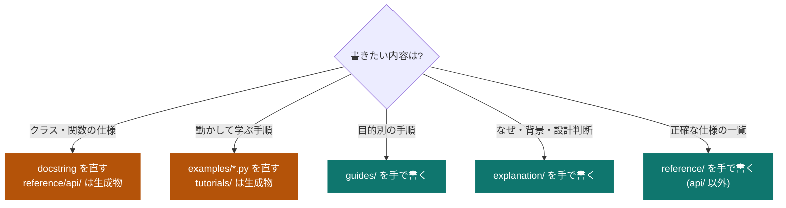
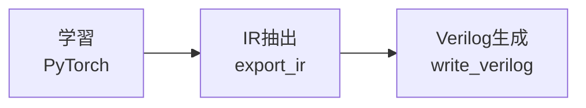
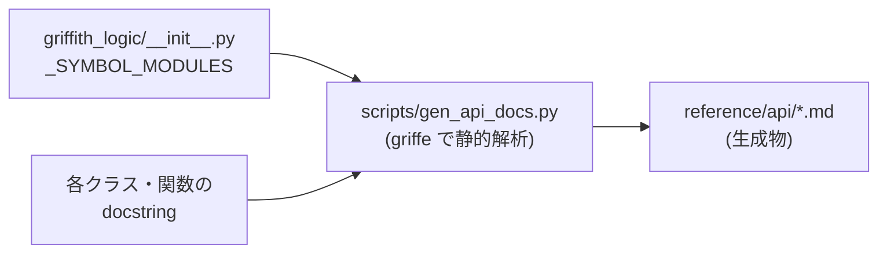
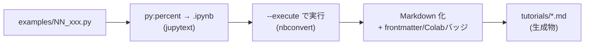

このページは **ページを書く人向けの実務マニュアル**である。
どこにファイルを置き、どう書き、どう検証してコミットするか ── その手順だけを扱う。

**「なぜその構成なのか」**(Diátaxis による分類、生成と手書きの切り分け、腐敗の機械検出、
将来の移行に備えた設計)は [ドキュメント管理の方針](/contributing/docs-management/) にある。
新しいページを **足す前に** そちらを読んでほしい。ここは方針が決まったあとの作業手順である。

---

## 1. まず「手で書いてよい場所か」を確かめる

書き始める前の分岐がこれである。**生成される領域を手で編集しても、次のビルドで消える。**



橙 = 生成物(手編集禁止)/ 緑 = 手書き。

| ディレクトリ | 手編集 | 真実源 |
|---|---|---|
| `src/content/docs/getting-started/` | ✓ | — |
| `src/content/docs/tutorials/` | **禁止** | `examples/*.py` |
| `src/content/docs/guides/` | ✓ | — |
| `src/content/docs/explanation/` | ✓ | — |
| `src/content/docs/reference/api/` | **禁止** | `griffith_logic/__init__.py` の docstring |
| `src/content/docs/reference/`(api 以外) | ✓ | — |
| `src/content/docs/contributing/` | ✓ | — |
| `src/content/docs/en/` | ✓ | 英語版。未翻訳ページは日本語へフォールバック |

---

## 2. 手書きページを 1 本足す

### ① ファイルを置く

**ディレクトリ = URL** である。`src/content/docs/guides/foo.md` は `/guides/foo/` になる。
拡張子は原則 `.md` を選ぶ。Starlight のコンポーネント(`<Tabs>` `<Card>` など)を
どうしても使うときだけ `.mdx` にする。

:::tip[素の Markdown に寄せる]
フレームワーク固有の記法で本文の構造を作ると、将来サイトを移行するときに全ページ書き直しになる。
コンポーネントは「無くても意味が通る」装飾に留める、が本プロジェクトの約束である。
:::

### ② frontmatter を書く

**`title` と `description` の 2 つだけ**に保つ。

```yaml
---
title: 'IRを扱う'
description: 'IR(JSON)の生成・検証・シミュレーション。IR が真実源である理由と扱い方。'
---
```

- `title` はサイドバーのラベルと揃える(自動生成ページ以外は `astro.config.mjs` 側が正)
- `description` は検索結果と OGP に出る 1 文。**ページの目的**を書く(体言止めでよい)
- 余計なキーを増やさない。移行コストは frontmatter の複雑さに比例する

### ③ サイドバーへ登録する

サイドバーは **`docs-site/astro.config.mjs` の `sidebar` が正**で、自動収集ではない
(`reference/api/` だけが `autogenerate`)。該当セクションの `items` に 1 行足す。

```js
{ label: 'IRを扱う', translations: { en: 'Working with IR' }, slug: 'guides/ir' },
```

- `slug` は `src/content/docs/` からの相対パス(拡張子なし)
- `translations.en` を書くと英語ロケールでラベルが英訳される
- **順序に意味を持たせる。** 読む順に並べる

### ④ ビルドで検証する

`npm run build` を通す。リンク切れ・frontmatter の不備・数式のエラーはここで捕まる
(→ 下の「6. ビルドして検証する」)。

---

## 3. 書式

### 見出し

`##` から始める(`#` は `title` が担う)。1 ページ 1 目的、目的が 2 つあるなら 2 ページに割る。

### 内部リンクは「サイト内絶対パス」

```markdown
[IRスキーマ](/reference/ir-schema/)      ← 正しい(末尾スラッシュも付ける)
[IRスキーマ](../reference/ir-schema)     ← 避ける
```

相対リンクはページ移動で静かに壊れ、検証にも掛かりにくい。
**サイト内絶対パス + 末尾スラッシュ**で統一する。

薄いリンクを置かない。「詳細は X を参照」だけでなく、**なぜそこを読むのか**の 1 行を添える。

### 注記(aside)

```markdown
:::note[任意の見出し]
補足。読み飛ばしても本筋は通る内容。
:::

:::tip[コツ]
知っていると得をすること。
:::

:::caution[注意]
間違えやすい。読者が実際にハマるポイント。
:::

:::danger[禁止]
やると壊れる。守らないと検証が意味を失う類の規律。
:::
```

見出しの `[...]` は省略でき、その場合は既定ラベル(Note / Tip …)になる。

### Mermaid 図

**` ```mermaid ` のコードフェンス**で書く。クライアント側でレンダリングされるので、
特別なプラグインの追加は要らない。

````markdown

````

書くときの実務的な注意。

| 注意点 | 理由 |
|---|---|
| **ノードラベルは必ず `["…"]` で囲む** | 日本語の括弧・記号でパースが壊れるのを防ぐ |
| **改行は `<br/>`** | ラベル内で `\n` は効かない |
| 色を付けるなら `classDef` | **橙 = 実数の世界、緑 = 論理の世界**の約束を守る |
| 図があるページでだけ mermaid が読み込まれる | 使わないページの表示は重くならない。気軽に使ってよい |

図は「変わらない概念」を描くために使う。**画面キャプチャは最後の手段**である
(UI は変わるが、概念は変わらない)。

### 数式(KaTeX)

`remark-math` + `rehype-katex` で **ビルド時に**レンダリングされる。

```markdown
インライン: $y = \sigma(Wx + b)$

ブロック:

$$
H_{\text{out}} = \left\lfloor \frac{H + 2p - k}{s} \right\rfloor + 1
$$
```

- **`$` を数式以外の意味で使わない**(金額やシェル変数はコードスパンに入れる)
- KaTeX が対応していないコマンドはビルドを落とす。凝った記法を使う前にビルドで確かめる

### コードブロック

言語を必ず指定する(Expressive Code がシンタックスハイライトする)。

````markdown
```bash
uv run pytest -q
```

```python
from griffith_logic.ir import validate
validate(ir, target='hdl')
```
````

コマンドは **`uv run` 形式**で書く。`.venv` を activate する例を載せない。

---

## 4. 生成系を触る

### API リファレンス — `_SYMBOL_MODULES` に足すだけ

`reference/api/` は `scripts/gen_api_docs.py` が **`griffith_logic/__init__.py` の
`_SYMBOL_MODULES`(遅延 import の dict)を AST で読んで**生成する。
つまり **API ドキュメントのために書く作業は無い。**



新しい公開シンボルを足すときの手順はこれだけ。

1. `_SYMBOL_MODULES` にエントリを 1 行足す(**dict 内のコメント行がカテゴリ区切り**になり、
   ページ分けとサイドバーの並び順が決まる)
2. 実装側の docstring を日本語で書く(**これがそのまま公開される文章**)
3. `npm run gen:api` で生成し、差分を確認する

```bash
cd docs-site
npm run gen:api      # 生成する
npm run check:api    # 生成せず差分だけ検査(CI と同じ)
```

`prebuild` で `gen:api` が自動的に走るので、「生成を忘れて古い API 表が出る」ことは起きない。
逆に **`check:api` が落ちたら、docs ではなく `_SYMBOL_MODULES` か docstring を直す。**

### チュートリアル — `examples/` に置けば変換される

`tutorials/` は `scripts/build_tutorials.py` が **`examples/*.py` を実際に実行して**生成する。
出力も図も、実行結果がそのまま埋め込まれる(だから載っている数値は必ず本物である)。



新しいチュートリアルを足す手順。

1. `examples/NN_名前.py` を書く。**CPU で 1 分以内**に完走することが設計目標
   (実行タイムアウトは 300 秒)
2. 冒頭の docstring と本文のコメントが、そのまま**教材の文章**になる。
   「何をしているか」ではなく「なぜそうするか」を書く
3. `scripts/build_tutorials.py` の `TUTORIALS` にエントリを足す
   (`slug` / `title` / `description` / `minutes` / `intro` / `source`)
4. `astro.config.mjs` のサイドバーへ `tutorials/<slug>` を追加する
5. 生成する

```bash
uv run --with jupytext --with nbconvert --with ipykernel \
    python scripts/build_tutorials.py --only <slug>   # 1本だけ
uv run ... python scripts/build_tutorials.py          # 全部
uv run ... python scripts/build_tutorials.py --check  # 実行せず対象一覧
```

:::caution[生成された .md を直さない]
文章を直したくなったら、直す先は **元の `examples/*.py` のコメント / docstring**、
または `build_tutorials.py` の `intro` である。生成先を直しても次回の実行で上書きされ、
真実源とのズレは誰にも気づかれないまま残る。
:::

---

## 5. 英語版(i18n)

- 日本語がルートロケール、英語が `/en/` サブロケール
- 英語版は `src/content/docs/en/` に**同じ相対パス**で置く
- **未翻訳ページは日本語へフォールバック**する(全ページを訳す義務はない)
- サイドバーのラベルは `astro.config.mjs` の `translations: { en: '…' }` で訳す

つまり、日本語ページを足しただけで英語サイトも壊れない。
英訳は「読者が多いページから順に」足していけばよい。

---

## 6. ビルドして検証する

```bash
cd docs-site
npm install          # 初回のみ
npm run dev          # http://localhost:4321 で確認(保存すると即反映)
npm run build        # 本番ビルド。これがグリーンになることが合格条件
npm run preview      # ビルド結果を確認
```

`npm run build` は次を**まとめて検証**する。コミット前に必ず 1 回通す。

| 検証 | 落ちる条件 |
|---|---|
| API 生成の追従(`prebuild`) | `_SYMBOL_MODULES` と生成物がずれている |
| **サイト内リンクの実在検証** | リンク先のページ・見出しアンカーが存在しない |
| frontmatter の妥当性 | `title` 欠落、不正なキー |
| KaTeX のレンダリング | 未対応の数式コマンド |
| 全文検索インデックス(Pagefind) | — |

:::danger[リンク切れはビルドを落とす]
`starlight-links-validator` がサイト内リンクを実在検証する。
**見出しアンカー(`/page/#見出し`)も検証対象**なので、見出しを書き換えたら
そこを指すリンクも直す必要がある。見出し文言をよく変えるページでは、
アンカーではなくページ単位でリンクするほうが安全である。
:::

---

## 7. コミット前チェックリスト

1. Diátaxis の 4 分類のどれか **1 つ**に決めたか(混ぜていないか)
2. 同じ事実を他のページに書いていないか(あるならリンクに置き換える)
3. **生成で埋まる内容ではないか**(なら docstring か `examples/` を直す)
4. **内部の実験 ID・タスク ID・未公開の数値が混ざっていないか**
   (リポジトリの `docs/` から持ち込むときに特に注意)
5. リンクはサイト内絶対パスか。リンク先は実在するか
6. `npm run build` がグリーンか

コミットは `docs:` 種別で。実装の変更と同じブランチに載せる
(→ [開発をはじめる](/contributing/))。

---

## 次に読む

- [ドキュメント管理の方針](/contributing/docs-management/) — 分類・生成戦略・腐敗検出・出口戦略の「なぜ」
- [開発をはじめる](/contributing/) — 環境構築・コミット規約・PR の流れ
