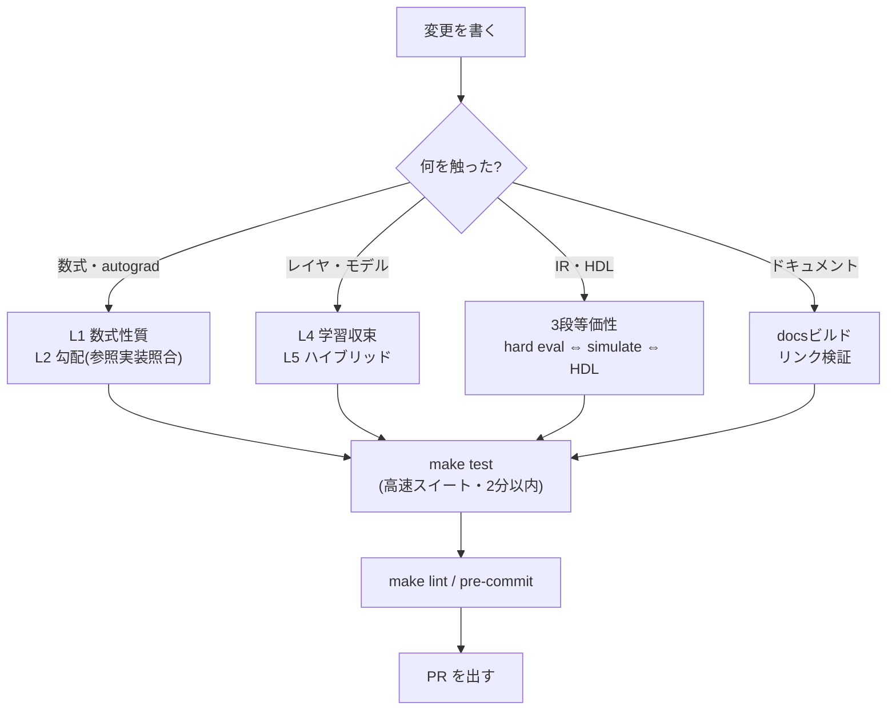
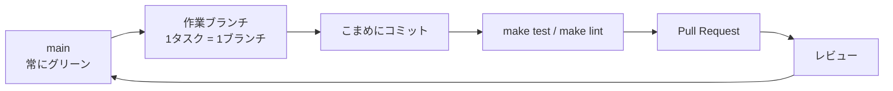

このページは **コードに手を入れる人向けの入口** である。環境を作り、変更を書き、
テストを通し、PR を出すまでの一本道を通す。

読む順番は、このページ → [テスト体系(L1〜L5)](/contributing/testing/) →
(ドキュメントも直すなら)[ドキュメントを書く](/contributing/docs/)。

:::note[ライセンスと DCO サインオフ]
<!-- TODO(human): ライセンス確定後に確認 -->
本プロジェクトは **Apache License 2.0** である(`LICENSE` / `NOTICE`)。コントリビューションも
同じ条件で提供されたものとして扱う。CLA の代わりに
[Developer Certificate of Origin](https://developercertificate.org/)(DCO)を採用しており、
**すべてのコミットにサインオフが必要**である(`git commit -s`)。
行動規範は `CODE_OF_CONDUCT.md`、脆弱性の報告は `SECURITY.md` の手順に従うこと。
:::

---

## 1. 全体像

変更の種類によって「どこまでのテストを通すか」が変わる。これが本プロジェクト特有の作法である。



高速スイート(`make test`)は **常時グリーンが必須**である。ここが赤いまま次の作業へ進まない。

---

## 2. 開発環境をつくる

パッケージ管理は [uv](https://docs.astral.sh/uv/) に統一している。

```bash
git clone https://github.com/tsukushi-gate/Griffith.git
cd Griffith
uv sync --extra dev --extra cpu    # Mac=MPS版 / Linux=軽量CPU版torch
```

extras は環境で使い分ける。

| 環境 | コマンド |
|---|---|
| Mac(MPS)/ Linux CPU | `uv sync --extra dev --extra cpu` |
| CUDA GPU 機 | `uv sync --extra dev --extra cu128` |

:::danger[`.venv` を直接 activate しない]
Python コマンドは **常に `uv run` を通す**(`uv run python …` / `uv run pytest …`)。
依存の追加も `uv pip install` ではなく **extras + `uv sync`** で行う。
`.venv/bin/python` を直に叩くと、ロックファイルと実際の環境が静かにずれる。
:::

動作確認。

```bash
make test        # 高速スイート。2分以内にグリーンになるのが基準
make lint        # ruff
```

インストール手順の詳細(前提ソフト・トラブルシュート)は
[インストール](/getting-started/installation/) を参照。

### pre-commit を入れる(初回のみ)

```bash
uvx pre-commit install
```

以後 `git commit` のたびに **ruff / mypy(core・encoding)/ 行末空白・改行 / 秘密鍵検出** が走る。
CI の `make lint` / `make type` と**同一の uv 環境**で実行されるため、
フックが通れば CI の静的解析も通る。全ファイルに手動で掛けるには
`uvx pre-commit run --all-files`。

---

## 3. 変更を書く

### コーディング規約

- **コメント・docstring は日本語**で書く。書くのは**数式・仕様の根拠**であって、実装の逐語説明ではない
- **変数名・関数名・クラス名は英語**
- 既存コードのスタイル(パラメータ化の命名、butterfly 基底のビット規約など)を踏襲する
- 型安全を優先する。`any` / `Any` に逃げず、マジックナンバーは定数へ切り出す

### 触る前に知っておく 3 つの不変条件

| 不変条件 | 理由 |
|---|---|
| **参照実装 `core/reference.py` を高速化目的で書き換えない** | 素朴に書かれていること自体が ground truth としての価値。速い実装はこれと照合して検証する |
| **テスト閾値・許容誤差・ゴールデンデータを実装に合わせて緩めない** | 較正は**実測ベース**でのみ行い、経緯を記録に残す。落ちた閾値を下げるのは検証を無効化するのと同じ |
| **IR が真実源** | シミュレータ・torch 復元・HDL 生成はすべて IR から派生する。片方だけ直すと 3 段等価性が崩れる |

### 公開 API を足すとき

公開シンボルは `griffith_logic/__init__.py` の `_SYMBOL_MODULES`(遅延 import)に追加する。
**ここが公開 API の真実源**で、[Python API リファレンス](/reference/api/core/)はここから自動生成される。
足し忘れると `npm run check:api` が CI で落ちる。

モジュールを移動したときは、**旧パスに再エクスポートのシムを残し**、
後方互換テストへ追記する。

### 新しい部品を足すとき

新しいレイヤ・autograd Function・モデルを足す場合は、**テストを先に書く 4 段手順**がある。
順序を守ることが要点なので、[テスト体系](/contributing/testing/) の「新しい部品を足すときの 4 段手順」を参照。

---

## 4. コミットする

コミットメッセージは **`種別: [タスクID] 日本語要約`** 形式。

| 種別 | 用途 |
|---|---|
| `feat` | 機能追加 |
| `fix` | バグ修正 |
| `test` | テスト |
| `docs` | ドキュメント |
| `exp` | 実験の結果回収・図・レポート |
| `refactor` | 挙動を変えない整理 |
| `chore` | 雑務(依存更新など) |

タスク ID は内部のロードマップ ID(`[A1-3]` など)。**紐づくタスクが無ければ省略してよい。**

```
feat: [A4-5] LutLayerのbutterfly基底切替
fix: IRのconcatビット順がVHDLだけ逆だったのを修正
docs: IRスキーマのノード種別表を追加
```

コミット前に **高速スイート + ruff がグリーン**であること。
実装とドキュメントの修正は**同じブランチに載せる**(「あとでまとめて直す」は必ず腐る)。

---

## 5. ブランチと PR

trunk-based を基本とする。



- **`main` へ直接コミットしない。** 小さなドキュメント修正もブランチに積む
- ブランチは短命に保つ。長生きするほど衝突が高くつく
- PR には **変更概要・検証結果(通したテスト)・関連するタスク ID** を書く
- 履歴破壊系の操作(`reset --hard` / `push --force` / ブランチの強制削除)は行わない

### カバレッジは ratchet(逆戻り防止)

カバレッジは高速スイートで計測する。

```bash
uv run pytest --cov=griffith_logic --cov-report=term
```

CI は `--cov-fail-under` で下限をゲートしており、**下限は常に「現在の基線 − 1 の整数」**に固定する
(基線 74.4% なら下限 73)。カバレッジが基線より上がったら下限も新基線 − 1 へ引き上げる。
**カバレッジを下げる PR は原則禁止**で、やむを得ない場合は理由を PR に明記して合意を取る。

:::tip[なぜ「基線 − 1」なのか]
下限を基線ちょうどにすると、無関係な行の増減で PR が理由なく落ちる。
1 ポイントの余白だけ許し、それ以上の後退は必ず止める ── 摩擦を最小にしたまま逆戻りを防ぐ設定である。
:::

---

## 6. 重い検証をどこで回すか

高速スイートに入らないテスト(GPU・論文再現・HDL シミュレーション)は、必要なときだけ回す。

| 対象 | コマンド | 前提 |
|---|---|---|
| GPU 依存テスト | `uv run modal run scripts/modal_app.py::pytest_cuda` | Modal アカウント |
| 論文再現 | `uv run modal run scripts/modal_app.py::pytest_cuda --marker paper` | 同上 |
| HDL 等価性(Verilog) | `uv run pytest -m hdl` | `iverilog` |
| HDL 等価性(VHDL) | `uv run pytest -m hdl_vhdl` | `ghdl` |

クラウド GPU の使い分けと投入手順は [クラウドGPU](/guides/cloud-gpu/) を参照。

---

## 次に読む

- [テスト体系(L1〜L5)](/contributing/testing/) — どの変更にどのテストを書くか
- [ドキュメントを書く](/contributing/docs/) — ページの追加・書式・ビルド検証
- [ドキュメント管理の方針](/contributing/docs-management/) — なぜその構成なのか
