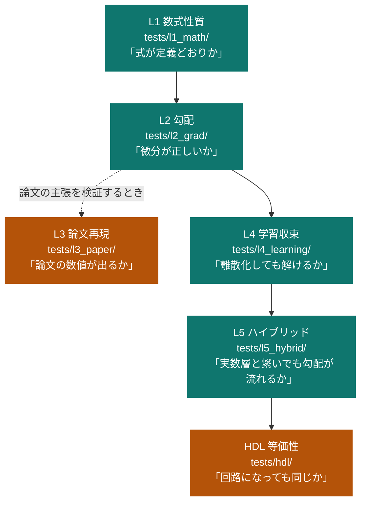
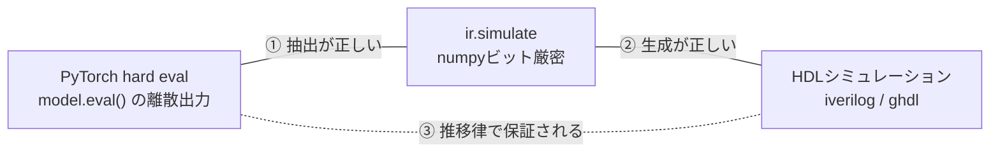
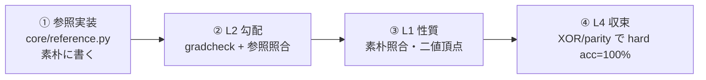

微分可能論理ゲート NN は **壊れても動いてしまう** 種類のソフトウェアである。
勾配の式を 1 項間違えても loss は下がり、真理値表のビット順を逆にしても accuracy は出る。
そのままエクスポートすると、**Verilog になって初めて間違いに気づく**。

この構造的な危うさに対して、本プロジェクトは
**「主張の強さ」ごとにテストを 5 層へ分ける**という方針を取っている。
下の層ほど速く・厳密で、上の層ほど遅く・総合的である。

---

## 1. 5 層の地図



緑 = 高速スイート(既定で毎回走る) / 橙 = 明示的にマーカー指定したときだけ走る。

| 層 | 場所 | 何を主張するか | 合格基準 | 既定実行 |
|---|---|---|---|---|
| **L1** | `tests/l1_math/` | 数学的性質(分割単位性・真理値表・二値頂点での Boolean 一致・離散化仕様) | 素朴ループとの float64 厳密照合 | ✓ |
| **L2** | `tests/l2_grad/` | 勾配の正しさ | `gradcheck` + 参照実装との照合 | ✓ |
| **L3** | `tests/l3_paper/` | 論文の再現 | **実測較正した**閾値 | `-m paper` |
| **L4** | `tests/l4_learning/` | 学習が収束する | **hard eval accuracy = 100%** | ✓ |
| **L5** | `tests/l5_hybrid/` | ハイブリッド統合(勾配フロー・置換 API) | 勾配が実数層まで到達する | ✓ |
| **HDL** | `tests/hdl/` | 生成した回路が同じ動作をする | 全パターンでビット一致 | `-m hdl` |

モデル級・統合テストの**新規**は `tests/integration/` へ置く。
`tests/` 直下のフラット配置は歴史的な据え置きなので、**移動しない**。

---

## 2. どの変更にどのテストを書くか

迷ったら次の表を引く。「上から順に、該当するものすべて」が答えである。

| 変更した対象 | 必須の層 | 具体的に書くもの |
|---|---|---|
| **カスタム autograd Function** | L2 + L1 | `core/reference.py` に参照実装 → float64 `gradcheck` → 参照照合 → 性質テスト |
| **数式・基底(butterfly など)** | L1 | 素朴ループとの厳密照合、全 $2^n$ 通り掃引 |
| **新しいレイヤ・部品** | L1 + L2 + L4 | → 下の「新しい部品を足すときの 4 段手順」 |
| **学習則(BP / AP / DFA / ES)** | L2 + L4 | 純 numpy 参照との解析照合 + 小課題の収束 |
| **ハイブリッド(実数層との接続・置換 API)** | L5 | 勾配が実数層まで流れることの確認 |
| **IR のスキーマ・シリアライズ** | 等価性 | `simulate` の出力が torch hard eval と一致 |
| **HDL 生成(Verilog / VHDL)** | HDL | **3 段等価性**(→ 下の「3 段等価性」) |
| **論文の主張・再現実験** | L3 | `@paper` マーカー。閾値は**実測してから**固定 |
| **公開 API の追加・移動** | 後方互換 | 旧パスのシムと、後方互換テストへの追記 |
| **CLI・エディタ** | 統合 | `tests/integration/` に API レベルの往復テスト |

---

## 3. 3 段等価性 — HDL の生命線

IR まわりで**唯一絶対に守る不変条件**がこれである。



**PyTorch hard eval ⇔ `ir.simulate` ⇔ HDL シミュレーション** の 3 者が、
全入力パターンでビット単位に一致すること。

- **① が破れる**なら、離散化(`export_ir`)か真理値表のビット規約が間違っている
- **② が破れる**なら、Verilog / VHDL 生成のビット順(連結の MSB / LSB)を疑う
- `simulate` を **golden model** と呼ぶのは、これが浮動小数の近似を一切含まない
  numpy の整数ビット演算だからである。「回路としてこう動くはず」の基準になる

IR まわりのコードを触ったら、この鎖のどこも切れていないことを必ず確かめる。
詳細は [HDLエクスポートと等価性検証](/guides/hdl-export/) を参照。

---

## 4. 新しい部品を足すときの 4 段手順

新しいレイヤ・autograd Function・モデルを追加するときは、
**テストを先に書く。順序に意味がある。**



### ① 参照実装(ground truth)を書く

`griffith_logic/core/reference.py` に、**論文の数式を素朴な torch 演算でそのまま書き下す**。
butterfly 分解もカスタム Function も CUDA カーネルも使わない。効率は不要、明瞭さが最優先。

:::danger[参照実装を高速化しない]
`core/reference.py` が素朴であること**自体**が価値である。速い実装は必ずこれと照合して検証される。
参照側を最適化した瞬間、「両方同じバグを持っている」ことを検出できなくなる。
:::

autograd を使わない部品(訓練器など)は、代わりにテスト内へ**純 numpy 参照**を書く。

### ② L2: `gradcheck` + 参照照合

`tests/l2_grad/` に float64 で `torch.autograd.gradcheck` を通し、
①の参照実装を autograd で微分した値と照合する。**境界点(x = 0.0 / 1.0)を必ず 1 ケース入れる。**

forward が不連続な STE 系(argmax・閾値)は `gradcheck` が原理的に使えない。
その場合は **契約テスト方式**に切り替える。

| | 検証内容 |
|---|---|
| forward 契約 | hard 出力を厳密照合 |
| backward 契約 | soft 参照の autograd 勾配と一致 |

### ③ L1: 数学的性質テスト

`tests/l1_math/` に、部品が満たすべき性質(分割単位性・二値頂点での Boolean 一致・
線形性・温度スケール)を**全数掃引または hypothesis** で検証する。
hypothesis のストラテジは共通定義(`tests/strategies.py`)を使う。

**参照実装の正しさはこの層だけが担保する。** 参照が壊れていれば、
分割単位性や二値頂点の性質が落ちて検出できる。

### ④ L4: 収束テスト

XOR / parity などの小課題で **hard(離散化後)accuracy = 100%** に到達することを確かめる。

```python
model.eval()
with torch.no_grad():
    acc = (model(x).argmax(-1) == y).float().mean().item()
assert acc == 1.0, f'XORが学習できない: hard acc={acc}'
```

**soft accuracy で判定しない。** 連続緩和のまま正解しているモデルは、
離散化した瞬間に壊れることがあり、それを見逃すためである。
収束が確率的なら **seed を固定して決定化**する(緩い閾値でごまかさない)。
実行時間は部品あたり数秒以内に収める。

4 段すべてがグリーンになるまで、部品は完成扱いにしない。

---

## 5. 許容誤差は 1 か所から引く

テストファイルに許容誤差を**数値リテラルで直書きしない**。
`tests/conftest.py` の定数を import して使う。

| 定数 | 値 | 用途 |
|---|---|---|
| `TOL_F64_EQ` | `1e-12` | float64 での forward 式一致 |
| `TOL_F64_GRAD` | `1e-10` | float64 での勾配一致(参照実装との照合) |
| `TOL_F32_EQ` | `1e-6` | float32 での式一致 |
| `GRADCHECK_KW` | `atol=1e-6, rtol=1e-3` | `torch.autograd.gradcheck` の標準設定 |

直書きすると「どのテストがどれくらい緩いのか」が誰にも分からなくなり、
気づかないうちに全体が緩む。**閾値は 1 か所に集めて初めて監視できる。**

---

## 6. 閾値を緩めない(絶対原則)

:::danger[グリーンにするための閾値調整は TDD の自殺]
テストが落ちたとき、**許容誤差や合格ラインを実装の実測値に合わせて緩めることを禁止する。**
まず実装のバグを疑い、根本原因を特定する。ゴールデンデータについても同様である。
:::

数式上の理由(条件数、和の桁落ちなど)で**本当に**閾値の再設定が必要な場合のみ、
次の実測較正手順を踏む。

1. **seed を変えて 10 回実行**し、対象メトリクスの**最悪値**を記録する
2. 最悪値に対して **10 倍以上の余裕**を持たせた値を新閾値とする(最悪誤差 3e-12 → 閾値 1e-10)
3. **較正の経緯(最悪値・採用閾値・数式上の理由)を記録に残す**
4. 閾値が `conftest.py` の共通定数より緩い場合は、テスト内にその理由を docstring で明記する
   (黙って共通定数を置き換えない)

`@paper` の閾値も同じで、**推測で決めず必ず実測してから固定**し、
較正履歴を docstring に残す。

同じ原則がカバレッジにも適用される(→ [開発をはじめる](/contributing/) の ratchet 運用)。
**検証の厳しさは上げる方向にのみ動かす。**

---

## 7. 実行コマンド

```bash
make test        # 高速スイート。常時グリーンが基準(2分以内)
make test-all    # slow を含む(hdl / cuda / paper は除外のまま)
make lint        # ruff
make type        # mypy(core・encoding のみ厳格化の段階導入)
make cov         # カバレッジ計測
make hdl         # HDL 等価性(要 iverilog / ghdl)
```

層を指定して回すこともできる。

```bash
uv run pytest tests/l2_grad/ -q         # L2 だけ
uv run pytest -m paper                  # 論文再現(Modal 推奨)
uv run pytest -m hdl                    # Verilog 等価性(要 iverilog)
uv run pytest -m hdl_vhdl               # VHDL 等価性(要 ghdl)
```

### マーカーと既定の絞り込み

`pyproject.toml` の既定 addopts が `slow` / `paper` / `hdl` / `hdl_vhdl` を除外しているため、
`uv run pytest` は何も指定しなくても高速スイートになる。

| マーカー | 意味 | CI |
|---|---|---|
| `slow` | 実行に時間がかかる | 除外 |
| `cuda` | CUDA GPU が必要(非対応環境では自動 skip) | 除外(Modal で実行) |
| `paper` | 論文再現(分単位。夜間 / Modal 実行) | 除外 |
| `hdl` | HDL シミュレータ(iverilog)が必要 | 除外 |
| `hdl_vhdl` | GHDL が必要 | 除外 |
| `learning` | 学習ループを回して収束 / 精度を主張する | **除外**(ローカル `make test` では実行) |

`learning` が CI から外れているのは、学習ループの実行時間が CI の予算に合わないためである。
**ローカルの `make test` では走る**ので、部品を変更したら手元で必ず確認すること。

### GPU が要るテスト

```bash
uv run modal run scripts/modal_app.py::pytest_cuda                    # @cuda テスト
uv run modal run scripts/modal_app.py::pytest_cuda --marker paper     # 論文再現
```

投入と監視の詳細は [クラウドGPU](/guides/cloud-gpu/) を参照。

---

## 次に読む

- [開発をはじめる](/contributing/) — 環境構築・コミット規約・PR の流れ
- [HDLエクスポートと等価性検証](/guides/hdl-export/) — 3 段等価性の実務手順
- [IRスキーマ](/reference/ir-schema/) — 等価性の基準となる IR の仕様
