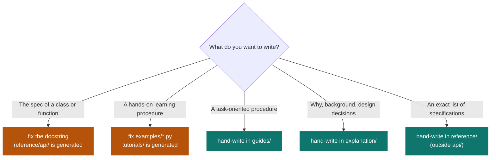
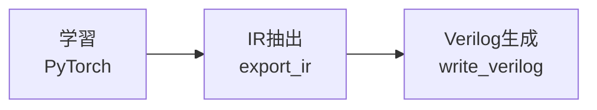
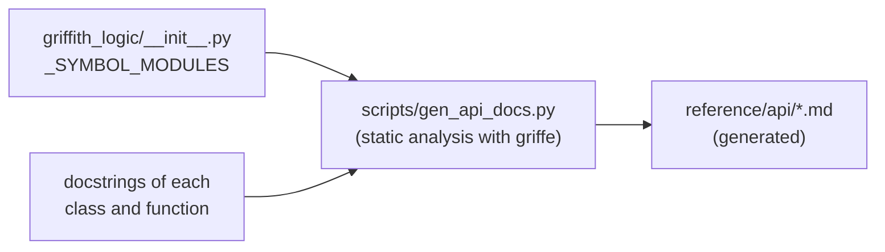
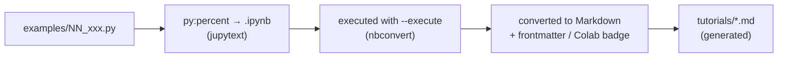

This page is the **practical manual for people writing pages**: where to put the file, how to write
it, and how to verify it before committing — nothing more.

**Why the structure is what it is** (the Diátaxis classification, the split between generated and
hand-written content, mechanical detection of rot, and designing for a future migration) is covered
in [Docs management policy](/en/contributing/docs-management/). Read that **before** adding a new
page. This page is the procedure once the policy question is settled.

---

## 1. First, check whether you're allowed to hand-write there

This is the fork in the road before you start. **Hand edits to generated areas disappear on the next
build.**



Orange = generated (do not edit by hand); green = hand-written.

| Directory | Hand editable | Source of truth |
|---|---|---|
| `src/content/docs/getting-started/` | ✓ | — |
| `src/content/docs/tutorials/` | **no** | `examples/*.py` |
| `src/content/docs/guides/` | ✓ | — |
| `src/content/docs/explanation/` | ✓ | — |
| `src/content/docs/reference/api/` | **no** | docstrings reached from `griffith_logic/__init__.py` |
| `src/content/docs/reference/` (outside api) | ✓ | — |
| `src/content/docs/contributing/` | ✓ | — |
| `src/content/docs/en/` | ✓ | The English version. Untranslated pages fall back to Japanese |

---

## 2. Adding one hand-written page

### ① Put the file somewhere

**Directory = URL.** `src/content/docs/guides/foo.md` becomes `/guides/foo/`. Prefer the `.md`
extension; use `.mdx` only when you really need Starlight components (`<Tabs>`, `<Card>` …).

:::tip[Stay close to plain Markdown]
If the structure of your prose is built out of framework-specific syntax, migrating the site later
means rewriting every page. The agreement in this project is that components stay decorative —
the page must still make sense without them.
:::

### ② Write the frontmatter

Keep it to **`title` and `description`, nothing else**.

```yaml
---
title: 'IRを扱う'
description: 'IR(JSON)の生成・検証・シミュレーション。IR が真実源である理由と扱い方。'
---
```

- Keep `title` in sync with the sidebar label (for anything but generated pages,
  `astro.config.mjs` is authoritative)
- `description` is the one sentence shown in search results and OGP. Write **the purpose of the
  page**
- Don't add extra keys. Migration cost is proportional to frontmatter complexity

### ③ Register it in the sidebar

The sidebar is **defined by `sidebar` in `docs-site/astro.config.mjs`**, not auto-collected (only
`reference/api/` uses `autogenerate`). Add one line to the `items` of the relevant section.

```js
{ label: 'IRを扱う', translations: { en: 'Working with IR' }, slug: 'guides/ir' },
```

- `slug` is the path relative to `src/content/docs/` (no extension)
- Adding `translations.en` gives the label an English translation in the English locale
- **Make the order mean something.** Arrange pages in reading order

### ④ Verify with a build

Get `npm run build` to pass. Broken links, malformed frontmatter and math errors are all caught
there (→ "6. Build and verify" below).

---

## 3. Formatting

### Headings

Start at `##` (`#` is covered by `title`). One purpose per page; if there are two purposes, split
into two pages.

### Internal links are site-absolute paths

```markdown
[IRスキーマ](/reference/ir-schema/)      ← correct (include the trailing slash)
[IRスキーマ](../reference/ir-schema)     ← avoid
```

Relative links break silently when pages move and are hard to catch in validation. Standardize on
**site-absolute paths with a trailing slash**.

Don't leave thin links. Instead of just "see X for details", add a line saying **why the reader
should go there**.

### Asides

```markdown
:::note[any heading]
An aside. The main thread still works if the reader skips it.
:::

:::tip[a trick]
Something worth knowing.
:::

:::caution[watch out]
Easy to get wrong. A place readers actually get stuck.
:::

:::danger[forbidden]
Doing this breaks things. Discipline that, if ignored, makes the verification meaningless.
:::
```

The `[...]` heading is optional; without it you get the default label (Note / Tip …).

### Mermaid diagrams

Write them in a **` ```mermaid ` code fence**. They are rendered client-side, so no extra plugin is
needed.

````markdown

````

Practical points when writing them.

| Point | Why |
|---|---|
| **Always wrap node labels in `["…"]`** | Prevents Japanese brackets and symbols from breaking the parser |
| **Use `<br/>` for line breaks** | `\n` does nothing inside a label |
| Use `classDef` if you add color | Keep to the convention: **orange = the real-valued world, green = the logic world** |
| mermaid is only loaded on pages that have a diagram | Pages that don't use it stay light. Use diagrams freely |

Use diagrams to draw **concepts that don't change**. **Screenshots are a last resort** (the UI
changes; the concept does not).

### Math (KaTeX)

Rendered **at build time** with `remark-math` + `rehype-katex`.

```markdown
Inline: $y = \sigma(Wx + b)$

Block:

$$
H_{\text{out}} = \left\lfloor \frac{H + 2p - k}{s} \right\rfloor + 1
$$
```

- **Never use `$` for anything but math** (put currency amounts and shell variables in code spans)
- Commands KaTeX does not support fail the build. Check with a build before reaching for exotic
  notation

### Code blocks

Always specify the language (Expressive Code does the syntax highlighting).

````markdown
```bash
uv run pytest -q
```

```python
from griffith_logic.ir import validate
validate(ir, target='hdl')
```
````

Write commands in **`uv run` form**. Never show an example that activates `.venv`.

---

## 4. Working with the generated sections

### API reference — just add it to `_SYMBOL_MODULES`

`reference/api/` is generated by `scripts/gen_api_docs.py`, which **reads `_SYMBOL_MODULES` (the
lazy-import dict) in `griffith_logic/__init__.py` via the AST**. In other words, **there is no
writing to do for the API docs.**



Adding a new public symbol takes only this.

1. Add one entry to `_SYMBOL_MODULES` (**comment lines inside the dict act as category
   separators**, determining the page split and the sidebar order)
2. Write the docstring in Japanese on the implementation side (**that text is published verbatim**)
3. Run `npm run gen:api` and review the diff

```bash
cd docs-site
npm run gen:api      # generate
npm run check:api    # only check the diff without generating (same as CI)
```

`gen:api` runs automatically in `prebuild`, so "I forgot to regenerate and the API table is stale"
cannot happen. Conversely, **when `check:api` fails, fix `_SYMBOL_MODULES` or the docstring, not
the docs.**

### Tutorials — put it in `examples/` and it gets converted

`tutorials/` is generated by `scripts/build_tutorials.py`, which **actually executes
`examples/*.py`**. Output and figures are embedded as produced (which is why every number on those
pages is real).



To add a new tutorial:

1. Write `examples/NN_name.py`. The design target is **finishing within one minute on CPU** (the
   execution timeout is 300 seconds)
2. The docstring at the top and the comments in the body become **the teaching text** verbatim.
   Write "why we do this", not "what this does"
3. Add an entry to `TUTORIALS` in `scripts/build_tutorials.py`
   (`slug` / `title` / `description` / `minutes` / `intro` / `source`)
4. Add `tutorials/<slug>` to the sidebar in `astro.config.mjs`
5. Generate

```bash
uv run --with jupytext --with nbconvert --with ipykernel \
    python scripts/build_tutorials.py --only <slug>   # just one
uv run ... python scripts/build_tutorials.py          # everything
uv run ... python scripts/build_tutorials.py --check  # list targets without executing
```

:::caution[Don't edit the generated .md]
When you want to change the prose, change **the comments / docstring in the original
`examples/*.py`**, or the `intro` in `build_tutorials.py`. Editing the generated file gets
overwritten on the next run, and the drift from the source of truth stays there unnoticed.
:::

---

## 5. The English version (i18n)

- Japanese is the root locale, English is the `/en/` sub-locale
- English pages go under `src/content/docs/en/` at **the same relative path**
- **Untranslated pages fall back to Japanese** (there is no obligation to translate everything)
- Sidebar labels are translated via `translations: { en: '…' }` in `astro.config.mjs`

So adding a Japanese page never breaks the English site. Translations can be added page by page,
starting with the ones most people read.

---

## 6. Build and verify

```bash
cd docs-site
npm install          # first time only
npm run dev          # check at http://localhost:4321 (updates on save)
npm run build        # production build. Passing this is the bar
npm run preview      # inspect the build output
```

`npm run build` **checks all of the following at once**. Always run it once before committing.

| Check | Fails when |
|---|---|
| API generation is up to date (`prebuild`) | `_SYMBOL_MODULES` and the generated files disagree |
| **Existence check on internal links** | The target page or heading anchor does not exist |
| Frontmatter validity | Missing `title`, invalid keys |
| KaTeX rendering | An unsupported math command |
| Full-text search index (Pagefind) | — |

:::danger[Broken links fail the build]
`starlight-links-validator` checks that internal links resolve. **Heading anchors
(`/page/#heading`) are checked too**, so if you rewrite a heading you must also fix the links
pointing at it. On pages whose headings change often, linking to the page rather than an anchor is
safer.
:::

---

## 7. Pre-commit checklist

1. Did you commit to **exactly one** of the four Diátaxis categories (no mixing)?
2. Is the same fact written on another page? (If so, replace it with a link)
3. **Is this something the generators would fill in?** (If so, fix the docstring or `examples/`)
4. **Did any internal experiment ID, task ID or unpublished number slip in?**
   (Be especially careful when bringing material over from the repository's `docs/`)
5. Are the links site-absolute paths, and do the targets exist?
6. Is `npm run build` green?

Commit with the `docs:` type, on the same branch as the implementation change
(→ [Get started](/en/contributing/)).

---

## Read next

- [Docs management policy](/en/contributing/docs-management/) — the "why" behind the classification, generation strategy, rot detection and exit strategy
- [Get started](/en/contributing/) — environment setup, commit conventions, the PR flow

<!-- i18n:source=contributing/docs.md hash=d729b8f2f0f6 -->
