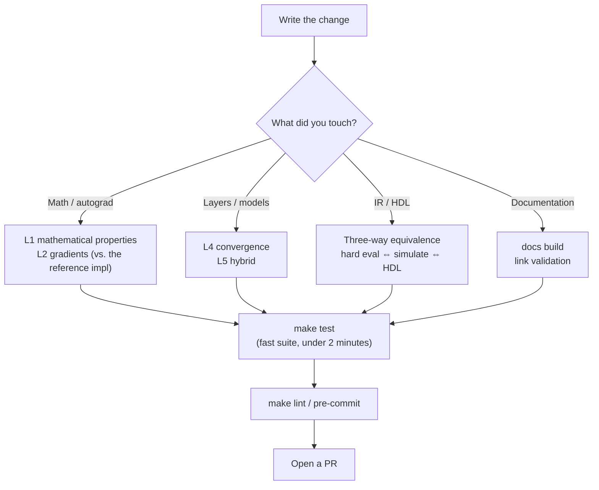
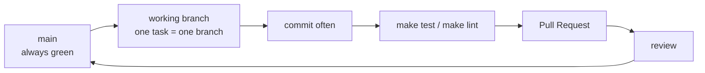

This page is the **entry point for people who touch the code**. It walks the straight line from
setting up an environment, writing a change and getting the tests green, to opening a PR.

Read this page first, then [Test layers (L1–L5)](/en/contributing/testing/), and — if you are also
touching the docs — [Writing docs](/en/contributing/docs/).

:::note[License and DCO sign-off]
<!-- TODO(human): ライセンス確定後に確認 -->
This project is licensed under the **Apache License 2.0** (see `LICENSE` and `NOTICE`), and
contributions are accepted under the same terms. Instead of a CLA we use the
[Developer Certificate of Origin](https://developercertificate.org/) (DCO), so **every commit must
be signed off** (`git commit -s`). See `CODE_OF_CONDUCT.md` for the code of conduct, and
`SECURITY.md` for reporting vulnerabilities.
:::

---

## 1. The big picture

How far you have to run the tests depends on what you changed. This is the practice specific to
this project.



The fast suite (`make test`) **must be green at all times**. Never move on to the next piece of work
while it is red.

---

## 2. Setting up

Dependency management is standardized on [uv](https://docs.astral.sh/uv/).

```bash
git clone https://github.com/tsukushi-gate/Griffith.git
cd Griffith
uv sync --extra dev --extra cpu    # Mac = MPS build / Linux = lightweight CPU torch
```

Pick extras to match your machine.

| Environment | Command |
|---|---|
| Mac (MPS) / Linux CPU | `uv sync --extra dev --extra cpu` |
| CUDA GPU machine | `uv sync --extra dev --extra cu128` |

:::danger[Never activate `.venv` directly]
Always run Python **through `uv run`** (`uv run python …` / `uv run pytest …`). Add dependencies
with **extras + `uv sync`**, not `uv pip install`. Invoking `.venv/bin/python` directly makes the
lockfile and the real environment drift apart, silently.
:::

Check that it works.

```bash
make test        # fast suite. The bar is: green within 2 minutes
make lint        # ruff
```

For details of the installation procedure (prerequisites, troubleshooting), see
[Installation](/en/getting-started/installation/).

### Install pre-commit (once)

```bash
uvx pre-commit install
```

From then on, every `git commit` runs **ruff / mypy (core and encoding) / trailing whitespace and
newline checks / secret detection**. They run in the **same uv environment** as `make lint` and
`make type` in CI, so if the hook passes, the static analysis in CI passes. To run them over every
file by hand: `uvx pre-commit run --all-files`.

---

## 3. Writing the change

### Coding conventions

- **Comments and docstrings are written in Japanese.** Write down the *reasoning* — the equations
  and the specification — not a line-by-line restatement of the implementation
- **Variable, function and class names are in English**
- Follow the style of the existing code (naming of parameterizations, the bit conventions of the
  butterfly basis, and so on)
- Prefer type safety. Don't escape into `any` / `Any`, and pull magic numbers out into constants

### Three invariants to know before you touch anything

| Invariant | Why |
|---|---|
| **Never rewrite the reference implementation `core/reference.py` for speed** | Being written naively is exactly what gives it value as ground truth. Fast implementations are validated by comparison against it |
| **Never loosen test thresholds, tolerances or golden data to match the implementation** | Calibration happens **only from measurements**, and the reasoning is recorded. Lowering a threshold that just failed is the same as disabling the check |
| **The IR is the source of truth** | The simulator, torch reconstruction and HDL generation all derive from the IR. Fixing only one of them breaks three-way equivalence |

### When you add a public API

Public symbols are added to `_SYMBOL_MODULES` (lazy imports) in
`griffith_logic/__init__.py`. **That is the source of truth for the public API**, and the
[Python API reference](/en/reference/api/core/) is generated from it. Forget to add it and
`npm run check:api` fails in CI.

When you move a module, **leave a re-export shim at the old path** and add a line to the backward
compatibility tests.

### When you add a new component

For a new layer, autograd Function or model there is a **four-step, test-first procedure**. The
order is the point, so see "The four steps for adding a new component" in
[Test layers](/en/contributing/testing/).

---

## 4. Committing

Commit messages take the form **`type: [task ID] summary in Japanese`**.

| Type | Used for |
|---|---|
| `feat` | New functionality |
| `fix` | Bug fixes |
| `test` | Tests |
| `docs` | Documentation |
| `exp` | Collecting experiment results, figures, reports |
| `refactor` | Reorganization with no behavior change |
| `chore` | Chores (dependency updates and so on) |

The task ID is an internal roadmap ID such as `[A1-3]`. **Omit it when there is no associated
task.**

```
feat: [A4-5] LutLayerのbutterfly基底切替
fix: IRのconcatビット順がVHDLだけ逆だったのを修正
docs: IRスキーマのノード種別表を追加
```

Before committing, the **fast suite and ruff must be green**. Put implementation changes and the
matching documentation changes **on the same branch** ("I'll fix the docs later, all at once" always
rots).

---

## 5. Branches and PRs

We work trunk-based.



- **Never commit directly to `main`.** Even a small docs fix goes on a branch
- Keep branches short-lived. The longer they live, the more expensive conflicts get
- A PR states **what changed, how it was verified (which tests were run) and the related task ID**
- Do not perform history-destroying operations (`reset --hard`, `push --force`, force-deleting
  branches)

### Coverage is a ratchet (no going backwards)

Coverage is measured on the fast suite.

```bash
uv run pytest --cov=griffith_logic --cov-report=term
```

CI gates it with `--cov-fail-under`, and **the floor is always "the current baseline − 1, as an
integer"** (baseline 74.4% → floor 73). When coverage rises above the baseline, the floor is raised
to the new baseline − 1 as well. **A PR that lowers coverage is disallowed as a rule**; where it is
unavoidable, state the reason in the PR and get agreement.

:::tip[Why "baseline − 1"?]
Setting the floor exactly at the baseline makes PRs fail for no reason as unrelated lines come and
go. Allowing exactly one point of slack, and stopping anything worse, keeps friction minimal while
still preventing regression.
:::

---

## 6. Where to run the heavy checks

Tests that are not part of the fast suite (GPU, paper reproduction, HDL simulation) are run only
when needed.

| Target | Command | Prerequisite |
|---|---|---|
| GPU-dependent tests | `uv run modal run scripts/modal_app.py::pytest_cuda` | A Modal account |
| Paper reproduction | `uv run modal run scripts/modal_app.py::pytest_cuda --marker paper` | Same |
| HDL equivalence (Verilog) | `uv run pytest -m hdl` | `iverilog` |
| HDL equivalence (VHDL) | `uv run pytest -m hdl_vhdl` | `ghdl` |

For how to choose between cloud GPUs and how to submit jobs, see
[Cloud GPU](/en/guides/cloud-gpu/).

---

## Read next

- [Test layers (L1–L5)](/en/contributing/testing/) — which tests to write for which change
- [Writing docs](/en/contributing/docs/) — adding pages, formatting, build checks
- [Docs management policy](/en/contributing/docs-management/) — why the structure is what it is

<!-- i18n:source=contributing/index.md hash=b5d1e1877bf0 -->
