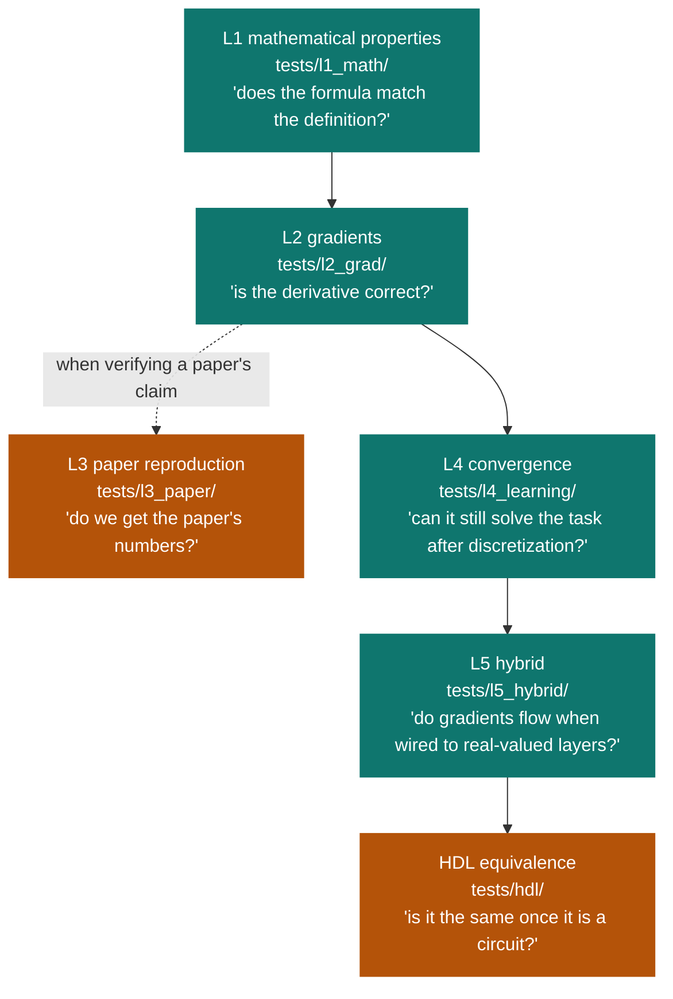
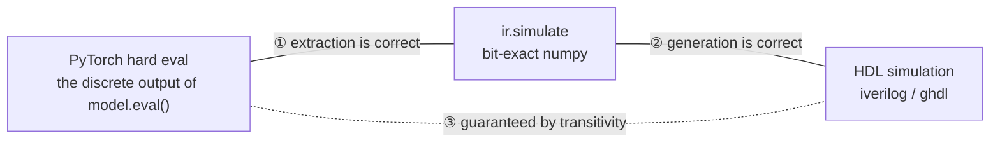
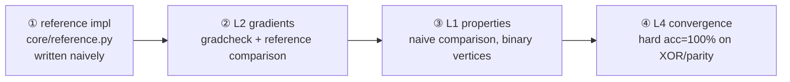

A differentiable logic-gate NN is the kind of software that **keeps working even when it is
broken**. Get one term of the gradient wrong and the loss still goes down; reverse the bit order of
a truth table and the accuracy still looks fine. Export that, and **you find out only once it is
Verilog**.

Against that structural fragility, this project splits its tests into **five layers by the strength
of the claim each one makes**. The lower layers are faster and stricter; the upper ones slower and
more holistic.

---

## 1. Map of the five layers



Green = the fast suite (runs every time by default); orange = runs only when the marker is given
explicitly.

| Layer | Location | What it asserts | Passing criterion | Runs by default |
|---|---|---|---|---|
| **L1** | `tests/l1_math/` | Mathematical properties (partition of unity, truth tables, Boolean agreement at binary vertices, the discretization spec) | Exact float64 agreement with a naive loop | ✓ |
| **L2** | `tests/l2_grad/` | Correctness of gradients | `gradcheck` + comparison against the reference implementation | ✓ |
| **L3** | `tests/l3_paper/` | Reproduction of a paper | Thresholds **calibrated from measurements** | `-m paper` |
| **L4** | `tests/l4_learning/` | That training converges | **hard eval accuracy = 100%** | ✓ |
| **L5** | `tests/l5_hybrid/` | Hybrid integration (gradient flow, the replacement API) | Gradients reach the real-valued layers | ✓ |
| **HDL** | `tests/hdl/` | That the generated circuit behaves identically | Bit-exact agreement on every pattern | `-m hdl` |

**New** model-level and integration tests go into `tests/integration/`. The flat layout directly
under `tests/` is a historical leftover — **do not move it**.

---

## 2. Which tests to write for which change

When in doubt, consult this table. The answer is "everything that applies, from the top down".

| What you changed | Required layers | What to actually write |
|---|---|---|
| **A custom autograd Function** | L2 + L1 | A reference implementation in `core/reference.py` → float64 `gradcheck` → comparison against the reference → property tests |
| **A formula or basis (butterfly etc.)** | L1 | Exact comparison with a naive loop, sweeping all $2^n$ cases |
| **A new layer or component** | L1 + L2 + L4 | → see "The four steps for adding a new component" below |
| **A learning rule (BP / AP / DFA / ES)** | L2 + L4 | Analytic comparison against a pure numpy reference + convergence on a small task |
| **Hybrid work (wiring to real-valued layers, the replacement API)** | L5 | Confirm gradients flow all the way to the real-valued layers |
| **The IR schema or serialization** | Equivalence | `simulate` output matches torch hard eval |
| **HDL generation (Verilog / VHDL)** | HDL | **Three-way equivalence** (→ see "Three-way equivalence" below) |
| **A claim from a paper, or a reproduction experiment** | L3 | The `@paper` marker. Fix the threshold **only after measuring it** |
| **Adding or moving a public API** | Backward compatibility | A shim at the old path, plus a line in the backward compatibility tests |
| **CLI or editor** | Integration | An API-level round-trip test in `tests/integration/` |

---

## 3. Three-way equivalence — the lifeline of HDL

This is **the one invariant around the IR that is absolute**.



**PyTorch hard eval ⇔ `ir.simulate` ⇔ HDL simulation** must agree bit for bit on every input
pattern.

- **If ① breaks**, the discretization (`export_ir`) or the truth-table bit convention is wrong
- **If ② breaks**, suspect the bit order (MSB / LSB in concatenation) of Verilog / VHDL generation
- `simulate` is called the **golden model** because it contains no floating-point approximation
  whatsoever — it is integer bit arithmetic in numpy. It is the standard for "how this should behave
  as a circuit"

Whenever you touch code around the IR, make sure no link in that chain is broken. For details, see
[HDL export and equivalence checking](/en/guides/hdl-export/).

---

## 4. The four steps for adding a new component

When adding a new layer, autograd Function or model, **write the tests first. The order matters.**



### ① Write the reference implementation (ground truth)

In `griffith_logic/core/reference.py`, **write the equations from the paper down directly as
naive torch operations**. No butterfly decomposition, no custom Function, no CUDA kernel.
Efficiency is irrelevant; clarity comes first.

:::danger[Do not optimize the reference implementation]
That `core/reference.py` is naive **is itself** the value. Fast implementations are always validated
against it. The moment you optimize the reference side, you lose the ability to detect "both have
the same bug".
:::

For components that do not use autograd (trainers and the like), write a **pure numpy reference**
inside the test instead.

### ② L2: `gradcheck` + reference comparison

In `tests/l2_grad/`, run `torch.autograd.gradcheck` in float64 and compare against the gradient
obtained by differentiating the reference implementation from ① with autograd. **Always include at
least one case at a boundary point (x = 0.0 / 1.0).**

STE-style components with a discontinuous forward (argmax, thresholds) cannot use `gradcheck` in
principle. In that case, switch to a **contract test**.

| | What is checked |
|---|---|
| Forward contract | Exact comparison of the hard output |
| Backward contract | Agreement with the autograd gradient of the soft reference |

### ③ L1: mathematical property tests

In `tests/l1_math/`, verify the properties the component must satisfy (partition of unity, Boolean
agreement at binary vertices, linearity, temperature scaling) by **exhaustive sweep or hypothesis**.
Use the shared hypothesis strategies (`tests/strategies.py`).

**This is the only layer that guarantees the reference implementation is correct.** If the reference
is broken, partition of unity or the binary-vertex property fails, and that is how you find out.

### ④ L4: convergence tests

Confirm that small tasks such as XOR / parity reach **accuracy = 100% in hard (post-discretization)
mode**.

```python
model.eval()
with torch.no_grad():
    acc = (model(x).argmax(-1) == y).float().mean().item()
assert acc == 1.0, f'XORが学習できない: hard acc={acc}'
```

**Do not judge on soft accuracy.** A model that only gets the answers right under the continuous
relaxation can break the instant it is discretized, and soft accuracy hides that. If convergence is
stochastic, **pin the seed to make it deterministic** (do not paper over it with a loose threshold).
Keep the runtime within a few seconds per component.

A component is not considered finished until all four steps are green.

---

## 5. Tolerances come from one place

**Never hard-code a tolerance as a numeric literal** in a test file. Import the constants from
`tests/conftest.py`.

| Constant | Value | Used for |
|---|---|---|
| `TOL_F64_EQ` | `1e-12` | Forward agreement in float64 |
| `TOL_F64_GRAD` | `1e-10` | Gradient agreement in float64 (against the reference implementation) |
| `TOL_F32_EQ` | `1e-6` | Agreement in float32 |
| `GRADCHECK_KW` | `atol=1e-6, rtol=1e-3` | Standard settings for `torch.autograd.gradcheck` |

Hard-coding them means nobody can tell which test is how lax, and the whole suite loosens without
anyone noticing. **Thresholds can only be monitored once they live in one place.**

---

## 6. Never loosen a threshold (absolute rule)

:::danger[Adjusting thresholds to get green is suicide for TDD]
When a test fails, **loosening a tolerance or a passing line to match what the implementation
happens to produce is forbidden.** Suspect a bug in the implementation first and find the root
cause. The same applies to golden data.
:::

Only when a threshold **genuinely** has to be reset for mathematical reasons (conditioning,
cancellation in a sum, and so on) do you go through this measurement-based calibration procedure.

1. **Run 10 times with different seeds** and record the **worst** value of the metric in question
2. Take a value with **at least 10× headroom** over that worst case as the new threshold (worst
   error 3e-12 → threshold 1e-10)
3. **Record the calibration** (worst value, chosen threshold, mathematical justification)
4. If the threshold is looser than the shared constant in `conftest.py`, state the reason in a
   docstring inside the test (do not silently replace the shared constant)

The same holds for `@paper` thresholds: **never guess, always measure before fixing them**, and keep
the calibration history in the docstring.

The same principle applies to coverage (→ the ratchet policy in
[Get started](/en/contributing/)). **Verification strictness only ever moves upwards.**

---

## 7. Commands

```bash
make test        # fast suite. The bar is: always green (under 2 minutes)
make test-all    # includes slow (hdl / cuda / paper stay excluded)
make lint        # ruff
make type        # mypy (strictness is being introduced gradually, core and encoding first)
make cov         # coverage measurement
make hdl         # HDL equivalence (needs iverilog / ghdl)
```

You can also run a single layer.

```bash
uv run pytest tests/l2_grad/ -q         # L2 only
uv run pytest -m paper                  # paper reproduction (Modal recommended)
uv run pytest -m hdl                    # Verilog equivalence (needs iverilog)
uv run pytest -m hdl_vhdl               # VHDL equivalence (needs ghdl)
```

### Markers and the default filter

The default addopts in `pyproject.toml` exclude `slow` / `paper` / `hdl` / `hdl_vhdl`, so plain
`uv run pytest` gives you the fast suite without any arguments.

| Marker | Meaning | CI |
|---|---|---|
| `slow` | Takes a long time to run | excluded |
| `cuda` | Requires a CUDA GPU (auto-skipped where unavailable) | excluded (run on Modal) |
| `paper` | Paper reproduction (minutes; run nightly / on Modal) | excluded |
| `hdl` | Requires an HDL simulator (iverilog) | excluded |
| `hdl_vhdl` | Requires GHDL | excluded |
| `learning` | Runs a training loop to assert convergence / accuracy | **excluded** (does run in a local `make test`) |

`learning` is kept out of CI because the runtime of a training loop does not fit the CI budget.
**It does run in a local `make test`**, so always check it on your machine after changing a
component.

### Tests that need a GPU

```bash
uv run modal run scripts/modal_app.py::pytest_cuda                    # @cuda tests
uv run modal run scripts/modal_app.py::pytest_cuda --marker paper     # paper reproduction
```

For submission and monitoring details, see [Cloud GPU](/en/guides/cloud-gpu/).

---

## Read next

- [Get started](/en/contributing/) — environment setup, commit conventions, the PR flow
- [HDL export and equivalence checking](/en/guides/hdl-export/) — three-way equivalence in practice
- [IR schema](/en/reference/ir-schema/) — the specification of the IR that equivalence is measured against

<!-- i18n:source=contributing/testing.md hash=c834cbd4da74 -->
