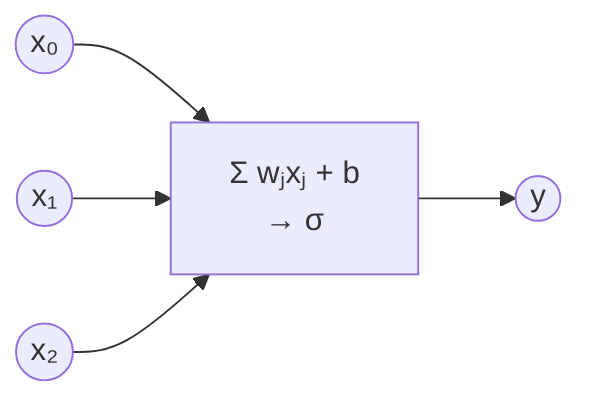

This page explains how a neural network (NN) works, by the shortest route, for readers who have
**never done machine learning**. The goal is to make one point stick: **an NN is computation in the
world of real numbers**. Once that lands, it becomes obvious what
[a DLGN (differentiable logic gate NN)](/en/explanation/dlgn/) tore down and what it rebuilt.

If you already know NNs, skip this page and go straight to
[What is a DLGN](/en/explanation/dlgn/).

## 1. The perceptron — the smallest part

The smallest part of an NN is a **neuron** (a perceptron). What it does is startlingly simple:
multiply the inputs by numbers and add them up.

$$
y = \sigma\!\left( \sum_{j} w_j x_j + b \right)
$$

- $x_j$ … the inputs (say, pixel brightnesses in an image)
- $w_j$ … the **weights** — how much that input counts
- $b$ … the bias, a global offset
- $\sigma$ … the activation, which bends the output nonlinearly (without it, any number of layers
  still collapses into a straight line)

Multiply and accumulate — that is, a **MAC (multiply-accumulate)**. GPUs are good at NNs because
they can run billions of MACs in parallel. Put the other way round: **an NN demands a GPU precisely
because multiplication is what it really is**.

Line neurons up side by side and you get a "layer"; stack layers and you get a deep neural network.

## 2. "Learning" means nudging the weights

The structure — which neuron connects to what — is chosen by a human. **All that learning
determines is the weights $w$.**

Learning is nothing more than repeating three steps.

1. **Predict** — push the input through and get an output $y$ (forward)
2. **Measure how wrong you were** — collapse the gap from the target into a single number, the
   **loss**
3. **Nudge the weights in the direction that shrinks the loss** — and repeat this millions of times

For a cat-vs-dog classifier, learning is literally this: feed in a cat image, shift every weight a
hair so the cat score goes up, and keep doing it for as much data as you have.

## 3. Gradient descent — differentiation decides which way to move

The hard part is step 3: which way, and how far? There are millions of weights, so guessing
(searching every combination) is out of the question.

This is where **differentiation** earns its keep. Differentiating the loss $L$ with respect to a
weight $w$ gives $\partial L / \partial w$: how much the loss rises if you nudge $w$ up a little.
That is the **gradient**. Once you have it, you just walk the other way.

$$
w \leftarrow w - \eta \, \frac{\partial L}{\partial w}
$$

$\eta$ is the learning rate (the step size). This is **gradient descent**, and nearly all of deep
learning is that one line, repeated.

Picture descending a mountain in fog with nothing but the slope under your feet. You have no map,
but **as long as you can feel the slope** you can get down. And even in a weight space of millions
of dimensions, all those slopes are computed at once by **backpropagation**, at roughly the cost of
a single forward pass.

## 4. Why differentiability is an absolute requirement

This is the most important paragraph on the site.

For gradient descent to work at all, **the loss has to vary smoothly with the weights**. You need
that continuous feedback: I moved $w$ by 0.001 and the loss fell by 0.0004.

Now suppose the output were **discrete**, 0 or 1. Nudge $w$ and the output stays at 0, stays at 0 —
then jumps to 1 the instant you cross some threshold. The slope is **zero almost everywhere and
infinite at a single point**, so it tells you nothing about which way to move. This is the
fundamental constraint of deep learning: discrete things cannot be learned by gradients.

:::note[The thing to remember]
**Learnable = differentiable.** And to be differentiable, values have to move continuously — as
real numbers.
:::

## 5. So an NN lives in the world of real numbers

Putting all of that together, an NN looks like this.

| | What it is | What follows |
|---|---|---|
| Unit of computation | real-valued multiply and add (MAC) | you need multipliers → you need a GPU / DSP |
| What gets learned | a real-valued weight matrix | it's differentiable, so gradient descent works |
| Shape at inference | the same real arithmetic as at training | it burns power and memory bandwidth |

Even at inference — in production, after training is over — an NN keeps multiplying real numbers.
That is why, on a phone or in a datacenter alike, most of the power goes to multiplication and
memory traffic. Quantization (going to 8 bits, say) makes each multiply cheaper, but
**the multiplication itself never goes away**.

## 6. Where this leads — building an NN out of logic gates

From a hardware point of view, all this is rather odd. What digital circuits are best at is not
multiplication but **logic: AND, OR, XOR**. An FPGA is tens of thousands to millions of LUTs
(lookup tables) — little boxes each realizing one arbitrary logic function — while multipliers are a
scarce resource present only in small numbers.

That mismatch raises the question this project starts from.

> **Could a neuron be a logic gate itself, instead of a multiply-accumulate?**

If it could, inference would become multiplication-free bitwise ops that burn straight onto an
FPGA. But as §4 showed, picking a logic gate is a discrete choice, and no gradient flows through it
— so it can't be learned.

A DLGN resolves that contradiction with **two phases: continuous relaxation (soft) and
discretization (hard)**. Continue at
[What is a DLGN, and how does it differ from an NN?](/en/explanation/dlgn/).

{/* i18n:source=explanation/ai-basics.mdx hash=30fe9f3aec66 */}
