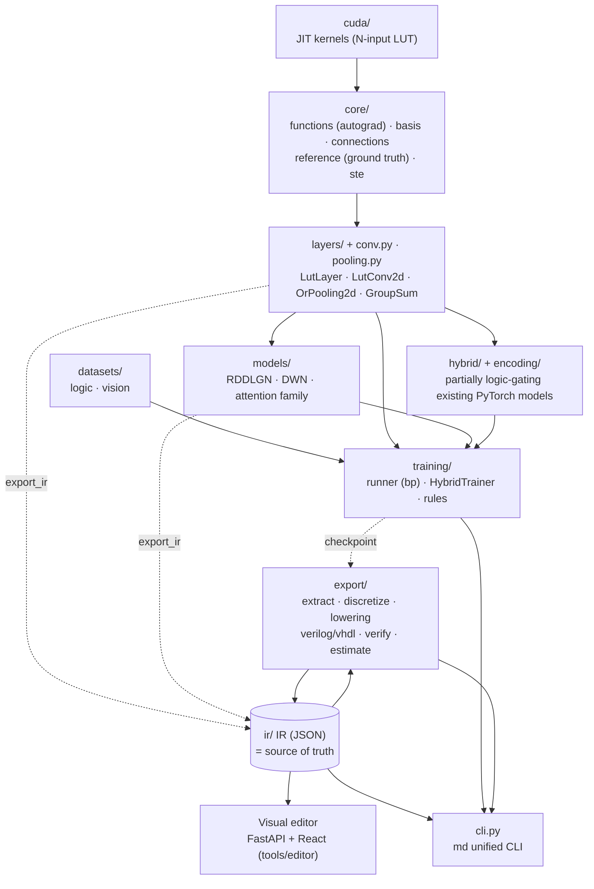
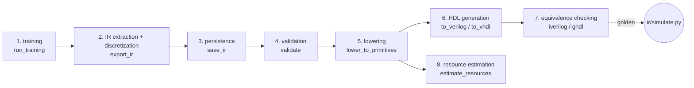

griffith-logic is a framework that **trains differentiable logic-gate NNs in PyTorch, extracts the
result into an IR (JSON), generates Verilog/VHDL from it, and verifies equivalence in an HDL
simulator**. Training uses continuous relaxation so gradients flow; inference collapses the model
into a pure Boolean circuit via argmax discretization
(→ [What is a DLGN](/en/explanation/dlgn/)).

This page explains **why the structure is what it is, and how data moves through it**.

## The big picture — the IR is the source of truth

The core design places the **IR (intermediate representation)** at the center, keeping the upstream
(training) and the downstream (export / editor / code generation) loosely coupled. Swap out the
training framework and everything below the IR is unchanged; add an HDL target and the training
side is unchanged.



- `core/` is the mathematical heart: pure functions and autograd definitions only, no `nn.Module`.
  The custom autograd (`LutFunction` and friends) is what makes training fast and memory-efficient.
- `cuda/` is a leaf module. On machines without CUDA it falls back to the Python implementation
  automatically (**CUDA is not required** — CPU and MPS work fine).
- `layers/` composes `core` into `nn.Module` building blocks, and `models/` stacks those.
- `ir/` belongs neither to the training side (torch) nor to the downstream side (HDL / editor) —
  it is the **shared contract**. `export/`, the editor, and the CLI all read the same IR.

## Dataflow — the 8 stages from training to HDL equivalence checking

The main path from a trained model down to HDL has eight stages. Each is an independent pure
function or module you can call on its own.

### The main path at a glance



### What each stage takes and returns

The table below covers, for each of the eight stages, what it receives, what it returns, and the
implementation details that matter.

| Stage | Input → Output | Key points |
|---|---|---|
| **1. Training** | `TrainConfig` → checkpoint + metrics | The shared runner covers `bp` only; ap/dfa/eggroll go through `HybridTrainer`. Loss/accuracy during training are soft; evaluation is the discretized **hard eval** |
| **2. IR extraction + discretization** | `nn.Module` → `IRGraph` | A registry maps each layer to an IR node. Discretization means "push all 2^N patterns through an already-`eval()`ed probe and read off the truth table". The point is to **never duplicate the per-parameterization discretization rules downstream** |
| **3. Persistence** | `IRGraph` ⇔ JSON | Truth tables are hex-encoded (at N=6 they are 64-bit and exceed JS safe integers). Large arrays are externalized into an npz sidecar |
| **4. Validation** | `IRGraph` → list of warnings | `target='hdl'` rejects configurations that cannot be turned into HDL. Checks widths, slots, and DAG cycles |
| **5. Lowering** | `IRGraph` → `IRGraph` | A pure function. Expands native `conv2d` / `or_pool2d` nodes into sequences of `lut_layer`. Padding is handled by "specializing the truth table", with no constant nets |
| **6. HDL generation** | `IRGraph` → HDL string | Verilog-2001 / VHDL-2008. IRs containing `conv2d` are rejected, so stage 5 must run first |
| **7. Equivalence checking** | `IRGraph` + input vectors → pass/fail | Internally lowers, runs `simulate` (the golden reference), generates a self-checking testbench, and compares with `iverilog` / `ghdl` |
| **8. Resource estimation** | `IRGraph` → LUT count, logic depth, net count | Measure after lowering when conv/pool are involved. A first-order, synthesizer-independent estimate |

### Entry points from the CLI

The unified CLI provides entry points into this path (`griffith train` = stage 1, `griffith export-hdl` =
stages 4→6). For how to actually run it, see
[HDL export and equivalence checking](/en/guides/hdl-export/).

## The three axes of training

Even with the same goal — learning an N-input LUT — the prior work (difflogic / BinaryBrain / DWN /
LDDLGN / WARP / CAGE) differs in how it relaxes and how it trains. To fold all of it into a single
`LutLayer`, the library exposes **three orthogonal axes**. Separating them lets you isolate the
trade-offs between discretization gap, training stability, and hardware deployability
experimentally.

| Axis | Options | What it decides |
|---|---|---|
| **Parameterization** | `softmax` / `independent` / `iwp` / `raw` / `warp` | In which continuous space the truth table lives, and how it is relaxed |
| **Selection** | `soft` / `hard_st` | Whether training passes a softmax mixture, or argmax forward + STE backward |
| **Learning rule** | `bp` / `ap` / `dfa` / `eggroll` | How gradients are produced. Everything but BP can be mixed per layer |

Parameterization and selection are `LutLayer` arguments; learning rules are attached to layers with
`with_learning` + `HybridTrainer`. Definitions of each term are in the
[glossary](/en/explanation/glossary/).

## Design principles

The structure of this framework follows from four principles.

### The IR is the source of truth

After training, the meaning of a model is frozen into the IR.
`export/`, the editor, and code generation look at nothing else. This is the central design that
keeps the training framework and the output target orthogonal, so a change on one side never
propagates to the other. IR nodes are **per layer**, not per gate (the gate view is derived from
the `indices` wiring and `truth_tables`).

### The reference implementation is ground truth

`core/reference.py` is a naive, pure-autograd
implementation, and it guarantees mathematically that the optimized versions (custom autograd,
CUDA kernels) are correct, via float64 gradcheck and agreement to 1e-10. **The reference is never
rewritten for speed** — its naivety is exactly what makes it valuable for verification.

### Three-way equivalence

The same circuit must agree along three paths.

```
PyTorch hard eval  ⇔  ir/simulate.py (numpy golden)  ⇔  HDL simulation
```

Stage 2's discretization (torch eval) and stage 7's comparison (simulate vs. HDL) close this
chain.

### Minimizing the discretization gap

Narrowing the performance difference between the
continuous relaxation used in training and the Boolean circuit used at inference *is* the quality
metric. The choice of parameterization and selection is what moves it.

## What to read next

- [What is a DLGN](/en/explanation/dlgn/) — the soft/hard phases, and why it goes straight to FPGA
- [LutLayer internals](/en/explanation/lut-layer/) — deriving forward/backward
- [HDL export and equivalence checking](/en/guides/hdl-export/) — running the downstream half of the 8 stages
- [Glossary](/en/explanation/glossary/)

<!-- i18n:source=explanation/architecture.md hash=9b8f7f08f60f -->
