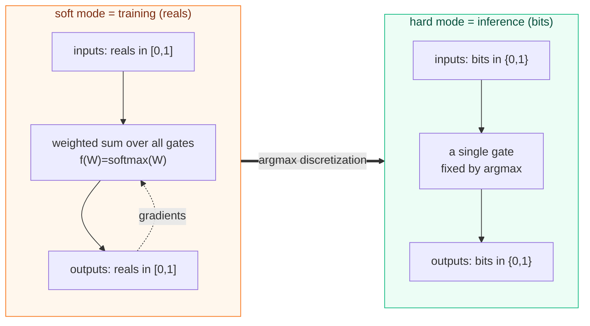
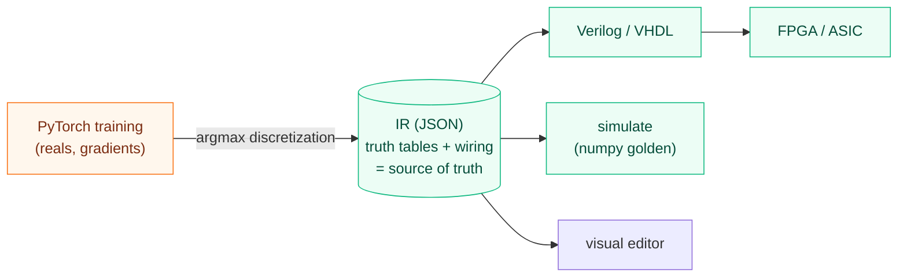

A **DLGN (Deep Differentiable Logic Gate Network)** replaces the computational unit of a neural
network — the multiply-accumulate (MAC) — with a logic gate. Training is ordinary gradient descent,
and **the moment training ends the model is a pure Boolean circuit**.

If the premises of a conventional NN (real-valued weights, multiplication, GPUs) aren't yet second
nature, read [What is a neural network, really?](/en/explanation/ai-basics/) first — the contrast
lands much harder afterwards.

:::note[The color convention on this site]
Throughout this site, <span style="color:#f97316;font-weight:600">orange = the real-valued world
(MAC, gradients, soft values during training)</span> and
<span style="color:#10b981;font-weight:600">green = the logical world (bits, gates, hard values at
inference)</span>. The colors in a diagram tell you where reals end and bits begin.
:::

## 1. In one sentence

| | Conventional NN | DLGN |
|---|---|---|
| Neuron | $y=\sigma(\sum_j w_j x_j + b)$ (MAC) | $y = g(x_{i_1}, \dots, x_{i_N})$ (Boolean function) |
| What is learned | a **weight matrix** (real-valued) | a distribution over **which gate (truth table) it becomes** |
| Wiring | fully connected (dense matrix) | each gate picks up only N inputs (sparse; fixed random by default) |
| Inference arithmetic | real multiplication and addition | **bitwise ops only** — AND / OR / XOR … |
| Weights after training | used directly at inference | **thrown away** (once argmax fixes one gate, they're useless) |
| Natural hardware | GPU / DSP (multipliers) | **FPGA / ASIC** (maps directly onto LUTs) |

That last row is the important one. **All that survives training is "which gate, wired to what"**,
so the artifact is not a file of neural-network weights — it's a **circuit diagram**.

## 2. Why is it trainable at all? — continuous relaxation

Choosing a gate is inherently discrete, and no gradient flows through it. A DLGN sidesteps this by
**using all 16 candidate gates (for N=2) a little bit at a time, simultaneously**.

Each neuron holds a weight $W$ per candidate gate, converts it into a **probability distribution**
(softmax), and takes the weighted average of every candidate's output.

$$
y = \sum_{k=0}^{2^N-1} f(W)_k \prod_{j=0}^{N-1}
\bigl( x_j \bigr)^{b_j(k)} \bigl( 1 - x_j \bigr)^{1 - b_j(k)}
$$

- $b_j(k)$ … bit $j$ of entry $k$ of the truth table
- $f(W)$ … the parameterization; the default is $\mathrm{softmax}(W)$ (a distribution summing to 1)
- the inputs $x_j$ are also reals in $[0,1]$ (close to 1 = high confidence the bit is set)

The second factor expresses "how likely the input pattern is $k$" as a product. Substituting
$x_j\in\{0,1\}$ makes exactly one term equal 1 and the rest 0 — in other words this formula is
**the straightforward continuous extension of an ordinary truth-table lookup**. It preserves the
meaning of Boolean algebra while remaining smoothly differentiable in both $W$ and $x$. That's why
a plain PyTorch training loop works unmodified.

## 3. Two phases: soft (training) and hard (inference)

A DLGN model has two faces, and switching between them maps directly onto PyTorch's `train()` /
`eval()`.



| | soft (training) | hard (inference) |
|---|---|---|
| Values | reals in $[0,1]$ | bits in $\{0,1\}$ |
| Gate | a mixture of all candidates | one gate, fixed by argmax |
| Differentiable | yes (gradients flow) | not needed (nothing is learned here) |
| Code | `model.train()` | `model.eval()` |

```python
y_soft = model(x)   # training: continuous relaxation, gradients flow
model.eval()
y_hard = model(x)   # inference: runs as a pure Boolean circuit
```

**The accuracy gap between soft and hard is called the discretization gap, and closing it is what
DLGN quality actually means.** The number to watch during training is not soft accuracy but
**hard accuracy** — which is why this library's training logs always report `test_acc` (hard)
alongside `test_acc_soft` (→ [Reading training curves](/en/guides/training-curves/)).

There is also a school of thought that keeps the discretization gap at zero from the start:
**Hard-ST** (the CAGE approach) passes a single argmax-selected gate in the forward pass while
approximating the backward pass with softmax gradients. This library exposes it as
`selection='hard_st'`.

## 4. Fan-in (N) as a tuning knob

difflogic — the original DLGN paper (Petersen et al., NeurIPS 2022) — fixes gates at **two
inputs**, with 16 candidate two-input Boolean functions (AND, OR, XOR, pass-through, constants, …).
This library lifts that restriction and generalizes to **N-input LUTs (N = 2 / 4 / 6)**.

| N | Truth-table entries $2^N$ | Where it fits |
|---|---|---|
| 2 | 4 (= 16 gates) | difflogic-compatible; exact gradients, fast on CPU/GPU |
| 4 | 16 | the balanced choice |
| 6 | 64 | **maps 1:1 onto an FPGA LUT6 cell** |

Fan-in isn't a question of which is "better" — it's **a knob set by your deployment target**. To
squeeze FPGA area, six inputs win (the physical cell is a LUT6, so two inputs waste most of it).
For training stability and CPU/GPU speed, two inputs win. See
[DLGN taxonomy and lineage](/en/explanation/taxonomy/) for the details.

## 5. Inference is bitwise ops — straight to FPGA

In hard mode the model is a **Boolean circuit shaped as a directed acyclic graph**, containing no
real numbers at all. This isn't "compiling an NN for an FPGA" — it means **you were training a
circuit all along**.

This library freezes the training result into an **IR (intermediate representation, JSON)** and
branches everything downstream from there.



The boundary from orange (reals) to green (bits) is concentrated in **exactly one place: the IR**.
Thanks to that, you can swap out the training side and everything downstream of the IR stays
unchanged, or add an HDL target without touching training
(→ [Architecture overview](/en/explanation/architecture/)).

That the generated circuit really behaves like the original model is guaranteed by
**three-way equivalence**.

```
PyTorch hard eval  ⇔  ir/simulate.py (numpy golden)  ⇔  HDL simulation
```

Only when all three agree on every vector can you say it's ready to burn
(→ [HDL export and equivalence checking](/en/guides/hdl-export/)).

## 6. Where DLGNs fit, and where they don't

**Good fit**

- You want inference on an **FPGA / ASIC** (no multipliers, direct LUT mapping, low power)
- Latency is tight (a combinational circuit answers in a handful of clocks)
- The data can't leave the device, so it must be processed locally

**Poor fit / caveats**

- Reusing a large pretrained model rarely pays off. **Converting existing weights into a DLGN
  generally loses** — a native DLGN's strength is learning Boolean logic freely, and transcribing
  arithmetic structure takes that freedom away (measured failure cases are in
  [taxonomy §3](/en/explanation/taxonomy/))
- Parameter efficiency per unit of accuracy can trail a dense real-valued NN. Keeping the parts
  that should stay real-valued (attention, for example) as they are — **going hybrid** — is often
  the practical answer
- Training itself is real-valued computation in PyTorch, so **a GPU still helps while training**.
  It's inference that stops needing one

## What to read next

- [DLGN taxonomy and lineage](/en/explanation/taxonomy/) — arithmetic DLGN vs. native DLGN vs. 6-LUT DLGN
- [LutLayer internals](/en/explanation/lut-layer/) — deriving forward/backward, and the butterfly basis
- [Architecture overview](/en/explanation/architecture/) — the 8-stage dataflow from training to HDL
- [Train on MNIST](/en/tutorials/mnist/) — see it for yourself by running it
- [Appendix: XOR Internals](/en/tutorials/xor/) — the same idea on a 16-gate circuit, every node drawn

{/* i18n:source=explanation/dlgn.mdx hash=e0ac981e0a5c */}
