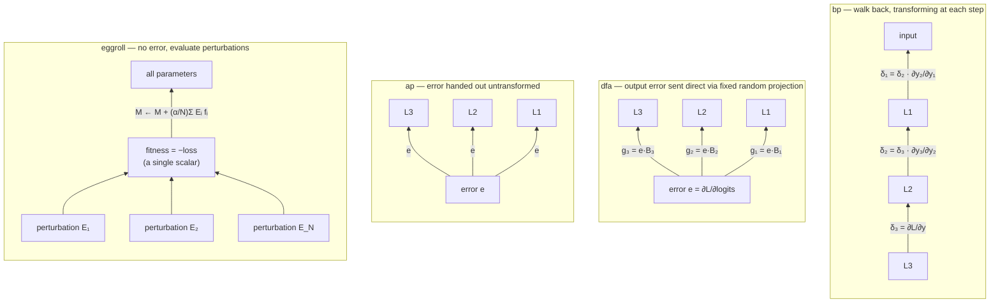
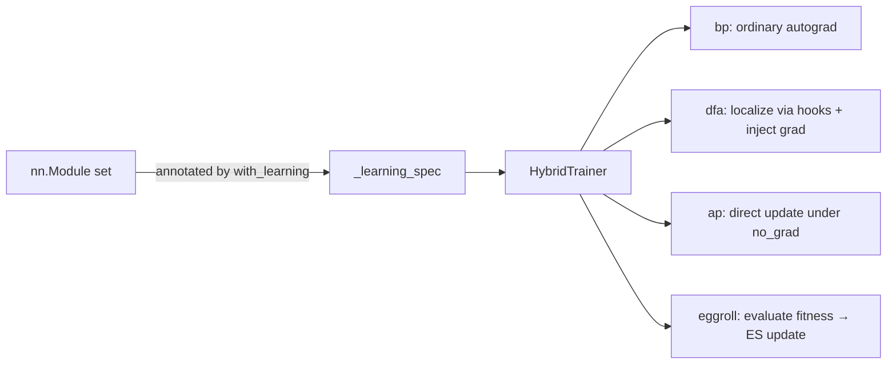

To learn "which Boolean function each gate becomes", you have to decide **how responsibility (error)
gets distributed to each gate's weights**. That is the **credit assignment** problem, and this
library treats the answer as a third axis you can **swap out per layer**
(→ [Architecture overview](/en/explanation/architecture/)).

The motivation for offering anything besides backprop is plain: **once a differentiable circuit runs
on hardware, you don't want to implement the backward path too**. If learning works from the forward
pass alone, learning itself can move onto the circuit.

## The four learning rules

| Learning rule | How error travels | Needs derivatives? | Implementation constraints | Where it fits |
|---|---|---|---|---|
| **`bp`** (backprop) | propagates the output error backwards, transforming it layer by layer | **yes** (every path) | none in particular; the only rule the shared runner `run_training` handles | **the default**. When accuracy comes first |
| **`ap`** (Akiho Propagation) | broadcasts the output error **unchanged** to every reachable LUT | **no** (autograd is never used) | requires `parameterization='independent'`; a straight `nn.Sequential(Flatten, LutLayer…, GroupSum)` | when you want to demonstrate backprop independence. Fully connected only |
| **`dfa`** (Direct Feedback Alignment) | projects the output error straight into each layer's output space through a **fixed random matrix** | only locally (one step inside the layer) | output must be 2D `(B,D)` or 3D `(B,S,D)`, and `block_upstream=True` only | when you want to cut backprop between layers. Parallelism, biological plausibility |
| **`eggroll`** (evolution strategy) | no error at all. **Scatters low-rank perturbations and selects by fitness** | **no** (forward only) | 2D parameters only; evaluation count is the cost | when the objective has no usable or trustworthy gradient |

### Credit assignment side by side

Here is how the error reaches the same three-layer LUT network under each rule.



The distinction that matters is **whether the error is transformed as it passes each layer**.
`bp` multiplies by a Jacobian every layer, `dfa` multiplies by a fixed random matrix exactly once,
and `ap` multiplies by nothing. `eggroll` never builds an error vector in the first place — it
updates from a single scalar (fitness).

---

## bp — backprop

The default, and the baseline everything else is measured against. `LutLayer` carries a custom
autograd (`LutFunction`), so the backprop path also runs a hand-written implementation that walks
the butterfly basis in reverse (→ [LutLayer internals](/en/explanation/lut-layer/)).

The shared runner `training/runner.py::run_training` handles `bp` only; everything else goes through
the `HybridTrainer` path described below.

## ap — Akiho Propagation

An in-house learning rule that **never uses backprop**. It broadcasts the output error **unchanged**
to every LUT reachable by following the connections, and updates each gate's weights directly.

$$
w_k \;\leftarrow\; w_k + \eta \cdot e \cdot \mathrm{basis}_k(x)
$$

$\mathrm{basis}_k(x)$ measures how much that entry was read, so the update lands **only on entries
that were actually used**. The whole procedure runs inside `torch.no_grad()` and builds no
computation graph at all. Setting `update_mode=2` updates only the entry with the largest basis.

It pairs with `parameterization='independent'`, differing in that the weights are treated directly
as probabilities in $[0,1]$ rather than passing through a sigmoid.

### How far it gets, and where it stops

:::caution[What we measured — how far AP gets, and where it stops]
On a fully connected (flat) MNIST setup it settles at **soft ≈ 0.90 / hard ≈ 0.85**, and does not
collapse anywhere between depth 2 and 8. BP under the same conditions reaches soft 0.983 /
hard 0.977, so AP **falls roughly 6–8 pt short of BP**. Worse, on a **Conv tree + OrPooling setup it
collapses to accuracy ≈ 0.11 (chance)**. The cause was not the loss of monotonicity we first
suspected (ruled out by an intervention study over 39 runs and 3 seeds) but the fact that
**error routed through OR-style aggregation produces no useful learning signal**. In short,
**connection structure and learning rule cannot be designed independently** — the biggest lesson AP
taught us. On RNNs it stays at chance for T≥2 even with an eligibility trace (e-prop style), so
credit assignment through time does not hold either.
:::

### Quoting these numbers publicly

:::note[How to quote these numbers publicly]
"98% on MNIST with AP" is wrong. Every 98% figure comes from **BP (using backprop)** or is cited
from an external paper; no record of AP reaching the 90s exists in this repository. Always name the
learning rule alongside the number ("98.3% with BP; AP, which uses no backprop, currently sits at
90%"). The primary source is the internal audit record (AUDIT_98).
:::

## dfa — Direct Feedback Alignment

Based on Lillicrap et al. 2016 / Nøkland 2016. The output error
$e = \partial L/\partial \mathrm{logits}$ is projected directly into each layer's output space
through a per-layer **fixed random matrix** $B_l$ and used as a local gradient.

$$
g_l = e B_l, \qquad \frac{\partial L}{\partial \theta_l} \approx \frac{\partial\, \mathrm{out}_l}{\partial \theta_l} \cdot g_l
$$

$B_l$ is never learned. Learning still progresses because **the forward weights align themselves
towards the direction of $B_l$** (feedback alignment). The seed for $B_l$ comes from a deterministic
hash, so it reproduces across runs.

The implementation works by isolating a local graph.

1. `forward_pre_hook` calls `detach()` on the input, so no BP gradient flows upstream
2. the module's own forward builds a **local graph** from the detached input to its output
3. `forward_hook` keeps the local output and passes a `detach()`ed copy downstream
4. after the loss, `autograd.grad(local_out, params, grad_outputs=g_l)` injects the gradient

Step 4 is the design's key move: it **reuses the verified custom backward machinery
(`LutFunction`) as-is**. Only backpropagation across layers disappears; the exact gradient
computation within a layer stays. Sequence outputs `(B,S,D)` are flattened internally to `(B*S,D)`
and handled just like the 2D case (the math is unchanged).

## eggroll — evolution strategy

An implementation of Algorithm 1 from EGGROLL (Sarkar et al., 2026). It uses no gradients at all and
instead **scatters low-rank perturbations and selects by fitness**.

$$
E = \tfrac{1}{\sqrt{r}} A B^\top \ (A \in \mathbb{R}^{m \times r},\ B \in \mathbb{R}^{n \times r}),
\qquad
M \leftarrow M + \frac{\alpha}{N}\sum_i E_i f_i
$$

Keeping the perturbations low-rank makes them cheap to generate, and a counter-based RNG lets you
**reconstruct a perturbation deterministically from its seed**. Since workers only need to share
fitness scalars, it suits distributed execution well. The target parameters are set to
`requires_grad=False` and leave autograd entirely.

`train`/`eval` mode respects whatever the caller set, so running under `eval()` lets you
**use post-discretization hard performance directly as the fitness**. That makes it an option when
you want to optimize the Boolean circuit itself without going through continuous relaxation.

---

## Mixing rules per layer — with_learning and HybridTrainer

A learning rule is specified **per module**, not for the whole model. `with_learning` does **not**
wrap the module — it merely annotates it with a `_learning_spec` attribute. Nothing about forward,
`repr`, or `state_dict` changes, so you can add it to an existing model after the fact.

```python
from griffith_logic import GroupSum, HybridTrainer, LearningSpec, LutLayer, with_learning

model = nn.Sequential(
    with_learning(LutLayer(2, 32, n_inputs=2), LearningSpec(rule='dfa')),
    with_learning(LutLayer(32, 16, n_inputs=2), LearningSpec(rule='dfa')),
    GroupSum(k=2, tau=2.0),
)
trainer = HybridTrainer(model, torch.optim.Adam(model.parameters(), lr=0.05))
for _ in range(600):
    metrics = trainer.train_step(x, y)
trainer.close()
```

Unannotated modules are treated as `bp`. That makes **mixtures like "bp for feature extraction, dfa
for the output head alone"** natural to write. `HybridTrainer` arbitrates hook management, gradient
injection, and ES update ordering across the rules.



The main fields of `LearningSpec`:

| Field | Applies to | Meaning |
|---|---|---|
| `rule` | all | `'bp'` / `'ap'` / `'dfa'` / `'eggroll'` |
| `lr` | all | rule-specific learning rate (`None` uses the trainer default) |
| `update_mode` | ap | `1` = update all weights / `2` = only the entry with the largest basis |
| `feedback_init` | dfa | initialization of the fixed random feedback |
| `block_upstream` | dfa | only `True` is supported in the current implementation |
| `eggroll` | eggroll | `EGGROLLConfig` (rank / sigma / alpha / n_workers …) |

## Which one to pick

- **Start with `bp`** — get the accuracy baseline. It's also the only rule the shared runner takes.
- **`dfa`** — when you want to cut backprop between layers, or aim for layer parallelism. Gradients
  within a layer stay exact, so you drop only the "backprop chain" without losing as much accuracy
  as AP does.
- **`ap`** — when you want to demonstrate complete backprop independence. **Fully connected setups
  only**; anything with Conv, OrPooling, or recurrence currently collapses.
- **`eggroll`** — when you want to optimize an objective with no usable gradient (post-discretization
  hard accuracy itself, for example) directly.

For the hands-on procedure, see
[Tutorial 6. Learning rules (DFA/AP)](/en/tutorials/learning-rules/) and
`examples/03_learning_rules.py` in the repository.

## What to read next

- [LutLayer internals](/en/explanation/lut-layer/) — what the backward pass bp actually walks looks like
- [Running training](/en/guides/training/) — `run_training` and `TrainConfig`
- [Reading training curves](/en/guides/training-curves/) — how to read the soft/hard divergence
- [Design decisions](/en/explanation/design-decisions/) — why the three axes were made orthogonal

<!-- i18n:source=explanation/learning-rules.md hash=a699cb83c85e -->
