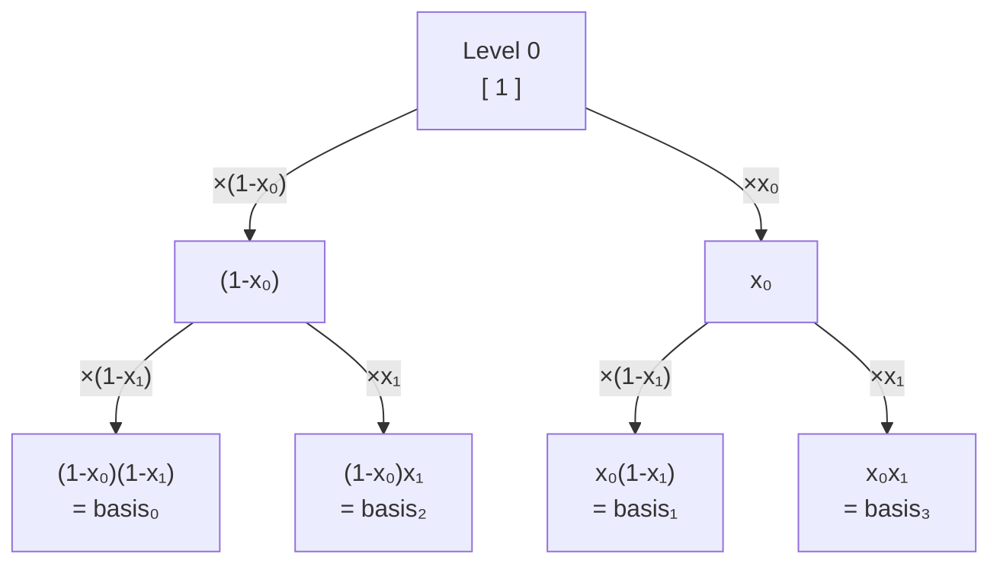
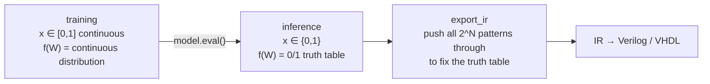

`LutLayer` is this library's smallest building block: **a layer that makes an N-input LUT
(look-up table) differentiable**. This page follows the math to answer "why this formula?" and
"why is the backward pass written by hand?".

## 1. Starting point — a LUT isn't differentiable

A LUT is a lookup table returning one bit for N binary inputs. At N=2 that's a 4-entry truth table,
which can be filled in $2^4 = 16$ ways — that is, it can express **all 16 two-input Boolean
functions** (AND / OR / XOR / NAND …). At N=6 there are $2^{64} \approx 1.8 \times 10^{19}$ ways,
the same expressive power as an FPGA LUT6.

The problem is that the entries of a truth table are **discrete** 0 or 1, so gradient descent
cannot touch them. The fix is to allow continuous values between 0 and 1 during training and snap
back to discrete at inference. How that continuous value is held is the parameterization, and it
sits at the heart of this library's design.

## 2. The central formula

Each neuron computes:

$$
y \;=\; \sum_{k=0}^{2^N-1} f(W)_k \cdot \mathrm{basis}_k(x_0, \dots, x_{N-1})
$$

$$
\mathrm{basis}_k(x) \;=\; \prod_{j=0}^{N-1} x_j^{\,b_j(k)} \,(1 - x_j)^{\,1 - b_j(k)}
$$

Here $b_j(k)$ is bit $j$ of $k$, and $f$ maps the parameters $W$ into "weights" (the default is
$\mathrm{softmax}$).

$\mathrm{basis}_k(x)$ measures **how much the input is exactly pattern $k$**. When the inputs are
settled at 0/1 the basis becomes one-hot and the formula reduces to "read row $k$ of the truth
table" — the definition of a LUT. When inputs take intermediate values, several entries are read
out partially at once: that is the continuous relaxation.

Expanding at N=2 makes the meaning plain.

$$
\begin{aligned}
\mathrm{basis}_0 &= (1-x_0)(1-x_1) &&\text{1 when both are 0} \\
\mathrm{basis}_1 &= x_0 (1-x_1) &&\text{1 when only $x_0$ is 1} \\
\mathrm{basis}_2 &= (1-x_0) x_1 &&\text{1 when only $x_1$ is 1} \\
\mathrm{basis}_3 &= x_0 x_1 &&\text{1 when both are 1}
\end{aligned}
$$

If only $w_3$ is large you get $y \approx x_0 \land x_1$ (AND); if $w_1, w_2$ are large you get
$y \approx x_0 \oplus x_1$ (XOR).

:::note[Relationship to difflogic]
difflogic (NeurIPS 2022) enumerates the 16 gates directly and mixes them with softmax. The formula
above is **the same thing rewritten as a linear combination of 4 basis functions** — equivalent at
N=2, with parameters dropping from 16 to 4. More importantly, this form **generalizes to N=4 and 6
as-is** (enumerating 16 gates becomes $2^{64}$ of them at N=6 and falls apart).
:::

### The layer's structure

`LutLayer` holds exactly two tensors.

| Tensor | Shape | Learned |
|---|---|---|
| `weights` | `(out_dim, 2^N)` | **yes** (logits, pre-parameterization) |
| `indices` | `(N, out_dim)` | **no** (the wiring: which inputs each neuron looks at) |

Fixing the `indices` wiring and learning only the weights is the basic stance of the DLGN family
(setting `connections='unique'` guarantees every input is used at least once). In other words,
**what is being learned is not the wiring but which Boolean function each gate becomes**.

## 3. The butterfly basis — building $2^N$ products by divide and conquer

Computing each $\mathrm{basis}_k$ separately from the definition costs N multiplications per entry.
The butterfly basis instead **reuses intermediate results, doubling the size stage by stage** (the
name comes from the same divide-and-conquer structure as the FFT butterfly).



The implementation is four straightforward lines (`core/basis.py`).

```python
def _compute_basis_butterfly(gathered, n_inputs):
    basis = torch.ones(..., 1)              # Level 0: [1]
    for j in range(n_inputs):
        xj = gathered[..., j:j+1]
        basis = torch.cat([basis * (1.0 - xj), basis * xj], dim=-1)
    return basis                            # size 2^n_inputs
```

The complexity itself is the same $O(N \cdot 2^N)$ as the naive version. All three reasons for
choosing butterfly are **about the backward pass**.

- The intermediate state at each level can be saved and reused in backward (memory efficiency)
- $\sum_k \mathrm{basis}_k = 1$ holds structurally (each level only multiplies by
  $(1-x_j) + x_j = 1$, so numerical error doesn't accumulate)
- Backward needs **no division** (the naive version requires quotients like
  $\mathrm{basis}_k / x_j$, which break as $x_j \to 0$)

## 4. Parameterization — five choices of $f(W)$

With the same central formula, how you map $W$ into weights (the choice of $f$) changes
**expressive power, ease of discretization, and parameter count**. `LutLayer(parameterization=...)`
offers five.

| Method | $f(W)$ | Params/gate | Constraint | Origin |
|---|---|---|---|---|
| `softmax` (default) | $\mathrm{softmax}(W)$ | $2^N$ (16 at $N{=}2$) | $\sum_k w_k = 1$ | difflogic |
| `independent` | $\sigma(W)$ | $2^N$ | entries are independent | BinaryBrain |
| `raw` | $W$ as-is | $2^N$ | holds $[0,1]$ directly | BinaryBrain |
| `iwp` | per-input $\sigma(\alpha_j)$ | $N$ | decomposable functions only | LDDLGN |
| `warp` | Walsh–Hadamard coefficients | $2^N$ | unconstrained reals | WARP |

Mathematically the difference boils down to "do the entries compete with each other?".
Here is each method in turn.

### `softmax` — entries compete

The weights live **on the simplex** $\sum_k w_k = 1$. Think of distributing 100
yen across $2^N$ boxes: raising one automatically lowers the others. Gradients reach every
parameter in a single backward pass, but it comes with a hard constraint — **at most one entry
can be picked for the hard table** (see below).

### `independent` / `raw` — entries are independent

Each entry independently carries a "probability of being 1", and they
do not sum to 1. Any of the $2^N$ 0/1 tables can be expressed, so the **hard table is more
expressive than softmax**. The gradient is
$\partial L/\partial p_k = \partial L/\partial y \cdot \mathrm{basis}_k$ and reaches only that
entry.

### `iwp` — one parameter per input

One parameter **per input** rather than per entry ($N$ in total). It only learns the
weight for "use $x_j$ as-is or inverted", building the function as a product of literals.
Extremely light, but it cannot express functions where the combination is the point, such as XOR
(the justification is LDDLGN's empirical finding that the vast majority of gates in a trained
model converge to the AND/OR/NOT family).

### `warp` — learning in the frequency domain

Learns not the truth table itself but the **Walsh–Hadamard transform coefficients**
$\theta$ of it. The output goes through $\mathrm{logit} = \sum_k \theta_k \cdot \mathrm{wh}_k(x)$
and is smoothed with a Gumbel-Sigmoid. Because it works with unconstrained reals, it tends to be
stable at N=4 and 6. Setting `wh_degree_cap` forces coefficients with
$\mathrm{popcount}(k) > d$ identically to 0, restricting the hard table to a **degree-d
polynomial threshold function** (the PolyLUT approach).

For the practical side of choosing among them, see
[Choosing a parameterization](/en/guides/parameterization/).

## 5. The soft → hard collapse — what happens at inference

Switch to `model.eval()` and `LutLayer` stops relaxing, becoming a **settled Boolean circuit**.
What gets rounded, and how, **differs per parameterization**.



| Method | Discretization rule | What the hard table can be |
|---|---|---|
| `softmax` (N=2) | $\arg\max$ over the 16 gate logits | **all 16 Boolean functions** |
| `softmax` (N>2) | only entries with $\mathrm{softmax}(W)_k > 0.5$ become 1 | since $\sum_k w_k = 1$, at most one entry can be 1. **A single minterm, or the constant FALSE** |
| `independent` | $\sigma(W) > 0.5$ | any $2^N$ truth table |
| `iwp` | $\sigma(\alpha) > 0.5$ → product of literals | decomposable functions only |
| `warp` | threshold at $\mathrm{logit} > 0$ | any function within the degree cap |

:::caution[softmax at N>2 has a large discretization gap]
As the table shows, `softmax` loses nothing at N=2 because it takes $\arg\max$ directly over the
16-gate table, but **at N>2 the hard table structurally degenerates to "a single minterm or
FALSE"**. The soft performance does not carry over to hard (the discretization gap widens), so if
you are deploying to hardware at N=4/6, pick `independent` / `iwp` / `warp`.
:::

Suppressing the performance drop on the `hard` side (the **discretization gap**) is this library's
quality metric. And the downstream — IR extraction and HDL generation — **duplicates none of these
rules**. `export_ir` pushes all $2^N$ patterns through the already-`eval()`ed model and takes the
observed outputs as the truth table, so adding parameterizations requires no downstream changes
(→ [Architecture overview](/en/explanation/architecture/)).

## 6. Backward — why write it by hand

`LutFunction` (`core/functions.py`) does not defer to PyTorch's autograd; its backward is written
by hand. Two reasons: we don't want to retain the entire butterfly computation graph, and we want
to close the softmax backward pass analytically.

### Gradient of the weights

Since $y = \langle \mathrm{basis},\, \mathrm{softmax}(W) \rangle$, we first collect the gradient
with respect to the softmax output, then apply the softmax Jacobian
$J_{ij} = w_i(\delta_{ij} - w_j)$ analytically.

$$
\tilde{g} = \sum_{b} \frac{\partial L}{\partial y_b} \,\mathrm{basis}_b,
\qquad
\frac{\partial L}{\partial W} = w \odot \bigl(\tilde{g} - \langle \tilde{g}, w \rangle\bigr)
$$

```python
grad_w_soft = einsum('bo,boe->oe', grad_output, basis)
dot = (grad_w_soft * w).sum(dim=-1, keepdim=True)
grad_weights = w * (grad_w_soft - dot)
```

### Gradient of the inputs — walking the butterfly backwards

What forward "branched out and spread", backward "merges and folds back". At each level $j$, the
difference between the upper half (the $x_j$ side) and the lower half (the $1-x_j$ side) is the
gradient of $x_j$.

```python
grad_cur = einsum('bo,oe->boe', grad_output, w)
for j in reversed(range(n_inputs)):
    half = grad_cur.shape[-1] // 2
    grad_lo, grad_hi = grad_cur[..., :half], grad_cur[..., half:]
    grad_gathered[:, :, j] = ((grad_hi - grad_lo) * intermediates[j]).sum(-1)
    grad_cur = grad_lo * (1 - xj) + grad_hi * xj     # back to the previous level
```

Because it reuses `intermediates[j]` (the per-level intermediate state saved in forward) directly,
**no division appears**. Finally, the contributions from multiple neurons referencing the same
input are aggregated with `scatter_add_` to give `grad_x`.

| Aspect | PyTorch default | `LutFunction` |
|---|---|---|
| Computation graph | retains the whole butterfly | saves intermediate state only |
| softmax backward | via the graph | analytic Jacobian |
| Numerical stability | involves division | division-free |
| Memory | baseline | roughly 50–80% less |

:::note[How is correctness guaranteed?]
That this optimized backward is mathematically correct is guaranteed by comparison against the
naive, pure-autograd implementation `core/reference.py` (float64 gradcheck + agreement to 1e-10,
`tests/l2_grad/`). The reference implementation is **never rewritten for speed** — its naivety is
precisely what makes it valuable for verification
(→ [Design decisions](/en/explanation/design-decisions/)).
:::

## 7. Residual initialization for deep stacks

Stack logic gates deeply and the initial state is a chain of random functions, so no signal reaches
the far end. Residual initialization (CDDLGN §3.2) fixes this by **biasing the initial weights
toward the function that passes the first input straight through**.

$$
\mathrm{softmax}([5, 0, 0, 0]) \approx [0.993,\ 0.002,\ 0.002,\ 0.002]
$$

Set the logit of the pass-through entry to 5.0 and the initial network behaves almost like the
identity, letting gradients travel through a deep tree. `LutConv2d` has structurally deep trees, so
it is **on by default**; `LutLayer` defaults to off and takes `residual_init=True` when needed.

## 8. Extending to convolution — LutConv2d

`LutConv2d` maps each output channel to a single **logic-gate tree** (a complete N-ary tree). At
depth $d$, $N^d$ leaves draw inputs at random from the receptive field and $(N^d - 1)/(N-1)$
internal gates convolve bottom-up. Each gate computes exactly the same "butterfly basis × weights"
as `LutLayer`, and likewise collapses into discrete Boolean operations under $\arg\max$ at
inference.

Pooling is `OrPooling2d` = a wrapper around `F.max_pool2d`, which is the
**maximum t-conorm = probabilistic logical OR**. On binary values it acts literally as Boolean OR.

## What to read next

- [Choosing a parameterization](/en/guides/parameterization/) — practical trade-offs among the five methods
- [Learning rules (BP/AP/DFA/ES)](/en/explanation/learning-rules/) — how to swap out gradient construction
- [Architecture overview](/en/explanation/architecture/) — the 8 stages from training to HDL
- [Design decisions](/en/explanation/design-decisions/) — why the reference implementation stays naive

<!-- i18n:source=explanation/lut-layer.md hash=828ba97c197b -->
