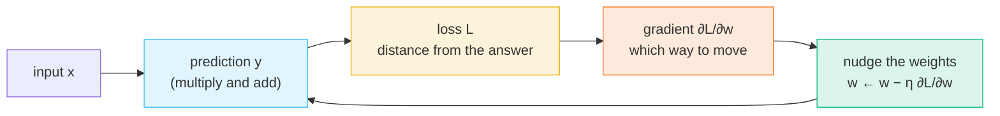
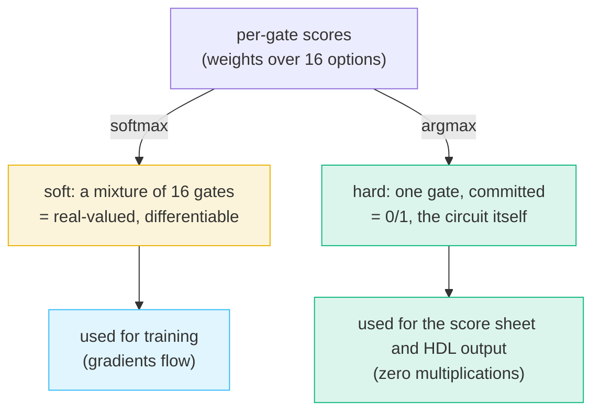

This page is meant to be read **without writing a single line of code**.
It is for readers who want the map before running the
[Intro Course](/en/tutorials/nn-basics/), and for readers who ran it and now want
the same story in words.

There is only one question here.

> When you move from an ordinary neural network (NN) to a differentiable logic gate
> network (DLGN), **what stays and what gets swapped out?**

:::note[Prerequisite]
If neural networks themselves are new to you, start with
[What is a Neural Network?](/en/explanation/ai-basics/) — it is faster.
This page picks up from there and concentrates on **putting NN and DLGN side by side**.
:::

## 1. How an NN feels from the inside — weights, loss, gradients

An NN multiplies and adds, and that is all. Each input $x_j$ is multiplied by a **weight**
$w_j$, the results are summed, and an activation function $\sigma$ bends the result.

$$
y = \sigma\!\left( \sum_j w_j x_j + b \right)
$$

Humans choose the **structure** (how many layers, how many units); training decides
**only the weights $w$**. How those weights move is decided by a four-step loop.

The loop only turns under one condition: **the loss must change smoothly with the weights**.
Without the continuous feedback of "I moved $w$ by 0.001 and the loss dropped by 0.0004",
there is no way to tell which direction to go. That is why NNs live in the world of real numbers.

## 2. A DLGN learns the kind of gate, not the number to multiply by

In a DLGN, one neuron becomes a **logic gate that looks at only two input wires**.
Whether that gate is an AND, an OR or an XOR is what training decides.
Not a single multiplication appears anywhere.

And here is the wall. "AND or XOR" is a **discrete choice among 16 options**;
it cannot be moved smoothly. Nudge it and it stays AND, then at some instant it jumps to XOR.
No gradient can be taken, so the loop of §1 will not turn.

### An analogy: a knob, and a switch that is still undecided

Training an ordinary NN is like **turning a volume knob a little at a time until the sound is right**.
The knob moves continuously, so you can turn it slightly, hear whether it improved, and turn further.

What a DLGN wants to turn is not a knob but a **16-position switch labelled "AND / OR / XOR / …"**.
A switch cannot sit between positions. So the DLGN does this:
**while training, it keeps a real-valued score for how much it leans toward each position**.
Scores are continuous, so they move as smoothly as a knob.
When training ends, it **flips the switch to the highest-scoring position** — and that is the circuit that gets burned.

This pair — the **undecided state (soft)** and the **committed state (hard)** — is the heart of a DLGN.

soft and hard are **two forms of the same model**, not the same function.
The accuracy difference between them is called the **discretization gap**, and it is the single
biggest thing to watch in a DLGN (see [Discretization Gap](/en/explanation/results/discretization-gap/)).

## 3. The mapping — what stays, what is swapped

| | Ordinary NN | DLGN | Changed? |
|---|---|---|---|
| Training framework | predict → loss → gradient → update | **exactly the same** | same |
| Loss and optimizer | cross entropy / Adam | **exactly the same** | same |
| Framework | PyTorch | **the same PyTorch** (`nn.Module`) | same |
| What one neuron computes | a weighted sum over every input | one logic gate over two inputs | swapped |
| What is learned | real-valued **weights** | each gate's **truth table** (which logic function) | swapped |
| Activation function | ReLU and friends are required | **not needed** (the gate carries the nonlinearity) | gone |
| Output layer | dense layer + softmax | `GroupSum` (just counts per group, no weights) | swapped |
| Inference arithmetic | real multiplications (needs multipliers) | bit operations only (**zero multiplications**) | swapped |
| `model.eval()` | only changes Dropout/BatchNorm behaviour | **changes the mathematics of the model** | different meaning |
| Reading the score | a single accuracy | **two numbers**, soft and hard (hard is the real one) | more |
| Typical learning rate | around 1e-3 | **0.01–0.3** | different magnitude |
| Layer width | hidden dim in the hundreds | thousands to tens of thousands of gates (= circuit area) | different magnitude |
| Final artifact | `state_dict` / ONNX | **IR (JSON) → Verilog / VHDL** | different destination |

In one line: **nothing about how you train changes. What is being learned moves from "weights" to "which gate".**

## 4. Why go to all this trouble

Digital circuits are good at AND / OR / XOR, not at multiplication.
An FPGA is tens of thousands to millions of LUTs — small boxes that each realize one arbitrary
logic function — while multipliers are a scarce resource present only in small numbers.

If an NN can be built out of logic gates, the result of training **is** the circuit:
inference runs at low power and high speed with no multipliers and no GPU.
That is the motivation behind DLGNs, and the reason this library ships a continuous path from
`export_ir()` all the way to Verilog (see [What is DLGN](/en/explanation/dlgn/)).

## What to read next

- [Intro 1. Neural Networks and PyTorch Basics](/en/tutorials/nn-basics/) — run §1 for yourself
- [Intro 3. Replace the MLP with a DLGN](/en/tutorials/mlp-to-dlgn/) — see the §3 table one-to-one in code
- [Coming from PyTorch](/en/guides/from-pytorch/) — the **full** mapping table for day-to-day work
- [What is DLGN](/en/explanation/dlgn/) — why gradients flow through something discrete, with the mathematics
- [Reading Training Curves](/en/guides/training-curves/) — telling soft and hard apart

{/* i18n:source=explanation/nn-to-dlgn.mdx hash=3410550097a1 */}
