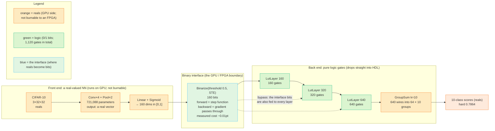
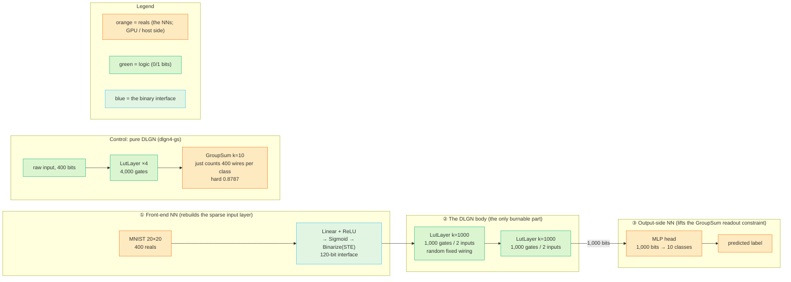
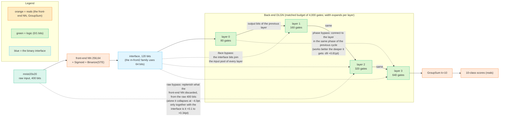
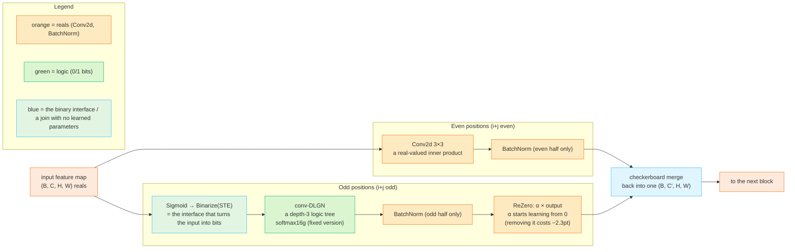

Separately from the models that live in the package itself (= the first half of the
[Model Zoo](/en/reference/model-zoo/)), there are many **configurations that only ever ran on
experimental branches**. This page is where they live. Unlike the mainline pages, the lead role here belongs to
**the negative results and the reason behind them**.
Nothing stops at "it did not help": the purpose of this page is to record **why** it did not help,
every single time.

The collection covers **11 families, 81 configurations** (24 series if counted by experiment series ID).
All of them were run from scripts under `experiments/`, and the metrics are logged in wandb.

:::caution[How to read every family on this page]
- **Most results are single-seed.** Three seeds were taken only for LUT6-1 (the 1-layer condition),
  HYBRID-4b, RES-LN-2 (rezero-n2) and VAE-1 (logic-n6 / float-bern-match).
  **No ranking within 0.3pt in the 0.980–0.984 band can be claimed.**
- **Equal gate budget ≠ matched parameter count.** N=2 softmax is 16 parameters per gate, N=6 is 64,
  and AP's `independent` is 4. Always check this when comparing across tables.
- **Provisional values with unequal epochs are mixed in**: the back-end scale runs at 16M (10ep) and
  61M (5ep, cut short), and Logic-DenseNet's CIFAR dense/plain (61ep, cut short).
- **All FPGA numbers are theoretical values** (200MHz, one clock per layer, fully pipelined; an upper
  bound before place-and-route). Measured results from Vivado synthesis have not been performed.
- **The hybrid families are not on the same footing as the literature.** They include a floating-point
  NN front-end (roughly 200k–1.65M parameters), and only what sits behind the binary interface can be
  put into hardware. **A comparison that lines up gate counts alone against the literature** — where the
  entire network is logic gates (difflogic / DWN / LogicTreeNet / LILogicNet) — **does not hold**.
  What can be said under matched conditions goes as far as "the back-end's contribution given the same
  front-end and the same interface" and "the relative position against pure DLGN".
:::

## 1. Pure DLGN / input bypass — clever fixed wiring never won, not once

**What was tried**: on the hypothesis that the weakness of pure DLGN (400-bit input → LutLayer×L →
GroupSum, with only gate type being learned) lies in the random sparse connectivity of the input
layer, **wiring tricks that redistribute the raw input to every layer** were tried across
5 rounds (R1–R5), about 30 runs. Conditions fixed at mnist20x20 (400 bits), `n_inputs=2`, τ=10,
bs=128, seed 0, fixed wiring.

| Configuration | Structural idea | MNIST 20×20 hard | What it showed |
|---|---|---|---|
| **Pure DLGN (baseline)** | k1000×4 layers = 4,000 gates, random fixed wiring | **0.8994** (lr0.03 / 30k iter) | Strongest under a matched budget. The initial baseline was 0.8939 |
| concat-random bypass | hidden-layer input becomes `concat([h,x])` (output width unchanged) | 4 layers 0.9077 / 20 layers 0.7963 | **Worse the deeper it goes.** 17–44% of the fan-in is taken by raw input |
| IALGN-style spine+anchor | slot0 = identity from the same index of the previous layer, only slot1 carries the original input | random 0.8724 / split 0.8663 / butterfly 0.8655 / coverage 0.8293 | The more evenly the input is spread, the worse it gets (coverage is last, −6.5pt) |
| OR residual | `h_new = OR(h_prev, lut_out)` | 0.7654 (with residual_init) / 0.8416 (without) | `OR(h,h)=h` collapses the layer into an identity, and it duplicates the role of the spine |
| XNOR residual | `h_new = XNOR(h_prev, lut_out)` | 0.7731 | `XNOR(h,h)=1` saturates to a constant |
| Cross-layer bypass prev2 / dense | anchor points two layers back / to all preceding layers | 0.8779 / 0.8727 | Better than raw-input bypass, but still short of the baseline |
| Foundation sweep | thermometer 2/4 levels, augment, τ30, gumbel, lr0.03 | only lr0.03 improves, at **0.8993**. therm2 0.8885 / aug 0.8873 / gumbel 0.8494 / τ30 0.8299 | The only thing that helped was the learning rate (+0.54pt) |
| Going deeper (6 layers, 6,000 gates) | lr0.03 + 2-level thermometer | 0.9095 | But 1.5× the gates. Under a matched budget, 0.8994 still wins |
| Matched-budget depth + partial spine | total fixed at ≈4,000 gates: k660×6 / k500×8 / k400×10 | none: 0.8696 / 0.8477, spine50: 0.8429 / 0.8227 / 0.8012 | **Monotonically worse the more layers are added.** Width beats depth |
| Learning the anchor selection | softmax+STE over K=32 candidates for the anchor slot only | 0.8968 | Almost cancels the harm of the spine, but does not exceed it (−0.26pt) |
| Straight-through wiring selection | Hard-ST / Gumbel-ST | 0.8875 / 0.8648 | Pushing discretization earlier is a disadvantage |
| **mnist784 (the decisive evidence)** | 784 inputs, no crop | 0.8683 (−3.11pt vs. 20×20) | **The higher the input dimension, the more sparse connectivity drops** |

**Why it did not work**: input bypass is a prescription for "the information is not arriving", but
the actual bottleneck was **the input layer itself, not the wiring structure**. Mixing raw input into
a layer with a fan-in of only 2 costs exactly that many slots for receiving the previous layer's
features. The fixed logic residuals `OR` / `XNOR`, far from creating an identity path, **collapse the
layer via `OR(h,h)=h` / `XNOR(h,h)=1`** (and pairing them with residual initialization accelerates the
degeneration). The fact that mnist784 got worse settled it, and the motivation moved to the hybrid
family: "put a densely connected NN in front and rebuild the input layer".

wandb group `input-bypass-dlgn` (tags `input-bypass` / `series:BYPASS-*`).
Implemented in `experiments/train_input_bypass.py`.

## 2. Hybrids — front-end NN/CNN + binary interface + back-end DLGN

**What was tried**: raise a **bit interface** of front-end NN (Linear+ReLU or Conv) → Sigmoid →
`Binarize(0.5, STE)`, and make everything behind it pure logic gates (a stack of LutLayer → GroupSum).
Everything behind the interface drops straight into HDL. Six stages: front-end MLP (HYBRID-1),
front-end CNN (HYBRID-2), back-end shape search (HYBRID-3), settling wiring and LUT6 (HYBRID-4/4b),
and sweeping the GPU/FPGA boundary (HYBRID-5/6).

**Structure (the actual sizes of the series best, h2-cnn-dlgn-expand = CIFAR-10 hard 0.7864)**

**How to read it**: only what is to the right of the interface (green) is 1,120 two-input LUTs that
lower to Verilog. The left (orange) is an ordinary CNN and needs a GPU.
Against the all-NN control (h2-cnn-mlp, 0.7425), the claim of this series is **+4.39pt from swapping
only the back end from MLP to DLGN while keeping the front end identical** — and it is also why gate
counts here cannot be laid side by side with papers whose networks are logic gates end to end.

### 2.1 Front-end MLP (HYBRID-1)

| Configuration | Front-end NN → interface | Back-end DLGN | hard | Gates |
|---|---|---|---|---|
| **m-front2-wide** | 256,128 → 128 bits | 1000,1000 | **0.9714** (MNIST) | 2,000 |
| **m-front2-expand-bypass** | 256,64 → 64 bits | 80,160,320 (bypass) | **0.9703** | **560** (1/7 of pure DLGN) |
| m-front1-wide | 128 → 128 bits | 1000,1000 | 0.9616 | 2,000 |
| m-front1-compress | 256 → 256 bits | 120,60 | 0.9556 | **180** (1/22) |
| m-mlp-control (no back-end) | 256,64 → 64 bits | — | 0.9203 | 0 |
| c-front2-wide | 512,128 → 128 bits | 1000,1000 | **0.5446** (CIFAR-10) | 2,000 |
| c-front2-compress | 512,256 → 256 bits | 200,100 | 0.5057 (last) | 300 |

**What it showed**: the sparse-connectivity bottleneck is gone — **+7.20pt** over the matched-budget
pure DLGN at 0.8994, and 0.9703 is reached with 560 gates (1/7 the size). With the same front-end and
the same interface, **the back-end DLGN contributes +5.00pt** (0.9703 vs. the MLP control at 0.9203).
The division-of-labour hypothesis, "compression = dense NN / expansion = sparse DLGN", is supported by
the compressing variant landing clearly last on CIFAR. On CIFAR, a separate learning rate for the
front-end (`--front-lr 1e-3`) is mandatory.

### 2.2 Front-end CNN (HYBRID-2) — beating an "ordinary NN" head-on

| run | head | Interface | Back-end | CIFAR-10 hard | Gates | NN parameters |
|---|---|---|---|---|---|---|
| **h2-cnn-dlgn-expand** | dlgn | 160 bits | 160,320,640 (bypass) | **0.7864** | 1,120 | 721,088 |
| h2-cnn-dlgn-wide | dlgn | 256 bits | 1000,1000 | 0.7775 | 2,000 | 1,114,400 |
| h2-cnn-dlgn-compress | dlgn | 256 bits | 200,100 | 0.7562 | **300** | 1,114,400 |
| h2-cnn-mlp-bin | mlp-bin | 256 bits | MLP(256) | 0.7426 | 0 | 1,182,762 |
| h2-cnn-mlp (all-NN control) | mlp | real-valued 256 | MLP(256) | 0.7425 | 0 | 1,182,762 |

**What it showed**: CNN+DLGN beat CNN+MLP by **+4.39pt**. The winner's back-end is nothing but 1,120
two-input LUTs, and its front-end CNN is also 40% smaller than the control's. The factor decomposition
gives **essentially zero cost for the binarizing interface (−0.01pt) and +4.38pt from the back-end
DLGN**. In throughput measurements the bottleneck is the GPU-side CNN front-end at every batch size,
so the ratio against the all-NN model is 0.98–1.28× (= essentially no improvement), and 1.48–2.30×
against running the same hybrid entirely on GPU. The FPGA back-end's latency is 20ns
(5 stages @200MHz).

### 2.3 Back-end shape (HYBRID-3) — shape dominates, depth is subordinate to shape

Front-end fixed at "256,64" (64-bit interface); every run N=6, softmax.

| run | dlgn-widths | Axis | MNIST hard | LUTs |
|---|---|---|---|---|
| l6-expand | 80,160,320 (bypass) | expanding, medium | **0.9703** | 560 |
| l6-deep-expand | 80,160,320,640 | expanding, deep | 0.9696 | 1,200 |
| l6-flat-narrow | 250,250 | constant, shallow, small | 0.9618 | 500 |
| l6-compress | 120,60 | contracting, shallow | 0.9542 | **180** |
| l6-deep-narrow | 250,250,250,250 | constant, deep, small | 0.9506 | 1,000 |
| l6-flat-wide | 1000,1000 | constant, shallow, large | 0.9178 | 2,000 |
| l6-tiny | 60,30 | contracting, tiny | 0.8558 | **90** |
| l6-deep-compress | 320,160,80,40 | contracting, deep | **0.6460** (soft 0.8185) | 600 |
| (calibration) warp parameterization | 1000,1000 | — | 0.2027 (training collapsed) | 2,000 |

**What it showed**: there is a **32pt** spread within the axis, so shape dominates
(expanding ≫ constant > contracting). The sign of depth is subordinate to shape (expanding −0.07pt /
constant −1.12pt / contracting **−30.8pt**), so "deeper is better" does not hold for any shape. Under a
constant shape, width and accuracy are inversely correlated: 500 gates at 0.9618 beat 2,000 gates at
0.9178. l6-expand is **exactly equal, ±0.00pt, to n=2**, so in this setting LUT6's expressiveness is
not the bottleneck. LUT6's value lies on the other side: "the same accuracy with fewer gates"
(560 vs. 2,000 = a 3.6× reduction).

### 2.4 Settling wiring and LUT6 (HYBRID-4 / 4b)

Front-end fixed at "256,120" (120-bit interface), back-end at "120,240,480" (840 LUTs).

| run | N | Wiring | Extra | MNIST hard |
|---|---|---|---|---|
| h4-n2-i120 | 2 | bypass | — | **0.9746** |
| h4-l6-i120 | 6 | bypass | — | 0.9739 (best 0.9766) |
| h4-n2-balanced | 2 | balanced | — | 0.9734 |
| h4-l6-bypass-bb-nolast | 6 | bypass | BB re-binarization (all but the last layer) | 0.9721 |
| h4-l6-balanced | 6 | balanced | — | 0.9646 |
| h4-l6-i240 | 6 | balanced | 240-bit interface, 1,680 LUTs | 0.9617 |
| h4-l6-balanced-dwn | 6 | balanced | DWN-style learned wiring in layer 1 | 0.9610 |
| h4-l6-unique-i120 | 6 | unique | — | 0.9597 |
| h4-l6-bb-nolast / -balanced-bb / -full | 6 | balanced | BB re-binarization | **0.1135 / 0.0891 / 0.1010** (collapse) |

**Factor decomposition**: cross-layer shortcuts **+0.93pt** > even coverage +0.49pt (which only helps
LUT6) > interface 64→120 bits +0.36pt. Interface 120→240 bits is **−0.29pt (saturated)**, and
DWN-style learned wiring is **−0.36pt**.

**Why it collapsed**: BinaryBrain-style **re-binarization between layers dies without a skip path**.
Combined with balanced wiring (previous layer only) it falls to hard 0.089–0.114, whereas with bypass
it trains normally at 0.9721. Pushing gradients through many stages of STE with no detour makes them
vanish.

**HYBRID-4b (settled with 3 seeds + CIFAR)**: for MNIST legacy bypass, n=2 0.97430 vs. LUT6 0.97450 —
the ranges overlap completely, so there is no difference. With balanced+bypass, n=2 0.97487 > LUT6
0.97300. On CIFAR-10, n=2 0.7864 > LUT6 (balanced+bypass) 0.78230 > LUT6 (legacy) 0.77555.
**In this hybrid configuration, "LUT6 > LUT2" does not hold** (LUT6 is always at best equal, for 4× the
parameters). The sign of balanced+bypass flips with the dataset (MNIST −0.150pt / CIFAR +0.675pt).

### 2.5 Sweeping the GPU/FPGA boundary and demonstrating the pipeline (HYBRID-5 / 6)

CIFAR-10, balanced+bypass, `--front-lr 1e-3`.

| run | Boundary | Interface | Back-end DLGN | hard | Gates | vs. all-NN (bs=1024) |
|---|---|---|---|---|---|---|
| h5-conv4-dlgn | Conv×4+Pool×2 | 160 bits | 160,320,640 | **0.7795** | 1,120 | 1.01x |
| h5-conv2-dlgn-deep | Conv×2+Pool×1 | 240 bits | 240,480,960,960 | 0.7103 | 2,640 | 1.66x |
| h5-conv2-dlgn | Conv×2+Pool×1 | 240 bits | 240,480,960 | 0.7051 | 1,680 | 1.67x |
| h5-conv1-dlgn-wide | Conv×1+Pool×1 | 360 bits | 360,720,1440 | 0.6957 | 2,520 | 3.07x |
| **h5-conv1-dlgn** | Conv×1+Pool×1 | 240 bits | 240,480,960,960 | 0.6925 | 2,640 | **3.40x** (567,289 sps) |
| (reference) h5-fullnn | all GPU | real-valued 256 | none | 0.7425 | 0 | 1.00x |

**What it showed**: the sweet spots are "Conv1 for speed, Conv4 for accuracy". The intermediate Conv2
gives 15× worse speed return per point of accuracy and is not worth buying.
"One conv + one Linear + everything else DLGN" **works if the goal is speed (3.40×) and fails if the
goal is accuracy** (−5.0pt vs. all-NN / −8.7pt vs. Conv4). The information lost by making the boundary
shallower is recovered neither by back-end depth (+0.52pt) nor by interface width (+0.32pt).
train_acc is 0.983–0.999 across every run, so **the accuracy difference is generalization, not a
capacity shortfall**. The bottleneck is always the GPU side (against 5.1µs of FPGA and 9.1µs of PCIe,
the GPU part is 1,805µs at its fastest).

HYBRID-6 demonstrated the theoretical 3.40× as an actual **3.23–3.41×** using a double-buffered
event-driven schedule, and latency improved **11.35×** at bs=1 (0.939ms → 0.083ms).
Even swinging `T_fpga` by a factor of 100, the bottleneck stays in the GPU front-end at all
15 configurations × 4 points = 60 points: **making the FPGA faster does not make the system faster**.
The only two effective levers are "shrink the GPU front-end" and "amortize the fixed PCIe term
(6–13µs) over large batches".
On an LLM proxy (d384 / L6 / vocab50k), going from k=1 to k=64 concurrent sequences moves the LM head's
share from 20% to 49%, and the FPGA offload gain on prefill goes from 1.25x to 1.95x.

wandb group `hybrid-front-dlgn`. Implemented in `experiments/train_hybrid_front.py` /
`train_hybrid_cnn.py` / `bench_hybrid_throughput.py` / `bench_pipeline_overlap.py`.

## 3. Back-end scale (HS-1) — inverse scaling

**What was tried**: keeping HYBRID-2's front-end CNN and interface fixed, **sweep only the back-end
DLGN's gate count over four orders of magnitude, from 1,120 to 61,000,000**. The point was to reach
the same budget band as LogicTreeNet-B (16M) and -G (61M) in the literature and check directly whether
"more gates" means "better". CIFAR-10, seed 0.

| Back-end gates | Depth | best hard | Epochs |
|---|---|---|---|
| 1,120 (control = the HYBRID-2 configuration) | 3 | **0.7806** | 20 |
| 100,000 | 2 / 4 / 8 | 0.7793 / **0.7808** / 0.7762 | 20 |
| 1,000,000 | 4 / 8 | 0.7724 / 0.7679 | 20 |
| 8,000,000 | 8 | 0.7627 | 20 |
| 16,000,000 (= the LogicTreeNet-B budget) | 8 | 0.7305 | 10 |
| 61,000,000 (= the LogicTreeNet-G budget) | 8 | 0.6008 | 5 (cut short) |

**Why it did not scale**: at an equal 20 epochs the numbers get monotonically worse — 0.7806 → 0.7808
→ 0.7724 → 0.7627 — which is **inverse scaling**. On the footing set by the front-end CNN, the back-end
saturates at roughly 1,000 gates. The effect of depth is zero-to-negative across every budget band
(d4 ≧ d8 everywhere). That said, 61M at 0.6008 is **not invalid capacity but insufficient training**
(at the point it was cut short it was still gaining +5–7pt per epoch: 0.293→0.396→0.479→0.548→0.601).
The comparison target, LogicTreeNet-G at 86.29%, is the product of 700–1000 epochs, which shows that
**the real cost of a huge gate network is not gates but training**.
On the engineering side, 61M gates (980M parameters) peaks at 52GB on an A100-80GB at bs32, and the
practical bottleneck turned out to be the Python path, where hard eval takes 10 minutes per point.

wandb group `hybrid2-scale-v1`. Implemented in `experiments/train_hybrid2_scale.py`.

## 4. Output-layer NN / reverse hybrid (HYBRID-R)

**What was tried**: put the real-valued NN on the **output side** instead of the front. Replace pure
DLGN's readout, `GroupSum`, with a Linear / MLP head, and also try a sandwich with an NN at both ends.
mnist20x20, 12,000 iters, seed 0, Modal A10G, DLGN k=1000 with random fixed wiring, separated learning
rates (DLGN 0.03 / NN 1e-3).

### Structure — the series-best sandwich

The diagram below is the series-best sandwich configuration (MNIST hard 0.9731).

**How to read it**: the only difference from the control (pure DLGN) below is whether one orange NN
has been inserted at each end. Adding ③ alone takes 0.8787 → 0.954 (+7.5pt); adding ① alone gives
0.9714; adding both gives the sandwich at 0.9731. In other words **the sparse input (which ① fixes)
and the readout constraint (which ③ fixes) are separate bottlenecks**, and ③ can be recovered with a
single minimal Linear — which is the basis for the "FPGA front end + tiny NN head" deployment
(the reverse hybrid).

### Results by configuration

| Configuration | Structure | best hard | soft–hard gap |
|---|---|---|---|
| **sandwich** | NN front-end 120 bits + DLGN 2 layers + MLP head | **0.9731** | ≈0 |
| sandwich-4 | same, DLGN 4 layers | 0.9716 | ≈0 |
| dlgn4-mlp-n6 | LUT6 indep, lut-lr 0.15 + MLP head | 0.9549 | 0.033 |
| dlgn2-mlp | DLGN 2 layers + MLP head | 0.9548 | 0.024 |
| dlgn4-linear | DLGN 4 layers + Linear head | 0.9540 | 0.026 |
| dlgn4-mlp | DLGN 4 layers + MLP head | 0.9516 | 0.028 |
| dlgn4-gs (control) | pure DLGN + GroupSum | 0.8787 | 0.008 |

**What it showed**: simply adding an NN head is worth **+7.5pt** (0.8787→0.954), and it barely depends
on the kind of head (Linear / MLP) or on the DLGN's depth. In other words, the gain really is
**lifting the readout constraint imposed by `GroupSum`** itself, and a single minimal Linear layer
recovers it. On the other hand the ceiling of 0.955 does not reach the front-end-NN family's 0.9714:
**sparse connectivity in the input layer cannot be filled in from the head** (which re-confirms the
conclusion of the input-bypass family from the opposite side).
The sandwich, with an NN at both ends, is the family's best at 0.9731 and a soft–hard gap of ≈0 —
though at one seed, +0.17pt is inside the noise.
For deployment the implication is that **a reverse hybrid (FPGA front-end + a tiny NN head) works at
0.954** — putting all the heavy computation on the FPGA and leaving the host nothing but a 10-class
readout lands on a practical line.

wandb group `reverse-hybrid-v1`. Implemented in `experiments/train_reverse_hybrid.py`.

## 5. Settling LUT6 vs. LUT2 (LUT6-1) — the real cause was the parameterization

**What was tried**: verify, footing by footing, whether a 6-input LUT is stronger than a 2-input LUT.
First a five-minute diagnostic of output scale and gradients (in_dim=400, out_dim=1000, seed 0), then a
comparison across four footings: pure DLGN, 1-layer / 2-layer, DWN, and hybrid.

| Configuration | out.mean | mean \|dL/dW\| | vs. N=2 softmax |
|---|---|---|---|
| N=2 softmax, continuous input | 0.50155 | 3.041e+00 | 1.0000 |
| **N=6 softmax, continuous input** | **0.01562** (pinned at 1/64) | 6.817e-03 | **1/446** |
| N=6 softmax, binary input | 0.01561 | 2.508e-02 | 1/121 |
| N=6 independent, continuous input | 0.49921 | 8.266e-01 | 1/3.7 |
| N=2 independent, continuous input | 0.49772 | 1.327e+01 | 4.3640 |

**The real cause**: N=6 softmax pins its output at 1/64 because of a **double simplex constraint**,
ΣW=1 together with Σbasis=1. N=2 softmax is a difflogic-compatible 16-gate mode with a different
structure, so it settles at ≈0.5 and the problem does not arise. The old hypothesis, "just correct the
1/16 basis decay with the learning rate", was rejected (16× the learning rate is **−3.05pt**,
monotonically worse).

| Track | Configuration | hard |
|---|---|---|
| A: pure DLGN, 4,000 LUTs, 4 layers | **pA-n6-indep** (independent, lr0.48) | **0.9565** |
| | pA-n2-base (softmax, 16 gates, lr0.03) | 0.8846 |
| | pA-n6-samelr / lr8x / lr16x (softmax) | 0.7961 / 0.7828 / 0.7656 |
| pM: 1 layer | 2,000 LUT6 indep / 8,000 LUT2 softmax | **0.9496** / 0.9315 |
| pM: 2 layers | same | **0.9697** / 0.9553 |
| pM: seeds 0/1/2 (1 layer) | 2,000 LUT6 indep | **0.95040** [0.9496, 0.9519] |
| | 8,000 LUT2 softmax | 0.92920 [0.9272, 0.9315] |
| pD: DWN (EFD+Thermometer) | n6 / n2 | 0.9312 / 0.9273 |
| B: hybrid (840 LUTs) | hB-n2-indep / hB-l6-lr16x / hB-l6-indep | **0.9764** / 0.9759 / 0.9683 |
| | hB-l6-indep-bb / bb-lr16x / bb-lr1x (re-binarization between layers) | 0.3910 / 0.3331 / 0.1771 |

**When it holds**: in **pure DLGN with no front-end NN**, using the **`independent` (sigmoid)
parameterization**, random fixed wiring, shallow layers (1–2), and a quarter as many LUT6 as LUT2.
Under that condition the three-seed mean is **+2.12pt with no overlap between the ranges**. The LUT
parameter counts are exactly equal — 2000×64 = 8000×16 = 128,000 — so it is a win at a matched
parameter count. With four layers at the same gate count it is **+7.19pt**.

**When it does not hold**: with softmax left in place, N=6 is disadvantaged in principle (the learning
rate cannot make it up). In the hybrid with a front-end NN it stays level with LUT2 (0.9759 vs. 0.9764).
In other words, **the "LUT6 cannot win" seen in HYBRID-3 through 4b was not a matter of expressiveness
but of an implementation choice: the softmax parameterization**.

Implemented in `experiments/diagnose_lut_output_scale.py` / `train_dwn_lut_compare.py`.

## 6. Deep diffusion (DD-1 through DD-6) — an MECE decomposition of shape × bypass × wiring

**What was tried**: with a matched budget of 4,000 gates and the front-end NN fixed at "256,120"
(120-bit interface), sweep **back-end shape, bypass source and wiring rule** exhaustively (mnist20x20,
4–6 way parallelism on MPS, single seed).
The controls (the paper configuration, pure DLGN) are const d4 at 0.8956 (reproducing the known 0.8994)
and const d8 at 0.7932 (going deep in pure DLGN costs −10pt).

### Bypass wiring

The diagram below is the expand-bypass form: solid arrows are the main path, dashed are bypasses.

**How to read it**: every gate has a fan-in of only 2, so "what gets mixed into the input pool" is
literally **how many slots for the previous layer's features you give up**. That is why raw-input
bypass lost across the board in pure DLGN (§1): only once the 120 high-quality wires of the
front-end NN's interface dominate the pool does a bypass help, and then only marginally
(+0.1 to +0.34pt). On the wiring side, making the dashed edges a deterministic shift-by-one (shift1)
gives const+shift1 at 0.9828, on par with random wiring — **deep diffusion does not need random
wiring**, which is the practical payoff for FPGA implementation.

### Sweeping the shape

First, varying only how the back-end DLGN's width is distributed across layers.

| Shape | Structural idea | best hard |
|---|---|---|
| **const** | constant width (same form as the paper configuration) | 0.9804 (with raw_iface, **0.9838** = best of all 56 runs). 0.9828 even with shift1 wiring |
| expand2 | width doubles per layer (63→2030) | 0.9811 |
| expand4 / expand8 | steeper expansion | 0.9620 / 0.9689 (layer 0 is a width-10 bottleneck, 16.7% coverage) |
| shrink+input_all | contracting shape (2035→60) | 0.9723 |
| cycle (cyc6/9/12) | repeating small→medium→large (190→381→765) | 0.9822 / 0.9750 / 0.9704 (monotonic degradation) |
| **cycle + phase** | connect to the same-phase layer of the previous cycle | **0.9831** (d9). Single-peaked: d6 0.9804 / d12 0.9800 / d15 0.9784 |
| hourglass | VAE-style large→small→large (1146→286→1140) | 0.9812–**0.9829** (mirror + raw_iface / amplitude 8:2:1). All 6 configurations beat expand2 |
| diamond | small→large→small (286→1143→290) | 0.9780 / 0.9786 (mirror). **The direction of the shape matters: hourglass > expand2 > diamond** |

### Bypass sources and wiring rules

Next, holding the shape fixed and varying where bypasses come from and how nets are assigned.

| Variation | What it is | best hard | What it showed |
|---|---|---|---|
| chain / input_all / none / far_first | different bypass sources from the interface bits | 0.9822 / 0.9820 / 0.9811 / 0.9800 | Within 0.2pt, so little significance |
| **phase** | connect to the same phase of the previous cycle | d9 +0.81pt / d12 +0.96pt / d6 −0.18pt | **The more repetitions, the more it helps = a mechanism that grants depth tolerance** |
| mirror | U-Net style: later layers ← the mirrored earlier layer | +0.08pt alone | What helped was combining it with raw_iface and increasing the amplitude |
| **raw (raw-input bypass)** | replenish what the front-end NN discarded from the raw 400 bits | const+raw_iface **0.9838** | A small gain, on the order of +0.1–0.34pt |
| raw only (replacing the interface) | use only the raw input | **0.9418 (−4.0pt, collapse)** | The main information is the front-end NN's interface bits; raw input is auxiliary |
| **shift1** | deterministic wiring with a shift of 1 | const+shift1 **0.9828** ≈ random | **Random wiring is unnecessary in deep diffusion** (a gain for FPGA implementation) |
| shift1 + a wider pool | combined with raw_iface (520-bit pool) | 0.8810 (collapse at 10% coverage) | The condition for applying it is "pool width ≤ gate count" |

### Scaling laws — both depth and budget saturate early

Depth (expand2+iface, fixed at 4k) gives d2 0.9816 / d4 0.9804 / d6 0.9820 /
d8 0.9810 / d12 0.9814, i.e. **completely flat** (robust to depth, in contrast to pure DLGN's −10pt
collapse, but with zero gain too). Budget (cyc9-phase) gives 1k 0.9793 / **4k 0.9831** / 16k 0.9809 /
64k 0.9812, so it **saturates at 4k** (64k shows signs of overfitting). The conclusion is that with
MNIST and a 120-bit interface, roughly 4,000 gates and **0.983 is the ceiling**, and the bottleneck is
not back-end capacity but **the interface width or the front-end NN**.

### What happens when the front-end NN is removed (DD-6)

In the pure-DLGN version wired directly to
the raw 400 bits, pure-hg-amp-mirror 0.8991 / pure-hg 0.8988 / pure-hg-mirror 0.8850 /
pure-hg-mirror-inp 0.8688 / pure-exp2 0.8665 / pure-dia-mirror 0.7913. The hourglass is the best shape
even in pure DLGN (footing-independent), but **mirror bypass and raw-input bypass are counterproductive
in pure DLGN** (re-confirming the clean sweep of losses in the input-bypass family).
The gain from mirroring presupposes a front-end NN (a compressing interface), and
**the roughly 9pt gap between the hybrid's 0.9820 and the best pure run's 0.8991 cannot be filled by
shape or bypass**.

As a calibration of execution efficiency, 4-way MPS parallelism cost zero it/s per run, and even 6-way
stayed at −3 to −5% (63.5–65.6 it/s) — 26 runs in 42 minutes, 16 runs in 44 minutes.

wandb groups `deep-diffusion-v1` through `v6`. Implemented in `experiments/train_deep_diffusion.py`.

## 7. Checkerboard hybrid conv (CHECKER-1/2/3) — the placement itself is what works

**What was tried**: split the conv's **output positions into a checkerboard**, with the even positions
going through an ordinary Conv2d (GPU) and the odd positions through a conv-DLGN (a depth-3 logic tree,
the fixed `softmax16g`, an STE interface + rezero + separate BN per half). CIFAR-10, Modal A10G, single
seed.

### What exactly is "checkerboard"

Seen from above, one block's output feature map looks like this.

Output position (i, j) is painted in two colors by `(i + j) % 2`, and **each color is filled by a
different compute unit**. Below is the actual assignment over an 8×8 output map (the 50% checkerboard).

| i \\ j | 0 | 1 | 2 | 3 | 4 | 5 | 6 | 7 |
|---|---|---|---|---|---|---|---|---|
| **0** | 🟧 | 🟩 | 🟧 | 🟩 | 🟧 | 🟩 | 🟧 | 🟩 |
| **1** | 🟩 | 🟧 | 🟩 | 🟧 | 🟩 | 🟧 | 🟩 | 🟧 |
| **2** | 🟧 | 🟩 | 🟧 | 🟩 | 🟧 | 🟩 | 🟧 | 🟩 |
| **3** | 🟩 | 🟧 | 🟩 | 🟧 | 🟩 | 🟧 | 🟩 | 🟧 |
| **4** | 🟧 | 🟩 | 🟧 | 🟩 | 🟧 | 🟩 | 🟧 | 🟩 |
| **5** | 🟩 | 🟧 | 🟩 | 🟧 | 🟩 | 🟧 | 🟩 | 🟧 |
| **6** | 🟧 | 🟩 | 🟧 | 🟩 | 🟧 | 🟩 | 🟧 | 🟩 |
| **7** | 🟩 | 🟧 | 🟩 | 🟧 | 🟩 | 🟧 | 🟩 | 🟧 |

🟧 = ordinary Conv2d (real-valued, GPU) / 🟩 = conv-DLGN (a tree of logic gates).
**Both see the same input and fill different output positions** (no overlap, no gaps).
The GPU covers only half the positions, so `conv_macs` is 0.5.
The "channel split" comparison is also 50%, but **both fill every position and are separated along the
feature dimension**; that lands at the plain average (0.5766) — so what works is not mixing as such
but **the alternating spatial placement itself**.

### Inside one block

The implementation is `experiments/train_checker_conv.py` on the experiment
branch; the diagram below sketches the components.

BN is separated per half because a real-valued Conv and a logic tree have completely different output
statistics. **The learned-gate variant (gated) never discovered this checkerboard pattern**
(it converged to a smooth content mixture with a checkerboard score of ≈ 0.0001–0.0003, hard 0.6741).
The checkerboard is a prior structure that lies outside the reachable region of gate learning and has
to be supplied by hand.

### CHECKER-1 — beating both the plain average and the all-CNN control

First, comparing ways of mixing at 2 blocks and 20 epochs.

| Configuration (CHECKER-1, 20ep, 2 blocks) | best hard | soft–hard gap |
|---|---|---|
| **checker (50% checkerboard)** | **0.7173** | ≈0 |
| checker-norez (no rezero) | 0.6946 | 0.015 |
| checker-75 (75% DLGN) | 0.6813 | 0.003 |
| cnn (all-CNN control) | 0.6710 | 0 |
| channel (50% channel split) | 0.5766 | 0.193 |
| dlgn (all conv-DLGN) | 0.4740 | 0.173 |

The checkerboard beats the plain average (0.572) by +14.5pt and **even beats the all-CNN control by
+4.6pt** — this is synergy, not interpolation.
The channel split lands at roughly the plain average, which shows that what works is not "mixing" but
**the spatially alternating placement itself**. checker-75 exceeds all-CNN with a quarter of the GPU
computation. rezero is worth +2.3pt.

### CHECKER-2 — sweeping the placement

Next, checking whether any placement other than the checkerboard can win, across eight variants.

| Placement variation (CHECKER-2) | best hard | conv_macs ratio |
|---|---|---|
| (reference) 50% checkerboard | **0.7173** | 0.5 |
| cross (mutual injection) | 0.6778 | 1.72 |
| gated (learned gate) | 0.6741 | 1.02 |
| (reference) all-CNN | 0.6710 | 1.0 |
| freq-swap (CNN = full resolution / DLGN = low resolution) | 0.6540 | 1.0 |
| boost-half (dense addition at matched compute) | 0.6528 | 0.69 |
| boost (dense addition) | 0.6350 | 1.0 |
| freq (CNN = low frequency / DLGN = high frequency) | 0.5560 | 0.25 |

The fixed checkerboard wins across every placement, and **the frequency-splitting hypothesis is
rejected**. What stands out is that **the learned gate never discovers the checkerboard** (it converges
to a smooth content-wise mix, with a checkerboard-ness score of ≈0.0001–0.0003) — the checkerboard is a
good structural prior that lies outside the reachable region of gate learning.
Dense addition falls short even with compute equalized, so the source of the synergy really was
**the exclusive, spatially alternating placement itself**.

### CHECKER-3 — how far it goes when stacked deep

Finally, with data augmentation, 30 epochs, and up to 9 blocks.

| Going deeper (CHECKER-3, augment + 30ep) | best hard |
|---|---|
| **cyc6-phase-cnn** (all-CNN, 6 blocks, cycle+phase) | **0.8525** |
| **cyc9-phase** (checkerboard, 9 blocks, 3 cycles, +phase) | **0.8512** |
| cyc6-phase (checkerboard, 6 blocks) | 0.8281 |
| plain6 (checkerboard 6, monotonically growing channels) | 0.8267 |
| cyc6-nophase (checkerboard 6, no skip) | 0.8247 |
| base-aug (checkerboard, 2 blocks + aug) | 0.7660 |
| cnn-aug (all-CNN, 2 blocks + aug) | 0.7118 |

The checkerboard's CIFAR-10 mark of **0.8512** is a new record for the hybrid families
(+6.48pt over HYBRID-2's 0.7864, +13.39pt over CHECKER-1).
In shallow configurations the checkerboard's advantage persists (+5.42pt at 2 blocks), but
**in deep configurations the advantage disappears and it becomes even** (checkerboard 9blk 0.8512 ≈
all-CNN 6blk 0.8525).
The claim therefore has to move from "it wins" to "**it reaches the same accuracy with half the GPU
computation**".
caveat: the 9-block all-CNN control was not measured, and this is a single seed.

wandb group `checker-conv-v1`. Implemented in `experiments/train_checker_conv.py`.

## 8. Inside a Transformer / ReZero (GPT-FFN-1/2, RES-LN-1/2)

**What was tried**: two strands — (a) replace only nanoGPT's FFN with a LUT network (attention,
LayerNorm and the residual stay real-valued; a Linear+Sigmoid → Binarize(STE) interface is raised at the
FFN's entrance and converted back to real values at its exit before being added to the residual), and
(b) on the vision side, separate the three hypotheses of residual, LayerNorm and zero-init.

### GPT-FFN-1 — replacing the FFN with LUTs works

First, replacing a language model's FFN and comparing LUT2 against LUT6.

| GPT-FFN-1 (shakespeare-char, d=128, 4 blocks, 5,000 iters) | best val_ppl | params (of which LUT) |
|---|---|---|
| MLP control | **4.62** | 528k (0) |
| LUT2 (softmax, 128-256-128) | **6.94** | 455k (24.6k) |
| LUT6 (independent, x1,x2,x1) | 9.01 | 528k (98.3k) |
| LUT6 (independent, x2,x4,x2) | 8.90 | 758k (197k) |

Replacing the FFN with DLGN works in itself (no divergence, no NaN, monotone improvement). Doubling the
width only moves 9.01 → 8.90, so **capacity is not the bottleneck**. Here **LUT2 beats LUT6 by
+2.07 ppl, the opposite sign from the pure-DLGN conclusion** (the third example of "which of LUT6 and
LUT2 wins flips with the footing").

### RES-LN-1 — what worked was zero-init

Next, isolating residual, LayerNorm, and zero-init one at a time on the vision side.

| RES-LN-1 (mnist20x20, 8,000 iters) | best hard | gap | Role |
|---|---|---|---|
| mlp-ctrl (an MLP block of the same structure, 1.37M parameters) | 0.9865 | 0 | An indication of the ceiling |
| **rezero-n2** (residual + LN + α zero-init) | **0.9583** | 0.023 | Best in the family |
| seq-ln-n2 (sequential = no residual) | 0.9428 | 0.053 | H1 control |
| res-nonorm-n2 (residual, no norm) | 0.9335 | 0.050 | H2 control |
| res-ln-n2 (residual + LN, α=1) | 0.9106 | 0.086 | The straightforward port |
| rezero-n6 (LUT6 independent) | 0.8950 | 0.150 | |
| res-ln-n6 (LUT6, α=1) | **0.6849** | 0.294 | |

**Hypothesis verdicts**: H1 (residual = a gradient highway) is **conditionally rejected** (a residual
with α=1 loses to the sequential version by −3.2pt). H2 (LayerNorm helps) is **rejected** (−2.3pt).
H3 (zero-init helps) is **strongly supported** (LUT2 +4.8pt / **LUT6 +21.0pt**, with the gap also halved
from 0.294 to 0.150). The decisive corroboration is that the rescue is largest exactly for LUT6, whose
initial output variance is largest. So what worked was neither the residual nor the LayerNorm, but
**the zero-init of α**.

### RES-LN-2 — decomposing LUT6's disadvantage into two factors

The sweep (RES-LN-2) **decomposed LUT6's disadvantage into two factors, "initial output noise" and
"insufficient learning rate"**, and treating both — rezero-n6 + lut-lr 0.05 — reached **0.9711**
(gap 0.008), overturning LUT2's best of 0.9658 (and effectively level with the directly connected
hybrid at 0.9714).
Depth and interface width, on the other hand, were counterproductive across the board, so "add rezero
and you can stack deep" does not hold (rezero-n6-B8 is 0.8870, gap 0.145).

### GPT-FFN-2 — ReZero works in language too

Finally, porting the ReZero recipe found on the vision side straight into the language domain.

| GPT-FFN-2 (porting to the language domain) | iters | best val_ppl |
|---|---|---|
| MLP control | 15,000 | **4.21** |
| **LUT2 softmax + rezero** | 15,000 | **5.37** |
| LUT2 softmax + rezero | 5,000 | 5.85 |
| LUT2 independent + rezero | 5,000 | 6.13 |
| LUT6 independent + rezero | 5,000 | 6.61 |
| LUT6 indep + rezero + double width | 5,000 | 6.61 |
| LUT2 independent (no rezero) | 5,000 | 7.50 |
| LUT6 softmax (no rezero) | 5,000 | 8.22 |

ReZero holds in language too (LUT2 −1.09 / **LUT6 −2.40**, with the largest rescue at LUT6 — the same
form as in vision), and at 15,000 iters the residual gap to the MLP control halves from 2.32 to
**1.16 ppl**.
The rule of thumb "softmax for N=2, independent for N≥6" is supported in language as well.
**The ranking does not flip, though: in language LUT2 still wins.**

wandb groups `gpt-ffn-dlgn` / `residual-ln-v1` / `residual-ln-v2`.
Implemented in `experiments/train_nanogpt_ffn_dlgn.py` / `train_residual_dlgn.py`.

## 9. Akiho Propagation (BP-free) and its interaction with skips (AP-1)

**What was tried**: compare Akiho Propagation (AP) — a learning rule that distributes the error to
every layer through a reachability map, without backprop — directly against BP on pure DLGN, with a
matched gate budget of 4,000, 15,000 iters, mnist20x20.
The interaction with connection structure (none / input_all / chain / OR residual) is examined too.
Learning rates are bp=0.03 / ap=0.1, and the parameterization is bp=softmax (16 per gate) /
ap=independent (4 per gate, as AP requires).

| run-tag | rule | depth | Connection | best hard | soft | gap |
|---|---|---|---|---|---|---|
| ap1-bp-d2 | bp | 2 | none | **0.9150** | 0.9147 | −0.0003 |
| ap1-ap-d2 | ap | 2 | none | 0.8403 | 0.8593 | +0.0189 |
| ap1-bp-d4 | bp | 4 | none | 0.8970 | 0.8976 | +0.0013 |
| ap1-ap-d4 | ap | 4 | none | 0.8180 | 0.8362 | +0.0182 |
| ap1-bp-d4-inp | bp | 4 | input_all | 0.8775 | 0.8772 | −0.0003 |
| ap1-ap-d4-inp | ap | 4 | input_all | 0.8185 | 0.8329 | +0.0144 |
| ap1-ap-d4-chain | ap | 4 | chain | 0.8132 | 0.8246 | +0.0114 |
| ap1-bp-d4-res | bp | 4 | OR residual | 0.8776 | 0.8784 | +0.0008 |
| **ap1-ap-d4-res** | ap | 4 | OR residual | **0.3912** | 0.4442 | +0.0530 |
| ap1-ap-d2-inp | ap | 2 | input_all | 0.8430 | 0.8578 | +0.0147 |

**What it showed**: the gap between AP and BP is a stable **−6 to −8pt** regardless of configuration.
Even so it learns from chance at 0.10 up to 0.82–0.84, so "BP-free still reaches a usable range" is
re-confirmed. The value of skips does not change with the learning rule (input bypass is useless under
both rules — endorsing deep diffusion's DD-6 conclusion as learning-rule-independent).

**The one interaction is the OR residual.** With BP it costs only −1.9pt, but **with AP it is a
catastrophic −42.7pt**. Because AP scatters the same output error value to every layer through the
reachability map, an OR merge causes reachable paths to explode (the number of reachable pairs at layer
0 goes 7,987→26,714), so the error saturates and is counted multiple times.
Depth is d2 > d4 under both rules. The soft–hard gap is ≈0 for BP but +0.011 to +0.019 for AP
(+0.053 for the OR residual), so **AP's weights are somewhat less tolerant of binarization**.

Note: the BP side uses softmax, so at the same gate count it has 4× the parameters (64,000 vs. 16,000);
this is an equal-gate-budget comparison, not a matched-parameter one. Single seed.
As a by-product, a problem was found and fixed where the Modal image was missing the `figures` extra
(matplotlib/pillow), so any training script that emitted figures hit an ImportError.

wandb group `ap-mnist-v1` (tags `series:AP-1`). Implemented in `experiments/train_ap_mnist.py`.

## 10. Extending to other tasks (U-Net / VAE / DenseNet)

### 10.1 LogicUNet (UNET-1) — skips only help dense prediction

**What was tried**: build both encoder and decoder out of `LutConv2d` (zero real-valued arithmetic),
with skips concatenating the encoder's same-resolution output into the decoder. The classification
variant swaps the head for "LUT conv → spatial sum → GroupSum (τ=√(head_group·H·W))".
Because `LutConv2d`'s parameter count does not depend on the number of input channels,
**the parameter count is unchanged with or without skips, so the ablation is automatically at a matched
budget** (15,745 / 15,745).

| Segmentation | Data | skip | epoch | best IoU | Final test IoU | test Dice |
|---|---|---|---|---|---|---|
| u1-seg-mnist | mnist-mask | yes | 10 | **0.8203** | 0.8107 | 0.8955 |
| u1-seg-mnist-noskip | mnist-mask | no | 10 | 0.6579 | 0.6392 | 0.7799 |
| u1-seg-pet | pet64 | yes | 40 | 0.5512 | 0.5162 | 0.6809 |
| u1-seg-pet-noskip | pet64 | no | 40 | 0.5580 | 0.4654 | 0.6352 |
| **u1-seg-pet-n6** | pet64 | yes (LUT6) | 40 | **0.5813** | 0.5364 | 0.6982 |

| Classification | Data | Configuration | Parameters | best test acc | soft |
|---|---|---|---|---|---|
| u1-cls-mnist-unet | MNIST | U-Net (with skips) | 19,210 | 0.6870 | 0.8652 |
| u1-cls-mnist-noskip | MNIST | U-Net (no skips) | 19,210 | 0.7348 | 0.8914 |
| **u1-cls-mnist-enc** | MNIST | encoder only | 19,200 | **0.7388** | 0.7609 |
| u1-cls-cifar-unet | CIFAR-10 | U-Net (with skips) | 71,434 | 0.2598 | 0.4517 |
| u1-cls-cifar-noskip | CIFAR-10 | U-Net (no skips) | 71,434 | 0.2450 | 0.4837 |
| **u1-cls-cifar-enc** | CIFAR-10 | encoder only | 71,424 | **0.3814** | 0.4080 |

**What it showed**: **a decoder plus skips "helps dense prediction"; it is not "a good structure in
general"**. With the same implementation and the same parameter count, the sign flips: **+16.24pt** on
dense prediction, but −5.18pt on classification (MNIST) and −12.16pt (CIFAR). What skips carry is
positional information, which is the answer itself in dense prediction and information you want to throw
away in classification.
On pet64 the effect of skips disappears (a 3.0pt spread, with the order reversed), and **moving to LUT6
helped most instead** (0.5813) — on harder data, expressiveness per gate matters more than structure.
The 19pt soft–hard gap in CIFAR-10 classification remains unexplained.
caveat: all 11 runs listed are single-seed (duplicate runs and runs that terminated early are not listed).

wandb group `unet1` (tags `series:UNET-1`). Implemented in `experiments/unet1_common.py` /
`train_unet1_classify.py` / `train_unet1_seg.py` (the library itself is untouched; only monkey-patched).

### 10.2 LogicVAE (VAE-1) — a binary latent is cheap, logic-izing the network is expensive

**What was tried**: input thermo4 → encoder, 3 LUT layers × 1024 → GroupSum →
**an ST-Bernoulli binary latent z∈{0,1}⁶⁴** → decoder, 3 LUT layers × 1024 → GroupSum → 784-pixel logits.
Real-valued arithmetic appears only at the two GroupSums.
It exploits the fact that sampling a Bernoulli latent, `z = 1[q > u]`, **is itself a comparator**,
which avoids the reparameterization μ+σ·ε (multiplication and square root) that suits logic circuits
worst. binarized MNIST / Fashion-MNIST, 50ep, seed 0.

| run | Configuration | Parameters | test ELBO | recon | KL | active bits |
|---|---|---|---|---|---|---|
| v1-float-gauss64 | real-valued MLP, continuous 64-dim latent | 1,953,680 | **88.76** | 71.98 | 16.78 | — |
| v1-float-bern | real-valued MLP, Bernoulli latent | 1,920,848 | 92.21 | 74.90 | 17.31 | 0.651 |
| v1-float-gauss16 | real-valued MLP, continuous 16-dim latent | 1,879,856 | 93.54 | 77.79 | 15.75 | — |
| **v1-float-bern-match** | real-valued MLP, Bernoulli latent, matched parameter count | 208,550 | **104.52** (seed1/2: 102.18 / 104.00) | 87.54 | 16.02 | 0.692 |
| **v1-logic-n6** | LogicVAE, LUT6/independent, lr 0.05 (the winning prescription) | 828,240 | **142.85** (seed1/2: 145.71 / 141.40) | 127.55 | 15.30 | 0.719 |
| v1-logic-base | LogicVAE, LUT2/softmax | 207,696 | 218.47 | 208.55 | 9.92 | 0.919 |
| v1-logic-hg | LogicVAE, hourglass shape | 224,080 | 223.92 | 214.48 | 9.44 | 0.929 |
| v1-logic-lronly | lr 0.05 only | 207,696 | 233.01 | 222.78 | 10.23 | 0.915 |
| v1-logic-n6only | LUT6 + independent only | 828,240 | 235.78 | 225.85 | 9.93 | 0.931 |
| v1-logic-beta4 | LUT2/softmax, beta=4 | 207,696 | 241.14 | 231.65 | 9.49 | 0.941 |
| v1-logic-fashion | LogicVAE, Fashion-MNIST | 207,696 | 274.56 | 262.39 | 12.17 | 0.851 |
| v1-float-bern-fashion | real-valued MLP, Bernoulli latent, Fashion | 1,920,848 | 136.16 | 119.31 | 16.85 | 0.665 |

**What it showed**: **LUT6 + independent + a raised learning rate (the prescription obtained from the
ReZero and LUT6 families) is decisive for generative models too** (−75.63 nat, the largest improvement
in the family). Factoring it out, neither n6 alone (235.78) nor lr alone (233.01) does anything:
**the combination is required**. Also, **the cost of binarizing the latent is small** (gauss64 88.76 vs.
bern 92.21 = +3.5 nat), whereas **the cost of turning the network into logic gates is +38 to +39.75 nat
at a matched parameter count and matched latent** (bern-match 104.5 vs. logic-n6 142.8) — the main
source of the gap is on the network side.
The hourglass shape and β=4 are ineffective to harmful. On Fashion the gap widens (+138 nat).
No run shows posterior collapse (active_bits 0.65–0.94).
That said, in `v1-logic-n6only` all 64 cells of the prior generation are the same image, and the logged
images are identical at the file level — a sign that **the decoder is barely using the latent bits**.
As for novelty, a logic-gate VAE remains a world first as of 2026-09 (zero hits in a full-text arXiv
search, plus unified-framework surveys corroborating the absence of generative models).

wandb group `vae1` (16 runs). Implemented in `experiments/train_vae1.py`.

### 10.3 Logic-DenseNet (DENSE-1) — a footing where concat is free

**What was tried**: input thermo → DenseBlock (3 layers, concat) → transition (1×1 + pool) →
DenseBlock (3 layers, concat) → GroupSum, with bottleneck 1×1 → LUT conv 3×3 (growth rate k).
The key to the footing is that **in logic gates concat is completely free** (it just bundles wires and
consumes no gate at all), and the three arms — dense / plain / pyramid — were compared at a matched
budget (±0.16%, with an assert on exact gate-count agreement).

| tag | Budget | bs | Reached | best hard | Status |
|---|---|---|---|---|---|
| d1-mnist-pyr | 146,272 | 128 | 30ep | **0.9679** | Completed |
| d1-mnist-dense | 146,186 | 128 | 30ep | 0.9647 | Completed |
| d1-mnist-plain | 146,186 | 128 | 30ep | **0.7833** | Completed (a wide divergence: soft 0.9669 ⇔ hard 0.7543) |
| d1-cifar-pyr | 399,952 | 128 | 100ep | **0.5902** | Completed (−1.4pt vs. the literature's 60.4%) |
| d1-cifar-dense | 400,264 | 32 | 61ep | 0.5671 | Cut short at 24h |
| d1-cifar-plain | 400,264 | 32 | 61ep | **0.3948** | Cut short at 24h. The best is at epoch 3, flat afterwards |
| d1-cifar-pyr-b2 | 799,904 | 64 | 100ep | **0.6130** | Completed (13.7h) |

**What it showed**: **the effect of dense connections is real** (MNIST plain 0.7833 → dense 0.9647 =
**+18.1pt**, CIFAR 0.3948 → 0.5671 = **+17.2pt**). What the failure actually consists of is the
divergence "soft can learn but it does not survive going hard", and concat provides **tolerance of
discretization** by acting as a highway for gradients and information (the same form as the bypass
findings in the deep-diffusion family).
Even so, **at a matched budget it does not reach the pyramid (CDDLGN) type** (−0.3pt on MNIST, −2.3pt on
CIFAR).
And **if you are going to spend more budget, spend it on pyramid, not dense**
(0.40M dense 0.5671 vs. 0.80M pyr-b2 **0.6130** = +4.6pt).
caveat: dense / plain were cut short at 61ep by the 24h timeout (pyramid completed 100ep), so those are
provisional values at unequal epochs; bs also differs between arms to avoid OOM (pyr 128 / dense, plain
32 / pyr-b2 64); single seed.
Five of the 12 runs are effectively failed runs caused by OOM.
The one remaining blank is dense-b2 (0.80M) — a direct comparison against pyr-b2 at a matched budget and
matched bs.

wandb group `logic_densenet`. Implemented in `experiments/train_logic_densenet.py`.

## 11. FPGA gate budget and power (web survey)

**What was tried**: assuming the results above are to be put on an FPGA, survey the literature for the
going rates on gate budget, packing and power (this is not measured).

| Question | Conclusion |
|---|---|
| Can the CNN front-end fit on an FPGA? | **Yes.** With hls4ml (7-bit QAT) a conv front-end of the same scale runs at 5.2µs / about 194k img/s, using 12.8% of the LUTs and 2.5% of the DSPs on a VU9P. The PCIe round trip disappears (**first priority**) |
| Can the CNN be turned into DLGN? | It can, but at one million gates CIFAR-10 is ≈65% (interpolating LogicTreeNet). MNIST-class is **99.23% at 566K gates** = within budget |
| The best move for budget efficiency | **Going to 6-LUT neurons.** One million two-input gates ≈ 430k LUT6 equivalents, and **FPGN-6-L reaches 76.72% on CIFAR-10 with 434k LUTs** (**+12pt** over two-input) |
| Do one million gates physically fit? | Spatially unrolled, an estimated 330k–500k LUTs → **on a VU9P-class device (1.18M LUTs) no folding is needed**. Folding is only required for edge deployment |
| Folding the conv stage | **Essentially free** (the truth tables are already shared across spatial positions; even at 16M gates the unique count is 16k gates ≈ 5,500 LUTs. fold = H·W = 1024, about 195k img/s at 200MHz) |
| Folding the FC stage | The condition is "sharing wiring patterns across layers (going butterfly)". Left as random wiring it breaks against a 44Mbit instruction-memory wall |
| The implementation cost of random wiring | Post-P&R, HPWL is 3.5× and **Fmax stops at 298MHz** (structured wiring reaches 526MHz) = it multiplies the implementable frequency by 0.57 |
| The trade-off formula | `T·G ≤ f_clk · p · L / r` (T = samples/s, G = gate count, p = packing rate [gate/LUT], L = LUT count, r = fold overhead) |

As for the going rates in the literature, LogicTreeNet (two-input gates) gives 0.40M (S) 60.4% /
1.0M (interpolated) ≈64–66% / 3.08M (M) 71.0% / 16M (B) 80.2% / 61M (G) 86.3%. The mandatory techniques
are residual init (−9% without it), or-pooling (−3.5% without it), and limiting kernel inputs to
2 channels + splitting into k/8 groups (to avoid routing congestion).
For the first layer, **thermometer encoding (R=8, 96ch) is the only option** (an 8-bit first layer costs
6.2× the LUTs, 96× the DSPs and 33× the latency; with thermometer the accuracy loss is 0.0pt).

**Priority order**: ① co-locating the conv front-end on the FPGA (PCIe disappears, a three-order latency
improvement) > ② positional folding of the conv-DLGN > ③ going 6-LUT.
**The limit**: the packing rate p is an estimate, and **every area estimate is provisional** until the
Verilog under `export/` is synthesized with Vivado and measured.

**Where we stand within the family**: for CIFAR, accuracy against gate count has LogicTreeNet's
log-linear line as its baseline (+11.9pt per 10× gates), and both difflogic and the learned-wiring
family sit about +2.9pt off it in extrapolation — **nobody has broken the line by an order of magnitude
yet**. The only thing confirmed to move the line is going 6-LUT.
Conversely, binary/quantized CNNs use 29–56× more gate-equivalents for the same accuracy, so on gate
efficiency alone the logic-network side is clearly ahead.
Speed splits into two clusters, **the ns class** (fully unrolled, II=1) and **the µs class** (folding /
quantized CNNs / GPU), with the 10²–10⁴ ns range in between essentially empty.
And **our hybrids and checkerboards are on a different footing** — only the back-end DLGN part goes on
that horizontal axis, and as long as a real-valued NN front-end remains, they cannot in principle join
the ns-class cluster. A head-on comparison with the pure-gate camp only becomes possible once
"DLGN-izing the conv stage + going 6-LUT" puts us on the baseline.

## What to read next

- [Model Zoo](/en/reference/model-zoo/) — a list of every model, including those in the package itself
- [How far logic gates get, architecture by architecture](/en/explanation/results/architecture-survey/) — what the mainline models have and have not achieved
- [The discretization gap and what to do about it](/en/explanation/results/discretization-gap/) — an overview of the soft ⇔ hard divergence that recurs throughout this page
- [Benchmarks](/en/reference/benchmarks/) — the single source of truth for mainline measurements
- [Auditing the "world first" claims](/en/explanation/results/world-firsts/) — the basis for the novelty claims on this page, such as LogicVAE

{/* i18n:source=explanation/results/experimental-models.mdx hash=11f45dc33728 */}
