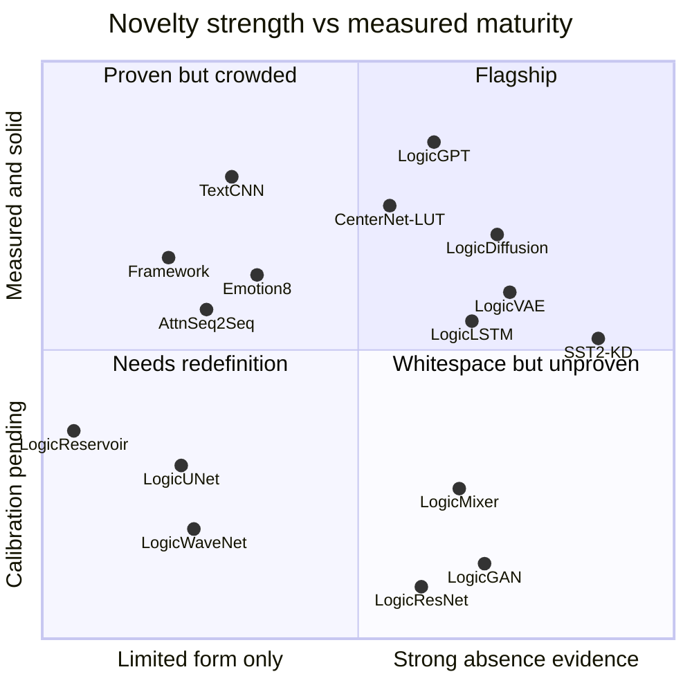

This project holds several claims of the form "the first in the world to do X with logic gates."
This page is the record of what happened when we **looked for counterexamples** rather than
**defending** them. Verdicts, nearest prior work, the exact qualified wording, and the
**claim we retracted** are all published as they are.

The point is to make the strength of the claims comparable side by side, so the basis of each
verdict (search queries, survey date, the load-bearing qualifier) is stated per claim, and claims
resting on thin evidence are laid out in a way that makes their thinness visible.

## 1. Method of the audit

### 1.1 Falsification search (looking for counterexamples, not confirmations)

If you collect support for a claim, confirmation bias quietly turns "we did not find it" into
"it does not exist." So for each claim the searches are run in the posture of
**hunting for the paper that kills it**.

- **4–10 queries per claim** (general web search + arXiv API full-text/abstract search + close
  reading of individual abs pages)
- **The absence of a hit is itself recorded as a negative finding**
  (e.g. the arXiv API query `abs:"logic gate" AND abs:"text classification"` returned **0 total hits**,
  and `abs:"logic gate network" AND abs:"distillation"` also returned **0 total hits**)
- The Related Work sections of adjacent papers are followed to check, second-hand, for hidden direct competitors
- The full list of queries used and the survey date are kept per claim (so a third party can re-run the same searches later)

### 1.2 Three-valued verdicts

| Verdict | Meaning |
|---|---|
| **Survives (no counterexample)** | No counterexample was found within the scope of the exhaustive search |
| **Conditionally survives (close prior work)** | Survives as long as the qualifiers are kept. Drop even one qualifier and it is refuted |
| **Refuted (counterexample exists)** | A counterexample exists. The claim is retracted or narrowed |

For "conditionally survives" we always write down **which qualifier is load-bearing**.
For instance, the claim about autoregressive generation on FPGA rests on the
**triple qualifier** "real FPGA hardware × text generation × non-instruction-set", and dropping any
one of the three puts it in the line of fire of existing work.

### 1.3 Rechecking freshness

This field moves fast, and in 2025–2026 one gap after another was filled.
So past verdicts are not treated as fixed: the policy is to **re-audit periodically and downgrade**.
In the most recent recheck (2026-09-05) no claim was refuted over the two-month interval, but
one was downgraded from ✅ to 🟡, and one was judged to need its comparison text revised.

### 1.4 Limits of this audit (stated up front)

- **Preprints from the last few weeks are out of scope.** Work under review or unpublished parallel work cannot be caught
- **Non-English literature is out of scope** (Japanese only partially covered; Chinese, Portuguese and others not surveyed)
- **Full-text search of non-arXiv and paywalled literature is only indirect.** FPGA-side workshops
  (FPL / FCCM / ASAP / ICFPT) and embedded-systems journals in particular have a low arXiv rate and may be buried
- **No systematic patent search has been done.** Patents on RAM-based NN classifiers do exist, so
  anyone considering a filing needs a separate professional search
- **Some verdicts stop at the abstract.** Close reading of the full text may force the qualified form to be narrowed further

## 2. Definition of the strength badges

The "strength of the evidence" for a claim is made explicit as an axis separate from the verdict itself.

| Badge | Meaning |
|---|---|
| **S1** | Paper-grade absence evidence (search queries, survey date, and the scope limits of the claim all written out) |
| **S2** | Audited by falsification search (nearest prior work stated; qualified form mandatory) |
| **🟡** | Close prior work exists (survives only in qualified form) |
| **S3** | Claim only, not audited |
| **Retracted** | Retracted after a counterexample was found |
| **—** | Reproduction or port (no world-first claim) |

S3 and — do not appear in these tables. **S3** is the badge for claims that have not been through
the audit, and the policy is to send them to the audit before they are listed on this page.
**—** goes to work that never claimed a world first in the first place, such as DLGN reproductions
or ports of existing methods.

## 3. Verdict tables

Every row means "as of the survey date, in the qualified form as written, an exhaustive search found
no counterexample" — it is not a proof of absolute absence (§6).

### 3.1 Architecture family (13 claims, surveyed 2026-07-10 / rechecked 2026-09-05)

| # | Claim (the qualified wording) | Strength | Nearest prior work | Audit date |
|---|---|---|---|---|
| A1 | The first **autoregressive decoder-only** logic-gate language model that **turns the entire attention block (projection, scores, normalization) into a circuit**. We do not write "the world's first GPT" | S2 | RDDLGN 2508.06097 / LL-ViT 2511.00812 / Boolean attention **2511.17550** | 2026-07-10 / rechecked 2026-09-05 |
| A2 | The first case of carrying Gumbel gate-selection calibration, demonstrated only on classification, over to **the attention projections of an LM** | S2 | Mind the Gap 2506.07500 (NeurIPS 2025) / Align Forward 2603.14157 | 2026-07-10 / rechecked 2026-09-05 |
| A3 | The first recurrent cell that realizes the **three-gate forget/input/output structure** with LutLayer and collapses into a strictly MUX circuit at eval | S2 | RDDLGN 2508.06097 (Elman-type) / R-DTLGN 2605.24649 | 2026-07-10 / rechecked 2026-09-05 |
| A4 | ~~The first logic-gate reservoir in the world~~ → **retracted** (§4). The contribution is limited to "integration into a differentiable framework, HDL output from the same IR, and sharing learning rules with the other components" | **Retracted** | LUTNet-RC (IEEE ICFPT 2023) / RBN reservoirs (2000s onward) / CMOS-gate RC (ACM 2021) | 2026-07-10 |
| B1 | The first diffusion model that **closes all three elements — forward process, reverse process and denoiser — in Boolean circuits at once** | S2 | LogicIR 2606.26609 (discriminative restoration, no generative process) / BDPM 2501.13915 (denoiser is an ordinary NN) / p-bit diffusion 2603.27996 | 2026-07-10 / rechecked 2026-09-05 |
| B2 | The intersection of "**binary latent**" × "**logic-circuit encoder/decoder**" is untrodden | S2 | Latent Bernoulli AE (ICML 2020, binary latent × ordinary NN) / DiffLogic CA 2506.04912 | 2026-07-10 / rechecked 2026-09-05 |
| B3 | No GAN exists in which **both G and D are learned logic circuits** | S2 | BinaryGAN 1810.04714 (only the output layer is binary; G/D are MLPs) | 2026-07-10 / rechecked 2026-09-05 |
| B4a | **Token-mix / channel-mix decomposition** × learned logic gates is a first | S2 | CDDLGN 2411.04732 (convolutional, not a mixer decomposition) | 2026-07-10 / rechecked 2026-09-05 |
| B4b | **Structural residual merging across layers (OR/XOR joins) in a convolutional logic gate network, with identity idempotence guaranteed by pass-through initialization**, is untrodden. Existing depth-scaling methods are either residuals as an initialization bias or topology changes via a direct anchor to the input, and none carry an identity path across layers as actual wiring | S2 | CDDLGN 2411.04732 (residual *initialization*) / **IALGN 2607.21633** (structural topology change via input anchor, 150 layers) | 2026-07-10 / **revised 2026-09-05** |
| B4c | The first model to introduce nearest upsample and skip concat that strictly preserve {0,1} into a gates-only encoder-decoder and apply it to **segmentation (dense prediction of discrete classes)**. The rationale ~~that dense prediction with logic networks is itself untrodden~~ **does not hold** | **🟡** | **LogicIR 2606.26609** (per-pixel dense prediction with an all-gate UNet-type network; the task, however, is image restoration) | 2026-07-10 / **downgraded 2026-09-05** |
| B4d | No external work exists on **a detector built with DLGN from backbone through detection head (center heatmap + size/offset regression) and evaluated by mAP**. Our own CenterNet-LUT is the prior art here | S2 | LGN Video Copy Detection 2604.21694 (retrieval task, no bboxes) / the CDDLGN paper itself lists localization as future work | 2026-07-10 / rechecked 2026-09-05 |
| B4e | Not "logic-gate audio generation" in general, but weight on the **logic mapping of the WaveNet structure (dilated causal conv + gated activations)** | **🟡** | GSoC 2024 bytebeat difflogic audio (Ian Clester; **stateless f(t) form, non-autoregressive**) | 2026-07-10 / rechecked 2026-09-05 |
| B5 | Not "unification + HDL" on its own, but weight on the **breadth of coverage across the architecture family** (generative + sequential + detection on a single LutLayer, IR and HDL) | **🟡** | **BitLogic 2602.07400** (unification + HDL; but even in v2 the authors state "all evaluations are limited to two-layer feed-forward networks") / BinaryBrain | 2026-07-10 / rechecked 2026-09-05 |

> The primary record counts this section as "14 claims", but the actual verdict table has the 13 rows
> above (a leftover from the cleanup that followed A4's retraction).

### 3.2 Attention family (3 claims, surveyed 2026-07-03 / rechecked 2026-09-05)

| # | Claim (the qualified wording) | Strength | Nearest prior work | Audit date |
|---|---|---|---|---|
| C1 | No attention exists that replaces **the Q/K/V projection matrices themselves** with learned differentiable logic gate / LUT layers and eliminates inner-product weight multiplication. Existing work either binarizes **only the activations** after projection, or **restricts LUT-ization to the FFN/MLP** | S2 | DWN 2410.11112 (supplies the components; extension to Transformers explicitly listed as future work) / BinaryFormer, HAD, BinaryAttention (activations only) / LL-ViT 2511.00812 (FFN only) | 2026-07-03 / rechecked 2026-09-05 |
| C2 | No example exists of building **all three elements** — projection, scores and normalization — out of **learned logic gate / LUT layers** rather than quantization (sign/ternary), and training end-to-end **without abolishing attention** | S2 | MatMul-free LM 2406.02528 (ternary quantization + attention abolished) / 2607.01798 (piecewise-linear LUT **approximation** of softmax) / 2511.17550 | 2026-07-03 / rechecked 2026-09-05 |
| C3 | No example exists of running **autoregressive text generation** **on real FPGA hardware** with a learned logic circuit as a **fixed combinational circuit after collapse (argmax discretization)**. Instruction-set accelerators, attention-only coprocessors and software collapse demonstrations each fail to satisfy all of these at once | **🟡** | **RDDLGN 2508.06097** (collapse + autoregressive generation already demonstrated in software; FPGA is future work. Accepted at ACM EMFM'26) / MatMul-free LM (FPGA, but instruction-set based) / CAMformer (ASIC) | 2026-07-03 / rechecked 2026-09-05 |

> **C3 has an expiry date.** It dies the moment the RDDLGN line ships an FPGA implementation.
> Also, this repository goes only **as far as collapse in software**; we do not claim it runs on real FPGA hardware.

### 3.3 NLP and detection family (5 claims, surveyed 2026-09-05)

| # | Claim (the qualified wording) | Strength | Nearest prior work | Audit date |
|---|---|---|---|---|
| W1 | The first case of applying **a differentiable logic gate network (DLGN, gradient training + argmax discretization)** to **text classification**. Read broadly as "the first LUT-based text classification", it is **refuted** | **🟡** | WiSARD tf-idf text classification (ESANN 2021, one-shot learning, non-gradient) / Tsetlin Machine Embedding 2301.00709 / RDDLGN 2508.06097 (translation, not classification) | 2026-09-05 |
| W2 | No example exists of running **multi-class (8-emotion) sentiment classification with text as input** on a DLGN and reporting post-discretization accuracy. "Emotion recognition with DLGN" in general is **not a first** | **🟡** | **2607.18149** (DLGN × 3-class emotion recognition from EEG, 2026-07) / existing work on WRIME is BERT/DeBERTa-based only | 2026-09-05 |
| W3 | No public literature exists that **quantitatively validates knowledge distillation with a differentiable logic gate network as the student on a language task (SST-2 sentence classification)**. Existing language KD uses a quantized/binarized Transformer or a BiLSTM as the student, not a student whose truth tables are learned by gradient and discretized into a circuit by argmax | **S1** | GSoC 2024 difflogic KD proposal (acoustic / generative music, non-peer-reviewed, no quantitative evaluation) / TernaryBERT 2009.12812 (ternary quantization) — arXiv `abs:"logic gate network" AND abs:"distillation"` returns **0 hits** | 2026-09-05 |
| W4 | An implementation that **builds the cross-attention of an encoder-decoder seq2seq (machine translation) out of XNOR-similarity logic gate circuits and combines gradient training via differentiable relaxation with argmax discretization**. "The world's first implementation of attention with logic gates" **cannot be sustained** | **🟡** | **2511.17550** (XNOR-type Boolean Q-K attention; **about 5 months ahead of us**, but on images, self-attention type, trained by **evolutionary computation**, with no autoregressive generation) / RDDLGN (no attention) | 2026-09-05 |
| W5 | No external work exists on **an object detector built with DLGN from backbone through detection head and evaluated by mAP**. RAM (LUT)-based **object tracking and surveillance** has existed since 2014, so we do not write "the world's first object detection with LUTs" | **🟡** | 2604.21694 (retrieval) / LogicIR 2606.26609 (restoration) / GLANCE 2603.15717 (only gaze estimation is made weightless; the detector itself is an ordinary NN) / WiSARD object tracker 1403.3118 | 2026-09-05 |

> **The lesson of W4**: an unqualified "world's first implementation" collapses under a single prior
> publication from five months earlier. In exchange for not being able to claim primacy of the idea,
> we rewrote it to state the differences (that it is cross-attention, that it is gradient-trained,
> that it showed an advantage under matched conditions) as the qualified form.

## 4. Record of a retraction — A4, "the logic reservoir"

**Keeping this section is what makes the other verdicts worth believing.**
If we went around erasing retracted claims, the surviving claims could be assumed to get the same treatment.

- **The original claim**: a configuration that uses a frozen random logic circuit as a reservoir and trains only the readout layer is a world first
- **Verdict**: **Refuted (counterexample exists)**. Found in the re-survey of 2026-07-10
- **Counterexamples**:
  - **LUTNet-RC** (IEEE ICFPT 2023) — LUT-based reservoir computing
  - **Random Boolean Network (RBN) reservoirs** — classical work since the 2000s (Snyder et al. ~2013 and others, two decades of accumulation)
  - **Reservoirs built from CMOS gates** (ACM 2021)
- **Why we missed it**: we were searching in our own vocabulary of "differentiable logic gate networks",
  so we never reached the **vocabulary of the RBN / reservoir computing side** (a different lineage in an
  adjacent field). This failure is what prompted us to widen falsification search into
  "search in the vocabulary of adjacent fields too"
- **The corrected claim**: the core of "frozen random logic circuit + learned readout" belongs to prior work.
  Our contribution is limited to **integration into a differentiable framework, HDL output from the same IR,
  and sharing learning rules with the other components (GPT/LSTM)**. Any write-up must cite LUTNet-RC and RBN reservoirs
- **Fallout**: the "world first" phrasing left in model docstrings, the roadmap and reports was retracted and rewritten.
  Overstatements of the same kind (WaveNet, detection, text classification) have since been corrected to qualified forms one by one in later audits

## 5. Four-quadrant map

**Horizontal axis = strength of novelty** (left: survives only in qualified form → right: strong absence evidence),
**vertical axis = how far the measurements have got** (bottom: calibration pending / no full run → top: measured and solid).

The meaning of each quadrant and what sits in it, in text as well.

| | **Measured and solid (top)** | **Calibration pending / no full run (bottom)** |
|---|---|---|
| **Strong novelty (right)** | **Flagship**. LogicGPT (A1/A2), fully logical diffusion (B1), LogicVAE (B2), LogicLSTM (A3), SST-2 KD (W3). The first candidates for a paper come from here | **Whitespace but unproven**. LogicMixer (B4a), LogicGAN (B3), LogicResNet (B4b). The area where we should **stop talking about novelty and produce numbers first** |
| **Survives only in qualified form (left)** | **Compete on results**. TextCNN (W1), 8 emotions (W2), CenterNet-LUT (B4d/W5), Attention Seq2Seq (W4), framework breadth (B5). Lead with **the numbers reached and the differences**, not with "first" | **Needs redefinition**. LogicUNet (B4c), LogicWaveNet (B4e), LogicReservoir (A4, retracted). Either narrow the qualified form or drop the claim |

There are two points to take from this.

- **A thin top-right is the honest picture of where we are.** The stronger the novelty claim, the
  shallower the measurements tend to be; conversely, text classification and detection, where the
  measurements are solid, have close prior work
- **The bottom-left is the zone for deciding to drop a claim.** The retracted A4 is still there because
  the implementation and the measurements themselves (frozenness, fading memory, convergence from
  training the readout alone) remain valuable after the retraction — only the novelty claim was withdrawn

## 6. "World first" is not a proof of absolute absence

Every verdict on this page is limited to the following meaning.

> **As of the survey date, in the qualified form as written, an exhaustive search with the queries as written failed to find a counterexample.**

This is not a proof of non-existence. As stated in §1.4 above, preprints from the last few weeks,
non-English literature, paywalled literature, patents and unpublished implementations are all out of scope.

Accordingly, when the novelty of this project is mentioned in external materials, papers or talks,
the operational rule is to observe these three points.

1. **Write it in the qualified form.** Use the "qualified wording" from the verdict tables verbatim and do not drop the qualifiers
   (several claims are refuted the moment a single qualifier is removed)
2. **Always state the nearest prior work alongside it.** Never write "first" without showing the difference
3. **Attach the survey date.** Verdicts have a shelf life. The field moves fast, and a two-month recheck already downgraded one claim

When a new claim is raised, look for the counterexample first. If one turns up, write it on this page instead of hiding it.

{/* i18n:source=explanation/results/world-firsts.mdx hash=ca1cc2f087bd */}
