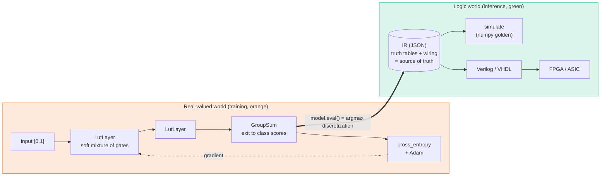

This page is a **map of the concepts**. It gives you the names and how they relate to each other,
and leaves the mathematics and the step-by-step procedures to the pages they belong to.

In one sentence, here is what the library does:

> **Train the logic circuit itself by gradient descent, then take it out as a pure Boolean circuit
> the moment training ends.**

During training everything is real-valued (orange); once extracted it is bits (green). This site
consistently distinguishes the two worlds by color: **orange = real-valued, green = logic**.

## The overall map



There is exactly one bridge from orange to green: **discretization via `eval()`, and the IR**.
Because that boundary is a single point, you can swap out the training side and leave the circuit
side untouched.

## The five concepts

| Concept | In one line | Where it matters | More |
|---|---|---|---|
| **soft / hard duality** | Training uses a weighted average over all gates (differentiable); inference picks one with argmax | `model.train()` / `model.eval()` | [What is DLGN?](/en/explanation/dlgn/) |
| **LutLayer** | One output neuron = one N-input LUT (truth table). What is learned is not weights but *which gate* | Model definition | [LutLayer internals](/en/explanation/lut-layer/) |
| **GroupSum** | Splits the final gate outputs evenly across k classes, sums them and divides by `tau`. The exit from logic to class scores | End of the model | [Parameterization](/en/guides/parameterization/) |
| **IR** | JSON containing nothing but truth tables and wiring. **The source of truth for everything downstream** | After training | [Working with IR](/en/guides/ir/) |
| **HDL** | Synthesizable Verilog / VHDL generated from the IR | Deployment | [HDL export](/en/guides/hdl-export/) |

### 1. The soft / hard duality

"Pick a gate" is a discrete operation, so gradients cannot flow through it as-is. During training
we therefore mix all candidate gates with a probability distribution (softmax), and **at inference
argmax settles on exactly one**.

```python
model.train()
acc_soft = (model(x).argmax(-1) == y).float().mean()   # accuracy of the relaxation itself
model.eval()                                            # ← here it collapses into a circuit
acc_hard = (model(x).argmax(-1) == y).float().mean()   # accuracy of the circuit you would burn
```

**Always look at hard.** The gap between soft and hard is called the *discretization gap*, and
keeping it small is quality itself (→ [Reading training curves](/en/guides/training-curves/)).

### 2. LutLayer — learning the *kind of gate*, not weights

Each output neuron of `LutLayer(in_dim, out_dim, n_inputs=N)` is one N-input LUT. Every gate picks
up **only N** of the input lines, sparsely (the wiring is fixed at initialization); what is learned
is the contents of the truth table over those N inputs.

| N | Number of candidates | Where it sits |
|---|---|---|
| 2 | the 16 two-input Boolean functions | difflogic-compatible. Exact, fast gradients |
| 4 | 2^16 | The balanced choice |
| 6 | 2^64 | **Maps one-to-one onto an FPGA LUT6 cell** |

### 3. GroupSum — the exit from logic to scores

Classification needs a score per class, but logic gates only ever produce bits. `GroupSum(k, tau)`
splits the final layer's outputs into k equal groups, sums each group and divides by `tau` to get
logits. It costs a single adder, so it is cheap on the circuit side too.

```python
model = nn.Sequential(
    LutLayer(400, 2000, n_inputs=2),
    LutLayer(2000, 2000, n_inputs=2),
    GroupSum(k=10, tau=10.0),   # 2000 gates → 10 classes (200 gates per class)
)
```

### 4. IR — the source of truth for everything downstream

`export_ir()` walks the trained model and emits JSON normalized into **a collection of truth
tables**, no matter which parameterization was used for training. Verilog, VHDL, the simulator and
the visual editor are all derived from that IR.

```python
ir = export_ir(model, input_width=400, name='mnist')
validate(ir, target='hdl')   # check bit widths and topological order up front
```

### 5. HDL — and then it becomes a circuit

The generated Verilog / VHDL is synthesizable RTL you can hand straight to vendor tools. That it
behaves identically to the original model is guaranteed mechanically by **three-way equivalence**:

```
PyTorch hard eval  ⇔  ir/simulate (numpy golden)  ⇔  HDL simulation
```

Only when all three agree on every vector can you say it is ready to burn.

## Read next

- [1. Train on MNIST](/en/tutorials/mnist/) — an executed tutorial where all five concepts show up
- [What should I use? (decision guide)](/en/guides/choosing/) — choosing architecture, parameterization, N and learning rule
- [What is DLGN, and how does it differ from an NN?](/en/explanation/dlgn/) — why gradients flow (the relaxation, with equations)
- [Architecture overview](/en/explanation/architecture/) — the 8-stage dataflow from training to HDL
- [Glossary](/en/explanation/glossary/) — definitions of soft/hard, fan-in, discretization gap and more

<!-- i18n:source=getting-started/concepts.md hash=a74347228cc2 -->
