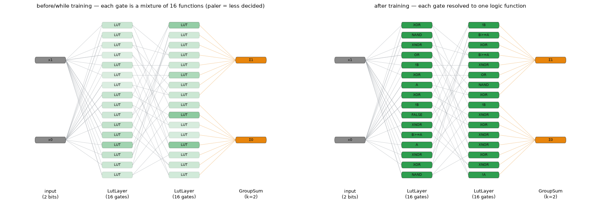
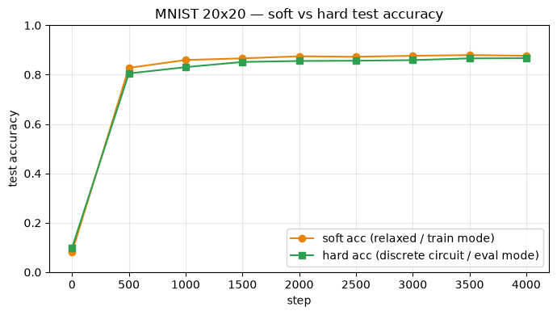

import { Steps, Aside, LinkCard, CardGrid } from '@astrojs/starlight/components';

This page assumes the package is already installed
(see [Installation](/en/getting-started/installation/)).
In the next **five minutes you'll solve XOR with logic gates**.

<Aside type="note" title="New to neural networks?">
If you have never used PyTorch or trained a neural network, the fastest route is the
[Intro Course](/en/tutorials/nn-basics/) (three pages).
It walks through **PyTorch basics → a small MLP on MNIST → replacing the same model with a DLGN**,
so that `LutLayer`, `GroupSum` and `model.eval()` already make sense when you get here.
</Aside>

## The whole thing in 30 seconds

```bash
uv sync --extra dev --extra cpu     # setup (use --extra cu128 on GPU machines)
uv run python examples/01_xor.py    # learn XOR → accuracy 1.00 on the discretized circuit
make test                           # fast test suite (under 2 minutes, always green)
```

## Stacking logic-gate layers

`LutLayer` is an ordinary `nn.Module`, so you can drop it anywhere inside an existing model.
Below is a three-layer N=4 LUT network sized for MNIST.

```python
import torch
import griffith_logic as gl   # `gl` is the idiomatic alias

# A 3-layer N=4 LUT network (MNIST-sized)
model = torch.nn.Sequential(
    torch.nn.Flatten(),
    gl.LutLayer(in_dim=784, out_dim=16000, n_inputs=4),
    gl.LutLayer(in_dim=16000, out_dim=16000, n_inputs=4),
    gl.LutLayer(in_dim=16000, out_dim=16000, n_inputs=4),
    gl.GroupSum(k=10, tau=30.0),
)
y = model(torch.rand(32, 784))   # (32, 10) class logits
```

Three things are worth internalizing.

- **`gl.LutLayer(in_dim, out_dim, n_inputs=N)`** — every output neuron is one N-input LUT (truth
  table). `N=2` is difflogic-compatible; `N=6` maps onto an FPGA LUT6.
- **`gl.GroupSum(k, tau)`** — splits the final gate outputs evenly across `k` classes, sums each
  group and divides by `tau` to produce logits. It's the exit from the world of logic gates into
  classification scores.
- **`model.eval()`** — during training gradients flow through a continuous relaxation (softmax and
  friends); **switching to eval applies argmax discretization and the model collapses into a pure
  Boolean circuit**. The accuracy after that collapse (hard accuracy) is the real performance.

<Aside type="tip" title="Always watch soft and hard together">
If accuracy under `model.train()` (soft) is high but drops under `model.eval()` (hard), the
continuous relaxation is stuck in an intermediate state. Logging hard accuracy periodically
during training is standard practice.
</Aside>

## Solving XOR in five minutes

XOR is the smallest problem that isn't linearly separable, and the classic way to sanity-check the
expressive power of a logic-gate circuit.

<Steps>

1. Run the example as-is.

   ```bash
   uv run python examples/01_xor.py
   ```

2. Check the output.

   ```text
   XOR: soft acc=1.00, hard acc=1.00
   ```

   `hard acc=1.00` means **all four input patterns are correct even after discretizing into a pure
   Boolean circuit**.

3. Read through it one cell at a time — there's a walkthrough with real executed output.

   → [Appendix: XOR Internals](/en/tutorials/xor/)

</Steps>

The actual code is about 30 lines, and the whole idea is "train with a continuous relaxation, then
collapse into a circuit with `eval()`".

```python
model = nn.Sequential(
    gl.LutLayer(2, 16, n_inputs=2),   # softmax over 16 gates (difflogic-compatible)
    gl.LutLayer(16, 16, n_inputs=2),
    gl.GroupSum(k=2, tau=2.0),
)
opt = torch.optim.Adam(model.parameters(), lr=0.05)
for step in range(500):
    opt.zero_grad()
    F.cross_entropy(model(x), y).backward()
    opt.step()

model.eval()   # discretize (argmax collapses it into a complete Boolean circuit)
acc_hard = (model(x).argmax(-1) == y).float().mean()
```

### Those 30 lines become this circuit



On the left, before training: each node is still a **mixture** of the 16 candidate Boolean
functions, so it can only be labelled `LUT`, and the paler the color the less decided the node is.
On the right, after training: argmax has settled on one function per node, so each node now carries
its name (`AND` / `XOR` / `NAND` / `!A` …).
**Training is the act of picking one gate out of 16, over and over.**
Green = logic gates, orange = the real-valued part (GroupSum), gray = input bits and wiring.

### Watch hard, not soft

Here is the test accuracy when the exact same code is scaled up to MNIST (400-bit input,
4000 gates). Orange is the continuous relaxation used during training (soft); green is **the
discretized circuit itself** after argmax (hard), and the latter is the real performance.



→ The full, already-executed walkthrough is in [1. Train on MNIST](/en/tutorials/mnist/).

## Emitting it as a circuit

A trained model can be turned into Verilog / VHDL by way of the IR (JSON). This is the exit ramp
where the GPU disappears.

```python
from griffith_logic.export import export_ir
from griffith_logic.export.verilog import write_verilog
from griffith_logic.ir import validate

model.eval()
ir = export_ir(model, input_width=2, name='xor')
validate(ir, target='hdl')
write_verilog(ir, 'out_examples/xor.v')
```

To follow training, Verilog generation and equivalence checking end to end in one go, head to the
[end-to-end walkthrough](/en/tutorials/full-pipeline/).

## Next steps

<CardGrid>
  <LinkCard title="Intro Course (no ML background needed)" href="/en/tutorials/nn-basics/" description="Three pages: PyTorch basics → an MLP on MNIST → replacing the same model with a DLGN." />
  <LinkCard title="1. Train on MNIST" href="/en/tutorials/mnist/" description="Ten minutes: a 4000-gate circuit learns to read handwritten digits (with three figures)." />
  <LinkCard title="Appendix: XOR Internals" href="/en/tutorials/xor/" description="Five minutes: watch the soft→hard collapse on a 16-gate circuit, every node drawn." />
  <LinkCard title="End-to-end walkthrough" href="/en/tutorials/full-pipeline/" description="Training → reading the loss logs → HDL export → FPGA." />
  <LinkCard title="Core Concepts" href="/en/getting-started/concepts/" description="Continuous relaxation and discretization, N-input LUTs, the IR as source of truth." />
  <LinkCard title="Training" href="/en/guides/training/" description="Commands and settings for real tasks such as MNIST." />
</CardGrid>

{/* i18n:source=getting-started/quickstart.mdx hash=61dd711a3a0b */}
