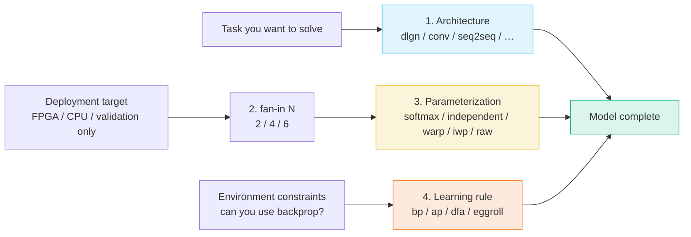
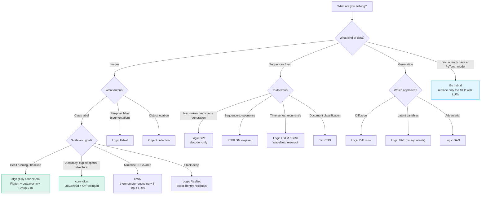
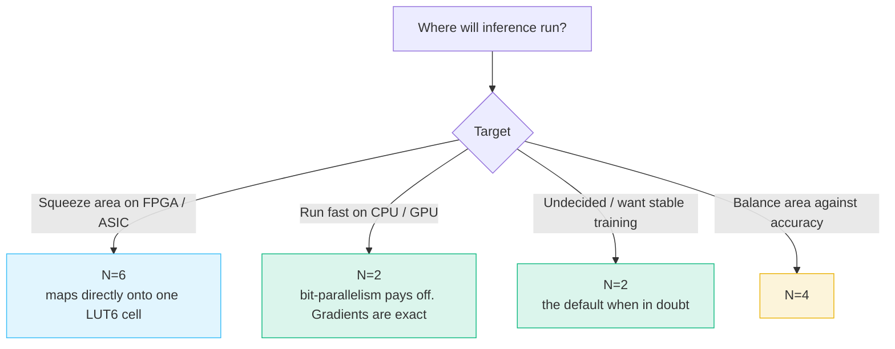
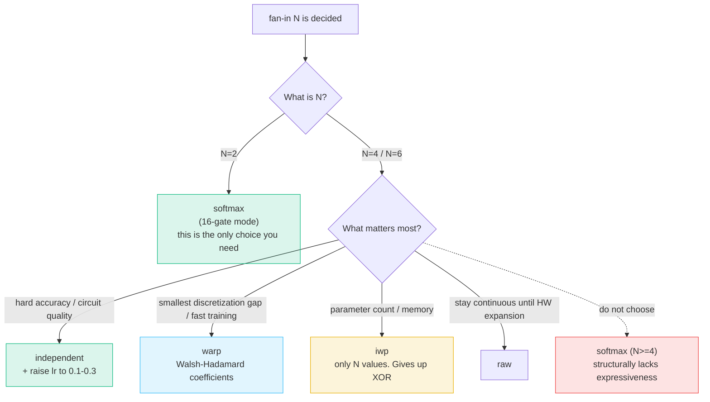
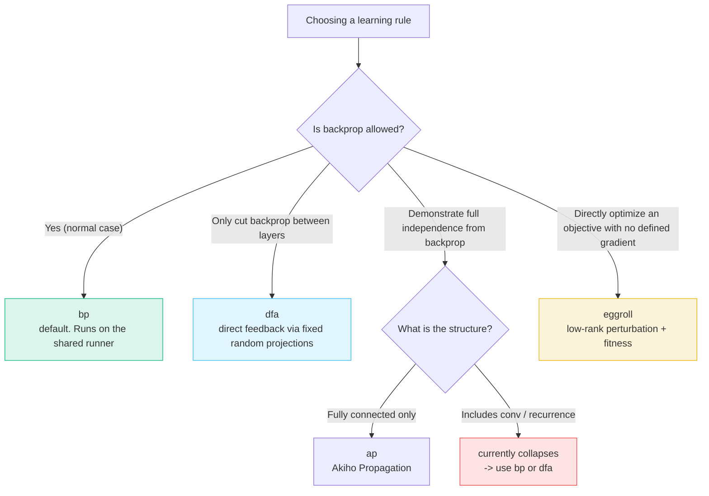

This library offers a lot of options: **20+ architectures × 5 parameterizations ×
3 fan-in (N) values × 4 learning rules**. You do not need to understand all of them before starting —
in practice your **task** and your **deployment constraints** settle nearly everything.

This page is the decision table that answers "what should I use?" **in a single page**.

:::tip[If you have no idea, start here]
**A few `LutLayer(n_inputs=2, parameterization='softmax')` layers + `GroupSum(k, tau=10)`, trained with `bp`.**

```python
import torch.nn as nn
from griffith_logic import GroupSum, LutLayer

model = nn.Sequential(
    nn.Flatten(),
    LutLayer(784, 8000, n_inputs=2),   # parameterization='softmax' is the default
    LutLayer(8000, 8000, n_inputs=2),
    LutLayer(8000, 8000, n_inputs=2),
    GroupSum(k=10, tau=10.0),          # exit into 10-class classification
)
```

```bash
uv run griffith train configs/recipes/dlgn_mnist_quick.yaml
```

This is the difflogic-compatible baseline, and it is also the **configuration that leads on accuracy**
(hard 97.74% on MNIST, 6 layers, 50 epochs). Only when you have a concrete reason to deviate
should you go back to the flowcharts below and re-choose.
:::

## There are only four choices



The four are **orthogonal** (see [Architecture overview](/en/explanation/architecture/)).
Changing the architecture does not change how you pick the parameterization, and vice versa,
so you can decide them one at a time.

---

## 1. Task → architecture



| Destination | Components | Page to read |
|---|---|---|
| dlgn (fully connected) | `LutLayer` + `GroupSum` | [1. Train on MNIST](/en/tutorials/mnist/) |
| conv-dlgn | `LutConv2d` + `OrPooling2d` | [5. HDL export for a CNN](/en/tutorials/cnn-hdl-export/) |
| DWN | `ThermometerEncoder` + `DWNLayer` | [DWN (thermometer encoding)](/en/tutorials/dwn/) |
| Logic ResNet | Residual blocks (exact identity) | [ResNet (exact identity)](/en/tutorials/logic-resnet/) |
| Logic U-Net | Encoder/decoder + spatial output | [U-Net (dense prediction)](/en/tutorials/logic-unet/) |
| Object detection | Detection head | [Object detection](/en/tutorials/detection/) |
| Logic GPT | `LutStack` + causal self-attention | [Logic-gate GPT](/en/tutorials/logic-gpt/) |
| RDDLGN | Recurrent encoder-decoder | [seq2seq (RDDLGN)](/en/tutorials/rddlgn-seq2seq/) |
| Recurrent family | LSTM/GRU, causal conv, reservoir | [LSTM / GRU](/en/tutorials/logic-lstm/) · [WaveNet](/en/tutorials/logic-wavenet/) · [Reservoir](/en/tutorials/logic-reservoir/) |
| TextCNN | Character/word conv | [TextCNN](/en/tutorials/textcnn/) |
| Generative family | Diffusion / VAE / GAN | [Diffusion models](/en/tutorials/logic-diffusion/) · [VAE](/en/tutorials/logic-vae/) · [GAN](/en/tutorials/logic-gan/) |
| Hybrid | `replace_mlp_with_lut` | [2. Build a hybrid NN](/en/tutorials/hybrid/) |
| Mixer | Token mixing in logic | [Mixer](/en/tutorials/logic-mixer/) |

:::caution["Converting" a pretrained model is not a shortcut]
"Convert a strong MLP into a DLGN and it will be strong" does not hold. We measured three routes
in house (distillation / transfer initialization of sparsified fan-in sets / layer-wise binary distillation), and
**none of them beat training from scratch**. Transfer initialization degraded badly.
The strength of a native DLGN lies in learning each gate as free Boolean logic, and
transferring an arithmetic structure turns that freedom into a constraint
(see [DLGN taxonomy and lineage](/en/explanation/taxonomy/)).

**Two options actually work**: train from scratch, or keep the parts that should stay real-valued via
[hybridization](/en/tutorials/hybrid/). If you want to measure step by step how far you can push toward logic,
[the logic ladder](/en/tutorials/logic-ladder/) gives you an experimental template.
:::

---

## 2. Deployment target → fan-in (N)

How many inputs a single gate reads. This is **a knob decided by the deployment target, not a question of which is better**.



| Goal | Favorable N |
|---|---|
| FPGA implementation area | 6 |
| CPU / GPU inference speed | 2 |
| Training stability | 2 |

As N grows, parameters per gate grow as $2^N$ and training memory grows with it.
difflogic chose 2 inputs not because it is optimal for FPGAs, but for
**clean training (16 gates with exact gradients) and CPU/GPU speed**
(see [DLGN taxonomy and lineage](/en/explanation/taxonomy/)).

---

## 3. N → parameterization

Which continuous space holds the truth table. **This choice directly determines your discretization gap.**



### Character of the five methods

| Method | How weights are held | Parameters/gate | Representable hard functions | Origin |
|---|---|---|---|---|
| `softmax` (N=2) | softmax over 16 gates | 16 | **all 16 functions** | difflogic (DLGN) |
| `softmax` (N≥4) | softmax over $2^N$ entries | $2^N$ | **a single minterm or FALSE only** | — |
| `independent` | sigmoid per entry | $2^N$ | all $2^{2^N}$ functions | BinaryBrain |
| `iwp` | product of per-input sigmoids | $N$ | product-form functions only (no XOR) | LDDLGN |
| `raw` | holds $[0,1]$ reals directly | $2^N$ | all $2^{2^N}$ functions | BinaryBrain |
| `warp` | Walsh–Hadamard coefficients + Gumbel | $2^N$ | all $2^{2^N}$ functions | WARP |

The essential difference is **whether the values compete or are independent**.

```
softmax:      [0.01, 0.02, 0.07, 0.90]  sum=1        "split 100 points across 4 boxes"
independent:  [0.10, 0.80, 0.30, 0.95]  independent  "flip 4 switches separately"
```

With softmax, raising one lowers the others, so **a single backward pass sends coupled gradients to every parameter**.
With independent, the gradient reaches only the relevant entry, but in exchange **any bit pattern is reachable**.

### Counting parameters

Per gate (multiply by 10,000 for a 10,000-gate model).

| N | `softmax` | `independent` / `raw` / `warp` | `iwp` |
|---|---|---|---|
| 2 | 16 (16-gate table) | 4 | 2 |
| 4 | 16 | 16 | 4 |
| 6 | 64 | 64 | **6** |

At N=6 with 10,000 gates that is **640K vs. 60K**. `iwp` is more than 10× lighter and trains faster,
but the price is that it cannot represent functions where the combination is the point, such as XOR.
LDDLGN's rationale is the observation that most gates in a trained model converge to AND/OR/NOT,
betting on the empirical finding that very few gates actually converge to XOR-like functions.

### Established finding: never choose softmax with N≥4

With N≥4, softmax is not a 16-gate table but **a simplex over $2^N$ entries**.
Since the entries sum to 1, discretization (probability > 0.5) can set at most one bit —
so the only hard tables it can produce are **a single minterm or the constant FALSE**.
Everyday functions such as pass-through, OR, and XOR are structurally unreachable.

Experiments agree: in a convolutional configuration, simply swapping `softmax` for `independent` gave
**+3.2pt accuracy despite running only half as many epochs**. On fully connected MNIST, softmax N=4 reaches
only hard 94.54% with a 1.12pp gap, losing to warp N=4 under identical conditions (95.50% / 0.14pp).
The point of this finding is that **missing expressiveness cannot be compensated by more training**.

### Established finding: raise the learning rate for independent

`independent` goes through a sigmoid, and combined with a saturation-prone initialization,
**gradients decay rapidly through deep serial composition**. In measurements the gradient norm dropped to around $10^{-5}$,
and at the default lr=0.02 soft accuracy did not move even after 10 epochs. **Training progresses at lr ≥ 0.3.**

```bash
uv run griffith train configs/recipes/dlgn_mnist_quick.yaml \
    model.n_inputs=6 model.k=4000 model.parameterization=independent optim.lr=0.3
```

### If you choose by discretization gap

| Choice | Measured gap | Notes |
|---|---|---|
| `warp` N=2 | **−0.06pp** | hard beats soft |
| `warp` N=4 | **0.14pp** | 11-48% of the FLOPs of softmax |
| `softmax` N=2 | 0.56pp | Best accuracy (hard 97.74%) |
| `softmax` N=4 | 1.12pp | Not recommended, for the reason above |
| DWN | **0.0** | Structurally has no gap |
| `selection='hard_st'` | **0** | forward=argmax / backward=STE (the CAGE approach) |

Details and the full comparison are in [Choosing a parameterization](/en/guides/parameterization/).

---

## 4. Environment constraints → learning rule

To learn "which gate this becomes", you must decide **how error is distributed** to each gate's weights.
The default is `bp`, and the sole motivation for anything else is **not wanting to implement the backward path in the circuit too**.



| Learning rule | Needs differentiation? | Constraints | When to use |
|---|---|---|---|
| `bp` | Yes (all paths) | None. The only rule the shared runner `run_training` handles | **Default.** When accuracy comes first |
| `dfa` | Locally only | 2D/3D outputs, `block_upstream=True` only | When you want to cut backprop between layers. Within-layer gradients stay exact |
| `ap` | No | Requires `parameterization='independent'`. Serial fully connected only | Demonstrating independence from backprop |
| `eggroll` | No (forward only) | 2D parameters only. Evaluation count is the cost | When you want to optimize hard accuracy itself directly |

:::caution[What AP reaches and where it stops (read before quoting numbers)]
On fully connected MNIST it settles at **soft ≈ 0.90 / hard ≈ 0.85**, while BP under identical conditions reaches
soft 0.983 / hard 0.977 — **AP falls 6-8pt short of BP**.
Worse, **on a conv-tree + OrPooling configuration it collapses to accuracy ≈ 0.11 (chance)**.
The cause was not a break in monotonicity but that **error routing through OR-style aggregation
produces no useful learning signal** — in other words, **connection structure and learning rule cannot be designed independently**.

"98% on MNIST with AP" is wrong. Every 98% figure comes from BP.
Always state the learning rule when you quote numbers.
:::

The learning rule is specified **per layer**, not for the whole model, so `with_learning` + `HybridTrainer`
lets you mix them — "bp for feature extraction, dfa for the output head only"
(see [Learning rules (BP/AP/DFA/ES)](/en/explanation/learning-rules/)).

---

## What to do once you have decided

| Task | Page |
|---|---|
| Typical hyperparameter ranges (lr / τ / k / depth / epochs) | [Run training](/en/guides/training/) |
| How to read the soft and hard curves | [Reading training curves](/en/guides/training-curves/) |
| Dump the trained result into IR (JSON) and validate it | [Working with IR](/en/guides/ir/) |
| Generate Verilog / VHDL and check equivalence | [HDL export and equivalence checking](/en/guides/hdl-export/) |
| Flash it onto a real FPGA | [Deploying to an FPGA](/en/guides/fpga/) |
| Send large training jobs to the cloud | [Cloud GPU](/en/guides/cloud-gpu/) |
| Rearrange the structure in the browser and experiment | [Visual editor](/en/guides/editor/) |

:::note[A principle common to every choice]
**Always look at hard eval before you flash.** A soft score is the score of a continuous approximation,
not of the circuit. If the continuous truth tables stay clustered near 0.5, rounding destroys accuracy
(a real case: eval acc 0.803 → 0.211 after rounding).
In this library, a "good choice" means high hard accuracy *and* a small gap between soft and hard.
:::

## What to read next

- [Learning roadmap](/en/guides/roadmap/) — reading order by starting point, plus common architecture names (RNN/CNN/Transformer…) mapped to tutorials
- [Core concepts](/en/getting-started/concepts/) — the five concepts: soft/hard, LutLayer, GroupSum, IR, HDL
- [Migrating from PyTorch](/en/guides/from-pytorch/) — mapping table for `nn.Linear` and friends
- [Choosing a parameterization](/en/guides/parameterization/) — the five methods in detail, with measured comparisons
- [DLGN taxonomy and lineage](/en/explanation/taxonomy/) — how the three lineages differ, and why conversion does not work
- [Glossary](/en/explanation/glossary/) — definitions of soft/hard, fan-in, discretization gap, and more

{/* i18n:source=guides/choosing.mdx hash=2c3d0983e9d0 */}
