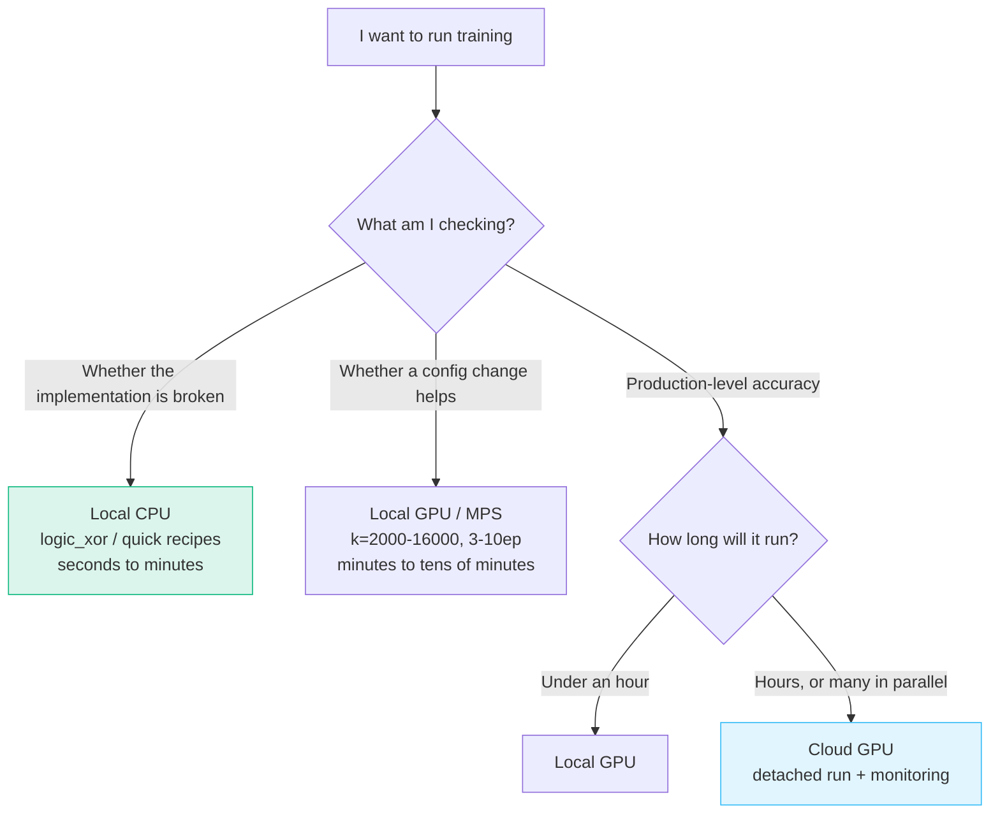
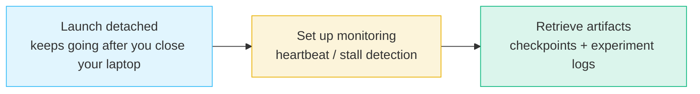

Logic-gate networks **do not need a GPU for inference** (that is the whole selling point), but
**a GPU does help for training**. Reproduction experiments at the 60k-gate, 200-epoch scale in particular
will not finish in any reasonable time on a local CPU.
This page is a guide for deciding where to run.

:::note[What you will learn here]
1. **Choosing a device** — at what scale to pick CPU / MPS (Apple Silicon) / CUDA
2. **How to send jobs to the cloud** — running the same script with the same arguments on a cloud GPU
3. **Etiquette for long jobs** — detached execution, retrieving artifacts, and how to think about monitoring
:::

## Start locally

This library **does not require CUDA**. The CUDA kernels are an optional acceleration; in environments
where they are unavailable, it automatically falls back to the Python implementation.

```bash
uv sync --extra dev --extra cpu    # CPU / MPS environment
uv sync --extra dev --extra cu128  # CUDA 12.8 environment
```

If you do not specify a device, it is **auto-detected in the order cuda → mps → cpu**.
To be explicit, set `run.device` in the config.

```bash
uv run griffith train configs/recipes/logic_xor.yaml run.device=cpu
```

### Rules of thumb for device selection

| Device | What it's for | Rough scale | Notes |
|---|---|---|---|
| **CPU** | Sanity-checking the implementation, training logic functions such as XOR and parity, CI | up to a few thousand gates / minutes | Runs deterministically, so it suits regression tests. The `logic_xor` recipe takes seconds |
| **MPS** (Apple Silicon) | Local MNIST smoke tests, checking the UI and editor | up to ~10k gates / ten-odd minutes | CUDA kernels are not used; it runs on the Python implementation |
| **CUDA** (local GPU) | The main arena for everyday experiments | 10k–60k gates / tens of minutes | The LUT kernels are JIT-compiled, making this the fastest |
| **Cloud GPU** | Paper reproduction, long runs, hyperparameter sweeps | 60k+ gates / hours | Keeps running after you close your laptop |



:::tip[Inference needs no GPU]
Once training is done and the model is lowered from IR to HDL, the circuit runs on an FPGA or as bit operations on a CPU.
A GPU is only needed **while the continuous relaxation of training is running**
(→ "no performance difference at inference time" in [Choosing a Parameterization](/en/guides/parameterization/)).
:::

## Running on a cloud GPU

A wrapper for the serverless GPU execution platform [Modal](https://modal.com/) is bundled in.
**Existing training scripts run unmodified**, with the same arguments as locally.

### Setup

```bash
# Install the cloud dependencies
uv sync --extra cpu --extra dev --extra cloud

# Authenticate (opens a browser)
uv run modal setup

# Register the secret for experiment logging (if you use wandb)
uv run modal secret create wandb WANDB_API_KEY=<your-key>
```

### Examples

```bash
# Locally (as before)
uv run python experiments/train.py --dataset mnist -e 20

# On a cloud GPU (same script, same arguments)
uv run modal run scripts/modal_app.py --script train.py --args "--dataset mnist -e 20"
```

The GPU type is selected via an environment variable.

```bash
MODAL_GPU=T4        uv run modal run scripts/modal_app.py --script train.py --args "..."
MODAL_GPU=A100-80GB uv run modal run scripts/modal_app.py --script train_cnn.py --args "..."
```

| GPU | Use |
|---|---|
| T4 | Smoke tests and debugging (cheapest) |
| A10G | Standard training (default) |
| A100-80GB | Large models, large batches |
| H100 | When you need maximum speed |

### Launching from the unified CLI

Sweeps and grid experiments can be sent to the cloud directly from the `griffith` CLI.

```bash
# Expand a grid (cartesian product) and launch
uv run griffith launch --grid "optim.lr=[0.001,0.01] model.k=[64,256]" \
    configs/recipes/dlgn_mnist_quick.yaml --modal

# Just see what would be expanded (no execution)
uv run griffith launch --grid "optim.lr=[0.001,0.01]" \
    configs/recipes/dlgn_mnist_quick.yaml --dry-run

# Run a sweep (wandb sweep) with parallel agents
uv run griffith sweep configs/sweeps/example_mnist.yaml --count 8 --modal --parallel 2
```

## Etiquette for long jobs

For jobs that run for hours, sticking to these three points prevents most accidents.



### 1. Launch detached

```bash
# Keeps running in the cloud even if you disconnect locally
uv run modal run --detach scripts/modal_app.py --background \
    --script train_cnn.py --args "-e 200"

# Extend the timeout (default 6 hours)
MODAL_TIMEOUT=43200 uv run modal run --detach scripts/modal_app.py --background --script ...
```

:::caution[Avoid synchronous calls]
If you call a cloud function synchronously (polling for the result and waiting),
**the whole job can be cancelled the moment the client stops polling**.
Launch via the asynchronous path (spawn), and go fetch the result explicitly only when you want to wait.
The bundled entry points and `griffith launch --modal` / `griffith sweep --modal` are already built this way.
:::

### 2. Set up monitoring

Do not launch and walk away: follow the logs, or run stall detection alongside.

```bash
# Follow the logs
uv run modal app logs -f <app_id>

# Warn if the logs stop growing for a while (does not stop the job)
uv run python scripts/modal_watch.py <app_id> --interval 60 --stall-min 15
```

Quiet does not mean healthy. If the heartbeat (epoch / step / loss) shows the same value for
several cycles, go look at the logs directly.

### 3. Retrieve artifacts

Training results must not disappear along with the container, so the design keeps them in both
a persistent volume and the experiment tracker.

```bash
# Inspect and fetch checkpoints on the persistent volume (<your-volume> is your own Modal Volume)
uv run modal volume ls  <your-volume> checkpoints/
uv run modal volume get <your-volume> checkpoints/<run_dir>/best.pt ./checkpoints/

# Use the unified CLI to pull down all run directories not yet fetched locally
uv run griffith collect
```

Set the volume name through the `MD_MODAL_VOLUME` environment variable (a default name is used when
it is unset). `griffith collect` reads the same variable, so exporting it once from your shell
profile or `.env` is enough.

```bash
export MD_MODAL_VOLUME=<your-volume>
```

Checkpoints can also be uploaded to the experiment tracker (wandb Artifacts).
How much gets uploaded is controlled by an environment variable.

| `WANDB_ARTIFACTS` | Behavior |
|---|---|
| `off` | Do not upload |
| `best` (default) | Upload only the best checkpoint, once, at the end of training |
| `all` | Upload periodic saves as well |

## Common stumbling blocks

| Symptom | Cause | Fix |
|---|---|---|
| The job vanished when I closed my laptop | Launched without detaching | Pass `--detach` and `--background` together |
| Cold starts are 2–3 minutes slower every time | JIT compilation of the CUDA kernels (the cache is container-local) | Expected. Run one job first before launching many in parallel |
| It was launched but never starts | The concurrent GPU limit was hit and it is queued | Detect the overage with the pre-launch check (`scripts/modal_preflight.py`) |
| It works locally but crashes in the cloud | Data or checkpoints are referenced by absolute path | Follow the relative-path convention (scripts are expected to run unmodified) |
| It should be using the GPU but it's slow | It fell back to CPU | Check the "device: ..." line in the startup log |

## What to read next

- [Running Training](/en/guides/training/) — how much of what to run
- [Choosing a Parameterization](/en/guides/parameterization/) — a choice that directly drives compute cost
- [griffith CLI Reference](/en/reference/cli/) — every flag for `launch` / `sweep` / `collect` / `report`
- [Working with the IR](/en/guides/ir/) — lowering a retrieved checkpoint into a circuit

<!-- i18n:source=guides/cloud-gpu.md hash=c7eabf05f438 -->
