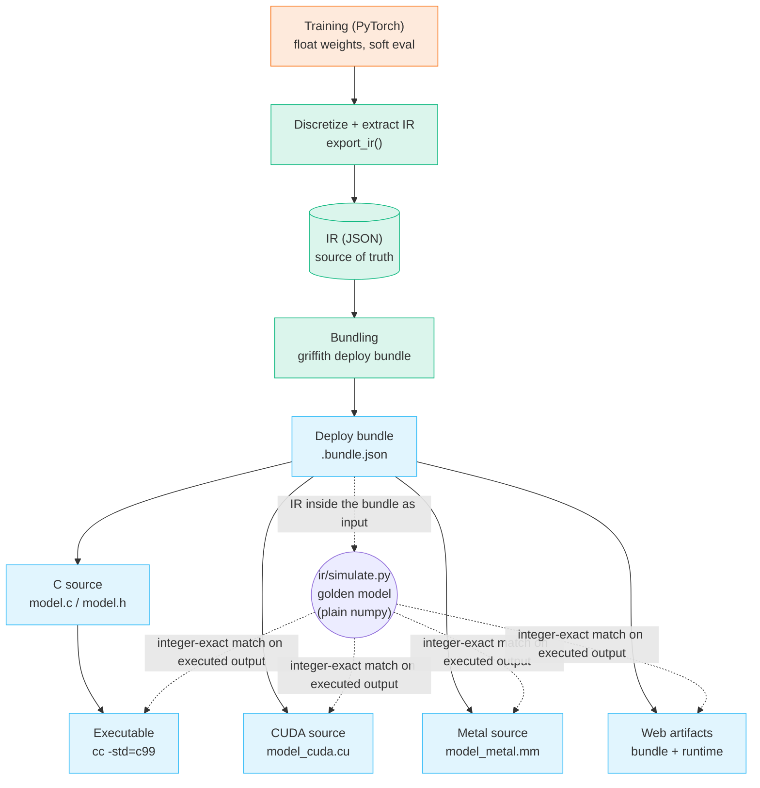

The **deploy kit** is the machinery that turns a trained DLGN into **C / CUDA / Metal / Web** code you can run on embedded
devices, phones, browsers, and GPUs. This page takes the shortest path from a trained model (IR) to a
**zero-dependency C executable**, and actually runs it on the smallest model, XOR. The whole thing takes under 10 minutes.

If [HDL export](/en/guides/hdl-export/) is the road to FPGAs and ASICs, the deploy kit is the road to **software on devices you
already have**. Both start from the same IR and are checked against the same golden model.

## What the deploy kit can do

The training side does not change at all. Starting from the **IR (JSON) as the source of truth** extracted with `export_ir()`, you branch to one of five targets.

| Target | Generate with | Output | Tooling needed | Pre-ship check |
|---|---|---|---|---|
| **C** (embedded, mobile, desktop) | `griffith deploy codegen-c` | `model.c` / `model.h` + runtime | a C99 compiler (`cc`) | `verify-c` |
| **CUDA** (NVIDIA GPU) | `griffith deploy codegen-cuda` | `model_cuda.cu` + runtime | `nvcc` | no verify command; pinned by the test suite |
| **Metal** (Apple GPU) | `griffith deploy codegen-metal` | `model_metal.mm` + runtime | `clang++` (macOS) | `verify-metal` |
| **Web** (browser) | `griffith deploy codegen-web` | bundle + WASM/JS runtime bundle | static hosting | `verify-web` |
| **HDL** (FPGA/ASIC) | `griffith export-hdl` | Verilog / VHDL | iverilog / ghdl and others | [three-way equivalence](/en/guides/hdl-export/) |

How far each target has actually been verified on real hardware is listed, with verification levels, in
[Platform support](/en/reference/platform-support/). For the ESP32 and iPhone hands-on procedures, see
[Run on ESP32](/en/guides/deploy-esp32/) and [Run on iPhone](/en/guides/deploy-ios/).

:::note[What the C runtime is like]
The C runtime is **zero-dependency C99** (the only headers it needs are `<stdint.h>` and `<stddef.h>`), does **no heap allocation at run time**,
and uses **no floating-point arithmetic**; its machine code is about 6KB. SIMD (NEON / SSE2 / AVX2) is chosen automatically at compile time and
falls back to a scalar implementation where unavailable. **The integer output is exactly identical on every path**, so SIMD only makes things faster and never changes correctness.
:::

## The overall flow

Here is the flow from training to execution. **Orange = the real-valued world, green = the logic-gate world, blue = bit strings and artifacts.**



`ir/simulate.py` in the middle is the **golden model** (the reference that defines the correct answer). It takes the IR inside the bundle as its input,
and each target's artifact is checked by **building and running it** and comparing the output, not by looking at the source
(that is why the C edge points at the executable rather than the C source).
### What each stage does

The table below summarizes what each stage in the diagram does and what it guarantees.

| Stage | What it does | What it guarantees |
|---|---|---|
| Discretize + extract IR | **Pins down** parameterization differences (softmax, warp, and so on) **into truth tables** | Before writing anything out, it **checks PyTorch hard eval against IR simulate in integers** and aborts on a mismatch |
| Bundling | **Reduces** the weight-shared gate trees of conv layers **to an instruction list** (59.7 to 95.1% fewer gates) and compiles preprocessing into **integer descriptors** | Self-checks with an exhaustive truth-table comparison before writing |
| Code generation | Turns the bundle into **self-contained source**. All optimization is finished by this point; the target just executes the instruction list | Unsupported shapes **raise at generation time** (nothing silently falls back to another path) |
| Verification (`verify-*`) | Builds and runs the generated artifact and compares it against `ir/simulate.py` | The integer output differs by **not a single bit** |

### Every stage checked against the golden model, integer-exact

Every target is verified by an exact integer match, always **against `ir/simulate.py` (the naive numpy implementation)**.

```
PyTorch hard eval ⇔ ir/simulate ⇔ C (scalar / NEON / SSE2)
                            ⇔ CUDA
                            ⇔ Metal
                            ⇔ TS / WASM / WebGPU
                            ⇔ Verilog / VHDL
```

The rule of thumb is **"never derive the golden from the thing under test."** There was once a case where only the self-consistency of the exported IR was checked,
so broken IRs matched each other and a broken model shipped with every test green; ever since, everything is checked against an independent naive implementation.

## Step 0: Setup

```bash
uv sync --extra dev --extra cpu
```

Building C needs `cc` (clang or gcc; macOS ships with one).

## Step 1: Trained model → IR → model JSON

What `griffith deploy bundle` reads is a "webbench-format model JSON", but the minimum is just `{"ir": <the IR dict>}`.
Extract the IR from the trained model with `export_ir()`, turn it into JSON with `ir_to_dict()`, and wrap it.

```python
import json
from griffith_logic.export import export_ir
from griffith_logic.ir.serialize import ir_to_dict

model.eval()  # discretize (collapses into a Boolean circuit)
ir = export_ir(model, input_width=2, name='xor')
doc = {'ir': ir_to_dict(ir)}
with open('out_examples/xor_model.json', 'w', encoding='utf-8') as f:
    json.dump(doc, f)
```

A complete script that trains XOR and does all of the above is `examples/06_deploy_c/export_model.py`.

```bash
uv run python examples/06_deploy_c/export_model.py
# → out_examples/xor_model.json
```

You can write out your own model in the same shape (`{"ir": ir_to_dict(export_ir(model, input_width=..., name=...))}`).
For image input, add a `preproc` key (`kind` / `mean` / `std` / `thresholds`, and so on) and the preprocessing is baked into the bundle
as integer descriptors too.

## Step 2: Bundle

```bash
uv run griffith deploy bundle out_examples/xor_model.json -o out_examples/xor.bundle.json
```

`--compress` means the same thing for every kind of model, dense or conv2d. The default `fast` **automatically applies every lossless reduction that finishes in seconds** (accuracy does not change). Dense models get their wasted gates removed (sweep; XOR goes from 32 to 22 gates). conv2d models have their gate trees rebuilt into smaller ones (resynthesis).
If a model has conv2d nodes, their gate trees are folded into an instruction list at every `--compress` level (the IR is unchanged).
To do nothing use `--compress none`; to search a little deeper and spend minutes, use `--compress max` (details in [Prepare demo models](/en/guides/deploy-models/#reducing-the-gate-count-lossless); for everything that happens automatically, see [Compression and optimizations](/en/reference/deploy-optimizations/)).
`griffith deploy info out_examples/xor.bundle.json --strict` lets you check at any time that the bundle's contents agree with its IR
(`--strict` rebuilds the instruction list from the IR and confirms an exact match).
For the bundle format, see [Deploy bundle spec](/en/reference/deploy-bundle/).

## Step 3: Generate C source

```bash
uv run griffith deploy codegen-c out_examples/xor.bundle.json -o out_examples/xor_c
```

The following files appear in `out_examples/xor_c/`.

| File | Role |
|---|---|
| `model.h` / `model.c` | The generated model itself. Weights and instructions are `static const` (in flash `.rodata` on embedded targets) |
| `mdl_kernels.h` / `mdl_kernels.c` | Shared kernels (the runtime) |
| `mdl_simd.h` | Selection of the SIMD path (the only file holding architecture-specific code) |
| `mdl_threads.h` / `mdl_threads.c` | Optional. Helper that runs N images in parallel across cores |

Only `model.*`, `mdl_kernels.*`, and `mdl_simd.h` are required; skip linking `mdl_threads.*` if you do not use it.

By default (`--dense-flat auto`), `codegen-c` **decides automatically, from the effective-gate reduction, whether to flatten the dense circuit (`lut_flat`) at C-generation time**.
XOR goes from 22 to 3 gates (an 86% reduction) and is adopted; the result appears on standard output, in the top comment of `model.h`, and as `#define MDL_DENSE_FLAT 1` (the bundle is unchanged).
If you prefer working RAM, `--dense-flat off` gives the conventional C.

## Step 4: Build and run

```bash
cc -std=c99 -O2 -I out_examples/xor_c \
   out_examples/xor_c/model.c out_examples/xor_c/mdl_kernels.c \
   examples/06_deploy_c/main.c -o out_examples/xor_c/xor_demo
./out_examples/xor_c/xor_demo
```

`examples/06_deploy_c/main.c` is a minimal driver that just runs XOR's 4 patterns and compares them with the expected values.
The expected output is below (the exact `scores` can drift a little with the PyTorch version, but it is a success as long as the
classification matches the expected value for all 4 patterns).

```
xor(0,0) = 0 (scores=8,1) expected=0 OK
xor(0,1) = 1 (scores=0,8) expected=1 OK
xor(1,0) = 1 (scores=0,8) expected=1 OK
xor(1,1) = 0 (scores=8,1) expected=0 OK
全4パターン一致
```

To try your own model, rewrite the input and output arrays to match `MDL_INPUT_WIDTH` / `MDL_OUTPUT_WIDTH` in `model.h`.

## Step 5: Pre-ship gate (verify-c)

Confirm that the generated C **matches `ir/simulate.py` exactly in integers**, on random inputs.

```bash
uv run griffith deploy verify-c out_examples/xor.bundle.json -n 8 --seed 1
```

```
C等価性検証: out_examples/xor.bundle.json(サンプル8件)
  dense-flat(auto): 採用 — 実効ゲート 22 → 3(削減率 86.4%)。削減率が閾値以上(86.4% >= 25%)
  サンプル1/8: 一致(2要素)
  ...
  mdl_infer_batch_packed: 33枚 一致(2要素/枚)
一致: 経路=bits + dense-flat(lut_flat) 出力2要素 × 8サンプル、mdl_infer_batch_packed 33枚(整数厳密、ゴールデンは元バンドルIRのsimulate)
```

If the last line appears, the generated C differs from the golden model by not a single bit. `verify-c` builds C with the same flattening decision as `codegen-c` and compares it with
**`simulate` of the IR of the bundle before flattening**, so it also demonstrates that the automatic flattening is lossless.
The batch entry point `mdl_infer_batch_packed` that `codegen-c` adds along with flattening is also checked, separately from the one-at-a-time `mdl_infer`, on 33 samples (enough to cross the 32-samples-per-word boundary).
It is a good habit to run this before shipping.

## The C API

The essentials of the API exposed by the generated `model.h` are as follows.

```c
#include "model.h"

/* Infer from an encoded bit string (MDL_INPUT_WIDTH values of 0/1) */
int mdl_infer(const uint8_t *input_bits, int32_t *scores);

/* Infer from an image (preprocessing included). Generated only for image models */
int mdl_infer_image(const uint8_t *image, int32_t *scores);
```

There is also a **context version where you own the work area**. It does no heap allocation at all (the caller provides the memory),
so it works as is on a microcontroller.

```c
static uint32_t work[MDL_CTX_BYTES / 4];
mdl_ctx ctx;
mdl_ctx_init(&ctx, work, sizeof(work));      /* needs 4-byte alignment */
mdl_infer_ctx(&ctx, input_bits, scores);
mdl_infer_image_ctx(&ctx, image, scores);    /* image models only */
```

`mdl_infer` / `mdl_infer_image` are thin wrappers that just use a default (static) context, and adding
`-DMDL_NO_DEFAULT_CTX` removes the default context entirely, bringing the generated code's static RAM to 0.
**Different contexts can be called concurrently** (all that is shared is the read-only weights).

Input and output sizes are exposed as macros such as `MDL_INPUT_WIDTH` / `MDL_OUTPUT_WIDTH`, and `mdl_labels[]` is generated if class names exist.
For reading out results, there are helpers `mdl_argmax()` (classification) and `mdl_argmax_spatial()` (segmentation).

:::caution[Decoding detection boxes is not included]
For detection models (CenterNet family), **box decoding by peak extraction plus NMS is not in the runtime**.
The model's output stops at the score map, and everything after that is post-processing on the application side.
The decoding spec is in [Prepare demo models](/en/guides/deploy-models/).
:::

## Targets other than C

### CUDA (NVIDIA GPU)

```bash
uv run griffith deploy codegen-cuda out_examples/xor.bundle.json -o out_examples/xor_cuda
nvcc -O2 -arch=sm_89 -I. out_examples/xor_cuda/model_cuda.cu out_examples/xor_cuda/mdl_cuda.cu your_main.cu -o app
```

Set `-arch` to your GPU's compute capability (`sm_89` is the example for an RTX 4070 Ti).
`--batch N` raises the maximum number of images processed at once. **At this model scale the GPU often does not win by a landslide**,
so measure first if speed is the goal (see [Platform support](/en/reference/platform-support/#gpu-cuda) for the verified GPUs and CUDA versions).

### Metal (Apple GPU)

```bash
uv run griffith deploy codegen-metal out_examples/xor.bundle.json -o out_examples/xor_metal
uv run griffith deploy verify-metal out_examples/xor.bundle.json   # needs macOS + Apple GPU + clang++
```

The shaders are compiled from source at run time, so Xcode's metal toolchain is not needed.

### Web (browser)

```bash
make web-runtime   # first time only: build runtime/web/dist
uv run griffith deploy codegen-web out_examples/xor.bundle.json -o out_examples/xor_web
uv run griffith deploy verify-web out_examples/xor.bundle.json --engine wasm
python -m http.server -d out_examples/xor_web
```

The Web target generates no source; it **writes the bundle itself out as the distribution JSON** (the browser does not redo the reduction).
`threads=1` is the default, so no COOP/COEP headers are needed and plain static hosting works. A delivery-size estimate is
"bundle size + about 279KB (the runtime, common to all models)".

## What to read next

- [Deploy MNIST](/en/tutorials/deploy-mnist/) — follow a real-data image model from training through to running C
- [Activity recognition (UCI-HAR)](/en/tutorials/har/) — deploy a dense model with sensor input
- [Prepare demo models](/en/guides/deploy-models/) — how to set up the three models: MNIST / activity recognition / face detection
- [Run on ESP32](/en/guides/deploy-esp32/) / [Run on iPhone](/en/guides/deploy-ios/) — the hands-on procedures on real devices
- [Platform support](/en/reference/platform-support/) — how far each target is verified
- [Deploy bundle spec](/en/reference/deploy-bundle/) — the bundle format and its validation rules
- [griffith CLI](/en/reference/cli/#griffith-deploy) — all `griffith deploy` subcommands
- [HDL export](/en/guides/hdl-export/) — the road from the same IR to FPGA/ASIC

{/* i18n:source=guides/deploy-quickstart.mdx hash=7cca9c6355c0 */}
