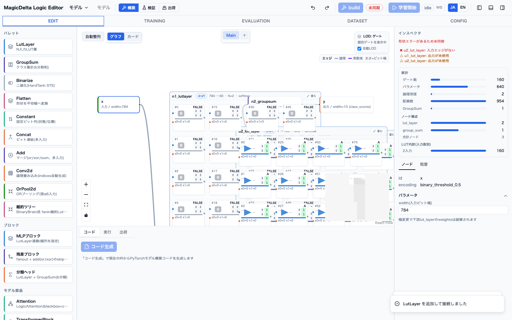
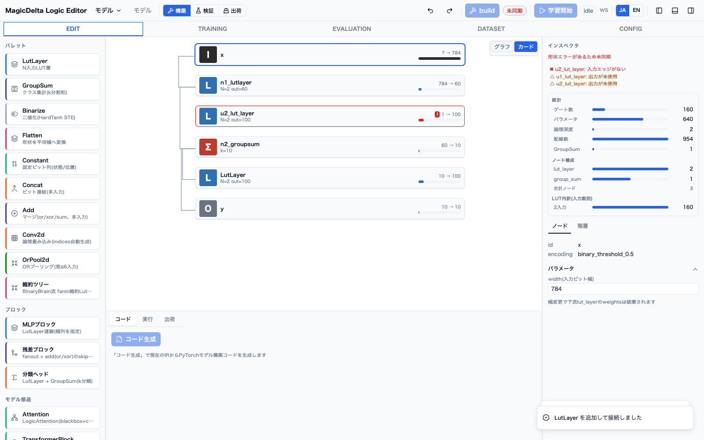
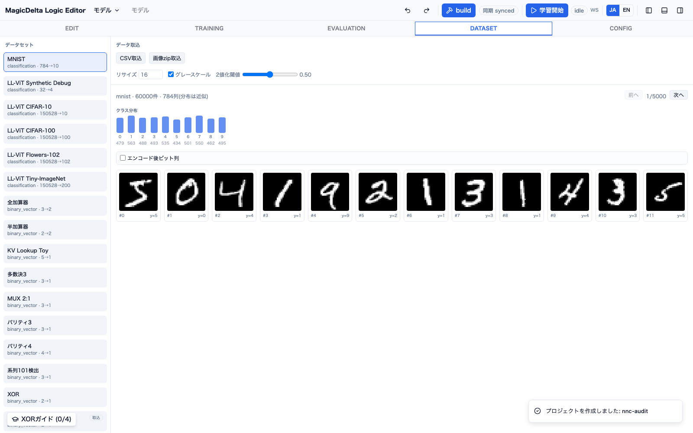
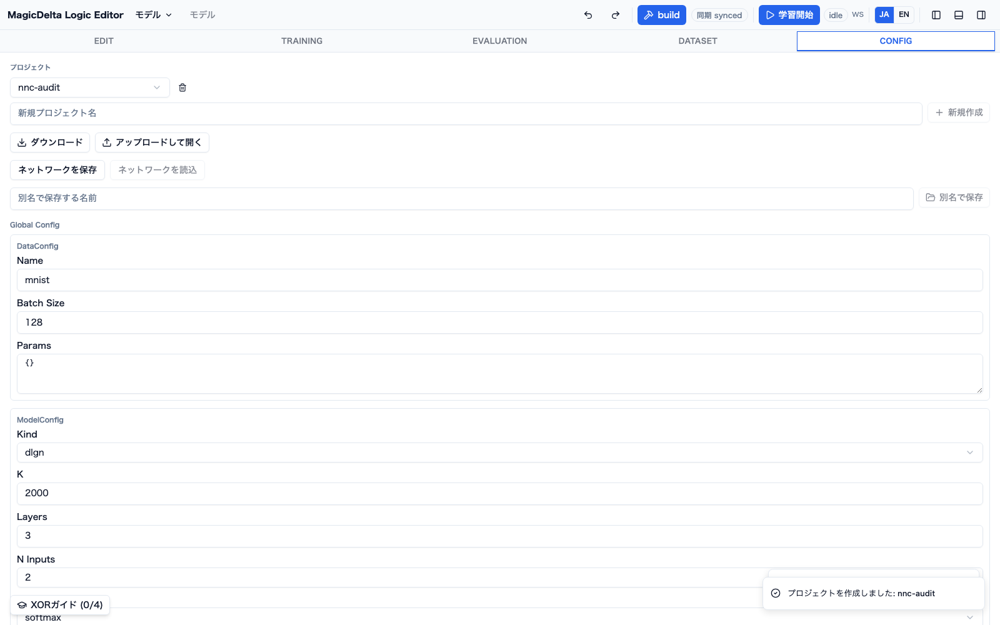
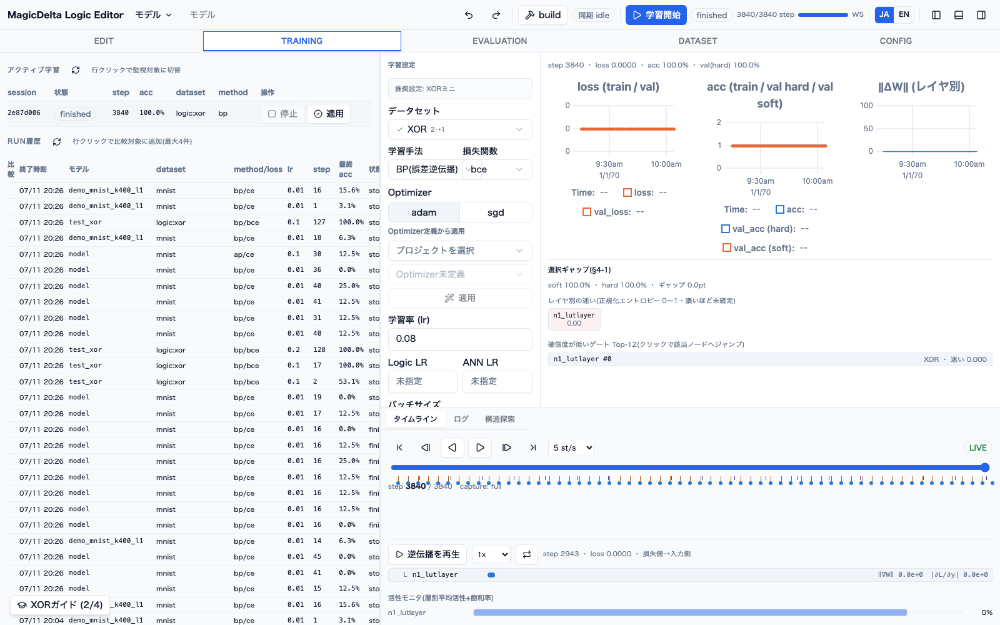
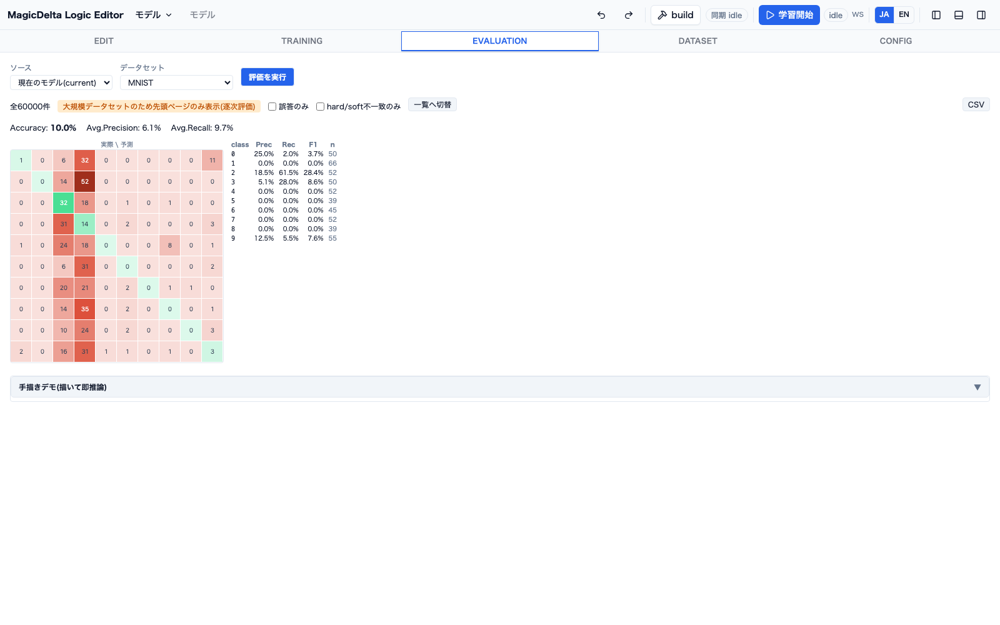

:::note[The editor is available once you clone the repository]
The visual editor **is part of this repository** (`tools/editor/`). It is not shipped inside the
`griffith-logic` PyPI package, so to use it, clone the repository, install the backend dependencies
with `uv sync --extra editor`, and start it with `make editor`. The library (`griffith_logic`) and
the IR specification are fully covered by the other pages of this site; you can do the same things
from Python without the editor.
:::

The visual editor is a browser application that **uses the IR (intermediate representation) as a common
contract to cover graph editing, live training monitoring, evaluation, and HDL export in a single
screen**. The backend is FastAPI and the frontend is React + React Flow. Its UX draws on three
references — ComfyUI, Sony Neural Network Console, and TensorFlow Playground — and in particular
follows **NNC's approach of staging the workflow across tabs**.

Whether you write a model in Python or assemble it in the editor, **what gets saved is the same IR**
(see [Architecture Overview](/en/explanation/architecture/)). The editor is a GUI frontend for the IR,
not a separate way of defining models.

## Launching

Install the dependencies. The `editor` extra only brings in FastAPI/uvicorn, so pair it with the
`cpu` (or `cu128`) extra that provides PyTorch.

```bash
uv sync --extra editor --extra cpu --extra dev   # on GPU machines, swap --extra cpu for --extra cu128
```

Install the frontend dependencies with `npm install` inside the `frontend/` directory of the editor
distribution.

Start everything with one command from the repository root.

```bash
make editor    # starts backend(8765) + frontend(5173) together
```

Open `http://localhost:5173` in your browser. To start the pieces separately, use
`make backend` / `make front` (the backend uvicorn process and the frontend `npm run dev`).

:::caution[Always open via localhost:5173]
Both REST (`/api`) and the training WebSocket (`/ws`) are proxied to the backend by the vite dev
server on the same origin. Connecting directly to `ws://127.0.0.1:8765/...` can cause a
`400 line too long` failure that takes down only the WS in environments with huge cookies (the vite
proxy immunizes against this by stripping cookies from the training WS). Only set
`VITE_EDITOR_WS_BASE_URL=ws://host:port` explicitly when connecting to a backend on another host.
:::

## Screen layout — the five top tabs

The tab strip in the header *is* the workflow, stage by stage. The order matches the keyboard keys
`1`–`5`.

| # | Tab | Stage | What you look at |
|---|---|---|---|
| 1 | **EDIT** | Build | Graph / cards, component palette, statistics (LUT count, logic depth, wiring count) |
| 2 | **TRAINING** | Run | loss/acc curves, per-layer ‖ΔW‖, time machine, run history |
| 3 | **EVALUATION** | Measure | Batch evaluation, confusion matrix, discretization gap, handwriting inference demo |
| 4 | **DATASET** | Feed | Built-in catalog, CSV/image-zip import, encoding preview |
| 5 | **CONFIG** | Decide | `TrainConfig` schema-driven form, project saving |

Within the EDIT tab you can further switch **lenses** (`Q`/`W`/`E`). The graph itself stays the same;
a lens is an overlay context that changes coloring, badges, and the bottom dock tabs all at once.

- **Build** (`Q`) — construction and code generation
- **Probe** (`W`) — playground inference
- **Ship** (`E`) — pre-shipping checks and HDL / code export

---

## 1. EDIT — Building the graph

Drag and drop nodes from the **component palette** on the left, then drag ports to connect them.
Shape mismatches appear immediately as red badges on the canvas. The **inspector** on the right shows
live statistics (gate count, parameter count, logic depth, wiring count).



*The graph view. Zooming switches the LOD so that a `LutLayer` expands down to **one card per gate**.
Each card shows its current truth table (a settled logic function such as `FALSE` or `A`) and the
input slots `s0`/`s1`. Edge color distinguishes logic (gray) from real-valued (blue), and thickness
represents bit width.*

Available components include LutLayer / GroupSum / Binarize / Flatten / Constant / Concat / Add, plus
Conv2d, OrPool2d, and reduction trees; composite blocks such as MLP blocks, residual blocks, and
classification heads; and even Attention / TransformerBlock (treated as blackboxes).

### Card mode — the NNC-style vertical stack

Toggling to the **card** view in the upper right gives you an NNC-style list with layers stacked one
per row from top to bottom. For simple sequential models this makes the structure easier to follow.



*Card mode. Each card shows shapes and settings such as `784 → 60` and `N=2 out=60`. Nodes with no
incoming edge are outlined in red with an error icon, and the inspector on the right lists the
reasons, e.g. "u2_lut_layer: no input edge". Press `A` to align the cards vertically in topological
order.*

EDIT also offers **direct truth table editing** (rewriting hex cell by cell), **manual wiring**
(reassigning input slots on an SVG bipartite graph), **Units** (defining and instantiating
parameterized reusable subnetworks), and **multiple networks** (held in tabs, with weight transfer
between layers of the same name). There is also a `⌘K` command palette, right-click QuickAdd, and
undo/redo.

The "Code" tab in the bottom dock can **generate PyTorch model construction code** from the current
IR — the path for taking what you built in the GUI straight into a script.

### Structured wirings, and parts that arrive through the IR

Besides `random` / `unique`, the inspector's `connections` field offers the **structured wirings**
that are fixed by a formula rather than by random draws (`rot`, `rot_n`, `butterfly`, `local1d`,
`local2d`). Picking one shows its argument fields (`s_a`/`s_b`/`step` for rot, `stride` for
butterfly, `offsets`/`grid` for local2d, and so on), and "generate and apply" asks the backend
generator (`POST /api/wiring/generate`, the same function the recipe key `model.connections` uses)
for the indices and writes them into the IR. Truth tables are kept, and a one-line summary reports
coverage, unused inputs and gates that read the same input twice. A draft (not yet built) node is
regenerated by the same rule at build time, so you can also just decide the arguments and move on.

The "learning demo" and "vision" groups of the model menu include three samples whose structured
wiring changes from stage to stage (their structure lives in
`tools/editor/frontend/src/samples/wiringSamples.json`).

- **2-bit adder, rot wiring** (4 → 16 → 16 × 4 → 3): layer 0 is rot(0,2), which pairs a_i with b_i;
  the hidden layers double the shift 1 / 2 / 4 / 8; the output stage is rot(0,8, step 5). With the
  logic preset (lr 0.08 / batch 16 / 60 epochs) all 16 rows become an exact match (checked on 4 seeds).
  Layer 0 is a 4 → 16 projection, so its shift is not a stride that widens the reach but a choice of
  which pairs to form
- **MNIST rot 1000** (784 → 6 layers × 1000 → GroupSum k=10 tau 3.75): layer 0 is the 2D
  neighbourhood rot(1,28) (one pixel to the right and one row down); the hidden layers use the shifts
  6 / 30 / 150 / 750 / 500, chosen so that the class receptive field covers 100% of the input
- **MNIST butterfly (4-input) 1000**: layer 0 gathers 4 bits at a time with rot_n; the hidden layers
  are a cyclic radix-4 butterfly with strides 1 / 4 / 16 / 64 / 256 (4^5 ≥ 1000, so 5 stages reach
  every input)

The two MNIST samples use the same wiring as `configs/recipes/fmc_w1000_{rot,bf4}.yaml`. On the
recipe side (`griffith train`, inputs binarized at 0.5, 8 epochs) the hard accuracy is rot 92.3% /
butterfly 89.2% (fixed random wiring 90.7%, mean of 2 seeds each). The editor preset is lr 0.01 /
batch 100 / 2 epochs, and the inputs are fed as grayscale. Shifts are chosen as distances that mean
something in the flattened input order (2 in the adder = the same digit of the other operand, 28 in
MNIST = one row down). `butterfly` in this repository is a cyclic shift (rot_n of radix n), not the
XOR pairing of an FFT.

The editor turns the IR into a PyTorch model with `build_torch` for training, evaluation and HDL
generation, so the following parts are usable from an IR JSON made in Python or the CLI
(`POST /api/models/ir/load`).

- **conv2d / or_pool2d** (conv-DLGN and friends) stay as nodes and can be trained and evaluated.
  Re-extracting on every build no longer unrolls them into `lut_layer` chains (HDL generation does).
- **permute** (for example the native extraction of `GroupSum(assign='stride')`) and a `lut_layer`
  whose fan-in is not 2 / 4 / 6 (the 8-input LUT of a ThermometerEncoder, the 1-input identity of a
  stride assignment) are built as **frozen LUTs** with no trainable parameters (the layers after them
  still train).
- The **`bias` of group_sum** (an integer decision bias per class) can be edited in the inspector and
  is honored by the Probe-lens evaluation and by code generation.
- **LTT layers** and DWN `lut_layer`s are restored as "LUT layers that can hold any table"
  (retraining follows the DWN rule).

---

## 2. DATASET — Feeding data

Browse and preview the built-in catalog (MNIST, the `logic:*` logic function family, truth tables)
along with any datasets you have imported. Uploading a CSV or an image zip registers it in the
dynamic catalog.



*The DATASET tab. The "resize / grayscale / binarization threshold" controls at the top are the
import settings; since a logic-gate neural network takes 0/1 inputs, the **binarization threshold is
effectively the star of preprocessing**. Check the class distribution bar for imbalance and inspect
real samples in the grid below. Ticking "encoded bit string" lets you see exactly which 0/1 grid the
real values are converted into.*

---

## 3. CONFIG — Deciding training settings

The form is generated automatically from the JSON Schema of `TrainConfig`
(`GET /api/config/schema`). The backend type definitions are the source of truth, so **the settings
never drift from the code**.



*The CONFIG tab. The upper section handles projects (create, download, upload, save network under a
different name); the lower section is the Global Config. `ModelConfig`'s `Kind` (dlgn, etc.), `K`
(layer width), `Layers`, `N Inputs`, and parameterization (softmax and others) are set here. Settings
are saved to the project and can be recalled from the TRAINING tab.*

---

## 4. TRAINING — Running and inspecting training

Specify dataset, method (`bp`/`ap`/`bb`), lr, batch, epochs, optimizer, and loss, then start.
**Each run trains an independent copy of the model you are editing** (non-destructive exploration).
Only when you like a result do you pull it into the working model with `適用` (Apply).



*The TRAINING tab. The three panels in the upper right are curves updated live over WebSocket
(loss; acc for train/val hard/val soft; per-layer ‖ΔW‖). Below them, the **"selection gap"** is a
metric specific to logic-gate neural networks: `soft 100.0% · hard 100.0% · ギャップ 0.0pt` means
"the performance of the continuous relaxation carries over to the Boolean circuit with no loss"
(see [Reading Training Curves](/en/guides/training-curves/)). "Per-layer indecision" is a normalized
entropy — the darker it is, the less settled that layer's gates are. The timeline in the bottom dock
is the **time machine**: scrub to any step to view a read-only snapshot from that moment. While
paused, you can also rewind and use that point as the starting position for retraining.*

Highlights of what TRAINING can do:

- **pause / resume / stop**, plus **step execution** (advance n steps and auto-pause)
- **Backpropagation replay** — replays the gradient flow, visualized with glowing layers and gradient particles
- **Live gate distribution tracking** — mini bars / heatmaps update at up to 5Hz
- **Run history** — list and compare run summaries that persist across processes

---

## 5. EVALUATION — Measuring

Evaluate a run or the current model in one batch against a chosen dataset. Alongside accuracy and the
confusion matrix (P/R/F1), a distinctive column shows the **discretization gap** (samples where the
hard-discretized result disagrees with the soft argmax).



*The EVALUATION tab. A 10×10 confusion matrix (rows = actual, columns = predicted) and per-class
P/R/F1. This figure evaluates an **untrained model**: accuracy 10.0% is chance level, and you can
read off the classic collapse pattern where predictions get sucked into particular columns (2 and 3).
You can filter by "errors only" or "hard/soft mismatches only", and the input bit string of a
misclassified sample can be injected into the playground to trace the circuit (counterexample
tracing). Results can be exported as CSV.*

Opening the "handwriting demo" at the bottom lets you draw on a 28×28 canvas and immediately see
binarization → inference → class probability bars. It also works with live inference during training.

---

## Architecture search (NAS)

Running genome-evolution architecture search via `POST /api/nas/start` produces a
**trade-off graph of accuracy × circuit area (LUT count) with a Pareto front**. Interrupt/resume,
a JSONL ledger, and deterministic golden tests are supported.

## Keyboard shortcuts

| Key | Action |
|---|---|
| `1`–`5` | Switch top tab (EDIT/TRAINING/EVALUATION/DATASET/CONFIG) |
| `Q`/`W`/`E` | Switch lens within EDIT (Build / Probe / Ship) |
| `F` / `L` | Fit view / auto-layout |
| `A` | NNC vertical alignment (update coordinates in topological order) |
| `⌘K` / `Ctrl+K` | Command palette |
| `⌘Z` / `⇧⌘Z` | undo / redo |
| `⌘S` | Sync immediately |

Shortcuts are disabled while an input/textarea/select has focus. The single source of truth is the
key assignment table at the top of `frontend/src/hooks/useShortcuts.ts`. The URL hash (`#edit`,
`#training`, etc.) and the tab state stay in two-way sync, so browser back/forward works.

## API — Driving it from an agent

The REST/WS interface the editor uses is also **the API an agent can use to go from model
construction through training to modification**. For the full endpoint table, request/response
shapes, complete curl/Python examples, and WS frame types, see the API reference bundled with the
editor distribution. The main entries are:

| Category | Main endpoints |
|---|---|
| Models | `POST /api/models/demo` `import` `import/python`, `GET /api/models/current/ir` |
| Editing | `PUT /api/models/current/ir`, `POST .../nodes/{id}/truth_table` `.../indices`, `.../build`, `.../codegen` |
| Datasets | `GET /api/datasets`, `POST /api/datasets/import/csv` `.../import/images`, `.../encoding-preview` |
| Training | `POST /api/train/start` `.../pause` `.../step` `.../apply`, `GET /api/train/{sid}/history` |
| Evaluation | `POST /api/evaluate`, `POST /api/evaluate/export.csv` |
| Export | `POST /api/export/hdl` (Verilog/VHDL + resource estimate), `POST /api/probe` |
| WS | `/ws/train/{sid}` (metrics / layer_summary / history_index / grad_flow) |

Layer names are IR node ids (`n{i}_{class name}`), following the same convention as `export_ir`.
The TS types for the API contract are generated from `backend/schemas.py` by `make gen-types`, and CI
detects drift with `gen-types → git diff --exit-code`.

## Known limitations

- **Training is CPU-only** (prioritizing the stability of threaded execution). Run GPU training
  outside the editor (see [Cloud GPU](/en/guides/cloud-gpu/)).
- **Attention / Transformer are handled only as blackboxes.** Inside the editor they cannot be
  trained, cannot generate HDL, and cannot be built from IR alone; the Python model side is
  authoritative for execution.
- **Training sessions exist only in process memory** and disappear when the backend restarts
  (persistent records live at `GET /api/runs`; `server_epoch` from `/api/health` lets you detect a
  restart).
- Step execution and rewind (restore) are permitted **only while paused**.
- Checkpoint import supports only `.pt` files that are sequential `nn.Sequential` models saved as a
  whole model object (state_dict-only checkpoints are not supported).
- Confidence for the warp / raw parameterizations is shown as the neutral value (0.5) because the
  definition is not obvious.
- **Frozen LUTs** (the 8-input `lut_layer` of a thermometer encoder, or a permute) are not trained
  inside the editor (they carry no parameters). An IR whose `group_sum` has a `bias` is rejected by
  HDL / C generation.
- Training monitors (per-layer ‖ΔW‖, gate distributions) only cover `LutLayer`; conv2d and frozen
  LUTs do not appear there.

## Troubleshooting

**`ModuleNotFoundError: No module named 'torch'`** — the `editor` extra does not include PyTorch.
Run `uv sync --extra editor --extra cpu --extra dev` (replace `cpu` with `cu128` on CUDA machines).
`cpu` and `cu128` cannot be specified together.

**WebSocket returns `400 Bad Request` / the UI shows "WS not connected"** — check in order.

1. Verify the backend is alive with `curl http://127.0.0.1:8765/api/health`
2. Confirm you opened the frontend via `http://localhost:5173`
3. In DevTools → Network → WS, confirm the connection targets the same origin
   (`ws://localhost:5173/ws/train/{sid}`). If it connects directly to `ws://127.0.0.1:8765/...`,
   the frontend is stale — reload or restart it
4. `400 line too long` is caused by huge cookies (e.g. auth cookies from another project). Going
   through the vite proxy immunizes against this, so re-check that you have not fallen back to the
   direct connection in step 3

## What to read next

- [Reading Training Curves](/en/guides/training-curves/) — interpreting the TRAINING tab curves and the selection gap
- [Working with the IR](/en/guides/ir/) — the structure of the IR the editor actually saves
- [HDL Export and Equivalence Verification](/en/guides/hdl-export/) — the process beyond the Ship lens
- [Architecture Overview](/en/explanation/architecture/) — why the IR sits at the center

<!-- i18n:source=guides/editor.md hash=b114c664d591 -->
