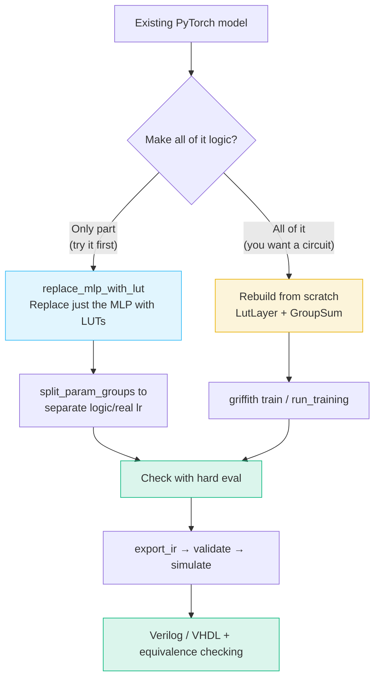

This library is **plain PyTorch**. It subclasses `nn.Module`, `loss.backward()` works, and
`torch.optim` can be used as-is. Migration is therefore fast.

At the same time, a few things **share a name but not a meaning**, and that is where accidents happen.
The worst offender is `model.eval()`: in PyTorch it only changes how Dropout and BatchNorm behave,
but here it **changes the mathematics of the model itself** (a real-valued mixture becomes a Boolean circuit).

This page is a **translation table** from PyTorch vocabulary to the vocabulary of this library.

:::tip[New to PyTorch as well?]
This page is a translation table for people who already write PyTorch. If neural networks
themselves are new to you, the fastest route is the [Intro Course](/en/tutorials/nn-basics/)
(three pages) — PyTorch basics → an MLP on MNIST → **replacing the same model with a DLGN**,
all with executed output. For the ideas alone, read [From NN to DLGN](/en/explanation/nn-to-dlgn/).
:::

:::note[What you will learn here]
1. **The mapping table** — what replaces `nn.Linear` / `nn.Conv2d` / the output layer / optimization / export
2. **How `model.eval()` differs** — the switch from soft to hard, and the discretization gap
3. **Where PyTorch intuition breaks down** — floating-point-centric techniques, and the absence of pretrained assets
:::

## The minimal mapping — the same network written two ways

```python
# PyTorch (a real-valued MLP)
import torch.nn as nn

model = nn.Sequential(
    nn.Flatten(),
    nn.Linear(784, 256), nn.ReLU(),
    nn.Linear(256, 256), nn.ReLU(),
    nn.Linear(256, 10),          # → into cross_entropy
)
```

```python
# griffith-logic (a logic-gate network)
import torch.nn as nn
from griffith_logic import GroupSum, LutLayer

model = nn.Sequential(
    nn.Flatten(),
    LutLayer(784, 8000, n_inputs=2),    # no activation function needed
    LutLayer(8000, 8000, n_inputs=2),   # the gates themselves carry the nonlinearity
    GroupSum(k=10, tau=10.0),           # → into cross_entropy
)
```

The two look almost identical, and neither `loss.backward()` nor `optimizer.step()` changes.
What differs is **what lives inside a single neuron**. One output of `nn.Linear` is a weighted sum over
every input, whereas one output of `LutLayer` is **a single LUT (truth table) that sparsely picks up
just N of the input lines**, and what is learned is not a weight but **which logic function it becomes**.

---

## Mapping table

### Layers

| PyTorch | Here | What differs | Reference |
|---|---|---|---|
| `nn.Linear(i, o)` | `LutLayer(i, o, n_inputs=2)` | Not a dense sum of products but a LUT that picks up only N lines. What is learned is the truth table. Wiring is fixed at initialization (`wiring='learnable'` makes it trainable too) | [The Mathematics of LutLayer](/en/explanation/lut-layer/) |
| `nn.ReLU` / `nn.GELU` | **Not needed** | The nonlinearity is built into the LUT. The concept of an activation function does not exist here | [What is DLGN](/en/explanation/dlgn/) |
| `nn.Conv2d` | `LutConv2d(in_ch, out_ch, kernel_size, tree_depth=3)` | The kernel is not a sum of products but a **tree of gates**. `tree_depth` sets its depth | [Convolution and Spatial Processing API](/en/reference/api/conv/) |
| `nn.MaxPool2d` | `OrPooling2d` | max is arithmetic. On the logic side, aggregation is done with OR | [5. Exporting a CNN to HDL](/en/tutorials/cnn-hdl-export/) |
| `nn.BatchNorm` / `nn.LayerNorm` | `LogicLayerNorm` and others | Normalization by statistics does not map onto a circuit. Use the logic-based replacements | [General NN Blocks API](/en/reference/api/blocks/) |
| `nn.Linear(h, C)` + softmax at the output | `GroupSum(k=C, tau)` | It simply **splits the final gate outputs evenly into C groups, sums them, and divides by τ**. It carries no weights, and on the circuit side it is a single adder | [Core Concepts](/en/getting-started/concepts/) |
| `nn.MultiheadAttention` | The `LogicAttention` family | There is an implementation with attention itself made logical (scores via XNOR-popcount, softmax via MUX) | [Attention Tour](/en/tutorials/attention-tour/) |
| `nn.Embedding` / input normalization | `ThermometerEncoder` and others | Real-valued inputs are encoded into bit strings first. Inputs are either reals in $[0,1]$ or 0/1 bits. With `ThermometerEncoder(bits, input_bits=8)` (the quantization width of the input) the threshold comparisons themselves become 8-input LUTs inside the IR; without it the encoder stays a preprocessing step outside the IR | [DWN (Thermometer Encoding)](/en/tutorials/dwn/) |
| `nn.Linear(i, o)` + `sign` (a perceptron layer) | `LTTLayer(i, o, n_inputs=6)` | Each gate is a **linear threshold function** $1[w\cdot x + b > 0]$ of N inputs. N+1 parameters per gate; it can express only threshold (linearly separable) Boolean functions. Trained with STE, exported as an N-input LUT | [API: core layers](/en/reference/api/core/) |
| `nn.Dropout` | **Usually not used** | Regularization is normally tuned through capacity (gate count k) and the amount of training | [Running Training](/en/guides/training/) |

That is the entirety of what `GroupSum` does.

$$
\text{logit}_c = \frac{1}{\tau}\sum_{i \in \text{group}_c} y_i
$$

If the output dimension is not divisible by the number of classes, an assert fires.
τ affects accuracy directly: for a 6-layer MNIST model with k=8000, **a fixed τ=10 is about 1.0pt better**
than the rule of thumb $\tau=\sqrt{k/C}$.

### Training

| PyTorch | Here | What differs | Reference |
|---|---|---|---|
| Hand-written training loop | `run_training(cfg)` / `uv run griffith train recipe.yaml` | Configs are validated with pydantic (unknown keys fail before the run starts). The CLI is a thin wrapper over the API with identical internals | [Running Training](/en/guides/training/) |
| `torch.optim.Adam(model.parameters(), lr=1e-3)` | The same, except **lr is 0.01–0.3** | Logic-side weights prefer learning rates 1–2 orders of magnitude larger than real-valued weights. `independent` sometimes needs lr ≥ 0.3 | [Choosing a Parameterization](/en/guides/parameterization/) |
| Hand-written param groups | `split_param_groups(model, logic_lr=0.02, ann_lr=1e-3)` | In hybrid setups it automatically separates the logic-side and real-valued lr. With a single shared lr, the logic side does not move | [2. Building a Hybrid NN](/en/tutorials/hybrid/) |
| Backprop only | `with_learning(module, LearningSpec(rule=...))` + `HybridTrainer` | You can mix bp / ap / dfa / eggroll **per layer**. `with_learning` only annotates attributes rather than wrapping, so it can be bolted onto an existing model | [Learning Rules (BP/AP/DFA/ES)](/en/explanation/learning-rules/) |
| Reporting a single `acc` | Always report **both soft and hard** | `test_acc_soft` is the score of the continuous approximation; `test_acc` (hard) is **the true score as a circuit** | [Reading Training Curves](/en/guides/training-curves/) |
| `model.eval()` | `model.eval()` — but it means something else | **It discretizes with argmax and becomes a Boolean circuit.** See below | [What is DLGN](/en/explanation/dlgn/) |

### Export

| PyTorch | Here | What differs | Reference |
|---|---|---|---|
| `torch.onnx.export(model, ...)` | `export_ir(model, input_width=..., name=...)` | The output is **IR (JSON)**: a neutral representation holding only truth tables and wiring, belonging neither to torch nor to HDL. For conv models, `export_ir(model, input_shape=(C, H, W), native_conv=True)` keeps `conv2d` / `or_pool2d` nodes (weight sharing is preserved) | [Working with IR](/en/guides/ir/) |
| Inference with ONNX Runtime | `simulate(ir)` (bit-exact, in numpy) | The IR itself becomes the **golden model** and serves as the reference for cross-checking | [Working with IR](/en/guides/ir/) |
| TorchScript / TensorRT | `griffith export-hdl ir.json --lang verilog` | The destination is not an execution engine but **synthesizable Verilog / VHDL** | [HDL Export and Equivalence Checking](/en/guides/hdl-export/) |
| `state_dict` is the source of truth | **IR is the source of truth** | The meaning of a trained model is pinned down in the IR. HDL generation, the editor, and the simulator all look only at the IR | [Architecture Overview](/en/explanation/architecture/) |
| `load_state_dict` | `build_torch(ir)` | You can go back from IR to a PyTorch model (edit the IR and continue training) | [Working with IR](/en/guides/ir/) |
| "Probably behaves the same" | **Machine-verified three-stage equivalence** | It verifies that the three paths `PyTorch hard eval ⇔ ir/simulate ⇔ HDL simulation` agree on every vector | [HDL Export and Equivalence Checking](/en/guides/hdl-export/) |

ONNX can still be used as **an entry point for teacher models** (`resolve_teacher('onnx:<path>')`, etc.).
As discussed below, however, converting or distilling from a pretrained model is not a silver bullet.

---

## `model.eval()` means something different

In PyTorch, `eval()` only changes the behavior of Dropout and BatchNorm, and you get
**an approximation of the same function**. Not so here.

```python
model.train()
y_soft = model(x)   # reals in [0,1]. a softmax mixture of all gates. gradients flow
model.eval()
y_hard = model(x)   # bits 0/1: only the single gate picked by argmax is active
```

| | soft (`train()`) | hard (`eval()`) |
|---|---|---|
| Input | reals in $[0,1]$ | 0/1 bits via `round()` |
| LUT weights | `softmax(W)` (spread over all $2^N$ entries) | `one_hot(argmax(W))` (a single entry) |
| Output | real values | bits |
| Meaning | how well the continuous relaxation fits | **true performance as a logic circuit** |

The accuracy difference between the two is called the **discretization gap**.

| Gap | Interpretation | Action |
|---|---|---|
| 0–0.5pt | Healthy. Gates have converged well onto specific entries | Leave it as is |
| 1pt or more | It helps the continuous approximation but falls apart as a circuit | More epochs / revisit the parameterization |
| soft is low too | It simply is not learning | Suspect lr, τ, or capacity (k, number of layers) |

:::caution[Always look at hard eval before you bake]
If continuous truth tables stay clustered around 0.5 and are then rounded, accuracy collapses.
In one real case, a model with eval acc 0.803 dropped to **0.211** the moment its entries were rounded
(recalibrating BatchNorm statistics only got it back to 0.632).
**A soft score is not a circuit's score.**
:::

There are also options that drive the gap structurally to zero: `selection='hard_st'` (the CAGE approach,
where the forward pass uses argmax and only the backward pass approximates with softmax gradients),
the `warp` parameterization (measured at −0.06pp), and DWN (train/eval logit difference of 0.0).

---

## Where PyTorch intuition breaks down

Here is the honest list. Starting without knowing these guarantees you get stuck.

### 1. The metric to watch is hard, not soft

Training only progresses in soft, but **the score that means something is the hard one**.
`test_acc` is hard, `test_acc_soft` is soft. It is easy to read them backwards until you are used to it.

### 2. Pretrained assets are unavailable

**There is no pretrained ecosystem** like timm / torchvision / HuggingFace.
Nor does "just convert a strong real-valued model" hold up: distillation, transfer initialization, and
layerwise binary distillation were all measured, and **none of the three beat training from scratch**
(transfer initialization degraded badly). The strength of a native DLGN is that it can learn free Boolean
logic, and transferring arithmetic structure constrains that freedom
(→ [Taxonomy and Lineage of DLGN](/en/explanation/taxonomy/)).

The practical answers are **training from scratch**, or keeping the parts that should stay real-valued via
**[hybridization](/en/tutorials/hybrid/)** (e.g. replacing only a Transformer's MLP with LUTs).

### 3. Floating-point-centric techniques lose their meaning

The final artifact is a Boolean circuit with no multiplication. Therefore:

- **Tuning precision (FP16/BF16/quantization) is meaningless on the inference side** — the output is nothing but 0/1 bits
- **The magnitude of a weight** carries no meaning by itself. All that matters is which entry is the largest
- **The main battleground of regularization is managing the discretization gap**, not weight norms
- Correctness is measured by **bit-level agreement, not numerical error** (three-stage equivalence)

### 4. The learning-rate scale is different

Your sense that Adam sits around 1e-3 does not apply. **0.01 is the default**, and with `independent`
or deep serial configurations you go up to **0.1–0.3**.
The first suspect for "the loss will not move off its initial value" is always the learning rate.

### 5. "Layer width" means something different

The `out` in `LutLayer(in, out)` is **the number of gates**, and it maps directly to circuit area.
For MNIST you work in the range of 2,000 (smoke test) to 64,000 (paper reproduction).
Numbers 1–2 orders of magnitude larger than an `nn.Linear` hidden dimension are normal here, which is visually surprising.

### 6. Only inference is GPU-free

Training is real-valued computation in PyTorch, so **a GPU helps during training**.
"No GPU needed" refers to the circuit after baking (CUDA is not required; CPU / MPS work too).

### 7. There are three axes beyond architecture

In PyTorch, "which layer to use" is nearly the whole design, but here you also get three orthogonal axes:
**parameterization / selection / learning rule**.
What to pick is summarized in [What Should I Use? (Selection Guide)](/en/guides/choosing/).

### 8. Replacing `nn.Linear` is not 1:1

Swapping `nn.Linear(784, 256)` for `LutLayer(784, 256)` does not give you an equivalent.
A single gate sees only N inputs, so **you need many more gates and more layers to get the same expressive power**.
This is why the hybridization API (`LogicSpec(n_inputs=2, depth=2, neurons_per_output=8)`)
exposes `depth` and `neurons_per_output` as knobs.

---

## Migration steps



1. Get one run working with the **[Quickstart](/en/getting-started/quickstart/)**
2. Decide architecture, N, parameterization, and learning rule in **[What Should I Use?](/en/guides/choosing/)**
3. Match the usual ranges for lr, τ, and k in **[Running Training](/en/guides/training/)**
4. Learn to read soft vs. hard in **[Reading Training Curves](/en/guides/training-curves/)**
5. Turn it into a circuit with **[Working with IR](/en/guides/ir/)** → **[HDL Export](/en/guides/hdl-export/)**

## Read next

- [Intro 3. Replace the MLP with a DLGN](/en/tutorials/mlp-to-dlgn/) — see this table one-to-one, with executed code
- [What Should I Use? (Selection Guide)](/en/guides/choosing/) — decide four choices with a flowchart
- [Core Concepts](/en/getting-started/concepts/) — soft/hard, LutLayer, GroupSum, IR, HDL
- [What is DLGN](/en/explanation/dlgn/) — why gradients flow at all
- [2. Building a Hybrid NN](/en/tutorials/hybrid/) — the shortest migration path, one line into an existing model
- [Core Layers API](/en/reference/api/core/) — every argument of `LutLayer` / `GroupSum`

{/* i18n:source=guides/from-pytorch.mdx hash=cd5894452a96 */}
