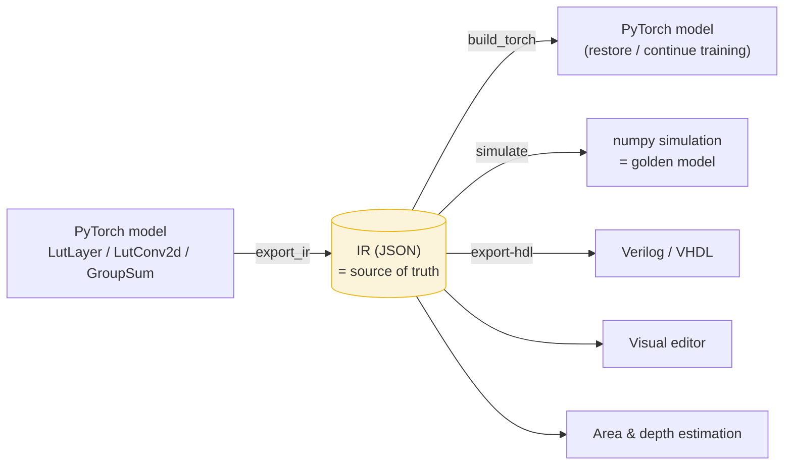
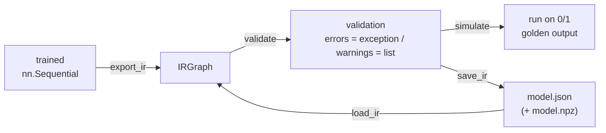
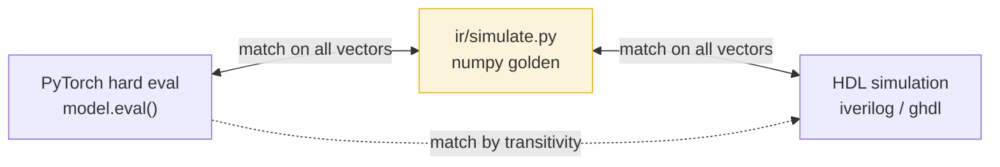

The **IR (Intermediate Representation)** expresses a trained logic circuit as **JSON**
that is independent of both PyTorch and hardware.
In this library the IR is the one contract connecting upstream (training) with
downstream (HDL generation, the editor, simulation), which makes the
**IR the single source of truth**.

:::note[What you'll learn here]
1. **How to work with the IR** — the flow from `export_ir` → `validate` → `simulate` → `save_ir` / `load_ir`
2. **What's inside the IR JSON** — reading through a real minimal sample
3. **Why the IR sits in the middle** — the intent behind the loose coupling, and how three-way equivalence guarantees correctness
:::

## The design: the IR as the source of truth

Wire a training framework directly to an HDL target and every change on one side breaks the other.
Put the IR at the center and **you can swap the upstream without touching the downstream, and add downstream targets without touching the upstream**.



Three key points.

- **The IR belongs to neither torch nor HDL.** It is a neutral representation that carries neither side's conventions.
- **The IR round-trips.** `build_torch()` turns it back into a PyTorch model, so you can edit the IR and then keep training (recovery training).
- **The IR is executable.** `simulate()` runs it bit-exactly in numpy, so the IR itself becomes the reference (golden model) for comparison.

## The basic flow



### 1. Export — `export_ir`

```python
import torch
import torch.nn as nn
from griffith_logic.layers.lut import LutLayer
from griffith_logic.export import export_ir

model = nn.Sequential(
    LutLayer(in_dim=2, out_dim=4, n_inputs=2),
    LutLayer(in_dim=4, out_dim=1, n_inputs=2),
)
# ... train here ...
model.eval()

graph = export_ir(model, input_width=2, name='xor')
```

| Argument | Meaning |
|---|---|
| `model` | `nn.Sequential` (a sequential model) |
| `input_width` | Bit width of the flattened input. Mutually exclusive with `input_shape` |
| `input_shape` | `(C, H, W)` for conv-style models. The width is computed automatically |
| `name` | The name stored in `metadata.name` |
| `native_conv` | With `True`, `LutConv2d` / `OrPooling2d` are exported as native nodes. The default `False` expands them into a series of `lut_layer`s |

Exporting captures the **hard (post-discretization) form** of the model. Continuous weights are
resolved into truth tables (hex strings), and no "training-time probabilities" remain in the IR.

### 2. Validate — `validate`

```python
from griffith_logic.ir import validate

warnings = validate(graph)              # general checks
warnings = validate(graph, target='hdl')  # plus the extra constraints for HDL generation
```

- If the graph is **structurally broken** (unknown node type, duplicate ids, an edge endpoint that does not exist, width mismatch, and so on), an `IRValidationError` is raised.
- Constructs that **work but cause trouble downstream** are returned as a list of warning strings.
- With `target='hdl'`, constructs that cannot be expressed in HDL (`blackbox`, `add(mode='sum')`, etc.) are additionally rejected. **Always validate this way before lowering to HDL.**

### 3. Run — `simulate`

```python
import numpy as np
from griffith_logic.ir import simulate, simulate_trace

X = np.array([[0, 0], [0, 1], [1, 0], [1, 1]])
y = simulate(graph, X)          # array([0, 1, 1, 0]) — XOR
trace = simulate_trace(graph, X)  # {node_id: intermediate output of shape (batch, width)}
```

The input accepts **only 0/1** (passing continuous values trips an assert).
Because the computation is bit-exact in numpy, this output serves as the reference for comparison.
`simulate_trace` returns the intermediate values of every node, so you can pinpoint the layer where bits went wrong.

### 4. Save and load — `save_ir` / `load_ir`

```python
from griffith_logic.ir import save_ir, load_ir, ir_to_dict, ir_from_dict

path = save_ir(graph, 'outputs/xor.json')   # returns the path of the json actually written
graph2 = load_ir(path)

d = ir_to_dict(graph)      # to a dict (for API responses, etc.)
graph3 = ir_from_dict(d)
```

:::caution[Large arrays are offloaded to .npz]
Large arrays such as `indices` are externalized into a sidecar `.npz` once their element count
exceeds a threshold (65,536 by default), leaving only a reference like
`{"$data": "xor.npz#n0_lutlayer_indices"}` in the JSON.
**Always carry the `.json` and the `.npz` together.**
`truth_tables` are always written as hex strings so that 64-bit values for N=6 can be handled safely in JSON.
:::

## A real IR JSON

Training XOR with the code above and calling `export_ir` produces exactly the following
(two layers of 2-input LUTs; `simulate` outputs `[0, 1, 1, 0]`, and `validate` reports 0 warnings).

```json
{
  "format": "magicdelta-ir",
  "version": "0.2.0",
  "metadata": { "name": "xor", "created_at": "2026-09-03T20:39:56+09:00" },
  "inputs": [
    { "id": "x", "width": 2, "shape": null,
      "encoding": "binary_threshold_0.5", "semantics": null }
  ],
  "outputs": [
    { "id": "y", "width": 1, "shape": null,
      "encoding": null, "semantics": null }
  ],
  "nodes": [
    {
      "id": "n0_lutlayer",
      "type": "lut_layer",
      "params": {
        "in_width": 2,
        "out_width": 4,
        "n_inputs": 2,
        "indices": [[0, 0, 1, 0], [1, 1, 1, 0]],
        "truth_tables": ["0x6", "0xe", "0xd", "0xb"]
      },
      "train_info": { "parameterization": "softmax", "selection": "soft" },
      "meta": {}
    },
    {
      "id": "n1_lutlayer",
      "type": "lut_layer",
      "params": {
        "in_width": 4,
        "out_width": 1,
        "n_inputs": 2,
        "indices": [[0], [2]],
        "truth_tables": ["0xa"]
      },
      "train_info": { "parameterization": "softmax", "selection": "soft" },
      "meta": {}
    }
  ],
  "edges": [
    { "src": "x", "dst": "n0_lutlayer" },
    { "src": "n0_lutlayer", "dst": "n1_lutlayer" },
    { "src": "n1_lutlayer", "dst": "y" }
  ]
}
```

### How to read it

| Field | Meaning |
|---|---|
| `format` / `version` | The IR format identifier and version (`magicdelta-ir` / `0.2.0`) |
| `inputs[].encoding` | Input encoding. `binary_threshold_0.5` = inputs are assumed binarized at 0.5 |
| `params.indices` | The **wiring table**. Its shape is `(n_inputs, out_width)`. `indices[j][o]` = which bit of the previous stage feeds input `j` of output neuron `o` |
| `params.truth_tables` | The **truth table of each gate**, as $2^N$ bits in hex. The number of elements equals `out_width` |
| `train_info` | Training-side metadata (which parameterization the model was trained with). Used when converting back to PyTorch with `build_torch` |
| `edges` | Connections between nodes. `x` is the input port, `y` the output port |

Reading the first LUT by hand: output neuron 0 has
`indices[0][0]=0` and `indices[1][0]=1`, i.e. it takes inputs $(x_0, x_1)$, and
its truth table `0x6 = 0b0110` gives $(0,0)\to0,\ (1,0)\to1,\ (0,1)\to1,\ (1,1)\to0$ ——
**exactly XOR**. Just reading the JSON tells you what the circuit means.

### Main node types

`lut_layer` / `group_sum` / `binarize` / `flatten` / `concat` / `add` /
`conv2d` / `or_pool2d` / `constant` / `blackbox`.
Convolution-style nodes (`conv2d` / `or_pool2d`) are expanded into a series of `lut_layer`s by **lowering**
before being handed to HDL generation (the HDL generator explicitly rejects an IR containing native conv nodes).

## Three-way equivalence — guaranteeing the IR is correct

To call the IR the source of truth, it must be verified that "the IR matches both torch and HDL".
This library runs the same circuit through **three independent paths** and requires agreement on every vector.



| Path | Implementation | Role |
|---|---|---|
| PyTorch hard eval | the torch model after `model.eval()` | truth on the training side |
| simulate | `ir/simulate.py` (bit-exact in numpy) | **golden model** (the reference for comparison) |
| HDL simulation | iverilog (Verilog) / ghdl (VHDL) | truth about the generated artifact |

Only when all three agree can you say "the HDL is equivalent to the original model".
This verification runs continuously as part of the test suite (`-m hdl` / `-m hdl_vhdl`).

## Going back from the IR, and around again

```python
from griffith_logic.ir import build_torch, probe

# IR → PyTorch model (restore / continue training / recovery training)
module = build_torch(graph)
out = module(torch.tensor([[0., 1.]]))

# Probe intermediate bits (hard / soft)
values = probe(graph, X)
```

The `train_info.parameterization` used by `build_torch()` matters:
reproducing an arbitrary truth table exactly, for instance, requires an `independent`-style parameterization
(→ [Choosing a parameterization](/en/guides/parameterization/)).
Because the IR carries this information, the circuit survives the round trip intact.

## From the CLI

```bash
# Validate an IR and convert it to Verilog / VHDL
uv run griffith export-hdl outputs/xor.json --lang verilog
uv run griffith export-hdl outputs/xor.json --lang vhdl -o build/xor.vhdl
```

`griffith export-hdl` performs **IR → HDL conversion only**. For the procedure including simulator
cross-checking, see [HDL export](/en/guides/hdl-export/).

## Common pitfalls

| Symptom | Cause | Fix |
|---|---|---|
| `export_ir` raises `NotImplementedError` | A non-logic layer (one with no registered extractor) is mixed in | Pass only the logic portion, or extend with `register_extractor` |
| `simulate` fails an assert | The input contains values other than 0/1 | Binarize with `round()` or similar before passing it |
| `load_ir` fails on another machine | The `.npz` sidecar was not brought along | Carry the `.json` and `.npz` as a set |
| HDL generation rejects the IR | `conv2d` / `or_pool2d` nodes remain | Run lowering first (export with `native_conv=False`) |
| torch and simulate disagree | You are comparing against soft (training-mode) output | Always compare against hard eval with `model.eval()` |

## Read next

- [IR schema (reference)](/en/reference/ir-schema/) — the complete spec of node types and parameters
- [Architecture overview](/en/explanation/architecture/) — where the IR sits in the 8-stage data flow
- [HDL export](/en/guides/hdl-export/) — producing Verilog/VHDL from the IR and verifying equivalence
- [Running training](/en/guides/training/) — the training steps that precede lowering to the IR

<!-- i18n:source=guides/ir.md hash=64e209ae4a54 -->
