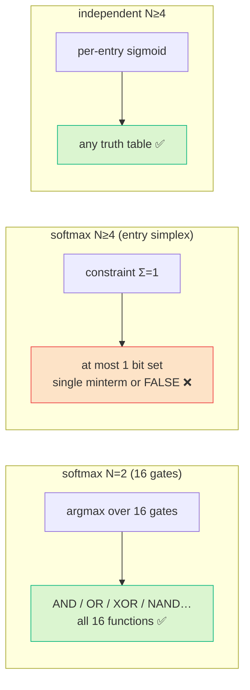
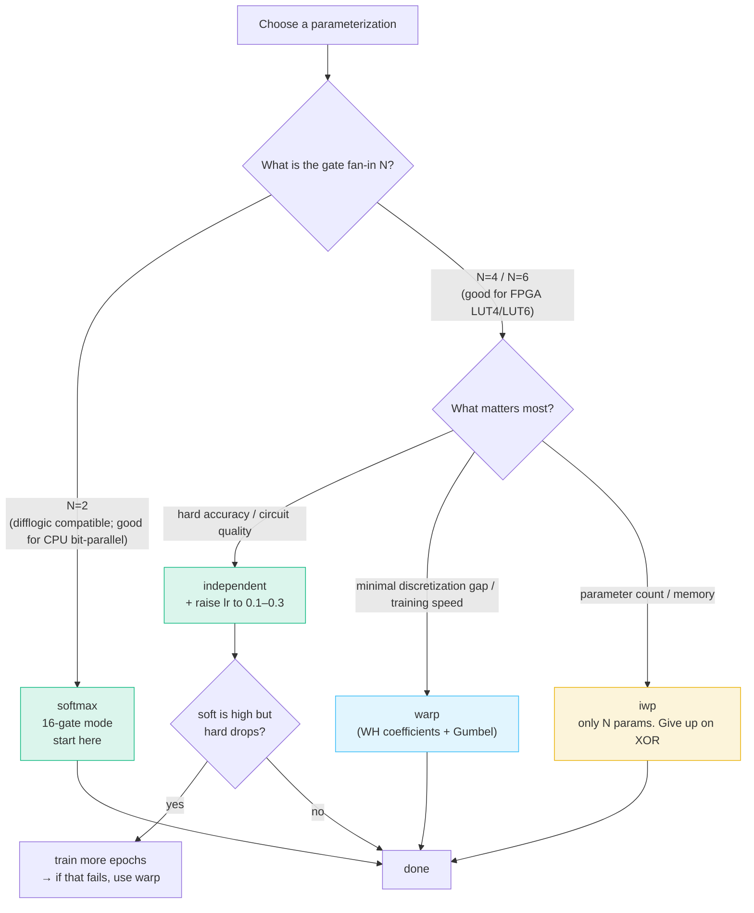

A logic gate is fundamentally a lookup table (LUT) that returns 0 or 1, and it is not
differentiable. Parameterization is what **wraps it in continuous parameters so gradients can
flow**, and this library implements five schemes. The choice made here determines accuracy,
parameter count, and the quality of the circuit after discretization.

:::note[What you'll learn here]
1. **How the five schemes differ** — what softmax / independent / iwp / raw / warp hold as parameters and what they can express
2. **The settled conclusion** — **softmax for N=2, independent (with a higher learning rate) for N≥4** — and the experimental evidence behind it
3. **How to choose** — a decision flow driven by your goal (accuracy / FPGA area / training speed)
:::

## Background: LUTs and discretization

An $N$-input LUT holds a truth table of $2^N$ entries and can express $2^{2^N}$ Boolean functions.

| $N$ | Entries $2^N$ | Expressible functions $2^{2^N}$ | Corresponds to |
|---|---|---|---|
| 2 | 4 | 16 | difflogic's 16 gates |
| 4 | 16 | 65,536 | LUT4 |
| 6 | 64 | about $1.8\times10^{19}$ | **The same expressiveness as an FPGA LUT6** |

During training this table is approximated by continuous values; at inference it is discretized
back into a pure Boolean table. The general form is below, and **the only difference between
schemes is the weight transform $f$**.

$$
y = \sum_{k=0}^{2^N-1} f(W)_k \prod_{j=0}^{N-1}\bigl(x_j \text{ if } \mathrm{bit}(k,j)=1 \text{ else } 1-x_j\bigr)
$$

## Comparing the five schemes

| Scheme | Weight transform $f$ | Params/gate | Hard discretization | Expressible hard functions | Origin |
|---|---|---|---|---|---|
| `softmax` (**N=2**) | softmax over the 16 gates | 16 | `argmax` → 16-gate table | **All 16 functions** | difflogic (DLGN) |
| `softmax` (N≥4) | softmax over the $2^N$ entries | $2^N$ | Only entries with probability > 0.5 become 1 | **A single minterm or FALSE only** | — |
| `independent` | Per-entry sigmoid | $2^N$ | $\sigma(w)>0.5$ | **All $2^{2^N}$ functions** | BinaryBrain |
| `iwp` | Per-input sigmoid, combined by product | $N$ | $\sigma(w)>0.5$ | Product-form functions only (no XOR) | LDDLGN |
| `raw` | Weights held directly in $[0,1]$ | $2^N$ | Thresholded at hardware lowering time | All $2^{2^N}$ functions | BinaryBrain |
| `warp` | Walsh–Hadamard coefficients, Gumbel smoothing | $2^N$ | logit > 0 | All $2^{2^N}$ functions | WARP |

### softmax — entries (or gates) compete

The weights are constrained to sum to 1. It is like distributing 100 yen among boxes: raising one
automatically lowers the others. The advantage is that gradients reach every parameter in a
coupled way.

**N=2 is a special case**: instead of the 4 truth-table entries, it becomes a
**16-gate mode that takes softmax over the 16 complete Boolean functions** (the shape of `weights`
is `(out_dim, 16)`). What argmax selects is a finished function such as AND/OR/XOR/NAND, so
discretization loses no expressiveness.

### independent — entries are independent

Each entry independently carries a probability of being 1 ($\sigma(w_k)$; they do not sum to 1).
Because **any truth table can be expressed directly**, no expressiveness is lost at discretization.
It maps cleanly onto an FPGA LUT6.

```
softmax(N≥4):  [0.01, 0.02, 0.07, 0.90] sum=1       → at most 1 bit can be set
independent:   [0.10, 0.80, 0.30, 0.95] independent → any bit pattern is reachable
```

### iwp — one parameter per input

It holds only $N$ parameters instead of $2^N$. At N=6 that is 64 → 6, a more than tenfold
reduction, and training is faster too. The price is that it **cannot express functions like XOR
where the combination itself is the point**. The scheme bets on the observation that most gates in
a trained model converge to AND/OR/NOT.

### raw / warp

- `raw` — keeps weights as real numbers in $[0,1]$ (initialized as $\mathcal{N}(0.5, 0.01)$). Inference also uses continuous values, and **discretization happens only at hardware lowering time**.
- `warp` — learns **coefficients in the Walsh–Hadamard basis** rather than the truth table itself, and discretizes by the sign of the logit. The discretization gap is essentially zero (measured at **−0.06pp** on MNIST N=2 — that is, hard beats soft) and it runs at 11–48% of softmax's FLOPs. A degree cap (`wh_degree_cap`) that discards higher-order coefficients can shrink the circuit further.

## The settled conclusion: softmax for N=2, independent for N≥4

:::tip[If you remember only one thing]
- **N=2** → `softmax` (16-gate mode)
- **N=4 / N=6** → `independent`. And **raise the learning rate** (go from 0.01 to 0.1–0.3 to isolate the effect)
:::

### Why you must not use softmax at N≥4

At N≥4, softmax operates on a **simplex over the $2^N$ entries**, not the 16-gate table.
Since the entries sum to 1, discretization (probability > 0.5) can set at most one bit —
meaning the only hard tables you can build are **a single minterm or constant FALSE**.
Everyday functions like pass-through, OR, and XOR are structurally inexpressible.



**Experimental evidence**: in a controlled experiment on a convolutional configuration that changed
nothing but `softmax` (entry simplex) → `independent`, accuracy improved by **+3.2pt despite half
the epochs**. On fully connected MNIST, softmax N=4 tops out at hard 94.54% with a 1.12pp
discretization gap, losing to warp N=4 under the same conditions (95.50% / 0.14pp).
The point of this finding is that missing expressiveness cannot be made up with more training.

### Why the learning rate has to go up

`independent` goes through a sigmoid, and combined with a saturating initialization (logits around
±5) it makes **gradients decay rapidly through deep serial composition**. Measurements showed
gradient norms across all layers dropping to around $10^{-5}$, and at the default lr=0.02 the soft
accuracy did not move past its first digit even after 10 epochs.
**Training does progress at lr ≥ 0.3**, so the standard move when using `independent` is to raise
the learning rate by an order of magnitude first and isolate the problem from there.

```bash
# N=6 (FPGA LUT6 compatible) + independent + a higher learning rate
uv run griffith train configs/recipes/dlgn_mnist_quick.yaml \
    model.n_inputs=6 model.k=4000 model.parameterization=independent optim.lr=0.3
```

## Decision flowchart



## Measured reference (MNIST, 6 layers, τ=10, 50 epochs, bs=128, lr=0.01)

| | softmax N=2 | warp N=2 | warp N=4 | softmax N=4 |
|---|---|---|---|---|
| hard accuracy | **97.74%** | 96.11% | 95.50% | 94.54% |
| soft accuracy | 98.30% | 96.05% | 95.64% | 95.66% |
| Discretization gap | 0.56pp | **−0.06pp** | **0.14pp** | 1.12pp |
| Gate count | 96,000 | 96,000 | **24,000** | **24,000** |
| Parameter count | 1,536,000 | **384,000** | **384,000** | **384,000** |
| Training time | 5.0 min | 3.1 min | **2.1 min** | 1.7 min |

What to take away:

- **N=2 softmax leads on accuracy** by a clear margin — but it costs 4× the parameters.
- **warp has essentially zero discretization gap.** The soft score carries over to the circuit as-is.
- **Only softmax N=4 has a large gap** (1.12pp). The missing expressiveness described above shows up directly in the numbers.
- After discretization every scheme yields **the same kind of LUT circuit**. There is no difference in inference performance; **the difference exists only during training**.

## How to specify it

```yaml
# recipe YAML
model:
  n_inputs: 6
  parameterization: independent
```

```bash
# CLI override
uv run griffith train <recipe>.yaml model.parameterization=independent optim.lr=0.3
```

```python
# Python API
from griffith_logic.layers.lut import LutLayer

layer = LutLayer(in_dim=784, out_dim=4000, n_inputs=6,
                 parameterization='independent')
# LutLayer(in=784, out=4000, n_inputs=6, entries=64, param=independent)
print(layer)   # the repr shows the scheme you picked, as-is
```

`LutLayer.PARAMETERIZATIONS` defines the list of valid values, and an unknown string raises an
error immediately at initialization.

## Addendum: the `sin` estimator (paper IWP) and gates other than LUTs

For `independent`, the estimator $\rho$ that maps $\Omega_k$ to the entry probability
$\omega_k = \rho(\Omega_k)$ can be the default sigmoid or `estimator: sin`
($\rho(\Omega) = 0.5 + 0.5\sin\Omega$, the setting used in the experiments of
*Light Differentiable Logic Gate Networks*). Residual initialization then becomes
$\Omega \sim \mathcal N(\pm\mu, \sigma)$ (defaults $\mu=1.2$, $\sigma=0.25$). The same option works for
both `LutLayer` and `LutConv2d` (`LutConv2d(..., parameterization='independent', estimator='sin')`).

There is also a gate that does not hold a truth table directly: **`LTTLayer` (linear threshold gate)**.
Gate j computes $y_j = 1[\sum_k w_{jk} x_{jk} + b_j > 0]$ with N+1 parameters per gate. It can only
express linearly separable Boolean functions (for N=2, the 14 functions other than XOR / XNOR), but
training always uses hard values plus STE (`ste='clip'|'identity'|'sigmoid'`), so there is no
discretization gap by construction, and in the IR it becomes an ordinary N-input LUT
(`export/discretize.py::truth_tables_from_ltt` enumerates all $2^N$ patterns).

## What to read next

- [What Should I Use? (Selection Guide)](/en/guides/choosing/) — settle all four choices, parameterization included, on one page
- [Running Training](/en/guides/training/) — typical ranges for learning rate, τ, and epochs
- [The Mathematics of LutLayer](/en/explanation/lut-layer/) — inside the Butterfly basis and the custom autograd
- [A Taxonomy of DLGN](/en/explanation/taxonomy/) — the lineage and positioning of each method
- [Working with IR](/en/guides/ir/) — how the chosen parameterization is recorded in the IR

<!-- i18n:source=guides/parameterization.md hash=8c5761bf465d -->
