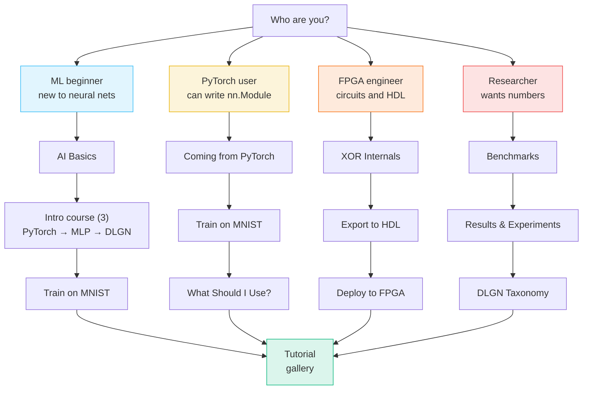

This site has more than 80 pages. **You do not need to read them in order.**
The shortest path depends on where you are coming from, so use this page to decide
**where to start and what to read next** — nothing else.

:::tip[Decide in three seconds]
- New to machine learning → [AI Basics](/en/explanation/ai-basics/)
- You can write PyTorch → [Coming from PyTorch](/en/guides/from-pytorch/)
- Circuits / FPGA background → [Appendix: XOR Internals](/en/tutorials/xor/)
- Researcher, want numbers → [Benchmarks](/en/reference/benchmarks/)
:::

## The four routes

### Route A: New to neural networks

A logic-gate NN is "an ordinary neural network whose weights became truth tables",
so picking up the **ordinary NN vocabulary** first (layers, loss, gradients)
makes everything after it much faster.

| # | Read | What you get |
|---|---|---|
| 1 | [AI Basics](/en/explanation/ai-basics/) | What a neural network is and what training actually does |
| 2 | [Intro 1. NN & PyTorch Basics](/en/tutorials/nn-basics/) | Tensors, autograd and the training loop, hands-on (no DLGN yet) |
| 3 | [Intro 2. Build an MLP in PyTorch](/en/tutorials/pytorch-mlp/) | Three `nn.Linear` layers on MNIST, and what the real-valued weights look like |
| 4 | [Intro 3. Replace the MLP with a DLGN](/en/tutorials/mlp-to-dlgn/) | The same training loop, swapped over to `LutLayer` / `GroupSum` |
| 5 | [Core Concepts](/en/getting-started/concepts/) | The five concepts: soft/hard, LutLayer, GroupSum, IR, HDL |
| 6 | [Installation](/en/getting-started/installation/) → [Quickstart](/en/getting-started/quickstart/) | Get it running locally |
| 7 | [1. Train on MNIST](/en/tutorials/mnist/) | 4000 logic gates reading handwritten digits |
| 8 | [Appendix: XOR Internals](/en/tutorials/xor/) | The whole mechanism in a 16-gate network |

:::tip[The introductory course is a set of three]
Steps 2-4 form one course — PyTorch basics → a small MLP → the same problem as a DLGN —
and each runs in a few minutes on CPU. If you would rather just read,
[AI Basics](/en/explanation/ai-basics/) and [From NN to DLGN](/en/explanation/nn-to-dlgn/) are enough to move on.
:::

### Route B: Coming from PyTorch

**This library is ordinary PyTorch** (`nn.Module`, `loss.backward()`, `torch.optim`),
so you only have to learn the diff. The biggest trap is that `model.eval()`
means something different here.

| # | Read | What you get |
|---|---|---|
| 1 | [Coming from PyTorch](/en/guides/from-pytorch/) | `nn.Linear`→`LutLayer`, and how `model.eval()` differs |
| 2 | [1. Train on MNIST](/en/tutorials/mnist/) | The fastest working example |
| 3 | [What Should I Use?](/en/guides/choosing/) | Decide architecture, parameterization, fan-in, learning rule |
| 4 | [Training](/en/guides/training/) / [Reading Training Curves](/en/guides/training-curves/) | CLI vs Python API, reading soft vs hard accuracy |
| 5 | [Tutorial gallery](/en/tutorials/) | Find the example closest to your model (see the table below) |

### Route C: FPGA engineers and circuit designers

It is faster to look at **what the generated Verilog actually is** before reading
about training. Start from the smallest XOR and follow it through the IR (JSON) to HDL.

| # | Read | What you get |
|---|---|---|
| 1 | [Appendix: XOR Internals](/en/tutorials/xor/) | A 16-gate circuit decided by training |
| 2 | [3. Export to HDL](/en/tutorials/hdl-export/) | IR extraction → Verilog/VHDL → equivalence check |
| 3 | [Working with IR](/en/guides/ir/) / [IR Schema](/en/reference/ir-schema/) | The structure of the IR, which is the source of truth |
| 4 | [Deploy to FPGA](/en/guides/fpga/) | Running on Tang Nano 20K / DE0-CV |
| 5 | [5. Export a CNN to HDL](/en/tutorials/cnn-hdl-export/) / [7. End-to-End Walkthrough](/en/tutorials/full-pipeline/) | Circuits at a realistic scale |

### Route D: Researchers evaluating the approach

Check "how far does it get" and "what was it compared against" first,
then descend into the theory.

| # | Read | What you get |
|---|---|---|
| 1 | [Benchmarks](/en/reference/benchmarks/) | Measured accuracy and speed |
| 2 | [Paper Reproduction](/en/explanation/results/dlgn-repro/) | Reproduction status of the difflogic paper |
| 3 | [Architecture Survey](/en/explanation/results/architecture-survey/) | How far each architecture got |
| 4 | [Discretization Gap](/en/explanation/results/discretization-gap/) / [Parameterization Study](/en/explanation/results/parameterization-study/) | How much soft→hard costs, and what fixes it |
| 5 | [DLGN Taxonomy](/en/explanation/taxonomy/) / [LutLayer Internals](/en/explanation/lut-layer/) | The three lineages and the gradient math |

---

## Common architecture names → tutorials on this site

The table that answers "**is there an RNN tutorial?**".
Tutorials here are named after the specific model (LSTM, WaveNet, ...),
so this maps the general architecture names onto them.

| What you are looking for | Where to start here |
|---|---|
| **MLP / fully connected** | [1. Train on MNIST](/en/tutorials/mnist/) (stacked `LutLayer`), [Appendix: XOR](/en/tutorials/xor/) |
| **CNN / convolution** | [5. Export a CNN to HDL](/en/tutorials/cnn-hdl-export/), [Object detection (CenterNet)](/en/tutorials/detection/), [U-Net](/en/tutorials/logic-unet/) |
| **RNN / recurrent networks** | [RNN: LSTM / GRU](/en/tutorials/logic-lstm/), [RNN seq2seq](/en/tutorials/rddlgn-seq2seq/), [Reservoir computing](/en/tutorials/logic-reservoir/) |
| **LSTM / GRU / gated RNN** | [Gating is Boolean logic](/en/tutorials/logic-lstm/) |
| **seq2seq / encoder-decoder** | [seq2seq from an RNN alone (RDDLGN)](/en/tutorials/rddlgn-seq2seq/) |
| **Reservoir computing / ESN** | [Choosing not to train the circuit](/en/tutorials/logic-reservoir/) |
| **Transformer / GPT / LLM** | [Logic-gate GPT](/en/tutorials/logic-gpt/), [The Transformer logic ladder](/en/tutorials/logic-ladder/) |
| **Attention / self-attention** | [Four attention variants](/en/tutorials/attention-tour/), [The Transformer logic ladder](/en/tutorials/logic-ladder/) |
| **TCN / causal conv / dilated conv** | [WaveNet (causal CNN)](/en/tutorials/logic-wavenet/) |
| **ResNet / residual connections** | [Exact identity through OR residuals](/en/tutorials/logic-resnet/) |
| **U-Net / segmentation / dense prediction** | [Per-pixel answers with a logic U-Net](/en/tutorials/logic-unet/) |
| **MLP-Mixer / token mixing** | [LogicMixer (MLP-Mixer)](/en/tutorials/logic-mixer/) |
| **VAE / autoencoder / representation learning** | [Folding an image into 96 bits](/en/tutorials/logic-vae/) |
| **GAN / adversarial generation** | [Images from random bits (LogicGAN)](/en/tutorials/logic-gan/) |
| **Diffusion models** | [A diffusion model as one Boolean circuit](/en/tutorials/logic-diffusion/) |
| **Object detection / YOLO・CenterNet family** | [Object detection with zero multipliers](/en/tutorials/detection/) |
| **Text classification / n-grams** | [TextCNN in logic gates](/en/tutorials/textcnn/) |
| **BNN / binary neural nets / weightless NN** | [DWN (thermometer encoding)](/en/tutorials/dwn/), [BinaryBrain-compatible API](/en/tutorials/binarybrain/) |
| **Transfer learning / replacing part of a model** | [2. Build a Hybrid NN](/en/tutorials/hybrid/) |
| **Learning rules other than backprop (DFA / feedback alignment / ES)** | [6. Learning Rules (DFA/AP)](/en/tutorials/learning-rules/), [Learning rules explained](/en/explanation/learning-rules/) |

:::note[The naming is not accidental]
In logic-gate networks the parts of the original architecture map directly onto
Boolean operations — an LSTM forget gate literally becomes a 2:1 multiplexer.
The tutorial titles foreground that discovery, which pulls them away from the
generic names, but the content is a straightforward RNN / CNN / Transformer
as the table above shows.
:::

## Reverse lookup by goal

| What you want to do | Go to |
|---|---|
| Just run something | [Quickstart](/en/getting-started/quickstart/) |
| Decide which configuration to use | [What Should I Use?](/en/guides/choosing/) |
| Training will not converge | [Troubleshooting](/en/guides/troubleshooting/) |
| Soft accuracy is fine but hard collapses | [Discretization Gap](/en/explanation/results/discretization-gap/) |
| Turn it into a circuit on an FPGA | [HDL Export](/en/guides/hdl-export/) → [Deploy to FPGA](/en/guides/fpga/) |
| Rewire the structure in a browser | [Visual Editor](/en/guides/editor/) |
| Look up arguments and types | [Python API](/en/reference/api/) |
| Look up a term | [Glossary](/en/explanation/glossary/) |

## What to read next

- [Tutorial gallery](/en/tutorials/) — pick from thumbnails of all 27 executed tutorials
- [What Should I Use?](/en/guides/choosing/) — the four choices on one page
- [What is DLGN?](/en/explanation/dlgn/) — why train logic gates directly
- [FAQ](/en/explanation/faq/) — "does it really run without a GPU?" and more

{/* i18n:source=guides/roadmap.mdx hash=5b08a6e6da23 */}
