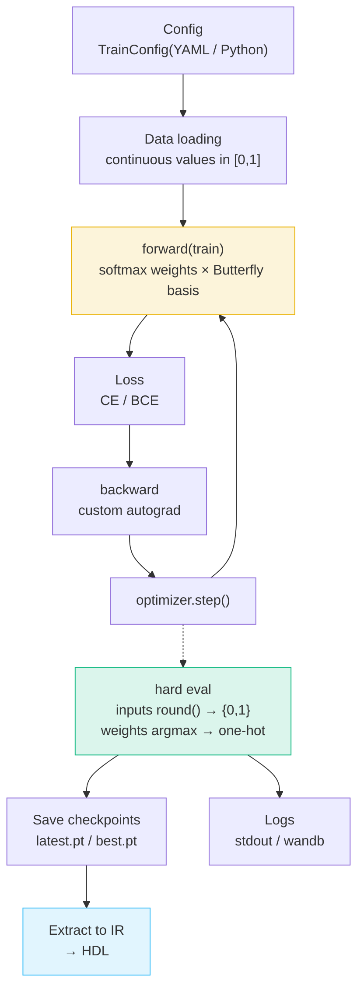
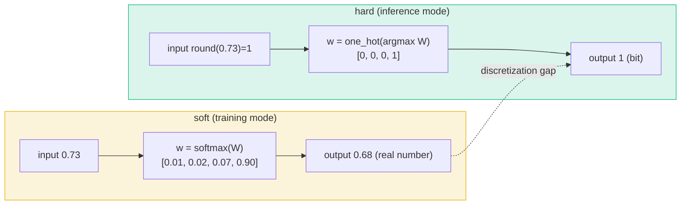

Training a differentiable logic-gate network follows one arc: **optimize a continuously relaxed
circuit by gradient descent, then discretize it into a pure Boolean circuit at the end.**
This page covers the operational side — how to actually run it.

:::note[What you'll learn here]
1. **Two entry points** — when to use `griffith train` (CLI) with a config YAML versus `TrainConfig` + `run_training()` (Python API)
2. **Typical hyperparameter ranges** — measured guidelines for learning rate, temperature τ, neuron count k, depth, and epochs
3. **Soft vs. hard accuracy** — why both are reported and what the gap between them (the discretization gap) means
:::

## The overall training flow

The training loop itself is no different from an ordinary neural network. What is distinctive is
the dual nature of the weights: **during training they are a probability distribution; at evaluation
they are a truth table with a single entry set.**



The top row (yellow) is **soft = training mode**; the bottom row (green) is **hard = inference mode**.
Learning only progresses in soft mode, but **the score that actually matters is the hard one**.

## Path A: run it from the CLI (`griffith train`)

Use this when you need reproducibility, when you are running sweeps, or when you are submitting
jobs to the cloud. Write the config in YAML and override individual fields on the command line
with dot notation.

```bash
# Run a recipe as-is
uv run griffith train configs/recipes/dlgn_mnist_quick.yaml

# Override just a few fields (without editing the YAML)
uv run griffith train configs/recipes/dlgn_mnist_quick.yaml optim.lr=0.02 model.k=4000

# Exit non-zero if the expected metrics are not met (for CI and automation)
uv run griffith train --strict configs/recipes/dlgn_mnist_quick.yaml
```

The recipe YAML maps directly onto the structure of `TrainConfig`.

```yaml
# configs/recipes/dlgn_mnist_quick.yaml
data:
  name: mnist
  batch_size: 128
model:
  kind: dlgn          # Flatten + LutLayer×layers + GroupSum
  k: 2000             # neurons (gates) per layer
  layers: 3           # number of LUT layers
  n_inputs: 2         # inputs per gate (2 / 4 / 6)
  parameterization: softmax
  tau: 10.0           # GroupSum temperature
optim:
  name: adam
  lr: 0.01
run:
  epochs: 3
  seed: 42
  wandb: true
expected_metrics:     # success criteria, as numbers
  hard_acc_min: 0.90
```

| Flag | Purpose |
|---|---|
| `config` (positional) | Path to the config YAML. If omitted, training starts from the defaults |
| `overrides` (variadic) | Dot-notation overrides such as `model.k=8000` |
| `--from-run DIR` | Reload an existing run's `config.yaml` and re-execute it |
| `--out-dir DIR` | Output directory (defaults to `outputs/<timestamp>_<run name>`) |
| `--strict` | Exit non-zero when `expected_metrics` are not met |

:::tip[Re-running is just pointing at a directory]
At launch, the runner saves the **fully resolved config** to `outputs/<run>/config.yaml`.
It uses the same schema, so `uv run griffith train outputs/<run>/config.yaml` reproduces the run exactly.
:::

What ends up in the output directory:

```
outputs/20260903_120000_dlgn_mnist/
├── config.yaml            # resolved config (re-runnable)
└── checkpoints/
    ├── latest.pt          # most recent
    └── best.pt            # the point of best hard acc
```

### Keys for wiring, GroupSum and conv-DLGN

With the defaults you get the usual fully connected DLGN with fixed random wiring. The keys that change
the structure are:

| Key | Values | Meaning |
|---|---|---|
| `model.connections` | `random` / `unique` / `{kind: ...}` | Wiring. `kind` is `rot` (per-layer lists `s_a` / `s_b` and the stride `step`) / `perm` / `random_seeded` / `random_uniform` / `butterfly` (`strides` / `order`) / `local1d` (`strides`) / `local2d` (`grid` / `bits_per_cell` / `layer0_offsets` / `assign`) / `per_layer` (each layer takes `rot` / `stretched_rot` / `perm` / `random_*` / `rot_n` / `butterfly` / `local1d` / `local2d`). Structured wirings accept `dedupe: true` to remove duplicate pins |
| `model.group_assign` | `contig` / `stride` | Class assignment of GroupSum (neuron i → class i // m or i mod k). In the IR, `stride` becomes a transpose plus `group_sum` |
| `model.estimator` | `sigmoid` / `sin` | Estimator of the entry probabilities for `parameterization: independent` (`sin` is the paper IWP; with `residual_init: true` the residual init is done in Ω space) |
| `model.kind: conv_dlgn` + `model.conv` | `in_shape` / `channels` / `sampler` (`random` / `random8` / `cross5` / `dilated8` / `checker13`) / `downsample` (`orpool` / `stride`) / `head_dims` / `head_wiring` (`rot2` / `random` / `unique`) | Weight-shared logic-gate-tree convolutions + OR pooling + a fully connected head (cdlgn style). Images are consumed as tensors; the IR comes from `export_ir(..., input_shape=in_shape, native_conv=True)` |

Recipe examples: `configs/recipes/conv_dlgn_cifar10_s.yaml` (CIFAR-10, calibration anchor) and
`configs/recipes/conv_dlgn_mnist_quick.yaml` (a one-epoch local smoke run).

### Unknown keys fail immediately

Configs are validated by pydantic with `extra='forbid'`. A typo such as `model.kk=2000` raises a
validation error before training starts, so **you never lose three hours only to discover a
misconfigured run**.

## Path B: run it from the Python API (`run_training`)

Use this when you want to call training from a notebook, build your own sweep logic, or feed the
result dictionary straight into downstream processing.

```python
from griffith_logic.training.config import TrainConfig, load_config
from griffith_logic.training.runner import run_training

# 1) Build it from Python objects
cfg = TrainConfig.model_validate({
    'data':  {'name': 'mnist', 'batch_size': 128},
    'model': {'kind': 'dlgn', 'k': 2000, 'layers': 3,
              'n_inputs': 2, 'parameterization': 'softmax', 'tau': 10.0},
    'optim': {'name': 'adam', 'lr': 0.01},
    'run':   {'epochs': 3, 'seed': 42},
})

# 2) Build it from YAML + overrides (exactly the path the CLI takes)
cfg = load_config('configs/recipes/dlgn_mnist_quick.yaml',
                  overrides=['optim.lr=0.02', 'model.k=4000'])

result = run_training(cfg, out_dir='outputs/my_run')
print(result['hard_acc'], result['best_hard_acc'], result['final_loss'])
```

`run_training()` returns a dictionary that contains at least the following.

| Key | Meaning |
|---|---|
| `hard_acc` | Discretized accuracy at the final epoch (**performance as a circuit**) |
| `best_hard_acc` | Best hard accuracy seen over the whole run |
| `final_loss` | Loss at the final step |
| `steps` | Total number of steps |
| `out_dir` / `checkpoint_latest` / `checkpoint_best` | Paths to the artifacts |
| `expected_metrics` | Result of checking the expected metrics (`{'ok': bool, 'checks': [...]}`) |

### Choosing between the two paths

| | `griffith train` (CLI) | `run_training()` (API) |
|---|---|---|
| Where the config comes from | YAML + dot notation | A `TrainConfig` object |
| Best suited to | Reproduction, sweeps, cloud submission, CI | Analysis, notebooks, embedding in your own loop |
| How you get results | stdout / `outputs/` / wandb | The returned dictionary |
| Internals | Just calls the same `run_training()` | — |

**The CLI is a thin wrapper around the API**, so training itself is identical either way.

## Key hyperparameters

### Typical ranges

Measured guidelines based on MNIST-style tasks (28×28, 10 classes).

| Parameter | Symbol/key | Typical range | How it behaves |
|---|---|---|---|
| Learning rate | `optim.lr` | **0.01** (Adam). Raise to 0.1–0.3 for `independent` and deep serial compositions | Too small and every gate stays frozen near its initial value |
| GroupSum temperature | `model.tau` | **10** (k=8000, 6 layers, MNIST). Around 100 for CIFAR-style tasks | Scales the logits. Too large and gradients thin out |
| Gate count | `model.k` | 2,000 (smoke test) – 64,000 (paper reproduction) | Circuit capacity. More gates means higher accuracy and more area |
| Depth | `model.layers` | **6** (MNIST paper level). 3–4 for quick checks | Deeper is more expressive, but gradients attenuate more easily |
| Gate fan-in | `model.n_inputs` | 2 / 4 / 6 | → [Choosing a Parameterization](/en/guides/parameterization/) |
| Epochs | `run.epochs` | 3 (smoke) / 50 (standard) / 200+ (paper reproduction) | The discretization gap shrinks as training progresses |
| Batch size | `data.batch_size` | 100–128 | Note that larger batches mean fewer steps per epoch |

### τ (the GroupSum temperature) directly affects accuracy

`GroupSum` merely sums neuron outputs per class and divides by τ, yet
**the choice of τ alone can move accuracy by a full point.**

$$
\text{logit}_c = \frac{1}{\tau}\sum_{i \in \text{group}_c} y_i
$$

On MNIST with 6 layers and k=8000, a **fixed τ=10 measured about 1.0pt higher** than the
rule-of-thumb $\tau=\sqrt{k/C}\approx 28.3$. Start around 10 and only change it if the loss
refuses to drop or the logits saturate.

### How much training to run

| Scale | Example config | Time | Purpose |
|---|---|---|---|
| Smoke | `logic_xor.yaml` (k=16, 2 layers, 10ep, CPU) | Seconds | Confirm nothing is broken |
| Quick | `dlgn_mnist_quick.yaml` (k=2000, 3 layers, 3ep) | Minutes | See whether a config change helps |
| Standard | k=16,000 / 6 layers / 50ep | Minutes to tens of minutes (GPU) | The main experimental workhorse. hard accuracy in the 97% range |
| Paper reproduction | k=64,000 / 6 layers / 200ep+ | Hours | → [Cloud GPU](/en/guides/cloud-gpu/) |

## Soft and hard — reading the two accuracies

Training scripts always report two accuracies. Treat them as **scores for two different models**.

| Display | `model.training` | Inputs | LUT weights | Meaning |
|---|---|---|---|---|
| `test_acc(soft)` | `True` | Continuous values in [0,1] | `softmax(W)` (spread across all $2^N$ entries) | How well the continuous relaxation fits |
| `test_acc` (hard) | `False` | {0,1} via `round()` | `one_hot(argmax(W))` (a single entry) | **True performance as a logic circuit** |

Laid out side by side, here is what happens internally.



Normally `soft > hard`, and the difference is called the **discretization gap**.

| Gap | Interpretation | What to do |
|---|---|---|
| 0–0.5pt | Healthy. Gates have converged well onto specific entries | Nothing |
| 1pt or more | The continuous relaxation works, but the circuit falls apart | Train longer / revisit the parameterization |
| soft is low too | Training is not working at all | Suspect lr, τ, or capacity (k, depth) |

Measured example (MNIST, 6 layers, 50ep): softmax N=2 gives soft 98.30% / hard 97.74% (a 0.56pt gap).
More training drives gates toward a single entry, so the gap tends to close on its own.

### Running hard eval on a trained checkpoint

```bash
uv run griffith eval outputs/20260903_120000_dlgn_mnist/checkpoints/best.pt
```

The model structure is restored from the config stored inside the checkpoint, so there is no need
to re-specify the architecture at evaluation time. Pass `--dataset` to evaluate on different data.

## Common pitfalls

| Symptom | Cause | Fix |
|---|---|---|
| Loss never moves from its initial value | Learning rate too low — especially common in deep serial configurations | Raise `optim.lr` to 0.1–0.3 to isolate the issue |
| soft is high but hard drops sharply | The discretization gap. Either not enough training or a mismatched parameterization | Train longer / [Choosing a Parameterization](/en/guides/parameterization/) |
| Accuracy falls short of published numbers | Usually a mismatch in τ, the wiring scheme, or how many evaluation samples were used | Set τ to the official recipe value and evaluate on the full test set |
| Config changes seem to have no effect | You edited one YAML but the run is reading another file | Check `outputs/<run>/config.yaml` (the resolved config) |
| Training works but the model won't lower to HDL | Non-logic layers (ones returning real values) are mixed in | → [HDL Export](/en/guides/hdl-export/) |

## What to read next

- [Choosing a Parameterization](/en/guides/parameterization/) — how to pick `n_inputs` and `parameterization`
- [Reading Training Curves](/en/guides/training-curves/) — what soft/hard curves tell you
- [Working with IR](/en/guides/ir/) — lowering training results into IR (JSON) and verifying them
- [Cloud GPU](/en/guides/cloud-gpu/) — submitting large training runs to the cloud
- [griffith CLI Reference](/en/reference/cli/) — every subcommand and flag

<!-- i18n:source=guides/training.md hash=b39d712c0b8b -->
