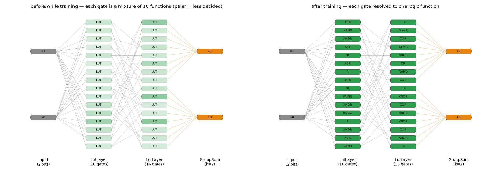
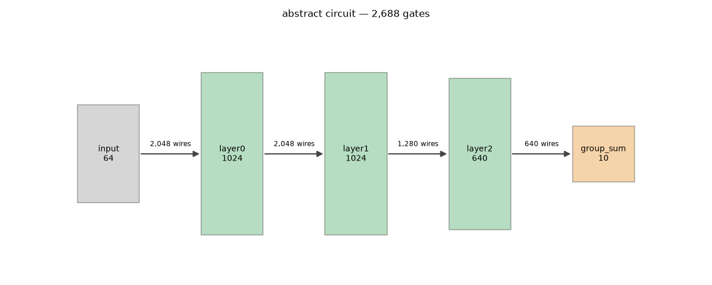

`griffith_logic.analysis.circuit_viz` is the module that turns the code you wrote into a picture of the
circuit it actually describes. It has two uses.

- **Mapping code to circuit** — seeing that the single line `LutLayer(2, 16)` means "16 gates and the wiring feeding them"
- **Watching training progress as a circuit** — seeing which of the 16 logic functions each gate has settled on (or whether it has settled at all)

It uses matplotlib, so the `figures` extra is required.

```bash
uv sync --extra cpu --extra figures
```

## Usage: before and after training, side by side

`plot_circuit()` effectively takes a single argument, `resolve`. The same function draws both the
pre-training (mixed) and post-training (resolved) views.

```python
import copy
import matplotlib.pyplot as plt
import torch.nn as nn

from griffith_logic import GroupSum, LutLayer
from griffith_logic.analysis.circuit_viz import plot_circuit

model = nn.Sequential(
    LutLayer(2, 16, n_inputs=2),
    LutLayer(16, 16, n_inputs=2),
    GroupSum(k=2, tau=2.0),
)
model_init = copy.deepcopy(model)   # snapshot before training

...  # train here

fig, axes = plt.subplots(1, 2, figsize=(17, 6))
plot_circuit(model_init, resolve=False, ax=axes[0])  # before: mixture
plot_circuit(model.eval(), resolve=True, ax=axes[1])  # after: gate names resolved
fig.savefig('circuit.png', dpi=110)
```



| Mode | Node display | How to read it |
|---|---|---|
| `resolve=False` | `LUT` (no name attached) | Fill darkness = how resolved the gate distribution is (`1 - H/ln 16`). **Pale = the logic function is still undecided.** Everything is pale before training and darkens as training proceeds |
| `resolve=True` | `AND` / `XOR` / `NAND` / `!A` / `A>=B` … | The name of the logic function chosen by argmax out of the 16. **A gate with this name is exactly what gets burned into the HDL** |

The colors follow the convention used across the project.

- **Green** — logic gates (`LutLayer` neurons)
- **Orange** — the real-valued part (`GroupSum` class scores and the wiring aggregated into them)
- **Gray** — input bits and wiring

## The gate names refer to the same things as the HDL

The labels under `resolve=True` are not names `plot_circuit` invents on its own.
They come from `truth_tables_from_lut_layer` (`griffith_logic/export/discretize.py`) — the single
discretization path `export_ir()` goes through when it builds the IR (the source of truth) — whose truth tables
are mapped to the 16 gate IDs and then to names (the same definition as `GATE_NAMES` in the visual editor).
Therefore

> a node labeled `XOR` in the figure = that neuron in the IR = that one line in the generated Verilog

is guaranteed (`tests/test_circuit_viz.py` checks that the IR truth tables and the labels agree).
LUTs with `n_inputs > 2` have no 16-gate name, so the truth table is shown in hex instead (e.g. `LUT:9a`).

## Large networks fall back to an overview

Once the total gate count exceeds `MAX_FULL_GATES` (256), drawing every node just turns into mush, so
`plot_circuit()` automatically falls back to an overview diagram (you can also call `plot_abstract()` directly).
Layers become boxes (height ∝ log(width)) and inter-layer connections become arrows annotated with counts.



```python
from griffith_logic.analysis.circuit_viz import plot_abstract

plot_abstract(model)                       # explicitly request the overview
plot_circuit(model, auto_abstract=False)   # draw every gate even when huge (expect mush)
```

## Try it in a tutorial

The [end-to-end tutorial](/en/tutorials/full-pipeline/) and the [XOR tutorial](/en/tutorials/xor/) contain
cells that print the before/after circuit diagrams side by side (the figures on those pages are actual execution output).

## Wiring diagrams for input-bypass architectures (experimental)

`plot_circuit` targets the straightforward "input → a chain of LutLayers → GroupSum" structure.
For **input-bypass (IALGN-style)** architectures, where a hidden layer's input is a pool such as
`concat([h_prev, x, o_0, ...])`, `analysis/wiring_viz.py` on the experimental branch `experiment/wiring-viz`
aggregates and draws the wiring distribution as a decomposition over index ranges
(it is the source that `circuit_viz`'s wiring extraction and overview were ported from). There, wire color
indicates the kind of connection.

- **Gray** — chained (from the immediately preceding layer)
- **Red** — bypass from the input side (the original input, plus the real-to-bit binarization interface)
- **Blue** — bypass from an intermediate layer

Properties like "the deeper the layer, the more the bypass spreads across the original input and earlier
intermediate layers" can be read off the overview as changes in arrow thickness. This will be folded into this page when it is merged into main.

## Structured wirings show up in the same diagrams

Wiring survives only as the `indices` table of the IR, so **structured wirings** fixed by a formula
before training are drawn exactly the same way. Besides the random kinds (`random_seeded` /
`random_uniform` / `perm`) and the regular ones (`rot` with a `step`, `stretched_rot`), the recipe key
`model.connections.kind` accepts `butterfly` (a cyclic radix-N butterfly: layer 0 is a gather, layer
l uses stride N^(l−1)), `local1d` (a proportionally mapped center plus a stride) and `local2d`
(neighbors on an image grid or a torus grid; layer 0 uses `grid` × `bits_per_cell`, hidden layers take
offsets from the ring sequence assigned by `assign`). To mix kinds per layer, write `rot_n` /
`butterfly` / `local1d` / `local2d` inside `kind: per_layer`. The generators live in
`griffith_logic.core.connections` (`get_butterfly_connections` / `get_local1d_connections` /
`get_local2d_connections` / `get_rot_n_connections`), and `connection_stats` reports coverage and
fan-out.

## Related

- [What is DLGN](/en/explanation/dlgn/) — what it means for the wiring to be fixed and random
- [Visual Editor](/en/guides/editor/) — another route for inspecting the IR graph interactively
- [Exporting to HDL](/en/tutorials/hdl-export/) — how the gates in the figure become a circuit

{/* i18n:source=guides/wiring-visualization.mdx hash=83aaa0252432 */}
