On the way to shipping your model, `griffith deploy` applies several compressions and optimizations.
This page is a **single list of all of them**. It answers "what is being done to my model", "how do I turn it off", and "does it really help".
For usage, see the [Deploy Kit Quickstart](/en/guides/deploy-quickstart/); for preparing a model, [Prepare demo models](/en/guides/deploy-models/);
for GPUs, [Deploy to a GPU](/en/guides/deploy-gpu/); for browsers, [Deploy to the browser](/en/guides/deploy-web/). All command options are in the [CLI reference](/en/reference/cli/), and the bundle format is in the [Deploy bundle spec](/en/reference/deploy-bundle/).

:::note[First, what you can rely on]
Everything listed here is built **not to change the integer outputs** (the accuracy of a trained model does not drop).
After each transformation, the result is compared as integers against `ir/simulate.py` of the original IR; if even one value differs, the build stops or that one optimization is dropped.
Where measurements showed a slowdown, the optimization is not on by default: it turns on automatically only under conditions where it measurably wins, or only when you ask for it explicitly.
:::

## At a glance

First, the whole flow in one picture (it runs top to bottom). The numbers in the boxes are measured gate counts of three real models (XOR / HAR k6000 / face detection) at each stage.

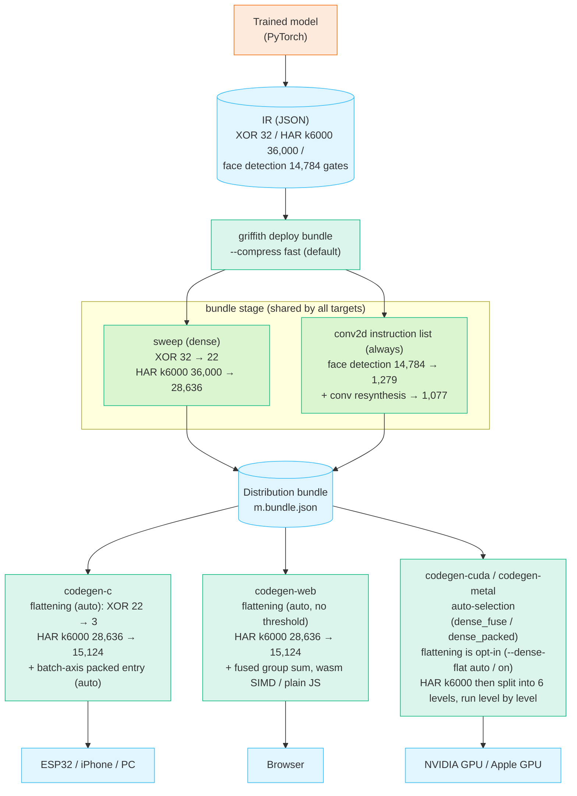

"Stage" says where the change happens. `bundle` is the stage that builds the distribution bundle (shared by every target); `codegen-*` is the stage that generates code for one target.
"Automatic" in the default column means it is applied only when its condition holds.

### Bundle stage and C generation stage

| Optimization (stage) | What it does | Default | Change or turn off | Measured effect |
|---|---|---|---|---|
| conv2d instruction lists (`bundle`) | Turns each conv2d gate tree into an instruction list with trivial gates folded away | Always on | Cannot be turned off (the IR is unchanged) | Face detection 14,784 → 1,077 gates. 59.7-95.1% fewer gates on real models |
| sweep (`bundle`) | Removes constant, duplicate (CSE), and unreferenced gates from dense models | Automatic (for dense) | `--no-sweep` / `--compress none` | XOR 32 → 22, HAR k6000 36,000 → 28,636 |
| conv resynthesis (`bundle`) | Rebuilds conv2d trees with fewer gates | Automatic (for conv2d) | `--compress none`. For a deeper search, `--compress max` | Face detection 1,279 → 1,077 (1.2 s). Speed does not change |
| Baking in flattening (`bundle`) | Flattens dense into a flat netlist (`lut_flat`) and bakes it into the IR | Off | `bundle --dense-flat` (explicit only) | The baked `lut_flat` runs on C / Web / CUDA / Metal alike. Each `codegen-*` decides automatically at generation time, so you normally do not need to bake it |
| Integer preprocessing (`bundle`) | Turns the input encoding into an integer-only descriptor | Always on for supported preprocessing | Cannot be turned off | Preprocessing runs with zero floating point |
| Flattening (`codegen-c`) | Flattens dense into a netlist without pass-throughs and constants and emits C for it | Automatic (reduction of 25% or more) | `--dense-flat off` / `on` / `--dense-flat-min-reduction R` | HAR k6000 on an ESP32: 26.60 → 12.69 ms (together with sweep) |
| Batch-axis packed entry (`codegen-c`) | Adds an entry that packs 32 samples into one word and runs them together | Automatic (when flattened) | `--dense-batch 0` / `--dense-batch N` | 1.7-5.9x the throughput of one-at-a-time at 32 samples |
| Bit-slice layer kernel (`codegen-c`) | Processes 32 gates of different kinds with one set of operations | Always on (dense that is not flattened) | `--dense-flat on` replaces it with flattening | 2.18x on HAR k6000 (one context) |
| 16-bit indices (`codegen-c`) | Stores the index tables as `uint16_t` to shrink the weights | Automatic (input width 65,536 or less) | No flag to turn it off | Weights (.rodata) 33.5-38.9% smaller. Speed unchanged |
| Fusion (`codegen-c --fuse`) | Unrolls the gate instruction list into straight-line code | Off | `--fuse` (explicit only) | 2-9% faster on conv models. Generated C is 1.2-2.3x larger |
| SIMD (C runtime) | Picks NEON / SSE2 / AVX2 at compile time | Automatic | `-DMDL_NO_SIMD` | Integer outputs are identical with SIMD and scalar |

### GPU and Web

| Optimization (stage) | What it does | Default | Change or turn off | Measured effect |
|---|---|---|---|---|
| conv_engine (`codegen-cuda` / `codegen-metal`) | Chooses `split` or `combined` for running conv2d | Automatic (`split`; `combined` if any node has too many slots) | `--conv-engine split\|combined` | With `combined`, a 1.6M-gate model that `split` cannot generate is generated and runs |
| Flattening (`codegen-cuda` / `codegen-metal`) | Runs dense as a flattened netlist (`lut_flat`), parallel level by level | OFF (opt-in, because large models get slower) | `--dense-flat auto` (adopted at a 25% or larger reduction) / `on`. Never when `--dense-fuse` / `--dense-packed` is explicit | On Metal (M3), against the best without flattening: k600 1.02-1.10x, k2400 0.85-1.15x, k6000 0.47-0.71x at batch 128 and above (slower) |
| dense_fuse (same) | Fuses consecutive dense layers and the final group_sum into one kernel | Automatic (when not flattened [the default], batch 32 or more, and a fusable chain exists) | `--dense-fuse` (force on) / `--no-auto` | 1.20-2.01x at batch 32 and above |
| dense_packed (same) | Packs the batch axis into 32 samples per word | Automatic (when not flattened, batch 128 or more, eligible, and dense_fuse is not on) | `--dense-packed` (force on) / `--no-auto` | At batch 128, most models gain +10% or more |
| decode megakernel (same) | Combines RDDLGN decoding into one kernel | On (only when it fits) | Falls back to the old path automatically when it does not fit (also `megakernel=False` in the Python API) | Metal 1.61-2.10x, CUDA 1.71-2.34x |
| n_streams (same) | Overlaps streams | Off | `--n-streams N` (explicit only) | Not automatic: it measurably slowed some models |
| conv_codegen (same) | Generates a dedicated kernel per conv2d | Off | `--conv-codegen` (explicit only) | End-to-end is about the same; generated code is 1.78-6.65x larger |
| Engine choice (`codegen-web`) | Prefers wasm (SIMD) and falls back to plain JS | Automatic | `engine: 'js'` / `'wasm'` of `loadBundle` | Integer outputs are identical on both engines |
| Flattening (`codegen-web`) | Ships dense as a flattened netlist (`lut_flat`) | Automatic (always, whenever there is a chain of 2-input `lut_layer`s) | `--dense-flat off` / `on` | HAR k6000 in the built-in browser: 1 sample 248 → 28µs (wasm), 32 samples 243 → 6.0µs per sample |

### Which ones apply to your model

This chart looks the tables above up from your model and target. "Dense" means a chain of 2-input `lut_layer`, and "reduction" is the effective-gate reduction that flattening would achieve. Answer from the top and you get the optimizations that are applied automatically by default, plus the one choice you make yourself (which C entry point to call).

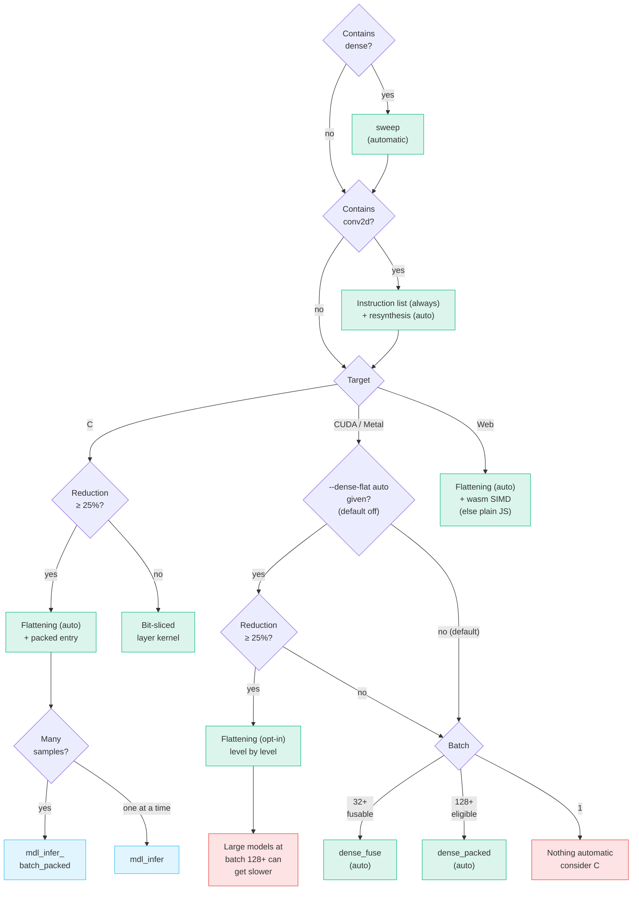

## Bundle stage (`griffith deploy bundle`)

`bundle` builds a **distribution bundle** from the model JSON. Every target (C / CUDA / Metal / Web) reads the same bundle, so compression done here **helps every target**.
You choose the level with `--compress {none,fast,max}` (default `fast`). It means the same thing whether the model is dense or conv2d.

| Level | Meaning |
|---|---|
| `none` | No IR-rewriting compression (output is byte-identical to before compression existed) |
| `fast` (default) | Applies every lossless reduction that finishes in seconds. Sweep for dense, resynthesis (search limit 4) for conv2d |
| `max` | `fast` plus search limit 5 and an extra check through `ir/simulate` (minutes on real models) |

The individual flags (`--sweep` / `--no-sweep` / `--resynth lossless`) **take precedence over `--compress` when given**.
The order of application is resynthesis → sweep (→ flattening last, if you bake it in).

### conv2d instruction lists (always)

The weight-shared gate tree of a conv2d is not kept as a raw gate count: trivial gates (constants, pass-throughs, and so on) are folded away into an **instruction list**, which is baked into the `programs` section of the bundle.
A target only executes this list and does not have to implement the reduction itself. The IR is unchanged.
It happens at every level and is recorded in `about.compress.always`.

- Effect: 59.7-95.1% fewer gates on real models (model dependent). Face detection goes from 14,784 to 1,077 gates (-92.7%)
- Verification: before writing, the truth tables of every tree are compared exhaustively. `--no-verify` skips this, but it is for debugging and normally not used

### sweep (dense only)

From dense models (a run of `lut_layer`), it removes gates that settle to a constant, duplicate gates that do the same job (CSE), and gates nobody uses.
It is not applied to models that contain conv2d; the reason for skipping is recorded in `about.compress.skipped`.

- Effect (`gates_before → gates_after`): XOR 32 → 22, HAR k6000 36,000 → 28,636, k600 2,400 → 1,989, MNIST 4,000 → 3,615 (-10 to -20%)
- Verification: before writing, it checks integer equality with the original IR on random inputs (8 by default) and on real data (`demo_samples`) if present. One mismatch aborts
- What it does not remove: pass-through / NOT gates cannot be removed from a layer (they are folded in the flattening stage)

The figure below is a real sweep on an XOR circuit trained with the same steps as `examples/06_deploy_c/export_model.py` from the [deploy kit quickstart](/en/guides/deploy-quickstart/).
The 10 grey (constant) and yellow (duplicate) gates on the left disappear from the first layer, giving 32 → 22. The dashed boxes on the right are 1-input gates: sweep keeps them to preserve the layer shape, and the later flattening stage folds them into wires. You can also check that the class 0 / class 1 scores are the same on both sides.

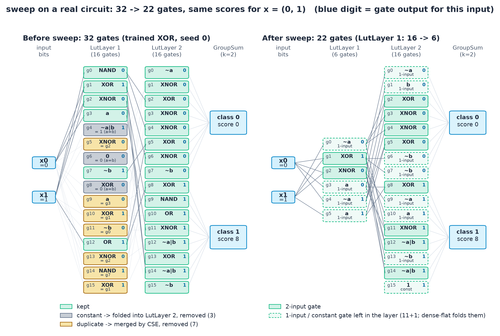

### conv2d resynthesis (conv2d only)

It rebuilds a conv2d tree **with fewer gates** for the same function. Trees that are already at the lower bound are not searched (an exact lower-bound skip), which is why it is fast.

- Effect: face detection 1,279 → 1,077 gates (-15.8%) in 1.2 s (Apple M3; measured on the public browser-demo model `tools/webbench/public/models/det_face_lut_k256.json`. The face detector in [Prepare Demo Models](/en/guides/deploy-models/) is built from a different wandb checkpoint, so its counts differ: 2,686 after the instruction list, 2,319 after resynthesis). Code size (model.c) -4 to -7%, binary -9 to -10%, delivery size almost unchanged (-0.6 to -1.7%)
- **Speed (latency) does not change.** It helps on targets with little flash
- Verification: `fast` checks the truth table of every tree exhaustively and forward-computes random inputs and real samples. `max` and `--resynth lossless` also add a check through `ir/simulate`

The figure below follows one tree of the face detector (`det_face_lut_k256`): conv2d node `n6_lutconv2d`, output channel 13.
(a) The depth-3 tree as trained has 7 gates; folding the pass-through and the unused gate gives the 5 instructions in (b) (instruction list), and resynthesis gives the 3 gates in (c). (d) shows that all three agree on all 16 inputs, and (e) shows why most trees are skipped without a search: a function that truly depends on 4 inputs cannot be built with fewer than 3 gates.

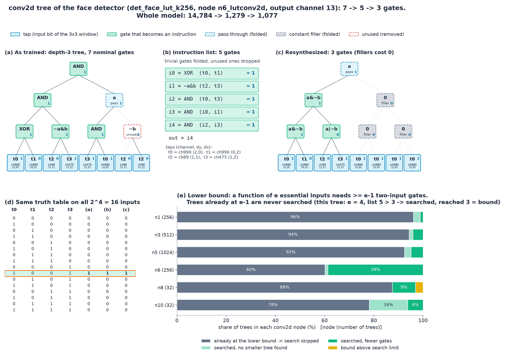

### Baking flattening into the IR (optional)

`bundle --dense-flat` is a compatibility path that **bakes** the flattening described in the next section **into the bundle IR**. The baked `lut_flat` node runs on C, Web, CUDA and Metal alike (Web and GPU).
Normally you do not need it: leave it to the automatic decision in `codegen-c` / `codegen-web`, which keeps the bundle shared by every target.

### Integer preprocessing (image input only)

For image-input models, the input encoding (`preproc`) is baked into the bundle as an **integer-only descriptor** (`preproc_desc`).
The device can preprocess without floating point, and the C runtime executes this descriptor as is. When the bundle is read, it can also be checked against a descriptor rebuilt from `preproc` (`griffith deploy info --strict`).

### What happens on failure (fail-safe)

If a transformation or its verification fails partway through an automatically applied compression, **only that compression is dropped and the build continues** (the uncompressed IR was correct to begin with).
The reason is recorded in `about.compress.skipped` and a warning goes to standard error. A **failure of a flag you gave explicitly**, such as `--sweep` or `--resynth lossless`, **is an error as before**.

## C generation stage (`codegen-c` / `verify-c`)

The C runtime is dependency-free C99 with no heap allocation at run time. This section lists what is applied when C code is generated.

### Flattening `--dense-flat` (automatic)

It flattens dense into a **flat netlist** (`lut_flat`) with pass-throughs, constants, NOTs, and duplicates folded away, and emits C that runs one table lookup per gate.
The transformation happens **in memory only** while C is generated; the bundle file does not change.

- The default is `auto`. It tries the flattening and adopts it if the **effective gate reduction is 25% or more**; below that it keeps the old kernel. The threshold is the host-measured break-even (about 26%) with some margin
- It targets dense models made of 2-input `lut_layer`s. This section is about C; Web (`codegen-web`) also flattens by default (no threshold, see the "Web" section below). CUDA / Metal can run `lut_flat` too, but do not flatten by default (opt-in, see "Flattening on the GPU" below)
- Verification: before use, the `simulate` of the IR before and after is compared as integers on 16 random inputs and on real data. `verify-c` uses the original bundle's `simulate` as the reference, so it also demonstrates that this transformation is lossless
- Effect: on a real ESP32, HAR k6000 goes 26.60 ms → 21.17 ms with sweep → 12.69 ms with sweep and flattening (all scores match). On the host, 1.23x at 36.5% reduction, 1.66x at 55.0%, 2.52x at 75.0%
- **Cost**: working RAM (`MDL_CTX_BYTES`) grows (by the signal table; 12,000 B → 26,800 B on an HAR-like synthetic model). On RAM-tight microcontrollers use `--dense-flat off`

The figure below turns the swept XOR circuit (22 gates, left) into a flat netlist (right).
Every blue dashed (pass-through / NOT) and yellow (duplicate) gate on the left becomes a reference into the signal table on the right, and only 3 gates, s3 to s5, are actually computed. A NOT costs no gate: it is the polarity bit of the output reference (red line and bubble).

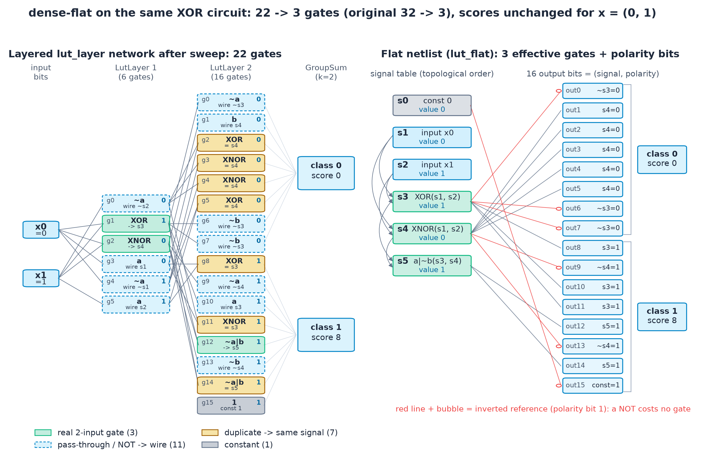

On a real ESP32 the effect is as follows. Each model has its own y axis, so compare bar heights within a panel. For every model the default (sweep + flattening) is fastest, and the integer scores matched in all three variants.

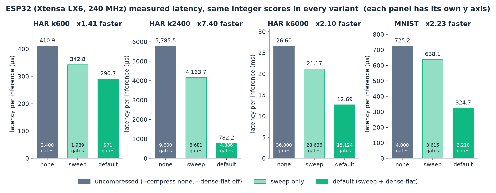

### Batch-axis packed entry `mdl_infer_batch_packed` (automatic)

When flattening is adopted, an entry `mdl_infer_batch_packed` that packs 32 samples into one word and evaluates them together is also generated by default (`MDL_DENSE_BATCH=32`).
On the host (Apple M3), at 32 samples the throughput relative to running `lut_flat` one at a time was 1.7x on HAR k600, 4.1x on k2400, 5.9x on k6000, and 5.4x on MNIST.
It adds about 0.7 KB of flash, and the caller provides a work buffer of `MDL_DENSE_WORK_BYTES`.
`verify-c` also checks this entry against `simulate` in integers on 33 samples, separately from the one-at-a-time `mdl_infer`.

The figure below shows what it does, using the XOR flat netlist (3 gates).
Transposing 32 inputs so that one word holds one signal for 32 samples lets each gate of the signal table compute all 32 samples with a single 32-bit word operation. The orange frame is the column of sample 5; follow it from top to bottom to get that sample's scores.

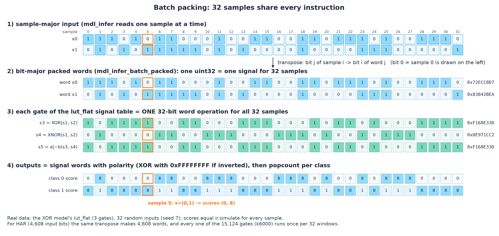

Time per sample with 32 samples on the host (Apple M3) is as follows. The larger the model (the longer the signal table), the bigger the gain.

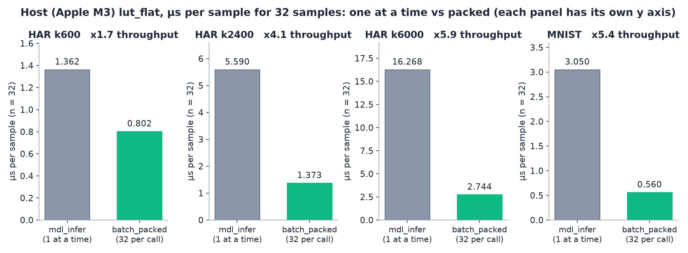

**Do not use it for single-sample work.** Calling it with one sample is 5-12x slower than `mdl_infer`. For latency, use `mdl_infer`.
`--dense-batch 0` stops generation and `--dense-batch N` changes the maximum count. Even for dense that is not flattened, an explicit `--dense-batch N` generates a layer-packed entry.

### Always included

| Optimization | What it does | Effect and caveats |
|---|---|---|
| Bit-slice layer kernel | For dense that is not flattened, processes 32 gates of different kinds with one set of operations | 2.18x the samples per second on HAR k6000 with one context |
| 16-bit indices | If the input width is 65,536 or less, stores dense index tables as `uint16_t`. Shared by C / CUDA / Metal | Weights (.rodata) 33.5-38.9% smaller (3 models). Latency within noise |
| Bit-sliced group counting | Counts group_sum with a bit-sliced carry-save counter | No measured value is listed on this page |
| Static work memory | All buffers are `static`, fixed at compile time. In the context version the caller passes the memory | Zero heap allocation. `-DMDL_NO_DEFAULT_CTX` also removes the default static RAM |
| SIMD preprocessing | Runs preprocessing with NEON / SSE2 / AVX2 (K8) | End-to-end 2.3-6.1x on image models (face detection 5.51 → 1.97 ms) |
| Automatic SIMD choice | Chooses NEON / SSE2 / AVX2 at compile time, scalar if none | **Integer outputs are identical on every path.** `-DMDL_NO_SIMD` turns it off explicitly |

### Only when you ask for it

`--fuse` unrolls the gate instruction list into straight-line code. Truth tables are fixed at generation time, so conv models run 2-9% faster.
In exchange, the generated C grows 1.2-2.3x, so it is off by default.

### Tried and not adopted

For the flattened `lut_flat`, we also measured packing 32 gates into one word along the **gate axis**.
Level fill was 95-99% on HAR k600 / k2400 / k6000, yet it reached only 0.94-0.98x of one gate per iteration with SIMD and 0.85-0.87x scalar.
The per-gate cost is dominated by two byte reads and one write, which bit-slicing does not remove.
So it is not in the library. For single-sample latency, `lut_flat` with `mdl_infer` remains the best.

## GPU (`codegen-cuda` / `codegen-metal`)

GPU optimizations "win or lose depending on the model and the batch", so they are turned on **automatically only under conditions where they measurably won** (`auto='measured'`).
To override, give an explicit flag, or switch the whole automatic selection off with `--no-auto` (with `--no-auto`, items you did not specify go back to the values from before automatic selection: `split`, `dense_fuse` off, `dense_packed` off).

| Optimization | Condition for automatic on | Force on / off | Measured |
|---|---|---|---|
| conv_engine (`split` / `combined`) | Default is `split`. If any conv2d node has more than 8 slots per output channel, the whole model switches to `combined` | `--conv-engine` | A 1.6M-gate real model generated and ran correctly with `combined` |
| dense_fuse | When not flattened (the default `--dense-flat off`, or a reduction under 25% with `auto`), batch 32 or more, and a fusable chain exists | `--dense-fuse` (force on) | 1.20-2.01x end-to-end at batch 32 and above. Not automatic at batch=1: it does not reach a clear win |
| dense_packed | When not flattened, batch 128 or more, the model is eligible (non-image input, dense and group_sum only), and dense_fuse is not on | `--dense-packed` (force on) | At batch 32 several models slow down (0.878-0.891x on CUDA). At batch 128 the slowdown almost disappears |
| decode megakernel | RDDLGN decoding that fits shared memory and buffer-argument limits (on by default) | Falls back to the old path automatically when it does not fit (also `megakernel=False` in the Python API) | Metal 1.61-2.10x, CUDA 1.71-2.34x. No slowdown cases |
| n_streams | **Never automatic** | `--n-streams N` | Slowdowns seen: 0.66x on Metal, 0.878x on CUDA at batch=1 |
| conv_codegen | **Never automatic** | `--conv-codegen` | 1.00-1.04x end-to-end; generated code 1.78-6.65x larger |

`dense_fuse` and `dense_packed` cannot be combined. When both conditions hold, `dense_fuse` wins because it measured higher.
Unlike C and Web, `codegen-cuda` / `codegen-metal` **do not flatten by default** (`--dense-flat off`; opt in with `auto` / `on`). When flattened, `dense_fuse` / `dense_packed` are no longer used, and on Metal on an Apple M3 it reached 0.47-1.15x of the best without flattening (slower on k6000; see the next section). **For batch=1 latency, C is often faster than a GPU**; see "When picking a GPU at batch=1 makes things slower" in [Deploy to a GPU](/en/guides/deploy-gpu/).
The chosen result and its reasons appear as one line on standard output at generation time and in a ` auto-config` comment at the top of the generated source.

### Flattening on the GPU (`lut_flat`, opt-in)

A gate of the flattened netlist only refers to "signals before itself", so as it stands it cannot be spread over GPU threads one gate per thread.
So at generation time each gate gets an **ASAP level** (inputs = 0, a gate = 1 + the largest level of its inputs) and the gates are regrouped level by level. Gates in the same level never depend on each other, so each level is evaluated all at once in one launch (or one barrier).
The number of levels never exceeds the number of original `lut_layer`s. The figure below lines up the gate counts of the original layers, the layers after sweep, and the flattened levels for the real HAR models.

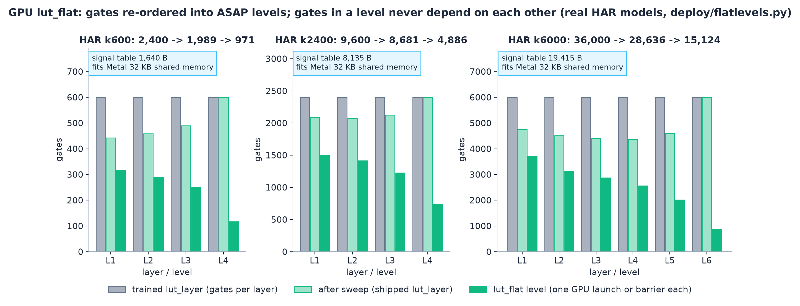

The GPU default is not to flatten (`--dense-flat off`). To use it, pass `--dense-flat auto` (adopted at a 25% or larger reduction) or `on` to `codegen-cuda` / `codegen-metal` / `verify-metal`. A `lut_flat` baked in by `bundle --dense-flat` runs this way regardless of the default.

There are three execution modes (`lut_flat_mode` in the Python API). The default `auto` picks `fused` when the signal table fits in shared memory (Metal 32KB / CUDA 48KB).

| Mode | What it does |
|---|---|
| `fused` | One threadgroup = one sample. The signal table lives in shared memory, with a barrier only between levels. One launch |
| `levels` | One launch per level. The signal table lives in device memory |
| `packed` | One launch per level, evaluating 32 samples packed into one word (batch 32 or more) |

The gates roughly halve, but that does not always make the GPU faster. Measured on Metal on an Apple M3, k600 got slightly faster, k2400 was mixed, and k6000 was slower than the best without flattening (`dense_packed` / `dense_fuse`).
On a GPU, the fixed cost of launches and transfers outweighs the gate count of one inference, and at batch=1 every mode takes 0.32-0.40 ms.
**When it gets slower**: a large model with tens of thousands of gates (k6000 = 15,124 gates after flattening) run at batch 128 or more dropped to 0.47-0.71x when flattened. Small models (k600) or batches around 32 are about the same or slightly faster. The CUDA `lut_flat` path has not been run or measured on real NVIDIA hardware (only a syntax check of the generated code). If you try flattening, compare it against the default (off) on your own model and batch before choosing (`scripts/bench_dense_gpu.py --dense-flat fused`).

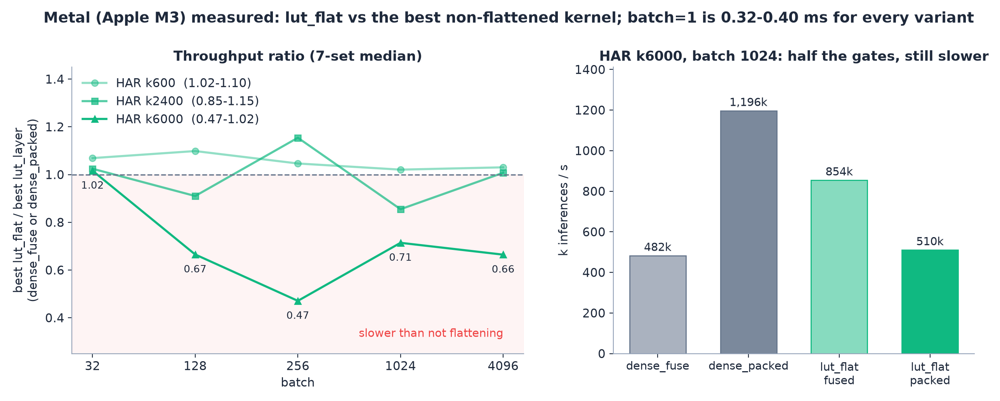

## Web (`codegen-web`)

The browser side already has its executable (a TypeScript engine and an AssemblyScript wasm kernel); `codegen-web` copies "bundle + runtime set" next to each other.

| Item | What it does | Default | Change |
|---|---|---|---|
| Engine choice | Tries wasm (SIMD) and, if that fails, records the reason in `notes` and falls back to plain JS. Integer outputs are identical on both engines | `engine: 'auto'` | `engine: 'js'` / `'wasm'` of `loadBundle` |
| Threads | `threads=1` by default. No COOP / COEP headers for SharedArrayBuffer are needed, and plain static hosting works | 1 | `threads` of `loadBundle` |
| Measuring delivery size | `--gzip` also writes a gzip version to measure delivery size | Off | `--gzip` |
| Flattening | Ships dense as a flattened netlist (`lut_flat`). It is fused with the following group_sum, and 3 or more samples are evaluated with batch-axis packing (32 samples per word). The Web's legacy path is slower per gate too, so there is no threshold | Automatic (always, when there is a chain) | `--dense-flat off` / `on` (same for `verify-web`) |
| Ship gate | `verify-web` runs the same bundle on Node and checks integer equality (both one sample at a time and all cases as one batch) | Run manually | `griffith deploy verify-web` |

### Measured on the Web

The effect of flattening on the three HAR models, against the legacy `lut_layer` path. The integer scores matched in all four. k2400 and k6000 are from the built-in browser (Chrome 152), and k600 from Node v25.

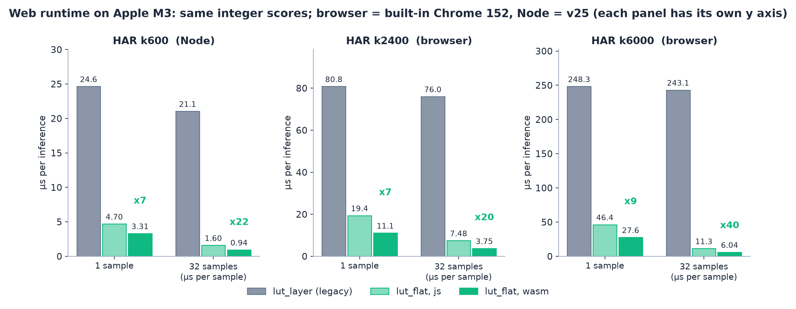

:::caution[`--slim` is not compression]
`codegen-web --slim` writes the model doc itself instead of the distribution bundle; it is a debugging option. The browser then has to rebuild the instruction lists from the IR, and the exporter-side reduction guarantee is given up. Do not use it to reduce size.
:::

## Checking what was applied

| Where to look | What it tells you |
|---|---|
| `griffith deploy info m.bundle.json` | The one-line `about.compress` (applied passes, gate counts before and after, skipped reasons) and the expected result of the `codegen-c` default |
| Standard output of `bundle` | The same line. For conv2d, instruction-list conversion and the resynthesis part of it are shown separately |
| Standard output of `codegen-c` and the top comment of `model.h` | Whether flattening was adopted and the reduction |
| `MDL_DENSE_FLAT` in `model.h` | 1 if flattening was adopted, else 0. The app can switch its RAM estimate with `#if MDL_DENSE_FLAT` |
| `MDL_DENSE_BATCH` in `model.h` | The maximum count when the batch-axis packed entry was generated |
| Standard output of `codegen-cuda` / `codegen-metal` | The result of the GPU automatic selection, on one line |
| `griffith deploy verify-c m.bundle.json` | Builds C with the same decision as `codegen-c` and checks integer equality against the original bundle's `simulate` |

The shape of `about.compress` is `{level, applied, skipped, gates, always}`.

```bash
uv run griffith deploy info m.bundle.json     # applied compression and the codegen-c outlook
uv run griffith deploy verify-c m.bundle.json # check that C matches simulate as integers
```

## Flags to turn things off

| What you want | Flag |
|---|---|
| Stop all bundle compression | `bundle --compress none` (conv2d instruction lists remain) |
| Stop only sweep | `bundle --no-sweep` |
| Search deeper and reduce more | `bundle --compress max` |
| Stop flattening (RAM first) | `codegen-c --dense-flat off` (same for `verify-c`) |
| Always use flattening | `codegen-c --dense-flat on` |
| Change the adoption threshold | `--dense-flat-min-reduction R` (default 0.25) |
| Stop the batch-axis packed entry | `codegen-c --dense-batch 0` |
| Do not use SIMD | Compile with `-DMDL_NO_SIMD` |
| Stop GPU automatic selection | `--no-auto` on `codegen-cuda` / `codegen-metal` |
| Set individual GPU optimizations explicitly | `--conv-engine` / `--dense-fuse` / `--dense-packed` / `--n-streams N` / `--conv-codegen` |

When you call `build_bundle()` or `generate_c()` directly from Python, **the automatic defaults listed here are not applied** (you get a circuit with no compression). To get the same result, use the CLI or call `griffith_logic.deploy.compress.apply_compress` yourself.

{/* i18n:source=reference/deploy-optimizations.mdx hash=53f6501ef588 */}
