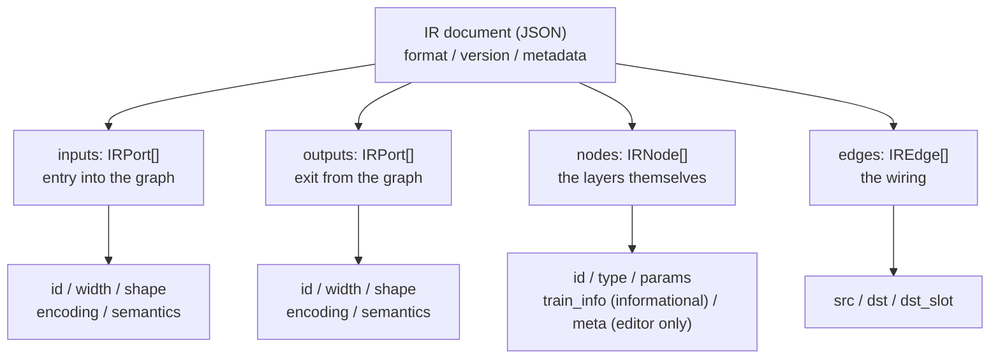
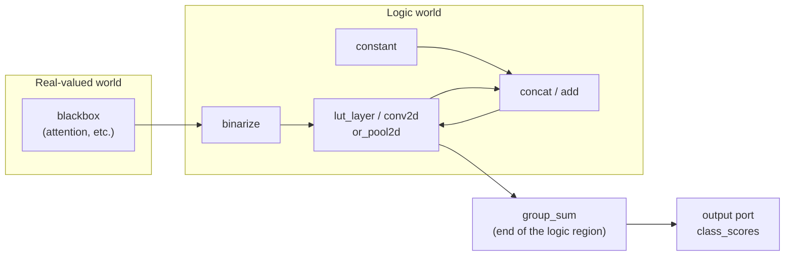
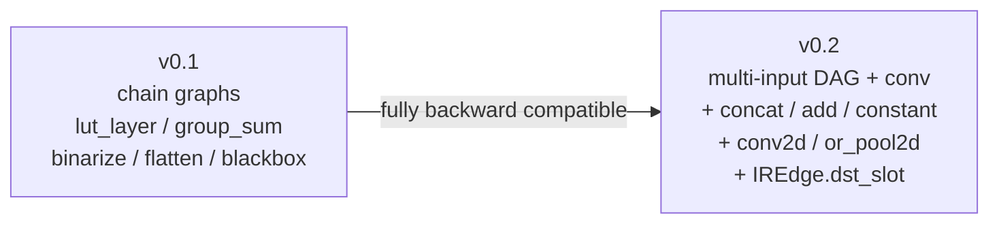

**The IR (intermediate representation) is the source of truth of this library.** The PyTorch model,
the numpy golden simulator and the generated Verilog / VHDL all derive from one and the same JSON.
That is what makes "PyTorch output = simulator output = real circuit output" mechanically
checkable.

This page is the **specification of the IR**. For how to read and produce one, see
[Working with IR](/en/guides/ir/); for why the IR sits in the middle at all, see the
[architecture overview](/en/explanation/architecture/).

The authoritative code lives in `griffith_logic/ir/schema.py` (dataclass definitions and the
docstrings describing the bit conventions), and the validation rules in
`griffith_logic/ir/validate.py`.

---

## 1. Overall document structure

An IR is **a single JSON object**. Its contents split into three blocks: a header, the boundary
(ports) and the body (the graph).



The graph is represented as **a set of nodes plus a set of edges**; there is no nesting of nodes
inside nodes. Ports and nodes share one id space, and an edge's `src` / `dst` may be either a node
id or a port id (so you can wire an input port straight into a node, or a node straight into an
output port).

### Top-level fields

| Field | Type | Meaning |
|---|---|---|
| `format` | string | Always `"magicdelta-ir"`. Checked on load; anything else is rejected |
| `version` | string | Schema version (currently `"0.2.0"`). → see "7. Versioning policy" below |
| `metadata` | object | Free-form. Holds `name`, `created_at` and so on. **Has no effect on semantics whatsoever** |
| `inputs` | IRPort[] | Input ports of the graph |
| `outputs` | IRPort[] | Output ports of the graph |
| `nodes` | IRNode[] | The layers. **The order carries no meaning** (execution order is derived from the edges) |
| `edges` | IREdge[] | Wiring between nodes and ports |

### IRPort (the boundary)

| Field | Type | Required | Meaning |
|---|---|---|---|
| `id` | string | ✓ | Port identifier, used as an edge endpoint (e.g. `"x"` / `"y"`) |
| `width` | int | ✓ | Bit width. A mismatch with what it connects to is a validation error |
| `shape` | int[] \| null | | Shape of the original tensor (e.g. `[1,28,28]`). The width convention is always the flattened `width` |
| `encoding` | string \| null | | How the input is encoded (e.g. `"binary_threshold_0.5"` = binarize at 0.5 before feeding it in) |
| `semantics` | string \| null | | What the output means (e.g. `"class_scores"` = class scores; argmax gives the predicted label) |

`encoding` and `semantics` are **notes for humans and external tools**; neither the simulator nor
HDL generation reads them. They exist so that "which bit patterns does this circuit expect?" can be
answered from the IR alone.

### IRNode (a layer)

| Field | Type | Meaning |
|---|---|---|
| `id` | string | Node identifier, **unique within the graph** (duplicates are a validation error) |
| `type` | string | Node kind. → see "2. Node kinds" below |
| `params` | object | The required parameters for that kind. **Only this determines the meaning of the circuit** |
| `train_info` | object | Informational notes from training (parameterization and so on). **The transpilers never read it** |
| `meta` | object | A free namespace for the visual editor (coordinates, display names …). **Completely ignored** |

That three-way split is the crux of the design. Change `params` and the circuit changes; change
`train_info` or `meta` as much as you like and not a single bit of the circuit moves. That is why
the editor can shuffle nodes around without the HDL output wobbling.

### IREdge (wiring)

| Field | Type | Default | Meaning |
|---|---|---|---|
| `src` | string | — | Producer side. A node id or an input port id |
| `dst` | string | — | Consumer side. A node id or an output port id |
| `dst_slot` | int | `0` | Input slot number for multi-input nodes (added in v0.2) |

- When `dst_slot` is 0 the **key is omitted from the JSON entirely** (byte-identical to v0.1, which
  keeps diffs stable)
- **Fanout (several edges from the same `src`) is allowed.** No dedicated branching node is needed
- On multi-input nodes, slots 0..N-1 must be filled **exactly once each, with no gaps**

---

## 2. Node kinds

v0.2 has 11 node kinds (`lut_flat` is for deployment only). The granularity is **one node = one layer**; nodes are not expanded down to
individual gates (a gate-level view can be derived from `indices` and `truth_tables`, so storing it
in the IR would mean maintaining the same thing twice).

| `type` | Added in | Main `params` | Output width | Role |
|---|---|---|---|---|
| `lut_layer` | v0.1 | `in_width`, `out_width`, `n_inputs`, `indices`, `truth_tables` | `out_width` | **The core.** N-input lookup-table layer |
| `group_sum` | v0.1 | `in_width`, `k`, `tau`, `bias` (optional) | `k` | Aggregates bits into k groups to produce class scores. `bias` is an integer decision bias per class (omitted = all zero) |
| `binarize` | v0.1 | `width`, `threshold` | `width` | Binarizes real values at a threshold (the boundary from the real world into the logic world) |
| `flatten` | v0.1 | `in_shape`, `width` | `width` | Only flattens the shape. Bits are untouched |
| `blackbox` | v0.1 | `torch_class`, `config`, `in_width`, `out_width` | `out_width` | A non-logic layer (the real-valued part of a hybrid model). **Cannot be turned into HDL** |
| `concat` | v0.2 | `in_widths` (in slot order) | `sum(in_widths)` | Bit concatenation of several inputs |
| `add` | v0.2 | `width`, `mode` (`or`/`xor`/`sum`) | `width` | Merges bits |
| `constant` | v0.2 | `width`, `bits` | `width` | A constant line. A root node **with no inputs** (arity 0) |
| `conv2d` | v0.2 | `in_shape`, `out_channels`, `kernel_size`, `stride`, `padding`, `tree_depth`, `n_inputs`, `indices_flat`, `truth_tables` | `out_channels × H_out × W_out` | Logic-gate convolution (native representation) |
| `or_pool2d` | v0.2 | `in_shape`, `kernel_size`, `stride`, `padding` | `C × H_out × W_out` | OR pooling |
| `lut_flat` | v0.2 | `in_width`, `out_width`, `gates`, `outputs` | `out_width` | **Deployment only.** A reduced, flat dense netlist (produced by `bundle --dense-flat`; never created from the training side) |



`binarize` is the entrance from the real-valued side into the logic side, and `group_sum` the exit
from logic back to real values (scores). It helps to remember that **only the stretch between those
two lowers to HDL**.

### 2.1 `lut_layer` — the core node

`out_width` gates sit side by side; **gate j** reads the input bits
`indices[0][j] … indices[n_inputs-1][j]` and emits one bit according to the truth table
`truth_tables[j]`.

| params | Type | Constraint (enforced during validation) |
|---|---|---|
| `in_width` | int | Input bit width |
| `out_width` | int | Output bit width = number of gates |
| `n_inputs` | int | Number of inputs N per gate |
| `indices` | int[N][out_width] | Shape must be exactly `(n_inputs, out_width)`. Values satisfy `0 ≤ v < in_width` |
| `truth_tables` | string[out_width] | Hex strings. Range `0 ≤ t < 2^(2^N)` |

**Bit convention for truth tables** (identical for all nodes):

> A truth table is "an integer of $2^N$ bits". Its **bit k** is the output for input pattern $k$ in
> butterfly-basis order (**bit j** of pattern $k$ = the value of input slot $j$).

For example, with N=2, `0x6` is `0110` in binary.

| Input pattern k | Slot 1 | Slot 0 | Truth-table bit k | Output |
|---|---|---|---|---|
| 0 | 0 | 0 | bit0 = 0 | 0 |
| 1 | 0 | 1 | bit1 = 1 | 1 |
| 2 | 1 | 0 | bit2 = 1 | 1 |
| 3 | 1 | 1 | bit3 = 0 | 0 |

So `0x6` is an **XOR gate**. Likewise `0x8` = AND, `0xe` = OR, `0x9` = XNOR. Every hex value in the
real JSON below can be read with this rule.

:::note[Why hex strings?]
With N=6 a truth table is a 64-bit integer, beyond what JSON numbers can carry (JavaScript's safe
integer range is $2^{53}$). To round-trip losslessly across languages, **truth tables are always
written as hex strings**.
N may exceed 6 (for example the 8-input LUTs of `ThermometerEncoder(input_bits=8)` have 256-bit
tables). `simulate` uses 64-bit shifts for N ≤ 6 and, for N > 6, expands each table into a
$(\text{out\_width}, 2^N)$ bit matrix and indexes it.
:::

### 2.2 `group_sum` — end of the logic region

Splits `in_width` bits evenly into `k` groups, counts the ones in each group and divides by `tau`.
The constraint is `in_width % k == 0`. Its output is **a real-valued score, not a bit vector**, so
everything past this node is outside the scope of HDL (`tau` is the logit temperature used during
training).

An optional `bias` (a list of `k` integers) is added to each group count before the score is formed
(the two-class decision rule $s_1 > s_0 + t$ is `bias = [t, 0]`). When omitted it is all zero;
`simulate` and `build_torch` honor it. HDL generation and the C runtime **explicitly reject** a
non-zero `bias` (the comparator plus constant belongs to the terminal part on the circuit side).

### 2.3 `concat` / `add` — multi-input nodes (v0.2)

Two node kinds added to express DAG structure (graphs that are not simple chains). Both distinguish
input order via `dst_slot`.

- **`concat`**: concatenates bits in the order of `in_widths` (a list of two or more positive
  integers)
- **`add`**: merges inputs of equal width with a bitwise operation. `mode` has three values

| `mode` | Hard (discrete) meaning | Soft (training-time) meaning | HDL |
|---|---|---|---|
| `or` | bitwise OR | $1-(1-a)(1-b)$ | supported |
| `xor` | bitwise XOR | $a+b-2ab$ | supported |
| `sum` | integer sum | $a+b$ | **not supported** (values leave $\{0,1\}$) |

`mode='sum'` is **only for the end of the logic region**, such as immediately before `group_sum`,
and `validate(..., target='hdl')` rejects it.

:::caution[concat bit order is identical across all three implementations]
**Slot 0 is the head of the output bit vector (the index-0 side) = the low bits when packed into an
integer.**

| Implementation | How it's written |
|---|---|
| numpy / torch | `concatenate([slot0, slot1, ...], axis=-1)` |
| Verilog | `assign w = {slotN-1, ..., slot1, slot0};` (in `{}` the left side is the MSB) |
| VHDL | `w <= slotN-1 & ... & slot1 & slot0;` (with `&` the left side is the MSB) |

The order looks reversed on the HDL side only because Verilog / VHDL define concatenation with
**the left operand as the MSB**. It is not written backwards — it is the same convention expressed
in each language's notation.
:::

### 2.4 `constant` — constant lines

A node **with no incoming edges** that simply emits `bits` (a list of 0/1 of length `width`).
`bits[j]` is output bit j (index 0 is the low bit, as with `concat`). It becomes a constant row in
the simulator, an expansion along the batch dimension in torch, and hard-wired constants in HDL.

### 2.5 `conv2d` / `or_pool2d` — convolution (v0.2)

**Width convention**: both input and output are NCHW flattened as `width = C × H × W`. That is,
input width = `prod(in_shape)` and output width = `out_channels × H_out × W_out`, with the output
shape given by the usual convolution formula.

$$
H_{\text{out}} = \left\lfloor \frac{H + 2p_H - k_H}{s_H} \right\rfloor + 1
$$

- `indices_flat`: shape `(out_channels, n_inputs^tree_depth)`, pointing at flat positions inside the
  receptive field
- `truth_tables`: length = `out_channels × number of internal tree nodes`, ordered **oc-major**, by
  tree level

**Before generating HDL, expand these into a sequence of `lut_layer` nodes with
`export/lowering.lower_to_primitives`.** Convolution is kept as a native node so that the editor and
the simulator do not lose sight of the fact that it *is* a convolution — that information cannot be
recovered from a huge expanded sequence of `lut_layer` nodes alone.

### 2.6 `lut_flat` — a reduced flat dense netlist (deployment only)

A single flat DAG obtained by **losslessly reducing** a serial chain of 2-input `lut_layer` nodes with
`export/netlist_reduce.py` (constants, pass-throughs, NOTs, CSE and unreferenced gates are removed).
`griffith deploy bundle --dense-flat` (implemented in `deploy/flatten_dense.py`) replaces the
`lut_layer` chain with it. **It is not a node you create from the training side, and it cannot be
turned back into torch** (`build_torch` raises `NotImplementedError`). It is excluded from HDL
generation; only the C runtime executes it.

`lut_flat` returns **the same `out_width` bits as the final `lut_layer` it replaced**. The
downstream `group_sum` is untouched, and so are its integer-score semantics (popcount per group).
Final-layer gates that the reduction resolved to a constant, a pass-through or an inversion are
rebuilt into the final output bit vector inside `lut_flat`, as references in `outputs`.

| params | Meaning |
|---|---|
| `in_width` | Number of input bits (the previous layer's output width) |
| `out_width` | Number of output bits (= the replaced final layer's width = `group_sum.in_width`) |
| `gates` | A list of `[tt, a, b]`. `tt` is a truth table in 0..15 (same convention as `lut_layer`: bit index = `(b<<1)\|a`); `a` / `b` are signal numbers |
| `outputs` | Length `out_width`. The reference for output bit i = `2*signal + polarity` (polarity 1 = inverted) |

**Signal numbers** (the indices that `a` / `b` / `outputs` point at):

| Signal | Meaning |
|---|---|
| `0` | Constant 0 (constant 1 is the inversion of signal 0 = the `outputs` value `1`) |
| `1 … in_width` | Input bit k → signal `1+k` |
| `in_width+1 …` | Output of gate g → signal `in_width+1+g` |

The `a` / `b` of gate g may only point at **signals before itself** (`< in_width+1+g`), i.e. the
list is in topological order. Gate inputs carry no polarity (NOT): the reducer has already absorbed
it into downstream truth tables, so polarity survives only in `outputs`.

---

## 3. A real one — the IR of an XOR circuit

This is **actual JSON** extracted with `export_ir` after training the same two-layer LUT + GroupSum
XOR model as in [tutorial 1](/en/tutorials/xor/) (produced by `examples/04_export_hdl.py`). The long
`indices` are folded with ellipses; everything else is exactly as generated.

```json
{
 "format": "magicdelta-ir",
 "version": "0.2.0",
 "metadata": {
  "name": "xor",
  "created_at": "2026-09-03T20:39:42.145207+09:00"
 },
 "inputs": [
  { "id": "x", "width": 2, "shape": null,
    "encoding": "binary_threshold_0.5", "semantics": null }
 ],
 "outputs": [
  { "id": "y", "width": 2, "shape": null,
    "encoding": null, "semantics": "class_scores" }
 ],
 "nodes": [
  {
   "id": "n0_lutlayer",
   "type": "lut_layer",
   "params": {
    "in_width": 2,
    "out_width": 16,
    "n_inputs": 2,
    "indices": [
     [1, 1, 0, 0, 1, 0, 1, 0, 0, 0, 1, 0, 1, 0, 0, 1],
     [1, 0, 1, 1, 1, 1, 1, 0, 0, 0, 0, 1, 1, 1, 0, 0]
    ],
    "truth_tables": [
     "0x7", "0x6", "0x9", "0xa", "0xd", "0x9", "0x0", "0x3",
     "0x6", "0xa", "0x6", "0x3", "0xe", "0x9", "0x7", "0x6"
    ]
   },
   "train_info": { "parameterization": "softmax", "selection": "soft" },
   "meta": {}
  },
  {
   "id": "n1_lutlayer",
   "type": "lut_layer",
   "params": {
    "in_width": 16,
    "out_width": 16,
    "n_inputs": 2,
    "indices": [
     [10, 4, 9, 14,  0,  7, 8,  3, 12, 13, 10, 11, 13, 4, 2, 6],
     [ 7, 5, 0, 11, 14, 12, 1, 15,  9,  2,  6,  3, 15, 5, 1, 8]
    ],
    "truth_tables": [
     "0x5", "0x9", "0x6", "0x9", "0x9", "0x6", "0x9", "0x3",
     "0x6", "0x7", "0xe", "0x9", "0xd", "0x6", "0xd", "0x3"
    ]
   },
   "train_info": { "parameterization": "softmax", "selection": "soft" },
   "meta": {}
  },
  {
   "id": "n2_groupsum",
   "type": "group_sum",
   "params": { "in_width": 16, "k": 2, "tau": 2.0 },
   "train_info": {},
   "meta": {}
  }
 ],
 "edges": [
  { "src": "x",            "dst": "n0_lutlayer" },
  { "src": "n0_lutlayer",  "dst": "n1_lutlayer" },
  { "src": "n1_lutlayer",  "dst": "n2_groupsum" },
  { "src": "n2_groupsum",  "dst": "y" }
 ]
}
```

Four things to notice.

1. **The widths form a chain** — `x` (2) → `n0` (in 2 / out 16) → `n1` (in 16 / out 16) →
   `n2` (in 16 / k=2) → `y` (2). Break the chain anywhere and `validate` fails with a width
   mismatch
2. **The second layer's `indices` top out at 15** — its input width is 16, so `0 ≤ v < 16`. The
   first layer has input width 2, so only 0 and 1 appear
3. **The truth tables are the product of training** — the second layer contains `0x6` (XOR) and
   `0x9` (XNOR): the result of each gate **settling** on one Boolean function under `eval()` after
   training
4. **No edge carries `dst_slot`** — every node here is single-input, so the slot is 0 and the key is
   omitted per the convention

:::tip[The parameterization does not survive into the IR]
`train_info.parameterization` records `"softmax"`, but that is **informational only**. Whether you
trained with `independent`, `iwp` or anything else, the extracted IR is **normalized into a
collection of truth tables**. This normalization decouples everything downstream (simulator, HDL)
from the training method, so the choice you make in
[Parameterization](/en/guides/parameterization/) never leaks past this point.
:::

### Offloading large arrays to a sidecar

On MNIST-scale models, `indices` runs to hundreds of thousands of elements. `save_ir` moves any
array with more elements than `inline_threshold` (default 65536) **into an `.npz` sidecar**, leaving
only a reference in the JSON.

```json
"indices": { "$data": "mnist.npz#n0_lutlayer_indices" }
```

`load_ir` resolves the `.npz` in the same directory automatically. **`truth_tables` is always
inline in the JSON** (hex strings never get big). Note that the path the editor uses over HTTP
(`ir_to_dict` / `ir_from_dict`) always inlines everything, since it sends the whole document at
once, and does not support `$data` references.

---

## 4. Validation rules (`validate`)

`validate(ir, target=...)` **raises on errors** and **returns warnings as a list**. Always run it
before writing HDL — catching problems here avoids accidents you would otherwise discover in the
synthesis tool.

```python
from griffith_logic.ir import validate

warnings = validate(ir, target='hdl')   # 'generic' | 'hdl'
```

| # | Check | Fails when |
|---|---|---|
| 1 | Node type | A `type` not in `NODE_TYPES` |
| 2 | id uniqueness | Duplicate node ids |
| 3 | Edge endpoints | `src` / `dst` referring to an undefined id |
| 4 | Node-specific params | Shape or range violations (`indices` shape, truth-table range, `in_width % k`, `bits` other than 0/1 …) |
| 5 | Slot consistency | Missing or duplicated slots on a multi-input node; a second edge into a single-input node |
| 6 | Width consistency | Output width of `src` ≠ input width of that slot on `dst` (including connections to output ports) |
| 7 | DAG property | A cycle, or an unreachable dependency |
| 8 | Unused nodes | A node whose output goes nowhere → **a warning** (not an error) |
| 9 | Extra HDL constraints | With `target='hdl'`: `blackbox` nodes, `add(mode='sum')`, and `lut_flat` |

The params of `lut_flat` are checked in 4 (`tt` in `gates` within 0..15, `a` / `b` not forward
references, `outputs` of length `out_width` and within the signal count). Of the items under 9,
`blackbox` and `add(mode='sum')` are things that cannot become a circuit in principle. Since `blackbox` is a
real-valued non-logic layer, **a hybrid model is exported by carving out only its logic part**.

---

## 5. How execution order is determined

The order of the `nodes` array is not the execution order. Execution order comes from a
**topological sort over the edges** (`IRGraph.topological_order()`). A cycle fails check 7.

Nor is "which node produces the final output" guessed. `IRGraph.output_source()` returns the `src`
**connected to the first output port**, and the simulator, the torch builder and HDL generation all
use that same helper. On a chain graph it coincides with the last node in topological order, but on
a DAG with fanout or unused nodes "last = output" does not hold, so the rule is pinned down in one
place.

---

## 6. Relevant API

| Purpose | Function |
|---|---|
| Save to / load from a file | `save_ir(graph, path)` / `load_ir(json_path)` |
| Convert to / build from a dict (the editor path) | `ir_to_dict(graph)` / `ir_from_dict(doc)` |
| Validation | `validate(graph, target=...)` |
| Golden execution (bit-exact, numpy) | `simulate(graph, x)` |
| Rebuild a torch model | `build_torch(graph)` |
| Convert truth tables to and from hex | `tt_to_hex(ints)` / `tt_from_hex(hexes)` |

For full signatures, see the [Python API reference](/en/reference/api/core/).

---

## 7. Versioning policy



- `IR_FORMAT` is fixed at `"magicdelta-ir"`; `IR_VERSION` is currently **`"0.2.0"`**
- **v0.2 reads v0.1 completely.** v0.1 JSON without `dst_slot` is loaded as 0, and on output
  `dst_slot=0` omits the key entirely, so a v0.1-equivalent graph round-trips back to the same JSON
- **Backward-compatibility principle**: new fields are added as **optional fields with a default**,
  and are not written to JSON when they hold that default. This keeps the representation of "an IR
  that doesn't use the new feature" unchanged, so neither diff reviews nor golden data break
- A document whose `format` does not match is rejected on load. `version`, on the other hand, does
  not block loading (forward compatibility is not guaranteed, but checks 1–9 are the real gate)
- New node kinds are added **additively**. A breaking change to the meaning of an existing node's
  `params` bumps the minor version and gets its rationale recorded in
  [Design decisions](/en/explanation/design-decisions/)

---

## Read next

- [Working with IR](/en/guides/ir/) — the practical steps for generating, validating and simulating
- [HDL export and equivalence checking](/en/guides/hdl-export/) — emitting Verilog / VHDL from the IR and checking three-way equivalence
- [Architecture overview](/en/explanation/architecture/) — why the IR was made the source of truth

<!-- i18n:source=reference/ir-schema.md hash=518671af4cfd -->
