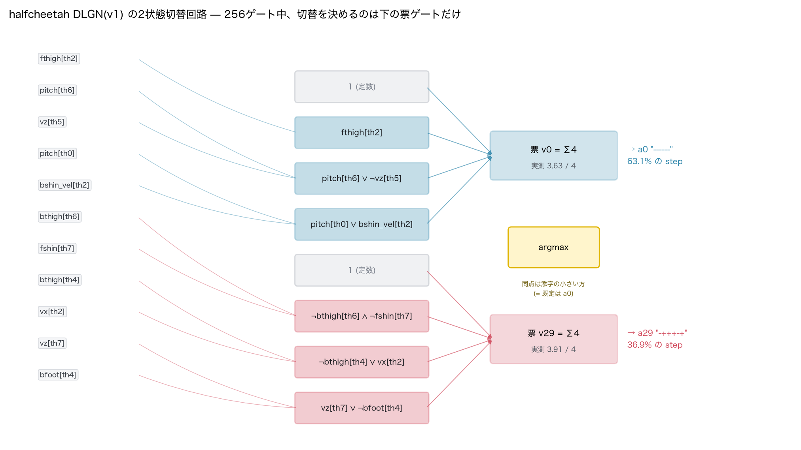
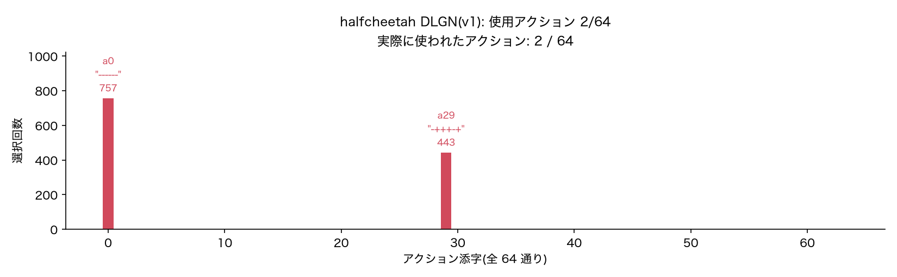

import ShowcaseVideo from '../../../../components/ShowcaseVideo.astro';

In body-control tasks the circuit decides at every step "which joint to move, and which way".
Nothing moves forward until the circuit discovers a periodic gait on its own, so this is a step harder than games.

## A bug starts walking

A planar bug with two legs, each with two joints. The physics is our own, with no external engine.
**A circuit of 32 two-input gates started walking after just 4 generations and 22 seconds of evolution.**

<ShowcaseVideo
	name="bugwalker_dlgn.mp4"
	caption="Logic circuit (32 gates) walking. Distance covered: 20.6."
/>

We also evolved classic NEAT with real-valued weights (NN) on the same task. It used 16 parameters and covered 21.1.
The speeds are about the same.

<ShowcaseVideo
	name="bugwalker_nn.mp4"
	caption="NN (16 parameters) walking. Distance covered: 21.1."
/>

Converted roughly into "how many two-input lookup tables (LUTs)", the sizes are 32 versus 1024
(a coarse estimate that counts one weight as one 8-bit multiply-accumulate; it is not a synthesized circuit area).
Walking emerged in 1 of 2 runs; depending on the initial seed, evolution can end without a gait.

## A snake-like robot swims

MuJoCo's Swimmer: a snake-like body of linked segments that only moves forward if it sends a wave down its body.
**A 37-gate circuit made that wave and moved about 5 m in 400 steps.**

<ShowcaseVideo
	name="swimmer_dlgn.mp4"
	caption="Logic circuit (37 gates) swimming."
/>

<ShowcaseVideo
	name="swimmer_nn.mp4"
	caption="NN (21 parameters) swimming."
/>

Averaged over two runs each, the fitness was 115.4 for the logic circuit and 129.7 for the NN: **the NN is slightly ahead**.
This environment varies little across seeds (within ±8%), so the gap is reliable.

## HalfCheetah's two-state gallop

A planar cheetah with six joints. Driving each joint fully one way or the other gives 64 possible moves.
The circuit evolution found **uses only 2 of the 64**.

<ShowcaseVideo
	name="halfcheetah_dlgn_gallop.mp4"
	caption="A circuit that runs by switching between just two moves."
/>

- It picks "bend all joints" on 63% of steps and "bend the back, extend the front leg" on 37%
- Only 8 gates decide between the two, and **just 3 live logic terms drive the switch**
- The circuit has no memory and no internal oscillator. The periodic gait comes from the closed loop "circuit → body → sensors → circuit"
- It covers 43.8 m per 1000 steps. An independent re-run of evolution under different settings rediscovered the same 3 terms

An even faster runner was found as well.

<ShowcaseVideo
	name="halfcheetah_dlgn_run.mp4"
	caption="The fastest logic-circuit runner."
/>

On score, though, the NN is ahead: averaged over two runs each, NN 791.0 versus logic circuit 500.9.
The circuit is also bigger: giving each of the 64 moves 4 votes makes 256 gates, more than the NN's 137 parameters.
**The highlight of this environment is not the score but that a human can read the circuit.**

## Bipedal walking: forward with 48 LUTs

BipedalWalker. The four joint torques are continuous, but we reduced each joint to "positive or negative", giving 16 moves.
Even so, **a circuit of 48 two-input LUTs learned a gait that moves forward**.

<ShowcaseVideo
	name="bipedal_dlgn.mp4"
	caption="Logic circuit (48 LUTs) walking on two legs."
/>

Averaged over 30 fixed initial conditions, it scored +3.67, far above the -109.55 of random actions.
The NN solved the same task with 36 parameters. Generations to solve: 28 for the NN, 41 for the logic circuit.

## Hopper, Ant, Humanoid: not walking yet

The harder the 3D body, the fewer results we can call "it moves".

### Hopper (hopping on one leg)

<ShowcaseVideo
	name="hopper_dlgn.mp4"
	caption="Logic-circuit Hopper. It stays upright without falling but barely moves forward."
/>

Most of Hopper's score is a reward for staying upright, so standing still without falling already scores well.
The logic circuit fell into this trap and moved only 0.8-1.5 m in 1000 steps.
One NN run found an individual that hops forward and never falls (4.4 m).

### Ant (quadruped)

<ShowcaseVideo
	name="ant_dlgn_champion.mp4"
	caption="Logic-circuit Ant."
/>

Choosing a combination of all 8 joints with a single output made it fall almost immediately.
After switching to outputs that choose "positive, negative, or stop" per joint, the logic circuit stayed upright for up to 90% of a 400-step episode.
Forward progress was only 0.24-0.61 m, though, and it does not even reach the score of the "stop every joint and do nothing" policy.

### Humanoid

<ShowcaseVideo
	name="humanoid_dlgn.mp4"
	caption="Logic-circuit (136 gates) Humanoid. Posture control that delays falling."
/>

With 17 joints, choosing joint combinations with one output means more than 130,000 outputs, which cannot be built.
With per-joint outputs it runs with 136 gates, and the time before falling grew from 19 steps to 95-114 steps.
**It does not walk, though.** It only sways between -0.47 and +0.23 m.

## Indirect encoding (HyperNEAT) lost badly

Instead of evolving the circuit gate by gate, we also tried HyperNEAT, which evolves a function that draws the wiring from coordinates.
It produced neatly symmetric structures, but on results it **lost badly to direct evolution**.

- Bug walker: direct evolution solved it in 4 generations (logic circuit) and 6 (NN); HyperNEAT did not solve it in any run within 100 generations
- Ant: all 4 runs settled on "stop every joint and stand still", and lost to direct evolution on distance covered

{/* i18n:source=showcase/creatures.mdx hash=750cac481617 */}
