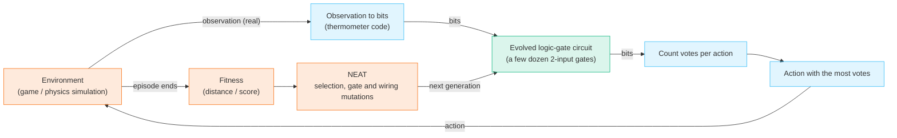

The showcase circuits are built with **neuroevolution (NEAT)**, not gradient descent.
Games and robots have no "correct action at this instant"; a score only appears after an episode has run to the end.
So instead of backpropagating an error, we build many circuits, run them, and keep the ones that do well.

## Overview

The colors follow the same legend as the rest of the site: orange is the real-valued world, green the logic-gate world, blue bit vectors and I/O.
The left loop (observation → circuit → action → environment) runs inside a single episode;
the right loop (fitness → NEAT → next generation of circuits) runs each time an episode ends.

## 1. Turning observations into bits

Environments return real values such as joint angles and velocities. We turn them into bit vectors with a **thermometer code**:
split the value range with several thresholds and emit one bit per threshold, set to 1 when the value exceeds it.
In environments whose observations are already 0/1, such as Snake, the bits go straight into the circuit.

If the threshold range is much wider than the actual distribution, the bits barely change and resolution is lost.
So for each environment we measure the value distribution under random actions and set the range from it.

## 2. The circuit picks an action

The circuit is built only from **two-input logic gates**. There are 16 Boolean functions of two inputs (AND, OR, XOR, NAND, ...),
and each gate is one of them. No weights, no multiplications.

On the output side, each action has a few "vote gates", and the action with the most votes that output 1 is chosen.
For robots with many joints, assigning votes to every joint combination makes the outputs grow exponentially,
so we switch to outputs that choose "positive, zero, or negative" per joint.

## 3. NEAT grows the shape of the circuit

NEAT (NeuroEvolution of Augmenting Topologies) evolves **the shape of the network itself**.
Starting from a minimal circuit where each gate has two inputs, each generation applies mutations that add gates and wires
or change how they are connected and what they compute, and builds the next generation from the best-performing circuits.

As in the original NEAT, circuits with similar shapes are grouped into "species" that compete among themselves, giving newly born shapes room to grow before they are eliminated.
In comparisons with classic NEAT using real-valued weights (NN), the NN side also starts from the same kind of minimal structure, to keep conditions equal.

## 4. How results are checked, and how circuits are shrunk

- **Re-measure under different initial conditions**: the reported score is the best individual re-run on initial conditions that evolution never used, so that a lucky individual does not become the winner
- **NNs see the same observations**: the NN gets the same information (as real values; the logic circuit gets it as bits)
- **Shrinking the circuit**: gates are removed while keeping the same action for every input seen during the verification runs. The Mario circuit shrank from 32 gates to 12. This "same" only holds for inputs that have been seen

## Running it yourself

The code for the showcase experiments will be released step by step.

{/* i18n:source=showcase/how-it-works.mdx hash=f99076e8cc9b */}
