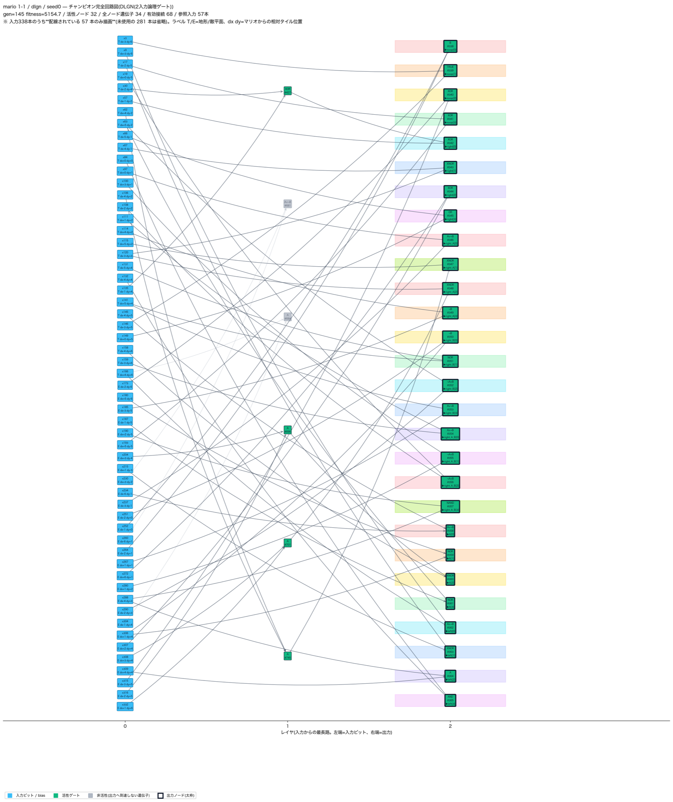

import ShowcaseVideo from '../../../../components/ShowcaseVideo.astro';

**32 two-input logic gates cleared World 1-1 of Super Mario Bros.**
No weights, no multiplications. A small circuit that takes bits in and puts bits out jumps over pits, dodges enemies, and runs to the flag.

<ShowcaseVideo
	name="mario_dlgn_clear.mp4"
	caption="The clearing circuit in action. The circuit's input bits and gates light up in real time alongside the game screen."
	meta="32 gates, cleared at generation 145"
/>

<small>Game footage is copyrighted by Nintendo and is quoted here for research purposes.</small>

## What the circuit sees

The circuit does not look at screen pixels. It reads terrain and enemy positions from the console's memory (RAM) and builds
**two 13x13 tile maps centered on Mario** (one for terrain, one for enemies).
Each tile is one bit, so the input is 338 bits in total.

This way of building observations (Mario-centered tiles instead of pixels) follows MarI/O, an earlier project that used NEAT to play Mario.

The circuit's outputs are votes for 7 actions (no-op, right, right + jump, and so on).
The action with the most votes is held for 4 frames.

## Evolution timelapse

Circuits in the first generation barely move forward. As NEAT adds and removes gates and wires each generation and keeps the individuals that get farther, the distance reached grows step by step.

<ShowcaseVideo
	name="mario_dlgn_progress.mp4"
	caption="Timelapse of the best individual over generations. Each segment is labeled with its generation and fitness."
/>

The first clearing individual appeared at generation 145, 2 hours 9 minutes after evolution started.

## The clearing circuit

The full circuit that evolution found. Input bits are on the left, the vote gates for each action on the right.
Of the 338 inputs, **only 57 are wired in**; the other 281 are unused.
A label such as `T dx+1 dy-3` means "the terrain tile one to the right of and three above Mario".

### Shrinking to 12 gates

The evolved circuit also contains gates that do not affect the result.
Removing gates under the condition that the action sequence up to the clear does not change by a single step,
**the 32 gates shrank to 12** (-62%). The remaining 12 are 3 constants, 3 gates that use only one input,
and 6 gates that genuinely use both inputs: the non-trivial computation needed to clear the stage fits in 6 gates.

This "same behavior" is guaranteed only for the inputs seen during the verification runs.
It may not behave the same way in situations it has never seen.

## Comparison with an NN under the same conditions

We also evolved classic NEAT with real-valued weights (NN) on the same 338-bit observations and the same evaluation.
The result is a tie.

| | Logic circuit (DLGN) | NN |
|---|---|---|
| Runs that cleared | 1 of 2 (generation 145) | 1 of 2 (generation 593) |
| Size of the clearing individual | 32 gates | 51 parameters |
| The run that did not clear | Stuck at the final staircase | Fell into a pit |

Gates and parameters are different units, so neither can be called smaller.
What this experiment shows is that "a circuit of 32 logic gates that clears the stage from 338 bits of observation exists, and NEAT can reach it".

## Weakness: this is close to memorization

World 1-1 plays out exactly the same way every time, so circuits tend to grow toward "replaying a fixed action sequence" rather than "reacting to what they see".
In fact, randomly replacing some of the actions breaks the clear.

| Noise (fraction of actions replaced at random) | Clears | Median distance reached |
|---|---|---|
| None | 10 of 10 | Goal (x=3161) |
| 1% | 3 of 10 | — |
| 5% | 0 of 10 | x=450 |

With 5% noise the fitness drops by 88%. This is not a weakness of logic circuits alone: NNs trained the same way share it.
It is a limit of evaluating on a single deterministic stage with a single run.

When we re-evolved with noisy evaluation, under 5% noise a 28-gate circuit went farther than every NN (8-533 parameters) evolved with the same compute time.
At 2% noise or less, however, a small NN did better, and no individual has yet reached the goal under noise.
**A noise-robust Mario circuit does not exist yet.**

Using NEAT to play Super Mario has prior work (Sørensen, Olsen, Risi, IEEE CIG 2016).
What is new here is doing it with a circuit made only of two-input logic gates instead of weighted neurons.

{/* i18n:source=showcase/mario.mdx hash=588f88a5ff09 */}
