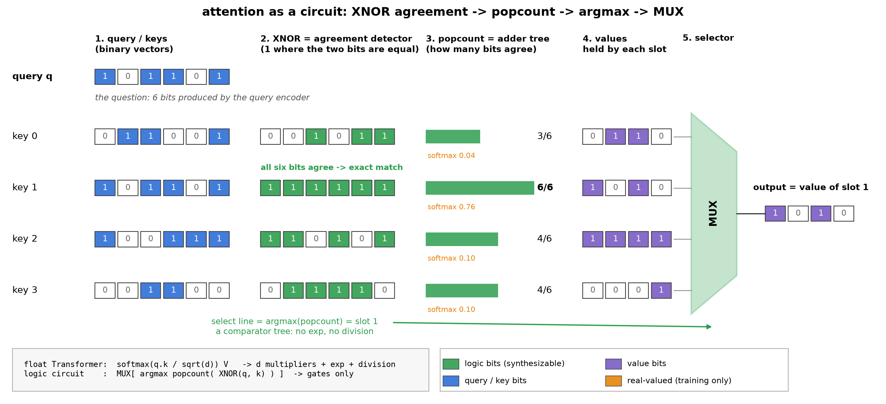
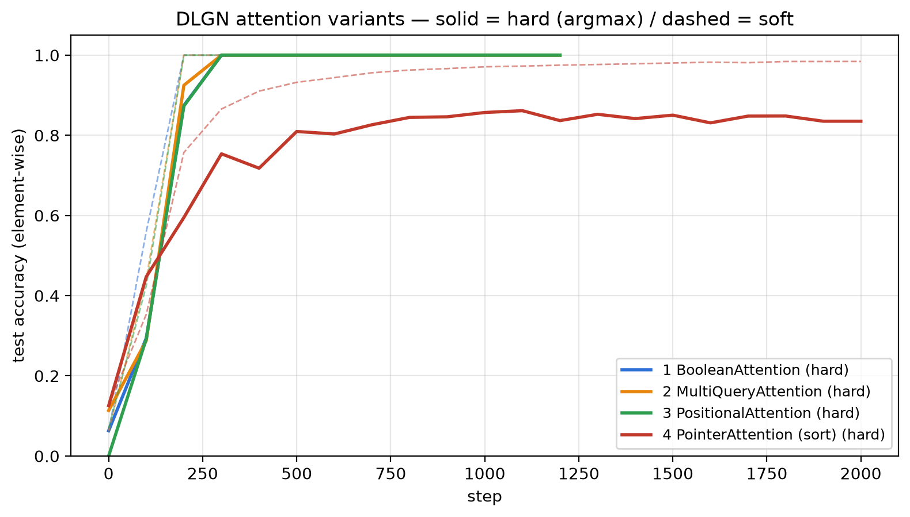
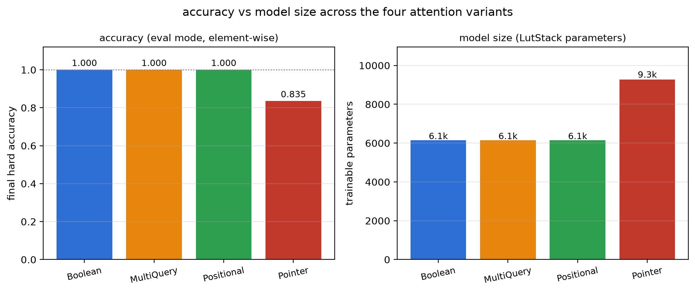
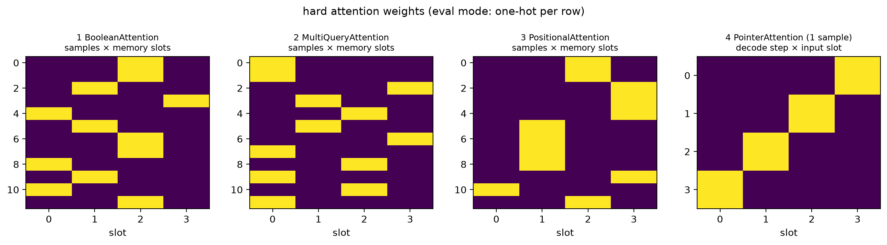

<!-- This file is generated automatically by scripts/build_tutorials.py.
     Do not edit it directly; edit examples/20_attention_tour.py and regenerate. -->

A tour that runs and compares, in one go, four attention variants in which the dot product becomes
**XNOR similarity** and softmax becomes **argmax**, on small tasks: associative recall, positional
lookup, and sorting.

Boolean / MultiQuery / Positional all solve their task at hard accuracy 1.000 (6,144 params), and
only Pointer, which solves a 4-element sort, stays at 0.835. Drawing the hard attention weight matrix
shows every row is one-hot, and **for Pointer a permutation matrix** appears — you can see with your
own eyes that "where to look" is learned as a discrete selection, not as a continuous weighted
average.

:::tip[What you'll learn]
1. How attention is replaced: dot product → XNOR similarity, softmax → argmax
2. What each of the four variants (Boolean / MultiQuery / Positional / Pointer) is good and bad at
3. How to read the hard attention weight matrix — the one-hot rows, and the permutation matrix that appears for Pointer

**Prerequisites**

- [The ladder to logic](/en/tutorials/logic-ladder/) — why the task is still solvable after throwing away softmax
- [Transformer (a logic-gate GPT)](/en/tutorials/logic-gpt/)
:::

:::note[About this page]
Estimated time: **about 7 minutes** / Environment: CPU only (no GPU needed)
Source script: [`examples/20_attention_tour.py`](https://github.com/tsukushi-gate/Griffith/blob/main/examples/20_attention_tour.py)
Try it yourself: [`notebooks/20_attention_tour.ipynb`](https://github.com/tsukushi-gate/Griffith/blob/main/notebooks/20_attention_tour.ipynb) (an unexecuted notebook with the same content as this page; open it with `uv run --group docs jupyter lab notebooks/`)
Every code output is the **actual result of running the code**, embedded verbatim.
:::

<!-- Colab badge: once the repository is public, replace this span with an <a> whose href is
     data-colab-url and "Open in Colab" becomes active. -->
<span class="colab-badge" data-colab-url="https://colab.research.google.com/github/tsukushi-gate/Griffith/blob/main/notebooks/20_attention_tour.ipynb">▶ Open in Colab (enabled once the repository is public)</span>

Comparing four logic-gate attention variants on small associative-recall (key-value lookup) tasks.

Every example up to MNIST (examples/06_mnist.py) was a straightforward "input bit string → class"
classifier. Here we step into attention mechanisms, where **the circuit decides for itself where to look**.

Attention in a logic-gate NN replaces the Transformer's dot product + softmax as follows:

    dot-product similarity  →  XNOR similarity (popcount)   ... just count the matching bits
    softmax                 →  softmax only while training, argmax at inference (Hard Attention)

XNOR and popcount are both pure combinational circuits, so what you get after training is literally
"a content-addressable memory (CAM) with no multipliers". Continuous relaxation (softmax) is used
only during training, and the moment you enter eval() it switches to argmax discrete selection —
the same design philosophy as LutLayer's soft/hard.

The four variants toured here (griffith_logic.models.attention):

  1. DLGNBooleanAttention      Single-query associative recall. The minimal form of attention
  2. DLGNMultiQueryAttention   Multiple queries applied in parallel to the same KV memory (a multi-head-like extension)
  3. DLGNPositionalAttention   Keys are not inputs but "fixed position numbers". Look up by position, not content
  4. DLGNPointerAttention      Pointer-Network style. Autoregression plus a mask repeats "pull, then erase" and
                               solves sorting (= repeated application of associative recall)

The four variants differ only in "how memory is looked up"; the training loop, the loss, and the data
format can all stay the same. The theme of this page is the contrast: swap which piece, and what
becomes solvable?

**The three parts attention is made of (in beginner's terms)**

- **XNOR = an agreement detector**. A single gate that outputs 1 when two wires carry the same
  value, 0 otherwise. Line up one per bit and you get a map of which bits agree
- **popcount = a majority count (an adder tree that counts the 1s)**. Counting the 1s in that map
  tells you "how many bits agree" = the similarity. **Not a single multiplier is needed**
- **MUX (multiplexer) = a selector**. A traffic switch that routes exactly one input to the
  output, told by "which number to pass". Instead of softmax's weighted average, it passes the
  value of the winning slot as is

Figure 1 pushes **concrete bit strings** through these three parts: from the query `101101` and
the agreement counts against the four keys (3/6, 6/6, 4/6, 4/6) all the way to the MUX picking
out the value `1010`.

**Where the four variants differ**

```mermaid
flowchart TB
  subgraph LEG["Legend (what the colors mean)"]
    direction LR
    lg["green = logic gates<br/>the world of bits, burnable into a circuit as is"]
    lr["orange = real-valued<br/>only the softmax used during training; nothing left in the circuit"]
  end
  subgraph V1["1 DLGNBooleanAttention — look up by content (associative memory / 6,144 params)"]
    direction LR
    a1["question<br/>the 4-bit query at the end of the input"]
    a2["match<br/>XNOR against the four keys<br/>an exact match always has the largest popcount"]
    a3["select<br/>a MUX picks one V<br/>→ LutStack decoder"]
    a1 --> a2 --> a3
  end
  subgraph V2["2 DLGNMultiQueryAttention — query the same memory twice (6,144 params)"]
    direction LR
    b1["question<br/>two queries"]
    b2["match<br/>the KV encoders stay shared<br/>the scores just grow to (B,2,4)"]
    b3["select<br/>a MUX per query<br/>circuit area barely changes"]
    b1 --> b2 --> b3
  end
  subgraph V3["3 DLGNPositionalAttention — look up by address (6,144 params)"]
    direction LR
    c1["question<br/>a 2-bit position number"]
    c2["match<br/>the keys are not in the input:<br/>constant keys encoding 0..3"]
    c3["select<br/>a MUX takes the slot at that address<br/>the position code is baked into the circuit"]
    c1 --> c2 --> c3
  end
  subgraph V4["4 DLGNPointerAttention — pull, then erase (sorting / 9,280 params)"]
    direction LR
    d1["question<br/>generated at every step by an autoregressive decoder"]
    d2["match<br/>XNOR against the input slots<br/>+ a cumulative mask suppressing what was already taken"]
    d3["select<br/>a MUX, four steps' worth<br/>the result is a permutation matrix"]
    d1 --> d2 --> d3
  end
  style lg fill:#10b98126,stroke:#10b981
  style lr fill:#f9731626,stroke:#f97316
  style a1 fill:#10b98126,stroke:#10b981
  style a2 fill:#10b98126,stroke:#10b981
  style a3 fill:#10b98126,stroke:#10b981
  style b1 fill:#10b98126,stroke:#10b981
  style b2 fill:#10b98126,stroke:#10b981
  style b3 fill:#10b98126,stroke:#10b981
  style c1 fill:#10b98126,stroke:#10b981
  style c2 fill:#10b98126,stroke:#10b981
  style c3 fill:#10b98126,stroke:#10b981
  style d1 fill:#10b98126,stroke:#10b981
  style d2 fill:#10b98126,stroke:#10b981
  style d3 fill:#10b98126,stroke:#10b981
```



The only differences are "where the question comes from" and "what happens after the selection";
the middle — XNOR + popcount + MUX — is exactly the same in all four. Variants 1-3 use the same
widths, so the circuits are the same size too (6,144 parameters each), and only Pointer grows,
by its autoregressive cell and query producer (9,280 parameters).

There are four figures:

    Fig. 1  the mechanism that replaces Q·K + softmax with XNOR + popcount + MUX (followed with concrete bits)
    Fig. 2  the learning curves of the four variants (how hard and soft overlap)
    Fig. 3  final hard accuracy versus parameter count (the cost/benefit comparison)
    Fig. 4  the attention weights after training (which slot is being pointed at)

Run: uv run python examples/20_attention_tour.py
Time: about 2 minutes on CPU (all four tasks). For a serious recipe aimed at accuracy, see
      the experiments/train_boolean_attention.py family
Expected result: 1-3 reach hard accuracy 1.00 (solved exactly), 4 (sorting) lands around 0.85 element-wise and around 0.65 for exact sequence match

## Setup: imports and the random seed

All we need is PyTorch, matplotlib and the four variants in `griffith_logic.models.attention`.
Switching between soft (the continuous relaxation used during training) and hard (the discrete
selection used at inference) is handled by the model itself, so the training code needs no special
machinery at all — that is the thing to watch for in the code below.

```python
import matplotlib.pyplot as plt
import torch
import torch.nn.functional as F

from griffith_logic.models.attention import (
    BooleanAttentionConfig,
    DLGNBooleanAttention,
    DLGNMultiQueryAttention,
    DLGNPointerAttention,
    DLGNPositionalAttention,
    MultiQueryAttentionConfig,
    PointerAttentionConfig,
    PositionalAttentionConfig,
)
```

```python
# The wiring (random connections) and the gates' initial values depend on randomness, so fix the seed.
torch.manual_seed(0)
```

### Shared hyperparameters

A reduced recipe that fits in a few CPU minutes across all four tasks. Raising `STEPS` and the
encoder widths improves accuracy, but here we care less about accuracy itself than about
"comparing the four variants on the same footing".

```python
STEPS = 1200      # training iterations per task
STEPS_PTR = 2000  # only Pointer (autoregressive sorting) is hard, so run it longer
BATCH = 128       # minibatch size
EVAL_EVERY = 100  # sampling interval for the learning curves
N_TRAIN = 20000   # number of training samples (synthesized on the fly)
N_TEST = 2000     # number of evaluation samples
LR = 0.01
```

## The heart of the replacement: dot product + softmax becomes XNOR + popcount + MUX

A Transformer's attention is `softmax(q·k/√d)·V`: it measures how close a query is to a memory with
a **real-valued dot product** and blends the values with a **softmax weighted average**. That needs
multipliers and an exponential, which is heavy for a circuit made only of logic gates.
The logic-gate version replaces it with three parts.

- **XNOR** (the negation of exclusive OR) = an **agreement detector**. One gate that returns 1 when
  two wires carry the same value and 0 otherwise. Laid out across the bit width, it becomes a map of
  "which bits agree"
- **popcount** = an adder tree that counts how many bits are 1. Counting the ones in the agreement
  map gives "how many bits agree" = the similarity. **Not a single multiplier is required**
- **MUX** (multiplexer) = a selector. A traffic switch that, given a "which one to pass" select line,
  lets exactly one input through to the output. Instead of a softmax weighted average, it passes the
  value of the winning slot as it is

**Why the replacement works**: the dot product of two binary vectors *is* the number of agreeing bits
(the flip side of the Hamming distance), so the meaning of the similarity the dot product measured is
not lost. The selection side follows the same idea: while training, a softmax (temperature
`tau_attn`) blends all slots so gradients flow, and at `eval()` it switches to an argmax that takes
only the highest-scoring slot (= **hard attention**). This is exactly the same design philosophy as
LutLayer's soft/hard.

```python
# LutStack widths. Two stages, [hidden layer, output layer]. The output layer becomes d_attn / d_val.
ENC = [64, 32]        # key/query encoder (→ d_attn)
VENC = [64, 32]       # value encoder (→ d_val)
DEC = [128, 64]       # output decoder (the final layer must be divisible by num_classes)

# The numeric example below uses hand-written vectors from before training. It lets you follow the
# two replacements described above (dot product → popcount(XNOR) / softmax → argmax) in actual numbers.

demo_query = torch.tensor([1.0, 0.0, 1.0, 1.0, 0.0, 1.0])
demo_keys = torch.tensor([
    [0.0, 1.0, 1.0, 0.0, 0.0, 1.0],   # 3 bits agree
    [1.0, 0.0, 1.0, 1.0, 0.0, 1.0],   # every bit agrees (= the correct slot)
    [1.0, 0.0, 0.0, 1.0, 1.0, 1.0],   # 4 bits agree
    [0.0, 0.0, 1.0, 1.0, 0.0, 0.0],   # 4 bits agree
])
demo_values = torch.tensor([          # the value held by each slot (what the MUX lets through)
    [0.0, 1.0, 1.0, 0.0],
    [1.0, 0.0, 1.0, 0.0],             # the value of the winning slot
    [1.0, 1.0, 1.0, 1.0],
    [0.0, 0.0, 0.0, 1.0],
])
demo_xnor = demo_query * demo_keys + (1 - demo_query) * (1 - demo_keys)
demo_scores = demo_xnor.sum(dim=-1)
demo_soft = F.softmax(demo_scores / 1.0, dim=-1)
demo_winner = int(demo_scores.argmax().item())
demo_hard = F.one_hot(demo_scores.argmax(-1), num_classes=demo_keys.shape[0]).float()
demo_out = demo_values[demo_winner]
q_str = ''.join(str(int(b)) for b in demo_query)
key_str = [''.join(str(int(b)) for b in row) for row in demo_keys]
xnor_str = [''.join(str(int(b)) for b in row) for row in demo_xnor]
val_str = [''.join(str(int(b)) for b in row) for row in demo_values]

print('=== 図1の数値例: XNOR一致検出 → popcount → MUX選択 ===')
print(f'query   = {q_str}')
for i, s in enumerate(demo_scores):
    print(f'key[{i}]  = {key_str[i]}  XNOR={xnor_str[i]}  popcount={int(s.item())}/6  '
          f'softmax={demo_soft[i]:.3f}  value={val_str[i]}')
print(f'argmax が選ぶスロット = {demo_winner} / MUX が出すバリュー = {val_str[demo_winner]}')
```

```text title="Output"
=== 図1の数値例: XNOR一致検出 → popcount → MUX選択 ===
query   = 101101
key[0]  = 011001  XNOR=001011  popcount=3/6  softmax=0.038  value=0110
key[1]  = 101101  XNOR=111111  popcount=6/6  softmax=0.757  value=1010
key[2]  = 100111  XNOR=110101  popcount=4/6  softmax=0.102  value=1111
key[3]  = 001100  XNOR=011110  popcount=4/6  softmax=0.102  value=0001
argmax が選ぶスロット = 1 / MUX が出すバリュー = 1010
```

### Figure 1: following "attention = XNOR + popcount + MUX" with concrete bits

**What to look for**: hand-written vectors from before training flow from left to right, and the
figure follows the whole path from the query `101101` and the number of agreeing bits with the four
keys (3/6, 6/6, 4/6, 4/6) to the MUX picking out the value `1010`. Bit boxes are **filled = 1 /
empty = 0**. Green marks the logic (the part that can be burned into a circuit as is) and orange the
real-valued part (the training-time softmax only, which leaves nothing in the circuit).

```python
# The drawing order is exactly the order values flow through the circuit:
#   keys (6 bits) -> XNOR agreement map -> popcount (agreeing bits) -> weights -> values -> MUX -> output.
COLOR_LOGIC, COLOR_REAL, C_KEY, C_VAL = '#2e9e4f', '#e8850c', '#2e6fd6', '#7a5cc4'
BIT_W, BIT_H = 0.40, 0.36
X_KEY, X_XNOR, X_BAR, X_VAL, X_MUX, X_OUT = 1.55, 4.45, 7.35, 10.1, 12.0, 13.3
Y_Q, Y_TOP, Y_GAP = 7.5, 6.1, 1.2
key_y = [Y_TOP - i * Y_GAP for i in range(4)]
y_mid = (key_y[0] + key_y[3]) / 2
bit_rows = [(X_KEY, Y_Q, demo_query, C_KEY), (X_OUT, y_mid, demo_out, C_VAL)]
for i, y in enumerate(key_y):
    bit_rows += [(X_KEY, y, demo_keys[i], C_KEY), (X_XNOR, y, demo_xnor[i], COLOR_LOGIC),
                 (X_VAL, y, demo_values[i], C_VAL)]
fig, ax = plt.subplots(figsize=(13.5, 6.2))
for bx, by, vec, bcolor in bit_rows:
    for j, bit in enumerate(vec):
        one = float(bit) > 0.5
        ax.add_patch(plt.Rectangle((bx + j * BIT_W, by - BIT_H / 2), BIT_W * 0.88, BIT_H,
                                   facecolor=bcolor if one else 'white',
                                   edgecolor='#333', lw=0.8, alpha=0.9 if one else 1.0))
        ax.text(bx + j * BIT_W + BIT_W * 0.44, by, str(int(one)), ha='center', va='center',
                fontsize=8.5, color='white' if one else '#666')
ax.text(0.1, Y_Q, 'query q', ha='left', va='center', fontsize=10, weight='bold')
ax.text(X_KEY, Y_Q - 0.55, 'the question: 6 bits produced by the query encoder',
        ha='left', fontsize=9, style='italic', color='#555')
for i, y in enumerate(key_y):
    count = int(demo_scores[i].item())
    ax.text(0.1, y, f'key {i}', ha='left', va='center', fontsize=10)
    ax.add_patch(plt.Rectangle((X_BAR, y - 0.16), 1.9 * count / 6, 0.32,
                               facecolor=COLOR_LOGIC, alpha=0.85, edgecolor='none'))
    ax.text(X_BAR + 1.95, y, f'{count}/6', ha='left', va='center', fontsize=10,
            weight='bold' if i == demo_winner else 'normal')
    ax.text(X_BAR + 0.03, y - 0.5, f'softmax {demo_soft[i]:.2f}', ha='left', fontsize=8,
            color=COLOR_REAL)
    ax.plot([X_VAL + 4 * BIT_W, X_MUX], [y, y], color='#999', lw=1)
    if i == demo_winner:
        ax.text(X_XNOR + 1.25, y + 0.42, 'all six bits agree -> exact match',
                ha='center', fontsize=8.5, color=COLOR_LOGIC, weight='bold')
ax.add_patch(plt.Polygon([[X_MUX, key_y[0] + 0.55], [X_MUX + 0.8, key_y[0] - 0.35],
                          [X_MUX + 0.8, key_y[3] + 0.35], [X_MUX, key_y[3] - 0.55]],
                         closed=True, facecolor=COLOR_LOGIC, alpha=0.28,
                         edgecolor=COLOR_LOGIC, lw=1.6))
ax.text(X_MUX + 0.4, y_mid, 'MUX', ha='center', va='center', fontsize=11,
        weight='bold', rotation=90)
ax.annotate('', xy=(X_MUX + 0.4, key_y[3] - 0.85), xytext=(X_XNOR + 2.3, key_y[3] - 0.75),
            arrowprops={'arrowstyle': '-|>', 'color': COLOR_LOGIC, 'lw': 1.4})
ax.text(X_XNOR + 0.6, key_y[3] - 0.62,
        f'select line = argmax(popcount) = slot {demo_winner}\n'
        'a comparator tree: no exp, no division',
        ha='center', va='top', fontsize=9, color=COLOR_LOGIC)
ax.plot([X_MUX + 0.8, X_OUT], [y_mid, y_mid], color='#333', lw=1.2)
ax.text(X_OUT + 2 * BIT_W, y_mid + 0.55, f'output = value of slot {demo_winner}',
        ha='center', fontsize=9.5, weight='bold')
for x, label in [(X_KEY, '1. query / keys\n(binary vectors)'),
                 (X_XNOR, '2. XNOR = agreement detector\n(1 where the two bits are equal)'),
                 (X_BAR, '3. popcount = adder tree\n(how many bits agree)'),
                 (X_VAL, '4. values\nheld by each slot'),
                 (X_MUX - 0.15, '5. selector')]:
    ax.text(x, 8.5, label, ha='left', va='top', fontsize=9.5, weight='bold')
ax.add_patch(plt.Rectangle((0.1, 0.15), 7.3, 1.0, facecolor='#f7f7f7', edgecolor='#bbb'))
ax.text(0.3, 0.65,
        'float Transformer:  softmax(q.k / sqrt(d)) V   -> d multipliers + exp + division\n'
        'logic circuit    :  MUX[ argmax popcount( XNOR(q, k) ) ]  -> gates only',
        ha='left', va='center', fontsize=8.5, family='monospace')
ax.add_patch(plt.Rectangle((7.6, 0.15), 6.1, 1.0, facecolor='white', edgecolor='#bbb'))
legend_items = [(7.65, 0.78, COLOR_LOGIC, 'logic bits (synthesizable)'),
                (7.65, 0.38, C_KEY, 'query / key bits'),
                (10.5, 0.78, C_VAL, 'value bits'),
                (10.5, 0.38, COLOR_REAL, 'real-valued (training only)')]
for lx, ly, color, label in legend_items:
    ax.add_patch(plt.Rectangle((lx, ly - 0.12), 0.28, 0.24, facecolor=color, alpha=0.9,
                               edgecolor='#333', lw=0.6))
    ax.text(lx + 0.38, ly, label, va='center', fontsize=8.5)
ax.set_xlim(0, 15.3)
ax.set_ylim(0, 8.8)
ax.set_axis_off()
ax.set_title('attention as a circuit: XNOR agreement -> popcount -> argmax -> MUX',
             fontsize=13, weight='bold')
fig.tight_layout()
plt.show()
```

    

    

**What it says**: only the one key that matches exactly reaches a popcount of 6/6, and every other
key necessarily falls short. That is why **a rule made of comparators alone** — "pick the slot with
the largest popcount" — settles the answer: no exponential and no division appear anywhere.
This is the heart shared by all four variants below.

## The datasets: synthesizing three small tasks on the fly

The input of an attention model is "one flat binary vector", and which bits are keys and where the
query starts is decided purely by the Config. In other words, the three generators below *are* the
**definition of the input layout** for each task.

```python
def to_bits(values: torch.Tensor, n_bits: int) -> torch.Tensor:
    """Turn an integer tensor into an MSB-first binary tensor of shape (..., n_bits)."""
    shifts = torch.arange(n_bits - 1, -1, -1)
    return ((values.unsqueeze(-1) >> shifts) & 1).float()
```

```python
def make_recall(n, num_pairs, key_bits, value_bits, num_queries=1):
    """Associative recall: [K1,V1, ..., Kn,Vn, Q(,Q2...)] → the value of the key matching the query.

    Keys are drawn without duplication within a sample by shuffling the whole key space and taking
    the first num_pairs (with two identical keys the "correct answer" would be undefined).
    """
    n_keys = 2 ** key_bits
    keys = torch.rand(n, n_keys).argsort(dim=-1)[:, :num_pairs]        # (n, P) no duplicates
    values = torch.randint(0, 2 ** value_bits, (n, num_pairs))          # (n, P)
    q_idx = torch.randint(0, num_pairs, (n, num_queries))               # (n, Q)

    # Memory part: concatenate [key bits, value bits] per pair and lay them out in a row
    pair_bits = torch.cat([to_bits(keys, key_bits), to_bits(values, value_bits)], dim=-1)
    memory = pair_bits.reshape(n, -1)                                   # (n, P*(KB+VB))
    # Query part: put the chosen pair's key at the end as the query
    query = to_bits(torch.gather(keys, 1, q_idx), key_bits).reshape(n, -1)

    x = torch.cat([memory, query], dim=-1)
    y = torch.gather(values, 1, q_idx)                                  # (n, Q)
    return x, (y.squeeze(-1) if num_queries == 1 else y)
```

```python
def make_positional(n, pos_bits, value_bits):
    """Position-indexed lookup: [V0, V1, ..., V(N-1), pos] → V_pos.

    The difference from associative recall is that "the key is not in the input". Keys are fixed to
    slot numbers 0..N-1 and held by the model as constants (= the positional encoding is burned in as circuitry).
    """
    num_slots = 2 ** pos_bits
    values = torch.randint(0, 2 ** value_bits, (n, num_slots))
    pos = torch.randint(0, num_slots, (n,))
    x = torch.cat([
        to_bits(values, value_bits).reshape(n, -1),
        to_bits(pos, pos_bits),
    ], dim=-1)
    y = torch.gather(values, 1, pos.unsqueeze(-1)).squeeze(-1)
    return x, y
```

```python
def make_sort(n, seq_len, value_bits):
    """Sorting: [V0, ..., V(N-1)] → the sequence rearranged in ascending order.

    A Pointer Network does not "produce an output" but chooses "which input to point at".
    So the supervision comes in two parts: the value sequence (y) and the pointer sequence (ptr = argsort).
    """
    values = torch.randint(0, 2 ** value_bits, (n, seq_len))
    ptr = values.argsort(dim=-1)                       # which slot to emit at which position
    y = torch.gather(values, 1, ptr)                   # = sorted(values)
    x = to_bits(values, value_bits).reshape(n, -1)
    return x, y, ptr
```

## The shared training loop

All four models can be trained with nothing but "forward, then cross entropy". Switching attention
between soft and hard is handled by `model.train()` / `model.eval()`, so **the training code is
literally identical across the four variants**.

At every evaluation we measure both soft and hard. **soft** is the form you see during training
(the softmax weighted average) and **hard** is the form after burning (argmax picks exactly one
slot); the closer the two are, the more the attention has already committed to a single slot.
That is what this pair of numbers is for.

```python
PARAM_COUNTS: dict[str, int] = {}
```

```python
def forward_logits(model, x, ptr=None):
    """Absorb model differences (whether the return value is a tuple) and extract just the logits."""
    out = model(x) if ptr is None else model(x, target_pointers=ptr)
    return out[0] if isinstance(out, tuple) else out
```

```python
def accuracy(logits, y):
    """Element-wise accuracy (counted per token for sequence tasks)."""
    return (logits.argmax(-1) == y).float().mean().item()
```

### train(): running one task

Circuit size is compared in Figure 3, so we stash the result of `count_parameters()` in `PARAM_COUNTS`.

```python
def train(name, model, data, steps=STEPS):
    """Train one task and return the history of (step, soft acc, hard acc)."""
    train_x, train_y, train_ptr, test_x, test_y = data
    n_classes = model.config.num_classes
    opt = torch.optim.Adam(model.parameters(), lr=LR)
    history = []

    for step in range(steps + 1):
        if step % EVAL_EVERY == 0:
            with torch.no_grad():
                # soft = the training-time form (attention as a softmax weighted average)
                model.train()
                soft = accuracy(forward_logits(model, test_x), test_y)
                # hard = the burned-circuit form (Hard Attention, argmax picks exactly one slot)
                model.eval()
                hard = accuracy(forward_logits(model, test_x), test_y)
                model.train()
            history.append((step, soft, hard))

        idx = torch.randint(0, train_x.shape[0], (BATCH,))
        # Only Pointer has an autoregressive decoder, so during training we feed the ground-truth pointers
        # (teacher forcing). At evaluation it is free-running with target_pointers=None.
        ptr = None if train_ptr is None else train_ptr[idx]
        logits = forward_logits(model, train_x[idx], ptr)
        yb = train_y[idx]
        opt.zero_grad()
        loss = F.cross_entropy(logits.reshape(-1, n_classes), yb.reshape(-1))
        loss.backward()
        opt.step()

    gates = model.count_parameters()['total']
    PARAM_COUNTS[name] = gates
    print(f'{name:<22} soft={history[-1][1]:.4f}  hard={history[-1][2]:.4f}  '
          f'({gates:,} params)')
    return history
```

## Training the four variants in turn

From here we run the four variants from top to bottom. **The only differences are where the question
comes from and what happens after the selection**; the XNOR + popcount + MUX in the middle is
completely shared by all four.

**1. BooleanAttention — the minimal form of attention (content-addressed)**. Only two things were
replaced: the dot product became an XNOR popcount, and softmax became an argmax (at `eval()` time).
The encoders that produce Q/K/V and the decoder that reads the selected V are ordinary `LutStack`s,
so the Transformer skeleton is left intact. The task is **associative recall (key-value lookup)**:
given four (key, value) pairs and one query, answer with the value of the matching key. The query key
matches one of the memory entries **exactly**, so the number of agreeing bits is maximal at the
correct slot (= `key_bits`) and strictly smaller everywhere else. What training decides is not the
similarity formula but the wiring by which the key/query encoders scatter bits into a code that
**makes agreement stand out**.

```python
print('\n=== 1. DLGNBooleanAttention (単一クエリ連想想起) ===')
cfg1 = BooleanAttentionConfig(
    num_pairs=4, key_bits=4, value_bits=4,
    encoder_sizes=ENC, value_encoder_sizes=VENC, decoder_sizes=DEC,
)
x1, y1 = make_recall(N_TRAIN, cfg1.num_pairs, cfg1.key_bits, cfg1.value_bits)
xt1, yt1 = make_recall(N_TEST, cfg1.num_pairs, cfg1.key_bits, cfg1.value_bits)
print(f'入力 {cfg1.input_dim} ビット = 4ペア×(4キー+4バリュー) + 4クエリ / '
      f'{cfg1.num_classes} クラス')
model1 = DLGNBooleanAttention(cfg1)
hist1 = train('BooleanAttention', model1, (x1, y1, None, xt1, yt1))

# ===========================================================================
# 2. Multi-Query Attention — several queries against the same memory
# ---------------------------------------------------------------------------
# What was replaced: one query becomes Q queries. The KV encoder stays shared; the query axis is
# simply folded into the batch direction and broadcast.
#
# Why that still works: the queries are independent of each other and only the memory they consult is
# shared. The score matrix just grows to (batch, Q, P), and the selection rule (maximum popcount) is
# identical to the single-query case. As circuitry this amounts to "looking up the same CAM several
# times by time division", so the point of this variant is to **buy bandwidth with almost no extra
# area (parameters)**. Comparing parameter counts with Boolean in Figure 3 makes that cheapness visible.
# ===========================================================================

print('\n=== 2. DLGNMultiQueryAttention (複数クエリ同時想起) ===')
cfg2 = MultiQueryAttentionConfig(
    num_pairs=4, num_queries=2, key_bits=4, value_bits=4,
    encoder_sizes=ENC, value_encoder_sizes=VENC, decoder_sizes=DEC,
)
x2, y2 = make_recall(N_TRAIN, cfg2.num_pairs, cfg2.key_bits, cfg2.value_bits,
                     num_queries=cfg2.num_queries)
xt2, yt2 = make_recall(N_TEST, cfg2.num_pairs, cfg2.key_bits, cfg2.value_bits,
                       num_queries=cfg2.num_queries)
print(f'入力 {cfg2.input_dim} ビット / 出力 (batch, {cfg2.num_queries}, '
      f'{cfg2.num_classes})')
model2 = DLGNMultiQueryAttention(cfg2)
hist2 = train('MultiQueryAttention', model2, (x2, y2, None, xt2, yt2))

# ===========================================================================
# 3. Positional Attention — pinning the keys to positions
# ---------------------------------------------------------------------------
# What was replaced: where the keys come from. Instead of reading keys out of the input, the position
# indices 0..N-1 are run through the key_encoder and the resulting fixed vectors become the keys
# (the input contains only the value sequence and a position number).
#
# Why that still works: the slot to be looked up is named by its position number, so as long as
# "the query encoding the position number" and "the key encoding each slot number" end up as mutually
# distant bit patterns, the maximum popcount always points at the right address.
# As training proceeds the key_encoder effectively becomes an encoder that scatters position numbers —
# the highlight is the contrast: the Transformer's positional encoding shows up not as a vector that
# gets added, but as **constant keys burned into the circuit**.
# The difference between content addressing (1, 2) and location addressing (3) also shows up in the
# patterns of the heatmaps in Figure 4.
# ===========================================================================

print('\n=== 3. DLGNPositionalAttention (位置指定ルックアップ) ===')
cfg3 = PositionalAttentionConfig(
    pos_bits=2, value_bits=4,
    encoder_sizes=ENC, value_encoder_sizes=VENC, decoder_sizes=DEC,
)
x3, y3 = make_positional(N_TRAIN, cfg3.pos_bits, cfg3.value_bits)
xt3, yt3 = make_positional(N_TEST, cfg3.pos_bits, cfg3.value_bits)
print(f'入力 {cfg3.input_dim} ビット = {cfg3.num_slots}スロット×4ビット + 2位置ビット')
model3 = DLGNPositionalAttention(cfg3)
hist3 = train('PositionalAttention', model3, (x3, y3, None, xt3, yt3))

# ===========================================================================
# 4. Pointer Attention — repeating "pull, then erase"
# ---------------------------------------------------------------------------
# What was replaced: how the output is produced. The three above "pull once and are done", simply
# reading the chosen value through a decoder. Pointer has an autoregressive decoder and at each step
#   (a) makes a query from the decoder state,
#   (b) points at one input slot by XNOR similarity,
#   (c) suppresses the chosen slot with a cumulative mask,
# repeating seq_len times. The output is not "a new value" but "which input was pointed at".
#
# Why that solves sorting: sorting into ascending order is the same as repeatedly "pointing at the
# smallest element not yet chosen", and since the mask forbids choosing twice, the output is
# necessarily a permutation of the input. In other words, sorting is reduced to **repeated
# application of associative recall**. The proof is on the right-hand side of Figure 4, where each
# row and each column lights at most one cell (= a permutation matrix).
#
# It is, however, in a different difficulty class: errors propagate to later steps, and training
# (teacher forcing) differs from evaluation (free-running). On the same budget it only gets partway.
# ===========================================================================

print('\n=== 4. DLGNPointerAttention (ポインタ選択によるソート) ===')
cfg4 = PointerAttentionConfig(
    seq_len=4, value_bits=3,
    value_encoder_sizes=VENC, key_encoder_sizes=ENC,
    decoder_cell_sizes=[64, 32], query_producer_sizes=ENC,
    output_decoder_sizes=DEC,
)
x4, y4, ptr4 = make_sort(N_TRAIN, cfg4.seq_len, cfg4.value_bits)
xt4, yt4, _ = make_sort(N_TEST, cfg4.seq_len, cfg4.value_bits)
print(f'入力 {cfg4.input_dim} ビット = {cfg4.seq_len}要素×{cfg4.value_bits}ビット / '
      f'出力は{cfg4.seq_len}ステップの系列')
model4 = DLGNPointerAttention(cfg4)
hist4 = train('PointerAttention', model4, (x4, y4, ptr4, xt4, yt4), steps=STEPS_PTR)
```

    
```text title="Output"
=== 1. DLGNBooleanAttention (単一クエリ連想想起) ===
入力 36 ビット = 4ペア×(4キー+4バリュー) + 4クエリ / 16 クラス

BooleanAttention       soft=1.0000  hard=1.0000  (6,144 params)

=== 2. DLGNMultiQueryAttention (複数クエリ同時想起) ===
入力 40 ビット / 出力 (batch, 2, 16)

MultiQueryAttention    soft=1.0000  hard=1.0000  (6,144 params)

=== 3. DLGNPositionalAttention (位置指定ルックアップ) ===
入力 18 ビット = 4スロット×4ビット + 2位置ビット

PositionalAttention    soft=1.0000  hard=1.0000  (6,144 params)

=== 4. DLGNPointerAttention (ポインタ選択によるソート) ===
入力 12 ビット = 4要素×3ビット / 出力は4ステップの系列

PointerAttention       soft=0.9843  hard=0.8351  (9,280 params)
```

### Re-measuring Pointer by exact sequence match

Measuring sequence tasks by "every step correct" makes their difficulty easy to see: even at 0.85
element-wise, the probability that all four elements are right can fall close to that value raised to
the fourth power. Training feeds the ground-truth pointers (**teacher forcing**) while evaluation
feeds the model's own output back in (**free-running**), and that mismatch also shows up most
strongly in the exact-sequence number.

```python
model4.eval()
with torch.no_grad():
    seq_pred = forward_logits(model4, xt4).argmax(-1)
exact = (seq_pred == yt4).all(dim=-1).float().mean().item()
print(f'  └ 要素単位 = {hist4[-1][2]:.4f} / 系列完全一致(全4要素が正しい割合) = {exact:.4f}')
```

```text title="Output"
  └ 要素単位 = 0.8351 / 系列完全一致(全4要素が正しい割合) = 0.6750
```

## Results: the four variants side by side

Every figure below is drawn from this one table. The three associative-recall variants (1–3) stand on
the same footing, so we put a loose lower bound on their hard accuracy just to reject "did not learn at all".

```python
# The shared table used by the figures below: (display name, history, color, PARAM_COUNTS key, short label).
runs = [
    ('1 BooleanAttention', hist1, '#2e6fd6', 'BooleanAttention', 'Boolean'),
    ('2 MultiQueryAttention', hist2, '#e8850c', 'MultiQueryAttention', 'MultiQuery'),
    ('3 PositionalAttention', hist3, '#2e9e4f', 'PositionalAttention', 'Positional'),
    ('4 PointerAttention (sort)', hist4, '#c0392b', 'PointerAttention', 'Pointer'),
]
print('\n--- 最終 hard accuracy (eval=argmax Hard Attention) ---')
for name, hist, _, key, _ in runs:
    print(f'{name:<28} hard={hist[-1][2]:.4f}  params={PARAM_COUNTS[key]:,}')
```

    
```text title="Output"
--- 最終 hard accuracy (eval=argmax Hard Attention) ---
1 BooleanAttention           hard=1.0000  params=6,144
2 MultiQueryAttention        hard=1.0000  params=6,144
3 PositionalAttention        hard=1.0000  params=6,144
4 PointerAttention (sort)    hard=0.8351  params=9,280
```

```python
# The three associative-recall variants should all learn on the same footing (the threshold is set loosely to allow for environment differences).
for name, hist, _, _, _ in runs[:3]:
    assert hist[-1][2] > 0.5, f'{name}: hard acc={hist[-1][2]:.4f} が低すぎる'
```

## Visualization: convergence, circuit size and attention weights

### Figure 2: convergence curves of the four variants, overlaid

**What to look for**: solid = hard (argmax, the burned-circuit form), dashed = soft (softmax, the
training-time form). All four are overlaid on one plot so you can compare when each takes off and,
above all, **how closely the solid and dashed lines coincide**.

```python
fig, ax = plt.subplots(figsize=(8, 4.6))
for name, hist, color, _, _ in runs:
    steps, soft, hard = zip(*hist, strict=True)
    ax.plot(steps, hard, '-', color=color, lw=2, label=f'{name} (hard)')
    ax.plot(steps, soft, '--', color=color, lw=1, alpha=0.55)
ax.set_xlabel('step')
ax.set_ylabel('test accuracy (element-wise)')
ax.set_ylim(0, 1.05)  # 1-3 pin at 1.0, so leave a little headroom at the top
ax.grid(alpha=0.3)
ax.legend(loc='lower right', fontsize=9)
ax.set_title('DLGN attention variants — solid = hard (argmax) / dashed = soft')
fig.tight_layout()
plt.show()
```

    

    

**What it says**: for 1–3 the solid and dashed lines almost coincide. Attention has already committed
to a single slot, so replacing softmax with argmax does not change the output. Only 4 (Pointer) keeps
the two lines apart and stalls — a sign that it is still stuck on an unconfident weighted average.

### Figure 3: accuracy and parameter count side by side

**What to look for**: the final hard accuracy on the left and the parameter count (a proxy for
circuit size) on the right. It is a cost-effectiveness comparison: "did it solve the task" and
"what did it pay for that", lined up the same way.

```python
labels = [short for *_, short in runs]
final_hard = [hist[-1][2] for _, hist, *_ in runs]
colors = [color for _, _, color, _, _ in runs]
param_counts = [PARAM_COUNTS[key] for *_, key, _ in runs]
fig, axes = plt.subplots(1, 2, figsize=(10, 4.2))
axes[0].bar(labels, final_hard, color=colors)
axes[0].set_ylim(0, 1.12)
axes[0].axhline(1.0, color='gray', ls=':', lw=1)
axes[0].set_ylabel('final hard accuracy')
axes[0].set_title('accuracy (eval mode, element-wise)', fontsize=10)
axes[0].grid(axis='y', alpha=0.3)
for i, v in enumerate(final_hard):
    axes[0].text(i, v + 0.02, f'{v:.3f}', ha='center', fontsize=9)
axes[1].bar(labels, param_counts, color=colors)
axes[1].set_ylabel('trainable parameters')
axes[1].set_title('model size (LutStack parameters)', fontsize=10)
axes[1].grid(axis='y', alpha=0.3)
for i, v in enumerate(param_counts):
    axes[1].text(i, v * 1.01, f'{v / 1000:.1f}k', ha='center', fontsize=9)
axes[1].set_ylim(0, max(param_counts) * 1.18)
for ax in axes:
    ax.tick_params(axis='x', labelrotation=12, labelsize=9)
fig.suptitle('accuracy vs model size across the four attention variants', fontsize=12)
fig.tight_layout()
plt.show()
```

    

    

**What it says**: 1–3 use the same widths, so their sizes match exactly and they still reach a perfect
score. In other words the difficulty of these three tasks is set by **how memory is looked up**, not by
circuit size. MultiQuery in particular handles two queries at the same size as Boolean — sharing the KV
encoder is free, and the variant's aim of "buying bandwidth without buying area" comes through directly.
Only Pointer grows, by an autoregressive cell and a query producer, and even then its accuracy does not get there.

### Figure 4: where attention actually points

**What to look for** (this is the last figure, so here is how to read it in advance): attention in
`eval()` mode is **one-hot** — exactly one cell per row is 1. The three panels on the left are
"test samples (vertical) × memory slots (horizontal)"; the place to look up changes from sample to
sample, so the pattern is scattered — that is the picture of looking things up correctly by content
(1, 2) or by address (3). The rightmost panel is, for a single sample, "decode step (vertical) ×
input slot (horizontal)", and the thing to check is that **each row and each column lights at most
one cell**. That means the output is a **permutation matrix** (a 0/1 matrix representing a
rearrangement): evidence that the cumulative mask forbids choosing the same slot twice, and
confirmation that sorting really did reduce to repeated associative recall.

```python
n_show = 12
panels = []
for name, model, xt in [
    ('1 BooleanAttention', model1, xt1),
    ('2 MultiQueryAttention', model2, xt2),
    ('3 PositionalAttention', model3, xt3),
]:
    model.eval()
    with torch.no_grad():
        forward_logits(model, xt[:n_show])
    attn = model.last_attention
    # Multi-Query is (B, Q, P), so we look only at the first query
    panels.append((f'{name}\nsamples × memory slots',
                   attn[:, 0] if attn.dim() == 3 else attn))

model4.eval()
with torch.no_grad():
    forward_logits(model4, xt4[:1])
panels.append(('4 PointerAttention (1 sample)\ndecode step × input slot',
               model4.last_attention[0]))

fig, axes = plt.subplots(1, 4, figsize=(13, 3.6))
for ax, (title, mat) in zip(axes, panels, strict=True):
    ax.imshow(mat.cpu(), cmap='viridis', vmin=0, vmax=1, aspect='auto')
    ax.set_title(title, fontsize=9)
    ax.set_xlabel('slot')
fig.suptitle('hard attention weights (eval mode: one-hot per row)', fontsize=11)
fig.tight_layout()
plt.show()
```

    


## What to read next

- [The ladder to logic](/en/tutorials/logic-ladder/) — checking step by step why the task is still solvable after throwing away softmax
- [A logic-gate GPT](/en/tutorials/logic-gpt/) — putting the variants into a language model
- [LogicMixer (MLP-Mixer)](/en/tutorials/logic-mixer/) — mixing without attention

<!-- i18n:source=tutorials/attention-tour.md hash=186430c6dbbc -->
