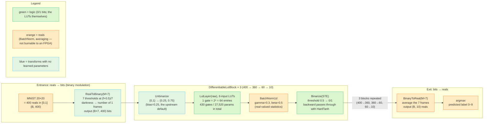
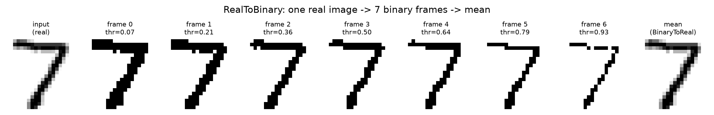
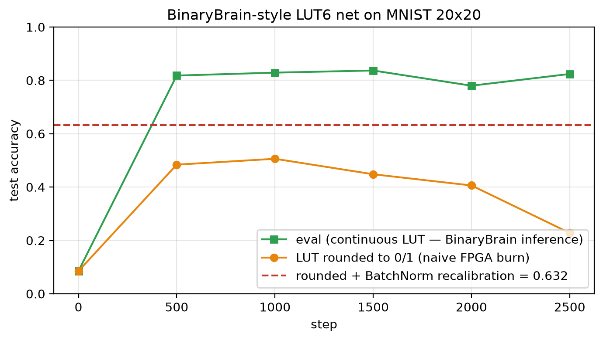
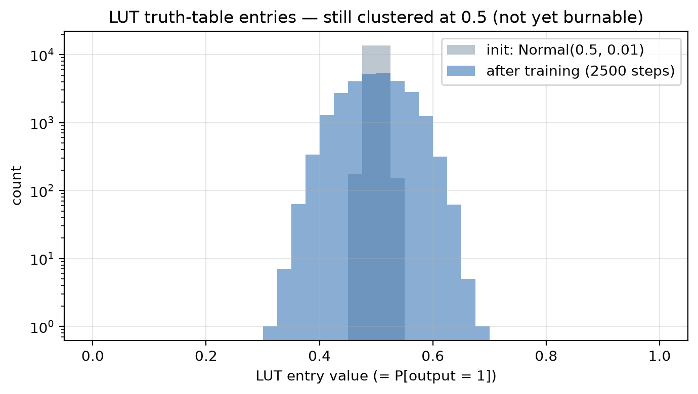

<!-- This file is generated automatically by scripts/build_tutorials.py.
     Do not edit it directly; edit examples/22_binarybrain.py and regenerate. -->

Train MNIST with the same component layout as the FPGA-oriented OSS project **BinaryBrain**
(`RealToBinary` → `DifferentiableLutBlock` → `BinaryToReal`). A real-valued image is stochastically
modulated into seven binary frames, 430 LUT6s are lined up, and a majority vote turns the result back
into reals — the lineage that trains FPGA LUTs directly.

**The subject of this page is quantifying "not yet burnable".** With continuous truth tables
(BinaryBrain's native inference path) eval acc is 0.803, but rounding the entries to 0/1
**collapses it to 0.211**. Recalibrating the BatchNorm statistics only brings it back to 0.632 — the
main cause is not a statistics mismatch but that the truth-table entries are still clustered around
0.5 (std 0.048) and **have not committed**. We measure this discretization gap, honestly exposed by
the shortened recipe, right down to the histogram.

:::tip[What you'll learn]
1. The BinaryBrain-style layout `RealToBinary` → `DifferentiableLutBlock` → `BinaryToReal`
2. The mechanism that stochastically modulates a real-valued image into binary frames and turns it back into reals by majority vote at the end
3. How to quantify **not yet burnable** — the collapse that happens when the truth tables are rounded to 0/1, and its main cause

**Prerequisites**

- [DWN — solving MNIST with thermometer encoding and n-input LUTs](/en/tutorials/dwn/) — an example where the gap goes to 0 instead
- [Choosing a Parameterization](/en/guides/parameterization/)
:::

:::note[About this page]
Estimated time: **about 10 minutes** / Environment: CPU only (no GPU needed)
Source script: [`examples/22_binarybrain.py`](https://github.com/tsukushi-gate/Griffith/blob/main/examples/22_binarybrain.py)
Try it yourself: [`notebooks/22_binarybrain.ipynb`](https://github.com/tsukushi-gate/Griffith/blob/main/notebooks/22_binarybrain.ipynb) (an unexecuted notebook with the same content as this page; open it with `uv run --group docs jupyter lab notebooks/`)
Every code output is the **actual result of running the code**, embedded verbatim.
:::

<!-- Colab badge: once the repository is public, replace this span with an <a> whose href is
     data-colab-url and "Open in Colab" becomes active. -->
<span class="colab-badge" data-colab-url="https://colab.research.google.com/github/tsukushi-gate/Griffith/blob/main/notebooks/22_binarybrain.ipynb">▶ Open in Colab (enabled once the repository is public)</span>

An example of training MNIST with the BinaryBrain-compatible API (Binarize / RealToBinary /
BinaryToReal / DifferentiableLutBlock).

BinaryBrain (https://github.com/ryuz/BinaryBrain) is a Japanese OSS project designed on the premise
of burning LUT networks directly onto FPGAs, and it implemented the idea of the "differentiable LUT"
early on. This library reimplements its core components in PyTorch so they can be used from
`griffith_logic` as plain nn.Modules.

**Why compatibility matters**

1. You can bring proven recipes over as they are. We match BinaryBrain's MNIST notebook down to the
   layer configuration, the initial values (BatchNorm gamma=0.3 / beta=0.5), and Unbinarize bias=0.25,
   so when accuracy is poor you can separate "is the implementation different or is the configuration different?".
2. You can connect to assets on the FPGA side. BinaryBrain's LUTs map one-to-one onto an FPGA's LUT6.
   Weights trained with the same configuration can be interpreted directly as FPGA truth tables.
3. It gives a comparison point for parameterization. This library's LutLayer has five parameterizations,
   and the BinaryBrain approach corresponds to `parameterization='raw'` (see below).

**Relationship to LutLayer**

    DifferentiableLutBlock = Unbinarize → LutLayer(parameterization='raw')
                             → BatchNorm1d → Binarize

So a BinaryBrain block is "a sandwich with a LutLayer in it", not something different. The difference
lies in how the truth table is parameterized:

  - The difflogic family (default `parameterization='softmax'`) learns softmax weights over
    16 logic gates and settles on one gate by argmax at inference time.
  - The BinaryBrain family (`parameterization='raw'`) holds the 2^N truth-table entries
    **directly** as reals in [0,1], clamping them back into range every step.
    Since no sigmoid is interposed, the gradient does not carry a sigmoid Jacobian.
    Burning to an FPGA is then just a matter of rounding each entry to 0/1.

**The whole circuit (binary modulation sandwiches the reals)**



**Where the concrete example shows up as a figure**: the first figure on this page,
"RealToBinary: one real image -> 7 binary frames -> mean", is R2B and B2R above in the flesh.
The darker a pixel, the more frames it is 1 in, and averaging the 7 frames nearly restores the
original shading — that is exactly the trick of "carrying a real into the world of bits as a count".

**How it is done**

- **Darkness becomes a number of 1s.** RealToBinary duplicates one real-valued image into 7 binary
  images. Because the thresholds are evenly spaced, a pixel of value 0.7 is 1 in roughly 5 of the 7
  frames. That is how probabilistic information turns into a bit string a circuit can handle
- **The layer sizes follow a design rule.** With 6-input LUTs, unless "next layer's node count × 6 ≥
  previous layer's node count" holds, some nodes end up read by nobody. 400 → 360 → 60 → 10 is the
  smallest configuration that satisfies it
- **BatchNorm corrects the bias of the bits.** Feeding a LUT output straight into the next stage
  skews it toward 0 or 1, so it is normalized as a real and re-cut by Binarize.
  **This BatchNorm is real arithmetic, so it has to be folded into the thresholds when burning**
  (the orange block)
- **Binarize is a step function forward and a pass-through backward** (STE). That is how gradients
  reach all the way back through a binarization that ought not to be differentiable
- **The truth table is held directly (raw).** Where the difflogic family learns "weights over the 16
  logic functions", the BinaryBrain approach holds the 2⁶ = 64 entries as reals in [0,1] and clamps
  them every step. Burning is then just rounding each entry

Run: uv run python examples/22_binarybrain.py
Expected result: eval accuracy around 0.80 (about 2 minutes on CPU)

Note that this example uses a short recipe, so the truth tables have not yet committed to 0/1.
We finish by quantitatively examining that "training works, but it is not yet enough to burn"
as a discretization gap (Figures 2 and 3).

## Setup: imports and the random seed

All we use are the three BinaryBrain-compatible parts — `RealToBinary` (real values to bits),
`DifferentiableLutBlock` (one LUT sandwich stage) and `BinaryToReal` (bits back to real values) —
plus MNIST shrunk to 20×20. The LUT wiring (which input lines each table looks at) is chosen at
random, so we fix the seed for reproducibility.

```python
import copy

import matplotlib.pyplot as plt
import torch
import torch.nn as nn
import torch.nn.functional as F
from torch.utils.data import DataLoader, Subset

from griffith_logic import BinaryToReal, DifferentiableLutBlock, RealToBinary
from griffith_logic.datasets import load_mnist20x20
```

```python
# The LUT connections (which input lines each one sees) are chosen randomly, so fix the seed for reproducibility.
torch.manual_seed(0)
```

### Hyperparameters

Let us pin down the symbols first. **`N_INPUTS` (the number of LUT inputs)** is how many wires a
single truth table looks at; 6 is the headline value because it maps one-to-one onto an FPGA LUT6,
giving 2⁶ = 64 entries. **`FRAME_M` (the number of binary-modulation frames, written M in the text)**
is how many binary images one real-valued image is split into: larger means finer shading, at M times
the computation.

```python
# BinaryBrain's MnistDifferentiableLutSimple.ipynb settings, shrunk to fit 2 minutes on CPU.
N_INPUTS = 6      # number of LUT inputs. The headline value, corresponding to an FPGA LUT6
FRAME_M = 7       # number of binary-modulation frames (upstream uses 15; fewer is faster but coarser quantization)
STEPS = 2500      # number of training iterations
BATCH = 64        # minibatch size (the effective batch is BATCH * FRAME_M = 448 rows)
LR = 0.001        # Adam(lr=0.001), same as upstream
N_TRAIN = 20000   # number of images used for training
N_TEST = 2000     # number of images used for the final evaluation
N_CURVE = 1000    # for the curves during training (evaluating 2000 images two ways every time is costly, so we thin it out)
```

## Data: receiving 20×20 MNIST as real values

This is where the page differs from the other examples. Most logic-gate NN examples binarize the
image at the door, but the BinaryBrain style receives **the real-valued shading itself** and lets
`RealToBinary` inside the model turn "darkness" into "the number of frames that are 1".
That is why we read the data with `binarize_threshold=None`.

```python
# 20x20 = 400-bit MNIST. Values are received as continuous [0,1]
# (being continuous is what gives RealToBinary's binary modulation meaning).
train_set, test_set = load_mnist20x20(binarize_threshold=None)
```

```python
def materialize(dataset, n):
    """Collect the first n samples into a (N, 400) tensor plus labels."""
    subset = Subset(dataset, range(n))
    x, y = next(iter(DataLoader(subset, batch_size=n)))
    return x.reshape(n, -1), y
```

```python
train_x, train_y = materialize(train_set, N_TRAIN)
test_x, test_y = materialize(test_set, N_TEST)
print(f'train={tuple(train_x.shape)} test={tuple(test_x.shape)} '
      f'(20x20=400ビット入力 / 10クラス)')
```

```text title="Output"
train=(20000, 400) test=(2000, 400) (20x20=400ビット入力 / 10クラス)
```

## Model: stacking three DifferentiableLutBlocks

One stage is the sandwich `Unbinarize` → `LutLayer(raw)` → `BatchNorm1d` → `Binarize`.
**Why BatchNorm is in there**: feeding a LUT's output straight into the next stage makes it lean
hard towards 0 or 1, and the next LUT ends up returning the same answer whatever its inputs are.
Normalizing back in the real domain and then re-cutting with `Binarize` evens out that bias at every
stage. (This BatchNorm is real-valued arithmetic, so burning it to an FPGA means folding it in as a
threshold.)

**`Binarize` is a step function forwards and a pass-through backwards** (**STE** = straight-through
estimator, the approximation that passes gradients through a non-differentiable function unchanged).
That is why gradients reach all the way back even with binarization in the middle.

```python
# BinaryBrain's network design rule:
#   "With N-input LUTs, unless the next layer's node count x N is at least the previous layer's node
#    count, some nodes in the previous layer end up unconnected and read by no one."
# 400 → 360(=6*6*10) → 60(=6*10) → 10 is the minimal configuration satisfying this rule
# (360*6=2160 >= 400, 60*6=360, 10*6=60). It corresponds to the last 3 of upstream's 6 layers.
LAYER_SIZES = [6 * 6 * 10, 6 * 10, 10]
```

```python
class BinaryBrainNet(nn.Module):
    """A classifier with the same skeleton as BinaryBrain's MnistDifferentiableLutSimple.

    Flatten → RealToBinary → DifferentiableLutBlock×3 → BinaryToReal

    Because the final layer's node count is exactly the number of classes (10), the GroupSum used in
    the difflogic family is unnecessary. Instead BinaryToReal takes on the role of
    "averaging the 10 classes' bits along the frame axis into a score in 0-1".
    """

    def __init__(self):
        super().__init__()
        # Real [0,1] → M binary frames. The thresholds are placed uniformly at (f+0.5)/M.
        # The darker a pixel, the more frames in which it is 1 = darkness turns into a "count" of bits.
        # It is parameter-free preprocessing, so no gradient flows through it.
        self.real_to_binary = RealToBinary(FRAME_M)

        self.blocks = nn.ModuleList()
        prev = 400
        for out_dim in LAYER_SIZES:
            # What is inside DifferentiableLutBlock (as above):
            #   Unbinarize({0,1}→{0.25,0.75}) → LutLayer(raw) → BatchNorm → Binarize
            # Binarize's backward is a HardTanh STE. The forward pass is a step function, but the
            # backward pass passes gradients through within [0,1], so learning still works.
            self.blocks.append(DifferentiableLutBlock(
                in_dim=prev, out_dim=out_dim, n_inputs=N_INPUTS,
                unbinarize_bias=0.25,   # the default in upstream's DifferentiableLutN.h
            ))
            prev = out_dim

        # Average the M frames back into a real score. This is an ordinary mean, so
        # PyTorch's autograd passes the gradient (1/M) through as is.
        self.binary_to_real = BinaryToReal(FRAME_M)

    def forward(self, x):
        x = self.real_to_binary(x)      # (B, 400) → (B*M, 400)
        for block in self.blocks:
            x = block(x)                # each block's output is {0,1} bits
        return self.binary_to_real(x)   # (B*M, 10) → (B, 10)

    def clamp_weights(self):
        """Push every block's truth table back into [0,1] (equivalent to upstream's m_flagClamp).

        The raw parameterization holds weights directly as probabilities, so unless you call this
        after every optimizer.step() they drift out of range.
        """
        for block in self.blocks:
            block.clamp_weights()
```

```python
model = BinaryBrainNet()
print(model)
n_luts = sum(LAYER_SIZES)
print(f'LUT{N_INPUTS} を {n_luts} 個 / 真理値表エントリ総数 '
      f'{n_luts * 2 ** N_INPUTS:,}(= LUT数 x 2^{N_INPUTS})')
```

```text title="Output"
BinaryBrainNet(
  (real_to_binary): RealToBinary(frame_modulation_size=7)
  (blocks): ModuleList(
    (0): DifferentiableLutBlock(
      unbinarize_bias=0.25
      (lut): LutLayer(in=400, out=360, n_inputs=6, entries=64, param=raw)
      (bn): BatchNorm1d(360, eps=1e-05, momentum=1.0, affine=True, track_running_stats=True)
      (binarize): Binarize(threshold=0.5, hardtanh=[0.0, 1.0])
    )
    (1): DifferentiableLutBlock(
      unbinarize_bias=0.25
      (lut): LutLayer(in=360, out=60, n_inputs=6, entries=64, param=raw)
      (bn): BatchNorm1d(60, eps=1e-05, momentum=1.0, affine=True, track_running_stats=True)
      (binarize): Binarize(threshold=0.5, hardtanh=[0.0, 1.0])
    )
    (2): DifferentiableLutBlock(
      unbinarize_bias=0.25
      (lut): LutLayer(in=60, out=10, n_inputs=6, entries=64, param=raw)
      (bn): BatchNorm1d(10, eps=1e-05, momentum=1.0, affine=True, track_running_stats=True)
      (binarize): Binarize(threshold=0.5, hardtanh=[0.0, 1.0])
    )
  )
  (binary_to_real): BinaryToReal(frame_modulation_size=7)
)
LUT6 を 430 個 / 真理値表エントリ総数 27,520(= LUT数 x 2^6)
```

```python
# Keep a copy of the truth tables before training (to compare histograms later).
init_weights = torch.cat([b.lut.weights.detach().flatten() for b in model.blocks])
```

## Training: ordinary PyTorch plus one line of clamping

The body is completely ordinary PyTorch, and the only BinaryBrain-specific part is the single line
"call `clamp_weights()` after `optimizer.step()`".
**Why the clamp is needed**: the `raw` parameterization holds each truth-table entry directly as
"the probability that this entry outputs 1", so it becomes meaningless once a gradient pushes it
outside [0,1]. Rather than squashing it with a sigmoid, upstream simply clips it back every step —
and because no sigmoid Jacobian (a multiplication by the slope) rides on the gradient, learning stays
more direct.

During training we measure two accuracies every time: **eval** (leaving the truth tables continuous
= BinaryBrain's native inference path) and **rounded** (a copy with the entries rounded to 0/1
= a naive burn to an FPGA). The gap between these two is the **discretization gap**, which is the
subject of this whole page.

```python
opt = torch.optim.Adam(model.parameters(), lr=LR)
history = []  # (step, eval acc, acc after rounding the truth tables)
```

```python
@torch.no_grad()
def accuracy(net, x, y):
    """Measure accuracy in inference mode.

    Note: running BatchNorm in train mode would update the running statistics, so evaluation must
    always use eval() (to avoid polluting the statistics with test data).
    The raw parameterization uses the truth tables **as continuous values** at inference too. This is
    the same behaviour as upstream, in contrast to the difflogic family, which settles on one gate by argmax at eval.
    """
    was_training = net.training
    net.eval()
    acc = (net(x).argmax(-1) == y).float().mean().item()
    net.train(mode=was_training)
    return acc
```

```python
@torch.no_grad()
def rounded_copy(net):
    """Return a copy with the truth tables rounded to 0/1 (a naive simulation of the circuit burned onto an FPGA)."""
    burned = copy.deepcopy(net)
    for block in burned.blocks:
        block.lut.weights.round_()
    return burned
```

```python
for step in range(STEPS + 1):
    if step % 500 == 0:
        eval_acc = accuracy(model, test_x[:N_CURVE], test_y[:N_CURVE])
        # Measure "what would happen if we burned it right now" alongside every time. The gap between these two lines is the discretization gap.
        hard_acc = accuracy(rounded_copy(model), test_x[:N_CURVE], test_y[:N_CURVE])
        history.append((step, eval_acc, hard_acc))
        print(f'step {step:>5}  eval acc={eval_acc:.4f}  '
              f'rounded-LUT acc={hard_acc:.4f}')

    idx = torch.randint(0, N_TRAIN, (BATCH,))
    opt.zero_grad()
    loss = F.cross_entropy(model(train_x[idx]), train_y[idx])
    loss.backward()
    opt.step()
    # This is the BinaryBrain way. Confine the truth-table entries to [0,1] every step.
    model.clamp_weights()

steps, eval_hist, hard_hist = zip(*history, strict=True)
```

```text title="Output"
step     0  eval acc=0.0850  rounded-LUT acc=0.0850

step   500  eval acc=0.8180  rounded-LUT acc=0.4840

step  1000  eval acc=0.8290  rounded-LUT acc=0.5060

step  1500  eval acc=0.8370  rounded-LUT acc=0.4480

step  2000  eval acc=0.7800  rounded-LUT acc=0.4060

step  2500  eval acc=0.8240  rounded-LUT acc=0.2280
```

```python
# Only the final values are re-measured on the whole test set (N_TEST images).
final_eval = accuracy(model, test_x, test_y)
final_hard = accuracy(rounded_copy(model), test_x, test_y)
```

## The discretization gap: why rounding breaks it

Rounding drops accuracy sharply. There are two candidate causes. **(a)** The truth tables have not
yet committed to 0/1, and rounding destroys information. **(b)** The distribution of LUT outputs
changes drastically, so the running statistics held by BatchNorm no longer fit.
If (b), re-measuring the statistics should restore it, so we push training data through, recalibrate,
and **decide experimentally which cause dominates**. Doing that identification is the point of this section.

```python
# Rounding drops accuracy sharply. Two causes are conceivable:
#   (a) The truth tables have not yet committed to 0/1, and rounding destroys information
#   (b) The distribution of LUT outputs changes drastically, so BatchNorm's running statistics no longer fit
# If (b), re-measuring the statistics should restore it, so let's push training data through and recalibrate.
recal = rounded_copy(model)
recal.train()
with torch.no_grad():
    for _ in range(20):
        idx = torch.randint(0, N_TRAIN, (512,))
        recal(train_x[idx])   # just doing a forward pass updates the BatchNorm statistics
recal_acc = accuracy(recal, test_x, test_y)

print(f'\n最終 eval accuracy={final_eval:.4f}(連続の真理値表 / BinaryBrainの推論経路)')
print(f'真理値表を0/1へ丸めた後      ={final_hard:.4f}')
print(f'  + BatchNorm統計を再較正    ={recal_acc:.4f}')
assert final_eval > 0.65, f'eval acc={final_eval:.4f} が低すぎる'
```

    
```text title="Output"
最終 eval accuracy=0.8030(連続の真理値表 / BinaryBrainの推論経路)
真理値表を0/1へ丸めた後      =0.2110
  + BatchNorm統計を再較正    =0.6320
```

## Visualization: modulation, learning curve, truth-table distribution

### Figure 1: what binary modulation (RealToBinary) is doing

**What to look for**: the original real-valued image on the far left, then seven binary frames made
by shifting the threshold `(f+0.5)/M`, and on the far right their average turned back into a real
image. The figure lets you follow, frame by frame, the correspondence that **the darker a pixel is,
the more frames it is 1 in**.

**Binary modulation** means encoding magnitude as "the number of frames that are 1" (the same idea as
pulse density modulation). The thresholds are evenly spaced, so a pixel with value 0.7 is 1 in about
five of the seven frames. That is how continuous information turns into a bit string a circuit can handle.

```python
sample = test_x[:1]                       # (1, 400)
frames = RealToBinary(FRAME_M)(sample)    # (M, 400)
recon = BinaryToReal(FRAME_M)(frames)     # (1, 400) restored by averaging

fig, axes = plt.subplots(1, FRAME_M + 2, figsize=(1.35 * (FRAME_M + 2), 2.1))
axes[0].imshow(sample.reshape(20, 20), cmap='gray_r', vmin=0, vmax=1)
axes[0].set_title('input\n(real)', fontsize=8)
for f in range(FRAME_M):
    axes[f + 1].imshow(frames[f].reshape(20, 20), cmap='gray_r', vmin=0, vmax=1)
    axes[f + 1].set_title(f'frame {f}\nthr={(f + 0.5) / FRAME_M:.2f}', fontsize=8)
axes[-1].imshow(recon.reshape(20, 20), cmap='gray_r', vmin=0, vmax=1)
axes[-1].set_title('mean\n(BinaryToReal)', fontsize=8)
for ax in axes:
    ax.set_axis_off()
fig.suptitle(f'RealToBinary: one real image -> {FRAME_M} binary frames -> mean',
             fontsize=11)
fig.tight_layout()
plt.show()
```

    

    

**What it says**: the far right (the average of seven frames) looks almost the same as the far left
(the original), which is the whole point — **shading survives a round trip through nothing but a
count of bits**. Conversely, the smaller M is, the coarser that reconstruction becomes (with M = 7
only eight levels of darkness can be distinguished).

### Figure 2: the learning curve and the discretization gap

**What to look for**: green is BinaryBrain's native inference path (continuous truth tables), orange
is the accuracy of "what if we rounded and burned it right now", and the red dashed line is the
rounded model after recalibrating BatchNorm. The two things to watch are **how wide the gap between
green and orange is** and **how much of that gap the red dashed line fills**.

```python
fig, ax = plt.subplots(figsize=(7, 4))
ax.plot(steps, eval_hist, 's-', color='#2e9e4f',
        label='eval (continuous LUT — BinaryBrain inference)')
ax.plot(steps, hard_hist, 'o-', color='#e8850c',
        label='LUT rounded to 0/1 (naive FPGA burn)')
ax.axhline(recal_acc, ls='--', color='#c0392b',
           label=f'rounded + BatchNorm recalibration = {recal_acc:.3f}')
ax.set_xlabel('step')
ax.set_ylabel('test accuracy')
ax.set_ylim(0, 1)
ax.grid(alpha=0.3)
ax.legend(loc='lower right')
ax.set_title(f'BinaryBrain-style LUT{N_INPUTS} net on MNIST 20x20')
fig.tight_layout()
plt.show()
```

    

    

**What it says**: with this reduced recipe the gap between green and orange stays wide open, and the
red dashed line (BatchNorm recalibration) fills only part of it. So the dominant cause of the
discretization gap is **not the statistics mismatch (b) but the truth tables not yet having committed
to 0/1 (a)**. The next figure shows that directly.

### Figure 3: the distribution of truth-table entries

**What to look for** (this is the last figure, so here is how to read it in advance): the horizontal
axis is the value of a LUT entry (= the probability that the entry outputs 1) and the vertical axis
is the count (log scale); grey is before training and blue after. **A burnable circuit is one whose
distribution has pinned to both ends, 0 and 1, so that `round()` loses no information.** Here,
however, the distribution has only spread a little from its initial Normal(0.5, 0.01) and is still
clustered around 0.5 — which is exactly why rounding breaks it (orange in Figure 2). It is also why
BinaryBrain's inference works with continuous weights, and the correct reading of this page is
"**training works, but this is not yet in a burnable state**".
Pushing it to the ends requires training as long as upstream's (or regularization that encourages binarization).

```python
final_weights = torch.cat([b.lut.weights.detach().flatten() for b in model.blocks])
fig, ax = plt.subplots(figsize=(7, 4))
bins = torch.linspace(0, 1, 41)
ax.hist(init_weights.numpy(), bins=bins.numpy(), alpha=0.55,
        color='#8899aa', label='init: Normal(0.5, 0.01)')
ax.hist(final_weights.numpy(), bins=bins.numpy(), alpha=0.55,
        color='#2b6cb0', label=f'after training ({STEPS} steps)')
ax.set_xlabel('LUT entry value (= P[output = 1])')
ax.set_ylabel('count')
ax.set_yscale('log')
ax.grid(alpha=0.3)
ax.legend()
ax.set_title('LUT truth-table entries — still clustered at 0.5 (not yet burnable)')
fig.tight_layout()
plt.show()

edge = ((final_weights < 0.05) | (final_weights > 0.95)).float().mean().item()
print(f'エントリ分布: std={final_weights.std():.3f} '
      f'range=[{final_weights.min():.3f}, {final_weights.max():.3f}]')
print(f'0.05未満 or 0.95超のエントリ割合={edge:.3f}(1.0に近いほど焼ける状態)')
```

    

    

```text title="Output"
エントリ分布: std=0.048 range=[0.321, 0.676]
0.05未満 or 0.95超のエントリ割合=0.000(1.0に近いほど焼ける状態)
```

## What to read next

- [DWN](/en/tutorials/dwn/) — conversely, a parameterization whose discretization gap is zero
- [Choosing a parameterization](/en/guides/parameterization/) — how independent / raw relate to BinaryBrain
- [Burning to an FPGA](/en/guides/fpga/) — what to verify before burning

<!-- i18n:source=tutorials/binarybrain.md hash=8d167ad7a588 -->
