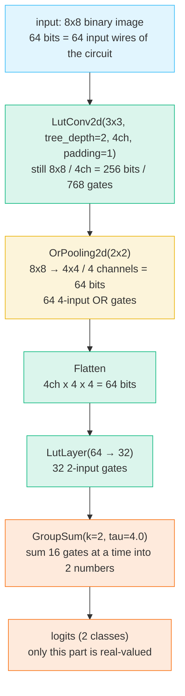
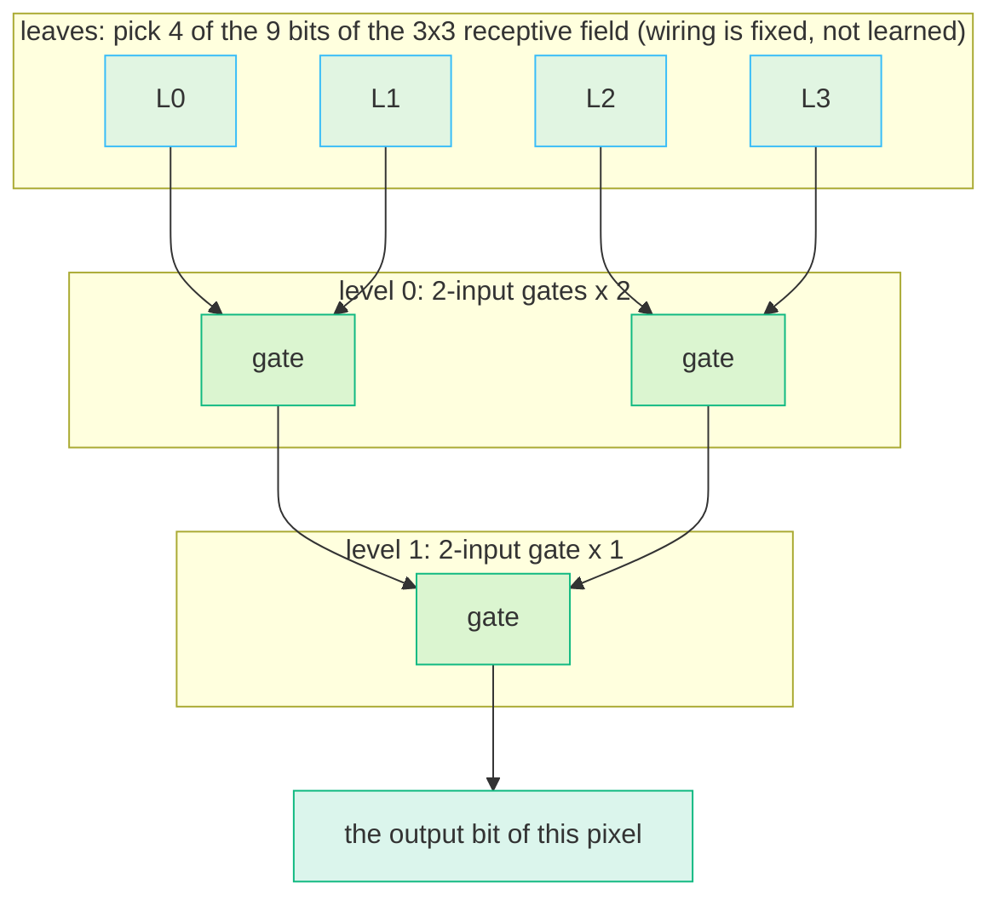
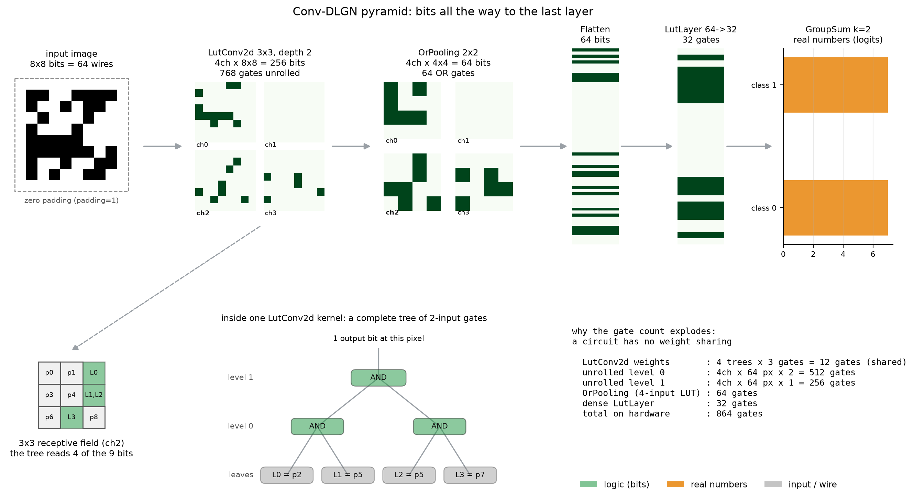
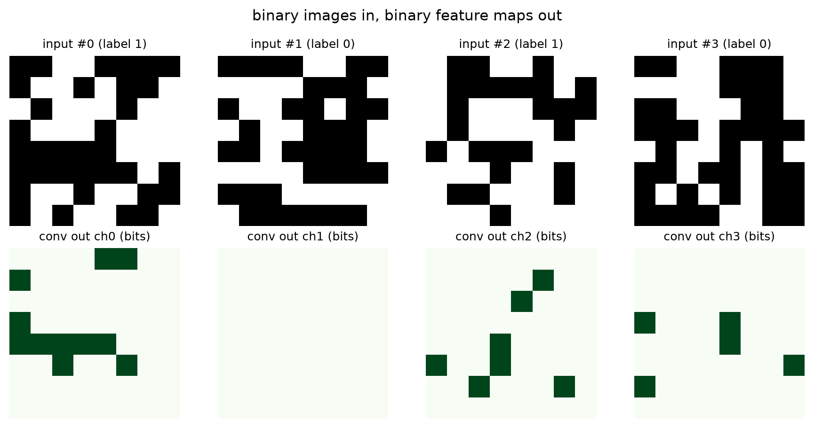
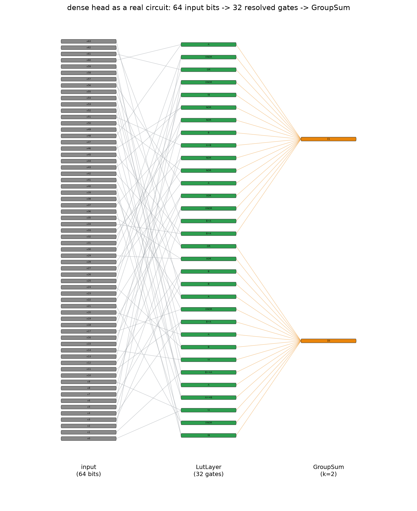
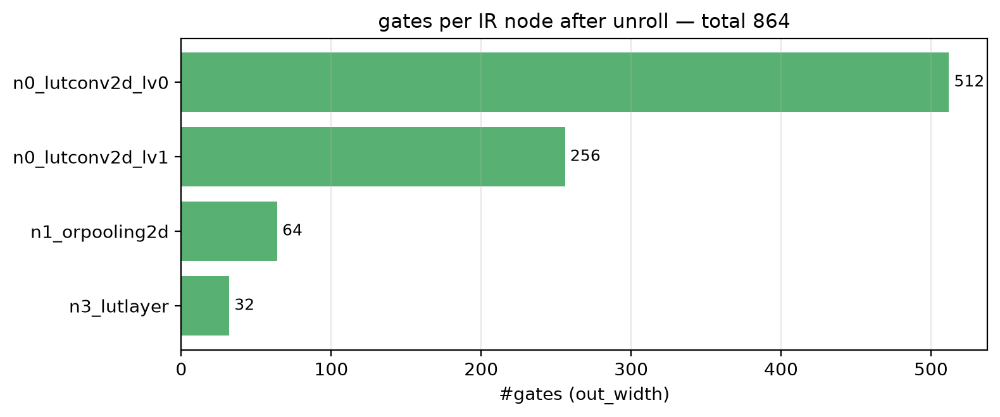
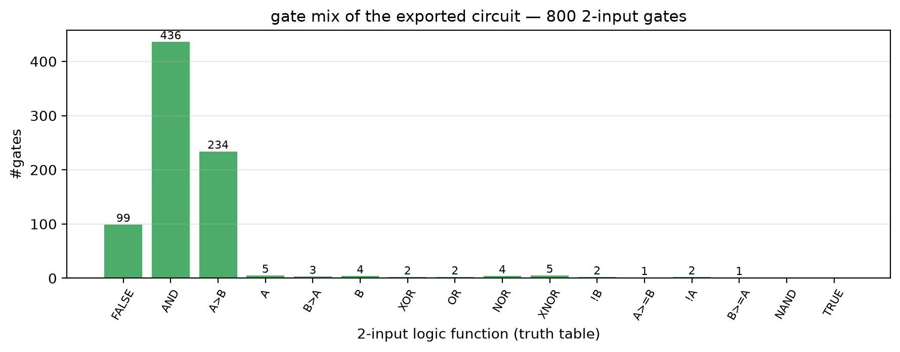
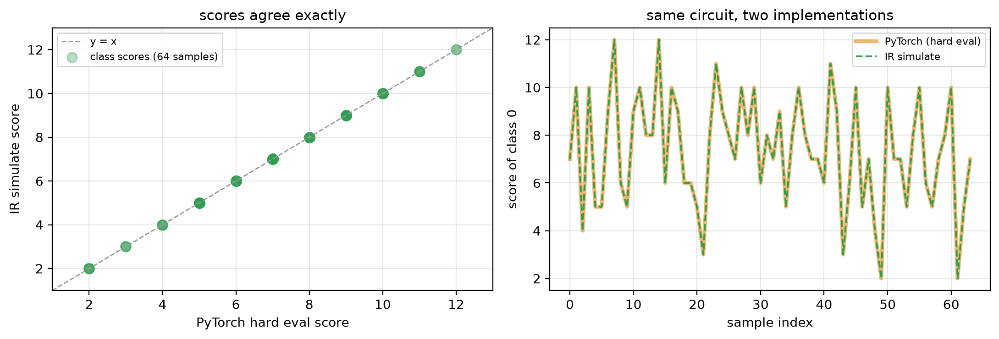

<!-- This file is generated by scripts/build_tutorials.py.
     Do not edit it directly; edit examples/05_cnn_export_hdl.py and regenerate. -->

Train a CNN made of logic gate convolutions (`LutConv2d`) + OR pooling + a LUT fully connected
layer, and convert the whole thing into Verilog / VHDL. When it becomes IR, the convolution is
unrolled into per-tree-level `lut_layer`s, and padding's boundary handling is folded into
specialized truth tables.

:::tip[What you'll learn]
1. How to assemble a logic gate CNN out of `LutConv2d` + OR pooling + a LUT fully connected layer
2. How a convolution gets unrolled into per-tree-level `lut_layer`s when it becomes IR
3. That padding's boundary handling is folded into specialized truth tables

**Prerequisites**

- [3. Export to HDL](/en/tutorials/hdl-export/) — go through the whole pipeline on a fully connected circuit first
- [1. Train on MNIST](/en/tutorials/mnist/)
:::

:::note[About this page]
Estimated time: **about 10 minutes** / Environment: CPU only (no GPU required)
Source script: [`examples/05_cnn_export_hdl.py`](https://github.com/tsukushi-gate/Griffith/blob/main/examples/05_cnn_export_hdl.py)
Try it locally: [`notebooks/05_cnn_export_hdl.ipynb`](https://github.com/tsukushi-gate/Griffith/blob/main/notebooks/05_cnn_export_hdl.ipynb) (an unexecuted notebook with the same content as this page; open it with `uv run --group docs jupyter lab notebooks/`)
Every code output below is **the result of an actual run**, embedded verbatim.
:::

<!-- Colab badge: once the repository is public, replace this span with an <a> whose href
     is data-colab-url to enable "Open in Colab". -->
<span class="colab-badge" data-colab-url="https://colab.research.google.com/github/tsukushi-gate/Griffith/blob/main/notebooks/05_cnn_export_hdl.ipynb">▶ Open in Colab (enabled once the repository is public)</span>

An example of HDL export for a CNN (logic gate convolution).

Train a CNN classifier of LutConv2d (tree structured) + OR pooling + LUT fully connected +
GroupSum on a small task and convert the whole thing into Verilog/VHDL. Padding's boundary
handling is folded in automatically by truth table specialization.

Where 04_export_hdl.py did the fully connected version, this one shows that **the same procedure
goes through unchanged for a model that includes convolutions**. A convolution is a structure that
"reuses the same weights at every position", but a circuit has no notion of weight sharing, so it
gets unrolled to every position when it becomes IR. Counting how much the gate count balloons is
also a purpose of this script.

**The shape of this model (with measured numbers)**



Green is "the world of logic, where only bits (0 or 1) flow", orange is "real numbers".
**Real numbers appear only in the final GroupSum**; everything before it is a mesh of gates.

**Inside LutConv2d (the tree for one pixel)**



The number of leaves is `n_inputs ** tree_depth = 2 ** 2 = 4`, and the number of internal gates is 3.
This tree is held for each of the 4 channels and applied to all 64 pixels of the image, so it comes
to `4ch x 64 px x 3 gates = 768 gates`.

**How it works (jargon explained as it comes up)**

- **The images are 0/1 from the start** — what enters a logic gate is only a High/Low voltage, so
  what the circuit can read is "bits" and nothing else. Real images too are binarized by
  thresholding or thermometer encoding (opening brightness into a few scale bits) before they go in
- **Convolution = sliding a small window over the image and applying the same circuit**.
  Here a 3x3 window (the receptive field) is slid one pixel at a time, and the same tree is
  evaluated at every position
- **A tree = a small circuit of stacked gate stages**. The first stage takes 4 bits to 2 bits,
  the second takes 2 bits to 1 bit. `tree_depth` is that number of stages, the knob for expressiveness
- **The leaf wiring is fixed at random** — which 4 of the 9 bits are looked at is decided the moment
  the layer is created and never moves during training. What training changes is only "which of the
  16 two-input logic functions each gate becomes"
- **Pooling = shrinking 4 nearby bits into 1 bit**. Max pooling of a real-valued NN is, in the world
  of bits, exactly OR (1 if any one of them is 1), and one OR gate is enough
- **padding = filling the outside of the image with 0**. At the border the window sticks out of the
  image, but what it sticks out into is the constant 0, so when it becomes a circuit that is folded
  straight into the truth tables and disappears
- **unroll = replicating the circuit once per position, because a circuit has no weight reuse**.
  In PyTorch it is weights for 12 gates, but in hardware 768 gates line up
- **GroupSum = the exit that adds up the gate output bits per class into a score**.
  This is where real numbers first appear, and argmax decides the class

The figures walk through, in order: an overview of the whole model as an architecture diagram with
real data flowing through it, then the bit feature maps the circuit sees, the fully connected head
as an actual circuit, which IR node the gate count balloons at after unrolling, the "bill of
materials" of the baked circuit (the breakdown of the 16 two-input logic functions), and finally the
fact that PyTorch's hard eval and the IR simulate agree right down to the scores.

Run: uv run python examples/05_cnn_export_hdl.py
Expected result: the IR simulate predictions match PyTorch and (if iverilog is present) the check is ALLPASS

## Setup: the APIs the convolutional export needs

On top of the fully connected version in [3. Export to HDL](/en/tutorials/hdl-export/), parts for
convolution join in.

- `LutConv2d` … **the logic gate version of convolution**. A layer that picks a few bits out of a
  3x3 window and emits one bit through a tree of 2-input gates
- `OrPooling2d` … max pooling in the world of bits. It just takes the OR of 4 nearby bits
- `write_verilog` / `write_vhdl` … write out two kinds of HDL from the same IR
- `truth_tables_from_conv` / `gate_id_from_tt_n2` … take the trained gates out as truth tables and
  map them onto one of the 16 two-input logic functions (used to print gate names inside the figures)

```python
import matplotlib.pyplot as plt
import numpy as np
import torch
import torch.nn as nn
import torch.nn.functional as F
from matplotlib.patches import ConnectionPatch, FancyBboxPatch, Patch, Rectangle

from griffith_logic import GroupSum, LutConv2d, LutLayer
from griffith_logic.analysis.circuit_viz import GATE_NAMES, plot_circuit
from griffith_logic.export import export_ir
from griffith_logic.export.discretize import truth_tables_from_conv
from griffith_logic.export.verify import iverilog_available, run_iverilog_equivalence
from griffith_logic.export.verilog import write_verilog
from griffith_logic.export.vhdl import write_vhdl
from griffith_logic.ir import save_ir, simulate, validate
from griffith_logic.ir.weights import gate_id_from_tt_n2
from griffith_logic.pooling import OrPooling2d
```

```python
torch.manual_seed(0)
```

## Dataset: guess which side is brighter

Make 8x8 binary images and label them by "number of ones in the left 4 columns > number of ones in
the right 4 columns".

**Why this task** ── it is a problem of gathering counts while sliding a local window over the whole
image, so the structure of convolution + pooling applies directly. And because it is as small as
8x8, everything downstream — the IR conversion, the Verilog generation, the check — goes through in
a few seconds.

The point is that the input is 0/1 from the start. What can be fed into a logic gate is only a
High/Low voltage, so real images too are binarized by thresholding or thermometer encoding (opening
brightness into a few scale bits) before they go in.

```python
# A synthetic task on 8x8 binary images: is the left half or the right half brighter?
# The point is that the input is 0/1 from the start. The input of a logic gate network is
# "bits", so real images too must be binarized by thresholding or thermometer encoding
# before they go in.
def make_data(n=512, seed=1):
    g = torch.Generator().manual_seed(seed)
    x = torch.randint(0, 2, (n, 1, 8, 8), generator=g).float()
    # Label: 1 if the number of ones in the left 4 columns > that in the right 4 columns.
    # It is a "count over a wide area" task, so local convolution + pooling helps.
    y = (x[:, 0, :, :4].sum((1, 2)) > x[:, 0, :, 4:].sum((1, 2))).long()
    return x, y
```

## Model definition: a logic gate CNN

It is just four layers stacked, but everything about what each part of a real-valued CNN turns into
in the world of bits shows up right here.

- `LutConv2d(1, 4, kernel_size=3, tree_depth=2, padding=1)` …
  picks 4 bits out of the 9 bits of a 3x3 window (the **receptive field**) and emits 1 bit through a
  **tree** of two stacked stages of 2-input gates. `tree_depth` is the depth of the tree = the knob
  for expressiveness. Which 4 bits are looked at is decided at random the moment the layer is
  created, and **never moves during training**
- `OrPooling2d(kernel_size=2)` … corresponds to max pooling of a real-valued CNN.
  In the world of bits, "1 if any one of them is 1" is exactly **OR**, so one OR gate is enough
  (average pooling needs adders, so it is not used)
- `LutLayer(64, 32)` … a fully connected LUT layer that takes the flattened 64 bits
- `GroupSum(k=2, tau=4.0)` … the exit that aggregates 32 gates into 2 classes. **This is the only
  place real numbers appear**

```python
model = nn.Sequential(
    # The logic gate version of convolution. It builds a tree of 2-input gates from the 9 pixels
    # in the kernel and emits one bit.
    # tree_depth=2 is the depth of the tree (= how many gate stages are stacked per output),
    # the knob for expressiveness.
    # padding=1 keeps the output at 8x8. The constant 0 at the border is folded into the truth
    # tables when it becomes IR.
    LutConv2d(1, 4, kernel_size=3, tree_depth=2, padding=1),
    # Max pooling in the world of logic circuits. It just ORs the 4 bits of a 2x2 window,
    # so in hardware one OR gate is enough (average pooling needs adders, so it is not used).
    OrPooling2d(kernel_size=2),
    nn.Flatten(),
    # A fully connected LUT layer of 32 gates taking 4ch x 4 x 4 = 64 bits as input.
    LutLayer(4 * 4 * 4, 32, n_inputs=2),
    # Aggregate 32 gates into 2 classes. tau is set to 4.0 to match the summed scale of
    # 16 gates per class.
    GroupSum(k=2, tau=4.0),
)
```

```python
# Since the model is made only of logic gate layers, the learning rate is 0.02 — an order of
# magnitude larger than for a real-valued NN (gate selection logits pass through a softmax,
# so their gradients are small).
opt = torch.optim.Adam(model.parameters(), lr=0.02)
x, y = make_data()
print(f'データ: {tuple(x.shape)} 二値画像 / ラベル1の割合 {y.float().mean():.2f}')
```

```text title="Output"
データ: (512, 1, 8, 8) 二値画像 / ラベル1の割合 0.43
```

## Training and hard evaluation

Training is just an ordinary PyTorch loop run for 300 steps. In `train()` mode each gate behaves
continuously as a "weighted sum of the 16 logic functions", which is why gradients flow.

It is fixed as a circuit only from `eval()` onward, and the accuracy measured there is the **hard
accuracy** (= the accuracy as a baked circuit). If it drops there, the judgement is that the
soft-to-hard gap is large.

```python
# During training we stay in train() mode, where each gate behaves continuously as a
# "weighted sum of the 16 logic functions" (which is why gradients flow). It is fixed as a
# circuit only from eval() onward.
for step in range(300):
    opt.zero_grad()
    F.cross_entropy(model(x), y).backward()
    opt.step()
```

```python
# eval() discretizes every gate (each gate settles on one logic function, the argmax of its logits).
# From here on, acc is "the accuracy as a circuit" (hard accuracy), not the accuracy of the soft
# outputs during training. If it drops here, the soft-to-hard gap is large.
model.eval()
with torch.no_grad():
    acc = (model(x).argmax(-1) == y).float().mean()
print(f'CNN hard acc = {acc:.3f}')
```

```text title="Output"
CNN hard acc = 0.760
```

## Visualization: an architecture diagram with real data flowing

**What to read**: hard accuracy is around 0.76. With a tiny recipe of fewer than 1000 gates in total
and 300 training steps, a wide-area aggregation task — "which side is brighter" — is solved well
above chance (0.5).

From here on is the heart of this page: first we make a single **architecture diagram with real data
pushed through it**. The next few cells are the preparation for that figure (the palette, helper
functions, and pulling out the intermediate bits).

```python
# The project-wide palette. green = logic (bits) / orange = real numbers / grey = inputs and wires.
C_LOGIC, C_REAL, C_GREY = '#2e9e4f', '#e8850c', '#8a8a8a'
conv = model[0]
```

```python
# Count the gates per stage after unrolling (this becomes the breakdown at the bottom right of the figure).
# The tree is "level 0 = 2 gates" and "level 1 = 1 gate", lined up for 4 channels x 64 pixels.
n_lv0, n_lv1, n_pool, n_dense = 4 * 64 * 2, 4 * 64, 64, 32
```

```python
# A helper that tiles the 4-channel bit feature maps into a single image (gaps punched out with NaN).
def montage(maps):
    ch_n, h, w = maps.shape
    out = np.full((2 * h + 1, 2 * w + 1), np.nan)
    for i in range(ch_n):
        r, q = divmod(i, 2)
        out[r * (h + 1):r * (h + 1) + h, q * (w + 1):q * (w + 1) + w] = maps[i]
    return out
```

```python
# A helper that draws one node of the tree / receptive field as a rounded box.
def node(ax, xc, yc, w, h, text, color, alpha=0.55):
    ax.add_patch(FancyBboxPatch(
        (xc - w / 2, yc - h / 2), w, h,
        boxstyle='round,pad=0,rounding_size=0.08',
        facecolor=color, alpha=alpha, edgecolor='#333333', lw=0.9, zorder=2))
    ax.text(xc, yc, text, ha='center', va='center', fontsize=8,
            color='#111111', zorder=3)
```

```python
# Actually push one sample through layer by layer and put the bits of each stage straight into the figure.
with torch.no_grad():
    img = x[0, 0].numpy()
    conv_out = model[0](x[:1])[0]
    pooled = model[1](conv_out[None])[0]
    flat = pooled.reshape(-1)
    dense = model[3](flat[None])[0]
    logits = (model[4](dense[None])[0] * 4.0).numpy()
```

### Figure 1: bits flowing all the way to the last layer

The top row is the actual bits of one image going through the layers (input 8x8 → conv 4ch →
pooling → flatten → fully connected → finally the real-valued GroupSum scores). Bottom left is which
positions of the **receptive field** the tree's leaves `L0`–`L3` look at, bottom center is **the
inside of the tree for one pixel** (with the gate names actually settled by training), and bottom
right is **the breakdown of the gate count after unrolling**.

**unroll** means replicating the convolution for every output position, because a circuit has no
weight reuse. On the PyTorch side it is weights for 12 gates, but in hardware 768 gates line up ──
and that arithmetic is written out at the bottom right of the figure.

```python
# Which part of the receptive field each leaf of the tree looks at is held in indices_flat
# (fixed wiring, not learned).
# For the figure, pick as representative the channel that looks at the largest number of positions.
leaf_idx = conv.indices_flat.cpu().numpy()
ch = max(range(conv.out_channels), key=lambda k: len(set(leaf_idx[k].tolist())))
```

```python
# The gate names come from the truth tables of export/discretize, so they match the gates of the
# generated Verilog.
gate_of_tree = [GATE_NAMES[gate_id_from_tt_n2(int(t))]
                for t in truth_tables_from_conv(conv)[ch]]
kh, kw = conv.kernel_size
used = {}
for slot, pos in enumerate(leaf_idx[ch]):
    used.setdefault(int(pos), []).append(slot)
cmap_bits = plt.get_cmap('Greens').copy()
cmap_bits.set_bad('#ffffff', alpha=0.0)

fig = plt.figure(figsize=(13.5, 7.6))
gs = fig.add_gridspec(2, 6, width_ratios=[1.0, 1.0, 1.0, 0.36, 0.36, 0.85],
                      height_ratios=[1.15, 1.0], hspace=0.45, wspace=0.6,
                      left=0.03, right=0.985, top=0.90, bottom=0.04)
ax_in, ax_cv, ax_pl = (fig.add_subplot(gs[0, i]) for i in range(3))
ax_fl, ax_dn, ax_sc0 = (fig.add_subplot(gs[0, i]) for i in range(3, 6))
ax_rf = fig.add_subplot(gs[1, 0])
ax_tr = fig.add_subplot(gs[1, 1:3])
ax_nt = fig.add_subplot(gs[1, 3:6])
ax_in.imshow(img, cmap='gray_r', vmin=0, vmax=1)
ax_in.add_patch(Rectangle((-1.5, -1.5), 10, 10, fill=False, ls='--', lw=1.0,
                          edgecolor=C_GREY))
ax_in.text(3.5, 9.0, 'zero padding (padding=1)', ha='center', va='top',
           fontsize=7.5, color='#555555')
ax_in.set_xlim(-2.2, 9.2)
ax_in.set_ylim(11.0, -2.0)
ax_in.set_title('input image\n8x8 bits = 64 wires', fontsize=9)
for ax_m, maps, hw in ((ax_cv, conv_out, 8), (ax_pl, pooled, 4)):
    ax_m.imshow(montage(maps.numpy()), cmap=cmap_bits, vmin=0, vmax=1)
    for i in range(4):
        r, q = divmod(i, 2)
        ax_m.text(q * (hw + 1) - 0.35, r * (hw + 1) + hw - 0.6, f'ch{i}',
                  fontsize=7, ha='left', va='top', color='#111111',
                  fontweight='bold' if i == ch else 'normal')
ax_cv.set_title(f'LutConv2d 3x3, depth 2\n4ch x 8x8 = 256 bits\n'
                f'{n_lv0 + n_lv1} gates unrolled', fontsize=9)
ax_pl.set_title(f'OrPooling 2x2\n4ch x 4x4 = 64 bits\n{n_pool} OR gates', fontsize=9)
ax_fl.imshow(flat.numpy()[:, None], cmap=cmap_bits, vmin=0, vmax=1, aspect='auto')
ax_fl.set_title('Flatten\n64 bits', fontsize=9)
ax_dn.imshow(dense.numpy()[:, None], cmap=cmap_bits, vmin=0, vmax=1, aspect='auto')
ax_dn.set_title(f'LutLayer 64->32\n{n_dense} gates', fontsize=9)
for ax_m in (ax_in, ax_cv, ax_pl, ax_fl, ax_dn):
    ax_m.set_axis_off()
ax_sc0.barh(['class 0', 'class 1'], logits, color=C_REAL, alpha=0.85, height=0.45)
ax_sc0.set_title('GroupSum k=2\nreal numbers (logits)', fontsize=9)
ax_sc0.tick_params(labelsize=8)
ax_sc0.grid(axis='x', alpha=0.3)
for side in ('top', 'right'):
    ax_sc0.spines[side].set_visible(False)
for ax_a, ax_b in ((ax_in, ax_cv), (ax_cv, ax_pl), (ax_pl, ax_fl),
                   (ax_fl, ax_dn), (ax_dn, ax_sc0)):
    fig.add_artist(ConnectionPatch(
        xyA=(1.06, 0.5), coordsA=ax_a.transAxes,
        xyB=(-0.10, 0.5), coordsB=ax_b.transAxes,
        arrowstyle='-|>', mutation_scale=13, color='#9aa0a6', lw=1.4))
fig.add_artist(ConnectionPatch(
    xyA=(0.5, -0.12), coordsA=ax_cv.transAxes,
    xyB=(0.5, 1.02), coordsB=ax_rf.transAxes,
    arrowstyle='-|>', mutation_scale=13, color='#9aa0a6', lw=1.2, ls='--'))
for pos in range(kh * kw):
    r, q = divmod(pos, kw)
    on = pos in used
    ax_rf.add_patch(Rectangle(
        (q, -r), 1, -1, facecolor=C_LOGIC if on else '#f0f0f0',
        alpha=0.55 if on else 1.0, edgecolor='#555555', lw=1.0))
    ax_rf.text(q + 0.5, -r - 0.5,
               ','.join(f'L{s}' for s in used[pos]) if on else f'p{pos}',
               ha='center', va='center', fontsize=7, color='#111111')
ax_rf.text(kw / 2, -kh - 0.45,
           f'3x3 receptive field (ch{ch})\nthe tree reads 4 of the 9 bits',
           ha='center', va='top', fontsize=9)
ax_rf.set_xlim(-1.4, kw + 1.4)
ax_rf.set_ylim(-kh - 1.9, 0.4)
ax_rf.set_aspect('equal')
ax_rf.set_axis_off()
for i in range(4):
    ax_tr.plot([float(i), 0.5 + 2.0 * (i // 2)], [0.0, 1.0],
               color='#9aa0a6', lw=1.2, zorder=1)
    node(ax_tr, float(i), 0.0, 0.86, 0.34, f'L{i} = p{int(leaf_idx[ch][i])}',
         C_GREY, 0.4)
for i in range(2):
    ax_tr.plot([0.5 + 2.0 * i, 1.5], [1.0, 2.0], color='#9aa0a6', lw=1.2, zorder=1)
    node(ax_tr, 0.5 + 2.0 * i, 1.0, 0.86, 0.34, gate_of_tree[i], C_LOGIC)
ax_tr.plot([1.5, 1.5], [2.0, 2.6], color='#9aa0a6', lw=1.2, zorder=1)
node(ax_tr, 1.5, 2.0, 0.9, 0.34, gate_of_tree[2], C_LOGIC)
ax_tr.text(1.5, 2.72, '1 output bit at this pixel', ha='center', va='bottom',
           fontsize=8)
for i, lab in enumerate(('leaves', 'level 0', 'level 1')):
    ax_tr.text(-0.55, float(i), lab, ha='right', va='center', fontsize=8,
               color='#555555')
ax_tr.set_xlim(-1.5, 3.7)
ax_tr.set_ylim(-0.45, 3.05)
ax_tr.set_axis_off()
ax_tr.set_title('inside one LutConv2d kernel: a complete tree of 2-input gates',
                fontsize=9)
ax_nt.set_axis_off()
ax_nt.text(0.0, 1.0, '\n'.join([
    'why the gate count explodes:',
    'a circuit has no weight sharing',
    '',
    f'  LutConv2d weights       : 4 trees x 3 gates = {conv.num_gates} gates (shared)',
    f'  unrolled level 0        : 4ch x 64 px x 2 = {n_lv0} gates',
    f'  unrolled level 1        : 4ch x 64 px x 1 = {n_lv1} gates',
    f'  OrPooling (4-input LUT) : {n_pool} gates',
    f'  dense LutLayer          : {n_dense} gates',
    f'  total on hardware       : {n_lv0 + n_lv1 + n_pool + n_dense} gates',
]), ha='left', va='top', fontsize=9, family='monospace',
    transform=ax_nt.transAxes)
ax_nt.legend(handles=[Patch(facecolor=C_LOGIC, alpha=0.6, label='logic (bits)'),
                      Patch(facecolor=C_REAL, alpha=0.85, label='real numbers'),
                      Patch(facecolor=C_GREY, alpha=0.5, label='input / wire')],
             loc='lower left', fontsize=9, frameon=False, ncol=3)
fig.suptitle('Conv-DLGN pyramid: bits all the way to the last layer', fontsize=12)
plt.show()
```

    

    

**What to read**: following the top row from left to right shows that the values stay **0/1 all the
way to the end** (only the GroupSum scores at the far right, drawn in orange, are real numbers). In
the breakdown at the bottom right, the 12 shared gates balloon into 768 gates through unrolling, and
adding pooling and the fully connected layer brings the whole thing to 864 gates.
**It is this post-unroll gate count, not PyTorch's parameter count, that is the FPGA area.**

### Figure 2: what the circuit sees as input, and the bits the convolution layer emitted

The top row is the input 8x8 binary images (= the circuit's 64 input wires), the bottom row is the
4-channel output of `LutConv2d`. The feature maps of a real-valued CNN are real numbers, but here,
because of `eval()`, they are **pure 0/1**.

```python
# The output of a logic gate convolution is not a real-valued feature map but a **bit feature map**.
# Top row: the 8x8 binary input images (= the circuit's 64 input wires)
# Bottom row: the 4-channel output of LutConv2d (pure 0/1 because of eval())
with torch.no_grad():
    feat = model[0](x[:4])          # (4, 4ch, 8, 8) — pass through the convolution layer only
fig, axes = plt.subplots(2, 4, figsize=(9, 4.6))
for j in range(4):
    axes[0, j].imshow(x[j, 0], cmap='gray_r', vmin=0, vmax=1)
    axes[0, j].set_title(f'input #{j} (label {int(y[j])})', fontsize=9)
    axes[1, j].imshow(feat[0, j], cmap='Greens', vmin=0, vmax=1)
    axes[1, j].set_title(f'conv out ch{j} (bits)', fontsize=9)
for ax in axes.ravel():
    ax.set_axis_off()
fig.suptitle('binary images in, binary feature maps out', fontsize=11)
fig.tight_layout()
plt.show()
```

    

    

**What to read**: the four channels each emit a different pattern, showing that trees of different
logic functions are at work on the same input. Since both the inputs and the outputs are bits, they
connect straight on as wires into the next layer (the OR pooling).

### Figure 3: look at the fully connected head as an actual circuit diagram

Pull out only the fully connected head of the second half of the model (`LutLayer(64→32)` +
`GroupSum(k=2)`) and draw it as **an actual circuit diagram**. The 64 grey boxes are the bits after
pooling, the 32 green boxes are the settled gates, and orange is the real-valued scores of the 2
classes.

```python
# plot_circuit can only draw a serial "input bits -> LutLayer -> GroupSum" structure, so the whole
# model including LutConv2d cannot be passed to it as is. Here we pull out only the fully connected
# head of the second half (LutLayer(64->32) + GroupSum(k=2)) and draw that.
# The 64 grey boxes are the bits after pooling, the 32 green boxes are the settled gates, and orange
# is the real numbers of the 2 classes.
# The gate names come from export/discretize (= the one and only discretization path IR/Verilog use),
# so **the gates drawn in this figure are exactly the gates of the generated Verilog**.
fig, ax = plt.subplots(figsize=(9, 11))
plot_circuit(nn.Sequential(model[3], model[4]), resolve=True, ax=ax,
             title='dense head as a real circuit: '
                   '64 input bits -> 32 resolved gates -> GroupSum')
fig.tight_layout()
plt.show()
```

    

    

**What to read**: the nodes carry the names of concrete logic functions such as `XOR` and `NAND`.
These gate names come from `export/discretize` (the one and only discretization path that the IR and
Verilog use), so **the gates drawn in this figure become exactly the gates of the generated
Verilog**.

## Into the IR and HDL generation

The procedure is the same as the fully connected version; the only difference is passing
`input_shape=(1, 8, 8)` to `export_ir` (because the expansion needs the image size — for a fully
connected model `input_width` is enough).

This is where the convolution is **unrolled into a `lut_layer` per tree level**. The boundary
handling of `padding=1` too is **folded in as a specialization of the truth tables and disappears
from the circuit**, using the fact that what the window sticks out into is the constant 0.
VHDL can be generated from the same IR ── pick whichever matches your toolchain.

```python
# IR conversion (conv is unrolled into lut_layer per tree level) + HDL generation.
# A circuit has no "weight sharing", so the convolution is expanded into gates for every output position.
# input_shape is passed because the expansion needs the image size (input_width suffices for fully connected).
ir = export_ir(model, input_shape=(1, 8, 8), name='cnn_demo')
validate(ir, target='hdl')
save_ir(ir, 'out_examples/cnn_demo.json')
write_verilog(ir, 'out_examples/cnn_demo.v')
```

```python
# VHDL can be generated from the same IR (just swap the downstream). Choose to match your toolchain.
write_vhdl(ir, 'out_examples/cnn_demo.vhdl')
```

```python
# The total gate count after unrolling = the size of what actually lands on the FPGA as LUTs.
# This, not the PyTorch-side parameter count, is the indicator of hardware cost.
n_gates = sum(n.params['out_width'] for n in ir.nodes if n.type == 'lut_layer')
n_torch_params = sum(p.numel() for p in model.parameters())
print(f'生成: out_examples/cnn_demo.{{json,v,vhdl}} (unroll後ゲート数: {n_gates})')
```

```text title="Output"
生成: out_examples/cnn_demo.{json,v,vhdl} (unroll後ゲート数: 864)
```

```python
# Comparing with the PyTorch-side parameter count shows how much expanding the shared weights added.
print(f'PyTorchパラメータ数: {n_torch_params:,} → 回路のゲート数: {n_gates:,}')
```

```text title="Output"
PyTorchパラメータ数: 560 → 回路のゲート数: 864
```

### Figure 4: where unrolling makes the gate count balloon

Line up the gate count (`out_width`) of each IR node as horizontal bars. A `lut_layer` node lines up
per tree stage (`tree_depth`), so **which stage dominates the area** is obvious at a glance.
This is exactly the estimate of FPGA implementation area.

```python
# A circuit has no "weight sharing", so the convolution is expanded into gates for every output position.
# lut_layer nodes line up per tree stage (tree_depth), making it obvious at a glance which one dominates.
# This is exactly the estimate of FPGA implementation area.
lut_nodes = [n for n in ir.nodes if n.type == 'lut_layer']
labels = [n.id for n in lut_nodes]
widths = [n.params['out_width'] for n in lut_nodes]
fig, ax = plt.subplots(figsize=(8, 0.45 * len(labels) + 1.6))
ax.barh(labels, widths, color='#2e9e4f', alpha=0.8)
for i, w in enumerate(widths):
    ax.text(w, i, f' {w:,}', va='center', fontsize=9)
ax.invert_yaxis()
ax.set_xlabel('#gates (out_width)')
ax.set_title(f'gates per IR node after unroll — total {sum(widths):,}', fontsize=11)
ax.grid(axis='x', alpha=0.3)
fig.tight_layout()
plt.show()
```

    

    

**What to read**: level 0 of the convolution (2 gates per pixel × 4ch × 64 pixels = 512) is the
largest, and the 32 gates of the fully connected head are within the noise.
**What determines the area is not the "width" of a layer but how many pixels the convolution is
expanded over.**

### Figure 5: what gates is the baked circuit made of?

Every gate in the IR carries a truth table. For 2 inputs it is one of the 16 logic functions, so
naming and counting them gives you the circuit's **bill of materials**. It is the information that
corresponds one-to-one with lines like `4'h8 >> {a, b}` in the generated Verilog
(OR pooling is a 4-input LUT, so it is excluded from this tally).

```python
# Every gate in the IR carries a truth table (truth_tables). For N=2 it is one of the 16 two-input
# logic functions, so naming and counting them gives you the circuit's "bill of materials".
# This information corresponds one-to-one with lines like `4'h8 >> {a, b}` in the generated Verilog;
# the more constants (FALSE/TRUE) and pass-throughs (A/!B) there are, the more the downstream
# logic synthesis can strip away.
# OR pooling is a 4-input LUT (0xfffe = 4-input OR), so it is excluded from this tally.
gate_names = [GATE_NAMES[gate_id_from_tt_n2(int(t, 16))]
              for n in ir.nodes
              if n.type == 'lut_layer' and n.params['n_inputs'] == 2
              for t in n.params['truth_tables']]
order = [GATE_NAMES[i] for i in range(16)]
counts = [gate_names.count(name) for name in order]
top = sorted(zip(order, counts, strict=True), key=lambda kv: -kv[1])[:3]
print('ゲート種別の上位3: ' + ', '.join(f'{k}={v}' for k, v in top))
fig, ax = plt.subplots(figsize=(9, 3.6))
ax.bar(order, counts, color='#2e9e4f', alpha=0.85)
for i, c in enumerate(counts):
    if c:
        ax.text(i, c, f'{c}', ha='center', va='bottom', fontsize=8)
ax.set_xlabel('2-input logic function (truth table)')
ax.set_ylabel('#gates')
ax.set_title(f'gate mix of the exported circuit — {len(gate_names):,} 2-input gates',
             fontsize=11)
ax.tick_params(axis='x', rotation=60, labelsize=8)
ax.grid(axis='y', alpha=0.3)
fig.tight_layout()
plt.show()
```

```text title="Output"
ゲート種別の上位3: AND=436, A>B=234, FALSE=99
```

    

    

**What to read**: of the 16 kinds, `AND` stands out, followed by `A>B` (= A and not B) ── functions
in the direction of "is the bit at this position set" are the ones being chosen. On the other hand,
the constant `FALSE` and pass-throughs remain at around 10%. These are effectively dead nodes or
wires, so they are **room for the downstream logic synthesis tool to strip away**, and the gate count
that actually lands will be smaller than this tally.

## Checking against the golden model

Just as in the fully connected version, we match PyTorch's hard eval against the IR simulate. The
one thing that needs care in the convolutional version is **matching the scale**: `GroupSum` returns
logits divided by `tau`, whereas the IR scores are the raw sums, so multiply `tau=4.0` back before
comparing.

The requirement is not "roughly matching" but **that the scores agree bit for bit**.
A mismatch here is a bug in the IR conversion, so the threshold must never be loosened.

```python
# Flatten the images into a bit vector before feeding the IR (the circuit's input is one bit vector).
x_flat = x[:64].flatten(1).numpy().astype(np.int64)
with torch.no_grad():
    # GroupSum returns logits divided by tau, so multiply tau=4.0 back to put them on the same
    # scale as the IR scores (the raw sums) for comparison.
    torch_scores = model(x[:64]).numpy() * 4.0
sim_scores = simulate(ir, x_flat)
```

```python
# The requirement is not "roughly matching" but that the scores agree bit for bit.
# A mismatch here is a bug in the IR conversion, so the threshold must never be loosened.
assert np.abs(torch_scores - sim_scores).max() < 1e-3
print(f'IR simulate一致: 予測一致率 '
      f'{(torch_scores.argmax(-1) == sim_scores.argmax(-1)).mean():.0%}')
print(f'スコアの最大絶対差: {np.abs(torch_scores - sim_scores).max():.2e}')
```

```text title="Output"
IR simulate一致: 予測一致率 100%
スコアの最大絶対差: 0.00e+00
```

### Figure 6: PyTorch (hard eval) and the IR simulate are the same circuit

The same agreement is confirmed in two ways. The left is a scatter plot of 64 samples × 2 class
scores (PyTorch on the horizontal axis, IR on the vertical), the right is a line of the class-0
scores in sample order.

**What to read (written first, since this is the last figure)**: on the left every point sits on the
dashed $y=x$ (the values are integers, so points overlap), and on the right the dashed line of the
IR simulate lands exactly on top of PyTorch's thick line. This is the first and second rung of the
three-way equivalence ── a single stray point means a bug in the IR conversion. The final cell also
prints the result of the third rung, the check by `iverilog`.

```python
# left  ... a scatter plot of 64 samples x 2 class scores. Every point sits on y = x
#           (the values are integers, so points overlap). A single stray point means a bug in the
#           IR conversion.
# right ... the class-0 score as a line in sample order. Another way to see the IR simulate
#           (dashed) landing exactly on top of PyTorch (thick line).
# This is the first and second rung of the "three-way equivalence (hard eval <=> simulate <=> HDL)".
fig, (ax_sc, ax_ln) = plt.subplots(1, 2, figsize=(11, 3.8))
lim = [min(torch_scores.min(), sim_scores.min()) - 1,
       max(torch_scores.max(), sim_scores.max()) + 1]
ax_sc.plot(lim, lim, color='#999999', lw=1, ls='--', label='y = x')
ax_sc.scatter(torch_scores.ravel(), sim_scores.ravel(), s=60, alpha=0.35,
              color='#2e9e4f', label='class scores (64 samples)')
ax_sc.set_xlim(lim)
ax_sc.set_ylim(lim)
ax_sc.set_xlabel('PyTorch hard eval score')
ax_sc.set_ylabel('IR simulate score')
ax_sc.set_title('scores agree exactly', fontsize=11)
ax_sc.legend(fontsize=8)
ax_sc.grid(alpha=0.3)
ax_ln.plot(torch_scores[:, 0], color='#e8850c', lw=3, alpha=0.6,
           label='PyTorch (hard eval)')
ax_ln.plot(sim_scores[:, 0], color='#2e9e4f', lw=1.4, ls='--',
           label='IR simulate')
ax_ln.set_xlabel('sample index')
ax_ln.set_ylabel('score of class 0')
ax_ln.set_title('same circuit, two implementations', fontsize=11)
ax_ln.legend(fontsize=8)
ax_ln.grid(alpha=0.3)
fig.tight_layout()
plt.show()
```

    

    

```python
# Actually simulate the generated Verilog and match it against the golden model
# (the last of the three-way equivalence).
if iverilog_available():
    result = run_iverilog_equivalence(ir, x_flat, 'out_examples/verify_cnn')
    print('Verilog照合: ' + ('ALLPASS' if result['passed'] else '不一致'))
else:
    print('iverilog未導入のためVerilog照合はスキップ')
```

```text title="Output"
Verilog照合: ALLPASS
```

## What to read next

- [Working with the IR](/en/guides/ir/) — the structure of the IR and how to manipulate it
- [HDL equivalence verification](/en/guides/hdl/)
- [Multiplier-free object detection](/en/tutorials/detection/) — take the same LutConv2d to a detection task

<!-- i18n:source=tutorials/cnn-hdl-export.md hash=dcee34e093b1 -->
