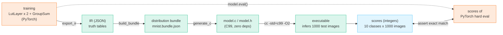
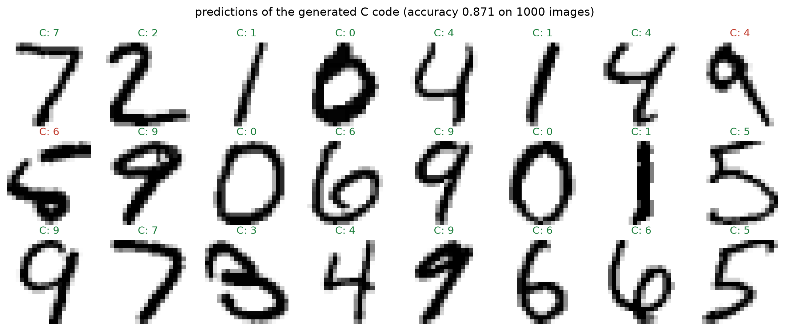
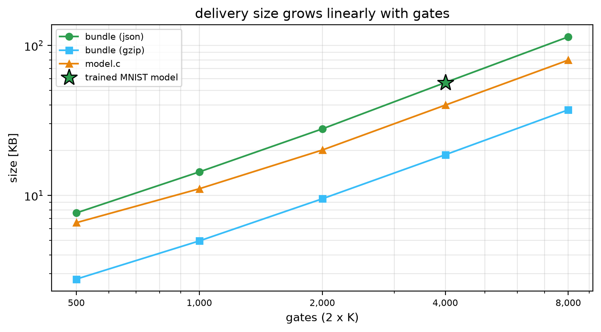

<!-- This file is generated by scripts/build_tutorials.py.
     Do not edit it directly; edit examples/29_deploy_mnist.py and regenerate. -->

**Run the trained circuit with nothing but a C compiler on your machine, without PyTorch.**
The "4000 logic gates" of [MNIST](/en/tutorials/mnist/) are exported in the order IR -> distribution bundle -> C99 source,
built with `cc`, and 1000 test images are inferred by C alone.

The core of this page is that **the integer scores returned by C do not differ from PyTorch's hard eval in a single element**.
After pinning down with `assert` that the trained circuit stays "the same circuit" through export, code generation and C compilation,
we count the delivery size (about 58 KB, about 19 KB gzipped) and the runtime memory (4 KB).
The inference time per image was about 3 microseconds on the author's machine (Apple M1 Max, 1 core, `cc -O2`)
(a value that changes with the machine, so it is not put in the page's output but written to `latency.json`). Finally, circuits with
different gate counts are lined up to confirm that the delivery size is roughly proportional to the number of gates.

The steps for putting this circuit on an ESP32 or an iPhone continue in [Run on ESP32](/en/guides/deploy-esp32/) and
[Run on iPhone](/en/guides/deploy-ios/), and the overall picture of the deploy kit is in
[Deploy Kit Quickstart](/en/guides/deploy-quickstart/).

:::tip[What you'll learn]
1. Every stage of the exit: trained model -> IR -> distribution bundle -> C source -> executable
2. How to confirm that C's integer scores **match exactly** PyTorch hard eval and IR simulate
3. How to measure delivery size and runtime memory, and how the size grows with the number of gates (us/image depends on the machine, so it is recorded in `latency.json`)

**Prerequisites**

- [1. Train on MNIST](/en/tutorials/mnist/) — the very circuit we carry here
- [3. Export to HDL](/en/tutorials/hdl-export/) — the IR and the idea of three-stage equivalence
- [Deploy Kit Quickstart](/en/guides/deploy-quickstart/) — if you first want to run through the whole exit lightly with XOR (optional)
:::

:::note[About this page]
Estimated time: **about 10 minutes** / Environment: CPU only (no GPU required)
Source script: [`examples/29_deploy_mnist.py`](https://github.com/tsukushi-gate/Griffith/blob/main/examples/29_deploy_mnist.py)
Try it locally: [`notebooks/29_deploy_mnist.ipynb`](https://github.com/tsukushi-gate/Griffith/blob/main/notebooks/29_deploy_mnist.ipynb) (an unexecuted notebook with the same content as this page; open it with `uv run --group docs jupyter lab notebooks/`)
Every code output below is **the result of an actual run**, embedded verbatim.
:::

<!-- Colab badge: once the repository is public, replace this span with an <a> whose href
     is data-colab-url to enable "Open in Colab". -->
<span class="colab-badge" data-colab-url="https://colab.research.google.com/github/tsukushi-gate/Griffith/blob/main/notebooks/29_deploy_mnist.ipynb">▶ Open in Colab (enabled once the repository is public)</span>

An example that trains MNIST and runs it as-is in zero-dependency C99 (the deploy kit).

The "circuit of 4000 logic gates" trained in [MNIST](/en/tutorials/mnist/) can only run inside PyTorch.
Here we carry it all the way to wrapping it into **a form that runs with nothing but a C compiler on your machine, without PyTorch**,
in a single script.

The road has the following 6 stages, and all of them are executed inside this file.



Orange is the PyTorch world, green is the world treated as a logic circuit, and blue is the integer scores.
**The final "exact match" is the star**: after confirming that the integers C returns do not differ from PyTorch's hard eval
in a single element, we measure the delivery size and the speed.

Run: uv run python examples/29_deploy_mnist.py
Expected: hard accuracy around 0.85 / C inference and PyTorch match exactly on 1000 images x 10 classes
(a C compiler cc / clang / gcc is required. Artifacts go to out_examples/deploy_mnist/)

## Setup: imports, random seed, output directory

The training side uses exactly the same toolkit as [MNIST](/en/tutorials/mnist/), and the deploy side uses four parts of
`griffith_logic.deploy`.

- `build_bundle` / `save_bundle` / `load_bundle` ... wrap a trained model into a **distribution bundle**
  (the circuit's IR and the class names in a single file), write it out, and read it back
- `generate_c` ... generate self-contained C source (`model.c` / `model.h`) from the bundle
- `verify_c_matches_simulate` ... actually build the generated C and compare it in integers against the IR reference implementation
  (`simulate`), a "pre-shipment gate"

The random seed is fixed, so you get **a bundle with the same bytes** every time
(so it can be used as the file that ESP32 or iPhone demos read).

```python
import gzip
import json
import platform
import re
import subprocess
from pathlib import Path

import matplotlib.pyplot as plt
import numpy as np
import torch
import torch.nn as nn
import torch.nn.functional as F
from matplotlib.ticker import NullFormatter
from torch.utils.data import DataLoader, Subset

from griffith_logic import GroupSum, LutLayer
from griffith_logic.datasets import load_mnist20x20
from griffith_logic.deploy import build_bundle, load_bundle, save_bundle
from griffith_logic.deploy.bundle import attach_bundle_sizes
from griffith_logic.deploy.cbackend import generate_c
from griffith_logic.deploy.verify import RUNTIME_C, find_cc, verify_c_matches_simulate
from griffith_logic.export import export_ir
from griffith_logic.ir import simulate, validate
from griffith_logic.ir.serialize import ir_to_dict
```

```python
# The initial gate distribution depends on the RNG, so fix the seed for reproducibility.
torch.manual_seed(0)
```

### Output directory and hyperparameters

All artifacts go to `out_examples/deploy_mnist/`. The file name `mnist.bundle.json` is fixed,
and other demos (embedded, smartphone) read it as it is.
The training recipe is the same shrunken one as [MNIST](/en/tutorials/mnist/) (2 layers x 2000 gates, 4000 iters), and
it finishes in 1-2 minutes on CPU.

```python
OUT_DIR = Path('out_examples/deploy_mnist')
OUT_DIR.mkdir(parents=True, exist_ok=True)

K = 2000          # gates per layer (half of the gates to burn)
STEPS = 4000      # training iterations
BATCH = 128       # mini-batch size
N_TRAIN = 20000   # number of training images (a subset of all 60000)
N_TEST = 2000     # number of images used for evaluation during training
N_C = 1000        # number of images inferred in C (the first N_C test images)
cc = find_cc()
assert cc is not None, 'C コンパイラ(cc / clang / gcc)が見つからない'
print(f'出力先: {OUT_DIR}')
```

```text title="Output"
出力先: out_examples/deploy_mnist
```

## Dataset: keep the images as 8-bit

We read the 20x20 MNIST. What differs from [MNIST](/en/tutorials/mnist/) is that **the images are also kept as integers 0-255 (u8)**.
What reaches a device is "8-bit pixels from a camera or a file", not real numbers like `0.37`.

PyTorch's hard eval binarized with `x.round()` (1 if above 0.5). A pixel value `k/255 > 0.5` is the same as `k >= 128`, so
**the C side gets the same bit string just by comparing the u8 pixel with the threshold 128**. We let the C driver we write later
carry this one-line binarization.

```python
train_set, test_set = load_mnist20x20(binarize_threshold=None)
```

```python
def materialize(dataset, n):
    """Pack the first n items into a (N, 400) tensor and labels (saves per-step preprocessing)."""
    subset = Subset(dataset, range(n))
    x, y = next(iter(DataLoader(subset, batch_size=n)))
    return x.reshape(n, -1), y
```

```python
train_x, train_y = materialize(train_set, N_TRAIN)
test_x, test_y = materialize(test_set, N_TEST)
```

```python
# Make both: the PyTorch hard-eval input (bits) and the input that reaches the device (u8 pixels).
test_bits = test_x.round()
test_u8 = (test_x * 255).round().to(torch.uint8)
assert torch.equal((test_u8 >= 128).float(), test_bits), 'u8 の閾値128が round() と食い違う'
print(f'train={tuple(train_x.shape)} test={tuple(test_x.shape)} '
      f'(u8 画素 {tuple(test_u8.shape)} と round() のビットが一致)')
```

```text title="Output"
train=(20000, 400) test=(2000, 400) (u8 画素 (2000, 400) と round() のビットが一致)
```

## Training: build the same circuit as the MNIST page

The model and the training loop are identical to [MNIST](/en/tutorials/mnist/): just run `LutLayer` x 2 + `GroupSum`
in ordinary PyTorch. What to watch is not the accuracy but that **`model.eval()` at the end of training (= the discretized circuit)
becomes the reference for every exit from here on**.

```python
model = nn.Sequential(
    LutLayer(400, K, n_inputs=2),
    LutLayer(K, K, n_inputs=2),
    GroupSum(k=10, tau=10.0),
)
opt = torch.optim.Adam(model.parameters(), lr=0.01)
history = []  # (step, soft acc, hard acc)

for step in range(STEPS + 1):
    if step % 1000 == 0:
        # soft = the training-time face / hard = the circuit fixed by argmax. What we deploy is hard.
        with torch.no_grad():
            model.train()
            soft_acc = (model(test_x).argmax(-1) == test_y).float().mean().item()
            model.eval()
            hard_acc = (model(test_bits).argmax(-1) == test_y).float().mean().item()
        model.train()
        history.append((step, soft_acc, hard_acc))
        print(f'step {step:>5}  soft acc={soft_acc:.4f}  hard acc={hard_acc:.4f}')
    idx = torch.randint(0, N_TRAIN, (BATCH,))
    opt.zero_grad()
    loss = F.cross_entropy(model(train_x[idx]), train_y[idx])
    loss.backward()
    opt.step()

model.eval()
final_hard = history[-1][2]
print(f'\n最終 hard acc={final_hard:.4f}(これから運ぶ回路の成績)')
assert final_hard > 0.80, f'hard acc={final_hard:.4f} が低すぎる'
```

```text title="Output"
step     0  soft acc=0.0815  hard acc=0.0990

step  1000  soft acc=0.8595  hard acc=0.8305

step  2000  soft acc=0.8745  hard acc=0.8555

step  3000  soft acc=0.8765  hard acc=0.8590

step  4000  soft acc=0.8765  hard acc=0.8670

最終 hard acc=0.8670(これから運ぶ回路の成績)
```

## IR and bundle: wrap the trained model into one file

The first step of the exit is the same as [Export to HDL](/en/tutorials/hdl-export/): `export_ir` fixes the trained model
into the **IR (a collection of truth tables)**. The IR depends on neither PyTorch nor C and is **the source of truth shared by all targets**.

`validate(ir, target='hdl')` checks that the IR holds together as a circuit (consistency of bit widths and wiring).
If it fails here, fix it before generating C.

```python
ir = export_ir(model, input_width=400, name='mnist')
validate(ir, target='hdl')
n_gates = sum(n.params['out_width'] for n in ir.nodes if n.type == 'lut_layer')
print(f'IR: ノード {[n.type for n in ir.nodes]} / 総ゲート数 {n_gates:,}')
```

```text title="Output"
IR: ノード ['lut_layer', 'lut_layer', 'group_sum'] / 総ゲート数 4,000
```

### The input contract and the contents of the model JSON

What goes into the bundle is the IR and the class names (`labels`). We fix **the input as a 0/1 string of 400 bits**
(the 20x20 pixels in row-major order, 1 if `pixel >= 128`).
There is also a way to put image preprocessing (thresholds, normalization) into the bundle, but it is available only for image models that start from
a convolution (`LutConv2d`); **for a fully connected circuit, the convention is to pass C the bit string itself**.
Turning the pixels into bits is the job of Python or of the C driver; here we let the latter do it in one line.

"A dict that has only `{'ir': ...}`" is the input (the model JSON) of `griffith deploy bundle`.

`export_ir` puts **the time of export** (`created_at`) into the IR metadata. Left as it is, the bytes of the bundle would change
on every run (and the gzip size would fluctuate by +-1 B), so below we overwrite it with a fixed time (`FIXED_TIME`)
so that **the same training result gives the same bytes**.

```python
LABELS = [str(d) for d in range(10)]
FIXED_TIME = '2026-01-01T00:00:00+09:00'
doc = {'ir': ir_to_dict(ir), 'labels': LABELS}
doc['ir']['metadata']['created_at'] = FIXED_TIME
(OUT_DIR / 'mnist_model.json').write_text(json.dumps(doc), encoding='utf-8')
```

### Build and write out the bundle

`build_bundle` combines the IR and the labels, and `save_bundle` writes them into a single file.
With the CLI it is the same operation as `griffith deploy bundle mnist_model.json -o mnist.bundle.json`.
The delivery size (compressed) is measured with gzip. `gzip.compress` writes the current time into its header by default,
so we pin it with `mtime=0` so that **the same bundle always gives the same number of bytes**.

```python
bundle = build_bundle(doc)
attach_bundle_sizes(bundle)
bundle_path = OUT_DIR / 'mnist.bundle.json'
save_bundle(bundle, bundle_path)
bundle_bytes = bundle_path.stat().st_size
bundle_gz = gzip.compress(bundle_path.read_bytes(), compresslevel=6, mtime=0)
Path(str(bundle_path) + '.gz').write_bytes(bundle_gz)
bundle_gz_bytes = len(bundle_gz)
print(f'バンドル: {bundle_path.name} = {bundle_bytes:,} B(gzip {bundle_gz_bytes:,} B)')
```

```text title="Output"
バンドル: mnist.bundle.json = 57,862 B(gzip 18,864 B)
```

## C code generation and build: make model.c and hand it to cc

We read the bundle back (the structure is validated on load) and create the C source with `generate_c`.
The output is just two files, `model.h` (the public API and size constants) and `model.c` (the `static const` truth tables and
the straight-line code that evaluates them in order), with **zero heap allocation and zero floating point at run time**.
The public API is `mdl_infer(input_bits, scores)`: pass 400 0/1 values and 10 integer scores come back.

The evaluation of the logic gates itself is done by the runtime (`mdl_kernels.c`, about 60 KB as source) with bit operations,
32 gates at a time. With the CLI, `griffith deploy codegen-c` does the same thing.

```python
loaded = load_bundle(bundle_path, validate=True, strict=True)
C_DIR = OUT_DIR / 'c'
C_DIR.mkdir(exist_ok=True)
for filename, text in generate_c(loaded, name='model', validate=False).items():
    (C_DIR / filename).write_text(text, encoding='utf-8')
```

```python
# Place the runtime sources in the same directory as the generated files (that alone makes it self-contained).
for rel in ('include/mdl_kernels.h', 'include/mdl_simd.h', 'src/mdl_kernels.c'):
    (C_DIR / Path(rel).name).write_bytes((RUNTIME_C / rel).read_bytes())
model_c_bytes = (C_DIR / 'model.c').stat().st_size
model_h_bytes = (C_DIR / 'model.h').stat().st_size
header = (C_DIR / 'model.h').read_text(encoding='utf-8')
ctx_bytes = int(re.search(r'#define\s+MDL_CTX_BYTES\s+\(?(\d+)', header).group(1))
print(f'生成: model.c {model_c_bytes:,} B / model.h {model_h_bytes:,} B / '
      f'ランタイム mdl_kernels.c {(C_DIR / "mdl_kernels.c").stat().st_size:,} B')
print(f'MDL_CTX_BYTES = {ctx_bytes:,} B(推論1回に必要な作業RAM。これが実行時メモリの全て)')
```

```text title="Output"
生成: model.c 40,902 B / model.h 3,724 B / ランタイム mdl_kernels.c 62,113 B
MDL_CTX_BYTES = 4,000 B(推論1回に必要な作業RAM。これが実行時メモリの全て)
```

### Write a host driver and build it

We prepare a small `main` that just calls the generated `mdl_infer(bits, scores)`.
It reads N u8 images from a file, **compares each pixel with 128 to make 400 bits**, and then infers.
It repeats this for N images x `reps` times, measures **the time of the whole loop** (including the binarization),
and writes the scores of the last pass to a file. The time is measured with `clock()` (standard C), so
there is no extra dependency. Only the driver uses `malloc`, which is a convenience for the host; the model itself keeps its work area
inside a context.

```python
DRIVER_C = r'''
#include <stdio.h>
#include <stdlib.h>
#include <time.h>
#include "model.h"

/* u8 pixels -> 0/1 bit string (1 if pixel >= 128). Same as PyTorch's x.round(). */
static void binarize(const uint8_t *img, uint8_t *bits) {
    for (int j = 0; j < MDL_INPUT_WIDTH; j++) bits[j] = img[j] >= 128;
}

int main(int argc, char **argv) {
    if (argc != 5) { fprintf(stderr, "usage: images.bin n reps scores.bin\n"); return 2; }
    int n = atoi(argv[2]), reps = atoi(argv[3]);
    uint8_t *images = malloc((size_t)n * MDL_INPUT_WIDTH);
    int32_t *scores = malloc((size_t)n * MDL_OUTPUT_WIDTH * sizeof(int32_t));
    uint8_t bits[MDL_INPUT_WIDTH];
    FILE *f = fopen(argv[1], "rb");
    if (!f || fread(images, 1, (size_t)n * MDL_INPUT_WIDTH, f) != (size_t)n * MDL_INPUT_WIDTH)
        return 3;
    fclose(f);
    for (int i = 0; i < n; i++) {                      /* warm-up */
        binarize(images + (size_t)i * MDL_INPUT_WIDTH, bits);
        mdl_infer(bits, scores + (size_t)i * MDL_OUTPUT_WIDTH);
    }
    clock_t t0 = clock();
    for (int r = 0; r < reps; r++)
        for (int i = 0; i < n; i++) {
            binarize(images + (size_t)i * MDL_INPUT_WIDTH, bits);
            mdl_infer(bits, scores + (size_t)i * MDL_OUTPUT_WIDTH);
        }
    double us = (double)(clock() - t0) / CLOCKS_PER_SEC * 1e6 / ((double)reps * n);
    f = fopen(argv[4], "wb");
    fwrite(scores, sizeof(int32_t), (size_t)n * MDL_OUTPUT_WIDTH, f);
    fclose(f);
    printf("%.3f\n", us);
    return 0;
}
'''
(C_DIR / 'main.c').write_text(DRIVER_C, encoding='utf-8')
exe = C_DIR / 'mnist_demo'
cmd = [cc, '-std=c99', '-O2', f'-I{C_DIR}',
       str(C_DIR / 'model.c'), str(C_DIR / 'mdl_kernels.c'), str(C_DIR / 'main.c'),
       '-o', str(exe)]
build = subprocess.run(cmd, capture_output=True, text=True)
assert build.returncode == 0, build.stderr
print('ビルド: cc -std=c99 -O2 model.c mdl_kernels.c main.c -o mnist_demo -> 成功')
```

```text title="Output"
ビルド: cc -std=c99 -O2 model.c mdl_kernels.c main.c -o mnist_demo -> 成功
```

## Infer in C and compare with PyTorch in integers

We write the first 1000 test images as u8 and feed them to the C executable
(the binarization is done by the C driver).
What comes back is a 1000 x 10 matrix of **integer scores** (the number of gates, out of the 200 assigned to each class,
that output 1).

There are three things to compare against: **PyTorch hard eval** (the output of `model.eval()` multiplied back by `tau`),
**the IR reference implementation `simulate`** (numpy integer bit operations), and **C**.
We pin down with `assert` that the three do not differ in a single element — the proof that the trained circuit stays
**the same circuit** through export, code generation and C compilation.

```python
images_path = OUT_DIR / 'test_images_u8.bin'
images_path.write_bytes(test_u8[:N_C].numpy().tobytes())
REPS = 20
scores_path = OUT_DIR / 'scores_c.bin'
run = subprocess.run([str(exe), str(images_path), str(N_C), str(REPS), str(scores_path)],
                     capture_output=True, text=True)
assert run.returncode == 0, run.stderr
us_per_image = float(run.stdout.strip())
c_scores = np.fromfile(scores_path, dtype=np.int32).reshape(N_C, 10).astype(np.int64)

with torch.no_grad():
    torch_logits = model(test_bits[:N_C])  # model.eval() already called = hard eval
torch_scores = np.rint(torch_logits.numpy() * 10.0).astype(np.int64)  # multiply tau=10 back
sim_scores = simulate(ir, test_bits[:N_C].numpy().astype(np.int64)).astype(np.int64)

assert np.array_equal(c_scores, torch_scores), 'C と PyTorch hard eval のスコアが食い違う'
assert np.array_equal(c_scores, sim_scores), 'C と IR simulate のスコアが食い違う'
c_pred = c_scores.argmax(1)
torch_pred = torch_logits.argmax(-1).numpy()
assert np.array_equal(c_pred, torch_pred)
c_acc = float((c_pred == test_y[:N_C].numpy()).mean())
n_mismatch = int((c_scores != torch_scores).sum())
print(f'C ⇔ PyTorch hard eval ⇔ IR simulate: {N_C}枚 × 10クラス = {c_scores.size:,} 要素のうち'
      f' 不一致 {n_mismatch} 個(予測ラベルも {N_C}/{N_C} 一致)')
print(f'C 推論の accuracy = {c_acc:.4f}({N_C}枚)')
```

```text title="Output"
C ⇔ PyTorch hard eval ⇔ IR simulate: 1000枚 × 10クラス = 10,000 要素のうち 不一致 0 個(予測ラベルも 1000/1000 一致)
C 推論の accuracy = 0.8710(1000枚)
```

### Pre-shipment gate: verify-c

The above was a check against "the model we just trained". `verify_c_matches_simulate` is more mechanical:
it makes several **random bit strings**, generates and builds C from the bundle, and compares it with
the IR reference implementation (the CLI's `griffith deploy verify-c`).
It is a gate that checks **the circuit itself is reproduced correctly in C**, independent of your model or images,
and it can be built straight into CI or a pre-shipment script.

```python
gate = verify_c_matches_simulate(loaded, n_samples=8, seed=1, verbose=False)
print(f'verify-c: {gate["n_samples"]}サンプル({gate["path"]}経路)'
      f' 最大差 {gate["max_abs_diff"]}')
```

```text title="Output"
verify-c: 8サンプル(bits経路) 最大差 0
```

## Delivery size and speed: how many bytes, and how many microseconds per image

Now that we know it "runs correctly", we count "how light it is". There are three kinds of numbers: **what you ship**
(the bytes of the bundle), **what you build** (the C source), and **what you need to run it** (the work RAM `MDL_CTX_BYTES`) plus the speed.

The speed (us/image) changes with the machine and from run to run, so **it is not burned into this page's output**
(it is measured above and written to `out_examples/deploy_mnist/latency.json`).
On the author's machine (Apple M1 Max, 1 core, `cc -O2`) the measured value is **about 3 us/image** (binarization included,
about 330,000 images/s); if you rerun it yourself the order of magnitude is the same but the value changes a little.
The byte counts, on the other hand, are the same every time for the same circuit.

```python
print('項目                     値')
print(f'バンドル(JSON)           {bundle_bytes:>10,} B')
print(f'バンドル(gzip)           {bundle_gz_bytes:>10,} B')
print(f'model.c                  {model_c_bytes:>10,} B')
print(f'MDL_CTX_BYTES(作業RAM)   {ctx_bytes:>10,} B')
```

```text title="Output"
項目                     値
バンドル(JSON)               57,862 B
バンドル(gzip)               18,864 B
model.c                      40,902 B
MDL_CTX_BYTES(作業RAM)        4,000 B
```

## Visualization: the digits C read, and the cost against the number of gates

The first figure overlays the predictions returned by the C executable on the test images.
Green is correct and red is wrong; since it matches PyTorch exactly, **the red ones are also exactly PyTorch hard eval's mistakes**.

### Figure 1: C's predictions overlaid on the test images

We line up 24 images. The images are the 20x20 pixels (u8) that the circuit received, as they are.

```python
fig, axes = plt.subplots(3, 8, figsize=(11, 4.6))
for ax, i in zip(axes.ravel(), range(24), strict=True):
    ok = c_pred[i] == int(test_y[i])
    ax.imshow(test_u8[i].reshape(20, 20).numpy(), cmap='gray_r')
    ax.set_title(f'C: {c_pred[i]}', fontsize=10, color='#1b7f3b' if ok else '#c0392b')
    ax.set_axis_off()
fig.suptitle(f'predictions of the generated C code (accuracy {c_acc:.3f} on {N_C} images)',
             fontsize=11)
fig.tight_layout()
plt.show()
```



**Reading**: the mistakes center on confusable digits such as 4 and 9, or 3 and 5, the same tendency as the misclassifications
of [MNIST](/en/tutorials/mnist/). C creates no new mistake at all.

### Figure 2: delivery size against the number of gates

Since there is only one trained circuit, we make **circuits with different widths K** and line them up. Size and speed are decided
only by the "shape" of the circuit and hardly depend on which logic functions were learned, so we may measure
untrained (randomly initialized) circuits. To check this, we overlay **the circuit with K=2000 that was really trained as a star** —
if it sits on the line of the random circuits, the assumption is correct.

Each point redoes "export_ir -> bundle -> C generation -> build -> timing over 1000 images" from scratch.
The timing results (us/image) change with the machine, so they appear neither in the figure nor in the output but are written to `latency.json`.
The figure is a deterministic one with **sizes only**.

```python
SWEEP_KS = [250, 500, 1000, 2000, 4000]
sweep = []
for width in SWEEP_KS:
    torch.manual_seed(1)
    probe = nn.Sequential(LutLayer(400, width, n_inputs=2),
                          LutLayer(width, width, n_inputs=2), GroupSum(k=10, tau=10.0)).eval()
    probe_ir = export_ir(probe, input_width=400, name=f'mnist_k{width}')
    probe_doc = {'ir': ir_to_dict(probe_ir), 'labels': LABELS}
    probe_doc['ir']['metadata']['created_at'] = FIXED_TIME
    probe_bundle = build_bundle(probe_doc)
    attach_bundle_sizes(probe_bundle)
    work = OUT_DIR / 'sweep' / f'k{width}'
    work.mkdir(parents=True, exist_ok=True)
    probe_path = save_bundle(probe_bundle, work / 'bundle.json')
    for filename, text in generate_c(probe_bundle, name='model', validate=False).items():
        (work / filename).write_text(text, encoding='utf-8')
    for rel in ('include/mdl_kernels.h', 'include/mdl_simd.h', 'src/mdl_kernels.c'):
        (work / Path(rel).name).write_bytes((RUNTIME_C / rel).read_bytes())
    (work / 'main.c').write_text(DRIVER_C, encoding='utf-8')
    probe_exe = work / 'demo'
    subprocess.run([cc, '-std=c99', '-O2', f'-I{work}', str(work / 'model.c'),
                    str(work / 'mdl_kernels.c'), str(work / 'main.c'), '-o', str(probe_exe)],
                   check=True, capture_output=True)
    out = subprocess.run([str(probe_exe), str(images_path), str(N_C), '10',
                          str(work / 'scores.bin')], check=True, capture_output=True, text=True)
    sweep.append({
        'gates': 2 * width,
        'bundle_kb': probe_path.stat().st_size / 1024,
        'gzip_kb': len(gzip.compress(probe_path.read_bytes(), compresslevel=6, mtime=0)) / 1024,
        'model_c_kb': (work / 'model.c').stat().st_size / 1024,
        'us': float(out.stdout.strip()),
    })
    print(f'K={width:>5} ({2 * width:>5} ゲート): バンドル {sweep[-1]["bundle_kb"]:7.1f} KB / '
          f'gzip {sweep[-1]["gzip_kb"]:6.1f} KB / model.c {sweep[-1]["model_c_kb"]:7.1f} KB')

gates = [p['gates'] for p in sweep]
(OUT_DIR / 'latency.json').write_text(json.dumps({
    'unit': 'microseconds per image (single core, includes binarization)',
    'machine': platform.platform(), 'compiler': Path(cc).name, 'flags': '-std=c99 -O2',
    'trained_mnist_gates': n_gates, 'trained_mnist_us': us_per_image,
    'random_init_sweep': [{'gates': p['gates'], 'us': p['us']} for p in sweep],
}, indent=2), encoding='utf-8')
fig, ax_size = plt.subplots(1, 1, figsize=(7.5, 4.2))
ax_size.plot(gates, [p['bundle_kb'] for p in sweep], 'o-', color='#2e9e4f', label='bundle (json)')
ax_size.plot(gates, [p['gzip_kb'] for p in sweep], 's-', color='#38bdf8', label='bundle (gzip)')
ax_size.plot(gates, [p['model_c_kb'] for p in sweep], '^-', color='#e8850c', label='model.c')
ax_size.plot([n_gates], [bundle_bytes / 1024], '*', ms=15, color='#2e9e4f',
             markeredgecolor='black', label='trained MNIST model')
ax_size.set_xscale('log')
ax_size.set_yscale('log')
ax_size.set_xticks(gates, labels=[f'{g:,}' for g in gates], fontsize=8)
ax_size.xaxis.set_minor_formatter(NullFormatter())
ax_size.set_xlabel('gates (2 x K)')
ax_size.set_ylabel('size [KB]')
ax_size.set_title('delivery size grows linearly with gates')
ax_size.grid(alpha=0.3, which='both')
ax_size.legend(fontsize=8)
fig.tight_layout()
plt.show()
```

```text title="Output"
K=  250 (  500 ゲート): バンドル     7.6 KB / gzip    2.8 KB / model.c     6.6 KB

K=  500 ( 1000 ゲート): バンドル    14.3 KB / gzip    5.0 KB / model.c    11.1 KB

K= 1000 ( 2000 ゲート): バンドル    27.8 KB / gzip    9.5 KB / model.c    20.1 KB

K= 2000 ( 4000 ゲート): バンドル    56.5 KB / gzip   18.7 KB / model.c    40.0 KB

K= 4000 ( 8000 ゲート): バンドル   114.0 KB / gzip   37.2 KB / model.c    79.8 KB
```



**Reading**: all three size curves have slope 1 (twice the gates means about twice the size), and
the star (trained) sits right on the line of the random circuits. The speed also grows in the same direction: on the author's machine
(Apple M1 Max, 1 core, `cc -O2`) it was about 0.4 us/image at 500 gates and about 6 us/image at 8,000 gates
(the details of the slope change with the machine, so check `latency.json` yourself).
**Size and speed are decided by the shape of the circuit**, so you can estimate them before shipping —
even with 8,000 gates the delivery is about 110 KB, or about 37 KB gzipped.

```python
per_gate = [p['bundle_kb'] * 1024 / p['gates'] for p in sweep]
gz_per_gate = [p['gzip_kb'] * 1024 / p['gates'] for p in sweep]
print(f'バンドル: 1ゲートあたり {min(per_gate):.1f}〜{max(per_gate):.1f} B'
      f'(gzip で {min(gz_per_gate):.1f}〜{max(gz_per_gate):.1f} B)')
```

```text title="Output"
バンドル: 1ゲートあたり 14.2〜15.6 B(gzip で 4.8〜5.7 B)
```

## What to read next

- [Deploy Kit Quickstart](/en/guides/deploy-quickstart/) — run it through with XOR; the branches to CUDA / Metal / Web start here too
- [Prepare Demo Models](/en/guides/deploy-models/) — how to prepare the MNIST / activity recognition / face detection bundles
- [Run on ESP32](/en/guides/deploy-esp32/) — run the same bundle on a microcontroller (with measurements on real hardware)
- [Run on iPhone](/en/guides/deploy-ios/) — call the generated C from Swift (with simulator measurements)
- [Activity Recognition (UCI-HAR, Phone Accelerometer)](/en/tutorials/har/) — thermometer-encode a phone's accelerometer and carry it to C by the same procedure
- [7. End-to-End Walkthrough: From Training to FPGA](/en/tutorials/full-pipeline/) — from training to Verilog / FPGA
- [Appendix: A Minimal Look Inside, with XOR](/en/tutorials/xor/) — make the circuit we carry even smaller and see all of its insides

<!-- i18n:source=tutorials/deploy-mnist.md hash=f28e392e607f -->
