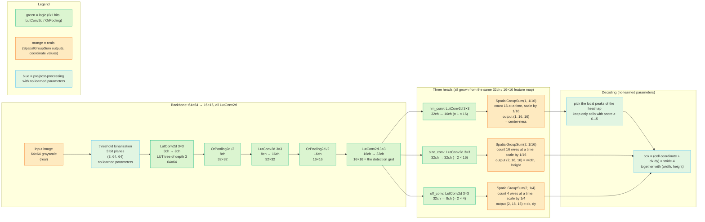
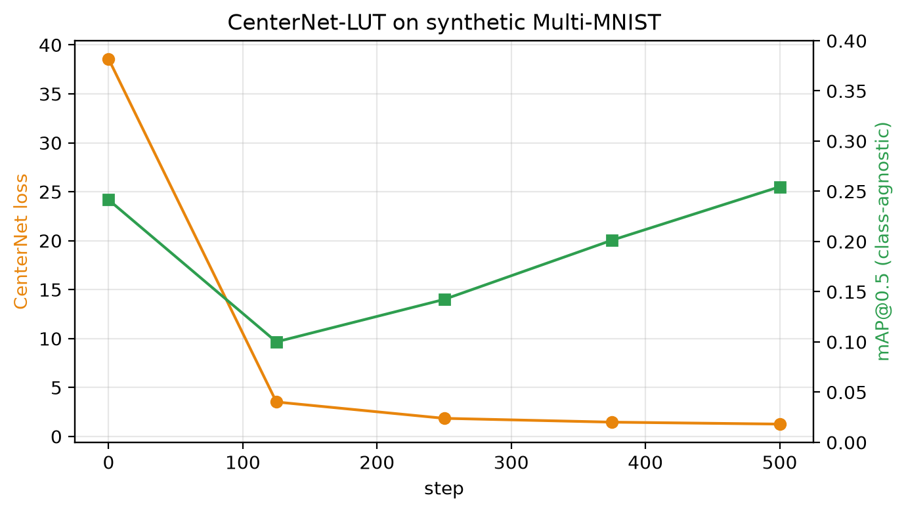
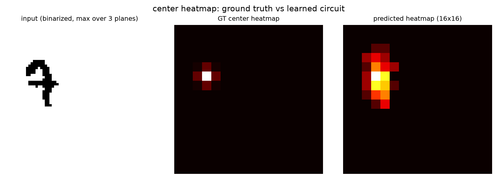
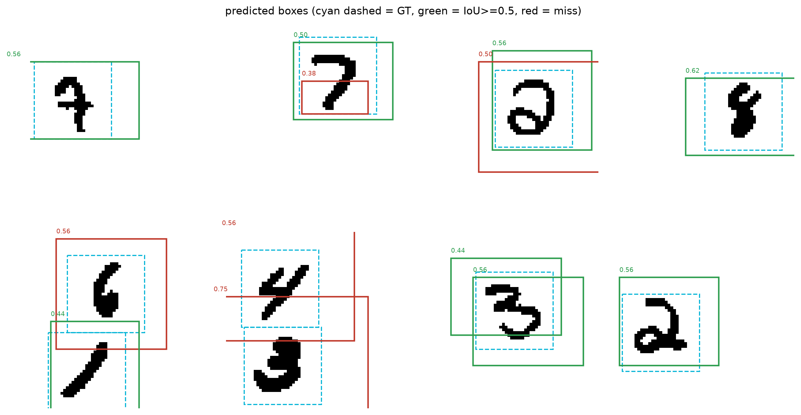

<!-- This file is generated automatically by scripts/build_tutorials.py.
     Do not edit it directly; edit examples/21_detection.py and regenerate. -->

**Object detection with zero multipliers.** We follow a minimal CenterNet built only from
`LutConv2d` and `OrPooling2d` as it finds digits in synthetic Multi-MNIST and draws bounding boxes.
784 gates in total, mAP@0.5 = 0.255 (measured on the minimal 500-step budget).

To fit within a few minutes of budget, this page is reduced to **class-agnostic (1-class)
detection** (the 10-class version failed to take off on the same budget). Restoring
the two lines that fold the GT heatmap with a max over the class axis gives you the 10-class version.
For the production recipe, see `experiments/train_detection.py` (its measured numbers predate the
per-image scoping fix in `compute_map`, so they are awaiting re-measurement).

:::tip[What you'll learn]
1. How to build a CenterNet-style detector from nothing but `LutConv2d` and `OrPooling2d` (784 gates in total)
2. The post-processing that turns a heatmap plus size regression into bounding boxes
3. How to shrink things to fit a few minutes of budget, and how to go back to the 10-class and production recipes

**Prerequisites**

- [U-Net (segmentation)](/en/tutorials/logic-unet/) — the basics of dense prediction heads
- [5. Export a CNN to HDL](/en/tutorials/cnn-hdl-export/)
:::

:::note[About this page]
Estimated time: **about 7 minutes** / Environment: CPU only (no GPU needed)
Source script: [`examples/21_detection.py`](https://github.com/tsukushi-gate/Griffith/blob/main/examples/21_detection.py)
Try it yourself: [`notebooks/21_detection.ipynb`](https://github.com/tsukushi-gate/Griffith/blob/main/notebooks/21_detection.ipynb) (an unexecuted notebook with the same content as this page; open it with `uv run --group docs jupyter lab notebooks/`)
Every code output is the **actual result of running the code**, embedded verbatim.
:::

<!-- Colab badge: once the repository is public, replace this span with an <a> whose href is
     data-colab-url and "Open in Colab" becomes active. -->
<span class="colab-badge" data-colab-url="https://colab.research.google.com/github/tsukushi-gate/Griffith/blob/main/notebooks/21_detection.ipynb">▶ Open in Colab (enabled once the repository is public)</span>

An example of solving object detection (CenterNet-LUT) with a logic-gate circuit.

examples/06_mnist.py was classification: "one image → one class". Object detection is two steps
harder than that: you must answer **where** (coordinates) and for **an unknown number of objects**.

Here we put the idea of CenterNet (Zhou et al. 2019) straight onto logic gates. CenterNet uses
neither anchors nor an NMS network; it detects with just three feature maps:

    heatmap:      the probability that an object centre is in that cell. A local peak = one detection
    size (2ch):   the width and height of the object in that cell (normalized by the image size)
    offset (2ch): the sub-pixel displacement from the cell grid

This structure — "the outputs are all conv feature maps" — suits logic-gate NNs well.
The backbone can be built from just LutConv2d (a differentiable LUT tree that learns the truth table
of a 3x3 window) and OrPooling2d (OR/max pooling), and **numeric** quantities like size/offset can be
produced with SpatialGroupSum (count the firing gates and multiply by a constant).
In other words it becomes a detector that completes even coordinate regression without a single multiplier.

**The whole circuit (the actual sizes of this reduced recipe: k=8, 3 layers)**



**Where the concrete example shows up as a figure**: the flow above can actually be seen in the
figures on this page.

1. "input (binarized)" = the output of TH above (bit planes at 64×64)
2. "GT center heatmap" vs. "predicted heatmap (16x16)" = the output of HMS above.
   Training has worked once **a peak rises** at the center of each digit
3. "predicted boxes" = BOX above: the result of applying size/offset at each peak and drawing a box

**How it is done**

- **The image is turned into bits at the entrance.** The grayscale is cut at three thresholds,
  converting "darkness" into 3 bit planes (3ch). A logic circuit only accepts 0/1, so this is the rule
- **A convolution is a truth table over a 3×3 window.** LutConv2d is a tree of LUTs (depth 3) that
  looks at the 3×3 = 9 pixels of a window and returns 0 or 1. Where a CNN filter is "an inner product
  of weights", this is "a table lookup", and only the contents of the table are learned
- **Pooling is OR.** In the world of bits, max pooling coincides with "1 if any input is 1" = OR.
  No comparators and no adders are needed
- **Numbers (probability, width, height, coordinates) are made by counting wires.** SpatialGroupSum
  is how a circuit without multipliers emits reals: it counts "how many of these 32 wires are 1" in
  groups of 16 and scales by 1/16 to land in 0–1. The resolution is therefore 1/16 — raise
  `size_group` if you need finer values.
  **The heatmap is built the same way**: logic-gate outputs are discretized to 0/1 at evaluation
  time, so a single channel would make the heatmap binary and leave every peak tied. Averaging 16
  wires (`hm_group=16`) yields 17 levels of confidence: 0, 1/16, ..., 1
- **No anchors and no NMS.** CenterNet reduces detection to "make only the center cell 1", so every
  output stays a feature map and decoding is just a local peak search

[About the imports]
The model definition experiments/detection_model.py still lives outside the package (under
experiments/), so this example loads it by extending sys.path. We plan to move it to the public API
on the griffith_logic side in the future, at which point only the import lines change.

[About the scale]
To fit within a few minutes on CPU, this example is a heavily reduced version:
  - 1-2 MNIST digits on a 64x64 canvas (the production recipe uses 96x96)
  - Backbone width k=8 (production 64), 3 layers (production 8)
  - 500 iterations
  - **Class-agnostic (1-class) detection**: only guess "is there a digit or not"
The aim is not accuracy but seeing with your own eyes that "the boxes come out at plausible positions and sizes".
The serious 10-class recipe (which also identifies the digit) is in experiments/train_detection.py
(see the [model zoo](/en/reference/model-zoo/)). Note that the detection numbers listed there predate
the per-image scoping fix in compute_map and are awaiting re-measurement.

Run: uv run python examples/21_detection.py
Time: 2-4 minutes on CPU (depending on machine load)
Expected result: class-agnostic mAP@0.5 around 0.20-0.30. The final figure shows the predicted boxes

## Setup: imports and the reduced recipe

All we need is PyTorch, matplotlib, and the detection parts that live under `experiments/`
(dataset, loss, decoding, mAP). The circuit building blocks themselves (`LutConv2d` /
`OrPooling2d` / `SpatialGroupSum`) are used from inside those model definitions.

```python
import os
import sys

import matplotlib.patches as patches
import matplotlib.pyplot as plt
import torch
from torch.utils.data import DataLoader
```

### Adding experiments/ to the import path

The model definition `detection_model.py` still lives outside the package (under `experiments/`),
so we extend `sys.path` before importing it. It will move to the public `griffith_logic` API
eventually, and at that point only the import lines change.

```python
# In a notebook __file__ is undefined, in which case we treat the current directory as the
# repository root (examples are run from the repository root by convention).
REPO_ROOT = (
    os.path.dirname(os.path.dirname(os.path.abspath(__file__)))
    if '__file__' in globals()
    else os.getcwd()
)
sys.path.insert(0, os.path.join(REPO_ROOT, 'experiments'))

from data.detection import MultiMNISTDetection, collate_detection  # noqa: E402
from detection_loss import CenterNetLoss  # noqa: E402
from detection_model import CenterNetLUT  # noqa: E402
from detection_utils import compute_map, decode_detections  # noqa: E402
```

```python
torch.manual_seed(0)
```

### Hyperparameters (a reduced recipe that fits in a few CPU minutes)

The **output stride** (`STRIDE`) says how many input pixels correspond to one cell of the
detection grid. We look at a 64×64 image with stride 4, so the grid is 16×16. Coordinates are
predicted on that grid and multiplied by `STRIDE` at the end to get back to image coordinates.
`SCORE_TH` is the lowest score at which a heatmap peak is accepted as one detection: lower it and
you over-detect, raise it and you miss objects.

```python
CANVAS = 64        # side of the synthetic image. The heatmap becomes 64/4 = 16x16
STRIDE = 4         # output stride
K = 8              # width parameter of the backbone (production 64)
N_THRESH = 3       # number of threshold-binarization channels on the input (grayscale → 3 bit planes)
MAX_OBJ = 2        # at most 2 objects per image
STEPS = 500        # number of training iterations
BATCH = 32
LR = 0.01
N_TRAIN = 3000
N_TEST = 200
EVAL_EVERY = 125
SCORE_TH = 0.15    # threshold above which a heatmap peak is accepted as a detection
HM_GROUP = 16      # number of wires in the heatmap head (their average is the confidence)
```

## Data: synthetic Multi-MNIST and CenterNet-style targets

We scatter MNIST digits over a 64×64 canvas (without overlap) and build CenterNet-style targets.
The targets are three feature maps, matching the model's three outputs one for one.

- **heatmap** — the probability that an object centre lies in that cell. The centre cell is 1 and
  its neighbourhood is a smooth Gaussian (a bell-shaped weight), so a small miss is not punished hard
- **size** (2ch) — the width and height of the object in that cell (normalised to 0–1 by image size)
- **offset** (2ch) — the grid is coarse, so this is the **sub-pixel shift** from the cell centre
  to the true centre

The image itself is threshold-binarized into **three bit planes**, `(3, 64, 64)`.
The input wires of a logic circuit accept nothing but 0/1, so this binarization is the house rule at the door.

```python
def materialize(n, train, seed):
    """Turn n samples of the dataset into tensors in one go (avoiding synthesis cost every step)."""
    ds = MultiMNISTDetection(
        mnist_root=os.path.join(REPO_ROOT, 'data-mnist'), train=train,
        canvas_size=CANVAS, min_objects=1, max_objects=MAX_OBJ,
        n_thresholds=N_THRESH, output_stride=STRIDE, n_classes=10,
        num_samples=n, seed=seed,
    )
    loader = DataLoader(ds, batch_size=n, collate_fn=collate_detection)
    images, targets = next(iter(loader))
    # --- Making it class-agnostic ---
    # Fold the 10-class heatmaps into one with a max over the class axis. Discarding "which digit"
    # and learning only "is there an object here" lets peaks form even with a small circuit and short training.
    # (To go back to the 10-class version, just delete these two lines and build the model with n_classes=10)
    targets['heatmap'] = targets['heatmap'].amax(dim=1, keepdim=True)
    targets['gt_labels'] = torch.zeros_like(targets['gt_labels'])
    return images, targets
```

## Model: a CenterNet made entirely of LutConv2d

The first three lines materialize the data, and then we build the detector (both live in one cell).
The backbone is three stages of Conv→Pool→Conv→Pool→Conv that take 64×64 down to 16×16, and
**three heads grow out of that same feature map** (heatmap / size / offset).

**Why a single centre point is enough to detect an object**: instead of aiming directly at "the box
around the object", the problem is split into **a per-cell classification** ("which cell holds the
centre") and a numeric prediction ("the width, height and shift for that cell"). No anchors
(pre-defined candidate boxes) and no NMS network (post-processing that removes duplicate boxes) are
needed, and every output stays a plain conv feature map. That "everything is a feature map" property
is exactly why this design suits a logic-gate circuit.

**Why a circuit with no multipliers can emit numbers like width and height**: the trick is
`SpatialGroupSum`, which counts "how many of the 32 wires are 1" in groups of 16 and scales by 1/16.
The resolution is therefore in steps of 1/16 — raise `size_group` if you need finer values.

```python
train_x, train_t = materialize(N_TRAIN, train=True, seed=0)
test_x, test_t = materialize(N_TEST, train=False, seed=1)
print(f'train={tuple(train_x.shape)}  heatmap={tuple(train_t["heatmap"].shape)}')

# ===========================================================================
# Model
# ---------------------------------------------------------------------------
# A 3-stage backbone (Conv→Pool→Conv→Pool→Conv) takes 64x64 down to 16x16, and three heads
# (heatmap / size / offset) grow out of the same feature map.
# Every conv is a LutConv2d, so all that is learned is "the truth table for a 3x3 window".
# hm_group / size_group / offset_group are all passed explicitly — the defaults on the
# experiments/ side may change for the production recipe, so we pin them here to keep the
# diagram above and the numbers below in agreement.
# ===========================================================================

model = CenterNetLUT(
    n_classes=1, k=K, in_channels=N_THRESH, tree_depth=3,
    head_depth=3, n_inputs=2, hm_group=HM_GROUP, size_group=16,
    offset_group=4, n_layers=3,
)
print(f'CenterNet-LUT: {model.num_gates:,} gates '
      f'(backbone {K}→{2 * K}→{4 * K} ch + heads hm/size/off)')
```

```text title="Output"
train=(3000, 3, 64, 64)  heatmap=(3000, 1, 16, 16)
CenterNet-LUT: 784 gates (backbone 8→16→32 ch + heads hm/size/off)
```

## Loss and evaluation: focal loss and mAP@0.5

**Focal loss** is a loss for classification where positives are extremely rare: it damps the
contribution of the easy background cells and shifts the weight onto learning the centre cells.
Out of the 16×16 = 256 cells at most two are centres, so without it the circuit settles into
answering "everything is background".

The metric **mAP@0.5** is the standard measure for object detection. The overlap between a
predicted box and a ground-truth box is measured by **IoU** (Intersection over Union = area of the
overlap ÷ area of the union, 0–1); an IoU of 0.5 or more counts as a hit, and the misses and the
over-detections are averaged into a single number.

```python
# CenterNet's composite loss:
#   heatmap = focal loss (push only the centre cell to 1, with a weak penalty on the surrounding Gaussian)
#   size/offset = L1 regression extracting only the centre cell via mask+index
loss_fn = CenterNetLoss(lambda_size=0.1, lambda_off=1.0)
opt = torch.optim.Adam(model.parameters(), lr=LR)
```

### Evaluation: decode → mAP

Decoding detections is post-processing with no learned parameters: keep only the **local peaks** of
the heatmap (cells that are the maximum within their own 3×3 window) and rebuild boxes there from
size and offset. "Keeping the local peaks" already plays the role of NMS, so no dedicated
post-processing network is required.

```python
def evaluate():
    """Measure mAP@0.5 on the test set. decode → mAP is CenterNet's evaluation path."""
    model.eval()
    preds, gts = [], []
    with torch.no_grad():
        for i in range(0, N_TEST, 50):
            out = model(test_x[i:i + 50])
            # Keep only the peaks with a 3x3 max pool (the NMS equivalent), then rebuild boxes from size/offset
            preds.extend(decode_detections(
                out['hm'], out['size'], out['off'],
                output_stride=STRIDE, top_k=MAX_OBJ * 2, threshold=SCORE_TH,
            ))
    for i in range(N_TEST):
        m = test_t['mask'][i] > 0
        gts.append({'boxes': test_t['gt_boxes'][i][m],
                    'labels': test_t['gt_labels'][i][m]})
    model.train()
    return compute_map(preds, gts, n_classes=1, iou_threshold=0.5)[0]
```

## The training loop

The body is ordinary PyTorch, and nowhere do you have to be aware that this is a logic-gate circuit.
Every `EVAL_EVERY` steps we measure mAP and print the breakdown of the loss (hm / size / off) with it.
The breakdown tells you directly which head is failing to make progress.

```python
history = []  # (step, total loss, mAP)
for step in range(STEPS + 1):
    idx = torch.randint(0, N_TRAIN, (BATCH,))
    out = model(train_x[idx])
    target = {k: v[idx] for k, v in train_t.items()}
    loss, parts = loss_fn(out, target)
    opt.zero_grad()
    loss.backward()
    opt.step()

    if step % EVAL_EVERY == 0:
        m_ap = evaluate()
        history.append((step, parts['total_loss'], m_ap))
        print(f'step {step:>4}  loss={parts["total_loss"]:.4f} '
              f'(hm={parts["hm_loss"]:.3f} size={parts["size_loss"]:.3f} '
              f'off={parts["off_loss"]:.3f})  mAP@0.5={m_ap:.4f}')

final_map = history[-1][2]
print(f'\n最終 mAP@0.5(クラス非依存) = {final_map:.4f} / 総ゲート数 {model.num_gates:,}')
```

```text title="Output"
step    0  loss=38.5631 (hm=37.975 size=0.185 off=0.570)  mAP@0.5=0.2415

step  125  loss=3.5220 (hm=3.084 size=0.024 off=0.436)  mAP@0.5=0.1001

step  250  loss=1.8510 (hm=1.452 size=0.004 off=0.399)  mAP@0.5=0.1423

step  375  loss=1.4607 (hm=1.021 size=0.002 off=0.440)  mAP@0.5=0.2013

step  500  loss=1.2627 (hm=0.858 size=0.001 off=0.405)  mAP@0.5=0.2545

最終 mAP@0.5(クラス非依存) = 0.2545 / 総ゲート数 784
```

```python
# This is a reduced recipe, so the threshold is loose (it only rejects "detecting nothing at all").
assert final_map > 0.10, f'mAP={final_map:.4f} が低すぎる'
```

## Reading the results: training curves and detections

### Figure 1: how the loss and mAP evolve

**What to look for**: the left axis (orange) is CenterNet's total loss and the right axis (green) is
mAP@0.5. The point is not just that the loss goes down, but that **the detection metric climbs along with it**.

```python
steps, losses, maps = zip(*history, strict=True)
fig, ax1 = plt.subplots(figsize=(7, 4))
ax1.plot(steps, losses, 'o-', color='#e8850c', label='total loss')
ax1.set_xlabel('step')
ax1.set_ylabel('CenterNet loss', color='#e8850c')
ax1.grid(alpha=0.3)
ax2 = ax1.twinx()
ax2.plot(steps, maps, 's-', color='#2e9e4f', label='mAP@0.5')
ax2.set_ylabel('mAP@0.5 (class-agnostic)', color='#2e9e4f')
ax2.set_ylim(0, max(0.4, max(maps) * 1.2))
ax1.set_title('CenterNet-LUT on synthetic Multi-MNIST')
fig.tight_layout()
plt.show()
```

    

    

**What it says**: the size loss falls to near zero almost immediately — MNIST digits are always
28×28, so width and height are effectively constants. The hard parts are the heatmap and the offset,
and the shape of the two curves shows that mAP is decided almost entirely by the quality of the heatmap peaks.

### Figure 2: the learned heatmap

**What to look for**: the input (after binarization) on the left, the target centre heatmap in the
middle, and the circuit's output on the right. The only thing that matters is **whether a peak rises
at the centre of each digit**; once that is right, everything else is fine coordinate adjustment.

```python
model.eval()
with torch.no_grad():
    sample = model(test_x[:1])
```

```python
# The input is 3 bit planes. For visualization, the channel max = "pixels that exceeded any threshold"
fig, axes = plt.subplots(1, 3, figsize=(10, 3.5))
axes[0].imshow(test_x[0].amax(0), cmap='gray_r')
axes[0].set_title('input (binarized, max over 3 planes)', fontsize=9)
axes[1].imshow(test_t['heatmap'][0, 0], cmap='hot')
axes[1].set_title('GT center heatmap', fontsize=9)
axes[2].imshow(sample['hm'][0, 0], cmap='hot')
axes[2].set_title('predicted heatmap (16x16)', fontsize=9)
for ax in axes:
    ax.set_axis_off()
fig.suptitle('center heatmap: ground truth vs learned circuit', fontsize=11)
fig.tight_layout()
plt.show()
```

    

    

**What it says**: the target heatmap is a **smooth hill**, whereas the prediction looks like "a few
points lighting up". At evaluation time the LUT outputs are discretized to {0,1}, so confidence can
only be expressed as a vote of 16 wires (17 levels of 1/16), and the skirt of the hill is never
reproduced.
Even so, **as long as the peak position is right** the decoder returns the correct box — which is why
mAP takes off even in this reduced recipe. If you want the shape of the skirt as well, you need a
larger width `k` and more layers.

### Figure 3: drawing the predicted boxes on the images (the finale of this example)

**What to look for**: cyan dashed boxes are the ground truth, solid boxes the predictions
(green = IoU 0.5 or more against the ground truth, red = a miss). If the positions and sizes overlap
plausibly, you can see with your own eyes that **coordinates can be regressed by a logic-gate circuit
alone, without a single multiplier** — that is what this closing figure is for.

```python
with torch.no_grad():
    out = model(test_x[:8])
```

```python
# The heatmap resolution is 1/16, so scores tie easily and a threshold alone cannot cut false
# positives. For readability the figure draws only the top MAX_OBJ (the mAP computation keeps top_k=4).
dets = decode_detections(out['hm'], out['size'], out['off'],
                         output_stride=STRIDE, top_k=MAX_OBJ,
                         threshold=SCORE_TH)
```

```python
def iou(a, b):
    """One-to-one IoU (between [x1, y1, x2, y2] boxes)."""
    x1, y1 = max(a[0], b[0]), max(a[1], b[1])
    x2, y2 = min(a[2], b[2]), min(a[3], b[3])
    inter = max(0.0, x2 - x1) * max(0.0, y2 - y1)
    area_a = (a[2] - a[0]) * (a[3] - a[1])
    area_b = (b[2] - b[0]) * (b[3] - b[1])
    return inter / (area_a + area_b - inter + 1e-9)
```

This is the last figure, so here is **how to read it, in advance**. Among the eight images, the
digits with a green box are right in both position and size, while a red box marks a case where
"the peak rose in the wrong place" — which happens most often when two digits sit close together.
The **sizes** of the boxes all look alike because MNIST digits are always 28×28, so the size head
only has to memorise a constant. In other words, the figure says that what is hard in this reduced
recipe is not the size but **getting the centre right**.

```python
fig, axes = plt.subplots(2, 4, figsize=(12, 6.4))
n_hit, n_pred = 0, 0
for i, ax in enumerate(axes.ravel()):
    ax.imshow(test_x[i].amax(0), cmap='gray_r')
    ax.set_axis_off()
    m = test_t['mask'][i] > 0
    gt_boxes = test_t['gt_boxes'][i][m].tolist()
    for x1, y1, x2, y2 in gt_boxes:
        ax.add_patch(patches.Rectangle(
            (x1, y1), x2 - x1, y2 - y1, fill=False,
            edgecolor='#00b3d6', lw=1.2, ls='--'))
    for box, score in zip(dets[i]['boxes'].tolist(),
                          dets[i]['scores'].tolist(), strict=True):
        ok = any(iou(box, g) >= 0.5 for g in gt_boxes)
        n_hit += int(ok)
        n_pred += 1
        color = '#2e9e4f' if ok else '#c0392b'
        ax.add_patch(patches.Rectangle(
            (box[0], box[1]), box[2] - box[0], box[3] - box[1],
            fill=False, edgecolor=color, lw=1.6))
        ax.text(box[0], box[1] - 2, f'{score:.2f}', color=color, fontsize=7)
fig.suptitle('predicted boxes (cyan dashed = GT, green = IoU>=0.5, red = miss)',
             fontsize=11)
fig.tight_layout()
plt.show()
print(f'表示した8枚の予測ボックス {n_pred} 個のうち、GTとIoU>=0.5 だったもの: {n_hit} 個')
```

    

    

```text title="Output"
表示した8枚の予測ボックス 13 個のうち、GTとIoU>=0.5 だったもの: 8 個
```

## What to read next

- [A logic-gate U-Net](/en/tutorials/logic-unet/) — the basics of dense prediction heads
- [5. Export a CNN to HDL](/en/tutorials/cnn-hdl-export/) — taking the detection circuit straight to HDL
- [Cloud GPUs](/en/guides/cloud-gpu/) — running the 10-class production recipe

<!-- i18n:source=tutorials/detection.md hash=d3a13e4349df -->
