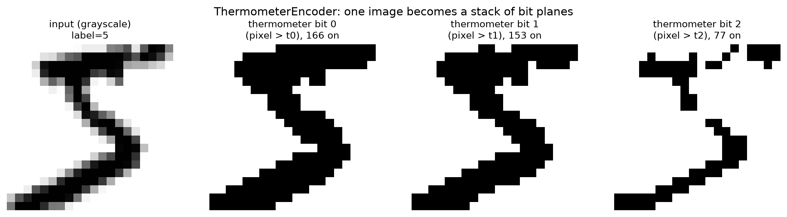
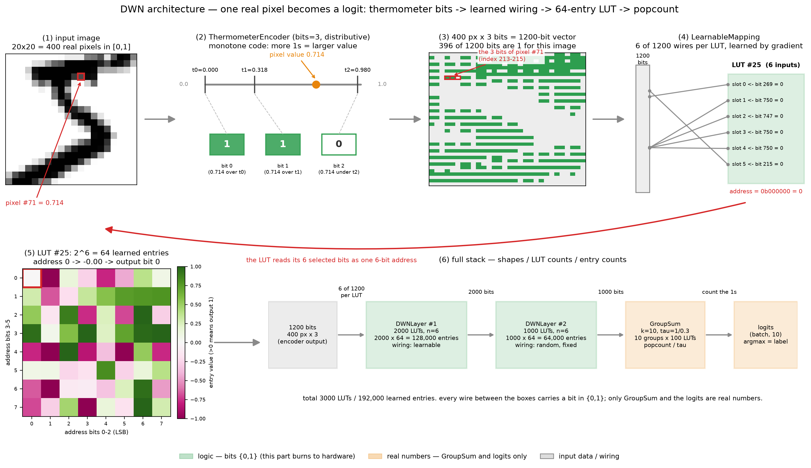
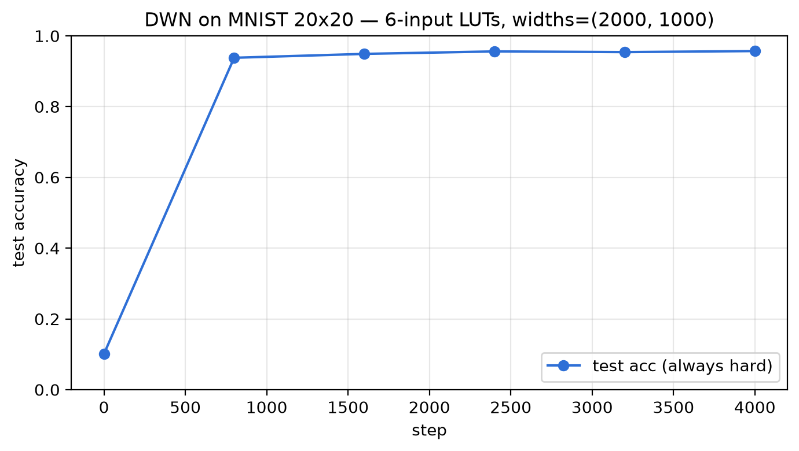
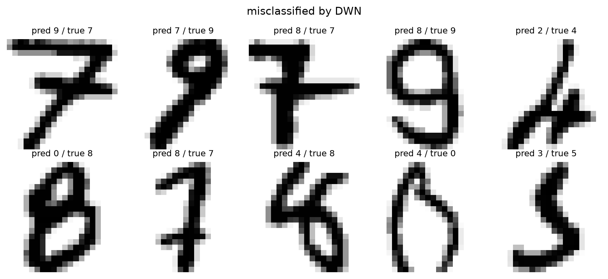

<!-- This file is generated automatically by scripts/build_tutorials.py.
     Do not edit it directly; edit examples/16_dwn.py and regenerate. -->

The exception in the logic-NN world: **a discretization gap of zero**. DWN (Differentiable
Weightless Neural Network) combines a `ThermometerEncoder` — which drops real-valued pixels into a
monotone bit string — with 64-entry n-input LUTs, and the maximum logit difference between `train()`
and `eval()` is **0.0**. In other words, the model being trained and the circuit being burned are
identical from the start.

test acc 0.958. This is the page that shows how the "works in soft, falls apart in hard" problem
covered on many other pages disappears purely through the choice of parameterization.

:::tip[What you'll learn]
1. The binarization technique of dropping real-valued pixels into a monotone bit string with `ThermometerEncoder`
2. How to build a DWN out of 64-entry n-input LUTs (test acc 0.958)
3. The mechanism that makes the **discretization gap 0.0** — the model being trained and the circuit being burned are identical

**Prerequisites**

- [1. Train on MNIST](/en/tutorials/mnist/) — the baseline to compare a plain LutLayer against
- [Choosing a parameterization](/en/guides/parameterization/)
:::

:::note[About this page]
Estimated time: **about 7 minutes** / Environment: CPU only (no GPU needed)
Source script: [`examples/16_dwn.py`](https://github.com/tsukushi-gate/Griffith/blob/main/examples/16_dwn.py)
Try it yourself: [`notebooks/16_dwn.ipynb`](https://github.com/tsukushi-gate/Griffith/blob/main/notebooks/16_dwn.ipynb) (an unexecuted notebook with the same content as this page; open it with `uv run --group docs jupyter lab notebooks/`)
Every code output is the **actual result of running the code**, embedded verbatim.
:::

<!-- Colab badge: once the repository is public, replace this span with an <a> whose href is
     data-colab-url and "Open in Colab" becomes active. -->
<span class="colab-badge" data-colab-url="https://colab.research.google.com/github/tsukushi-gate/Griffith/blob/main/notebooks/16_dwn.ipynb">▶ Open in Colab (enabled once the repository is public)</span>

An example of solving MNIST with a DWN (Differentiable Weightless Neural Network).

The DLGN in 06_mnist.py was "a circuit of sparsely wired 2-input logic gates". DWN (Bacellar et al.,
ICML 2024) is the same kind of logic circuit but with a different design philosophy:

  - The basic element is an **n-input LUT (lookup table)**, not a gate.
    With n=6 you learn a whole 2^6=64-entry truth table (its expressiveness is in another league from a gate).
  - Real-valued inputs are dropped into bit strings by a **ThermometerEncoder**.
    A monotone code that expresses "how large the value is" as "how many bits are set".
  - The forward pass is **always hard**, even during training (LUTs are binary, connections are argmax).
    So there is structurally no soft/hard discretization gap like DLGN has
    — the accuracy you watch during training is exactly the accuracy of the burned circuit.

**The whole picture: how one real pixel becomes a logit**

The numbers are this example's actual settings (BITS=3 / 400 pixels / WIDTHS=(2000,1000) /
N_INPUTS=6) and measured values. Pixel #71 is a real pixel of the first training image (label 5),
and the thresholds are the measured values of `encoder.thresholds[:, 71]`.

```mermaid
graph LR
  subgraph ENC["① ThermometerEncoder (real → bits, bits=3, distributive)"]
    direction LR
    IMG["input image 20×20<br/>400 real pixels in [0,1]"]
    CMP["compare against 3 thresholds<br/>e.g. pixel #71 = 0.714<br/>t0=0.000 / t1=0.318 / t2=0.980"]
    BIT["bit string 1 1 0<br/>over t0 and t1, does not reach t2<br/>= monotone (larger value, more 1s)"]
    VEC["one image = 1,200 bits<br/>400 pixels × 3 bits (396 are 1 for this image)"]
    IMG --> CMP --> BIT --> VEC
  end

  subgraph NET["② The DWN itself (everything here is bits)"]
    direction LR
    MAP["LearnableMapping<br/>argmax per column of W(1,200 × 12,000)<br/>picks 6 wires per LUT (the wiring is learned too)"]
    L1["DWNLayer #1<br/>2,000 LUTs × 6 inputs<br/>learns 64 entries (2^6) each<br/>128,000 in total → 2,000 bits"]
    L2["DWNLayer #2<br/>1,000 LUTs × 6 inputs (wiring fixed)<br/>64,000 entries in total → 1,000 bits"]
    MAP --> L1 -->|"2,000 bits"| L2
  end

  subgraph OUT["③ Decoding (reals only here)"]
    direction LR
    GS["GroupSum k=10 τ=1/0.3<br/>split 1,000 bits into 100 × 10 classes<br/>count the 1s (no weights)"]
    LOG["logits (10 reals) → argmax = predicted label"]
    GS -->|"(B, 10) reals"| LOG
  end

  subgraph GAP["④ Why DWN has no discretization gap"]
    direction LR
    G1["LUT outputs stay in {0,1} during training<br/>connections stay argmax during training (one wire, decided)"]
    G2["= the model being trained is the circuit being burned<br/>train() and eval() logits match exactly"]
    G1 --> G2
  end

  VEC --> MAP
  L2 --> GS
  L2 -.->|"the forward pass is always hard"| G1

  style IMG fill:#38bdf826,stroke:#38bdf8
  style CMP fill:#eab30826,stroke:#eab308
  style BIT fill:#10b98126,stroke:#10b981
  style VEC fill:#10b98126,stroke:#10b981
  style MAP fill:#eab30826,stroke:#eab308
  style L1 fill:#10b98126,stroke:#10b981
  style L2 fill:#10b98126,stroke:#10b981
  style GS fill:#f9731626,stroke:#f97316
  style LOG fill:#38bdf826,stroke:#38bdf8
  style G1 fill:#10b98126,stroke:#10b981
  style G2 fill:#eab30826,stroke:#eab308
```



**How it actually works (for readers new to neural networks)**

- **LUT (lookup table)** = a table that writes down the answer for every combination of inputs.
  With 6 inputs there are 2^6 = 64 combinations, so writing a 0 or a 1 into 64 cells expresses
  "any logic function of 6 inputs". What DWN learns is **the contents of that table itself**,
  not multiplicative weights.
- **Thermometer encoding** = a way of writing "how large the value is" as "how many bits are set".
  0.714 → `1 1 0`, a darker pixel → `1 1 1`. Unlike one-hot it preserves order, so nearby values
  give nearby bit strings and the downstream LUTs can handle magnitude relations easily.
- **Where to put the thresholds (distributive)** = place the thresholds at quantiles of the training
  data. Most MNIST pixels cluster near 0, so uniform spacing leaves almost all the bits dead.
- **Learning the wiring (LearnableMapping)** = which LUT looks at which input line is normally fixed
  at random. DWN holds a matrix of "1,200 input wires × 12,000 selection slots" and picks one wire
  per column with argmax. Gradients flow into that matrix too, so **the wiring is learned**.
- **EFD (Extended Finite Difference)** = a table lookup is a staircase and cannot be differentiated.
  So a finite difference using "the value of the neighbouring cell" is used in place of the gradient.
  This is the core idea of DWN.
- **GroupSum** = split the final layer's 1,000 bits into 10 classes × 100, count the 1s, and divide
  by the temperature τ. There is not a single learnable weight, which is why it is called "weightless".
- **Structurally zero discretization gap** = the forward pass is always hard, even during training
  (LUT outputs are {0,1}, connections are argmax). In other words, **the accuracy you watch during
  training is exactly the accuracy of the burned circuit**. The soft/hard divergence check of
  DLGN (06_mnist.py) is unnecessary.

In this example we look at four figures:
  1. How thermometer encoding turns one image into a stack of bit planes (Figure 1)
  2. The whole architecture drawn from the trained weights (Figure 2) — one pixel → bit string →
     wiring → a 64-entry truth table → popcount → logit, followed with real numbers
  3. The learning curve on MNIST 20x20 (Figure 3) and misclassified examples (Figure 4)

Run: uv run python examples/16_dwn.py
Expected result: test accuracy around 0.95 (2-3 minutes on CPU)

## Preparation: imports and the random seed

All we use is PyTorch, matplotlib, and three things from this library:
`ThermometerEncoder` / `DWNLayer` / `DWNClassifier`.

Let us pin down the terminology here. The *weightless* in **DWN** (Differentiable Weightless
Neural Network) means that it holds **not a single multiplicative weight matrix**. What an
ordinary NN learns is "weights"; what DWN learns is **the contents of a LUT (lookup table —
a table that writes down the answer for every combination of inputs)** itself.
Looking a value up in a table is not a multiplication, so this circuit burns to hardware as it is.

```python
import matplotlib.pyplot as plt
import numpy as np
import torch
import torch.nn.functional as F
from matplotlib.patches import FancyArrowPatch, Patch, Rectangle
from torch.utils.data import DataLoader, Subset

from griffith_logic import DWNClassifier, DWNLayer, ThermometerEncoder
from griffith_logic.datasets import load_mnist20x20
```

```python
# The LUTs' initial entries and connections are random, so fix the seed for reproducibility.
torch.manual_seed(0)
```

### Hyperparameters

Let us define the symbols first; they keep this meaning from here on.

- **q** — the **real-valued** intensity one pixel carries. On MNIST, a continuous value in `[0, 1]`
- **z = BITS** — how many bits one pixel is encoded into. Here, 3
- **t_1 … t_z** — the **thresholds** of the thermometer encoding. q is compared against them to make bits
- **n = N_INPUTS** — the number of input wires one LUT looks at. Here, 6.
  There are **2^n = 64 combinations** of inputs, so **a LUT has 64 entries (cells of the table)**
- **Address** — the **row number** being looked up. It is the n input bits read directly as an
  n-digit binary number, so it falls in the range `0 … 2^n - 1`

In other words, one LUT is an element that only "reads 6 bits as a 6-digit binary number
(= an address) and looks up a 64-row table once". **What is learned is the contents of those
64 cells**, not coefficients.

```python
# A recipe that fits in 1-2 minutes on CPU. Raising BITS, the widths, or STEPS improves accuracy.
BITS = 3               # thermometer bits per pixel (3, same as the official mnist.py)
WIDTHS = (2000, 1000)  # number of LUTs in each DWNLayer (same as the official recipe)
N_INPUTS = 6           # inputs n per LUT → the truth table has 2^6 = 64 entries
STEPS = 4000
BATCH = 128
N_TRAIN = 20000
N_TEST = 2000
```

## Data: passed through as real values

The DLGN in 06_mnist.py collapsed the input to 0/1 up front; here we **do not**. Binarization is
the job of `ThermometerEncoder` in the next section, and doing it there requires
**looking at the distribution of the training data to decide the thresholds**.
Collapsing the values here would throw that distributional information away.

```python
# The same difflogic-compatible 20x20 MNIST as 06_mnist.py. Values are passed as continuous [0,1]
# (binarization is the ThermometerEncoder's job, so we do not collapse them here).
train_set, test_set = load_mnist20x20(binarize_threshold=None)
```

```python
def materialize(dataset, n):
    """Collect the first n samples into a (N, 400) tensor plus labels."""
    subset = Subset(dataset, range(n))
    x, y = next(iter(DataLoader(subset, batch_size=n)))
    return x.reshape(n, -1), y
```

```python
train_x, train_y = materialize(train_set, N_TRAIN)
test_x, test_y = materialize(test_set, N_TEST)
print(f'train={tuple(train_x.shape)} test={tuple(test_x.shape)} '
      f'(20x20=400画素 / 10クラス)')
```

```text title="Output"
train=(20000, 400) test=(2000, 400) (20x20=400画素 / 10クラス)
```

## Thermometer encoding: dropping reals into "bit strings that preserve nearness"

**Why an encoding is needed at all.** A LUT is an element that lines bits up into an address, so it
cannot be fed a real-valued pixel q directly. Binarization has to happen somewhere.

**Why one-hot will not do.** Naively raising one line per value interval — a one-hot code — makes
**nearby values, such as 0.31 and 0.33, land on completely distant bit strings**. A LUT that only
looks a table up has no notion of "this address is near that address", so not a single clue about
magnitude relations survives downstream.

**Thermometer encoding** solves exactly this. Ones are set from the bottom up, one for each
threshold q exceeds — in other words **only the number of ones increases, monotonically** — so the
relation "nearby values give nearby bit strings" is preserved. That is why the downstream LUTs can
handle magnitude relations. As the name says, the code has the same shape as the mercury column of a
thermometer creeping upwards.

**Why the thresholds go at empirical quantiles (the values obtained by lining the real data up and
cutting at a given percentile).** `mode='distributive'` places t_1 … t_z at empirical quantiles of
the training data. MNIST pixels are heavily skewed towards pure black (near 0), so placing the
thresholds **at uniform spacing such as `0.25 / 0.5 / 0.75` leaves every bit constantly 0 for most
pixels**, and no information is carried at all. Quantiles cut where the data actually spreads out, so
every bit does work.

```python
# ThermometerEncoder(bits=z) compares a real value q against z thresholds and produces
#   T(q) = (1_{q>t_1}, ..., 1_{q>t_z})
# a "bit string whose ones increase monotonically". Unlike one-hot it preserves order, so
# "nearby values give nearby bit strings" and the downstream LUTs can handle magnitude relations easily.
#
# mode='distributive' places the thresholds at empirical quantiles of the training data
# (far more effective than uniform spacing on data like MNIST where pixels cluster near 0).
encoder = ThermometerEncoder(bits=BITS, mode='distributive').fit(train_x)
print(f'\n温度計しきい値 shape={tuple(encoder.thresholds.shape)} '
      f'(bits × 画素数) 例: 画素[210]のしきい値='
      f'{[round(v, 3) for v in encoder.thresholds[:, 210].tolist()]}')
```

    
```text title="Output"
温度計しきい値 shape=(3, 400) (bits × 画素数) 例: 画素[210]のしきい値=[0.0, 0.49, 0.992]
```

### Figure 1: one image becomes a stack of bit planes

**What to look at in this figure.** The leftmost panel is the original grayscale image; the three on
the right are the bits of `T(q) = (1_{q>t_1}, …, 1_{q>t_z})` folded back into 20x20 (= bit planes).
What matters is **whether the black dots thin out as you move right**. The threshold t_b rises as b
advances, so if monotonicity holds, only the darker pixels should survive.

```python
# One image (400,) → a bit string of (400*bits,). Fold it back per bit plane and lay them out.
sample = train_x[0]
code = encoder.encode(sample)          # (400, bits)
print(f'1枚の画像: 400画素 → {code.numel()} ビット '
      f'(立っているビット {int(code.sum())} 本)')

fig, axes = plt.subplots(1, BITS + 1, figsize=(3.0 * (BITS + 1), 3.2))
axes[0].imshow(sample.reshape(20, 20), cmap='gray_r', vmin=0, vmax=1)
axes[0].set_title(f'input (grayscale)\nlabel={int(train_y[0])}', fontsize=10)
axes[0].set_axis_off()
for b in range(BITS):
    # bit b means "pixel value > t_b". The further b goes, the higher the threshold,
    # so only dark pixels survive → the number of ones decreases (monotonicity shows up directly in the picture).
    axes[b + 1].imshow(code[:, b].reshape(20, 20), cmap='gray_r', vmin=0, vmax=1)
    axes[b + 1].set_title(f'thermometer bit {b}\n(pixel > t{b}), '
                          f'{int(code[:, b].sum())} on', fontsize=10)
    axes[b + 1].set_axis_off()
fig.suptitle('ThermometerEncoder: one image becomes a stack of bit planes',
             fontsize=12)
fig.tight_layout()
plt.show()
```

```text title="Output"
1枚の画像: 400画素 → 1200 ビット (立っているビット 396 本)
```

    

    

**Reading it.** The `N on` figure in the titles drops reliably as we go from bit 0 to bit 2. That is
the **monotonicity** of the thermometer code itself: the set of pixels where bit b is 1 necessarily
contains the set where bit b+1 is 1 (they nest). The right way to read the three pictures is not as
"three separate features" but as **strata of the same digit, sliced at thresholds of intensity**.
It also matters that the outline of the original image survives in every bit, which means the shape
information is not lost by binarization.

## DWNLayer: just a row of n-input LUTs

From here on **everything lives in the world of bits**. Before dropping `DWNLayer` straight into a
classifier, let us check on its own — with a tiny layer of only 8 LUTs — what the layer actually does.

**EFD (Extended Finite Difference)** deserves a mention here too. A table lookup is a staircase
function where "the output jumps when the address changes by one", so it cannot be differentiated as
it is (the gradient is 0 everywhere). Instead of a derivative, DWN propagates as the gradient
**the difference against a neighbouring cell (the entry whose address differs by one bit)**.
That is the finite difference, and it is the core idea of DWN.

```python
# DWNLayer(in_bits, out_luts, n_inputs=n) is a layer of out_luts LUTs, each of which
# "selects n input lines and looks up a 2^n-entry truth table". What is learned is
#   (a) the 2^n entry values of each LUT
#   (b) with mapping='learnable', which input lines to look up
# Giving gradients to the discrete LUT lookup via a finite difference called
# EFD (Extended Finite Difference) is the core idea of DWN.
probe = DWNLayer(in_bits=400 * BITS, n_luts=8, n_inputs=N_INPUTS,
                 mapping='learnable')
with torch.no_grad():
    probe_out = probe(encoder(train_x[:4]))
print(f'\nDWNLayer単体: 入力{400 * BITS}ビット → 出力{tuple(probe_out.shape)}, '
      f'LUTエントリ数/個={2 ** N_INPUTS}, 出力は常に二値='
      f'{bool(((probe_out == 0) | (probe_out == 1)).all())}')
```

    
```text title="Output"
DWNLayer単体: 入力1200ビット → 出力(4, 8), LUTエントリ数/個=64, 出力は常に二値=True
```

## Assembling the classifier: encoder → 2 LUT layers → GroupSum

The parts are ready, so we wire them in series. Let us define the remaining terms together here.

- **LearnableMapping (learned wiring)** — which LUT looks at which input bit line is normally fixed
  at random. DWN holds a matrix of "1,200 input wires × 12,000 selection slots" and picks one wire
  per column with argmax. Gradients flow into that matrix too, so **the wiring itself is learned**
- **GroupSum / popcount (counting the number of ones)** — the final layer's 1,000 bits are split into
  10 classes × 100, and the bits that are set in each group are simply **counted**.
  The count is divided by the temperature τ to become a logit. That there is not a single learnable
  weighted sum is precisely why this method is called weightless

```python
# Inside it is just the parts above in series: encoder → DWNLayer×2 → GroupSum.
# GroupSum splits the final layer's 1000 LUT outputs into 10 classes × 100, and divides
# the popcount (the number of ones) by tau to get logits. No learnable weighted sum at all (= weightless).
model = DWNClassifier(
    in_features=400,
    n_classes=10,
    layer_widths=WIDTHS,
    bits=BITS,
    encoder_mode='distributive',
    n_inputs=N_INPUTS,
    mapping='learnable',   # learn the connections only in the first layer (recommended by the official README)
)
```

```python
# Fit the same thresholds on the encoder held inside the classifier.
model.fit_encoder(train_x)
print(model)
```

```text title="Output"
DWNClassifier(
  (encoder): ThermometerEncoder(bits=3, mode=distributive, fitted=True)
  (layers): ModuleList(
    (0): DWNLayer(
      in_bits=1200, n_luts=2000, n_inputs=6, entries=64, mapping=learnable, efd=paper, ste=True
      (learnable_mapping): LearnableMapping(in=1200, out=12000, tau=0.001)
    )
    (1): DWNLayer(in_bits=2000, n_luts=1000, n_inputs=6, entries=64, mapping=random, efd=paper, ste=True)
  )
  (group_sum): GroupSum(k=10, tau=3.3333333333333335)
)
```

## Training: an ordinary PyTorch loop inside

No special learning rule is needed. We just drive `cross_entropy` down with Adam.
There is one decisive difference from 01_xor.py and 06_mnist.py, though —
**there is nowhere to measure a soft accuracy**. DWN's forward pass is always a hard table lookup,
even during training, so only one kind of accuracy exists to be measured in the first place.

```python
# Ordinary PyTorch here too. Since DWN's forward pass is always hard,
# switching between eval()/train() does not change accuracy (we verify this below).
opt = torch.optim.Adam(model.parameters(), lr=0.01)
history = []

for step in range(STEPS + 1):
    if step % 800 == 0:
        model.eval()
        with torch.no_grad():
            acc = (model(test_x).argmax(-1) == test_y).float().mean().item()
        model.train()
        history.append((step, acc))
        print(f'step {step:>5}  test acc={acc:.4f}')

    idx = torch.randint(0, N_TRAIN, (BATCH,))
    opt.zero_grad()
    loss = F.cross_entropy(model(train_x[idx]), train_y[idx])
    loss.backward()
    opt.step()

steps, accs = zip(*history, strict=True)
final_acc = accs[-1]
```

```text title="Output"
step     0  test acc=0.1010

step   800  test acc=0.9380

step  1600  test acc=0.9490

step  2400  test acc=0.9560

step  3200  test acc=0.9540

step  4000  test acc=0.9570
```

## Checking the discretization gap: why it is 0 for DWN

The **discretization gap** is the difference between "the accuracy you were watching during
training" and "the accuracy after burning the circuit". To pair up the terms: **soft eval** is
evaluation while still continuously relaxed (`train()` mode), and **hard eval** is evaluation after
discretizing and fixing everything (`eval()` mode).

**Why DLGN has a gap.** During training, one gate of a DLGN (06_mnist.py) is a **soft mixture** of
the 16 two-input logic functions, and it can take intermediate states such as "70% XOR, 30% AND".
Burning it fixes it to a single function with argmax, so **the model that was trained and the circuit
that gets burned are different things**. That is why the divergence check was mandatory there.

**Why DWN has a gap of 0.** DWN's forward pass is **always a hard table lookup**, even during
training: a LUT output is always in {0,1}, and the wiring is always fixed to one wire by argmax.
No intermediate state exists. Only the gradient is approximated, via EFD (a finite difference), so
**the model being trained and the circuit being burned are identical from the start**.

Below we verify mechanically that the claim is true. We evaluate the same weights in both `train()`
and `eval()` mode and assert that the maximum logit difference is **exactly 0.0**.

```python
# Confirming there is no discretization gap: evaluating the same weights in train() mode and
# eval() mode gives outputs that match **bit for bit** in DWN
# (with DLGN = 06_mnist.py, soft and hard differ by a few percent).
model.train()
with torch.no_grad():
    logits_train_mode = model(test_x)
model.eval()
with torch.no_grad():
    logits_eval_mode = model(test_x)
gap = (logits_train_mode - logits_eval_mode).abs().max().item()
print(f'\n最終 test acc={final_acc:.4f}')
print(f'train()モードと eval()モードのロジット最大差 = {gap} '
      f'(DWNは離散化ギャップが構造的に存在しない)')
assert gap == 0.0, f'離散化ギャップが発生している: {gap}'
assert final_acc > 0.90, f'test acc={final_acc:.4f} が低すぎる'
```

    
```text title="Output"
最終 test acc=0.9570
train()モードと eval()モードのロジット最大差 = 0.0 (DWNは離散化ギャップが構造的に存在しない)
```

## Visualization: the fate of one pixel, the learning curve, and misclassifications

### Material for Figure 2: pulling "the fate of one pixel" out of the trained model

From here we look at three figures. First we gather the material that replaces the abstract
explanation with measured values. We track exactly one point, pixel #71, and **read everything out of
the trained model**: its real value q, the three thresholds t_1…t_3, the thermometer bits, the 6
input wires the LearnableMapping actually selected, and the address read plus the value of that
entry (every number in the figure is one of these measured values).

```python
# Pixel #71 (a point towards the upper left of the first training image) is the one we track.
# Everything collected here is measured: the pixel value, the thresholds, the thermometer bits,
# the 6 input wires the LearnableMapping selected, and the address and value of the truth-table entry read.
PIXEL = 71
px_row, px_col = divmod(PIXEL, 20)
px_value = float(sample[PIXEL])
px_thresholds = [float(v) for v in model.encoder.thresholds[:, PIXEL]]
px_bits = [int(px_value > t) for t in px_thresholds]
code_flat = model.encoder(sample.unsqueeze(0))[0].detach()   # (1200,)
n_bits_on = int(code_flat.sum())
px_bit_ids = [PIXEL * BITS + b for b in range(BITS)]
```

```python
# The trained wiring: argmax per column of W(1200 × 12000) → input wire indices of shape (n_luts, 6)
wires = model.layers[0].learnable_mapping.weights.detach().argmax(dim=0)
wires = wires.reshape(WIDTHS[0], N_INPUTS)
```

```python
# Pick one LUT that actually looks at a bit of pixel #71 (fall back to #0 if there is none)
hits = (wires.unsqueeze(-1) == torch.tensor(px_bit_ids)).any(-1).any(-1)
hit_ids = hits.nonzero(as_tuple=True)[0]
LUT_ID = int(hit_ids[0]) if hit_ids.numel() else 0
lut_wires = [int(i) for i in wires[LUT_ID]]
lut_in_bits = [int(code_flat[i]) for i in lut_wires]
lut_addr = sum(b << j for j, b in enumerate(lut_in_bits))
lut_table = model.layers[0].luts.detach()[LUT_ID]
lut_entry = float(lut_table[lut_addr])
lut_out = int(lut_entry > 0)

print(f'\n追跡する画素 #{PIXEL} 値={px_value:.3f} '
      f'しきい値={[round(t, 3) for t in px_thresholds]} → ビット {px_bits}')
print(f'画素#{PIXEL}のビットを見ているLUT = #{LUT_ID} '
      f'(入力線 {lut_wires} / 値 {lut_in_bits})')
print(f'  → アドレス {lut_addr} (0b{lut_addr:06b}) のエントリ = {lut_entry:+.3f} '
      f'→ 出力ビット {lut_out}')
```

    
```text title="Output"
追跡する画素 #71 値=0.714 しきい値=[0.0, 0.318, 0.98] → ビット [1, 1, 0]
画素#71のビットを見ているLUT = #25 (入力線 [269, 750, 747, 750, 750, 215] / 値 [0, 0, 0, 0, 0, 0])
  → アドレス 0 (0b000000) のエントリ = -0.004 → 出力ビット 0
```

### Figure 2: from one real pixel to a logit (the whole picture)

```python
def draw_dwn_architecture():
    """Draw the architecture of the trained DWN in a single figure.

    From upper left to lower right it follows "one real pixel → thermometer bits → 1200 bits →
    learned wiring → a 64-entry truth table → two LUT layers → popcount → logits".
    Each stage is annotated with shapes, LUT counts and entry counts.
    The text in the figure is ASCII only (the matplotlib default font has no Japanese glyphs).
    """
    c_logic, c_real, c_wire = '#2e9e4f', '#e8850c', '#8a8a8a'
    c_mark = '#d62728'
    fig = plt.figure(figsize=(16.0, 9.0))
    fig.suptitle(
        'DWN architecture — one real pixel becomes a logit: '
        'thermometer bits -> learned wiring -> 64-entry LUT -> popcount',
        fontsize=13, y=0.975,
    )

    def arrow(p0, p1, rad=0.0, color=c_wire):
        fig.add_artist(FancyArrowPatch(
            p0, p1, transform=fig.transFigure, arrowstyle='-|>',
            mutation_scale=20, lw=1.8, color=color, zorder=5,
            connectionstyle=f'arc3,rad={rad}',
        ))

    # (1) the input image and the pixel being tracked
    ax1 = fig.add_axes([0.035, 0.595, 0.155, 0.28])
    ax1.imshow(sample.reshape(20, 20), cmap='gray_r', vmin=0, vmax=1)
    ax1.add_patch(Rectangle((px_col - 0.5, px_row - 0.5), 1, 1,
                            fill=False, ec=c_mark, lw=2.2))
    ax1.annotate(f'pixel #{PIXEL} = {px_value:.3f}',
                 xy=(px_col, px_row + 0.6), xytext=(-0.5, 22.6),
                 fontsize=8.5, color=c_mark, annotation_clip=False,
                 arrowprops=dict(arrowstyle='->', color=c_mark, lw=1.3))
    ax1.set_xticks([])
    ax1.set_yticks([])
    ax1.set_title('(1) input image\n20x20 = 400 real pixels in [0,1]', fontsize=10)

    # (2) thermometer encoding: compare against the thresholds to get a bit string
    ax2 = fig.add_axes([0.245, 0.595, 0.235, 0.28])
    ax2.set_xlim(-0.14, 1.14)
    ax2.set_ylim(-1.25, 1.05)
    ax2.axis('off')
    ax2.plot([0, 1], [0.5, 0.5], color=c_wire, lw=2.5, solid_capstyle='round')
    ax2.text(-0.11, 0.5, '0.0', fontsize=7.5, va='center', ha='right', color=c_wire)
    ax2.text(1.11, 0.5, '1.0', fontsize=7.5, va='center', ha='left', color=c_wire)
    box_x = [0.14, 0.5, 0.86]
    for b, (t, bit) in enumerate(zip(px_thresholds, px_bits, strict=True)):
        ax2.plot([t, t], [0.36, 0.64], color='#444444', lw=1.6)
        ax2.text(t, 0.72, f't{b}={t:.3f}', fontsize=7.5, ha='center')
        ax2.plot([t, box_x[b]], [0.34, -0.36], color='#bbbbbb', lw=0.9, ls='--')
        face = c_logic if bit else '#ffffff'
        ax2.add_patch(Rectangle((box_x[b] - 0.11, -0.72), 0.22, 0.36,
                                fc=face, alpha=0.85 if bit else 1.0,
                                ec=c_logic, lw=1.6))
        ax2.text(box_x[b], -0.54, str(bit), fontsize=13, ha='center', va='center',
                 weight='bold', color='#ffffff' if bit else '#333333')
        rel = 'over' if bit else 'under'
        ax2.text(box_x[b], -0.86, f'bit {b}\n({px_value:.3f} {rel} t{b})',
                 fontsize=7, ha='center', va='top')
    ax2.plot([px_value], [0.5], 'o', ms=10, color=c_real, zorder=6)
    ax2.annotate(f'pixel value {px_value:.3f}', xy=(px_value, 0.58),
                 xytext=(px_value - 0.30, 0.98), fontsize=8.5, color=c_real,
                 arrowprops=dict(arrowstyle='->', color=c_real, lw=1.3))
    ax2.set_title('(2) ThermometerEncoder (bits=3, distributive)\n'
                  'monotone code: more 1s = larger value', fontsize=10)

    # (3) the whole image becomes a 1200-bit vector
    ax3 = fig.add_axes([0.535, 0.595, 0.185, 0.28])
    grid = code_flat.reshape(40, 30).numpy()
    rgb = np.empty((40, 30, 3))
    rgb[grid > 0.5] = [0.18, 0.62, 0.31]
    rgb[grid <= 0.5] = [0.93, 0.93, 0.93]
    ax3.imshow(rgb, interpolation='nearest', aspect='auto')
    for bid in px_bit_ids:
        br, bc = divmod(bid, 30)
        ax3.add_patch(Rectangle((bc - 0.5, br - 0.5), 1, 1,
                                fill=False, ec=c_mark, lw=1.8))
    ax3.annotate(f'the 3 bits of pixel #{PIXEL}\n(index {px_bit_ids[0]}-{px_bit_ids[-1]})',
                 xy=(px_bit_ids[1] % 30, px_bit_ids[1] // 30 - 0.6),
                 xytext=(9.0, 2.0), fontsize=8, color=c_mark,
                 bbox=dict(fc='white', ec='none', alpha=0.88, pad=1.5),
                 arrowprops=dict(arrowstyle='->', color=c_mark, lw=1.3))
    ax3.set_xticks([])
    ax3.set_yticks([])
    ax3.set_title(f'(3) 400 px x 3 bits = 1200-bit vector\n'
                  f'{n_bits_on} of 1200 bits are 1 for this image', fontsize=10)

    # (4) LearnableMapping: pick 6 wires out of 1200 (the actual trained connections)
    ax4 = fig.add_axes([0.775, 0.555, 0.205, 0.32])
    ax4.set_xlim(0, 1)
    ax4.set_ylim(0, 1)
    ax4.axis('off')
    ax4.add_patch(Rectangle((0.02, 0.08), 0.08, 0.84, fc='#eeeeee', ec=c_wire, lw=1.2))
    ax4.text(0.06, 0.955, '1200\nbits', fontsize=7.5, ha='center', va='center')
    ax4.add_patch(Rectangle((0.55, 0.14), 0.44, 0.72,
                            fc=c_logic, alpha=0.16, ec=c_logic, lw=1.8))
    ax4.text(0.77, 0.905, f'LUT #{LUT_ID}  (6 inputs)', fontsize=8.5,
             ha='center', weight='bold')
    for j, (bidx, bval) in enumerate(zip(lut_wires, lut_in_bits, strict=True)):
        ys = 0.90 - 0.84 * bidx / (400 * BITS)
        yd = 0.79 - j * 0.105
        col = c_logic if bval else c_wire
        ax4.plot([0.10, 0.55], [ys, yd], color=col, lw=1.4, alpha=0.95)
        ax4.plot([0.10], [ys], 'o', ms=3.5, color=col)
        ax4.plot([0.55], [yd], 'o', ms=3.5, color=col)
        ax4.text(0.575, yd, f'slot {j} <- bit {bidx} = {bval}', fontsize=7,
                 va='center', ha='left')
    ax4.text(0.77, 0.075, f'address = 0b{lut_addr:06b} = {lut_addr}',
             fontsize=8, ha='center', color=c_mark)
    ax4.set_title('(4) LearnableMapping\n6 of 1200 wires per LUT, learned by gradient',
                  fontsize=10)

    # (5) the trained 64-entry truth table
    ax5 = fig.add_axes([0.055, 0.105, 0.175, 0.32])
    im = ax5.imshow(lut_table.reshape(8, 8).numpy(), cmap='PiYG', vmin=-1, vmax=1)
    ax5.set_xticks(range(8))
    ax5.set_yticks(range(8))
    ax5.tick_params(labelsize=7)
    ax5.set_xlabel('address bits 0-2 (LSB)', fontsize=8)
    ax5.set_ylabel('address bits 3-5', fontsize=8)
    ar, ac = divmod(lut_addr, 8)
    ax5.add_patch(Rectangle((ac - 0.5, ar - 0.5), 1, 1, fill=False, ec=c_mark, lw=2.6))
    ax5.set_title(f'(5) LUT #{LUT_ID}: 2^6 = 64 learned entries\n'
                  f'address {lut_addr} -> {lut_entry:+.2f} -> output bit {lut_out}',
                  fontsize=10)
    cax = fig.add_axes([0.238, 0.105, 0.009, 0.32])
    cb = fig.colorbar(im, cax=cax)
    cb.ax.tick_params(labelsize=7)
    cb.set_label('entry value (>0 means output 1)', fontsize=7.5)

    # (6) two LUT layers → GroupSum → logits
    ax6 = fig.add_axes([0.345, 0.105, 0.625, 0.32])
    ax6.set_xlim(0, 1)
    ax6.set_ylim(0, 1)
    ax6.axis('off')
    stack = [
        (0.00, 0.13, c_wire, '1200 bits\n400 px x 3\n(encoder output)'),
        (0.185, 0.19, c_logic,
         'DWNLayer #1\n2000 LUTs, n=6\n2000 x 64 = 128,000 entries\nwiring: learnable'),
        (0.43, 0.19, c_logic,
         'DWNLayer #2\n1000 LUTs, n=6\n1000 x 64 = 64,000 entries\nwiring: random, fixed'),
        (0.675, 0.15, c_real,
         'GroupSum\nk=10, tau=1/0.3\n10 groups x 100 LUTs\npopcount / tau'),
        (0.88, 0.12, c_real, 'logits\n(batch, 10)\nargmax = label'),
    ]
    for x0, w, col, label in stack:
        ax6.add_patch(Rectangle((x0, 0.33), w, 0.44, fc=col, alpha=0.16,
                                ec=col, lw=1.8))
        ax6.text(x0 + w / 2, 0.55, label, fontsize=8, ha='center', va='center')
    edge_labels = ['6 of 1200\nper LUT', '2000 bits', '1000 bits', 'count the 1s']
    for (x0, w, _, _), (x1, _, _, _), lab in zip(
            stack[:-1], stack[1:], edge_labels, strict=True):
        ax6.annotate('', xy=(x1, 0.55), xytext=(x0 + w, 0.55),
                     arrowprops=dict(arrowstyle='-|>', color=c_wire, lw=1.6))
        ax6.text((x0 + w + x1) / 2, 0.83, lab, fontsize=7.5, ha='center', va='center')
    ax6.text(0.5, 0.13,
             'total 3000 LUTs / 192,000 learned entries. '
             'every wire between the boxes carries a bit in {0,1}; '
             'only GroupSum and the logits are real numbers.',
             fontsize=8.5, ha='center', va='center')
    ax6.set_title('(6) full stack — shapes / LUT counts / entry counts', fontsize=10)

    arrow((0.198, 0.735), (0.238, 0.735))
    arrow((0.487, 0.735), (0.528, 0.735))
    arrow((0.727, 0.735), (0.768, 0.735))
    arrow((0.910, 0.560), (0.150, 0.505), rad=-0.10, color=c_mark)
    fig.text(0.42, 0.434, 'the LUT reads its 6 selected bits as one 6-bit address',
             fontsize=8.5, ha='center', color=c_mark,
             bbox=dict(fc='white', ec='none', alpha=0.9, pad=2.0))
    arrow((0.280, 0.265), (0.338, 0.265))

    fig.legend(
        handles=[
            Patch(facecolor=c_logic, alpha=0.3, edgecolor=c_logic,
                  label='logic — bits {0,1} (this part burns to hardware)'),
            Patch(facecolor=c_real, alpha=0.3, edgecolor=c_real,
                  label='real numbers — GroupSum and logits only'),
            Patch(facecolor='#dddddd', edgecolor=c_wire,
                  label='input data / wiring'),
        ],
        loc='lower center', ncol=3, frameon=False, fontsize=9,
        bbox_to_anchor=(0.5, 0.005),
    )
    plt.show()
```

**What to look at in this figure.** Following the six panels in the order (1) → (6) connects the
whole path from **one real-valued pixel to one logit**.
(1) the tracked pixel q is boxed in red on the image → (2) it is compared against the three
thresholds to become the bit string T(q) → (3) the whole image becomes a 1,200-bit vector →
(4) the LearnableMapping picks 6 wires out of 1,200 and reads them as a 6-digit binary number,
the **address** → (5) that address looks up the 64-entry table once → (6) through two LUT layers and
popcount, a logit.

Note in particular **the red arrow running from (4) to (5)**. It draws the one and only operation of
DWN: "read the 6 selected bits as a single address and look the table up".
The green boxes are the region where only bits flow (this part burns to hardware as it is);
the orange boxes are the real-valued region, and **only GroupSum and the logits are orange**.

```python
draw_dwn_architecture()
```

    

    

**Reading it.** Looking at the table in (5), the 64 cells separate clearly into deep green and deep
purple. In other words, training does not leave the contents of the table muddied at intermediate
values; it pushes **each cell all the way to either the 0 side or the 1 side**. The red-boxed cell is
the answer for this image, and which part of the table is read is decided solely by the 6 bits
selected in (4). As the footnote of (6) says, a total of 3,000 LUTs / 192,000 entries are what gets
learned, **everything flowing between the boxes is a bit in {0,1}**, and the real numbers live only
in the two rightmost boxes.

### Figure 3: the learning curve (there is only one line to draw)

**What to look at in this figure.** The learning curve of 01_xor.py had two lines, soft and hard;
here **only one can be drawn**, because DWN has no soft eval. This "there is only one line" is itself
the visual consequence of a discretization gap of 0. What to watch is how quickly it rises and where
it eventually plateaus.

```python
# Unlike the DLGN figures (two lines, soft and hard), DWN can only draw one. That is the advantage.
fig, ax = plt.subplots(figsize=(7, 4))
ax.plot(steps, accs, 'o-', color='#2e6fd6', label='test acc (always hard)')
ax.set_xlabel('step')
ax.set_ylabel('test accuracy')
ax.set_ylim(0, 1)
ax.grid(alpha=0.3)
ax.legend(loc='lower right')
ax.set_title(f'DWN on MNIST 20x20 — {N_INPUTS}-input LUTs, widths={WIDTHS}')
fig.tight_layout()
plt.show()
```

    

    

**Reading it.** It shoots up to around 0.9 within the first few hundred steps and then converges
gently towards about 0.95. The values shown here are the `eval()` values and, at the same time,
**the values of the model being trained itself** (we confirmed a maximum difference of 0.0 above).
That is, this curve is not a "provisional value that might drop once it is burned" — it shows
**the accuracy of the circuit itself** from the very beginning. The accident of cheering at a high
soft accuracy and then being betrayed by hard, as in DLGN, cannot happen in principle with this
method.

### Figure 4: the digits the circuit got wrong

**What to look at in this figure, and what it tells us.** We lay out the 10 images the circuit made
of 3,000 LUTs dropped. Each title reads `pred (prediction) / true (ground truth)`.
What to check is whether it breaks in some strange, circuit-specific way; what actually lines up is
mostly **shapes a human would also find confusable, such as 4 and 9, 3 and 5, or 7 and 1**.
That its mistakes are continuous with human intuition is evidence that a circuit built out of nothing
but bit strings and table lookups captures the shape of digits properly.
Conversely, if unrelated digits were mixed in at random, that would be the point to suspect the
encoding or the threshold settings.

```python
with torch.no_grad():
    pred = model(test_x).argmax(-1)
wrong = (pred != test_y).nonzero(as_tuple=True)[0][:10]
print(f'誤分類 {int((pred != test_y).sum())} / {N_TEST} 枚(先頭10枚を表示)')

fig, axes = plt.subplots(2, 5, figsize=(9, 4.2))
for ax, i in zip(axes.ravel(), wrong.tolist(), strict=False):
    ax.imshow(test_x[i].reshape(20, 20), cmap='gray_r', vmin=0, vmax=1)
    ax.set_title(f'pred {int(pred[i])} / true {int(test_y[i])}', fontsize=9)
    ax.set_axis_off()
for ax in axes.ravel()[len(wrong):]:
    ax.set_axis_off()
fig.suptitle('misclassified by DWN', fontsize=11)
fig.tight_layout()
plt.show()
```

```text title="Output"
誤分類 87 / 2000 枚(先頭10枚を表示)
```

    


## What to read next

- [Choosing a parameterization](/en/guides/parameterization/) — why the discretization gap is decided by the parameterization
- [BinaryBrain-compatible API](/en/tutorials/binarybrain/) — conversely, a case where the gap opens wide
- [1. Train on MNIST](/en/tutorials/mnist/) — a comparison against a plain LutLayer

<!-- i18n:source=tutorials/dwn.md hash=3124b0421b33 -->
