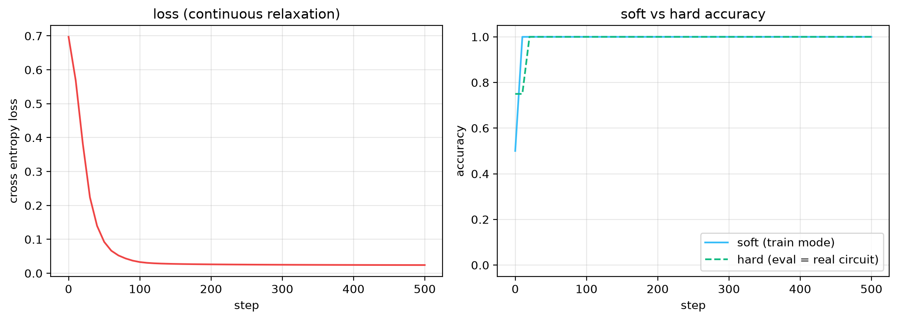
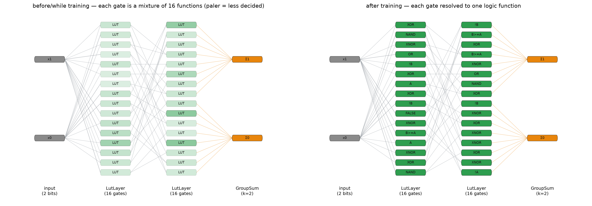
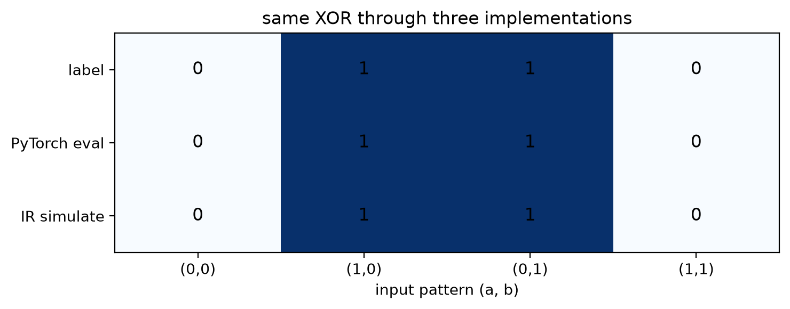

<!-- This file is generated by scripts/build_tutorials.py.
     Do not edit it directly; edit FULL_PIPELINE_SOURCE in scripts/build_tutorials.py and regenerate. -->

An **end-to-end walkthrough** that runs training -> how to read the loss log -> HDL export ->
the hand-off to an FPGA implementation, in one continuous flow. The subject is kept to the
minimal XOR, so even without having read the individual pages
([MNIST](/en/tutorials/mnist/) / [Export to HDL](/en/tutorials/hdl-export/)) first,
this page alone gives you the whole picture of "from training to becoming a circuit".

:::tip[What you'll learn]
1. One unbroken flow from training -> the loss log -> IR -> Verilog -> the FPGA implementation
2. Which API to call at each stage (this page alone runs all the way to the end)
3. A map of which individual page to go back to when you want to dig deeper

**Prerequisites**

- None — you can start reading from this page
:::

:::note[About this page]
Estimated time: **about 15 minutes** / Environment: CPU only (no GPU required)
Source script: none (a composite of `examples/01_xor.py` and `examples/04_export_hdl.py`)
Try it locally: [`notebooks/07_full_pipeline.ipynb`](https://github.com/tsukushi-gate/Griffith/blob/main/notebooks/07_full_pipeline.ipynb) (an unexecuted notebook with the same content as this page; open it with `uv run --group docs jupyter lab notebooks/`)
Every code output below is **the result of an actual run**, embedded verbatim.
:::

<!-- Colab badge: once the repository is public, replace this span with an <a> whose href
     is data-colab-url to enable "Open in Colab". -->
<span class="colab-badge" data-colab-url="https://colab.research.google.com/github/tsukushi-gate/Griffith/blob/main/notebooks/07_full_pipeline.ipynb">▶ Open in Colab (enabled once the repository is public)</span>

## 1. Data and model

XOR is "the smallest problem that cannot be linearly separated", the standard task for measuring the
expressive power of a logic gate circuit.
`griffith_logic.datasets.xor2()` returns a dataset enumerating the 4 patterns in butterfly convention order.
The model is the minimal setup of two `LutLayer`s + `GroupSum` (which aggregates gate outputs per class).

```python
import copy
from pathlib import Path

import matplotlib.pyplot as plt
import numpy as np
import torch
import torch.nn as nn
import torch.nn.functional as F

from griffith_logic import GroupSum, LutLayer
from griffith_logic.datasets import xor2
from griffith_logic.export import export_ir
from griffith_logic.export.verify import iverilog_available, run_iverilog_equivalence
from griffith_logic.export.verilog import write_verilog
from griffith_logic.ir import save_ir, simulate, validate

# Fix the random seed. "Which logic function each gate starts learning from" depends on
# randomness, so without fixing it the speed of convergence changes from run to run.
torch.manual_seed(0)

# xor2() returns a dataset enumerating the 4 patterns in butterfly convention order.
# XOR has only 4 cases, so train = test is fine (we look at the correctness of the truth
# table, not at memorization).
x, y_bits = xor2().dataset.tensors
y = y_bits.squeeze(-1).long()  # to the class labels {0,1} that cross_entropy requires

model = nn.Sequential(
    # 2 input bits -> 16 gates. Each gate is learned as a soft mixture of the 16 two-input
    # logic functions (AND/OR/XOR etc.). Which input wires it looks at is fixed at initialization.
    LutLayer(2, 16, n_inputs=2),   # 16-gate softmax (difflogic compatible)
    # Second stage. Nonlinearity such as XOR is expressed by this "composition of gates".
    LutLayer(16, 16, n_inputs=2),
    # Split the outputs of the final 16 gates evenly into 2 classes and aggregate (group sum).
    # tau is the logit temperature; the larger it is, the smoother the softmax.
    GroupSum(k=2, tau=2.0),
)
print(model)

# A snapshot of the pre-training circuit to plot later (training proceeds on the original model).
model_init = copy.deepcopy(model)
```

```text title="Output"
Sequential(
  (0): LutLayer(in=2, out=16, n_inputs=2, entries=4, param=softmax/16gate)
  (1): LutLayer(in=16, out=16, n_inputs=2, entries=4, param=softmax/16gate)
  (2): GroupSum(k=2, tau=2.0)
)
```

## 2. Training and how to read the loss log

Training is ordinary PyTorch (`cross_entropy` + Adam). What is specific here is that
**soft (during training) and hard (the discrete circuit) accuracy can be different things**;
watching the loss alone makes you miss the situation "it goes down in soft but breaks as a circuit".
So log **hard accuracy (the accuracy under `model.eval()`) at the same interval** alongside the loss.

```python
# What is optimized are the continuous parameters expressing "which logic function each gate is".
# The wiring is fixed, so what is being learned is effectively only the contents of the truth tables.
opt = torch.optim.Adam(model.parameters(), lr=0.05)
history = []
for step in range(501):
    opt.zero_grad()
    # The loss is the cross entropy of classification. backward() flows the gradient into the gate
    # distributions in the order GroupSum -> second stage -> first stage
    # (differentiable thanks to the continuous relaxation).
    loss = F.cross_entropy(model(x), y)
    loss.backward()
    opt.step()
    if step % 10 == 0:
        # Switching to eval() fixes each gate to a single logic function via argmax.
        # In other words, what is measured here is the accuracy of "the circuit at this instant".
        model.eval()
        with torch.no_grad():
            hard_acc = (model(x).argmax(-1) == y).float().mean().item()
        model.train()  # go back to the continuously relaxed state and keep training
        with torch.no_grad():
            soft_acc = (model(x).argmax(-1) == y).float().mean().item()
        history.append((step, loss.item(), soft_acc, hard_acc))

print(f"{'step':>6} {'loss':>10} {'soft acc':>10} {'hard acc':>10}")
for step, loss_value, soft_acc, hard_acc in history[::10]:
    print(f'{step:>6} {loss_value:>10.4f} {soft_acc:>10.2f} {hard_acc:>10.2f}')
```

```text title="Output"
  step       loss   soft acc   hard acc
     0     0.6972       0.50       0.75
   100     0.0330       1.00       1.00
   200     0.0262       1.00       1.00
   300     0.0250       1.00       1.00
   400     0.0245       1.00       1.00
   500     0.0241       1.00       1.00
```

### Figure 1: how the loss and the soft/hard accuracy evolve

The table alone makes it hard to see "when the circuit was decided", so the same history is
turned into a single figure. Left is the loss, right the accuracy, **drawing soft (still under
continuous relaxation) and hard (the circuit fixed by argmax) on top of each other**.
While these two lines are apart, the state is "the model under training solves it, but the
burned circuit does not".

```python
steps = [h[0] for h in history]
fig, axes = plt.subplots(1, 2, figsize=(11, 4))
axes[0].plot(steps, [h[1] for h in history], color='#ef4444')
axes[0].set_xlabel('step')
axes[0].set_ylabel('cross entropy loss')
axes[0].set_title('loss (continuous relaxation)')
axes[0].grid(alpha=0.3)
axes[1].plot(steps, [h[2] for h in history], label='soft (train mode)', color='#38bdf8')
axes[1].plot(steps, [h[3] for h in history], label='hard (eval = real circuit)',
             color='#10b981', linestyle='--')
axes[1].set_xlabel('step')
axes[1].set_ylabel('accuracy')
axes[1].set_ylim(-0.05, 1.05)
axes[1].set_title('soft vs hard accuracy')
axes[1].legend(loc='lower right')
axes[1].grid(alpha=0.3)
fig.tight_layout()
plt.show()
```

    

    

Key points for reading it:

- **hard acc often reaches 1.00 before the loss has fully bottomed out**. Correctness as a circuit is
  decided by the argmax after discretization, so the absolute value of the loss is not the goal.
- If the loss falls but hard acc does not rise, it is a sign that the continuous relaxation is camped
  out in an "intermediate probability distribution" (it breaks under discretization). Suspect the
  temperature `tau`, the learning rate, or the layer width.
- Conversely, if hard acc oscillates at 1.00, it has already learned enough and you may stop early.

```python
# train(): each gate remains a "probabilistic mixture" of the 16 logic functions (= continuous relaxation).
model.train()
acc_soft = (model(x).argmax(-1) == y).float().mean()
# eval(): each gate is fixed to a single logic function. From here on it is no longer a training-time
# approximation but the same pure Boolean circuit you would burn onto an FPGA.
model.eval()  # discretization (collapses into a complete Boolean circuit via argmax)
acc_hard = (model(x).argmax(-1) == y).float().mean()
print(f'XOR: soft acc={acc_soft:.2f}, hard acc={acc_hard:.2f}')
# The essential point is that hard is 1.00. If only soft is high, the circuit has not made up its mind.
assert acc_hard == 1.0
```

```text title="Output"
XOR: soft acc=1.00, hard acc=1.00
```

## 3. The same code becomes this circuit

All that was written so far is the three lines
`nn.Sequential(LutLayer(2, 16), LutLayer(16, 16), GroupSum(k=2))`,
but the reality is **16 gate nodes and the wires that connect them**.
`plot_circuit()` turns that circuit straight into a figure from the model.

### Figure 2: the circuit before and after training

- **Left (`resolve=False`)** — before training. Each node is a **mixture** of the 16 logic functions
  (AND/OR/XOR/…), so it can only be called a `LUT`. The color intensity is the certainty of the gate
  distribution; the paler it is, the more "still undecided which function it is".
- **Right (`resolve=True`)** — after training. The name of the logic function fixed to one by argmax
  (`AND` / `XOR` / `NAND` / `!A` / `A>=B` …) goes into the node.

The claim that **training is the work of picking one gate out of sixteen candidates, one at a time**
turns straight into a picture. The node names are derived from the truth tables the later
`export_ir()` uses when emitting Verilog, so the gates in this figure are identical to
**the gates of the circuit actually burned**.

```python
import matplotlib.pyplot as plt

from griffith_logic.analysis.circuit_viz import plot_circuit

fig, axes = plt.subplots(1, 2, figsize=(17, 6))
# Green = logic gates, orange = the real-valued part (GroupSum's class scores), grey = input bits and wires.
plot_circuit(model_init, resolve=False, ax=axes[0])
plot_circuit(model, resolve=True, ax=axes[1])
fig.tight_layout()
plt.show()
```

    

    

For real models with more than a few hundred gates, drawing every node only turns into mush, so
`plot_circuit()` automatically switches to an overview (layers = boxes, wiring = arrows labeled with counts)
(you may also call `plot_abstract()` directly). For how to read it, see
[Wiring visualization](/en/guides/wiring-visualization/).

## 4. Extract into the IR

`export_ir()` walks a trained `nn.Module` and, whichever parameterization it was trained with,
turns it into an IR (JSON) **universally discretized into truth tables**. The IR is the source of
truth on the hardware side; Verilog / VHDL / the simulator all derive from it. Use
`validate(ir, target='hdl')` to check the constraints HDL generation requires (bit widths,
topological order and so on) up front.

```python
# export_ir walks the model and drops the layer types, the wiring and the fixed truth tables into JSON.
# Whichever parameterization you trained with (softmax / independent / iwp …), the resulting IR is
# normalized into "a collection of truth tables".
ir = export_ir(model, input_width=2, name='xor_full_pipeline')
# Check bit widths, topological order and the absence of unsupported nodes up front.
# Failing here prevents accidents you would otherwise only notice in the synthesis tool.
validate(ir, target='hdl')
save_ir(ir, 'out_examples/xor_full_pipeline.json')
print(f'IR ノード数: {len(ir.nodes)}')
for node in ir.nodes:
    print(f'  - {node.type}: {node.params.get("out_width", "-")}')
```

```text title="Output"
IR ノード数: 3
  - lut_layer: 16
  - lut_layer: 16
  - group_sum: -
```

## 5. Generate Verilog and check it

`write_verilog()` writes out synthesizable Verilog, which is then matched against `simulate()`
(the bit-exact numpy golden model). If `iverilog` is installed, the generated Verilog itself is
simulated and automatically verified to match the golden model on every pattern.

```python
# Write out synthesizable RTL from the IR (you can throw it straight at Vivado / Quartus).
write_verilog(ir, 'out_examples/xor_full_pipeline.v')
# simulate() is a reference implementation that interprets the IR with numpy integer bit operations.
# No floating-point approximation enters, so it serves as the standard (the golden model) for
# "how the circuit is supposed to behave".
scores = simulate(ir, x.numpy().astype(np.int64))
print(f'IR simulate 予測: {scores.argmax(-1).tolist()} (正解 {y.tolist()})')

# Simulate the generated Verilog itself and match it against the golden model on all patterns.
# The last of the three-way equivalence: PyTorch hard eval <=> IR simulate <=> HDL simulation.
if iverilog_available():
    result = run_iverilog_equivalence(
        ir, x.numpy().astype(np.int64), 'out_examples/verify_full_pipeline',
    )
    print('Verilog照合: ' + ('ALLPASS' if result['passed'] else '不一致'))
else:
    print('iverilog未導入のためVerilog照合はスキップ(brew install icarus-verilog)')
```

```text title="Output"
IR simulate 予測: [0, 1, 1, 0] (正解 [0, 1, 1, 0])
Verilog照合: ALLPASS
```

At this point the same XOR has gone through **three separate implementations**:
PyTorch's `model.eval()`, the numpy implementation `simulate()`, and the Verilog simulator.
These three agreeing on every input pattern is the guarantee that "the trained model = the burned
circuit". With only 4 patterns, we can simply lay the three sets of predictions side by side and
look at all of them.

### Figure 3: the same XOR through three implementations

The rows are "label / PyTorch eval / IR simulate" and the columns are the 4 input patterns.
The number in each cell is the predicted class.

```python
model.eval()
with torch.no_grad():
    torch_pred = model(x).argmax(-1).numpy()
ir_pred = simulate(ir, x.numpy().astype(np.int64)).argmax(-1)
rows = np.vstack([y.numpy(), torch_pred, ir_pred])
labels = ['label', 'PyTorch eval', 'IR simulate']
fig, ax = plt.subplots(figsize=(7.5, 3.0))
ax.imshow(rows, cmap='Blues', vmin=0, vmax=1, aspect='auto')
ax.set_xticks(range(4))
ax.set_xticklabels([f'({int(a)},{int(b)})' for a, b in x.numpy()])
ax.set_yticks(range(len(labels)))
ax.set_yticklabels(labels)
ax.set_xlabel('input pattern (a, b)')
ax.set_title('same XOR through three implementations')
for row in range(rows.shape[0]):
    for col in range(rows.shape[1]):
        ax.text(col, row, int(rows[row, col]), ha='center', va='center', fontsize=12)
fig.tight_layout()
plt.show()
```

    

    

**What to read from it**: the three rows are filled with the same sequence `0 1 1 0` — the XOR
exactly as labeled is reproduced identically by PyTorch's discretization path and by numpy's
integer bit operations. If even a single cell disagreed, that would be a bug in the export.

### Peeking at the generated Verilog

Finally, let us display the beginning of the RTL that was written out (it can be put through logic
synthesis as it is).

```python
verilog = Path('out_examples/xor_full_pipeline.v').read_text().splitlines()
print('\n'.join(verilog[:20]))
```

```text title="Output"
// griffith-logic 自動生成 (source: xor_full_pipeline)
// 入力: 2bit / 出力: 8bit (score_bits=4)
module logic_core (
    input  wire [1:0] x,
    output wire [7:0] y
);

    // n0_lutlayer: lut_layer N=2, out=16
    wire [15:0] w_n0_lutlayer;
    assign w_n0_lutlayer[0] = 4'h7 >> {x[1], x[1]};
    assign w_n0_lutlayer[1] = 4'h6 >> {x[0], x[1]};
    assign w_n0_lutlayer[2] = 4'h9 >> {x[1], x[0]};
    assign w_n0_lutlayer[3] = 4'ha >> {x[1], x[0]};
    assign w_n0_lutlayer[4] = 4'hd >> {x[1], x[1]};
    assign w_n0_lutlayer[5] = 4'h9 >> {x[1], x[0]};
    assign w_n0_lutlayer[6] = 4'h0 >> {x[1], x[1]};
    assign w_n0_lutlayer[7] = 4'h3 >> {x[0], x[0]};
    assign w_n0_lutlayer[8] = 4'h6 >> {x[0], x[0]};
    assign w_n0_lutlayer[9] = 4'ha >> {x[0], x[0]};
    assign w_n0_lutlayer[10] = 4'h6 >> {x[0], x[1]};
```

## 6. From here to the FPGA

The generated `.v` is synthesizable RTL you can throw straight at vendor tools (Vivado / Quartus etc.).
For the hardware-side steps — pin assignment, clocking, bitstream generation — see the
[HDL equivalence verification guide](/en/guides/hdl/).

## What to read next

- [HDL equivalence verification](/en/guides/hdl/) — FPGA implementation and guaranteeing equivalence
- [Working with the IR](/en/guides/ir/) — read and rewrite the generated IR
- [Cloud GPU](/en/guides/cloud-gpu/) — training larger models

<!-- i18n:source=tutorials/full-pipeline.md hash=0606f950df25 -->
