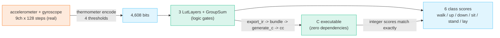
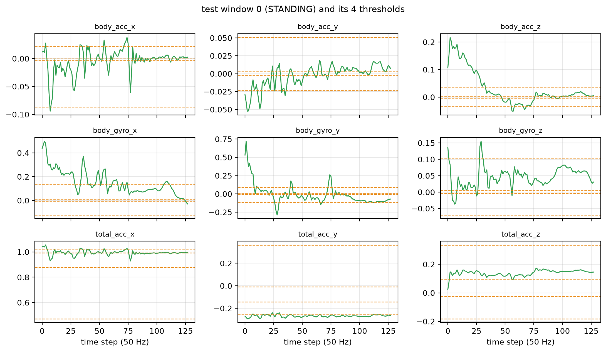
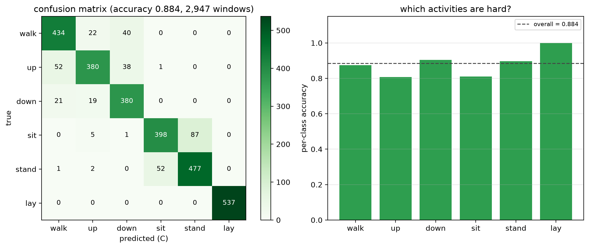

<!-- This file is generated by scripts/build_tutorials.py.
     Do not edit it directly; edit examples/27_har.py and regenerate. -->

**Guess "walking, sitting, climbing stairs" from a phone's accelerometer.** The raw signal of a
smartphone worn at the waist (9 channels x 128 samples = 2.56 s) is thermometer-encoded with 4 thresholds
into 4,608 bits and fed to a logic circuit of 9,000 gates. It is the smallest example of a logic-gate
network receiving **a sensor time series** instead of an image.

Measured hard accuracy is 0.885 (2,947 test windows from 9 people who never appear in training). The second half
goes through the same exit as [Deploy](/en/tutorials/deploy-mnist/): the trained circuit is
exported to C99, **every test window is inferred by C alone, and the result matches PyTorch's hard eval
exactly in integers**; then the delivery size (about 140 KB) and the runtime memory (6 KB) are counted.
The inference time per window was about 6.7 microseconds on the author's machine (Apple M1 Max, 1 core, `cc -O2`)
(a value that changes with the machine, so it is not put in the page's output but written to `latency.json`).

The steps for putting this circuit on an ESP32 or an iPhone continue in [Run on ESP32](/en/guides/deploy-esp32/) and
[Run on iPhone](/en/guides/deploy-ios/).

:::tip[What you'll learn]
1. How to turn a real-valued sensor signal into 0/1 input lines with thermometer encoding (thresholds are quantiles of the training data)
2. The flow of classifying the activity of unseen subjects with a logic circuit that takes 9ch x 128 steps x 4 thresholds = 4,608 bits
3. How to carry the same circuit to C99 and make it match PyTorch hard eval in integers on every test window

**Prerequisites**

- [4. Deploy](/en/tutorials/deploy-mnist/) — the same procedure as the second half
- [1. Train on MNIST](/en/tutorials/mnist/) — the basics of LutLayer + GroupSum
:::

:::note[About this page]
Estimated time: **about 10 minutes** / Environment: CPU only (no GPU required)
Source script: [`examples/27_har.py`](https://github.com/tsukushi-gate/Griffith/blob/main/examples/27_har.py)
Try it locally: [`notebooks/27_har.ipynb`](https://github.com/tsukushi-gate/Griffith/blob/main/notebooks/27_har.ipynb) (an unexecuted notebook with the same content as this page; open it with `uv run --group docs jupyter lab notebooks/`)
Every code output below is **the result of an actual run**, embedded verbatim.
:::

<!-- Colab badge: once the repository is public, replace this span with an <a> whose href
     is data-colab-url to enable "Open in Colab". -->
<span class="colab-badge" data-colab-url="https://colab.research.google.com/github/tsukushi-gate/Griffith/blob/main/notebooks/27_har.ipynb">▶ Open in Colab (enabled once the repository is public)</span>

Guessing the activity from a phone's accelerometer — an example that trains UCI-HAR with logic gates and carries it to C.

From the accelerometer and gyroscope of a smartphone worn at the waist (9 channels x 128 samples = a 2.56-second window),
we guess one of 6 activities: **walking, climbing stairs, descending stairs, sitting, standing, lying down**.
This page shows how a logic-gate network receives a **sensor time series** rather than an image.

A logic gate accepts only 0/1, so the real-valued signal is **thermometer-encoded** at the entrance.
The value of each channel is compared with 4 thresholds (the 20/40/60/80th percentiles of the training data) and
replaced by 4 bits saying whether each was exceeded. 9ch x 128 steps x 4 thresholds = **4,608 bits**
become the input lines of the circuit as they are.

The second half goes through the same exit as [Deploy](/en/tutorials/deploy-mnist/).
The trained circuit is exported to IR -> a distribution bundle -> C99 source and built with `cc`,
**all 2,947 test windows are inferred by C alone**, and we check that the result matches PyTorch's hard eval
exactly in integers.



Orange is the real-valued sensor signal, blue is the 0/1 bit string and the class scores, and green is the logic circuit.

Run: uv run python examples/27_har.py
Expected: hard accuracy 0.80 or more / C inference and PyTorch match exactly on 2,947 windows x 6 classes
(the first run downloads the UCI zip (about 60 MB) into data-uci-har/. A C compiler `cc` is required)

## Setup: imports, random seed, output directory

The training side uses two new parts, `load_uci_har` (reading the raw signals) and `thermometer_encode`
(thermometer encoding); the rest is the same `LutLayer` + `GroupSum` as [MNIST](/en/tutorials/mnist/).
The exit side uses the same `griffith_logic.deploy` parts as [Deploy](/en/tutorials/deploy-mnist/).

```python
import gzip
import json
import platform
import re
import subprocess
from pathlib import Path

import matplotlib.pyplot as plt
import numpy as np
import torch
import torch.nn as nn
import torch.nn.functional as F

from griffith_logic import GroupSum, LutLayer
from griffith_logic.datasets import (
    UCI_HAR_CHANNELS,
    UCI_HAR_LABELS,
    fit_thermometer_thresholds,
    load_uci_har,
    thermometer_encode,
)
from griffith_logic.deploy import build_bundle, load_bundle, save_bundle
from griffith_logic.deploy.bundle import attach_bundle_sizes
from griffith_logic.deploy.cbackend import generate_c
from griffith_logic.deploy.verify import RUNTIME_C, find_cc, verify_c_matches_simulate
from griffith_logic.export import export_ir
from griffith_logic.ir import simulate, validate
from griffith_logic.ir.serialize import ir_to_dict
```

```python
# The initial gate distribution depends on the RNG, so fix the seed for reproducibility.
torch.manual_seed(0)
```

### Output directory and hyperparameters

Artifacts go to `out_examples/har/` (the name `har.bundle.json` is fixed).
The circuit stacks `DEPTH` `LutLayer`s and aggregates into 6 classes at the end. **The input is as wide as 4,608 bits**,
so the first layer gets more gates than for MNIST (400 bits).
It is sized to finish within 3 minutes on CPU.

```python
OUT_DIR = Path('out_examples/har')
OUT_DIR.mkdir(parents=True, exist_ok=True)

N_THRESHOLDS = 4   # thermometer bits per channel per time step
K = 3000           # gates per layer
DEPTH = 3          # number of LutLayers
STEPS = 2000       # training iterations
BATCH = 128        # mini-batch size
cc = find_cc()
assert cc is not None, 'C コンパイラ(cc / clang / gcc)が見つからない'
print(f'出力先: {OUT_DIR}')
```

```text title="Output"
出力先: out_examples/har
```

## Dataset: raw accelerometer and gyroscope signals

`load_uci_har` returns the raw Inertial Signals as float32 `(N, 9, 128)`
(it downloads only the first time and caches into `data-uci-har/har_raw.npz`).
The 9 channels are x/y/z of the body acceleration (`body_acc`, the motion with gravity removed), the gyroscope (`body_gyro`),
and the total acceleration (`total_acc`, gravity included). Labels are activity numbers 0-5.

What matters is that **the data is split by subject**: no window of the same person appears in both training and test
(a setting that measures whether unseen people can be recognized too).

Data source: Jorge Reyes-Ortiz, Davide Anguita, Alessandro Ghio, Luca Oneto, Xavier Parra,
"Human Activity Recognition Using Smartphones", UCI Machine Learning Repository, 2013
([doi:10.24432/C54S4K](https://doi.org/10.24432/C54S4K)). It is licensed under
[CC BY 4.0](https://creativecommons.org/licenses/by/4.0/). The data is not bundled with the repository; it is fetched from UCI.

```python
x_train, y_train, x_test, y_test, subj_train, subj_test = load_uci_har(return_subjects=True)
print(f'train {x_train.shape} / test {x_test.shape}(9 チャネル × 128 点)')
print(f'被験者: 訓練 {len(set(subj_train.tolist()))} 人 / テスト {len(set(subj_test.tolist()))} 人'
      f'(重複 {len(set(subj_train.tolist()) & set(subj_test.tolist()))} 人)')
print('クラス別の窓数(訓練/テスト):')
for c, name in enumerate(UCI_HAR_LABELS):
    print(f'  {c} {name:<19} {int((y_train == c).sum()):>5} / {int((y_test == c).sum()):>4}')
```

```text title="Output"
train (7352, 9, 128) / test (2947, 9, 128)(9 チャネル × 128 点)
被験者: 訓練 21 人 / テスト 9 人(重複 0 人)
クラス別の窓数(訓練/テスト):
  0 WALKING              1226 /  496
  1 WALKING_UPSTAIRS     1073 /  471
  2 WALKING_DOWNSTAIRS    986 /  420
  3 SITTING              1286 /  491
  4 STANDING             1374 /  532
  5 LAYING               1407 /  537
```

## Thermometer encoding: turn a real-valued signal into 4,608 bits

The thresholds are decided **from the training data only**, per channel, at the 20/40/60/80th percentiles
(`fit_thermometer_thresholds`). Using the test distribution would make the evaluation optimistic, so the
test side gets **the same thresholds**. Because the cuts are quantiles, every bit is 1 for about
80/60/40/20% of the training data, so the information is used without bias.

`thermometer_encode` turns `(N, 9, 128)` into 0/1 values of shape `(N, 9, 128, 4)`. Lined up with `reshape`,
they become the input lines of the circuit (in the order channel -> time step -> threshold): **4,608 lines**.

```python
thresholds = fit_thermometer_thresholds(x_train, N_THRESHOLDS)
bits_train = thermometer_encode(x_train, thresholds=thresholds).reshape(len(x_train), -1)
bits_test = thermometer_encode(x_test, thresholds=thresholds).reshape(len(x_test), -1)
IN_BITS = bits_train.shape[1]
assert IN_BITS == 9 * 128 * N_THRESHOLDS
print(f'入力: {IN_BITS:,} ビット = 9ch × 128 点 × {N_THRESHOLDS} 閾値'
      f'(1 になっている割合: 訓練 {bits_train.mean():.3f} / テスト {bits_test.mean():.3f})')
```

```text title="Output"
入力: 4,608 ビット = 9ch × 128 点 × 4 閾値(1 になっている割合: 訓練 0.500 / テスト 0.499)
```

### Checking that it really is a thermometer

The thresholds are ascending, so if "a high threshold is exceeded" at some point, "the lower thresholds are also exceeded".
We check this monotonicity (patterns like `0001` never appear) over all the data.

```python
levels = bits_train.reshape(len(x_train), 9, 128, N_THRESHOLDS)
assert (np.diff(levels, axis=-1) <= 0).all(), '温度計になっていない'
print('温度計の単調性: OK(高い閾値のビットが立てば、低い閾値のビットも必ず立っている)')
```

```text title="Output"
温度計の単調性: OK(高い閾値のビットが立てば、低い閾値のビットも必ず立っている)
```

## Model and training: an ordinary PyTorch loop

The model is `DEPTH` `LutLayer`s and `GroupSum(k=6)`, the same shape as for MNIST.
`GroupSum` splits the last layer's gates into 6 groups and counts the ones in each group to make
the 6 class scores. The training loop is ordinary PyTorch with `cross_entropy` + `Adam`, and
every 500 steps it measures soft (the training-time face) and hard (the discretized circuit) accuracy side by side.

```python
train_x, train_y = torch.from_numpy(bits_train), torch.from_numpy(y_train)
test_x, test_y = torch.from_numpy(bits_test), torch.from_numpy(y_test)
layers = [LutLayer(IN_BITS, K, n_inputs=2)]
layers += [LutLayer(K, K, n_inputs=2) for _ in range(DEPTH - 1)]
model = nn.Sequential(*layers, GroupSum(k=6, tau=10.0))
opt = torch.optim.Adam(model.parameters(), lr=0.01)
history = []  # (step, soft acc, hard acc)

for step in range(STEPS + 1):
    if step % 500 == 0:
        with torch.no_grad():
            model.train()
            soft_acc = (model(test_x).argmax(-1) == test_y).float().mean().item()
            model.eval()
            hard_acc = (model(test_x).argmax(-1) == test_y).float().mean().item()
        model.train()
        history.append((step, soft_acc, hard_acc))
        print(f'step {step:>5}  soft acc={soft_acc:.4f}  hard acc={hard_acc:.4f}')
    idx = torch.randint(0, len(train_x), (BATCH,))
    opt.zero_grad()
    loss = F.cross_entropy(model(train_x[idx]), train_y[idx])
    loss.backward()
    opt.step()

model.eval()
final_hard = history[-1][2]
print(f'\n最終 hard acc={final_hard:.4f}(テスト {len(test_x):,} 窓。これから運ぶ回路の成績)')
assert final_hard >= 0.80, f'hard acc={final_hard:.4f} が低すぎる'
```

```text title="Output"
step     0  soft acc=0.1598  hard acc=0.1985

step   500  soft acc=0.8487  hard acc=0.8283

step  1000  soft acc=0.8846  hard acc=0.8643

step  1500  soft acc=0.8911  hard acc=0.8792

step  2000  soft acc=0.8948  hard acc=0.8853

最終 hard acc=0.8853(テスト 2,947 窓。これから運ぶ回路の成績)
```

## IR and bundle: wrap the trained model into one file

The procedure is the same as [Deploy](/en/tutorials/deploy-mnist/). `export_ir` fixes the circuit into
the IR, and `build_bundle` / `save_bundle` wrap the IR and the class names into `har.bundle.json`.
**The input is a 0/1 string of 4,608 bits** (the thermometer-encoded result); producing this encoding (the thresholds) is
Python's job. The threshold table is also written out to `har_thresholds.json`.

The delivery size (compressed) is measured with gzip. `gzip.compress` writes the current time into its header by default,
so we pin it with `mtime=0`. `export_ir` also puts **the time of export** (`created_at`) into the IR metadata,
so we overwrite it with a fixed time as well, so that **the same training result always gives the same bytes and the same byte count**.

```python
ir = export_ir(model, input_width=IN_BITS, name='har')
validate(ir, target='hdl')
n_gates = sum(n.params['out_width'] for n in ir.nodes if n.type == 'lut_layer')
print(f'IR: ノード {[n.type for n in ir.nodes]} / 総ゲート数 {n_gates:,}')

LABELS = list(UCI_HAR_LABELS)
doc = {'ir': ir_to_dict(ir), 'labels': LABELS}
doc['ir']['metadata']['created_at'] = '2026-01-01T00:00:00+09:00'  # 書き出し時刻を固定
(OUT_DIR / 'har_model.json').write_text(json.dumps(doc), encoding='utf-8')
(OUT_DIR / 'har_thresholds.json').write_text(json.dumps({
    'channels': list(UCI_HAR_CHANNELS), 'n_thresholds': N_THRESHOLDS,
    'thresholds': thresholds.tolist(),
    'bit_order': 'channel, time(128), threshold(ascending); bit = x > threshold',
}), encoding='utf-8')
bundle = build_bundle(doc)
attach_bundle_sizes(bundle)
bundle_path = OUT_DIR / 'har.bundle.json'
save_bundle(bundle, bundle_path)
bundle_bytes = bundle_path.stat().st_size
bundle_gz = gzip.compress(bundle_path.read_bytes(), compresslevel=6, mtime=0)
Path(str(bundle_path) + '.gz').write_bytes(bundle_gz)
bundle_gz_bytes = len(bundle_gz)
print(f'バンドル: {bundle_path.name} = {bundle_bytes:,} B(gzip {bundle_gz_bytes:,} B)')
```

```text title="Output"
IR: ノード ['lut_layer', 'lut_layer', 'lut_layer', 'group_sum'] / 総ゲート数 9,000
バンドル: har.bundle.json = 139,569 B(gzip 47,663 B)
```

## C code generation and build

We read the bundle back, create `model.c` / `model.h` with `generate_c`, and pass them to `cc` together with the runtime.
The driver is a small `main` that only "reads a file of bit strings, runs `mdl_infer`, and measures the time of the whole loop".

```python
loaded = load_bundle(bundle_path, validate=True, strict=True)
C_DIR = OUT_DIR / 'c'
C_DIR.mkdir(exist_ok=True)
for filename, text in generate_c(loaded, name='model', validate=False).items():
    (C_DIR / filename).write_text(text, encoding='utf-8')
for rel in ('include/mdl_kernels.h', 'include/mdl_simd.h', 'src/mdl_kernels.c'):
    (C_DIR / Path(rel).name).write_bytes((RUNTIME_C / rel).read_bytes())
model_c_bytes = (C_DIR / 'model.c').stat().st_size
header = (C_DIR / 'model.h').read_text(encoding='utf-8')
ctx_bytes = int(re.search(r'#define\s+MDL_CTX_BYTES\s+\(?(\d+)', header).group(1))
print(f'生成: model.c {model_c_bytes:,} B / MDL_CTX_BYTES = {ctx_bytes:,} B(作業RAM)')

DRIVER_C = r'''
#include <stdio.h>
#include <stdlib.h>
#include <time.h>
#include "model.h"

int main(int argc, char **argv) {
    if (argc != 5) { fprintf(stderr, "usage: bits.bin n reps scores.bin\n"); return 2; }
    int n = atoi(argv[2]), reps = atoi(argv[3]);
    uint8_t *bits = malloc((size_t)n * MDL_INPUT_WIDTH);
    int32_t *scores = malloc((size_t)n * MDL_OUTPUT_WIDTH * sizeof(int32_t));
    FILE *f = fopen(argv[1], "rb");
    if (!f || fread(bits, 1, (size_t)n * MDL_INPUT_WIDTH, f) != (size_t)n * MDL_INPUT_WIDTH)
        return 3;
    fclose(f);
    for (int i = 0; i < n; i++)                        /* warm-up */
        mdl_infer(bits + (size_t)i * MDL_INPUT_WIDTH, scores + (size_t)i * MDL_OUTPUT_WIDTH);
    clock_t t0 = clock();
    for (int r = 0; r < reps; r++)
        for (int i = 0; i < n; i++)
            mdl_infer(bits + (size_t)i * MDL_INPUT_WIDTH, scores + (size_t)i * MDL_OUTPUT_WIDTH);
    double us = (double)(clock() - t0) / CLOCKS_PER_SEC * 1e6 / ((double)reps * n);
    f = fopen(argv[4], "wb");
    fwrite(scores, sizeof(int32_t), (size_t)n * MDL_OUTPUT_WIDTH, f);
    fclose(f);
    printf("%.3f\n", us);
    return 0;
}
'''
(C_DIR / 'main.c').write_text(DRIVER_C, encoding='utf-8')
exe = C_DIR / 'har_demo'
build = subprocess.run(
    [cc, '-std=c99', '-O2', f'-I{C_DIR}', str(C_DIR / 'model.c'),
     str(C_DIR / 'mdl_kernels.c'), str(C_DIR / 'main.c'), '-o', str(exe)],
    capture_output=True, text=True)
assert build.returncode == 0, build.stderr
print('ビルド: cc -std=c99 -O2 model.c mdl_kernels.c main.c -o har_demo -> 成功')
```

```text title="Output"
生成: model.c 99,890 B / MDL_CTX_BYTES = 6,000 B(作業RAM)

ビルド: cc -std=c99 -O2 model.c mdl_kernels.c main.c -o har_demo -> 成功
```

## Infer every test window in C and compare with PyTorch in integers

We write the 4,608 bits of all test windows (2,947 of them) to a file and feed it to the C executable.
The 6 integer class scores that come back are compared among **PyTorch hard eval**, **the IR reference implementation `simulate`**
and **C**, and we pin down with `assert` that not a single element differs.

```python
bits_path = OUT_DIR / 'test_bits.bin'
bits_path.write_bytes(bits_test.astype(np.uint8).tobytes())
N_C = len(bits_test)
scores_path = OUT_DIR / 'scores_c.bin'
run = subprocess.run([str(exe), str(bits_path), str(N_C), '5', str(scores_path)],
                     capture_output=True, text=True)
assert run.returncode == 0, run.stderr
us_per_window = float(run.stdout.strip())
c_scores = np.fromfile(scores_path, dtype=np.int32).reshape(N_C, 6).astype(np.int64)

with torch.no_grad():
    torch_logits = model(test_x)  # model.eval() already called = hard eval
torch_scores = np.rint(torch_logits.numpy() * 10.0).astype(np.int64)  # multiply tau=10 back
sim_scores = simulate(ir, bits_test.astype(np.int64)).astype(np.int64)

assert np.array_equal(c_scores, torch_scores), 'C と PyTorch hard eval のスコアが食い違う'
assert np.array_equal(c_scores, sim_scores), 'C と IR simulate のスコアが食い違う'
c_pred = c_scores.argmax(1)
assert np.array_equal(c_pred, torch_logits.argmax(-1).numpy())
c_acc = float((c_pred == y_test).mean())
n_mismatch = int((c_scores != torch_scores).sum())
print(f'C ⇔ PyTorch hard eval ⇔ IR simulate: {N_C:,}窓 × 6クラス = {c_scores.size:,} 要素のうち'
      f' 不一致 {n_mismatch} 個(予測ラベルも {N_C:,}/{N_C:,} 一致)')
print(f'C 推論の accuracy = {c_acc:.4f}({N_C:,}窓)')
gate = verify_c_matches_simulate(loaded, n_samples=4, seed=1, verbose=False)
print(f'verify-c: {gate["n_samples"]}サンプル({gate["path"]}経路) 最大差 {gate["max_abs_diff"]}')
```

```text title="Output"
C ⇔ PyTorch hard eval ⇔ IR simulate: 2,947窓 × 6クラス = 17,682 要素のうち 不一致 0 個(予測ラベルも 2,947/2,947 一致)
C 推論の accuracy = 0.8843(2,947窓)

verify-c: 4サンプル(bits経路) 最大差 0
```

## Delivery size and speed: how many microseconds to judge a 2.56-second window

One sensor window is a 2.56-second recording, so **the time available for judging is 2.56 seconds**.
We count how fast C inference is against that, and how many bytes you have to ship.
The speed (us/window) changes with the machine and from run to run, so **it is not burned into this page's output**
(it is measured above and written to `out_examples/har/latency.json`).
On the author's machine (Apple M1 Max, 1 core, `cc -O2`) the measured value is **about 6.7 us/window**, which is
**about 1/380,000** (roughly 1e-6 times) of the 2.56 seconds available for judging.
The byte counts are the same every time for the same circuit.

```python
print('項目                     値')
print(f'バンドル(JSON)           {bundle_bytes:>10,} B')
print(f'バンドル(gzip)           {bundle_gz_bytes:>10,} B')
print(f'model.c                  {model_c_bytes:>10,} B')
print(f'MDL_CTX_BYTES(作業RAM)   {ctx_bytes:>10,} B')
(OUT_DIR / 'latency.json').write_text(json.dumps({
    'unit': 'microseconds per 2.56 s window (single core)',
    'machine': platform.platform(), 'compiler': Path(cc).name, 'flags': '-std=c99 -O2',
    'gates': n_gates, 'us_per_window': us_per_window,
}, indent=2), encoding='utf-8')
```

```text title="Output"
項目                     値
バンドル(JSON)              139,569 B
バンドル(gzip)               47,663 B
model.c                      99,890 B
MDL_CTX_BYTES(作業RAM)        6,000 B
```

## Visualization: waveforms with thermometer bits, and the confusion matrix

The first figure is the 9-channel waveform of one window (the first test window). The dashed lines are the 4
thresholds decided from the training data, and which lines the waveform exceeds becomes the
input bits directly.

### Figure 1: waveforms of the 9 channels and the thresholds

Rows are the body acceleration (top), the gyroscope (middle) and the total acceleration (bottom); columns are x/y/z.
This window is "standing" (STANDING), and the motion channels only wobble a little.
The threshold lines cut the value range into 5 bands.

```python
win = 0
fig, axes = plt.subplots(3, 3, figsize=(11, 6.4), sharex=True)
for c, ax in enumerate(axes.ravel()):
    ax.plot(x_test[win, c], color='#2e9e4f', lw=1.2)
    for t in range(N_THRESHOLDS):
        ax.axhline(thresholds[c, t], color='#e8850c', ls='--', lw=0.9)
    ax.set_title(UCI_HAR_CHANNELS[c], fontsize=9)
    ax.grid(alpha=0.3)
for ax in axes[-1]:
    ax.set_xlabel('time step (50 Hz)')
fig.suptitle(f'test window 0 ({UCI_HAR_LABELS[int(y_test[win])]}) and its 4 thresholds',
             fontsize=11)
fig.tight_layout()
plt.show()
```



**Reading**: how many dashed lines the waveform crosses decides the code at each time step (0000 / 0001 / ... / 1111).
Because the thresholds are quantiles, the lines are spaced widely for channels that move a lot, while for quiet channels
the values cluster tightly in a small range — even with the same "4 bits", the scale is fitted to the size of the signal.

### Figure 2: confusion matrix and per-activity accuracy

A table relating C's predictions to the true labels. **Rows are the truth, columns are the prediction**, and the numbers are window counts.
It matches PyTorch exactly, so this is also the confusion matrix of PyTorch hard eval.

```python
conf = np.zeros((6, 6), dtype=int)
for t_, p_ in zip(y_test, c_pred, strict=True):
    conf[t_, p_] += 1
per_class = conf.diagonal() / conf.sum(1)
fig, (ax_conf, ax_acc) = plt.subplots(
    1, 2, figsize=(12, 4.8), gridspec_kw={'width_ratios': [1.15, 1]})
im = ax_conf.imshow(conf, cmap='Greens')
for i in range(6):
    for j in range(6):
        ax_conf.text(j, i, conf[i, j], ha='center', va='center', fontsize=9,
                     color='white' if conf[i, j] > conf.max() * 0.55 else 'black')
short = ['walk', 'up', 'down', 'sit', 'stand', 'lay']
ax_conf.set_xticks(range(6), short)
ax_conf.set_yticks(range(6), short)
ax_conf.set_xlabel('predicted (C)')
ax_conf.set_ylabel('true')
ax_conf.set_title(f'confusion matrix (accuracy {c_acc:.3f}, {N_C:,} windows)')
fig.colorbar(im, ax=ax_conf, fraction=0.046)
ax_acc.bar(range(6), per_class, color='#2e9e4f')
ax_acc.axhline(c_acc, color='#444', ls='--', lw=1.2, label=f'overall = {c_acc:.3f}')
ax_acc.set_xticks(range(6), short)
ax_acc.set_ylim(0, 1.15)
ax_acc.set_ylabel('per-class accuracy')
ax_acc.set_title('which activities are hard?')
ax_acc.grid(alpha=0.3, axis='y')
ax_acc.legend(loc='upper right', fontsize=8)
fig.tight_layout()
plt.show()
```



**Reading**: the mistakes concentrate within two groups, "sitting <-> standing" and "walking / climbing stairs / descending stairs",
and there is almost no confusion across groups. With a phone at the waist, both sitting and standing keep the body almost still and differ only slightly in the
direction of gravity, whereas "lying down" changes the direction of gravity a lot and so every window is correct.
In other words, the circuit's errors are biased toward **activities that really are confusable from the sensor's point of view**.

```python
worst = int(np.argmin(per_class))
print(f'最も苦手な行動: {UCI_HAR_LABELS[worst]}(正解率 {per_class[worst]:.3f})')
```

```text title="Output"
最も苦手な行動: WALKING_UPSTAIRS(正解率 0.807)
```

## What to read next

- [4. Deploy](/en/tutorials/deploy-mnist/) — push image classification through the same exit
- [DWN (Weightless NN, Thermometer)](/en/tutorials/dwn/) — the style that builds thermometer encoding in as a layer
- [3. Export to HDL](/en/tutorials/hdl-export/) — the same kind of circuit as Verilog
- [TextCNN with Logic Gates](/en/tutorials/textcnn/) — another example of solving sequence data with logic gates
- [Prepare Demo Models](/en/guides/deploy-models/) — how to prepare the demo bundles, including this activity recognition model
- [Run on ESP32](/en/guides/deploy-esp32/) — run activity recognition on a microcontroller (ESP32)
- [Run on iPhone](/en/guides/deploy-ios/) — bundle activity recognition into an iPhone app

<!-- i18n:source=tutorials/har.md hash=156b2191023b -->
