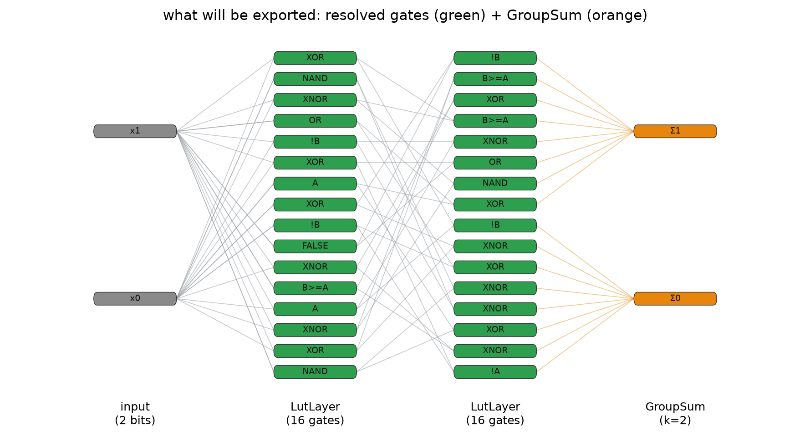
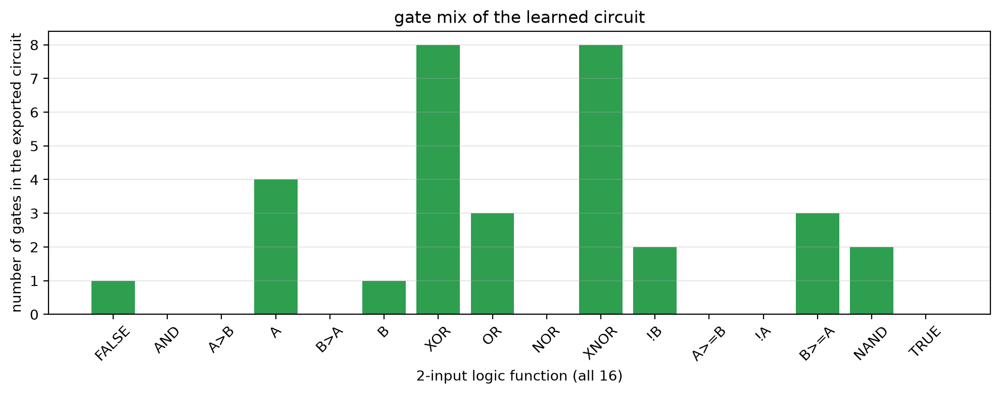
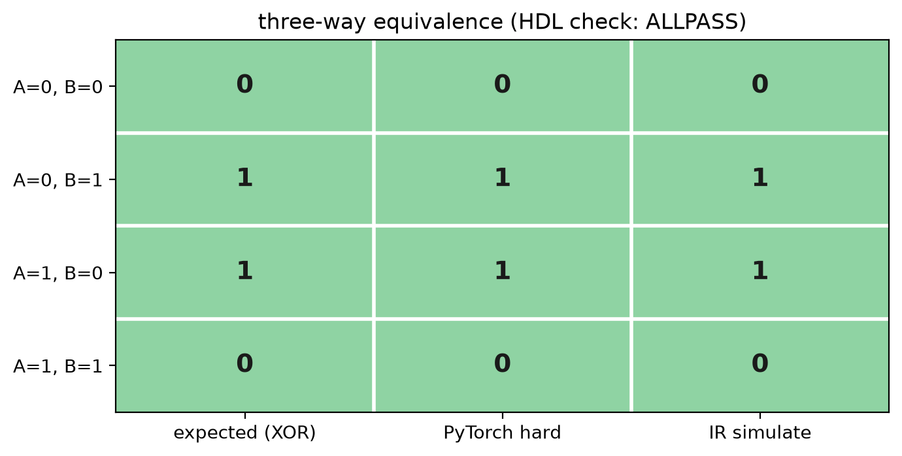

<!-- This file is generated by scripts/build_tutorials.py.
     Do not edit it directly; edit examples/04_export_hdl.py and regenerate. -->

Extract a trained model into the **IR (intermediate representation, the source of truth)**,
generate Verilog, and check it against the golden model. This walks the whole exit path of the
library: "train in PyTorch -> IR -> HDL".

:::tip[What you'll learn]
1. The three steps of the exit path: trained model -> IR (intermediate representation, the source of truth) -> Verilog
2. What kind of accidents `validate(ir, target='hdl')` catches for you before synthesis
3. How to confirm the three-way equivalence PyTorch hard eval <=> IR simulate <=> HDL simulation

**Prerequisites**

- [Appendix: XOR Internals](/en/tutorials/xor/) — the very circuit burned here
- [IR Guide](/en/guides/ir/) — why the IR is the source of truth
:::

:::note[About this page]
Estimated time: **about 10 minutes** / Environment: CPU only (no GPU required)
Source script: [`examples/04_export_hdl.py`](https://github.com/tsukushi-gate/Griffith/blob/main/examples/04_export_hdl.py)
Try it locally: [`notebooks/04_export_hdl.ipynb`](https://github.com/tsukushi-gate/Griffith/blob/main/notebooks/04_export_hdl.ipynb) (an unexecuted notebook with the same content as this page; open it with `uv run --group docs jupyter lab notebooks/`)
Every code output below is **the result of an actual run**, embedded verbatim.
:::

<!-- Colab badge: once the repository is public, replace this span with an <a> whose href
     is data-colab-url to enable "Open in Colab". -->
<span class="colab-badge" data-colab-url="https://colab.research.google.com/github/tsukushi-gate/Griffith/blob/main/notebooks/04_export_hdl.ipynb">▶ Open in Colab (enabled once the repository is public)</span>

An example of trained model -> IR -> Verilog export.

Train XOR and generate the IR (intermediate representation) JSON and Verilog.
If iverilog is available, equivalence against the golden model is checked as well.

This is the shortest path through the library's exit — "convert weights trained in PyTorch into a
logic circuit that needs no GPU". It has three stages: (1) training, (2) universal discretization
into the IR, (3) Verilog generation from the IR. Since the IR is the source of truth and the
simulator and the HDL both derive from it, "the PyTorch output = the IR output = the output of the
actual circuit" can be checked mechanically.

Run: uv run python examples/04_export_hdl.py
Expected result: out_examples/xor.json and xor.v are generated, and the check is ALLPASS

## Setup: the four APIs used on the way out

The path this page walks has four stages — train -> IR -> Verilog -> check — and the API for each
one is imported up front. The terms are defined here on first use.

- `export_ir` … converts a trained model into the **IR (intermediate representation)**. The IR is
  JSON normalized as "a collection of truth tables", and it is **the source of truth on the hardware side**
- `validate` … checks that the IR satisfies the constraints HDL generation requires (bit widths,
  topological order, and so on)
- `write_verilog` … writes synthesizable Verilog (RTL) out of the IR
- `simulate` … a reference implementation that interprets the IR with numpy integer bit operations
  (the **golden model**)

```python
from collections import Counter

import matplotlib.pyplot as plt
import numpy as np
import torch
import torch.nn as nn
import torch.nn.functional as F
from matplotlib.colors import ListedColormap

from griffith_logic import GroupSum, LutLayer
from griffith_logic.analysis.circuit_viz import GATE_NAMES, plot_circuit
from griffith_logic.export import export_ir
from griffith_logic.export.discretize import truth_tables_from_lut_layer
from griffith_logic.export.verify import iverilog_available, run_iverilog_equivalence
from griffith_logic.export.verilog import write_verilog
from griffith_logic.ir import save_ir, simulate, validate
```

## Training: building the XOR circuit to be burned

Showing the export procedure is the point of this page, so the target is the smallest possible
XOR ([Appendix: XOR](/en/tutorials/xor/) — exactly the same 32-gate setup). The training loop is
plain PyTorch too, so here you can just run 500 steps and move on.

```python
torch.manual_seed(0)
x = torch.tensor([[0., 0.], [0., 1.], [1., 0.], [1., 1.]])
y = torch.tensor([0, 1, 1, 0])

model = nn.Sequential(
    LutLayer(2, 16, n_inputs=2),   # 2 input bits -> 16 gates (each a mixture of 2-input logic functions)
    LutLayer(16, 16, n_inputs=2),  # second stage. Composing gates creates XOR's nonlinearity
    GroupSum(k=2, tau=2.0),        # aggregate the 16 gate outputs into 2 classes. tau is the logit temperature
)
opt = torch.optim.Adam(model.parameters(), lr=0.05)
for _ in range(500):
    opt.zero_grad()
    F.cross_entropy(model(x), y).backward()
    opt.step()
```

## Looking at the circuit to be burned, before exporting

### Figure 1: the network of resolved gates

The moment `model.eval()` is called, each gate is no longer a mixture of 16 logic functions but
**a gate fixed to one of them**. This draws that state as a circuit diagram. Green nodes are the
resolved logic gates, orange is the GroupSum (everything from there on is real-valued).

```python
# After eval(), the model is no longer a "mixture of 16 logic functions" but a network of gates
# each fixed to one. The gate names plot_circuit(resolve=True) reads come from the same path
# (export/discretize) as the truth tables export_ir uses when emitting Verilog, so
# **the gates in this figure = the gates of the generated circuit**.
model.eval()
fig, ax = plt.subplots(figsize=(9, 5))
plot_circuit(model, resolve=True, ax=ax,
             title='what will be exported: resolved gates (green) + GroupSum (orange)')
fig.tight_layout()
plt.show()
```

    

    

**What to read from it**: every node carries **a concrete logic function name** such as `XOR`,
`NAND` or `A>=B`. Those names come from the same path (`export/discretize`) as the truth tables
`export_ir` uses when emitting Verilog, so **the gates in this figure = the gates of the generated
circuit**.

### Counting the circuit's "bill of materials"

The same circuit seen from another angle. Each gate's truth table (4 bits = 16 possibilities for a
2-input gate) is treated as a gate ID, and we count how many of each of the 16 logic functions were
used. `truth_tables_from_lut_layer` is the same discretization path `export_ir` uses internally, so
**the breakdown counted here matches the breakdown of the contents of the generated Verilog**.

```python
# Treat each gate's truth table (4 bits = 16 possibilities) directly as a gate ID and count them by kind.
# truth_tables_from_lut_layer is the same discretization path export_ir uses internally, so the
# breakdown counted here matches the breakdown of the contents of the generated Verilog.
# There are two things to notice.
#   (1) Only some of the 16 kinds are used, heavily biased towards XOR / XNOR. Nobody told it to
#       "use XOR", yet gradients alone selected the logic functions the task needs.
#   (2) On the other hand constants (FALSE) and pass-throughs of an input (A / !B) remain. These are
#       effectively wires or dead nodes — redundancy a human would not write. Training was never
#       told to "use up all 32 gates", so the leftover gates settled into a shape where they do
#       nothing (which is also room for the synthesis tool to collapse them downstream).
gate_ids = [int(t) for layer in model if isinstance(layer, LutLayer)
            for t in truth_tables_from_lut_layer(layer)]
counts = Counter(gate_ids)
print('ゲート種別の内訳: ' + ', '.join(
    f'{GATE_NAMES[g]}×{n}' for g, n in counts.most_common()))
print(f'ゲート総数 {len(gate_ids)} / 使われた種類 {len(counts)} (2入力論理関数は全16種)')
```

```text title="Output"
ゲート種別の内訳: XOR×8, XNOR×8, A×4, OR×3, B>=A×3, !B×2, NAND×2, FALSE×1, B×1
ゲート総数 32 / 使われた種類 9 (2入力論理関数は全16種)
```

### Figure 2: how many gates of each logic function

All 16 kinds are laid out along the x axis (zero-count ones are kept as blanks, so you also see
what was **not** used).

```python
# Lay out all 16 kinds along the x axis (keeping the zero-count ones as blanks, to show what was NOT used).
order = sorted(GATE_NAMES)
labels = [GATE_NAMES[g] for g in order]
heights = [counts.get(g, 0) for g in order]
fig, ax = plt.subplots(figsize=(10, 4))
ax.bar(labels, heights, color='#2e9e4f')
ax.set_xlabel('2-input logic function (all 16)')
ax.set_ylabel('number of gates in the exported circuit')
ax.set_title('gate mix of the learned circuit')
ax.tick_params(axis='x', rotation=45)
ax.grid(axis='y', alpha=0.3)
fig.tight_layout()
plt.show()
```

    

    

**What to read from it**: only some of the 16 kinds are used, heavily biased towards XOR / XNOR —
nobody told the network to "use XOR", yet gradients alone selected the logic functions the task
needs. On the other hand constants (`FALSE`) and pass-throughs of an input (`A` / `!B`) remain.
These are effectively wires or dead nodes, redundancy a human would not write. Training was never
told to "use up all 32 gates", so the leftover gates settled into a shape where they do nothing —
which is also room for the synthesis tool downstream to remove them.

## Extracting into the IR

**The IR being the source of truth** is the keystone of this library's design. Verilog, VHDL and
the simulator all derive from it — which is exactly why "the PyTorch output = the IR output = the
output of the actual circuit" can be checked mechanically.

Two things in the procedure are not optional.

- **Switch to `eval()` before extracting.** Left in `train()`, you would be looking at the
  continuous-mixture state, which is not decided as a circuit
- **Run `validate(ir, target='hdl')`.** Checking bit widths, topological order and the absence of
  unsupported nodes here prevents accidents you would otherwise only notice in the synthesis tool
  after having written out the Verilog

```python
# Trained model -> IR (universal discretization of every parameterization into truth tables).
# Switching to eval() before extraction is mandatory. Left in train(), you would be looking at the
# "continuous mixture" state, which is not decided as a circuit. eval() fixes each gate to a
# single logic function.
model.eval()
```

```python
# export_ir walks the model and turns the layer types, the wiring, and the fixed truth tables into JSON.
# Whichever parameterization you trained with — softmax / independent / iwp — the resulting IR is
# unified into "a collection of truth tables" (a normalization that keeps everything downstream loosely coupled).
ir = export_ir(model, input_width=2, name='xor')
```

```python
# Check the constraints HDL generation requires (bit widths, topological order, absence of unsupported
# nodes) up front. Failing here prevents accidents you would otherwise only notice in the synthesis
# tool after having written out the Verilog.
validate(ir, target='hdl')
save_ir(ir, 'out_examples/xor.json')
```

## Generating Verilog

`write_verilog` writes **synthesizable RTL** (register transfer level description) out of the IR.
The resulting `.v` can be thrown straight at vendor tools such as Vivado or Quartus. If you need
VHDL instead, you only swap in `write_vhdl` — the downstream is interchangeable precisely because
the upstream IR is a normalized source of truth.

```python
# Write out synthesizable RTL from the IR. You can throw it straight at vendor tools (Vivado/Quartus etc.).
write_verilog(ir, 'out_examples/xor.v')
print('生成: out_examples/xor.json, out_examples/xor.v')
```

```text title="Output"
生成: out_examples/xor.json, out_examples/xor.v
```

## Checking the three-way equivalence

The correctness of the exit is guaranteed by "three independent implementations producing the same
answer".

1. **PyTorch hard eval** … the result of running the same truth tables through floating-point tensor operations
2. **IR simulate** … a reference implementation using integer bit operations with no floating point at all (the golden model)
3. **HDL simulation** … the result of actually running the generated Verilog under `iverilog`

If 1 and 2 agree, "nothing was dropped in the discretization"; if 3 agrees as well, you can assert
that "the learned weights match the behavior of the actual hardware".

```python
# simulate() is a reference implementation that interprets the IR with numpy integer bit operations.
# No floating-point approximation enters, so it serves as the standard (the golden model) for
# "how the circuit is supposed to behave".
# The PyTorch side (model.eval()) merely runs the same truth tables through floating-point tensor
# operations, so the two agreeing is a proof that "nothing was dropped in the discretization".
scores = simulate(ir, x.numpy().astype(np.int64))
pred_ir = scores.argmax(-1).tolist()
with torch.no_grad():
    pred_torch = model(x).argmax(-1).tolist()  # model is already in eval()
print(f'PyTorch hard 予測: {pred_torch}')
print(f'IR simulate 予測: {pred_ir} (正解 {y.tolist()})')
assert pred_torch == pred_ir == y.tolist()
```

```text title="Output"
PyTorch hard 予測: [0, 1, 1, 0]
IR simulate 予測: [0, 1, 1, 0] (正解 [0, 1, 1, 0])
```

```python
# If iverilog is available, check the Verilog against the golden model.
# Actually simulate the generated Verilog and confirm it matches the golden model on every input pattern.
# This is the last of the three-way equivalence: PyTorch hard eval <=> IR simulate <=> HDL simulation.
# Once this passes, you can assert that the learned weights match the behavior of the actual hardware.
if iverilog_available():
    result = run_iverilog_equivalence(ir, x.numpy().astype(np.int64),
                                      'out_examples/verify')
    hdl_status = 'ALLPASS' if result['passed'] else '不一致'
    print(f'Verilog照合: {hdl_status}')
else:
    # iverilog is only for checking. Even without it, the Verilog generation itself has completed.
    hdl_status = 'skipped'
    print('iverilog未導入のためVerilog照合はスキップ(brew install icarus-verilog)')
```

```text title="Output"
Verilog照合: ALLPASS
```

### Figure 3: the three-way equivalence as a single truth table

Finally the answers from the three routes above are collected into one table. Rows are the 4 input
patterns, columns are the routes to the answer (teacher label / PyTorch hard / IR simulate). The
number in a cell is the output class; green = matches `expected`, red = mismatch.

**What to read from it (written up front, since this is the last figure)**: all three columns are
filled with the same values and the whole thing turns **green**. That is the confirmation that "the
world of training (PyTorch)" and "the world of circuits (IR / HDL)" represent the same function; a
single red cell would be a bug in the export. The figure title also carries the result of the HDL
check under `iverilog`.

```python
# Rows are the 4 input patterns, columns are the "routes to the answer".
#   expected (XOR)  — the teacher labels. The ground truth a human decided
#   PyTorch hard    — the result of running the trained model discretized with eval()
#                     (floating-point tensor operations)
#   IR simulate     — the result of interpreting the IR with integer bit operations
#                     (no floating point at all)
# The conclusion of this script is that all three columns are filled with the same values and the
# whole thing turns green. This is a figure to confirm with your own eyes that "the world of
# training (PyTorch)" and "the world of circuits (IR/HDL)" represent the same function — that is,
# the meaning is preserved when the weights are dropped into a circuit.
# The number in a cell is the output class; green = matches expected, red = mismatch (a single one
# would be a bug in the export).
rows = [f'A={int(a)}, B={int(b)}' for a, b in x.tolist()]
cols = ['expected (XOR)', 'PyTorch hard', 'IR simulate']
table = np.array([y.tolist(), pred_torch, pred_ir]).T  # (4 patterns, 3 routes)
match = (table == table[:, :1]).astype(float)          # does it match the expected column?

fig, ax = plt.subplots(figsize=(7, 3.6))
ax.imshow(match, cmap=ListedColormap(['#e8552e', '#8fd3a3']), vmin=0, vmax=1, aspect='auto')
for i in range(table.shape[0]):
    for j in range(table.shape[1]):
        ax.text(j, i, str(table[i, j]), ha='center', va='center',
                fontsize=14, fontweight='bold', color='#1a1a1a')
ax.set_xticks(range(len(cols)), cols)
ax.set_yticks(range(len(rows)), rows)
ax.set_xticks([j + 0.5 for j in range(len(cols) - 1)], minor=True)
ax.set_yticks([i + 0.5 for i in range(len(rows) - 1)], minor=True)
ax.grid(which='minor', color='white', lw=2)
ax.tick_params(which='minor', length=0)
ax.set_title(f'three-way equivalence (HDL check: {hdl_status})')
fig.tight_layout()
plt.show()
```

    


## What to read next

- [5. Export a CNN to HDL](/en/tutorials/cnn-hdl-export/) — a model that includes convolutions
- [HDL equivalence verification](/en/guides/hdl/) — installing iverilog / ghdl and the three-way check

<!-- i18n:source=tutorials/hdl-export.md hash=d95a8337817a -->
