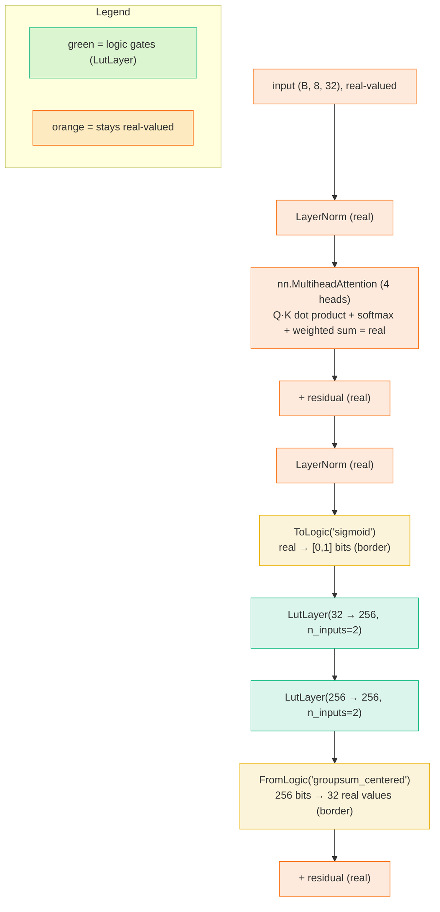
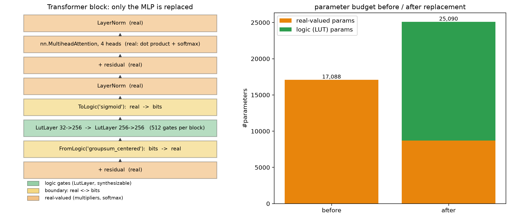
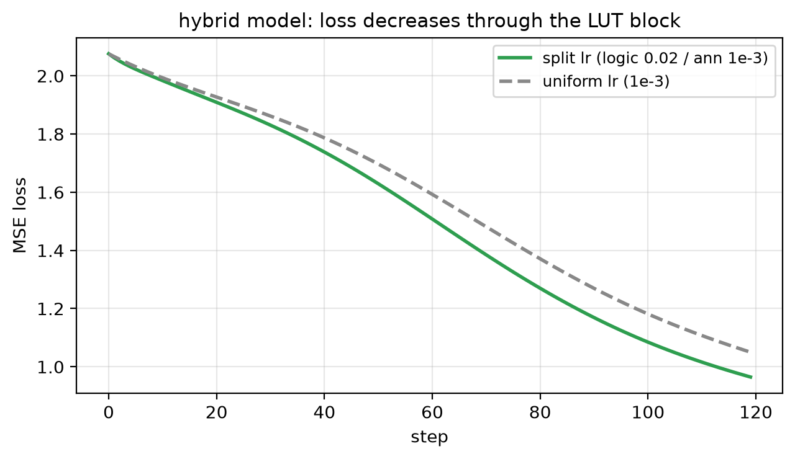
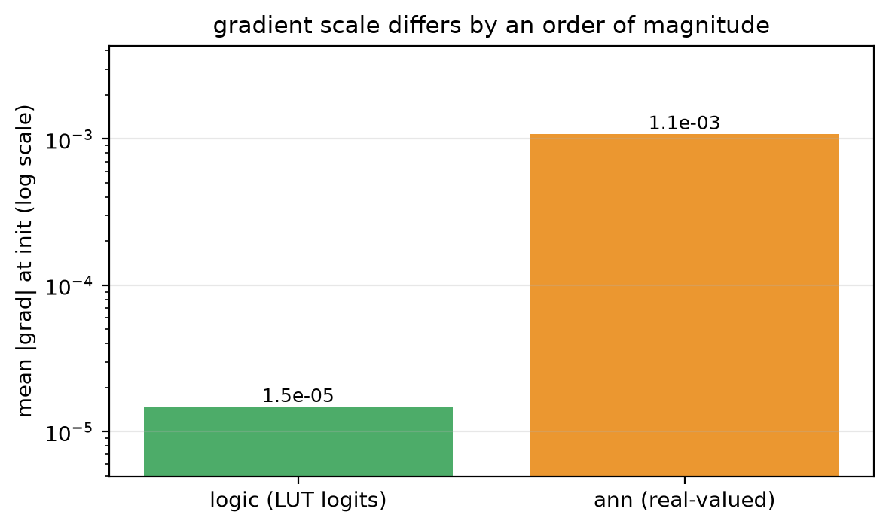
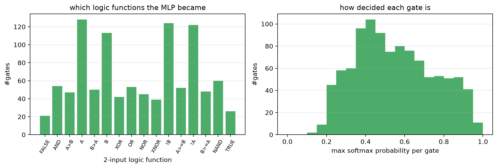

<!-- This file is generated by scripts/build_tutorials.py.
     Do not edit it directly; edit examples/02_hybrid_llvit.py and regenerate. -->

Replace **only the MLP part** of an existing Transformer block with LUT-based logic gates
(an LL-ViT style hybrid). Attention and LayerNorm stay as PyTorch real-valued layers, and
the logic side and the real-valued side are trained together with separate learning rates.

:::tip[What you'll learn]
1. How to wire up a replacement of **only the MLP part** of a Transformer block with LUTs (LL-ViT style)
2. Why attention and LayerNorm stay real-valued, and why the logic side and the real-valued side get separate learning rates
3. Where the design decision "do not turn everything into logic gates" pays off

**Prerequisites**

- [1. Train on MNIST](/en/tutorials/mnist/) — see the all-logic-gate case first
- [Migrating from PyTorch](/en/guides/from-pytorch/) — the layer correspondence table
:::

:::note[About this page]
Estimated time: **about 5 minutes** / Environment: CPU only (no GPU required)
Source script: [`examples/02_hybrid_llvit.py`](https://github.com/tsukushi-gate/Griffith/blob/main/examples/02_hybrid_llvit.py)
Try it locally: [`notebooks/02_hybrid_llvit.ipynb`](https://github.com/tsukushi-gate/Griffith/blob/main/notebooks/02_hybrid_llvit.ipynb) (an unexecuted notebook with the same content as this page; open it with `uv run --group docs jupyter lab notebooks/`)
Every code output below is **the result of an actual run**, embedded verbatim.
:::

<!-- Colab badge: once the repository is public, replace this span with an <a> whose href
     is data-colab-url to enable "Open in Colab". -->
<span class="colab-badge" data-colab-url="https://colab.research.google.com/github/tsukushi-gate/Griffith/blob/main/notebooks/02_hybrid_llvit.ipynb">▶ Open in Colab (enabled once the repository is public)</span>

An example of a hybrid NN (LL-ViT style).

It replaces "only the MLP part" of an existing Transformer block with LUT-based logic gates.
Attention and LayerNorm remain PyTorch real-valued layers.

Turning an entire Transformer into logic gates is hard, but if you push **just the MLP, which
holds most of the parameters**, into a logic circuit, you can peel most of the inference cost
off the GPU. This script confirms that "you can do partial replacement by dropping one line into
an existing model", and that gradients still flow and the loss still decreases afterwards.

This page checks four things:
where the model turns into logic gates and where it stays real-valued, how the parameter budget
moves, why splitting the learning rate between the logic side and the real-valued side helps, and
what collection of 2-input logic gates the replaced MLP finally becomes.

**What stays real-valued, and what becomes a LUT**

Orange = real-valued (the parts that need floating-point multiplies, LayerNorm, softmax),
green = logic gates (LutLayer: a truth table, so it can be burned into HDL).
`Binarize` (ToLogic) and `GroupSum` (FromLogic) are the **border** between the two worlds,
where real numbers and bits cross over.



Only the `mlp` of each block is replaced: **512 gates per block (LutLayer 32→256 and 256→256),
1,024 gates across the two blocks**. Real-valued parameters drop from **17,088 to 8,706**
(about half), and in exchange 16,384 logic parameters appear
(= 1,024 gates × the logits over the 16 two-input logic functions).
Because attention is left real-valued, this configuration is the partial logification known as
the "LL-ViT type" — the road that makes attention logical as well is covered in
[The Ladder of Logification](/en/tutorials/logic-ladder/).

Run: uv run python examples/02_hybrid_llvit.py
Expected result: 2 replacements, loss decreases

## Setup: imports and the replacement API

Four things are used from this library. They are the toolkit for **doing partial replacement
without rewriting your existing model**.

- `replace_mlp_with_lut` … walks the model recursively and swaps only the parts it can judge to
  be an MLP for a LUT block
- `LogicSpec` … the specification of the shape of the logic circuit after replacement (inputs per
  gate, depth, width)
- `split_param_groups` … automatically sorts parameters into the logic side (`logic`) and the
  real-valued side (`ann`)
- `LutLayer` / `gate_labels` … the layer inserted by the replacement, and how to get its gate names

```python
import copy

import matplotlib.pyplot as plt
import torch
import torch.nn as nn
import torch.nn.functional as F

from griffith_logic import (
    LogicSpec,
    LutLayer,
    replace_mlp_with_lut,
    split_param_groups,
)
from griffith_logic.analysis.circuit_viz import GATE_NAMES, gate_labels
```

```python
DIM = 32
```

## Preparing the "existing model" to be replaced

Write the starting point of the replacement — a perfectly ordinary **Pre-LN Transformer block** —
in plain PyTorch. **Nothing here comes from this library**; that is deliberate, to show that you
can bring an existing model of your own as it is.

The structure is `LayerNorm → MultiheadAttention → residual → LayerNorm → MLP → residual`.
Of these, the target of the replacement is only `self.mlp` (`Linear-GELU-Linear`), and since
**about 2/3 of a Transformer's parameters live in this MLP**, turning just this into logic peels
off most of the real-valued parameters.

```python
class Block(nn.Module):
    """A perfectly ordinary Pre-LN Transformer block (playing the "existing model" to be replaced).

    Nothing here comes from griffith_logic. It is deliberately written in plain PyTorch
    to show that you can bring your own implementation as it is.
    """

    def __init__(self):
        super().__init__()
        self.norm1 = nn.LayerNorm(DIM)
        self.attn = nn.MultiheadAttention(DIM, 4, batch_first=True)
        self.norm2 = nn.LayerNorm(DIM)
        # This mlp (Linear-GELU-Linear) is the replacement target.
        # About 2/3 of a Transformer's parameters live in this MLP.
        self.mlp = nn.Sequential(
            nn.Linear(DIM, DIM * 2), nn.GELU(), nn.Linear(DIM * 2, DIM),
        )

    def forward(self, x):
        h = self.norm1(x)
        a, _ = self.attn(h, h, h)
        x = x + a
        return x + self.mlp(self.norm2(x))
```

```python
torch.manual_seed(0)
model = nn.Sequential(Block(), Block())
```

```python
# Keep the pre-replacement shape around (to compare parameter counts later).
model_orig = copy.deepcopy(model)
```

## Partial replacement: swapping only the MLP for LUTs

The replacement takes a single function call. `LogicSpec` decides the shape of the circuit that
replaces it.

- `n_inputs=2` … 2 inputs per gate (the difflogic-compatible 16 logic functions)
- `depth=2` … stack 2 LUT layers; nonlinearity comes from composing gates
- `neurons_per_output=8` … assign 8 gates per output dimension — the expressiveness/cost knob

The returned `replaced` holds the names of the replaced modules, so you can verify in code that
**only the intended places were replaced** (which prevents the accident of everything being
silently swapped).

```python
# Walk the model recursively and swap every Sequential judged to be an MLP for a LUT block.
# spec is the shape of the logic circuit after replacement:
#   n_inputs=2           ... 2 inputs per gate (difflogic-compatible 16 logic functions)
#   depth=2              ... stack 2 LUT layers (nonlinearity comes from composing gates)
#   neurons_per_output=8 ... assign 8 gates per output dimension (the expressiveness/cost knob)
# The returned `replaced` holds the names of the replaced modules, so you can verify that only
# the intended places were replaced.
hybrid, replaced = replace_mlp_with_lut(
    model, spec=LogicSpec(n_inputs=2, depth=2, neurons_per_output=8),
)
print(f'置換されたモジュール: {replaced}')
```

```text title="Output"
置換されたモジュール: ['0.mlp', '1.mlp']
```

### Checking which layers the replacement inserted

The input/output width of each inserted `LutLayer` is literally the **number of gates**, and that
is the unit of hardware cost. The output shows two layers per block, `32→256` and `256→256`
= **512 gates**, so 1,024 gates across the two blocks.

```python
# Take a peek at the shape of the block after replacement. The MLP (Linear-GELU-Linear) has become
# a small circuit: "real values -> bits -> LutLayer x depth -> bits back to real values".
# The input/output width of each LutLayer (= the number of gates) is the unit of hardware cost.
for name, module in hybrid.named_modules():
    if isinstance(module, LutLayer):
        print(f'  {name}: LutLayer(in={module.in_dim}, out={module.out_dim},'
              f' n_inputs={module.n_inputs}) → {module.out_dim}ゲート')
```

```text title="Output"
  0.mlp.luts.0: LutLayer(in=32, out=256, n_inputs=2) → 256ゲート
  0.mlp.luts.1: LutLayer(in=256, out=256, n_inputs=2) → 256ゲート
  1.mlp.luts.0: LutLayer(in=32, out=256, n_inputs=2) → 256ゲート
  1.mlp.luts.1: LutLayer(in=256, out=256, n_inputs=2) → 256ゲート
```

## The training task: confirming only that gradients get through

**Why a regression onto random targets** — what this page wants to confirm is not accuracy but a
single point: whether one `backward()` still runs all the way through even when it crosses
heterogeneous layers, "real-valued → logic → real-valued". Real data would mix the difficulty of
the task into the result, so the task is **nothing but memorizing noise**, leaving only the effect
of the replacement itself in view.

```python
# The aim here is not accuracy but confirming that "gradients flow all the way through even in a
# hybrid", so a regression onto random targets (just memorizing noise) is enough.
# That removes any room for the dataset to change the result, leaving only the effect of the
# replacement itself.
x = torch.randn(64, 8, DIM)
target = torch.randn(64, 8, DIM)
```

```python
def run_training(net, opt, steps: int = 120):
    """Update the real-valued and logic layers together in a single backward pass, returning the loss of each step.

    The pass crosses heterogeneous layers — attention (real) -> LUT block (logic) -> attention —
    but the caller needs no special handling. That is what "the hybrid is usable" really means.
    """
    history = []
    for _ in range(steps):
        opt.zero_grad()
        loss = F.mse_loss(net(x), target)
        loss.backward()
        opt.step()
        history.append(loss.item())
    return history
```

## Why the learning rates are split (measuring the gradient scale)

This is the first place a hybrid trips you up. **Gradient magnitudes differ by orders of magnitude
between the logic side and the real-valued side.**

Logic gate parameters are "logits over the 16 logic functions"; they act on the output only after
passing through a softmax, so their gradients tend to be small. Real-valued weights in attention
or LayerNorm, by contrast, act on the output directly. Run both at the same learning rate and the
logic side alone barely moves from beginning to end.

Rather than leave this adjustment as craft lore, put a number on it: **run one backward pass from
the initial state and measure the mean $|\mathrm{grad}|$**.

```python
# Logic gate parameters are "logits over the 16 logic functions"; they act on the output only
# after passing through a softmax, so their gradients tend to be small. Real-valued weights in
# attention or LayerNorm act on the output directly. Run both at the same lr and only the logic
# side barely moves.
# Let's actually run one backward pass from the initial state and measure mean |grad| per group.
probe = copy.deepcopy(hybrid)
F.mse_loss(probe(x), target).backward()
grad_groups = split_param_groups(probe)
grad_mean = {
    g['name']: float(torch.cat([p.grad.abs().flatten() for p in g['params']
                                if p.grad is not None]).mean())
    for g in grad_groups
}
print(f'初期の平均|grad|: logic={grad_mean["logic"]:.2e} /'
      f' ann={grad_mean["ann"]:.2e}'
      f' (比 {grad_mean["ann"] / grad_mean["logic"]:.1f}倍)')
```

```text title="Output"
初期の平均|grad|: logic=1.48e-05 / ann=1.08e-03 (比 73.0倍)
```

## Training: with and without split learning rates

As the measurement above shows, the real-valued side's gradients are an order of magnitude larger,
so `split_param_groups` splits the parameters into two groups and **raises the learning rate on
the logic side only** (the rule of thumb is `logic_lr` ≈ 0.01–0.05, `ann_lr` ≈ 1e-3). There is no
need to enumerate module names by hand.

For comparison, the same run is repeated from the **same initial values** with "a uniform
lr=1e-3 for every parameter", to put side by side what happens if you keep training with the
pre-replacement setup.

### Optimizer: separate learning rates for the LUT side and the real-valued side

```python
# split_param_groups automatically sorts parameters under LutLayer/DWNLayer into the 'logic'
# group and everything else into the 'ann' group. No need to enumerate module names by hand.
# Rule of thumb: logic_lr ≈ 0.01–0.05, ann_lr ≈ 1e-3 (an order of magnitude apart or more).
opt = torch.optim.AdamW(split_param_groups(hybrid, logic_lr=0.02, ann_lr=1e-3))
losses = run_training(hybrid, opt)
```

```python
# For comparison: running every parameter at the same lr (1e-3, meant for real-valued layers).
# Starting from the same initial values, see what happens if you keep the pre-replacement setup.
uniform = copy.deepcopy(probe)
uniform.zero_grad(set_to_none=True)
losses_uniform = run_training(uniform, torch.optim.AdamW(uniform.parameters(),
                                                         lr=1e-3))

print(f'lr分離あり loss: {losses[0]:.4f} → {losses[-1]:.4f}')
print(f'lr分離なし loss: {losses_uniform[0]:.4f} → {losses_uniform[-1]:.4f}')
```

```text title="Output"
lr分離あり loss: 2.0758 → 0.9647
lr分離なし loss: 2.0758 → 1.0501
```

```python
# If the loss goes down, that is evidence that training works even with logic gate layers inserted.
assert losses[-1] < losses[0]
```

## Visualization: what was replaced and what remained

**Reading it**: in the output above you can see numerically that the loss falls better when the
learning rates are split. The uniform lr does lower the loss as well — because the real-valued
side alone balances the books — and "it looks like it is working when it is not" is what makes
this failure mode so nasty.

The result of the replacement is now shown in four figures. First, a helper that counts parameters.

### A helper that counts parameters split into logic and real-valued

```python
# Orange = the real-valued world (MACs, gradients), green = the logic world (bits, gates):
# the site-wide color convention. The figure has two panels:
#   left  ... the structure of the Transformer block. Only the MLP was replaced;
#             attention / LayerNorm / residuals remain PyTorch real-valued layers.
#   right ... the parameter breakdown (before and after). The MLP takes 2/3 of the budget,
#             so turning just that into logic peels off most of the real-valued parameters —
#             which is the whole point of going hybrid.
def count_params(module, logic: bool):
    """Count parameters under `module`, split into logic gate layers (LutLayer) and the rest."""
    logic_ids = {id(p) for m in module.modules() if isinstance(m, LutLayer)
                 for p in m.parameters()}
    return sum(p.numel() for p in module.parameters()
               if (id(p) in logic_ids) == logic)
```

### Figure 1: what stayed real-valued and what became logic gates

The left panel is the structure of the Transformer block. Orange = real-valued, green = logic
gates, yellow = the **border** between the two (`ToLogic` / `FromLogic`, where real numbers and
bits cross over). The right panel is a stacked bar chart of the parameter breakdown before and
after replacement.

```python
# Draw the figure entirely within one cell (splitting it would display an empty Figure).
COLOR_REAL = '#e8850c'   # orange = the real-valued part
COLOR_LOGIC = '#2e9e4f'  # green = the logic part
before_real = count_params(model_orig, logic=False)
after_real = count_params(hybrid, logic=False)
after_logic = count_params(hybrid, logic=True)
print(f'実数パラメータ: {before_real:,} → {after_real:,}'
      f' / 論理パラメータ: {after_logic:,}')
COLOR_BORDER = '#eab308'  # yellow = the border between real values and bits (ToLogic / FromLogic)
blocks = [
    ('LayerNorm  (real)', COLOR_REAL),
    ('nn.MultiheadAttention, 4 heads  (real: dot product + softmax)', COLOR_REAL),
    ('+ residual  (real)', COLOR_REAL),
    ('LayerNorm  (real)', COLOR_REAL),
    ("ToLogic('sigmoid'):  real  ->  bits", COLOR_BORDER),
    ('LutLayer 32->256  ->  LutLayer 256->256   (512 gates per block)', COLOR_LOGIC),
    ("FromLogic('groupsum_centered'):  bits  ->  real", COLOR_BORDER),
    ('+ residual  (real)', COLOR_REAL),
]
fig, (ax_blk, ax_bar) = plt.subplots(1, 2, figsize=(12, 5.2))
for i, (label, color) in enumerate(blocks):  # left: block diagram (top to bottom)
    y = len(blocks) - i - 1
    ax_blk.add_patch(plt.Rectangle((0, y + 0.1), 1, 0.8, facecolor=color,
                                   alpha=0.35, edgecolor='#333', lw=1.2))
    ax_blk.text(0.5, y + 0.5, label, ha='center', va='center', fontsize=8.5)
    if i:
        ax_blk.annotate('', xy=(0.5, y + 0.9), xytext=(0.5, y + 1.1),
                        arrowprops=dict(arrowstyle='<|-', color='#444'))
for dy, color, label in [(0.0, COLOR_REAL, 'real-valued (multipliers, softmax)'),
                         (0.35, COLOR_BORDER, 'boundary: real <-> bits'),
                         (0.7, COLOR_LOGIC, 'logic gates (LutLayer, synthesizable)')]:
    ax_blk.add_patch(plt.Rectangle((0.02, -0.95 + dy), 0.06, 0.22, facecolor=color,
                                   alpha=0.5, edgecolor='#333', lw=0.8))
    ax_blk.text(0.11, -0.84 + dy, label, va='center', fontsize=8)
ax_blk.set_xlim(-0.1, 1.1)
ax_blk.set_ylim(-1.1, len(blocks))
ax_blk.set_axis_off()
ax_blk.set_title('Transformer block: only the MLP is replaced', fontsize=11)
ax_bar.bar(['before', 'after'], [before_real, after_real],  # right: parameter breakdown
           color=COLOR_REAL, label='real-valued params')
ax_bar.bar(['before', 'after'], [0, after_logic], bottom=[0, after_real],
           color=COLOR_LOGIC, label='logic (LUT) params')
for i, total in enumerate([before_real, after_real + after_logic]):
    ax_bar.text(i, total, f'{total:,}', ha='center', va='bottom', fontsize=9)
ax_bar.set_ylabel('#parameters')
ax_bar.set_title('parameter budget before / after replacement', fontsize=11)
ax_bar.legend()
fig.tight_layout()
plt.show()
```

```text title="Output"
実数パラメータ: 17,088 → 8,706 / 論理パラメータ: 16,384
```

    

    

**Reading it**: following the left panel from top to bottom, the only green (logic) parts are the
two `LutLayer`s in the middle; attention, LayerNorm and the residuals all stay orange. This is the
partial logification called the "LL-ViT type". On the right, real-valued parameters fall from
17,088 to 8,706 — **about half** — and in exchange 16,384 logic parameters
(= 1,024 gates × 16 logic functions) ride on top. The logic-side count goes up, but these are
**not numbers used in multiplications; they are a choice of truth table**, so they leave no
multipliers behind once the circuit is burned.

### Figure 2: gradients flow all the way through even in a hybrid

Two learning curves are overlaid. Green is with split learning rates, the dashed gray is the
uniform lr. Same initial values, same data — **the only difference is how the learning rate is
given**. First of all, "the loss decreasing at all" is the evidence that gradients cross the
heterogeneous layers.

```python
# A single backward pass runs across attention (real) -> LUT block (logic) -> attention.
# A decreasing loss is evidence that training works with mixed layer types.
# The two curves share the same initial values and the same data; only the learning rates differ:
#   green ... logic_lr=0.02 / ann_lr=1e-3 (split_param_groups)
#   gray  ... a uniform lr=1e-3 for every parameter (the pre-replacement setup, kept as is)
# The uniform lr still lowers the loss, but more slowly because the logic side barely moves.
fig, ax = plt.subplots(figsize=(6.5, 3.8))
ax.plot(losses, color=COLOR_LOGIC, lw=2, label='split lr (logic 0.02 / ann 1e-3)')
ax.plot(losses_uniform, color='#888888', lw=2, ls='--', label='uniform lr (1e-3)')
ax.set_xlabel('step')
ax.set_ylabel('MSE loss')
ax.set_title('hybrid model: loss decreases through the LUT block', fontsize=11)
ax.legend(fontsize=9)
ax.grid(alpha=0.3)
fig.tight_layout()
plt.show()
```

    

    

**Reading it**: both curves slope down, so training works even with the LUT block in the middle.
The green one falls faster and deeper, though — the gray (uniform lr) is sluggish because the
logic side barely moves.

### Figure 3: why the learning rates need to be split

The mean $|\mathrm{grad}|$ measured in the previous section, as a bar chart on a logarithmic axis.
Note that the vertical axis is logarithmic — the difference is not "a little" but **an order of
magnitude**.

```python
# Mean |grad| per group after a single backward pass from the initial state (log axis).
# Logic gate logits sit behind a softmax, so their gradients are orders of magnitude smaller and
# they do not move at the same lr.
# "Splitting the lr" is not craft lore; it is the operation that closes this gradient-scale gap.
fig, ax = plt.subplots(figsize=(6.0, 3.6))
names = ['logic (LUT logits)', 'ann (real-valued)']
values = [grad_mean['logic'], grad_mean['ann']]
bars = ax.bar(names, values, color=[COLOR_LOGIC, COLOR_REAL], alpha=0.85)
for bar, v in zip(bars, values, strict=True):
    ax.text(bar.get_x() + bar.get_width() / 2, v, f'{v:.1e}',
            ha='center', va='bottom', fontsize=9)
ax.set_yscale('log')
ax.set_ylim(min(values) / 3, max(values) * 4)  # room for the value labels above the bars
ax.set_ylabel('mean |grad| at init (log scale)')
ax.set_title('gradient scale differs by an order of magnitude', fontsize=11)
ax.grid(axis='y', alpha=0.3)
fig.tight_layout()
plt.show()
```

    

    

**Reading it**: the real-valued side (orange) has gradients an order of magnitude larger than the
logic side (green). "Splitting the lr" is not a hunch but **a mechanical operation for closing
this gap**.

### Figure 4: what logic circuit did the MLP become in the end?

Finally, look at **what collection of gates** the replaced MLP became. The left panel shows how
many times each of the 16 two-input logic functions was chosen; the right shows the distribution
of each gate's **confidence** (the maximum probability after softmax; the closer to 1.0, the more
firmly it can say "I am an XOR").

**Reading it (written up front, since this is the last figure)**: the target here is random, so
the distribution of gate types stays comparatively flat instead of skewing toward particular
functions (on a meaningful task it skews toward AND / XOR and the like). The closer the confidence
on the right sits to 1.0, the smaller the gap between soft and hard, and the less discretization
breaks things — if it were clustered around 0.5, the verdict would be that training is progressing
but the result cannot be dropped into hardware.

```python
# After training, each gate settles on exactly one of the 16 two-input logic functions
# (the argmax of its logits). gate_labels names them from the same truth tables that get baked
# into the IR / Verilog, so the distribution shown here is the gate composition of the circuit
# that is actually generated.
# left  ... a histogram of gate types (which logic functions were chosen). The target here is
#           random, so the distribution stays close to uniform; on a meaningful task it skews
#           toward particular gates such as AND/XOR.
# right ... the distribution of confidence = the maximum probability after softmax. The closer
#           to 1.0, the smaller the gap between soft (training) and hard (circuit) — i.e. the
#           less discretization breaks things.
lut_layers = [m for m in hybrid.modules() if isinstance(m, LutLayer)]
labels_all = [name for layer in lut_layers for name in gate_labels(layer)]
confidence = torch.cat([
    torch.softmax(layer.weights.detach(), dim=-1).max(dim=-1).values
    for layer in lut_layers
])
order = [GATE_NAMES[i] for i in range(16)]
counts = [labels_all.count(name) for name in order]
print(f'ゲート総数 {len(labels_all)} / 最頻ゲート '
      f'{order[counts.index(max(counts))]} ({max(counts)}個)')
fig, (ax_hist, ax_conf) = plt.subplots(1, 2, figsize=(11, 3.8))
ax_hist.bar(order, counts, color=COLOR_LOGIC, alpha=0.85)
ax_hist.set_ylabel('#gates')
ax_hist.set_xlabel('2-input logic function')
ax_hist.tick_params(axis='x', rotation=60, labelsize=8)
ax_hist.set_title('which logic functions the MLP became', fontsize=11)
ax_hist.grid(axis='y', alpha=0.3)
ax_conf.hist(confidence.numpy(), bins=20, range=(0, 1), color=COLOR_LOGIC,
             alpha=0.85)
ax_conf.set_xlabel('max softmax probability per gate')
ax_conf.set_ylabel('#gates')
ax_conf.set_title('how decided each gate is', fontsize=11)
ax_conf.grid(axis='y', alpha=0.3)
fig.tight_layout()
plt.show()
```

```text title="Output"
ゲート総数 1024 / 最頻ゲート A (128個)
```

    


## What to read next

- [3. Export to HDL](/en/tutorials/hdl-export/) — turn a trained model into a circuit
- [Learning rules (BP/AP/DFA/ES)](/en/explanation/learning-rules/) — change the learning rule per layer
- [Architecture overview](/en/explanation/architecture/)
- [The Ladder of Logification](/en/tutorials/logic-ladder/) — measure "how far to go logic" one rung at a time

<!-- i18n:source=tutorials/hybrid.md hash=c055aa87f100 -->
