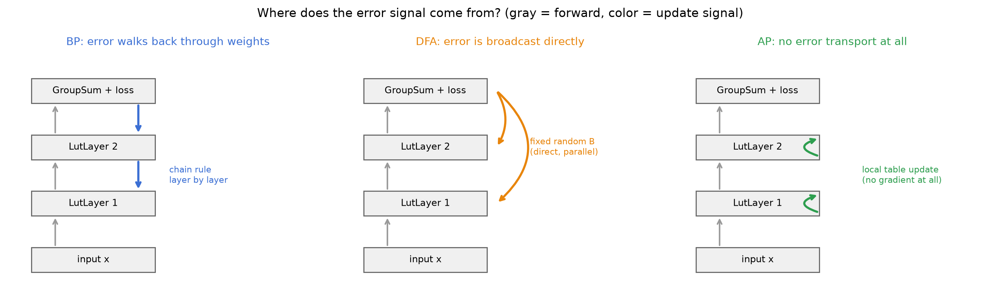
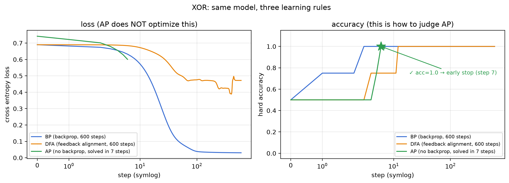
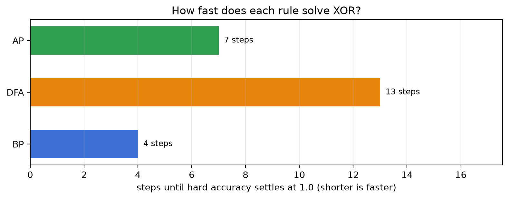

<!-- This file is generated by scripts/build_tutorials.py.
     Do not edit it directly; edit examples/03_learning_rules.py and regenerate. -->

Annotate learning rules per layer with `with_learning()` and see how `HybridTrainer`
runs BP / DFA / EGGROLL / AP together. Here the same XOR is solved with
DFA (a fixed random projection of the error) and AP (Akiho Propagation, a direct update that needs no backprop).

**How to read the figure**: AP does not optimize the loss (cross entropy), so on the loss curve
its value stays high and the line breaks off early, which looks like "it failed and stopped".
In reality it merely reached 100% accuracy and stopped early, so judge AP's success or failure by
**the accuracy in the right-hand panel**.

:::tip[What you'll learn]
1. How to mix learning rules per layer with `with_learning()` + `HybridTrainer`
2. The difference between DFA (a fixed random projection of the error) and AP (a direct update that needs no backprop)
3. How to read the figure: judge AP's success by **the accuracy**, not by the loss curve

**Prerequisites**

- [Appendix: XOR Internals](/en/tutorials/xor/) — the same problem solved with BP
- [Running training](/en/guides/training/) — the basics of training
:::

:::note[About this page]
Estimated time: **about 5 minutes** / Environment: CPU only (no GPU required)
Source script: [`examples/03_learning_rules.py`](https://github.com/tsukushi-gate/Griffith/blob/main/examples/03_learning_rules.py)
Try it locally: [`notebooks/03_learning_rules.ipynb`](https://github.com/tsukushi-gate/Griffith/blob/main/notebooks/03_learning_rules.ipynb) (an unexecuted notebook with the same content as this page; open it with `uv run --group docs jupyter lab notebooks/`)
Every code output below is **the result of an actual run**, embedded verbatim.
:::

<!-- Colab badge: once the repository is public, replace this span with an <a> whose href
     is data-colab-url to enable "Open in Colab". -->
<span class="colab-badge" data-colab-url="https://colab.research.google.com/github/tsukushi-gate/Griffith/blob/main/notebooks/03_learning_rules.ipynb">▶ Open in Colab (enabled once the repository is public)</span>

An example of switching learning algorithms.

Annotate learning rules per layer with with_learning(), and
HybridTrainer runs BP / DFA / EGGROLL / AP together.

A logic gate network "uses backprop when backprop is available", but local learning on hardware
and situations where gradients cannot flow are also in scope. That is why this library is designed
so that **the learning rule can be chosen per layer**. Here the same XOR is solved by two methods
that use no error backpropagation (DFA / AP), confirming that only the learning rule is swapped
while the model definition stays the same.

In one sentence, the only difference between the three learning rules is "**by which route the error
reaches each layer**".

- BP ... carries the output error backwards one layer at a time using the weights of the later layers (layers depend serially)
- DFA ... scatters the output error directly to each layer through a **fixed random matrix** (layers are independent of each other)
- AP ... carries no error at all. Each gate rewrites its own truth table locally (no derivatives)

Run: uv run python examples/03_learning_rules.py
Expected result: XOR is learned by both DFA and AP

A note on reading it: **AP does not optimize the loss (cross entropy)**, so looking at the loss
curve alone makes it seem to have "stopped partway while still high = failed". Judge AP by the
accuracy (it is cut off the moment accuracy reaches 100%). That is why the figure below has two
panels: loss on the left and accuracy on the right.

## Preparation: the API for switching learning rules

Only three things from this library are used, and they are enough to **mix learning rules per layer**.

- `with_learning(layer, spec)` ... wraps a layer and annotates it with "update this layer by this
  rule". It does not change the definition of the layer itself
- `LearningSpec(rule=...)` ... the learning rule to use (`'bp'` / `'dfa'` / `'ap'` / `'eggroll'`)
- `HybridTrainer` ... the trainer that reads the annotations and dispatches the appropriate update
  per layer

```python
import matplotlib.pyplot as plt
import torch
import torch.nn as nn
import torch.nn.functional as F

from griffith_logic import (
    GroupSum,
    HybridTrainer,
    LearningSpec,
    LutLayer,
    with_learning,
)
```

```python
BP_COLOR, DFA_COLOR, AP_COLOR = '#3b6fd4', '#e8850c', '#2e9e4f'
```

## The three learning rules differ only in "how the error arrives"

Before going into the experiments, let us pin down the difference between the three learning rules in
one sentence. The difference is only **by which route the error (= the signal telling which way to
move the parameters) reaches each layer**.

- **BP** (error backpropagation) ... carries the output error backwards one layer at a time using
  the weights of the later layers. The layers depend on each other serially, so updating an earlier
  layer has to wait for the later ones
- **DFA** (Direct Feedback Alignment) ... scatters the output error directly to each layer through a
  **fixed random matrix**. The layers do not depend on each other, so updates can be parallel and local
- **AP** (Akiho Propagation) ... carries no error between layers. Each gate rewrites its own truth
  table locally. It uses no derivatives at all, so not even an optimizer is needed

**Why anything other than BP is needed** ── because learning on hardware, and situations where
gradients cannot flow, are in scope. The more a rule gets by with local updates, the easier it is to
implement as a circuit.

### Groundwork for Figure 1: a function that draws "the route of the error"

```python
# Before starting the experiments, let us first pin down in a picture what the three learning rules do.
# The boxes stacked vertically are the layers (input at the bottom, output at the top), and the grey
# upward arrows are the forward pass. The colored arrows represent "how the error (= the signal telling
# which way to move the parameters) arrives". That is the only difference between the three; the model
# definition can be exactly the same in all three cases.
def draw_rule_diagram(ax, rule, color, caption):
    """Draw a schematic of the layer stack and the error route for one learning rule."""
    names = ['input x', 'LutLayer 1', 'LutLayer 2', 'GroupSum + loss']
    for i, name in enumerate(names):
        # The layer box. y=i is the level counted from the bottom.
        ax.add_patch(plt.Rectangle((0.10, i - 0.22), 0.52, 0.44,
                                   facecolor='#f0f0f0', edgecolor='#666', lw=1.0))
        ax.text(0.36, i, name, ha='center', va='center', fontsize=8.5)
        if i < len(names) - 1:
            # forward (grey): common to every learning rule; values flow from input to output.
            ax.annotate('', xy=(0.20, i + 0.78), xytext=(0.20, i + 0.22),
                        arrowprops=dict(arrowstyle='->', color='#999', lw=1.4))

    if rule == 'bp':
        # BP: the error comes down one layer at a time from the output, via the weights of the later layers (serial).
        for i in (3, 2):
            ax.annotate('', xy=(0.55, i - 0.78), xytext=(0.55, i - 0.22),
                        arrowprops=dict(arrowstyle='->', color=color, lw=2.0))
        ax.text(0.68, 1.5, 'chain rule\nlayer by layer', fontsize=8, color=color,
                va='center')
    elif rule == 'dfa':
        # DFA: the output error is delivered "directly" to each layer by a fixed random matrix B (layers are independent).
        for i, rad in ((2, -0.30), (1, -0.55)):
            ax.annotate('', xy=(0.66, i), xytext=(0.66, 3),
                        arrowprops=dict(arrowstyle='->', color=color, lw=2.0,
                                        connectionstyle=f'arc3,rad={rad}'))
        ax.text(0.80, 2.0, 'fixed random B\n(direct, parallel)', fontsize=8,
                color=color, va='center')
    else:
        # AP: the error never crosses layers. Each gate updates its own truth table locally by addition.
        for i in (1, 2):
            ax.annotate('', xy=(0.62, i + 0.16), xytext=(0.62, i - 0.16),
                        arrowprops=dict(arrowstyle='->', color=color, lw=2.0,
                                        connectionstyle='arc3,rad=-1.6'))
        ax.text(0.80, 1.5, 'local table update\n(no gradient at all)', fontsize=8,
                color=color, va='center')

    ax.set_xlim(0.0, 1.35)
    ax.set_ylim(-0.7, 3.7)
    ax.set_title(caption, fontsize=10, color=color)
    ax.set_axis_off()
```

### Figure 1: where does the error come from?

The explanation above turned into three schematics. The boxes stacked vertically are the layers
(input at the bottom, output at the top) and the grey upward arrows are the forward pass (the flow of
values). **The colored arrows are how the error arrives**, and that is the only difference between
the three.

```python
fig, axes = plt.subplots(1, 3, figsize=(13, 4.0))
draw_rule_diagram(axes[0], 'bp', BP_COLOR, 'BP: error walks back through weights')
draw_rule_diagram(axes[1], 'dfa', DFA_COLOR, 'DFA: error is broadcast directly')
draw_rule_diagram(axes[2], 'ap', AP_COLOR, 'AP: no error transport at all')
fig.suptitle('Where does the error signal come from? (gray = forward, color = update signal)',
             fontsize=11)
fig.tight_layout()
plt.show()
```

    

    

**What to read from it**: on the left (BP) the arrow comes down the layers one level at a time. In
the middle (DFA) arrows extend directly from the output to each layer, so the layers do not wait for
each other. On the right (AP) the arrows never cross layers and stay inside each layer ── there is no
transport of the error at all.

**The important point is that the model definition can be the same in all three cases**. The only
thing that changes is the annotation via `with_learning`.

## Data: solving the same XOR with three rules

The problem is fixed to the same 4 patterns as in [Appendix: XOR](/en/tutorials/xor/).
**The problem is fixed and only the learning rule is swapped**, so every difference visible from here
on can be read as a difference in "how the update is made".

```python
# The 4 XOR patterns (the same problem as 01_xor.py, solved with different learning rules).
# The problem is fixed and only the learning rule is swapped, so every difference from here on
# is a difference in "how the update is made".
x = torch.tensor([[0., 0.], [0., 1.], [1., 0.], [1., 1.]])
y = torch.tensor([0, 1, 1, 0])
```

## DFA: scattering the error through a fixed random matrix

**"Can it really learn with a haphazard matrix?"** ── that is the natural question when first seeing
DFA. The answer is "it can", and the reason is that **the forward weights align themselves with that
fixed matrix** (the phenomenon known as feedback alignment).

Since the layers do not depend on each other, updates can be parallel and local, which suits hardware
implementation well. The price is that accuracy is often below BP.

In code it is just a matter of wrapping the layers with
`with_learning(..., LearningSpec(rule='dfa'))`; the definition of `LutLayer` is exactly the same as on
the XOR page.

```python
# Ordinary backprop carries the gradient backwards using "the weights of the previous layer",
# so the layers depend on each other serially. DFA scatters the output-side error directly to
# every layer through **fixed random matrices**. Layers no longer depend on each other, so updates
# can be parallel and local, which suits hardware implementation (accuracy is often below BP).
# You may wonder "can it really learn with a random matrix", but the forward weights align themselves
# with that fixed matrix (feedback alignment), which is why learning proceeds.
torch.manual_seed(7)
model_dfa = nn.Sequential(
    # with_learning() merely wraps a layer and annotates "update this layer with this rule".
    # The layer itself (LutLayer) can be defined exactly as in 01_xor.py.
    with_learning(LutLayer(2, 32, n_inputs=2), LearningSpec(rule='dfa')),
    with_learning(LutLayer(32, 16, n_inputs=2), LearningSpec(rule='dfa')),
    GroupSum(k=2, tau=2.0),
)
```

```python
# HybridTrainer reads the annotations and dispatches the appropriate update per layer.
# DFA updates parameters through an optimizer, so Adam is passed here.
trainer = HybridTrainer(model_dfa, torch.optim.Adam(model_dfa.parameters(), lr=0.05))
loss_dfa, acc_dfa = [], []
for _ in range(600):
    # train_step does one round of forward, error assignment and update, and returns the metrics.
    # The 'accuracy' in the returned dict is the hard accuracy (accuracy as a discretized circuit).
    m = trainer.train_step(x, y)
    loss_dfa.append(m['loss'])
    acc_dfa.append(m['accuracy'])
trainer.close()  # clean up hooks etc. (mandatory, since some rules hold internal state)
print(f"DFA:  acc={m['accuracy']:.2f}")
```

```text title="Output"
DFA:  acc=1.00
```

## AP: a direct update that carries no error

For each gate, AP aggregates "does choosing this truth table entry get us closer to the answer?" and
adds the score directly in the better direction. **It uses no derivatives at all**, so no optimizer is
needed either — which shows up directly in the fact that no optimizer is passed to `HybridTrainer`.

There is one constraint. `parameterization='independent'` is mandatory: each truth table entry has to
be held as an independent variable ── because AP updates additively per entry, and a softmax mixture
over the 16 logic functions cannot be rewritten that way
(a concrete example of **a learning rule demanding a parameterization**).

```python
# For each gate it aggregates "does choosing this truth table entry get us closer to the answer?"
# and adds the score directly in the better direction. It uses no derivatives at all, so no
# optimizer is needed either.
# Because it does not carry the error between layers, the amount of information it can move in one
# step is coarser than BP, but on a problem as small as XOR it often jumps to the solution in a few steps.
torch.manual_seed(5)
model_ap = nn.Sequential(
    with_learning(
        # parameterization='independent': hold each truth table entry as an independent variable.
        # AP updates additively per entry, so it needs this independent representation rather than
        # a softmax mixture over the 16 logic functions (an example of a learning rule demanding a
        # parameterization).
        LutLayer(2, 32, n_inputs=2, parameterization='independent'),
        LearningSpec(rule='ap', lr=0.5),
    ),
    with_learning(
        LutLayer(32, 16, n_inputs=2, parameterization='independent'),
        LearningSpec(rule='ap', lr=0.5),
    ),
    GroupSum(k=2, tau=2.0),
)
```

```python
# Note that no optimizer is passed. AP creates no gradients and rewrites the values itself.
trainer = HybridTrainer(model_ap)
loss_ap, acc_ap = [], []
for _ in range(300):
    m = trainer.train_step(x, y)
    loss_ap.append(m['loss'])
    acc_ap.append(m['accuracy'])
    # AP often solves this in a few dozen steps, so cut off once accuracy hits 100%.
    # Caution: AP does not optimize the loss (it creates no gradients), so the loss is still high
    # when it stops. Judge success by accuracy, not by the loss.
    if m['accuracy'] == 1.0:
        break
ap_steps = len(acc_ap)  # number of steps until early stopping (varies with the seed, so use the measured value)
print(f"AP法: acc={m['accuracy']:.2f} ({ap_steps} steps で acc=1.0 に到達し早期終了)")
```

```text title="Output"
AP法: acc=1.00 (7 steps で acc=1.0 に到達し早期終了)
```

## BP: the baseline for comparison

Without a learning rule annotation, it trains with `backward()` as a plain PyTorch model. Not even
`HybridTrainer` is needed: just the usual `zero_grad → forward → backward → step`.
Overlaying the three in one figure shows the difference in "how fast the loss falls" directly.

```python
# Without a learning rule annotation, it trains with backward() as a plain PyTorch model.
# Not even HybridTrainer is needed: just the usual zero_grad -> forward -> backward -> step.
# Overlaying the three in one figure shows the difference in "how fast the loss falls" directly.
torch.manual_seed(7)
model_bp = nn.Sequential(
    LutLayer(2, 32, n_inputs=2),
    LutLayer(32, 16, n_inputs=2),
    GroupSum(k=2, tau=2.0),
)
opt = torch.optim.Adam(model_bp.parameters(), lr=0.05)
loss_bp, acc_bp = [], []
for _ in range(600):
    opt.zero_grad()
    logits = model_bp(x)
    loss = F.cross_entropy(logits, y)
    loss.backward()
    opt.step()
    loss_bp.append(loss.item())
    acc_bp.append((logits.argmax(-1) == y).float().mean().item())
print(f"BP:   acc={acc_bp[-1]:.2f}")
```

```text title="Output"
BP:   acc=1.00
```

## Evaluation: counting in how many steps it was solved

Looking only at the final accuracy, all three line up at 1.00 and the difference is invisible. What
actually matters is **speed**, so pick up the step at which each converged.

But XOR has only 4 samples, so "getting everything right once by chance" happens immediately.
Therefore convergence is defined not as the first time it hits 1.0 but as **the position from which
1.0 is held to the end** (= the point where it settled down and solved the problem). It is a
definition meant to avoid overestimation, and the design of the metric itself is part of the lesson.

```python
# Looking only at the final accuracy, all three line up at 1.00 and the difference is invisible.
# What actually matters is speed, so pick up the step at which each converged. But XOR has only
# 4 samples, so "getting everything right once by chance" happens immediately; therefore we define
# convergence not as the first time it hits 1.0 but as **the position from which 1.0 is held to the
# end** (= the point where it settled down and solved the problem).
def solved_step(acc_curve):
    """The first step number (1-based) of the stretch where acc=1.0 lasts to the end. None if not converged."""
    if acc_curve[-1] != 1.0:
        return None
    i = len(acc_curve) - 1
    while i > 0 and acc_curve[i - 1] == 1.0:
        i -= 1
    return i + 1
```

```python
solved = {
    'BP': solved_step(acc_bp),
    'DFA': solved_step(acc_dfa),
    'AP': solved_step(acc_ap),
}
for name, s in solved.items():
    print(f'{name:>3}: acc=1.0 に落ち着いたステップ = {s if s else "未収束"}')
```

```text title="Output"
 BP: acc=1.0 に落ち着いたステップ = 4
DFA: acc=1.0 に落ち着いたステップ = 13
 AP: acc=1.0 に落ち着いたステップ = 7
```

### Figure 2: the loss curves (left) and the accuracy curves (right)

The three are overlaid on two panels. The horizontal scales differ greatly (AP is cut short by early
stopping), so a logarithmic axis (symlog) is used to compare their shapes.

**Do not evaluate AP from the left panel alone**. AP does not optimize the loss, so it stays high and
breaks off short, which at first glance looks like "it failed and stopped".
**Judge AP's success or failure by the right panel (accuracy)**. There, AP's end point (= the moment
of early stopping) is marked with a star and an annotation, which is the evidence that it "succeeded
and stopped".

```python
# The horizontal scales differ (AP is cut short), so overlay them on a log axis to compare shapes.
#   BP  ... carries the gradient accurately across layers. The most stable baseline
#   DFA ... scatters the error directly to each layer with fixed random matrices. Slower than BP but layer-independent
#   AP  ... adds directly to truth table entries without derivatives. Solves it in a few dozen steps
#
# **Do not evaluate AP from the left panel (loss) alone**. AP does not optimize the loss, so it stays
# high and breaks off short, which at first glance looks like "it failed and stopped". The right panel
# (accuracy) shows AP jumping to acc=1.0 within a few steps and stopping early.
# In the right panel, AP's end point (= the moment of early stopping) is marked with a star and an
# annotation. That is the evidence that it "succeeded and stopped" rather than "failed and broke off".
bp_label = f'BP (backprop, {len(loss_bp)} steps)'
dfa_label = f'DFA (feedback alignment, {len(loss_dfa)} steps)'
ap_label = f'AP (no backprop, solved in {ap_steps} steps)'

fig, (ax_loss, ax_acc) = plt.subplots(1, 2, figsize=(12, 4.2))

ax_loss.plot(loss_bp, label=bp_label, color=BP_COLOR)
ax_loss.plot(loss_dfa, label=dfa_label, color=DFA_COLOR)
ax_loss.plot(loss_ap, label=ap_label, color=AP_COLOR)
ax_loss.set_xscale('symlog')
ax_loss.set_xlabel('step (symlog)')
ax_loss.set_ylabel('cross entropy loss')
ax_loss.set_title('loss (AP does NOT optimize this)')
ax_loss.grid(alpha=0.3)
ax_loss.legend(fontsize=8)

ax_acc.plot(acc_bp, label=bp_label, color=BP_COLOR)
ax_acc.plot(acc_dfa, label=dfa_label, color=DFA_COLOR)
ax_acc.plot(acc_ap, label=ap_label, color=AP_COLOR)
ax_acc.plot(ap_steps - 1, acc_ap[-1], marker='*', markersize=16, color=AP_COLOR,
            zorder=5, linestyle='none')
ax_acc.annotate(f'✓ acc=1.0 → early stop (step {ap_steps})',
                xy=(ap_steps - 1, acc_ap[-1]), xytext=(46, -46),
                textcoords='offset points', fontsize=9, color=AP_COLOR,
                arrowprops=dict(arrowstyle='->', color=AP_COLOR, lw=1.2))
ax_acc.set_xscale('symlog')
ax_acc.set_xlabel('step (symlog)')
ax_acc.set_ylabel('hard accuracy')
ax_acc.set_ylim(-0.05, 1.15)
ax_acc.set_title('accuracy (this is how to judge AP)')
ax_acc.grid(alpha=0.3)
ax_acc.legend(fontsize=8, loc='lower right')

fig.suptitle('XOR: same model, three learning rules')
fig.tight_layout()
plt.show()
```

    

    

**What to read from it**: on the left, the losses of BP (blue) and DFA (orange) go down and only AP
(green) breaks off at a high position. On the right, all three reach a hard accuracy of 1.0, with AP
reaching it earliest and being cut off there ── which shows how easily the misreading "look at the
loss and conclude failure" can happen.

### Figure 3: in how many steps was it solved? (bar chart)

The curve plot is for looking at shapes; **for comparing speed, bars make it obvious at a glance**.
The horizontal axis is the number of steps until hard accuracy settles at 1.0; the shorter, the faster.

**What to read from it (written first, since this is the last figure)**: all three are solved within a
few to a dozen-odd steps, so "it can be solved even after throwing backprop away" is actually
confirmed at XOR's scale. This is however a story about a tiny 4-sample problem, not a claim that AP
is always faster than BP. At the scale of [1. Training on MNIST](/en/tutorials/mnist/), BP is usually
the strongest baseline.

```python
# The curve plot above is for looking at shapes; for comparing "speed", bars make it obvious at a glance.
# The shorter the bar, the faster. All three live in the world of a few to a dozen-odd steps, so
# "it can be solved even after throwing backprop away" is actually confirmed at XOR's scale.
# This is however a story about a tiny 4-sample problem, not a claim that AP is always faster than BP.
# On real data (the scale of examples/06_mnist.py), BP is usually the strongest baseline.
names = [n for n, s in solved.items() if s is not None]
values = [solved[n] for n in names]
colors = {'BP': BP_COLOR, 'DFA': DFA_COLOR, 'AP': AP_COLOR}

fig, ax = plt.subplots(figsize=(8, 3.2))
bars = ax.barh(names, values, color=[colors[n] for n in names], height=0.55)
ax.bar_label(bars, labels=[f'{v} steps' for v in values], padding=6, fontsize=9)
ax.set_xlim(0, max(values) * 1.35)
ax.set_xlabel('steps until hard accuracy settles at 1.0 (shorter is faster)')
ax.set_title('How fast does each rule solve XOR?')
ax.grid(alpha=0.3, axis='x')
fig.tight_layout()
plt.show()
```

    


## What to read next

- [Learning rules (BP/AP/DFA/ES)](/en/explanation/learning-rules/) — the mathematics of each rule
- [Running training](/en/guides/training/)
- [Choosing not to train the circuit](/en/tutorials/logic-reservoir/) — the extreme case of training only the readout

<!-- i18n:source=tutorials/learning-rules.md hash=ab11499e359e -->
