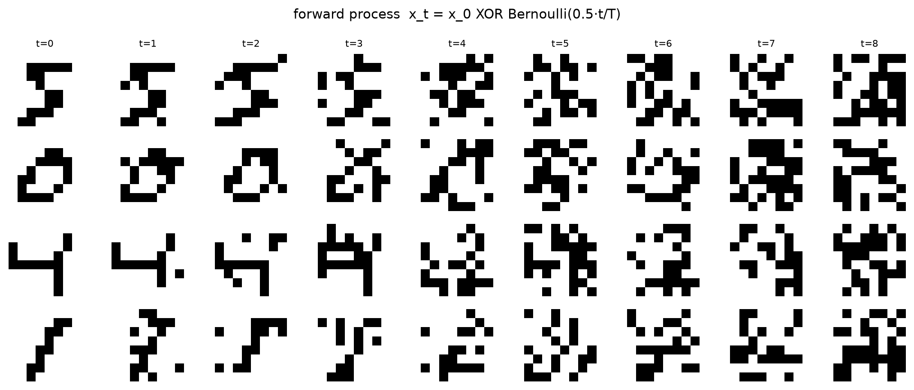
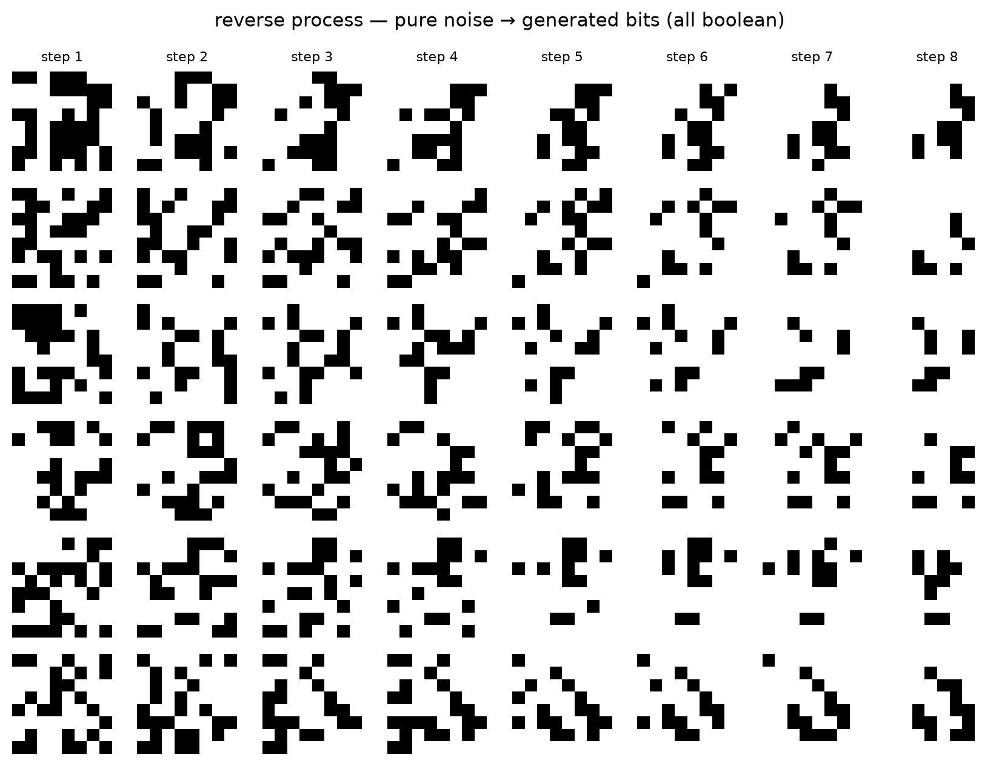
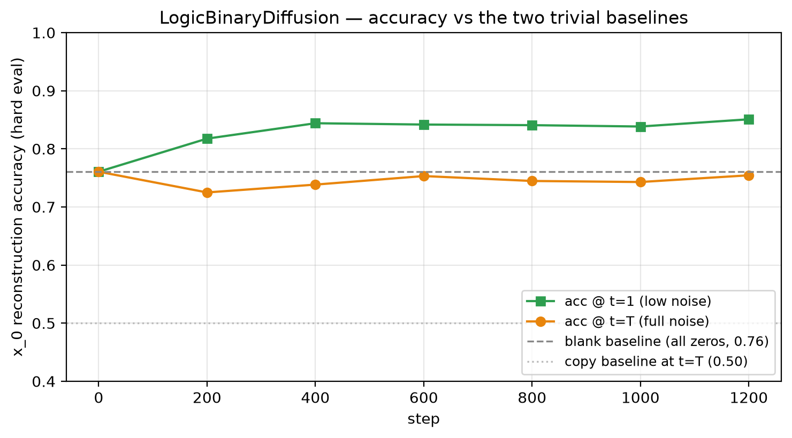
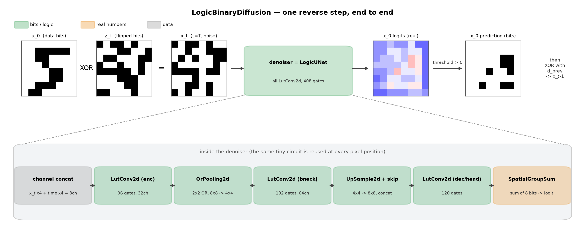
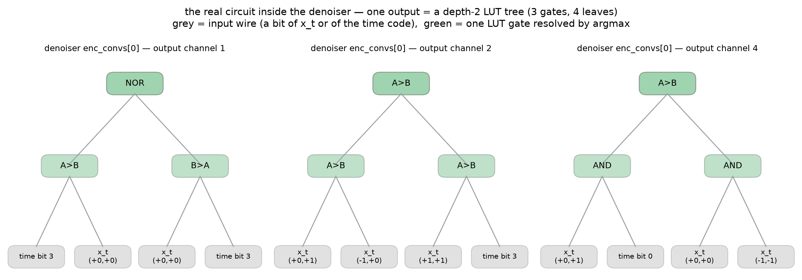

<!-- This file is generated automatically by scripts/build_tutorials.py.
     Do not edit it directly; edit examples/17_logic_diffusion.py and regenerate. -->

Turning a whole diffusion model into a Boolean circuit. Noise in the forward process is **XOR**, the
denoiser is **LUTs**, and the bit reassembly in the reverse process is logic too — the entire
generation pipeline closes without a single multiplication.

**Even how the baseline is chosen is part of the lesson here.** We originally used "denoise margin"
as the main metric, but measurement showed it already reads +0.26 before any training (that is just
the trivial "all pixels zero" solution). So we made the **blank (all-zero) baseline** explicit and
re-set the passing condition to "acc@t1 beats blank = the circuit really is reading $x_t$". The fact
that reconstruction from pure noise still sits near blank is also written down as is, without
exaggeration.

:::tip[What you'll learn]
1. Making diffusion logical: forward process = XOR, denoiser = LUTs, reverse process = bit reassembly
2. How to set up the blank baseline that tells you whether you are beating the trivial (all-zero) solution
3. What it means to report the metrics of a generative model "without exaggeration"

**Prerequisites**

- [1. Train on MNIST](/en/tutorials/mnist/)
- [Reading Training Curves](/en/guides/training-curves/) — how to choose a baseline
:::

:::note[About this page]
Estimated time: **about 6 minutes** / Environment: CPU only (no GPU needed)
Source script: [`examples/17_logic_diffusion.py`](https://github.com/tsukushi-gate/Griffith/blob/main/examples/17_logic_diffusion.py)
Try it yourself: [`notebooks/17_logic_diffusion.ipynb`](https://github.com/tsukushi-gate/Griffith/blob/main/notebooks/17_logic_diffusion.ipynb) (an unexecuted notebook with the same content as this page; open it with `uv run --group docs jupyter lab notebooks/`)
Every code output is the **actual result of running the code**, embedded verbatim.
:::

<!-- Colab badge: once the repository is public, replace this span with an <a> whose href is
     data-colab-url and "Open in Colab" becomes active. -->
<span class="colab-badge" data-colab-url="https://colab.research.google.com/github/tsukushi-gate/Griffith/blob/main/notebooks/17_logic_diffusion.ipynb">▶ Open in Colab (enabled once the repository is public)</span>

LogicBinaryDiffusion — an example of turning a whole diffusion model into a Boolean circuit.

A diffusion model is really a pair: a forward process that adds noise and a reverse process that
removes it. An ordinary diffusion model (DDPM) adds Gaussian noise in the forward direction and uses
a huge U-Net as the denoiser. Here we replace **all three** with logic operations:

    forward process : x_t = x_0 XOR z_t     ← **XOR**, not addition. z_t is the flip bits
    denoiser        : LogicUNet (LutConv2d throughout) ← the inside is all LUTs (truth tables)
    reverse process : reassemble bits from the posterior over predicted x̂_0 and the flip indicator

Prior work — BDPM (Kinakh & Voloshynovskiy, arXiv:2501.13915) — proposed XOR noise diffusion, but its
denoiser was a conventional CNN/Transformer. For **a diffusion model closed over logic gates all the
way into the denoiser** we have found no prior work as of 2026-09 (the closest is the BDPM above).
For the strength of the claim and the nearest literature see
[the world-first claims audit](/en/explanation/results/world-firsts/), and follow the qualified
wording given there in any external communication (implementation details are in the docstring at
the top of griffith_logic/models/logic_diffusion.py).
No multiplication and no floating point appear anywhere; the whole generation pipeline advances on
XOR and truth-table lookups alone.

## Data flow (with the real class names)

```mermaid
flowchart LR
    X0["x_0<br/>the data bits (0/1)"] --> Q["q_sample()<br/>x_t = x_0 XOR z_t"]
    NOISE["z_t ~ Bernoulli(p_t)<br/>a lottery over which bits flip"] --> Q
    Q --> XT["x_t<br/>the corrupted image bits"]
    TT["t → _time_bits()<br/>thermometer code (4 bits)"] --> CAT
    XT --> CAT["channel concat<br/>x_t x4ch + time x4ch = 8ch"]
    CAT --> UNET["denoiser = LogicUNet<br/>all LutConv2d (truth-table lookup)"]
    UNET --> SGS["SpatialGroupSum<br/>add up 8 bits"]
    SGS --> LOGIT["x_0 prediction logits (real)"]
    LOGIT --> HARD["threshold &gt; 0<br/>predicted bits x0_hat (0/1)"]
    HARD --> POST["_posterior_sample()<br/>d_prev from the flip-channel posterior"]
    XT --> POST
    POST --> XPREV["x_t-1 = x0_hat XOR d_prev"]
    XPREV -.->|"step t back by one and repeat"| CAT

    style Q fill:#10b98126,stroke:#10b981
    style UNET fill:#10b98126,stroke:#10b981
    style HARD fill:#10b98126,stroke:#10b981
    style POST fill:#10b98126,stroke:#10b981
    style SGS fill:#f9731626,stroke:#f97316
    style LOGIT fill:#f9731626,stroke:#f97316
```



Green is **the path that stays in bits (logic)**, orange is **the only place where real numbers
appear**. A real number shows up only where gate outputs are summed into a logit, and passing it
through a threshold turns it straight back into a bit (the "floating point at the margins" policy).

## How it actually works (in four lines)

1. **Adding noise = XOR**. Draw a lottery with flip rate p_t = 0.5·t/T and swap 0↔1 on the bits that
   win. At t=T half the bits are flipped, so the image becomes a completely random bit string.
2. **How the timestep is told = a thermometer code**. t is turned into a monotone bit string
   ("ones filling in from the left") and stacked onto the image along the channel dimension, so a LUT
   can read "how corrupted are we right now" straight off its wires.
3. **The denoiser is a logic circuit**. Every stage of LogicUNet is a LutConv2d; one output is a
   depth-2 LUT tree (4 leaves → 3 gates). It looks at only 4 bits, picked at random from the 3x3
   receptive field across the input channels, and emits one bit.
4. **Removing noise = XOR ancestral sampling from the posterior**. From the prediction x0_hat and the
   indicator of which bits are currently flipped, d_t = (x_t ≠ x0_hat), the probability of the
   previous indicator d_prev is computed exactly, and x_t-1 = x0_hat XOR d_prev is reassembled.

Only three formulas are involved:

- forward: x_t = x_0 ⊕ z_t, z_t ~ Bernoulli(p_t), p_t = 0.5·t/T
- one-step flip rate β: (1 − 2p_t) = (1 − 2p_t-1)(1 − 2β)
- posterior: P(d_prev=1 | d_t) ∝ P(d_t | d_prev=1)·p_t-1

Words you may be meeting for the first time:

- **logit** — a real-valued score meaning "the larger, the more it looks like a 1". Passing it
  through a sigmoid turns it into a probability.
- **ancestral sampling** — building a sample by rewinding the reverse process one stochastic step at
  a time.
- **thermometer code** — encoding a number as a monotone string of 0/1, like the mercury in a
  thermometer.

## Differences from an ordinary diffusion model (DDPM)

| What to look at | Ordinary DDPM | LogicBinaryDiffusion |
|---|---|---|
| Noise | adding Gaussian noise, x_t = √ᾱ_t·x_0 + √(1−ᾱ_t)·ε | flipping bits (XOR) |
| What is predicted | the noise ε that was added | the bits of x_0 themselves |
| Denoiser | a U-Net (convolution = multiply-accumulate) | LogicUNet (LutConv2d = truth-table lookup) |
| Reverse process | sample from a Gaussian posterior | XOR from the Bernoulli posterior of the flip channel |
| Loss | MSE | BCEWithLogits |
| Arithmetic required | floating-point multiplication | XOR and table lookup (real numbers only in the final sum) |

At the end of this page you will find an **architecture figure with real data flowing through it**
and a picture of the **real circuit (a LUT tree)** taken out of the trained denoiser. That is where
you can check "which part is the logic circuit".

The reduced recipe used in this example:
    The full run (experiments/train_logic_diffusion.py) trains 4 epochs on 28x28 binary MNIST and
    reaches acc@t1 0.886. Here we cut it down to "shrink to 8x8, T=8, 6000 training images, 1200 steps"
    so it fits in 3-4 minutes on CPU.
    What you get is **the level where the shape of a digit-like blob starts to appear**; it does not
    become a clearly readable digit. For a recipe aimed at generation quality, see the full-run script.

How to read the baselines (the most important part of this example):
    Reconstruction accuracy on binary images is meaningless unless compared against two trivial solutions.
      - copy   : do nothing and output x_t as is (≈0.50 at t=T)
      - blank  : answer all-zero pixels (= 1 − foreground ratio; ≈0.75 on this 8x8 data)
    A number like "accuracy 0.84" only becomes meaningful once it beats blank (0.75).
    In measurement it clearly beats blank (0.761) at low noise (t=1) with 0.851, while at
    full noise (t=T) it stays near blank at 0.754 — in other words,
    **the circuit is certainly reading x_t, but reconstruction from pure noise can still only manage
    "an MNIST-like blob"**. That is where we stand, and we present it without exaggeration.
    (Before training, acc@t1 starts at 0.761, exactly matching blank. Following this motion lets you see
    the moment it escapes the trivial solution.)

Run: uv run python examples/17_logic_diffusion.py
Expected result (measured with seed=0, about 50 seconds on CPU): acc@t1=0.851 (blank 0.761 / copy 0.938),
          acc@tT=0.754 (copy 0.501), foreground ratio of generated images 0.156 (training data 0.250)

## Setup: imports and the random seed

All we use is PyTorch and matplotlib, plus — from this library — the diffusion model itself
(`LogicBinaryDiffusion`), the LUT convolution (`LutConv2d`), MNIST, and the truth-table extractor.
No diffusion-specific framework is needed.

Let us pin down three words first. A **diffusion model (DDPM)** is a generative model built as a pair
of a **forward process** that gradually destroys an image and a **reverse process** that restores the
original from the destroyed one; the network in charge of restoration in the reverse process is
called the **denoiser**. This page replaces all three of them with logic operations.

```python
import matplotlib.pyplot as plt
import torch
import torch.nn.functional as F
from matplotlib.patches import FancyBboxPatch
from torch.utils.data import DataLoader

from griffith_logic.analysis.circuit_viz import GATE_NAMES, tt_to_gate_id_n2
from griffith_logic.conv import LutConv2d
from griffith_logic.datasets import load_mnist
from griffith_logic.export.discretize import truth_tables_from_conv
from griffith_logic.models import LogicBinaryDiffusion, LogicDiffusionConfig
```

```python
# The LUTs' initial truth values, the random wiring, and the XOR noise all depend on randomness, so fix the seed.
torch.manual_seed(0)
```

### Hyperparameters

**t / T** — t is the diffusion step index and T is the total number of steps (`TIMESTEPS = 8` here).
t=0 is the original image and t=T is the fully destroyed state; the reverse process walks back from
t=T to t=0 one step at a time.

```python
IMG = 8           # image size (the central 24x24 of 28x28, 3x3 average-pooled down to 8x8)
TIMESTEPS = 8     # number of diffusion steps T
BASE_CH = 32      # logic channel width of the shallowest stage of the denoiser (LogicUNet)
DEPTH = 1         # number of down/up stages in the denoiser (1 is enough at 8x8)
TIME_BITS = 4     # number of thermometer-code bits representing the timestep t
STEPS = 1200      # number of training iterations (in practice it plateaus around step 400)
BATCH = 64
N_TRAIN = 6000
```

## Data: turning binary MNIST into an 8x8 bit string

**x_0** — **the bits of the original image**. It is a training image binarized to 0/1, which on this
page is 8×8 = **64 bits**. From here on, whenever we write x_0 we always mean this.

Making the data binary is a necessity rather than a preference, because the forward process is XOR.
**An intermediate value such as 0.3 cannot be XORed** — the operation is undefined unless the value
is strictly 0 or 1.

There is a second reason. **At 28×28 the training falls into the trivial solution.** Only 13% of the
pixels are foreground (white), so the denoiser can score 87% just by "answering all zeros".
Collapsing the central 24×24 to 8×8 with 3×3 average pooling raises the foreground ratio to 25% and
makes the trivial solution no longer pay off — that is the crux of this reduced recipe.

```python
train_set, _test_set = load_mnist(binarize_threshold=None)
raw, _labels = next(iter(DataLoader(train_set, batch_size=N_TRAIN)))
data = (F.avg_pool2d(raw[:, :, 2:26, 2:26], 3) > 0.3).float()   # (N,1,8,8) {0,1}
print(f'data={tuple(data.shape)} 前景画素率={data.mean():.3f} '
      f'({IMG}x{IMG}={IMG * IMG}ビット / T={TIMESTEPS})')
```

```text title="Output"
data=(6000, 1, 8, 8) 前景画素率=0.250 (8x8=64ビット / T=8)
```

## The model: the three ingredients that make a diffusion model

A diffusion model is determined by the set of three — "forward process / denoiser / reverse process" —
and here every one of them has been replaced by logic operations. The following are the symbols that
keep coming back on this page.

- **z_t** — **the mask that decides which bits get flipped** (a 0/1 "lottery").
  `z_t ~ Bernoulli(p_t)`, `p_t = 0.5·t/T`. **Bernoulli** is the coin-toss distribution that returns
  1 with probability p and 0 otherwise; only the bits at the positions where a 1 came up are turned over
- **x_t** — **the image with t steps' worth of noise on it**. `x_t = x_0 XOR z_t`. The larger t is,
  the more bits have been flipped, and at `t=T` half of them are flipped, making it a
  **completely random bit string**
- **β (the one-step flip rate)** — the probability of a flip between two neighbouring steps.
  It follows from `(1 − 2p_t) = (1 − 2p_t-1)(1 − 2β)`
- **the time bits (thermometer code)** — t turned into "a monotone bit string in which ones fill in
  from the left" (picture the mercury in a thermometer). By stacking it onto the image along the
  channel dimension and letting the LUTs read it, the circuit receives "how corrupted are we right
  now" **as wires**
- **logits** — a real-valued score meaning "**the larger it is, the more that bit looks like a 1**".
  Passing it through a sigmoid turns it into a probability, and the threshold `> 0` turns it back
  into a bit. **This is the only place on this page where a real number appears**
- **x0_hat (x̂_0)** — the bit string of x_0 predicted by the denoiser. `x0_hat = (logits > 0)`
- **d_t / d_prev** — the **flip indicator** telling you "which bits of x_t and x̂_0 currently
  disagree". `d_t = (x_t ≠ x0_hat)`. The probability of the previous indicator d_prev is computed
  from the **posterior** (the probability distribution over d_prev given the observed d_t), and the
  bits are reassembled as `x_t-1 = x0_hat XOR d_prev`. Repeating this from t=T down to t=0 is
  **ancestral sampling** (building a sample by rewinding the reverse process one stochastic step at a time)

```python
model = LogicBinaryDiffusion(LogicDiffusionConfig(
    image_size=IMG,
    in_channels=1,
    timesteps=TIMESTEPS,
    flip_prob_max=0.5,      # flip rate 0.5 at t=T = pure noise (uniformly random bits)
    base_channels=BASE_CH,
    depth=DEPTH,
    n_inputs=2,
    time_embed_bits=TIME_BITS,
))
n_params = sum(p.numel() for p in model.parameters())
print(f'LogicBinaryDiffusion: base_channels={BASE_CH} depth={DEPTH} '
      f'params={n_params:,}(デノイザは全段 LutConv2d)')
```

```text title="Output"
LogicBinaryDiffusion: base_channels=32 depth=1 params=1,633(デノイザは全段 LutConv2d)
```

## Training and evaluation: taking the two trivial solutions as the yardstick

Reconstruction accuracy on binary images **is meaningless unless compared against a trivial
solution**. We set up two of them here.

- **the blank baseline** — the trivial solution of "answer all-zero pixels". Its value is
  `1 − foreground ratio` (about 0.75 on this 8x8 data). **On binary images this is the opponent that
  fools you most easily**
- **the copy baseline** — the trivial solution of "output x_t as is and do nothing" (about 0.50 at t=T)

A number like "accuracy 0.84" only becomes evidence that "the circuit is reading its input" once it
beats blank. We measure it along **hard eval** — the evaluation path in which every LUT has been
fixed by argmax to a single logic function, i.e. as the same pure Boolean circuit that would be
burned onto an FPGA.

```python
@torch.no_grad()
def evaluate(n: int = 512) -> dict:
    """Measure denoising performance along the eval (pure Boolean circuit) path.

    - acc@t1  : x_0 reconstruction accuracy at low noise (t=1)
    - acc@tT  : x_0 reconstruction accuracy at full noise (t=T)
    - copy@t* : the "do nothing and output x_t as is" baseline
    - blank   : the "answer all-zero pixels" baseline (= 1 − foreground ratio)
    """
    model.eval()
    x0 = data[:n]
    gen = torch.Generator().manual_seed(1)
    x_t1 = model.q_sample(x0, 1, generator=gen)
    x_tT = model.q_sample(x0, TIMESTEPS, generator=gen)
    acc_t1 = ((model(x_t1, 1) > 0).float() == x0).float().mean().item()
    acc_tT = ((model(x_tT, TIMESTEPS) > 0).float() == x0).float().mean().item()
    model.train()
    return {
        'acc_t1': acc_t1,
        'acc_tT': acc_tT,
        'copy_t1': (x_t1 == x0).float().mean().item(),
        'copy_tT': (x_tT == x0).float().mean().item(),
        'blank': 1.0 - x0.mean().item(),
    }
```

### The training loop

The training itself is **ordinary PyTorch**. `model.loss(x0)` does the whole thing at once: "draw a
random t → put XOR noise on it with `q_sample` → have the denoiser guess x_0 → **BCEWithLogits**".
BCEWithLogits is **a binary cross-entropy loss that takes logits directly**; think of it as a loss
that goes after "is each bit a 1 or a 0", one bit at a time.

The point where this differs from an ordinary DDPM is that what gets predicted is not "the noise that
was added" but **the bits of x_0 themselves** (x_0-prediction, following the prior work BDPM).

```python
opt = torch.optim.Adam(model.parameters(), lr=0.05)
history = []  # (step, loss, acc_t1, acc_tT)

for step in range(STEPS + 1):
    if step % 200 == 0:
        m = evaluate()
        with torch.no_grad():
            probe_loss = model.loss(data[:256])['loss'].item()
        history.append((step, probe_loss, m['acc_t1'], m['acc_tT']))
        if step % 400 == 0:
            print(f'step {step:>5}  loss={probe_loss:.4f}  '
                  f'acc@t1={m["acc_t1"]:.4f}  acc@tT={m["acc_tT"]:.4f}  '
                  f'(blank={m["blank"]:.4f} / copy@tT={m["copy_tT"]:.4f})')

    x0 = data[torch.randint(0, N_TRAIN, (BATCH,))]
    loss = model.loss(x0)['loss']
    opt.zero_grad()
    loss.backward()
    opt.step()

final = evaluate()
steps, loss_hist, acc1_hist, accT_hist = zip(*history, strict=True)
print(f'\n最終 acc@t1={final["acc_t1"]:.4f}(blank={final["blank"]:.4f} / '
      f'copy@t1={final["copy_t1"]:.4f}) / '
      f'acc@tT={final["acc_tT"]:.4f}(copy@tT={final["copy_tT"]:.4f})')
```

```text title="Output"
step     0  loss=0.9839  acc@t1=0.7606  acc@tT=0.7606  (blank=0.7606 / copy@tT=0.5007)

step   400  loss=0.3910  acc@t1=0.8441  acc@tT=0.7384  (blank=0.7606 / copy@tT=0.5007)

step   800  loss=0.3908  acc@t1=0.8407  acc@tT=0.7447  (blank=0.7606 / copy@tT=0.5007)

step  1200  loss=0.3897  acc@t1=0.8508  acc@tT=0.7544  (blank=0.7606 / copy@tT=0.5007)

最終 acc@t1=0.8508(blank=0.7606 / copy@t1=0.9380) / acc@tT=0.7544(copy@tT=0.5007)
```

Here is how to read those numbers. **acc@t1 clearly beats blank, while acc@tT stays near blank.** In
other words, at low noise the circuit really is reading the bits of x_t, but reconstruction from pure
noise can still only manage "an MNIST-like blob" — that is where we stand, and we present it without
exaggeration.

```python
# The real question is "does it clearly beat the blank (all-zero) baseline at low noise".
# Only once it does can we say the denoiser is actually reading the bits of x_t.
assert final['acc_t1'] > final['blank'] + 0.05, (
    f'blank ベースライン({final["blank"]:.4f})を超えていない: '
    f'acc@t1={final["acc_t1"]:.4f}')
```

## Visualization: the forward and reverse processes

### Figure 1: bits being destroyed by XOR

**Why XOR?** The bit-level operation that corresponds to Gaussian diffusion's "add noise, subtract it
later" is **XOR**. XOR is **self-inverse**: `(x XOR z) XOR z = x` always holds. **The operation that
puts noise on and the operation that takes it off are exactly the same operation**, so the forward
process and the reverse process can be closed with a single operation. And unlike real addition and
subtraction, it never produces an intermediate value such as 0.5, so **the image is destroyed as bits
and comes back as bits**.

What the figure below shows is precisely that way of being destroyed. Rows = 4 samples, columns =
from t=0 (the original image) to t=T. As t advances the flip rate `p_t = 0.5·t/T` rises and more bits
end up flipped.

```python
fwd_gen = torch.Generator().manual_seed(11)
x0_ref = data[:4]
fig, axes = plt.subplots(4, TIMESTEPS + 1, figsize=(11, 4.6))
for row in range(4):
    axes[row, 0].imshow(x0_ref[row, 0], cmap='gray_r', vmin=0, vmax=1)
    for t in range(1, TIMESTEPS + 1):
        x_t = model.q_sample(x0_ref[row:row + 1], t, generator=fwd_gen)
        axes[row, t].imshow(x_t[0, 0], cmap='gray_r', vmin=0, vmax=1)
for t in range(TIMESTEPS + 1):
    axes[0, t].set_title(f't={t}', fontsize=8)
for ax in axes.ravel():
    ax.set_axis_off()
fig.suptitle('forward process  x_t = x_0 XOR Bernoulli(0.5·t/T)', fontsize=11)
fig.tight_layout()
plt.show()
```

    

    

It looks completely unlike Gaussian diffusion's "gradual blurring": the way XOR noise diffusion
destroys an image is **bits flickering and flipping**. At the far right, t=T, the flip rate is 0.5 —
a uniformly random bit string in which the information of the original image is gone. That is where
the reverse process starts.

### Figure 2: the reverse process (pure noise → generation)

Now we look the other way round. Rows = samples, columns = reverse-process steps; the leftmost is
`Bernoulli(0.5)` pure noise and the last column is the generated result. One step consists of
repeating "predict x0_hat with the denoiser → draw d_prev from the posterior → reassemble with
`x_t-1 = x0_hat XOR d_prev`" (= ancestral sampling), and **the whole pipeline advances on LUT lookups
and XOR alone**.

```python
model.eval()
_final_x, trajectory = model.sample(
    6, generator=torch.Generator().manual_seed(3), return_trajectory=True)
n_show = len(trajectory)
fig, axes = plt.subplots(6, n_show, figsize=(1.05 * n_show, 6.4))
for row in range(6):
    for col, x_step in enumerate(trajectory):
        axes[row, col].imshow(x_step[row, 0], cmap='gray_r', vmin=0, vmax=1)
        axes[row, col].set_axis_off()
for col in range(n_show):
    axes[0, col].set_title(f'step {col + 1}', fontsize=8)
fig.suptitle('reverse process — pure noise → generated bits (all boolean)',
             fontsize=11)
fig.tight_layout()
plt.show()
gen_fg = _final_x.mean().item()
print(f'生成画像の前景画素率={gen_fg:.3f}(訓練データは{data.mean():.3f})')
```

    

    

```text title="Output"
生成画像の前景画素率=0.156(訓練データは0.250)
```

The uniform noise at the left pulls itself together as it moves right, and a **digit-like blob**
finally emerges. With the reduced recipe it **does not become a clearly readable digit**, but the
fact that the foreground ratio of the generated images comes close to that of the training data is
the numerical evidence that it has "collapsed neither to all black nor to all white".

```python
# Check the generated images have not collapsed to all-black/all-white (the minimum passing condition for a teaching example).
assert 0.05 < gen_fg < 0.60, f'生成画像が潰れている(前景率={gen_fg:.3f})'
```

## Visualization: the learning curves and the baselines

### Figure 3: reading the learning curves together with the two trivial solutions

The vertical axis is x_0 reconstruction accuracy under hard eval, the horizontal axis is the training
step. Green is low noise (t=1), orange is full noise (t=T), the grey dashed line is blank and the
grey dotted line is copy. **Plotting accuracy alone without the baselines makes the numbers
unreadable**, so this figure always draws all four lines together.

```python
fig, ax = plt.subplots(figsize=(7.5, 4.2))
ax.plot(steps, acc1_hist, 's-', color='#2e9e4f', label='acc @ t=1 (low noise)')
ax.plot(steps, accT_hist, 'o-', color='#e8850c', label='acc @ t=T (full noise)')
ax.axhline(final['blank'], color='#888', ls='--', lw=1.2,
           label=f'blank baseline (all zeros, {final["blank"]:.2f})')
ax.axhline(final['copy_tT'], color='#bbb', ls=':', lw=1.2,
           label=f'copy baseline at t=T ({final["copy_tT"]:.2f})')
ax.set_xlabel('step')
ax.set_ylabel('x_0 reconstruction accuracy (hard eval)')
ax.set_ylim(0.4, 1.0)
ax.grid(alpha=0.3)
ax.legend(loc='lower right', fontsize=9)
ax.set_title('LogicBinaryDiffusion — accuracy vs the two trivial baselines')
fig.tight_layout()
plt.show()
```

    

    

Green clearly overtakes the blank dashed line and keeps climbing = **the circuit really is reading the
bits of x_t**. Orange, on the other hand, stays pinned near blank, so the fact that reconstruction
from pure noise is the work that remains is visible right there. It also matters that green starts
out exactly coinciding with blank at the beginning of training: the moment it departs from that line
is "**the moment it escaped the trivial solution**".

## The architecture, illustrated, and the real circuit

From here we check "which part is the logic circuit" with real data and the real circuit. First we
prepare a few small helpers for drawing the figures (rounded boxes, arrows, small images).

```python
def draw_block(ax, x, y, w, h, name, sub, color):
    """A piece of the architecture figure: a rounded box carrying the class name and its size (gate count)."""
    ax.add_patch(FancyBboxPatch(
        (x - w / 2, y - h / 2), w, h,
        boxstyle='round,pad=0.004,rounding_size=0.012',
        facecolor=color, alpha=0.25, edgecolor=color, lw=1.4, zorder=2))
    ax.text(x, y + h * 0.17, name, ha='center', va='center', fontsize=8.2,
            fontweight='bold', zorder=3)
    ax.text(x, y - h * 0.22, sub, ha='center', va='center', fontsize=7.2,
            color='#333333', zorder=3)
```

```python
def draw_arrow(ax, x0, y0, x1, y1, text=''):
    """An arrow between blocks (with an optional label above it)."""
    ax.annotate('', xy=(x1, y1), xytext=(x0, y0),
                arrowprops=dict(arrowstyle='-|>', color='#444444', lw=1.3))
    if text:
        ax.text((x0 + x1) / 2, (y0 + y1) / 2 + 0.015, text, ha='center',
                va='bottom', fontsize=7.5, color='#444444')
```

```python
def put_image(fig, img, rect, caption, cmap='gray_r', vmin=0.0, vmax=1.0):
    """Paste a small picture of the real data into the architecture figure."""
    ax = fig.add_axes(rect)
    ax.imshow(img, cmap=cmap, vmin=vmin, vmax=vmax)
    ax.set_xticks([])
    ax.set_yticks([])
    for spine in ax.spines.values():
        spine.set_edgecolor('#555555')
    ax.set_title(caption, fontsize=7.8)
    return ax
```

### Figure 4: pushing real data through one reverse step

The top row is the actual tensors flowing from left to right (`x_0` → `z_t` → `x_t` → logits →
`x0_hat`); the bottom row opens up the inside of the denoiser. The colours are **green = the logic
path that stays in bits, orange = the only place a real number appears**.

The parts in the bottom row, one line each: **LutConv2d** is a layer that replaces the
multiply-accumulate of a convolution with a LUT tree (truth-table lookup), **OrPooling** is the
logical version of pooling that halves the resolution with a 2x2 OR, and **SpatialGroupSum** is the
exit that adds up the 8 bits of the final stage into a logit. The gate count of a LutConv2d is
"output channels × internal tree nodes", and the same tree is reused at every spatial position (which
is why 8x8 and 64x64 need the same number of gates).

```python
C_LOGIC, C_REAL, C_DATA = '#2e9e4f', '#e8850c', '#8a8a8a'
model.eval()
arch_gen = torch.Generator().manual_seed(21)
x0_arch = data[:1]
xt_arch = model.q_sample(x0_arch, TIMESTEPS, generator=arch_gen)
flip_arch = (x0_arch + xt_arch) % 2
with torch.no_grad():
    logits_arch = model(xt_arch, TIMESTEPS)
x0hat_arch = (logits_arch > 0).float()

conv_gates = {name: m.out_channels * m.n_internal
              for name, m in model.denoiser.named_modules()
              if isinstance(m, LutConv2d)}
total_gates = sum(conv_gates.values())
print('デノイザの論理ゲート総数=' + f'{total_gates}個(' +
      ' / '.join(f'{k}:{v}' for k, v in conv_gates.items()) + ')')

fig = plt.figure(figsize=(14, 5.8))
bg = fig.add_axes([0, 0, 1, 1])
bg.set_xlim(0, 1)
bg.set_ylim(0, 1)
bg.set_axis_off()
bg.text(0.5, 0.955, 'LogicBinaryDiffusion — one reverse step, end to end',
        ha='center', fontsize=12, fontweight='bold')
for i, (label, color) in enumerate((('bits / logic', C_LOGIC),
                                    ('real numbers', C_REAL),
                                    ('data', C_DATA))):
    bg.add_patch(FancyBboxPatch((0.02 + 0.115 * i, 0.90), 0.02, 0.025,
                                boxstyle='round,pad=0.002',
                                facecolor=color, alpha=0.3, edgecolor=color))
    bg.text(0.045 + 0.115 * i, 0.9125, label, va='center', fontsize=8)

put_image(fig, x0_arch[0, 0], [0.030, 0.60, 0.096, 0.26], 'x_0  (data bits)')
bg.text(0.143, 0.73, 'XOR', ha='center', va='center', fontsize=11)
put_image(fig, flip_arch[0, 0], [0.160, 0.60, 0.096, 0.26],
          'z_t  (flipped bits)')
bg.text(0.273, 0.73, '=', ha='center', va='center', fontsize=13)
put_image(fig, xt_arch[0, 0], [0.290, 0.60, 0.096, 0.26], 'x_t  (t=T, noise)')
draw_arrow(bg, 0.392, 0.73, 0.418, 0.73)
draw_block(bg, 0.510, 0.72, 0.180, 0.20, 'denoiser = LogicUNet',
           f'all LutConv2d, {total_gates} gates', C_LOGIC)
draw_arrow(bg, 0.602, 0.73, 0.634, 0.73)
put_image(fig, logits_arch[0, 0].detach(), [0.640, 0.60, 0.096, 0.26],
          'x_0 logits (real)', cmap='bwr', vmin=-6, vmax=6)
draw_arrow(bg, 0.742, 0.73, 0.796, 0.73, 'threshold > 0')
put_image(fig, x0hat_arch[0, 0], [0.800, 0.60, 0.096, 0.26],
          'x_0 prediction (bits)')
bg.text(0.955, 0.73, 'then\nXOR with\nd_prev\n-> x_t-1', ha='center',
        va='center', fontsize=7.8, color='#333333')

bg.add_patch(FancyBboxPatch((0.02, 0.10), 0.96, 0.31,
                            boxstyle='round,pad=0.004,rounding_size=0.02',
                            facecolor='#f2f4f6', edgecolor='#cccccc', zorder=0))
bg.plot([0.420, 0.030], [0.620, 0.412], color='#999999', ls='--', lw=1.0)
bg.plot([0.600, 0.970], [0.620, 0.412], color='#999999', ls='--', lw=1.0)
bg.text(0.5, 0.375, 'inside the denoiser (the same tiny circuit is reused at '
        'every pixel position)', ha='center', fontsize=8.5, color='#555555')
stage_x = [0.085 + 0.1383 * i for i in range(7)]
stages = [
    ('channel concat', f'x_t x{model.image_repeat} + time x{TIME_BITS} = '
     f'{model.image_repeat + TIME_BITS}ch', C_DATA),
    ('LutConv2d (enc)', f"{conv_gates['enc_convs.0']} gates, 32ch", C_LOGIC),
    ('OrPooling2d', '2x2 OR, 8x8 -> 4x4', C_LOGIC),
    ('LutConv2d (bneck)', f"{conv_gates['bottleneck']} gates, 64ch", C_LOGIC),
    ('UpSample2d + skip', '4x4 -> 8x8, concat', C_LOGIC),
    ('LutConv2d (dec/head)',
     f"{conv_gates['dec_convs.0'] + conv_gates['head_conv']} gates", C_LOGIC),
    ('SpatialGroupSum', 'sum of 8 bits -> logit', C_REAL),
]
for i, (name, sub, color) in enumerate(stages):
    draw_block(bg, stage_x[i], 0.24, 0.126, 0.15, name, sub, color)
    if i:
        draw_arrow(bg, stage_x[i - 1] + 0.063, 0.24, stage_x[i] - 0.063, 0.24)
plt.show()
```

```text title="Output"
デノイザの論理ゲート総数=408個(enc_convs.0:96 / bottleneck:192 / dec_convs.0:96 / head_conv:24)
```

    

    

A real number (orange) appears at exactly one place, the SpatialGroupSum at the right end, and
passing it through the threshold `> 0` turns it straight back into a bit. And the whole bottom row is
what the seemingly enormous processing of the top row actually is — instead of a huge U-Net,
**a small circuit of a few hundred gates is reused at every pixel position**.

### Figure 5: the real circuit taken out of the denoiser (a LUT tree)

```python
enc_conv = model.denoiser.enc_convs[0]
tables = truth_tables_from_conv(enc_conv)
leaf_idx = enc_conv.indices_flat
```

Finally we draw the **circuit actually taken out** of the trained denoiser. One output of a
`LutConv2d` is "a depth-2 LUT tree" = 3 gates and 4 leaves, and one panel in the figure below
corresponds to one such tree.

Here is how to read it. **The grey leaves** are the input wires picked at random from the 3x3
receptive field and the input channels, and `x_t (+dy,+dx)` and `time bit k` **are mixed into the
same tree** — that is, the circuit is matching up image bits and time bits inside a single gate.
**The green boxes** are the names of the logic functions fixed by argmax after training (AND / XOR /
NAND and so on), and **the names that appear here are exactly the same names that get baked into the
IR or the Verilog**. So this picture is not a conceptual diagram: it is a snapshot of **the burnable
circuit itself**.

```python
# Pick trees that look at both image bits and time bits (a tree that sees only one of them is a dull picture)
n_img_leaf = (leaf_idx // 9 < model.image_repeat).sum(dim=1)
mixed = [oc for oc in range(enc_conv.out_channels) if 2 <= int(n_img_leaf[oc]) <= 3]
show_channels = (mixed + [0, 1, 2])[:3]
fig, axes = plt.subplots(1, len(show_channels), figsize=(12, 4.2))
for ax, oc in zip(axes, show_channels, strict=True):
    leaf_x = [0.10, 0.37, 0.63, 0.90]
    gate_x = [0.235, 0.765]
    for g, gx in enumerate(gate_x):
        for leaf in (2 * g, 2 * g + 1):
            ax.plot([leaf_x[leaf], gx], [0.13, 0.47], color='#9aa0a6', lw=1.0)
        ax.plot([gx, 0.5], [0.53, 0.87], color='#9aa0a6', lw=1.0)
    for leaf, lx in enumerate(leaf_x):
        flat = int(leaf_idx[oc, leaf])
        ch, off = flat // 9, flat % 9
        dy, dx = off // 3 - 1, off % 3 - 1
        src = (f'x_t\n({dy:+d},{dx:+d})' if ch < model.image_repeat
               else f'time bit {ch - model.image_repeat}')
        ax.add_patch(FancyBboxPatch((lx - 0.11, 0.03), 0.22, 0.10,
                                    boxstyle='round,pad=0.005,rounding_size=0.03',
                                    facecolor=C_DATA, alpha=0.25,
                                    edgecolor='#555555', lw=0.8))
        ax.text(lx, 0.08, src, ha='center', va='center', fontsize=7.5)
    names = [GATE_NAMES[tt_to_gate_id_n2(int(tables[oc, g]))] for g in range(3)]
    for g, gx in enumerate(gate_x):
        ax.add_patch(FancyBboxPatch((gx - 0.11, 0.47), 0.22, 0.10,
                                    boxstyle='round,pad=0.005,rounding_size=0.03',
                                    facecolor=C_LOGIC, alpha=0.3,
                                    edgecolor='#333333', lw=0.8))
        ax.text(gx, 0.52, names[g], ha='center', va='center', fontsize=9)
    ax.add_patch(FancyBboxPatch((0.39, 0.87), 0.22, 0.10,
                                boxstyle='round,pad=0.005,rounding_size=0.03',
                                facecolor=C_LOGIC, alpha=0.45,
                                edgecolor='#333333', lw=0.8))
    ax.text(0.5, 0.92, names[2], ha='center', va='center', fontsize=9)
    ax.set_title(f'denoiser enc_convs[0] — output channel {oc}', fontsize=9)
    ax.set_xlim(-0.02, 1.02)
    ax.set_ylim(0.0, 1.05)
    ax.set_axis_off()
fig.suptitle('the real circuit inside the denoiser — one output = a depth-2 '
             'LUT tree (3 gates, 4 leaves)\ngrey = input wire (a bit of x_t or '
             'of the time code),  green = one LUT gate resolved by argmax',
             fontsize=10.5)
fig.tight_layout()
plt.show()
print(f'この木が{enc_conv.out_channels}チャネルぶん並び、'
      f'8x8の全画素位置で同じ木が使い回される(重み共有)。'
      f'デノイザ全体でも論理ゲートは{total_gates}個しかない。')
```

    

    

```text title="Output"
この木が32チャネルぶん並び、8x8の全画素位置で同じ木が使い回される(重み共有)。デノイザ全体でも論理ゲートは408個しかない。
```

## What to read next

- [A binary-latent VAE](/en/tutorials/logic-vae/) — turning another generative model into logic gates
- [Stabilizing LogicGAN](/en/tutorials/logic-gan/) — how adversarial training breaks
- [Reading training curves](/en/guides/training-curves/) — how to choose a baseline

<!-- i18n:source=tutorials/logic-diffusion.md hash=ad3bd6435e29 -->
