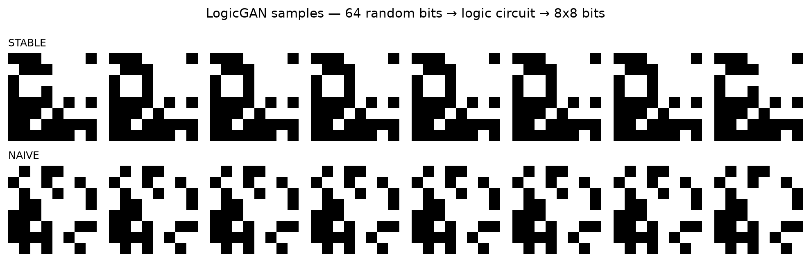
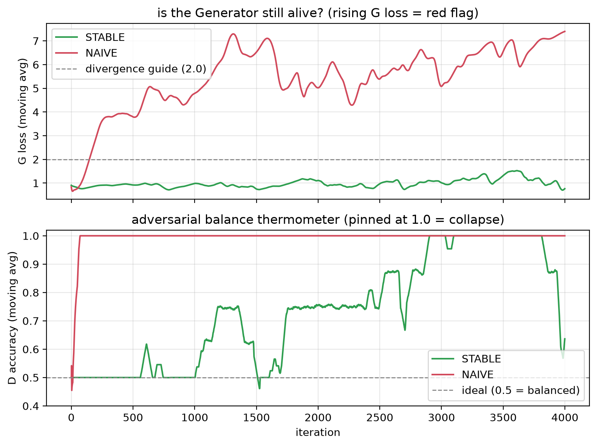
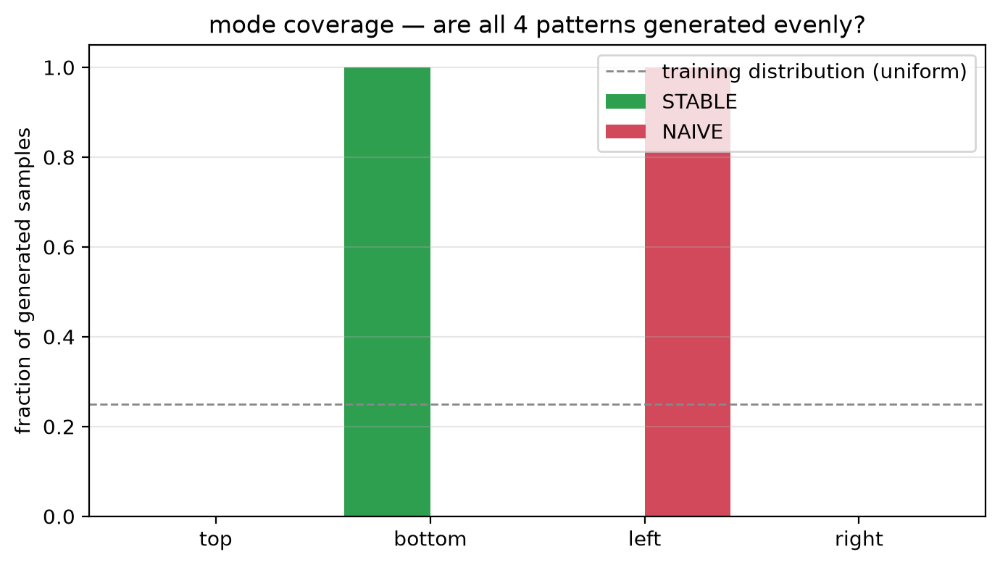
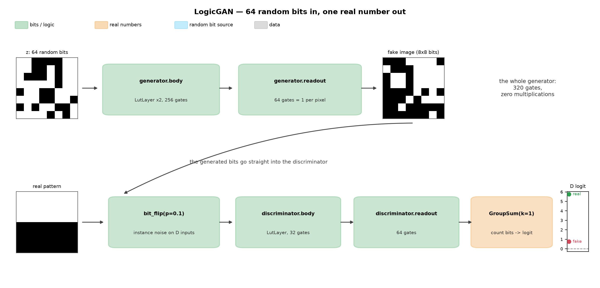
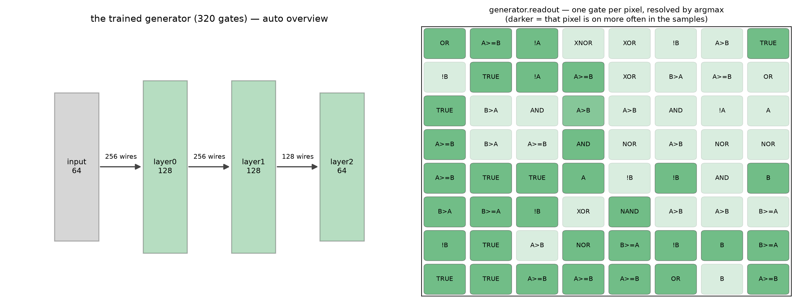

<!-- This file is generated automatically by scripts/build_tutorials.py.
     Do not edit it directly; edit examples/19_logic_gan.py and regenerate. -->

Make images by pushing a **random bit string** — the kind a physical RNG or an LFSR can supply
directly — through a logic circuit. And then break it. We train a stabilized configuration (STABLE)
and an untuned one (NAIVE) **from the same initial circuit**, put them side by side, and show by
measurement how adversarial training falls apart.

The difference is just four knobs (G:D=3:1 / bit-flip noise on D's input / label smoothing / lower
learning rate for D). In the untuned version the G loss diverges to 7.22 and D accuracy pins at 1.000
— the Generator has been wiped out. We also do not hide the fact that with this reduced recipe mode
collapse (1/4) occurs in both conditions.

:::tip[What you'll learn]
1. How to make images with a logic circuit driven by a **random bit string** — the kind a physical RNG or an LFSR can supply
2. The four knobs that stabilize adversarial training (update ratio / input noise / label smoothing / D's learning rate)
3. How to spot a broken GAN — a diverging G loss, D accuracy pinned at 1.000, and mode collapse

**Prerequisites**

- [Folding an image into 96 bits — a binary-latent VAE](/en/tutorials/logic-vae/) — generation without adversarial training
- [Running Training](/en/guides/training/)
:::

:::note[About this page]
Estimated time: **about 8 minutes** / Environment: CPU only (no GPU needed)
Source script: [`examples/19_logic_gan.py`](https://github.com/tsukushi-gate/Griffith/blob/main/examples/19_logic_gan.py)
Try it yourself: [`notebooks/19_logic_gan.ipynb`](https://github.com/tsukushi-gate/Griffith/blob/main/notebooks/19_logic_gan.ipynb) (an unexecuted notebook with the same content as this page; open it with `uv run --group docs jupyter lab notebooks/`)
Every code output is the **actual result of running the code**, embedded verbatim.
:::

<!-- Colab badge: once the repository is public, replace this span with an <a> whose href is
     data-colab-url and "Open in Colab" becomes active. -->
<span class="colab-badge" data-colab-url="https://colab.research.google.com/github/tsukushi-gate/Griffith/blob/main/notebooks/19_logic_gan.ipynb">▶ Open in Colab (enabled once the repository is public)</span>

LogicGAN — an example of making images from a random bit string with logic circuits alone (and of how it breaks).

Generation in 18_logic_vae.py was "latent bits → decoder circuit → image". A GAN adds a
**Discriminator** and pits it adversarially against the Generator.
LogicGAN builds both out of LutLayer stacks, and the Generator's input is not continuous Gaussian
noise but a **random bit string z ~ Bernoulli(0.5)** — the most natural noise source for a logic
circuit, suppliable straight from a physical entropy source or an LFSR.

    z (64 random bits) → logic circuit → image bits {0,1}

## Data flow (with the real class names)

```mermaid
flowchart LR
    Z["z ~ Bernoulli(0.5)<br/>64 random bits (coin flips)"] --> GB
    GB["generator.body<br/>LutLayer x2 (256 gates)"]
    GB --> GR["generator.readout<br/>LutLayer (64 gates = one per pixel)"]
    GR --> FAKE["fake image<br/>training [0,1] / inference 0/1"]
    REAL["real image<br/>4 binary patterns"] --> FLIP
    FAKE --> FLIP["bit_flip(p=0.1)<br/>bit-flip noise on D's input"]
    FLIP --> DB["discriminator.body<br/>LutLayer (32 gates)"]
    DB --> DR["discriminator.readout<br/>LutLayer (64 gates)"]
    DR --> DGS["GroupSum(k=1)<br/>add up 64 bits"]
    DGS --> LOGIT["real/fake logit (real number)"]
    LOGIT --> DLOSS["d_loss<br/>push real to 1 and fake to 0"]
    LOGIT --> GLOSS["g_loss<br/>make D call the fake a 1"]
    GLOSS -.->|"the gradient flows back up the soft path and updates G"| GB

    style GB fill:#10b98126,stroke:#10b981
    style GR fill:#10b98126,stroke:#10b981
    style FLIP fill:#10b98126,stroke:#10b981
    style DB fill:#10b98126,stroke:#10b981
    style DR fill:#10b98126,stroke:#10b981
    style Z fill:#38bdf826,stroke:#38bdf8
    style DGS fill:#f9731626,stroke:#f97316
    style LOGIT fill:#f9731626,stroke:#f97316
```



Green is **the logic circuit, where everything stays in bits**, orange is **where real numbers
appear** (only the final sum in the discriminator), and blue is **the random bit source**. From the
entrance to the exit of generation, not a single multiplication appears.

## How it actually works (in four lines)

1. **The noise source is a coin flip**. z is not a continuous Gaussian but 64 bits of
   Bernoulli(0.5). A comparator against u &lt; 0.5 produces it, so a physical RNG or an LFSR (a small
   circuit that makes pseudo-random numbers) can be wired straight in.
2. **The Generator is a LutLayer stack**. z is already bits, so no preprocessing (thermometer coding
   or anything else) is needed. The output of the last LutLayer **is** the pixel: soft (a continuous
   pixel probability) while training, hard (a pure Boolean circuit) at inference, emitting exactly
   0/1.
3. **The Discriminator is a logic circuit too**. Pixels go through LutLayers, and GroupSum counts
   "how many gates fired" to make a single real/fake logit.
4. **Gradients flow back through the soft phase**. Only during training is each gate a weighted sum
   over 16 logic functions (continuous), which is what lets the gradient travel from D to G. The
   circuit that gets baked is discrete, but **a smooth shadow runs alongside it while it learns** —
   a two-layer structure.

## Differences from an ordinary GAN

| What to look at | Ordinary GAN | LogicGAN |
|---|---|---|
| Noise z | continuous Gaussian N(0, I) | a random bit string, Bernoulli(0.5) |
| Generator | transposed convolutions + BatchNorm (multiply-accumulate) | a LutLayer stack (truth-table lookup) |
| Output | continuous pixels | pixel bits 0/1 (strictly discrete at inference) |
| Discriminator | a CNN | LutLayer + GroupSum (real numbers only in the final sum) |
| Loss | non-saturating GAN loss | the same (BCEWithLogits) |
| Instability | adversarial min-max | adversarial min-max **times discrete outputs**, doubled |

The four stabilizing knobs and how much they help are exactly the STABLE / NAIVE comparison below.
At the end of this page you will find an **architecture figure with real data flowing through it**
and the **real circuit of the trained Generator** (one gate per pixel, drawn down to the logic
function each gate resolved to under argmax).

The other subject of this example is "how it breaks":
    A GAN carries a double instability: "adversarial min-max" × "discrete output".
    With an untuned configuration the Discriminator overwhelms the Generator, the G loss diverges and
    the Generator is wiped out — this is a failure mode measured in this repository, and
    tests/test_logic_gan.py::test_training_dynamics_smoke guards the healthy region.
    This script **runs both the stabilized and the untuned version and puts them side by side**,
    making it visible which setting does what.

    ⚠️ Points where it is easy to fail (the STABLE / NAIVE difference below is exactly the remedy):
      1. The Discriminator is too strong → lower D's learning rate and update G multiple times (G:D=3:1)
      2. D separates real/fake perfectly and the gradient dries up → mix bit-flip noise into D's input
      3. D becomes overconfident → relax the real target from 1.0 with label smoothing
      4. Detecting collapse → red flag when D accuracy pins at 1.0 and the G loss increases monotonically

The reduced recipe used in this example:
    The full run (experiments/train_logic_gan.py) trains 30 epochs on 28x28 binary MNIST, but here we
    use a minimal task, "four 8x8 binary patterns", so it fits in under 3 minutes on CPU.
    What you get is the level where "the shape of the pattern starts to appear", and moreover with the
    reduced recipe **mode collapse (all samples come out looking alike) occurs**. That too is part of the lesson.

Run: uv run python examples/19_logic_gan.py
Expected result (seed=0, about 90 seconds on CPU): stabilized late G loss 0.9-1.0 / late D accuracy 0.8-0.9 /
          untuned late G loss in the 7s / late D accuracy 1.00 (collapsed). Mode coverage is 1/4 in both.
          GAN trajectories diverge on tiny floating-point differences, so the numbers shift a little between
          CPUs (Apple Silicon and x86). The stabilized recipe was chosen so that D accuracy stays < 0.99
          for seeds 0-2 on both CPUs (the earlier D learning rate 0.003 / smoothing 0.1 let D
          win completely on x86)

## Setup: imports and the random seed

All we need is PyTorch, matplotlib, this library's `LogicGAN` (the model itself), and the
circuit-drawing utilities. No special GAN framework is required.

**GAN (generative adversarial network / adversarial training)** — a training framework that trains
one network by **pitting two networks against each other**: one that draws pictures, and one that
guesses whether a picture is real or fake. The one that draws is the **Generator**, the one that
guesses is the **Discriminator**; from here on we write them G and D. The goal is for G to produce
pictures so convincing that D cannot see through them.

LogicGAN builds **both G and D out of stacks of logic gates (LutLayer)**, so from entrance to exit
not a single multiplication appears.

```python
import matplotlib.pyplot as plt
import torch
from matplotlib.patches import FancyBboxPatch

from griffith_logic.analysis.circuit_viz import gate_labels, plot_circuit
from griffith_logic.models import LogicGAN, LogicGANConfig
```

```python
# The LUTs' initial truth values, the random wiring, and the random bit strings all depend on randomness, so fix the seed.
torch.manual_seed(0)
```

### Hyperparameters

The image is squeezed down to a minimal 8x8 = 64 pixels, so the whole thing runs to the end in a few
minutes even on CPU. `NOISE_BITS` is **how many bits of the random bit string z** go into G (defined
in the next section). `DISC_HIDDEN` is kept far smaller than the Generator's `HIDDEN` as the very
first move toward **not letting D win too easily** — the reason shows up in the "Training" section.

```python
SIZE = 8          # image size (a minimal 8x8 = 64-pixel task)
NOISE_BITS = 64   # length of the random bit string fed to the Generator
HIDDEN = 128      # LutLayer width of the Generator
DEPTH = 2         # number of Generator layers
DISC_HIDDEN = 32  # LutLayer width of the Discriminator (keeping it weaker than G is the key to stability)
DISC_DEPTH = 1
ITERS = 4000      # number of adversarial training iterations
BATCH = 64
```

## Data: a four-pattern toy distribution where collapse can be counted

The training distribution is **just four** 8x8 binary patterns: "only the top half / bottom half /
left half / right half is black". There is a reason for picking such a simple distribution instead
of handwritten digits.

**Mode collapse** — the phenomenon where the generator stops producing more than a slice of the
distribution, so no matter how often you sample you get back the same kind of picture. It is the
best-known failure mode of GANs.

If the distribution has **only four points** in it, then simply assigning each generated image to its
nearest training pattern and counting tells you "how many of the four kinds it can produce" — it is
**mechanically measurable**. With MNIST you can only eyeball whether it "collapsed", but with this
toy distribution **collapse becomes a number** — which is exactly what Figure 3 shows.

```python
# Instead of MNIST we use four patterns: "top half, bottom half, left half, right half".
# The advantage of this toy distribution is that, with only four points in it, you can count
# mechanically whether mode collapse (only 1 of the 4 ever gets produced) has happened.
def make_patterns(size: int) -> torch.Tensor:
    pats = torch.zeros(4, 1, size, size)
    half = size // 2
    pats[0, 0, :half, :] = 1.0   # top half
    pats[1, 0, half:, :] = 1.0   # bottom half
    pats[2, 0, :, :half] = 1.0   # left half
    pats[3, 0, :, half:] = 1.0   # right half
    return pats
```

```python
PATTERNS = make_patterns(SIZE)
PATTERN_NAMES = ['top', 'bottom', 'left', 'right']
print(f'訓練分布: {len(PATTERNS)}種の二値パターン({SIZE}x{SIZE}={SIZE * SIZE}画素)')
```

```text title="Output"
訓練分布: 4種の二値パターン(8x8=64画素)
```

## The model: the Generator and the Discriminator

Before we get into the code, let us pin down the symbols that recur throughout this page.

- **z** — the **random bit string** that is the Generator's input (`NOISE_BITS`=64 zeros and ones in
  a row). It plays exactly the role of the **latent vector** an ordinary GAN uses — the "seed of the
  picture", randomness supplied from outside — except that here it is **bits**, not real-valued
  Gaussian noise. That means it **can be supplied directly** from a physical entropy source or from
  an **LFSR (a linear-feedback shift register: a tiny circuit that emits pseudo-random bits using
  nothing but a few flip-flops and an XOR)**. The upshot is that LogicGAN has the shape of "feed 64
  zeros and ones in from outside the circuit and an image comes out".
- **G (the Generator)** — the logic circuit that takes z and returns **the bits of an image**
  (8x8 = 64 bits).
- **D (the Discriminator)** — the logic circuit that takes the bits of an image and returns exactly
  one **logit**.
- **Logit** — a real-valued score meaning "the larger, the more real it looks". Push it through a
  sigmoid and you get a probability; its sign is itself the boundary (0) between "judged real" and
  "judged fake". In LogicGAN, real numbers appear only from D's final `GroupSum`, which counts bits,
  onward.
- **D accuracy** — the fraction of real/fake calls D gets right. **Around 0.5 means the two are
  evenly matched and healthy**; **pinned at 1.0 means D is winning too hard**, and the gradient
  returning to G dries up (= the sign of collapse).

The helper below implements one of the stabilizing knobs, the **input noise**.

### A knob: bit-flip noise on D's input

```python
def bit_flip(x: torch.Tensor, p: float) -> torch.Tensor:
    """Instance noise (bit flips) on the Discriminator's input.

    ⚠️ Remedy 2: flip bits with the same probability for both real and fake before showing them to D.
    Once D reaches a state where it "can tell real from fake perfectly", the gradient dries up and G
    can no longer learn, so we deliberately dirty both to make discrimination harder and keep the
    game balanced. p=0 disables it.
    """
    if p <= 0.0:
        return x
    mask = (torch.rand_like(x) < p).to(x.dtype)
    return x * (1.0 - mask) + (1.0 - x) * mask
```

### The training loop itself: only four knobs as arguments

A GAN makes progress **only while G and D are in balance**. If either one wins, the gradient dries
up and the other can no longer learn anything. That is why a GAN needs "knobs for keeping the
balance". This function takes **exactly four** of them as arguments, and the difference between the
stabilized version (STABLE) and the untuned version (NAIVE) that we compare later is closed under
those four.

- **Update ratio `g_steps`** — how many times G is updated for each single update of D (the D:G
  update-count ratio). D learns faster, so we run G more often to let it catch up.
- **Input noise `flip_prob`** — flip bits with the same probability for real and fake alike before
  showing them to D. This prevents D from reaching a state where it can separate the two perfectly.
- **Label smoothing `label_smoothing`** — the knob that "**makes the real label 0.9 instead of
  1.0**". A standard GAN remedy for stopping D from asserting "this is definitely real".
- **D's learning rate `disc_lr`** — simply shorten D's stride to keep it from winning too hard.

When training is done, `gan.generate(...)` samples 128 images. That runs the **hard eval** path
(**each gate resolved by argmax to a single logic function, executed as a pure Boolean circuit**), so
the pixels that come back are **strictly 0/1**, not approximations from the continuous relaxation.

```python
def train_gan(*, g_steps: int, flip_prob: float, label_smoothing: float,
              disc_lr: float, gen_lr: float, tag: str) -> dict:
    """Train one LogicGAN and return its history and generated samples.

    Only the four knobs that matter for stability (g_steps / flip_prob / label_smoothing / disc_lr)
    are arguments, so the difference between STABLE and NAIVE is exactly those four.
    """
    torch.manual_seed(0)  # start both conditions from the same initial circuit (fair comparison)
    gan = LogicGAN(LogicGANConfig(
        image_size=SIZE, in_channels=1,
        noise_bits=NOISE_BITS, hidden=HIDDEN, depth=DEPTH,
        disc_hidden=DISC_HIDDEN, disc_depth=DISC_DEPTH,
        n_inputs=2,
    ))
    opt_g = torch.optim.Adam(gan.generator.parameters(), lr=gen_lr)
    opt_d = torch.optim.Adam(gan.discriminator.parameters(), lr=disc_lr)

    g_hist, d_hist, acc_hist = [], [], []
    gan.train()
    for _ in range(ITERS):
        real = PATTERNS[torch.randint(0, len(PATTERNS), (BATCH,))]

        # --- Discriminator update ---
        # fake is detached inside d_loss, so this gradient does not flow into G.
        z = gan.generator.sample_noise(BATCH)
        fake = gan.generator(z)
        opt_d.zero_grad()
        d_loss = gan.d_loss(
            bit_flip(real, flip_prob), bit_flip(fake, flip_prob),
            label_smoothing=label_smoothing,   # ⚠️ remedy 3
        )
        d_loss.backward()
        opt_d.step()

        # --- Generator update (G:D = g_steps:1) ---
        # ⚠️ Remedy 1: lower D's learning rate and run G several times to keep the adversarial balance.
        # The loss is non-saturating (max log D), which also avoids vanishing gradients early on.
        for _ in range(g_steps):
            z = gan.generator.sample_noise(BATCH)
            fake = gan.generator(z)
            g_loss = gan.g_loss(gan.discriminator(fake))
            opt_g.zero_grad()
            g_loss.backward()
            opt_g.step()

        g_hist.append(g_loss.item())
        d_hist.append(d_loss.item())
        # ⚠️ Remedy 4: D accuracy is the thermometer of the "adversarial balance". 0.5 is ideal, 1.0 is collapse.
        with torch.no_grad():
            real_acc = (gan.discriminator(real) > 0).float().mean().item()
            fake_acc = (gan.discriminator(fake) < 0).float().mean().item()
        acc_hist.append((real_acc + fake_acc) / 2.0)

    # Generate along the eval path (= a pure Boolean circuit with fixed truth tables). Outputs are strictly {0,1}.
    samples = gan.generate(128, generator=torch.Generator().manual_seed(7))
    # Assign each sample to its nearest training pattern and measure Hamming distance and mode coverage.
    dist = (samples.flatten(1)[:, None, :]
            - PATTERNS.flatten(1)[None, :, :]).abs().sum(-1)
    nearest = dist.argmin(1)
    coverage = torch.bincount(nearest, minlength=len(PATTERNS)).float() / len(samples)

    late = slice(-200, None)
    result = {
        'tag': tag,
        'gan': gan,
        'g_hist': g_hist, 'd_hist': d_hist, 'acc_hist': acc_hist,
        'samples': samples,
        'late_g': sum(g_hist[late]) / len(g_hist[late]),
        'late_acc': sum(acc_hist[late]) / len(acc_hist[late]),
        'hamming': dist.min(1).values.mean().item(),
        'coverage': coverage,
        'n_modes': int((coverage > 0.05).sum()),
    }
    print(f'[{tag:>6}] late G loss={result["late_g"]:.3f}  '
          f'late D精度={result["late_acc"]:.3f}  '
          f'最近傍ハミング距離={result["hamming"]:.1f}/{SIZE * SIZE}  '
          f'被覆モード数={result["n_modes"]}/{len(PATTERNS)}')
    return result
```

## Training: running the stabilized and the untuned version side by side

This is the centrepiece of the page. We run **two training runs from the same initial circuit, with
only the knobs changed**.

- **STABLE** — update ratio G:D=3:1 / input noise p=0.1 / label smoothing 0.2 / D learning rate 0.001 (1/10 of G's)
- **NAIVE** — a GAN written straightforwardly, with **all four** stabilizers **removed**

There are two numbers to watch in the output. **late G loss** (the average over the last 200
iterations) says whether G is still alive; **late D accuracy** is the thermometer of the adversarial
balance, where **1.0 means collapse**. Instead of merely saying "GANs are unstable" in words, this
example **lays the ways it breaks side by side, measured**.

```python
# The difference is only the four knobs. NAIVE is "a GAN written straightforwardly", and it diverges in practice.
print('\n=== 安定版(G:D=3:1 / D入力ノイズ / label smoothing / D学習率↓)===')
stable = train_gan(g_steps=3, flip_prob=0.10, label_smoothing=0.2,
                   disc_lr=0.001, gen_lr=0.01, tag='STABLE')
print('\n=== 未調整版(4つの安定化を全て外した素直な実装)===')
naive = train_gan(g_steps=1, flip_prob=0.0, label_smoothing=0.0,
                  disc_lr=0.01, gen_lr=0.01, tag='NAIVE')

print(f'\n最終メトリクス: '
      f'STABLE late_g={stable["late_g"]:.3f} / late_dacc={stable["late_acc"]:.3f} / '
      f'hamming={stable["hamming"]:.1f}  ||  '
      f'NAIVE late_g={naive["late_g"]:.3f} / late_dacc={naive["late_acc"]:.3f} / '
      f'hamming={naive["hamming"]:.1f}')
```

    
```text title="Output"
=== 安定版(G:D=3:1 / D入力ノイズ / label smoothing / D学習率↓)===

[STABLE] late G loss=0.907  late D精度=0.797  最近傍ハミング距離=18.8/64  被覆モード数=1/4

=== 未調整版(4つの安定化を全て外した素直な実装)===

[ NAIVE] late G loss=7.221  late D精度=1.000  最近傍ハミング距離=21.9/64  被覆モード数=1/4

最終メトリクス: STABLE late_g=0.907 / late_dacc=0.797 / hamming=18.8  ||  NAIVE late_g=7.221 / late_dacc=1.000 / hamming=21.9
```

## Sanity checks: pinning the teaching claims down with asserts

The numbers above are **claims** we want reproduced on every run, so we write them as `assert`s
rather than prose. All three are minimum conditions for this example not being broken
(the same healthy region is guarded by `tests/test_logic_gan.py::test_training_dynamics_smoke`).

```python
# Sanity check 1: the stabilized version's G loss is bounded (it holds its own against the untuned version's divergence).
assert stable['late_g'] < 2.0, f'安定版でも G loss が発散: {stable["late_g"]:.3f}'
```

```python
# Sanity check 2: the stabilized version's D is not pinned at perfect separation.
assert stable['late_acc'] < 0.99, f'D が G を圧倒: {stable["late_acc"]:.3f}'
```

```python
# The claim this example makes: the adversarial balance is more broken in the untuned version.
assert naive['late_acc'] >= stable['late_acc'] - 1e-9, '未調整版が崩れていない'
```

## Visualization: generated samples, adversarial balance, mode coverage

### Plotting helper: moving average

Adversarial losses and discriminator accuracy swing so much from step to step that the raw series is
unreadable as a trend. Every trajectory plot below is smoothed with this moving average first.

```python
def smooth(values, window=50):
    """Moving average (adversarial losses swing so much per step that the raw values are unreadable)."""
    out, acc = [], 0.0
    for i, v in enumerate(values):
        acc += v
        if i >= window:
            acc -= values[i - window]
        out.append(acc / min(i + 1, window))
    return out
```

### Figure 1: generated samples (stabilized / untuned)

The top row is eight generated images from STABLE, the bottom row eight from NAIVE. There is exactly
one thing to look for: **"do they take the shape of the four training patterns (squares with only
one half blacked out)?"**

What is being drawn is the output of **hard eval** (the pure Boolean circuit resolved by argmax), so
each black-or-white cell is literally **a bit the circuit output**, not an approximation from the
continuous relaxation.

```python
# This is the eval path, so the pixels shown here are literally the bits the circuit output.
fig, axes = plt.subplots(2, 8, figsize=(10, 3.4))
for row, res in enumerate((stable, naive)):
    for col in range(8):
        axes[row, col].imshow(res['samples'][col, 0], cmap='gray_r',
                              vmin=0, vmax=1)
        axes[row, col].set_axis_off()
    axes[row, 0].set_title(res['tag'], loc='left', fontsize=9)
fig.suptitle('LogicGAN samples — 64 random bits → logic circuit → 8x8 bits',
             fontsize=11)
fig.tight_layout()
plt.show()
```

    

    

**How to read it**: on this tiny 8x8 task both rows are only at the stage where "the pattern's shape
starts to show", and the Hamming distance to the nearest pattern is around 20 of 64 pixels (the exact
values for this run are in the output above). The difference to look at is not how pretty the pictures
are but **whether learning is still alive**, and that shows in Figure 2 next. **Same circuit, same
initial values; the only difference is the four knobs.** In both rows the eight images look alike —
that is mode collapse, and Figure 3 is where it becomes a number.

### Figure 2: how the adversarial balance evolves (this is how you spot collapse)

We look at the balance of power between G and D over time: G loss on top, D accuracy on the bottom.
The **bottom** panel is the one to watch: wandering around 0.5 means the two are evenly matched and
healthy, while **pinned at 1.0 means D is winning too hard**. The G loss on top rising monotonically
as a consequence is the classic footprint of collapse.

```python
# What to watch is D accuracy (bottom). Holding around 0.5 is healthy; pinned at 1.0 means
# "D won too hard and G's gradient dried up" = collapse. The G loss on top rises monotonically
# in the untuned version as a consequence.
fig, axes = plt.subplots(2, 1, figsize=(8, 6), sharex=True)
for res, color in ((stable, '#2e9e4f'), (naive, '#d1495b')):
    axes[0].plot(smooth(res['g_hist']), color=color, label=res['tag'])
    axes[1].plot(smooth(res['acc_hist']), color=color, label=res['tag'])
axes[0].axhline(2.0, color='#888', ls='--', lw=1, label='divergence guide (2.0)')
axes[0].set_ylabel('G loss (moving avg)')
axes[0].set_title('is the Generator still alive? (rising G loss = red flag)')
axes[0].grid(alpha=0.3)
axes[0].legend(loc='upper left')
axes[1].axhline(0.5, color='#888', ls='--', lw=1, label='ideal (0.5 = balanced)')
axes[1].set_ylim(0.4, 1.02)
axes[1].set_xlabel('iteration')
axes[1].set_ylabel('D accuracy (moving avg)')
axes[1].set_title('adversarial balance thermometer (pinned at 1.0 = collapse)')
axes[1].grid(alpha=0.3)
axes[1].legend(loc='lower right')
fig.tight_layout()
plt.show()
```

    

    

**How to read it**: with NAIVE (red) the D accuracy pins at 1.0 early on and the G loss keeps
climbing into the 7s — **D has won outright and the gradient returning to G has dried up**. With
STABLE (green) the D accuracy settles at 0.8-0.9 (it does not stick at 1.0) and the G loss stays below the dashed line (2.0).
**The four knobs work not by "making G stronger" but by "not letting D win too hard".**

### Figure 3: mode coverage (collapsing is normal with the reduced recipe)

We assign the 128 generated images to their nearest training pattern and count them into four bars.
The dashed line is the training distribution (0.25 each, since the four are uniform), so **four bars
lined up around the dashed line means the distribution is covered**; a single bar sticking out means
**mode collapse**.

```python
# The training distribution is 4 patterns, uniform (= 0.25 each). We count generated samples by
# their nearest pattern and draw a bar chart. One bar sticking out means mode collapse. With the
# 8x8, 4000-iteration reduced recipe this does happen — the spot where the difficulty of GANs
# shows up as a number.
fig, ax = plt.subplots(figsize=(7, 4))
xs = torch.arange(len(PATTERNS))
ax.bar(xs - 0.2, stable['coverage'], width=0.4, color='#2e9e4f', label='STABLE')
ax.bar(xs + 0.2, naive['coverage'], width=0.4, color='#d1495b', label='NAIVE')
ax.axhline(1 / len(PATTERNS), color='#888', ls='--', lw=1,
           label='training distribution (uniform)')
ax.set_xticks(xs.tolist())
ax.set_xticklabels(PATTERN_NAMES)
ax.set_ylabel('fraction of generated samples')
ax.set_title('mode coverage — are all 4 patterns generated evenly?')
ax.legend()
ax.grid(alpha=0.3, axis='y')
fig.tight_layout()
plt.show()
```

    

    

**How to read it**: in both conditions only one bar stands up, and the number of covered modes is
**1/4** — meaning **even the stabilized version has mode-collapsed**. This is as far as an 8x8,
4000-iteration reduced recipe gets, and that is the honest limit of this example. It also says that
"keeping the adversarial balance (Figure 2)" and "covering the distribution (Figure 3)" are **two
different difficulties** — the full run (`experiments/train_logic_gan.py`) goes further by training
30 epochs on 28x28 binary MNIST.

## The architecture illustrated, and the real circuit

Finally, two figures confirm that what we have just trained really is **a logic circuit**. The three
helpers below are the parts that assemble Figure 4 (rounded boxes, arrows, and the small images
pasted into the figure); feel free to skip them.

### The figure's parts (boxes, arrows, pasted images)

```python
def draw_block(ax, x, y, w, h, name, sub, color):
    """A piece of the architecture figure: a rounded box carrying the class name and its size (gate count)."""
    ax.add_patch(FancyBboxPatch(
        (x - w / 2, y - h / 2), w, h,
        boxstyle='round,pad=0.004,rounding_size=0.012',
        facecolor=color, alpha=0.25, edgecolor=color, lw=1.4, zorder=2))
    ax.text(x, y + h * 0.17, name, ha='center', va='center', fontsize=8.4,
            fontweight='bold', zorder=3)
    ax.text(x, y - h * 0.22, sub, ha='center', va='center', fontsize=7.4,
            color='#333333', zorder=3)
```

```python
def draw_arrow(ax, x0, y0, x1, y1, text='', rad=0.0):
    """An arrow between blocks (with an optional label above it)."""
    ax.annotate('', xy=(x1, y1), xytext=(x0, y0), arrowprops=dict(
        arrowstyle='-|>', color='#444444', lw=1.3,
        connectionstyle=f'arc3,rad={rad}'))
    if text:
        ax.text((x0 + x1) / 2, (y0 + y1) / 2 + 0.015, text, ha='center',
                va='bottom', fontsize=7.5, color='#444444')
```

```python
def put_image(fig, img, rect, caption, cmap='gray_r', vmin=0.0, vmax=1.0):
    """Paste a small picture of the real data into the architecture figure."""
    ax = fig.add_axes(rect)
    ax.imshow(img, cmap=cmap, vmin=vmin, vmax=vmax)
    ax.set_xticks([])
    ax.set_yticks([])
    for spine in ax.spines.values():
        spine.set_edgecolor('#555555')
    ax.set_title(caption, fontsize=7.8)
    return ax
```

### Figure 4: the architecture (one real sample pushed through the stabilized run)

We push **exactly one real sample** through the trained stabilized model and paste the intermediate
states into the figure. The top row is G (64 random bits z → logic circuit → image bits), the bottom
row is D (image bits → logic circuit → a single real-valued logit). The numbers inside the boxes are
**the real gate counts**, and the dots on the far right are where D placed the logits for the real
and the fake sample (the dashed line is the decision boundary).

The box to pay attention to is **`readout`** — the output stage, where the correspondence is
**one LUT per pixel**. The colour legend is the project-wide one: green = logic gates / orange =
where real numbers appear / blue = the random bit source / grey = data.

```python
# Top row = the Generator (random bits -> logic circuit -> image); bottom row = the Discriminator
# (image -> logic circuit -> a single real-valued logit). The numbers inside the boxes are the real gate counts.
# Project-wide palette: green = logic gates / orange = the real-valued part / blue = the random bit source / grey = data.
C_LOGIC, C_REAL, C_SAMPLE, C_DATA = '#2e9e4f', '#e8850c', '#38bdf8', '#8a8a8a'
gan_s = stable['gan']
gan_s.eval()
with torch.no_grad():
    z_arch = gan_s.generator.sample_noise(
        1, generator=torch.Generator().manual_seed(4))
    fake_arch = gan_s.generator(z_arch)
    real_arch = PATTERNS[1:2]
    d_fake = float(gan_s.discriminator(fake_arch)[0, 0])
    d_real = float(gan_s.discriminator(real_arch)[0, 0])
g_body_gates = sum(int(m.out_dim) for m in gan_s.generator.body)
g_gates = g_body_gates + int(gan_s.generator.readout.out_dim)
d_body_gates = sum(int(m.out_dim) for m in gan_s.discriminator.body)
print(f'Generator={g_gates}ゲート / Discriminator='
      f'{d_body_gates + int(gan_s.discriminator.readout.out_dim)}ゲート  '
      f'D(real)={d_real:+.1f} / D(fake)={d_fake:+.1f}')

fig = plt.figure(figsize=(13.5, 6.4))
bg = fig.add_axes([0, 0, 1, 1])
bg.set_xlim(0, 1)
bg.set_ylim(0, 1)
bg.set_axis_off()
bg.text(0.5, 0.965, 'LogicGAN — 64 random bits in, one real number out',
        ha='center', fontsize=12, fontweight='bold')
for i, (label, color) in enumerate((('bits / logic', C_LOGIC),
                                    ('real numbers', C_REAL),
                                    ('random bit source', C_SAMPLE),
                                    ('data', C_DATA))):
    bg.add_patch(FancyBboxPatch((0.02 + 0.135 * i, 0.915), 0.018, 0.022,
                                boxstyle='round,pad=0.002',
                                facecolor=color, alpha=0.3, edgecolor=color))
    bg.text(0.043 + 0.135 * i, 0.926, label, va='center', fontsize=8)

put_image(fig, z_arch[0].reshape(8, 8), [0.020, 0.590, 0.104, 0.220],
          'z: 64 random bits')
draw_arrow(bg, 0.130, 0.70, 0.160, 0.70)
draw_block(bg, 0.265, 0.695, 0.190, 0.175, 'generator.body',
           f'LutLayer x{DEPTH}, {g_body_gates} gates', C_LOGIC)
draw_arrow(bg, 0.362, 0.70, 0.388, 0.70)
draw_block(bg, 0.500, 0.695, 0.200, 0.175, 'generator.readout',
           f'{int(gan_s.generator.readout.out_dim)} gates = 1 per pixel',
           C_LOGIC)
draw_arrow(bg, 0.602, 0.70, 0.632, 0.70)
put_image(fig, fake_arch[0, 0], [0.640, 0.590, 0.104, 0.220],
          'fake image (8x8 bits)')
bg.text(0.885, 0.70, f'the whole generator:\n{g_gates} gates,\n'
        'zero multiplications', ha='center', va='center', fontsize=9,
        color='#333333')

put_image(fig, real_arch[0, 0], [0.020, 0.110, 0.104, 0.220],
          'real pattern')
draw_arrow(bg, 0.692, 0.575, 0.200, 0.320, rad=0.12)
bg.text(0.430, 0.430, 'the generated bits go straight into the discriminator',
        ha='center', fontsize=8.5, color='#444444')
draw_arrow(bg, 0.130, 0.220, 0.170, 0.220)
draw_block(bg, 0.270, 0.220, 0.180, 0.175, 'bit_flip(p=0.1)',
           'instance noise on D inputs', C_LOGIC)
draw_arrow(bg, 0.362, 0.220, 0.388, 0.220)
draw_block(bg, 0.480, 0.220, 0.170, 0.175, 'discriminator.body',
           f'LutLayer, {d_body_gates} gates', C_LOGIC)
draw_arrow(bg, 0.567, 0.220, 0.593, 0.220)
draw_block(bg, 0.680, 0.220, 0.170, 0.175, 'discriminator.readout',
           f'{int(gan_s.discriminator.readout.out_dim)} gates', C_LOGIC)
draw_arrow(bg, 0.767, 0.220, 0.793, 0.220)
draw_block(bg, 0.858, 0.220, 0.130, 0.175, 'GroupSum(k=1)',
           'count bits -> logit', C_REAL)
lax = fig.add_axes([0.952, 0.115, 0.036, 0.215])
lax.axhline(0.0, color='#888888', ls='--', lw=1.0)
lax.scatter([0.5], [d_real], color=C_LOGIC, s=40, zorder=3)
lax.scatter([0.5], [d_fake], color='#d1495b', s=40, zorder=3)
lax.text(0.95, d_real, 'real', fontsize=7, va='center', color=C_LOGIC)
lax.text(0.95, d_fake, 'fake', fontsize=7, va='center', color='#d1495b')
lax.set_xlim(0.3, 2.8)
lax.set_xticks([])
lax.tick_params(labelsize=7)
lax.set_title('D logit', fontsize=7.8)
plt.show()
```

```text title="Output"
Generator=320ゲート / Discriminator=96ゲート  D(real)=+5.8 / D(fake)=+0.8
```

    

    

**How to read it**: orange (real numbers) exists only at the tail of D, from the `GroupSum` that
counts bits onward. From z to the image, and from the image to just before the verdict, **what
flows is nothing but 0/1 bits** and not one multiplication appears. The logits come out higher
on the real side than on the fake side (the gap is in the output above), so the breakdown behind
Figure 2's "D accuracy does not stick at 1.0" is visible in this single picture.

### Figure 5: the real circuit (the trained Generator itself)

To close, a picture of the circuit that is itself the result of training. **This figure is not a
schematic of the code; it is the real thing, raised from the trained parameters.**

- **Left** — the whole Generator (320 gates). It is large enough that `plot_circuit` automatically
  switches to the overview (layers = boxes, arrows = the number of wires).
- **Right** — the output stage `generator.readout` spread out in the layout of the image.
  **One cell = one pixel = one LUT**, and what is written in the cell is the name of the logic
  function it resolved to under argmax (`XOR` / `NAND` / `A>=B`, and so on). How dark a cell is
  reflects how often that pixel came out as 1 in the generated samples.

**How to read it**: which gate emits which square of the generated image can be read off directly,
by name. These names are **identical** to the gate names baked into the **IR (the JSON
representation this library holds as the source of truth for a circuit)** and into the **Verilog
(the hardware description you push into an FPGA or ASIC)** emitted from it. As the last `print`
shows, the 64 gates of the output stage concentrate into a handful of logic functions — we really do
have, in hand, "a small circuit that turns random bits into a picture".

```python
# Left: with 320 gates, plot_circuit automatically switches to the overview (layers = boxes, arrows = wire counts).
# Right: the output stage generator.readout is "one LUT per pixel". Laying out the logic function each gate resolved to under argmax
# at the position of its pixel lets you read off directly which gate emits which square of the generated image
# (these names are the same ones baked into the IR / Verilog).
fig, axes = plt.subplots(1, 2, figsize=(13.5, 5.2),
                         gridspec_kw={'width_ratios': [1.1, 1.0]})
plot_circuit(gan_s.generator, ax=axes[0],
             title=f'the trained generator ({g_gates} gates) — auto overview')
names = gate_labels(gan_s.generator.readout)
counts: dict[str, int] = {}
for name in names:
    counts[name] = counts.get(name, 0) + 1
for pix, name in enumerate(names):
    row, col = divmod(pix, SIZE)
    axes[1].add_patch(FancyBboxPatch(
        (col + 0.06, SIZE - 1 - row + 0.06), 0.88, 0.88,
        boxstyle='round,pad=0.01,rounding_size=0.08',
        facecolor=C_LOGIC, alpha=0.18 + 0.5 * float(stable['samples'][:, 0]
                                                    .mean(0)[row, col]),
        edgecolor='#555555', lw=0.6))
    axes[1].text(col + 0.5, SIZE - 1 - row + 0.5, name, ha='center',
                 va='center', fontsize=7.5)
axes[1].set_xlim(0, SIZE)
axes[1].set_ylim(0, SIZE)
axes[1].set_xticks([])
axes[1].set_yticks([])
axes[1].set_title('generator.readout — one gate per pixel, resolved by argmax\n'
                  '(darker = that pixel is on more often in the samples)',
                  fontsize=9.5)
fig.tight_layout()
plt.show()
top = sorted(counts.items(), key=lambda kv: -kv[1])[:4]
print('出力段64ゲートの内訳(上位4種): '
      + ' / '.join(f'{n}×{c}' for n, c in top))
```

    

    

```text title="Output"
出力段64ゲートの内訳(上位4種): A>=B×10 / TRUE×8 / !B×7 / A>B×7
```

## What to read next

- [A binary-latent VAE](/en/tutorials/logic-vae/) — generation without adversarial training
- [Turning a diffusion model into a Boolean circuit](/en/tutorials/logic-diffusion/)
- [Running training](/en/guides/training/) — how to diagnose training that has broken

<!-- i18n:source=tutorials/logic-gan.md hash=0bc3272bc4de -->
