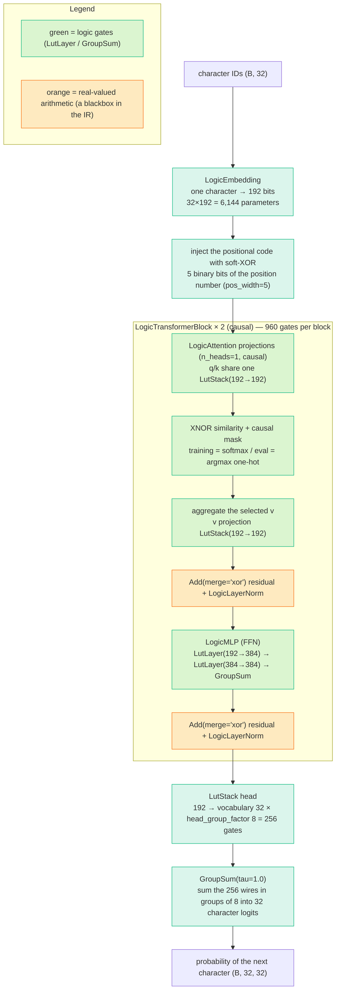
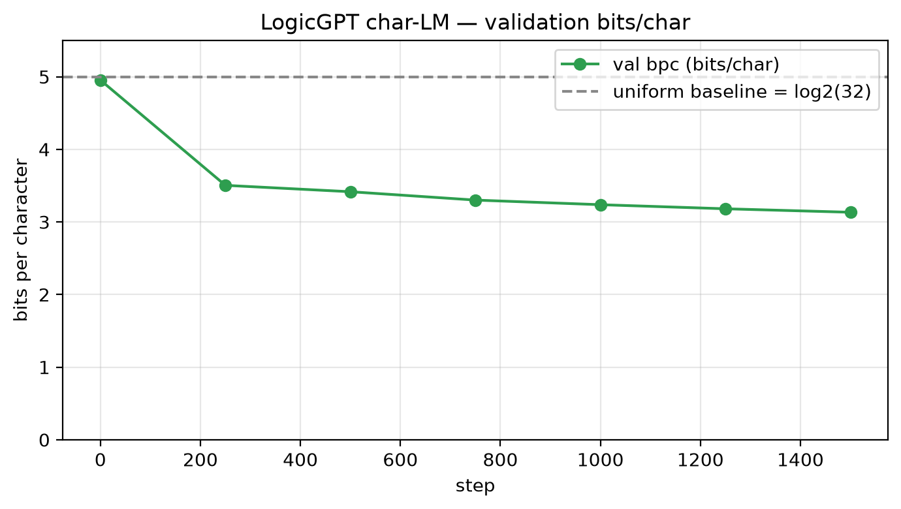
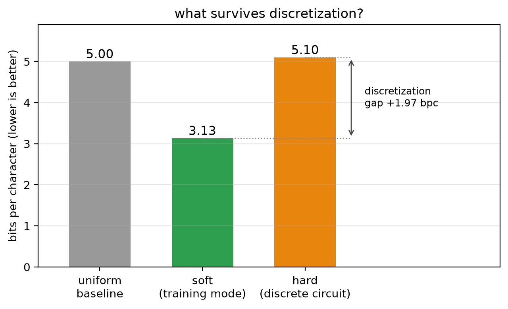
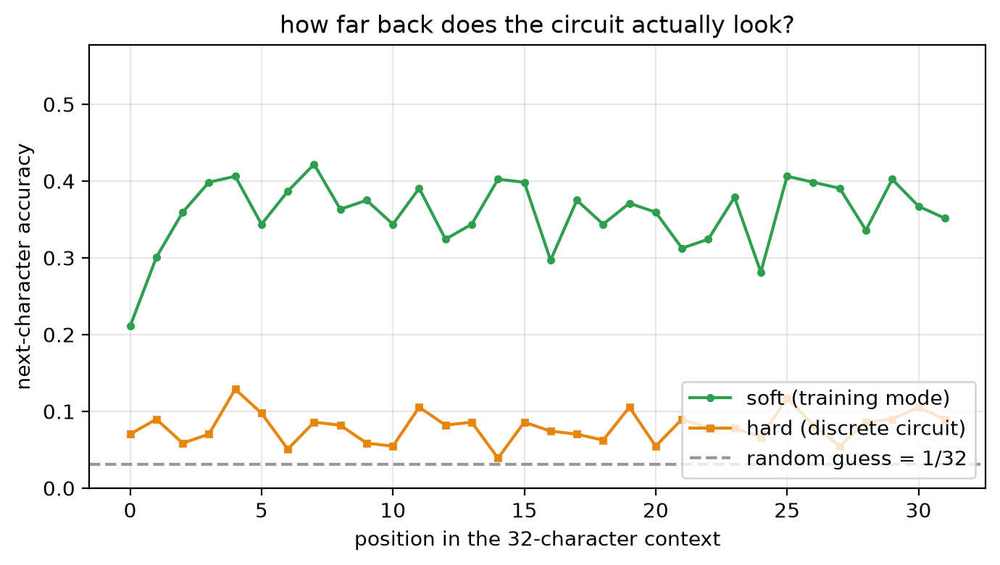
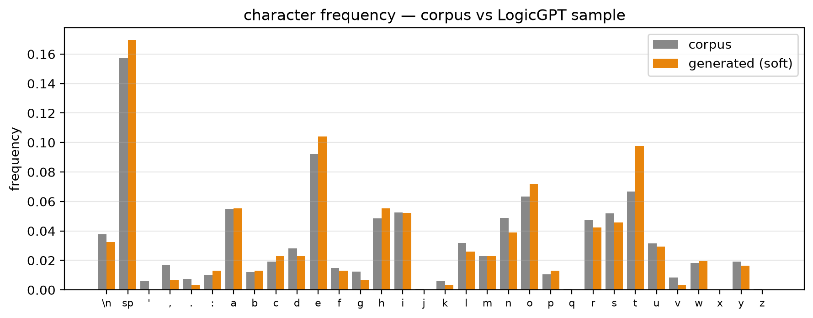
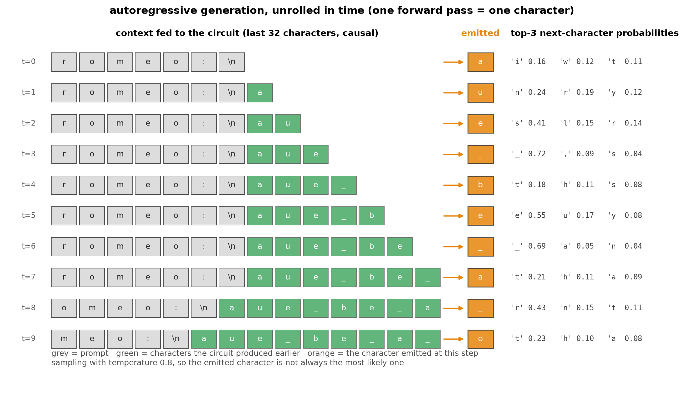

<!-- This file is auto-generated by scripts/build_tutorials.py.
     Do not edit it directly; edit examples/07_logic_gpt.py and regenerate. -->

Write Shakespeare with a decoder-only Transformer in which **attention, the FFN, and the
output head are all logic gates**. We train `LogicGPT`, which contains no real-valued matrix
multiplication at all, as a character-level language model on Tiny Shakespeare, and watch it
fall from the uniform baseline of 5.00 bpc down to **3.13 bpc**, along with the generated text
(speaker lines, word-like spellings, even line-break structure).

At the same time, this page is also **the clearest example of the discretization gap**. In soft
mode (the continuous relaxation used during training) readable sentences come out, but in hard
mode (the discrete circuit fixed by argmax) they fall apart — the harder the task, and a
language model is a hard one, the more honestly this difference shows.

:::tip[What you'll learn]
1. How to build a decoder-only Transformer in which attention, the FFN, and the output head are all logic gates
2. How to read bpc, the metric of a character-level language model (uniform baseline 5.00 → 3.13)
3. That the discretization gap (readable in soft, broken in hard) shows up most honestly in a language model

**Prerequisites**

- [1. Train on MNIST](/en/tutorials/mnist/) — experience telling soft and hard apart first
- [How to read training curves](/en/guides/training-curves/)
:::

:::note[About this page]
Estimated time: **about 10 minutes** / Environment: CPU only (no GPU required)
Source script: [`examples/07_logic_gpt.py`](https://github.com/tsukushi-gate/Griffith/blob/main/examples/07_logic_gpt.py)
Try it yourself: [`notebooks/07_logic_gpt.ipynb`](https://github.com/tsukushi-gate/Griffith/blob/main/notebooks/07_logic_gpt.ipynb) (the same content as this page as an un-executed notebook; open it with `uv run --group docs jupyter lab notebooks/`)
Every code output below is the **actual result of running the code**, embedded verbatim.
:::

<!-- Colab badge: once the repository is public, replace this span with an <a> whose
     href is the data-colab-url value to enable "Open in Colab". -->
<span class="colab-badge" data-colab-url="https://colab.research.google.com/github/tsukushi-gate/Griffith/blob/main/notebooks/07_logic_gpt.ipynb">▶ Open in Colab (enabled once the repository is public)</span>

An example of training a character-level language model with LogicGPT and generating Shakespeare-style text.

In MNIST (examples/06_mnist.py) we built a "circuit that classifies images". Here we assemble a
**decoder-only Transformer (GPT)** from the same logic gates and train a language model that
predicts the next character. In attention, the FFN, and the output head alike, every internal
value lives in the logic domain [0,1] (no floating-point matrix product creates the "meaning").

    LogicEmbedding → inject positional codes with soft-XOR → LogicTransformerBlock×2 (causal)
    → LutStack head → GroupSum for the character logits at each position

**The whole of LogicGPT (with real class names and gate counts)**

With the configuration used here (d_model=192, 2 layers, a 32-character vocabulary), the gates
that get learned come to **2,560 gates / 48,640 parameters** in total. Green is logic gates
(they become a circuit as is); orange is real-valued arithmetic, kept for the sake of training,
which the IR treats as a blackbox.



**How attention is turned into a circuit (in beginner's terms)**

- **XNOR = an agreement detector**. A single gate that outputs 1 when two wires carry the same
  value. It compares the query and the key one bit at a time
- **popcount = a majority count (an adder tree)**. Counting how many bits agreed tells you "how
  similar they are". This replaces the mountain of multiplications in a real Transformer's dot product
- **MUX = a selector**. Instead of softmax's weighted average, at eval time it passes only the
  contents of the most similar slot. The argmax of `LogicAttention(mode='hard')` is this

The rung-by-rung confirmation of why the substitution works is in
[The Ladder of Logification](/en/tutorials/logic-ladder/), and a comparison of four ways to look
things up is in [A tour of four logic-gate attention variants](/en/tutorials/attention-tour/).

To fit in 3-4 minutes on a CPU, this sample is shrunk down to d_model=192, 2 layers, a context of
32 characters, and 1500 steps (for the serious recipe see configs/recipes/logic_gpt_shakespeare.yaml,
and for experimental results see the [model zoo](/en/reference/model-zoo/)).
Even at that scale, you get as far as "word-like spellings, line breaks, and speaker lines such as `ROMEO:`".

There are three things worth watching:

  1. **Does bpc go down** (figure 1). bpc = bits per character is "how many bits are needed
     to guess the next character"; picking one of 32 characters at random costs log2(32)=5.0 bpc.
     Everything below that is the circuit having learned the regularities of character sequences.
  2. **The gap between soft and hard** (figure 2). During training the gates are continuously
     relaxed so that they can be differentiated, but what actually gets burned onto an FPGA is
     the discrete circuit fixed by argmax. The performance difference between the two is the
     "discretization gap", the biggest hurdle for logic NNs. In this reduced recipe the gap remains.
  3. **How far back it looks** (figure 3). Because this is causal self-attention, the beginning of
     the sequence has not a single character of context, and it should get easier to predict further
     along. Looking at the accuracy per position, it rises sharply over the first few characters and
     then plateaus — the context length this size of circuit actually uses shows up directly in that shape.

Run: uv run python examples/07_logic_gpt.py
Expected result: val bpc (bits per character) drops from 5.0 to around 3.1, and
          generated text is printed at the end (you can see at a glance it is not a random string)

## Setup: imports and the random seed

All we need is PyTorch, matplotlib, and this library's `LogicGPT` / `LogicGPTConfig`. Both the
training loop and the generation loop are written **exactly as they would be for an ordinary GPT**;
the only thing swapped out is the inside of the model (matrix products -> logic gates).

```python
import math
from pathlib import Path

import matplotlib.pyplot as plt
import torch
import torch.nn.functional as F

from griffith_logic import LogicGPT, LogicGPTConfig
```

The **initial wiring** of the gates (which two lines of the previous stage each gate looks at) and
the initial truth tables are decided by random numbers. The wiring stays fixed during training too,
so changing the seed makes the circuit itself a different object and changes how the bpc comes down.
To get a result we can compare against, we fix the seed first.

```python
torch.manual_seed(0)
```

## Configuration and data: a reduced recipe and Tiny Shakespeare

### Hyperparameters

This page runs a **reduced recipe** that fits in 3-4 minutes on a CPU. `D_MODEL` is the bit width
representing one character (= the number of logic wires flowing through the circuit), and `BLOCK` is
the **context length** (how many characters back to look when predicting the next one). Larger values
give better text, at the cost of longer training.

`REG_LAMBDA` is the strength of the regularizer that pushes the embeddings toward $\{0,1\}$ — the
knob that acts directly on the "discretization gap" we measure later.

```python
# A reduced recipe that fits in 3-4 minutes on a CPU. The larger D_MODEL/N_LAYERS/STEPS are, the better the text gets.
D_MODEL = 192      # Bit width representing one token (= number of logic wires)
N_LAYERS = 2       # Number of Transformer blocks
BLOCK = 32         # Context length (how many characters back to look when predicting the next one)
BATCH = 64
STEPS = 1500
LR = 0.02
REG_LAMBDA = 0.1   # Weight of the binarization regularizer that pushes the embedding toward {0,1}
N_CHARS = 200_000  # Number of characters used for training (all of Tiny Shakespeare is about 1.1M characters)
```

### Data: Tiny Shakespeare

The training corpus is Tiny Shakespeare (about 1.1 million characters of collected play dialogue).
So that it also runs where the corpus is not checked into the repository, we fall back automatically
to the embedded sample below.

```python
# If a corpus exists under data-shakespeare/, use it. So that this is self-contained even where it
# is missing, automatically fall back to a few-KB embedded sample (FALLBACK_TEXT below).
# In a notebook __file__ is undefined, so in that case treat the current directory as the
# repository root (examples are meant to be run from the repository root).
REPO_ROOT = Path(__file__).resolve().parents[1] if '__file__' in globals() else Path.cwd()
CORPUS = REPO_ROOT / 'data-shakespeare' / 'tinyshakespeare' / 'input.txt'

FALLBACK_TEXT = """first citizen:
before we proceed any further, hear me speak.
all:
speak, speak.
first citizen:
you are all resolved rather to die than to famish?
all:
resolved. resolved.
first citizen:
first, you know caius marcius is chief enemy to the people.
all:
we know't, we know't.
menenius:
i tell you, friends, most charitable care
have the patricians of you. for your wants,
your suffering in this dearth, you may as well
strike at the heaven with your staves as lift them
against the roman state.
romeo:
he jests at scars that never felt a wound.
but, soft! what light through yonder window breaks?
it is the east, and juliet is the sun.
arise, fair sun, and kill the envious moon,
who is already sick and pale with grief.
juliet:
o romeo, romeo! wherefore art thou romeo?
deny thy father and refuse thy name;
or, if thou wilt not, be but sworn my love,
and i'll no longer be a capulet.
hamlet:
to be, or not to be: that is the question:
whether 'tis nobler in the mind to suffer
the slings and arrows of outrageous fortune,
or to take arms against a sea of troubles.
"""
```

The **vocabulary** is the set of character kinds the model handles. Here we drop uppercase, narrow
the punctuation, and shrink it to 32 characters. The number of gates in the output head is
proportional to the vocabulary size (`vocab × head_group_factor`), so shrinking the vocabulary is
almost synonymous with **shrinking the circuit**.

```python
def load_text() -> str:
    """Read the corpus and normalize it to keep the vocabulary small.

    Drop uppercase and restrict the symbols used, shrinking down to a **32-character vocabulary**.
    The smaller the vocabulary, the lighter the output head (vocab x head_group_factor gates), and
    the easier it is to capture the character distribution even in a short training run (a simplification for teaching).
    """
    if CORPUS.exists():
        raw = CORPUS.read_text(encoding='utf-8')
        source = f'{CORPUS.name}(Tiny Shakespeare)'
    else:
        # So that it works even where the corpus is missing, repeat the embedded sample.
        raw = FALLBACK_TEXT * 60
        source = '埋め込みサンプル(data-shakespeare/ が無いため)'
    keep = set("abcdefghijklmnopqrstuvwxyz .,':\n")
    text = ''.join(c if c in keep else ' ' for c in raw.lower())
    print(f'コーパス: {source} / 使用 {min(len(text), N_CHARS):,} 文字')
    return text[:N_CHARS]
```

We convert the characters into a sequence of IDs and split the first 90% for training and the last
10% for validation. Validating a language model means "how well can it predict a continuation it has
never seen", so cutting along the time axis is the standard practice.

```python
text = load_text()
chars = sorted(set(text))
stoi = {c: i for i, c in enumerate(chars)}
VOCAB = len(chars)
data = torch.tensor([stoi[c] for c in text], dtype=torch.long)
n_split = int(len(data) * 0.9)
train_data, val_data = data[:n_split], data[n_split:]
print(f'語彙 {VOCAB} 文字: {"".join(chars)!r}')
```

```text title="Output"
コーパス: input.txt(Tiny Shakespeare) / 使用 200,000 文字
語彙 32 文字: "\n ',.:abcdefghijklmnopqrstuvwxyz"
```

Building the training data is the same as for an ordinary GPT too. The input `x` is 32 consecutive
characters and the target `y` is **that same run shifted one step to the right**. That way one
forward pass trains "the next character" at all 32 positions simultaneously, and the causal mask
(below) prevents any peeking at the future.

```python
def get_batch(
    src: torch.Tensor, size: int, generator: torch.Generator,
) -> tuple[torch.Tensor, torch.Tensor]:
    """Build (x, y). y is x shifted by one character = the ground truth "next character"."""
    idx = torch.randint(0, len(src) - BLOCK - 1, (size,), generator=generator)
    x = torch.stack([src[i:i + BLOCK] for i in idx])
    y = torch.stack([src[i + 1:i + BLOCK + 1] for i in idx])
    return x, y
```

## Model: a logic-gate GPT

The skeleton is an ordinary GPT (embedding -> positional code -> causal self-attention × N -> output
head), and **only the operators inside are wholesale replaced**. Why such a substitution is possible
becomes clear once each part of a real-valued Transformer is reread as "what device is it, really".

- **inner product (similarity) -> XNOR + popcount**. An inner product is nothing but a device that
  measures how well two vectors line up. For bit strings, passing each digit through an XNOR (a gate
  that outputs 1 on agreement) and counting the ones does the same job. **popcount** = an adder tree
  that counts the raised bits
- **the softmax weighted average -> a MUX (selector)**. A weighted average is a device for "how much
  of which slot's contents to pass". At eval time it becomes a tree of 2:1 multiplexers that pass
  only the most similar slot
- **Linear + activation -> LutLayer**. One neuron = one truth table (LUT)

In other words attention is not "magic that weights things by relevance" but a three-stage circuit —
**detect agreement -> count how many -> select** — and every one of those can be written with logic
gates.

```python
# Matching each part of a real-valued GPT against its logic counterpart:
#
#   nn.Embedding          -> LogicEmbedding (looks up a character ID as D_MODEL bits)
#   positional encoding   -> mixes the binary code of the position into the bits with soft-XOR
#   softmax attention     -> weights past positions with scores confined to [0,1] (causal mask)
#   FFN (Linear+GELU)     -> LutStack (4 LutLayers; widen by mlp_ratio and come back)
#   the output Linear     -> LutStack + GroupSum (VOCAB x 8 bits summed 8 at a time into the
#                            logit of each character; no matrix product appears at all)
#
# pos_width is the number of bits in the positional code, and block_size <= 2^pos_width is required (32 <= 2^5).
# tau is the temperature of GroupSum, which sets the scale of the logits (= the sharpness of the softmax).
config = LogicGPTConfig(
    vocab_size=VOCAB,
    d_model=D_MODEL,
    n_layers=N_LAYERS,
    n_heads=1,
    block_size=BLOCK,
    mlp_ratio=2,
    pos_width=5,
    head_group_factor=8,  # Head width = VOCAB x 8 gates -> GroupSum turns them into per-character logits
    tau=1.0,
)
model = LogicGPT(config)
counts = model.count_parameters()
print(f'パラメータ: 埋め込み {counts["embedding"]:,} / ブロック {counts["blocks"]:,} / '
      f'ヘッド {counts["head"]:,} / 合計 {counts["total"]:,}')
```

```text title="Output"
パラメータ: 埋め込み 6,144 / ブロック 38,400 / ヘッド 4,096 / 合計 48,640
```

## Training loop

The internals are completely plain PyTorch, and no special learning rule is needed (that is a
practical advantage of this approach). The only difference is that there are two losses: on top of
the usual cross entropy we add `emb_reg_loss` returned by `forward` (a regularizer that pushes the
embedding bits toward 0 or 1), scaled by `REG_LAMBDA`.

**Why is the regularizer needed?** During training the embeddings are free to take intermediate
values such as 0.5, but no such value exists in the actual circuit. If the learned solution relies on
intermediate values, performance collapses the moment they are fixed by argmax. Pushing them to the
ends in advance is what narrows the discretization gap measured in the next chapter.

```python
# The internals are plain PyTorch. It is the GPT training loop as-is, with only the model swapped for the logic gate version.
# forward returns (logits, emb_reg_loss). emb_reg_loss is the regularization term that pushes the
# embedding toward {0,1}; driving it down together with the loss brings the weights closer to something
# "burnable into a circuit" (= less likely to break when fixed by argmax after training. This acts
# directly on the discretization gap in figure 2).
opt = torch.optim.Adam(model.parameters(), lr=LR)
rng = torch.Generator().manual_seed(1)
history = []  # (step, train loss, val bpc)

for step in range(STEPS + 1):
    x, y = get_batch(train_data, BATCH, rng)
    model.train()
    logits, emb_reg = model(x)
    # Predict the "next character" at every position simultaneously (thanks to the causal mask, no peeking happens).
    loss = F.cross_entropy(logits.reshape(-1, VOCAB), y.reshape(-1))
    opt.zero_grad()
    (loss + REG_LAMBDA * emb_reg).backward()
    opt.step()

    if step % 250 == 0:
        with torch.no_grad():
            xv, yv = get_batch(val_data, 256, torch.Generator().manual_seed(99))
            val_loss = F.cross_entropy(model(xv)[0].reshape(-1, VOCAB), yv.reshape(-1)).item()
        # bpc (bits per character) = how many bits are needed per character.
        # Guessing among 32 characters at random gives log2(32)=5.0 bpc. Falling below that means learning is happening.
        bpc = val_loss / math.log(2)
        history.append((step, loss.item(), bpc))
        print(f'step {step:>5}  train loss={loss.item():.3f}  val bpc={bpc:.3f}')

final_bpc = history[-1][2]
print(f'\n最終 val bpc={final_bpc:.3f}(ランダム = log2({VOCAB}) = {math.log2(VOCAB):.2f} bpc)')
assert final_bpc < 4.2, f'bpc={final_bpc:.3f} が高すぎる(学習できていない)'
```

```text title="Output"
step     0  train loss=3.488  val bpc=4.954

step   250  train loss=2.362  val bpc=3.504

step   500  train loss=2.288  val bpc=3.416

step   750  train loss=2.187  val bpc=3.301

step  1000  train loss=2.154  val bpc=3.238

step  1250  train loss=2.103  val bpc=3.182

step  1500  train loss=2.045  val bpc=3.134

最終 val bpc=3.134(ランダム = log2(32) = 5.00 bpc)
```

## Evaluation: the discretization gap between soft and hard

The metric used here is **bpc** (bits per character). It is "how many bits of information it takes to
name the next character", and lower is better. Picking at random from 32 characters costs
$\log_2 32 = 5.00$ bpc, and the gap from there is what has been learned. (**ppl**, the perplexity
often seen with language models, is $2^{\text{bpc}}$ — the same thing expressed differently.)

And in a logic-gate NN we always measure accuracy **two ways**, because `train()` and `eval()` switch
not "whether dropout is on" but **the very form of the circuit**.

```python
# In LogicGPT, `model.train()` and `model.eval()` switch not "whether dropout is on" but
# **the very form of the circuit**.
#
#   train mode (soft) ... each gate is a softmax-weighted average of the 16 two-input logic
#                         functions. It can be differentiated, but this superposition cannot be
#                         burned into hardware.
#   eval mode (hard)  ... each gate is fixed by argmax to the single function with the largest
#                         weight, and the inputs are turned into {0,1} with a Heaviside step.
#                         This is the circuit that actually gets burned.
#
# Training happens in the soft world, so performance drops the moment we go to hard.
# That drop is the "discretization gap", and figure 2 below visualizes exactly that.
# We also return the accuracy per position, to see whether context is working (figure 3).
@torch.no_grad()
def evaluate(soft: bool) -> tuple[float, torch.Tensor]:
    """Evaluate 256 validation batches and return (bpc, accuracy per position (BLOCK,))."""
    model.train(mode=soft)
    xv, yv = get_batch(val_data, 256, torch.Generator().manual_seed(99))
    logits = model(xv)[0]
    nll = F.cross_entropy(logits.reshape(-1, VOCAB), yv.reshape(-1)).item()
    acc_by_pos = (logits.argmax(dim=-1) == yv).float().mean(dim=0)
    return nll / math.log(2), acc_by_pos
```

We run the same 256-item validation batch through both soft and hard, and line up the bpc together
with "the hit rate for the next character". The third line of the output is the **discretization
gap** = hard bpc − soft bpc, that is, "the part of the performance obtained in soft that could not be
carried into hardware".

```python
soft_bpc, soft_acc = evaluate(soft=True)
hard_bpc, hard_acc = evaluate(soft=False)
uniform_bpc = math.log2(VOCAB)
print(f'soft(連続緩和・学習時の姿) : val bpc={soft_bpc:.3f}  '
      f'次文字の的中率={soft_acc.mean().item():.1%}')
print(f'hard(argmaxで確定した回路) : val bpc={hard_bpc:.3f}  '
      f'次文字の的中率={hard_acc.mean().item():.1%}')
print(f'離散化ギャップ = {hard_bpc - soft_bpc:+.3f} bpc'
      f'(0に近いほど「そのまま焼ける」モデル)')
```

```text title="Output"
soft(連続緩和・学習時の姿) : val bpc=3.134  次文字の的中率=35.8%
hard(argmaxで確定した回路) : val bpc=5.099  次文字の的中率=8.0%
離散化ギャップ = +1.966 bpc(0に近いほど「そのまま焼ける」モデル)
```

## Text generation: letting the circuit write the continuation

bpc is a number, so we also make it emit actual text and check with our eyes. **Autoregressive
generation** means repeating "feed the last 32 characters into the circuit to get the next character,
then append it and slide the window one step to the right". One pass through the circuit per
character, and nothing else.

```python
# LogicGPT is a bare model that only has a forward, so we write the autoregressive loop ourselves.
# All it does is "feed in the last BLOCK characters, take the logits at the final position, sample one character, and append it".
@torch.no_grad()
def generate(prompt: str, n_new: int = 300, temperature: float = 0.8,
             soft: bool = True, seed: int = 0) -> str:
    """Generate n_new characters following prompt.

    soft=True is the same continuous relaxation mode as during training (model.train());
    soft=False is the form of the **circuit that can actually be burned**, with the gates fixed by argmax/Heaviside
    (model.eval()). Comparing these two is the heart of this sample.
    """
    torch.manual_seed(seed)
    model.train(mode=soft)
    ids = [stoi.get(c, stoi[' ']) for c in prompt]
    for _ in range(n_new):
        ctx = torch.tensor([ids[-BLOCK:]], dtype=torch.long)
        step_logits = model(ctx)[0][0, -1]          # Logits at the final position (VOCAB,)
        probs = torch.softmax(step_logits / temperature, dim=-1)
        ids.append(int(torch.multinomial(probs, 1)))
    return ''.join(chars[i] for i in ids)
```

**Temperature** is the divisor that decides how bold the choice of the next character is; 1.0 is the
model's probabilities as they are. The lower it goes the more it picks only high-confidence
characters (spelling gets stable, but the same words tend to repeat). We let it write from the same
prompt in both soft and hard, and print the two side by side below.

```python
# To give it the speaker line as a cue, the prompt is handed the `romeo:` format verbatim.
PROMPT = 'romeo:\n'
soft_sample = generate(PROMPT, n_new=300, temperature=0.8, soft=True)
hard_sample = generate(PROMPT, n_new=300, temperature=0.8, soft=False)

print('\n' + '=' * 68)
print('生成テキスト(soft = 学習時の連続緩和モード)')
print('=' * 68)
print(soft_sample)
print('\n' + '=' * 68)
print('生成テキスト(hard = ゲートを確定した離散回路モード)')
print('=' * 68)
print(hard_sample)
print('=' * 68)
```

    
```text title="Output"
====================================================================
生成テキスト(soft = 学習時の連続緩和モード)
====================================================================
romeo:
aue be a ods o she thest ereear cont, gofr han
fic ton betble that that senet my ppa twit.

swhakidll:
had your tom it the cillse 
cominivianius:
or the the from corious of pere: shat,
the with my ou would the won the a and tin tie silles your
the prouband ce
aringesece to ind twoute sthate mey ares

====================================================================
生成テキスト(hard = ゲートを確定した離散回路モード)
====================================================================
romeo:
aoen mia ousmousgt tmustielaearicoureeeourmdtu
fmd mumd'ttbteelaari aay m,
 ti w mpa twsa.
ag mwkidl
 m
  md:ou moureay mreeel
see
 tm'dovkaa
 ousorete
 e
' fmdraaou'pary may mu:i   a,

aae
  m
 mus.iouhs

 tmkcyti cu
a
 aousfntt ee
 l
eleyous
's,ty

 o,ououe
ay muhsecttturieen w ui
 sictti m,y aayg
====================================================================
```

## Visualization: what was learned, and what discretization took away

### Figure 1: training curve (val bpc)

**What this figure shows is the total amount learned.** The vertical axis is validation bpc and the
dashed line is the state of having learned nothing (picking one of 32 characters with equal
probability, 5.00 bpc). How far below the dashed line the curve gets is exactly the regularity of
character sequences the circuit has absorbed.

```python
steps, train_hist, bpc_hist = zip(*history, strict=True)
fig, ax = plt.subplots(figsize=(7, 4))
ax.plot(steps, bpc_hist, 'o-', color='#2e9e4f', label='val bpc (bits/char)')
ax.axhline(math.log2(VOCAB), color='#888', ls='--',
           label=f'uniform baseline = log2({VOCAB})')
ax.set_xlabel('step')
ax.set_ylabel('bits per character')
ax.set_ylim(0, math.log2(VOCAB) + 0.5)
ax.grid(alpha=0.3)
ax.legend(loc='upper right')
ax.set_title('LogicGPT char-LM — validation bits/char')
fig.tight_layout()
plt.show()
```

    

    

**Reading it**: it drops sharply early on and then flattens around 3.1 bpc. The roughly 1.9 bpc it
fell is the amount learned, and it flattens because it has hit the ceiling of the reduced recipe's
1500 steps (a full recipe goes lower from here). It is also the figure that tells you whether there
is room to train longer: if the curve still points downward, there is.

### Figure 2: the discretization gap (soft vs hard)

**The figure to look at most closely on this page.** There are three bars: the "learned nothing"
baseline on the left, the continuously relaxed model used during training (soft) in the middle, and
the circuit that can actually be burned, fixed by argmax (hard), on the right. Lower is better. The
difference between middle and right — the discretization gap — is the biggest hurdle in this field.

```python
bars = [('uniform\nbaseline', uniform_bpc, '#999999'),
        ('soft\n(training mode)', soft_bpc, '#2e9e4f'),
        ('hard\n(discrete circuit)', hard_bpc, '#e8850c')]
fig, ax = plt.subplots(figsize=(6.5, 4))
for i, (name, value, color) in enumerate(bars):
    ax.bar(i, value, width=0.6, color=color)
    ax.text(i, value + 0.08, f'{value:.2f}', ha='center', fontsize=11)
ax.annotate('', xy=(2.45, hard_bpc), xytext=(2.45, soft_bpc),
            arrowprops={'arrowstyle': '<->', 'color': '#444'})
ax.plot([1, 2.45], [soft_bpc] * 2, ls=':', color='#888', lw=1)
ax.plot([2, 2.45], [hard_bpc] * 2, ls=':', color='#888', lw=1)
ax.text(2.58, (soft_bpc + hard_bpc) / 2,
        f'discretization\ngap {hard_bpc - soft_bpc:+.2f} bpc',
        va='center', fontsize=9)
ax.set_xticks(range(len(bars)))
ax.set_xticklabels([b[0] for b in bars])
ax.set_xlim(-0.6, 3.9)
ax.set_ylim(0, uniform_bpc + 0.9)
ax.set_ylabel('bits per character (lower is better)')
ax.grid(alpha=0.3, axis='y')
ax.set_title('what survives discretization?')
fig.tight_layout()
plt.show()
```

    

    

**Reading it**: soft has come far down from the baseline, but hard stops well short of it. Part of
the soft performance was riding on intermediate values that do not exist in a real circuit. The gap
is larger for a language model than for a classification task (MNIST) because it deals with the
**fine differences** of a next-character probability, which is why this task exposes the weakness of
logic-gate NNs most honestly. To narrow it, raise `REG_LAMBDA` so the embeddings are pushed harder
toward $\{0,1\}$, and train longer.

### Figure 3: accuracy per position

**What this figure shows is how far back the context is actually being used.** The horizontal axis is
the position within the 32-character context and the vertical axis the next-character hit rate at
that position. Causal self-attention constrains each position to **see only its own left**, so the
left end (position 0) has no cue at all and further right should be increasingly favourable. Rising
to the right means context is being used; flat means it is predicting from character frequency alone.

```python
positions = range(BLOCK)
fig, ax = plt.subplots(figsize=(7, 4))
ax.plot(positions, soft_acc, 'o-', ms=3, color='#2e9e4f', label='soft (training mode)')
ax.plot(positions, hard_acc, 's-', ms=3, color='#e8850c', label='hard (discrete circuit)')
ax.axhline(1 / VOCAB, color='#999', ls='--', label=f'random guess = 1/{VOCAB}')
ax.set_xlabel('position in the 32-character context')
ax.set_ylabel('next-character accuracy')
ax.set_ylim(0, max(soft_acc.max().item(), hard_acc.max().item()) * 1.25 + 0.05)
ax.grid(alpha=0.3)
ax.legend(loc='lower right')
ax.set_title('how far back does the circuit actually look?')
fig.tight_layout()
plt.show()
```

    

    

**Reading it**: soft rises sharply over the first few characters and then plateaus — the context this
size of circuit can actually use is only a few characters' worth (the bumps beyond that come from
fluctuations in the validation batch). Hard, meanwhile, is nearly flat, which shows that **the use of
context is the first thing discretization destroys**. Placing these two figures side by side reveals
that the true identity of the gap in figure 2 is "losing the context".

### Figure 4: learned character distribution

**What this figure shows is whether the easiest part was learned.** The character frequencies of the
corpus (grey) and of the generated text (orange) are lined up character by character. Before it can
learn the ordering, a language model first learns the character statistics of the text, so we check
that it got that far.

```python
corpus_freq = torch.bincount(data, minlength=VOCAB).float()
corpus_freq /= corpus_freq.sum()
gen_ids = torch.tensor([stoi[c] for c in soft_sample], dtype=torch.long)
gen_freq = torch.bincount(gen_ids, minlength=VOCAB).float()
gen_freq /= gen_freq.sum()

fig, ax = plt.subplots(figsize=(9, 3.6))
pos = range(VOCAB)
ax.bar([p - 0.2 for p in pos], corpus_freq, width=0.4, color='#888', label='corpus')
ax.bar([p + 0.2 for p in pos], gen_freq, width=0.4, color='#e8850c', label='generated (soft)')
ax.set_xticks(list(pos))
ax.set_xticklabels([{'\n': '\\n', ' ': 'sp'}.get(c, c) for c in chars], fontsize=8)
ax.set_ylabel('frequency')
ax.grid(alpha=0.3, axis='y')
ax.legend()
ax.set_title('character frequency — corpus vs LogicGPT sample')
fig.tight_layout()
plt.show()
```

    


**Reading it**: if the two sets of bars have roughly the same shape, the hierarchy of frequencies —
space, `e`, `t` and so on — is inside the circuit. If instead only the space and `e` stick out, that
is a sign it learned the frequencies but not the ordering, the typical failure mode when the
discretization gap is large.

### Figure 5: unrolling autoregressive generation in time

Finally we cut out how generation actually proceeds, one step at a time. The next cell records, for
each step, the context, the character emitted, and the top three character probabilities at that
moment.

```python
GEN_STEPS = 10
WINDOW_SHOWN = 14
unroll_ids = [stoi.get(c, stoi[' ']) for c in PROMPT]
n_prompt = len(unroll_ids)
model.train(mode=True)
torch.manual_seed(0)
unroll_rows = []
with torch.no_grad():
    for _ in range(GEN_STEPS):
        ctx = torch.tensor([unroll_ids[-BLOCK:]], dtype=torch.long)
        probs = torch.softmax(model(ctx)[0][0, -1] / 0.8, dim=-1)
        nxt = int(torch.multinomial(probs, 1))
        top = torch.topk(probs, 3)
        unroll_rows.append((
            list(unroll_ids), nxt,
            [(chars[int(i)], float(p))
             for p, i in zip(top.values, top.indices, strict=True)],
        ))
        unroll_ids.append(nxt)
print('展開に使った生成:', repr(''.join(chars[i] for i in unroll_ids)))
```

```text title="Output"
展開に使った生成: 'romeo:\naue be a o'
```

**How to read it, and what it says** (the last figure on this page). Each row is one step, with time
running downward. Grey is the prompt, green is characters the circuit itself emitted earlier, and
orange is the one character emitted at that step. On the right are the top three characters and their
probabilities.

There are two things to read. **(1) The orange character enters the right end of the next row, and
the window slides one cell to the right** — that is autoregression itself: the circuit does not write
a sentence all at once but emits one character at a time. **(2) The character emitted is not always
the top-ranked one** — it is sampled at temperature 0.8, so the same circuit and the same prompt give
different text under a different seed.

```python
# Draw everything in a single cell (splitting the cell would emit a half-finished figure).
CHAR_LABEL = {'\n': '\\n', ' ': '_'}
fig, ax = plt.subplots(figsize=(11.5, 6.4))
for t, (ids, nxt, top3) in enumerate(unroll_rows):
    y = len(unroll_rows) - t
    shown = ids[-WINDOW_SHOWN:]
    offset = len(ids) - len(shown)
    for j, cid in enumerate(shown):
        generated = offset + j >= n_prompt
        ax.add_patch(plt.Rectangle((j * 0.62, y - 0.3), 0.56, 0.6,
                                   facecolor='#2e9e4f' if generated else '#dddddd',
                                   alpha=0.75 if generated else 1.0,
                                   edgecolor='#555', lw=0.7))
        ax.text(j * 0.62 + 0.28, y, CHAR_LABEL.get(chars[cid], chars[cid]),
                ha='center', va='center', fontsize=9,
                color='white' if generated else '#333')
    ax.annotate('', xy=(WINDOW_SHOWN * 0.62 + 0.5, y),
                xytext=(WINDOW_SHOWN * 0.62 - 0.02, y),
                arrowprops={'arrowstyle': '-|>', 'color': '#e8850c', 'lw': 1.3})
    ax.add_patch(plt.Rectangle((WINDOW_SHOWN * 0.62 + 0.55, y - 0.3), 0.56, 0.6,
                               facecolor='#e8850c', alpha=0.85, edgecolor='#333'))
    ax.text(WINDOW_SHOWN * 0.62 + 0.83, y, CHAR_LABEL.get(chars[nxt], chars[nxt]),
            ha='center', va='center', fontsize=9, color='white')
    ax.text(WINDOW_SHOWN * 0.62 + 1.5, y,
            '   '.join(f"'{CHAR_LABEL.get(c, c)}' {p:.2f}" for c, p in top3),
            ha='left', va='center', fontsize=8.5, family='monospace', color='#444')
    ax.text(-0.35, y, f't={t}', ha='right', va='center', fontsize=8.5, color='#666')
ax.text(WINDOW_SHOWN * 0.31, len(unroll_rows) + 0.85,
        f'context fed to the circuit (last {BLOCK} characters, causal)',
        ha='center', fontsize=10, weight='bold')
ax.text(WINDOW_SHOWN * 0.62 + 0.83, len(unroll_rows) + 0.85, 'emitted',
        ha='center', fontsize=10, weight='bold', color='#e8850c')
ax.text(WINDOW_SHOWN * 0.62 + 1.5, len(unroll_rows) + 0.85,
        'top-3 next-character probabilities', ha='left', fontsize=10, weight='bold')
ax.text(0, 0.15, 'grey = prompt   green = characters the circuit produced earlier   '
        'orange = the character emitted at this step\n'
        'sampling with temperature 0.8, so the emitted character is not always the '
        'most likely one', fontsize=9, color='#555')
ax.set_xlim(-1.0, WINDOW_SHOWN * 0.62 + 5.2)
ax.set_ylim(-0.55, len(unroll_rows) + 1.4)
ax.set_axis_off()
ax.set_title('autoregressive generation, unrolled in time '
             '(one forward pass = one character)', fontsize=12, weight='bold')
fig.tight_layout()
plt.show()
```

    


## Read next

- [The ladder of logification](/en/tutorials/logic-ladder/) — check step by step how far attention can be turned into a logic circuit
- [Logic gate seq2seq (RDDLGN)](/en/tutorials/rddlgn-seq2seq/) — compare against sequence transduction without attention
- [How to read training curves](/en/guides/training-curves/) — telling soft and hard apart

<!-- i18n:source=tutorials/logic-gpt.md hash=61d62fd4fc5c -->
