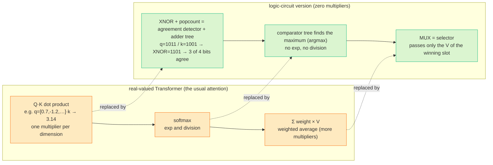
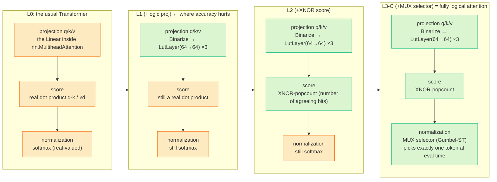
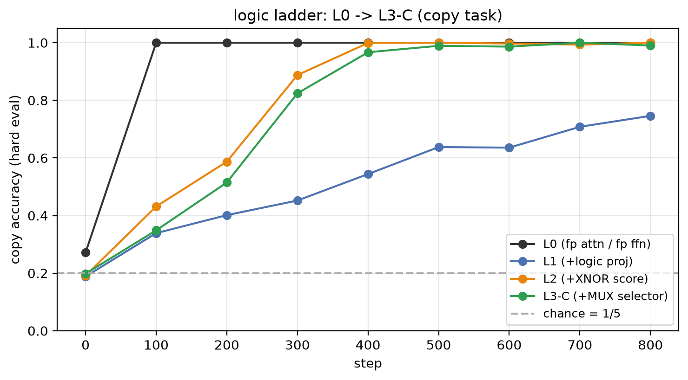
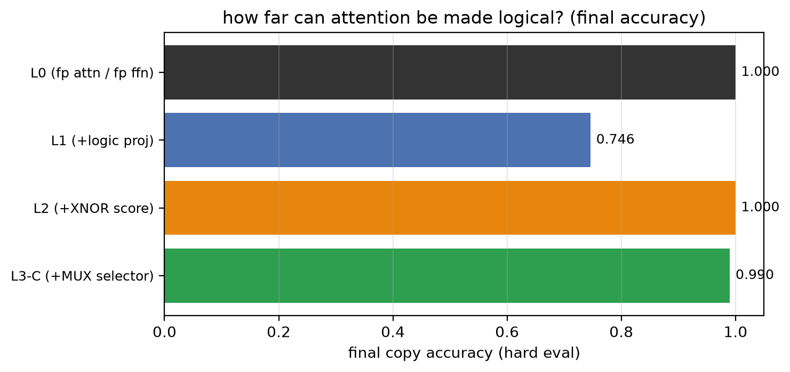
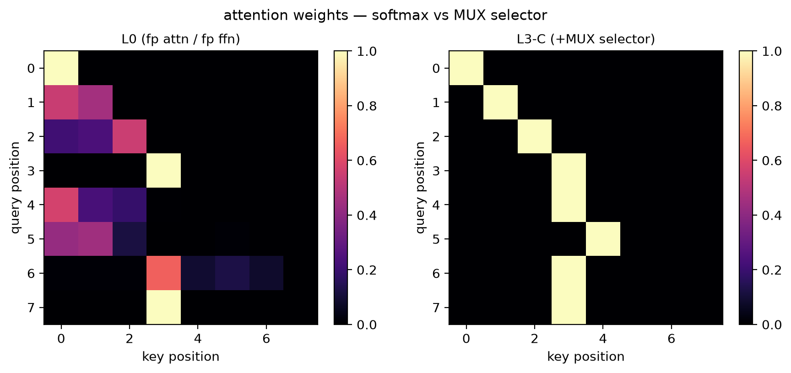
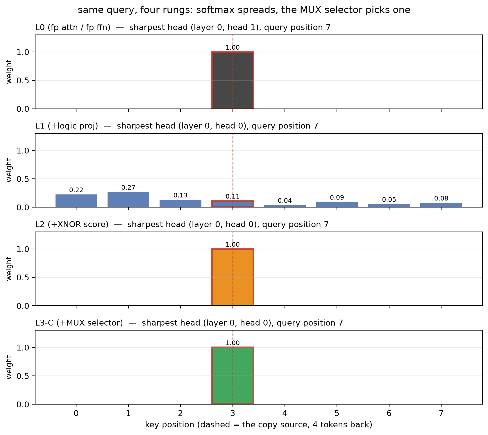

<!-- This file is auto-generated by scripts/build_tutorials.py.
     Do not edit it directly; edit examples/12_logic_ladder_gpt.py and regenerate. -->

A ladder you climb one rung at a time to find out **how far attention can be turned into a logic circuit**.
Starting from an ordinary floating-point Transformer (L0), we replace pieces in order: gating the projections (L1) -> XNOR-popcount scores (L2)
-> a MUX selector (L3-C), and compare accuracy on a copy task along with the attention maps.

The conclusion is counterintuitive. **The biggest drop comes from L1 (gating the projections); switching to XNOR and
removing softmax are nearly free** (L2 returns to 1.000, and L3-C still reaches 0.990). In the L3-C attention map
exactly one cell lights up per row — in other words, the picture says **attention was a learned MUX** all along.

:::tip[What you'll learn]
1. The route from a floating-point Transformer (L0) to a MUX selector (L3-C), logifying one rung at a time
2. At which rung accuracy drops — the one that bites hardest is gating the projections (L1)
3. The view that an attention map going one-hot means **attention is a learned MUX**

**Prerequisites**

- [Transformer (Logic Gate GPT)](/en/tutorials/logic-gpt/) — the finished form waiting at the top of the ladder
- [2. Building a Hybrid NN](/en/tutorials/hybrid/) — designs that stop partway up
:::

:::note[About this page]
Estimated time: **about 8 minutes** / Environment: CPU only (no GPU required)
Source script: [`examples/12_logic_ladder_gpt.py`](https://github.com/tsukushi-gate/Griffith/blob/main/examples/12_logic_ladder_gpt.py)
Try it yourself: [`notebooks/12_logic_ladder_gpt.ipynb`](https://github.com/tsukushi-gate/Griffith/blob/main/notebooks/12_logic_ladder_gpt.ipynb) (the same content as this page as an un-executed notebook; open it with `uv run --group docs jupyter lab notebooks/`)
Every code output below is the **actual result of running the code**, embedded verbatim.
:::

<!-- Colab badge: once the repository is public, replace this span with an <a> whose
     href is the data-colab-url value to enable "Open in Colab". -->
<span class="colab-badge" data-colab-url="https://colab.research.google.com/github/tsukushi-gate/Griffith/blob/main/notebooks/12_logic_ladder_gpt.ipynb">▶ Open in Colab (enabled once the repository is public)</span>

The "ladder of logification" — an example that compares, stage by stage, how far attention can be made into a logic circuit.

examples/07_logic_gpt.py was a GPT that was "all logic gates from the very start". Here we do the opposite:
**start from an ordinary floating-point Transformer (L0) and logify attention one rung at a time**,
measuring where performance drops. This is the ladder of `LogicLadderGPT` (D1).

    L0  : attention=FP / FFN=FP                       … an ordinary Transformer (the ceiling)
    L1  : logify the q/k/v projections (scores stay real dot products, softmax)
    L2  : + replace the scores with XNOR-popcount (Hamming distance)
    L3-C: + replace softmax with a MUX selector (argmax over 1 token, Gumbel-ST) … fully logical attention

By the time we reach L3-C, attention can be written with nothing but "logic gates + comparators + MUX".
That is, **the exp and division of softmax disappear, and it can be burned into a circuit as is**.
This is the demonstration of the research claim "attention = a learned multiplexer (MUX)";
the full-scale results on sMNIST/Shakespeare are in experiments/attention_ladder/REPORT.md.

**The three substitutions that turn attention into a circuit (with concrete values)**

Attention is the operation "find the entry (K) closest to the question (Q) and pull out its
content (V)". A real-valued Transformer does this with multiplications and exponentials, but a
logic circuit has no multipliers. So each stage is replaced, in beginner's terms, by these parts.



- **XNOR = an agreement detector**: a single gate that outputs 1 when two wires carry the same
  value. Line up one per bit
- **popcount = a majority count (adder tree)**: counting the 1s tells you "how many bits agree"
  = the similarity. The dot product of two binary vectors *is* the agreement count, so
  **the meaning of similarity is not lost**
- **MUX = a selector**: a switch that routes exactly one input to the output, told by "which
  number to pass"

**The ladder: what stays real-valued and what becomes a circuit at each rung**

Orange = real-valued (needs multipliers and exp) / green = logic gates (can be burned into a
circuit as is). This sample uses d_model=64, n_heads=2, n_layers=2, qk_bits=v_bits=64.
From L1 on, the logic part is **896 gates** (the total number of LutLayer outputs: projections
64×3 in 2 layers + FFN (128+128) in 2 layers), and the whole model has
**68,422 parameters at L0 versus 5,578 at L3-C** (3,584 of them in LutLayer).
Throw away the multipliers and the size drops by an order of magnitude too.



The implementation is a single class, `LadderAttention` in
`griffith_logic/blocks/causal_attention.py`: you move between rungs just by switching two
strings, `score` (fp_dot / xnor_popcount) and `norm` (softmax / mux_gumbel). The projection is
`_LogicProjection` (Binarize + LutLayer), and from L1 on the FFN is fixed to `LogicMLP` at every
rung so that "one rung = one variable" holds.

The task is a "copy task": a random sequence -> a separator symbol -> the same sequence, trained with next-token prediction.
Copying requires attention that "looks K+1 steps back", so the quality of attention
shows up directly in accuracy (an FFN alone cannot solve it). The size is small enough to fit in 2-3 minutes on CPU.

Run: uv run python examples/12_logic_ladder_gpt.py
Expected result: L0 = copy accuracy 1.00, L1 ≈ 0.7, L2 / L3-C recover to around 1.00

## Setup: imports and the random seed

All four rungs are built from the single class `LogicLadderGPT`. The difference between rungs is
expressed purely by a configuration dict — we never swap implementations. That is the device that
keeps "one rung = one variable".

```python
import matplotlib.pyplot as plt
import torch
import torch.nn.functional as F

from griffith_logic.models import LogicLadderGPT, LogicLadderGPTConfig
```

Since this page compares rungs against each other, the initial conditions are shared across all
of them. What is fixed here covers both data generation and weight initialization, and each rung
re-draws the same seed again later.

```python
torch.manual_seed(0)
```

## Task: the copy task

A random sequence -> a separator symbol -> **the same sequence**, trained with next-token
prediction. The last K tokens are correct simply by "copying the token $K+1$ steps back", so the
accuracy directly mirrors whether attention pulls the right position — the minimal induction task,
which no amount of extra FFN width can solve.

```python
# Example (K=4, 5 symbols): [3,1,4,1] + [SEP] + [3,1,4,1]
K = 4                 # length of the sequence to copy
N_SYM = 5             # number of symbol kinds
SEP = N_SYM           # ID of the separator symbol
VOCAB = N_SYM + 1
SEQ_LEN = 2 * K + 1   # sequence + separator + sequence

BATCH = 64
STEPS = 800
LR = 5e-3
EVAL_EVERY = 100
AUX_LAMBDA = 0.01     # auxiliary loss of the selector (only effective for the L3 family)
TEMP_START, TEMP_END = 2.0, 0.5  # temperature annealing of the selector (pushing soft -> hard)
```

Batch generation is three lines: the random sequence of length K, the separator `SEP`, then the
same sequence again. Scoring covers only the second half of K tokens — the first half is random,
so there is nothing to get right there in the first place.

```python
def make_batch(size: int, generator: torch.Generator) -> torch.Tensor:
    """Build a (size, 2K+1) batch of the copy task."""
    seq = torch.randint(0, N_SYM, (size, K), generator=generator)
    sep = torch.full((size, 1), SEP, dtype=torch.long)
    return torch.cat([seq, sep, seq], dim=1)
```

## The rungs of the ladder: what gets logified, one step at a time

The ladder has four rungs, and attention gets closer to a circuit the higher you climb.

- **L0** — an ordinary `nn.MultiheadAttention` + a real-valued FFN. Zero logification; the ceiling
  that everything else is measured against
- **L1** — only the q/k/v **projections** become LutLayers, with their outputs binarized to
  $\{0,1\}$. Scores are still real dot products and normalization is still softmax
- **L2** — scores move to **XNOR-popcount**. The multipliers disappear, replaced by a count of
  "how many bits matched" (XNOR = a gate that outputs 1 when two lines agree; popcount = an adder
  tree that counts the raised bits)
- **L3-C** — the softmax weighted average becomes a **MUX selector**, passing exactly one key

**Why can a MUX do the selecting?** Boiled down, a softmax weighted average is a device that
decides "how much of which slot's contents to pass through". If the weight is concentrated on a
single line, that is the same job as a tree of 2:1 multiplexers (an element that passes one of two
inputs according to a select line). L3-C **imposes that limit structurally from the start**, which
is precisely why one can say "attention is a learned MUX".

Only the attention side differs; the skeleton such as `d_model` is identical across rungs. Breaking
that would make it impossible to tell whether a performance gap comes from logification or from
capacity.

```python
BASE = {'d_model': 64, 'n_heads': 2, 'n_layers': 2, 'mlp_ratio': 2, 'dropout': 0.0}
LOGIC_PROJ = {
    'attention': 'logic_proj',  # build q/k/v projections with LutLayer (logic gates) and binarize to {0,1}
    'ffn': 'logic',             # the FFN is logic gates too (shared from L1 on = only attention is the variable)
    'qk_bits': 64, 'v_bits': 64,
    'n_inputs': 2,              # the standard 2-input gate of DLGN
    'parameterization': 'warp',
    'proj_depth': 1,
    'tau': 1.0,
}
RUNGS = {
    # L0: ordinary nn.MultiheadAttention + FP FFN. Zero logification, the ceiling.
    'L0 (fp attn / fp ffn)': dict(BASE, attention='fp', ffn='fp'),
    # L1: gate only the projections. Scores are real dot products, normalization stays softmax.
    'L1 (+logic proj)': dict(BASE, **LOGIC_PROJ, score='fp_dot', norm='softmax'),
    # L2: scores move to XNOR-popcount as well. Multipliers disappear, replaced by counting matching bits.
    'L2 (+XNOR score)': dict(BASE, **LOGIC_PROJ, score='xnor_popcount', norm='softmax'),
    # L3-C: softmax moves to a MUX selector. Attention becomes "a MUX that selects one token".
    'L3-C (+MUX selector)': dict(BASE, **LOGIC_PROJ, score='xnor_popcount', norm='mux_gumbel'),
}
```

## Training loop (shared by all four rungs)

The same loop serves all four rungs. Not a single rung-specific branch is written; only the
difference in the configuration dict changes the behavior. There are two devices worth noting.

- **Temperature annealing** — the selector's temperature is lowered 2.0 -> 0.5, shifting it
  gradually from "blend everything vaguely" to the hard "pick one". Starting hard would leave no
  gradient and learning would never get going
- **Auxiliary loss** — a term that sharpens the selection is added, scaled by `AUX_LAMBDA`. It is
  0 on L0-L2, so the same expression works for every rung

Evaluation always runs under `eval()`, where the selector becomes a deterministic hard argmax —
the shape of the baked circuit.

```python
def train_rung(name: str, model_cfg: dict) -> tuple[list[int], list[float], LogicLadderGPT]:
    """Train one rung and return (list of steps, list of copy accuracies, model)."""
    torch.manual_seed(0)          # compare the rungs from the same initial conditions
    rng = torch.Generator().manual_seed(1)
    cfg = LogicLadderGPTConfig.from_model_cfg(model_cfg, vocab_size=VOCAB, seq_len=SEQ_LEN)
    model = LogicLadderGPT(cfg)
    opt = torch.optim.Adam(model.parameters(), lr=LR)

    steps, accs = [], []
    for step in range(STEPS + 1):
        # Lower the temperature 2.0 -> 0.5, gradually pushing the selector toward the hard "pick one" behavior
        # (it is a no-op on the fp/softmax rungs, so the same loop works for every rung).
        model.set_temperature(TEMP_START + (TEMP_END - TEMP_START) * step / STEPS)
        model.train()
        x = make_batch(BATCH, rng)
        logits = model(x[:, :-1])                       # the last token is not used as input
        loss = F.cross_entropy(logits.reshape(-1, VOCAB), x[:, 1:].reshape(-1))
        # Take the selector's auxiliary loss (the term that sharpens the selection) and add it. It is 0 on the fp rung.
        aux = model.pop_aux_loss()
        opt.zero_grad()
        (loss + AUX_LAMBDA * aux).backward()
        opt.step()

        if step % EVAL_EVERY == 0:
            # Under eval() the selector becomes a deterministic hard argmax = the shape of the burned circuit.
            model.eval()
            with torch.no_grad():
                xv = make_batch(256, torch.Generator().manual_seed(99))
                pred = model(xv[:, :-1]).argmax(-1)
                # Score only the copy region (the last K tokens). The first half is random and unguessable.
                acc = (pred[:, K:] == xv[:, K + 1:]).float().mean().item()
            steps.append(step)
            accs.append(acc)
            print(f'  {name:<22} step {step:>4}  loss={loss.item():.3f}  copy acc={acc:.3f}')
    return steps, accs, model
```

## Running it: climbing all four rungs from the same initial conditions

Train the four rungs in order and line up the copy accuracies at the end. What matters is **not the
absolute values but the steps between them**: "at which rung does it drop" is exactly the answer to
"where does the cost of logification live".

```python
results = {}
models = {}
for rung_name, rung_cfg in RUNGS.items():
    print(f'--- {rung_name} ---')
    rung_steps, rung_accs, rung_model = train_rung(rung_name, rung_cfg)
    results[rung_name] = (rung_steps, rung_accs)
    models[rung_name] = rung_model

print('\n最終コピー精度(hard eval):')
for rung_name, (_, accs) in results.items():
    print(f'  {rung_name:<22} {accs[-1]:.3f}')

l0_acc = results['L0 (fp attn / fp ffn)'][1][-1]
l3c_acc = results['L3-C (+MUX selector)'][1][-1]
print(f'\nL0(浮動小数点) {l0_acc:.3f} → L3-C(完全論理attention) {l3c_acc:.3f}'
      f'  差 {l0_acc - l3c_acc:+.3f}')
assert l0_acc > 0.95, f'L0 が解けていない: {l0_acc:.3f}'
assert l3c_acc > 0.80, f'L3-C が低すぎる: {l3c_acc:.3f}'
```

```text title="Output"
--- L0 (fp attn / fp ffn) ---

  L0 (fp attn / fp ffn)  step    0  loss=1.913  copy acc=0.271

  L0 (fp attn / fp ffn)  step  100  loss=0.616  copy acc=1.000

  L0 (fp attn / fp ffn)  step  200  loss=0.606  copy acc=1.000

  L0 (fp attn / fp ffn)  step  300  loss=0.608  copy acc=1.000

  L0 (fp attn / fp ffn)  step  400  loss=0.602  copy acc=1.000

  L0 (fp attn / fp ffn)  step  500  loss=0.603  copy acc=1.000

  L0 (fp attn / fp ffn)  step  600  loss=0.605  copy acc=1.000

  L0 (fp attn / fp ffn)  step  700  loss=0.597  copy acc=1.000

  L0 (fp attn / fp ffn)  step  800  loss=0.606  copy acc=1.000
--- L1 (+logic proj) ---
  L1 (+logic proj)       step    0  loss=1.988  copy acc=0.188

  L1 (+logic proj)       step  100  loss=1.400  copy acc=0.339

  L1 (+logic proj)       step  200  loss=1.395  copy acc=0.401

  L1 (+logic proj)       step  300  loss=1.345  copy acc=0.452

  L1 (+logic proj)       step  400  loss=1.302  copy acc=0.544

  L1 (+logic proj)       step  500  loss=1.232  copy acc=0.638

  L1 (+logic proj)       step  600  loss=1.138  copy acc=0.636

  L1 (+logic proj)       step  700  loss=1.103  copy acc=0.708

  L1 (+logic proj)       step  800  loss=1.046  copy acc=0.746
--- L2 (+XNOR score) ---
  L2 (+XNOR score)       step    0  loss=1.990  copy acc=0.191

  L2 (+XNOR score)       step  100  loss=1.391  copy acc=0.432

  L2 (+XNOR score)       step  200  loss=1.347  copy acc=0.587

  L2 (+XNOR score)       step  300  loss=1.143  copy acc=0.888

  L2 (+XNOR score)       step  400  loss=0.877  copy acc=0.999

  L2 (+XNOR score)       step  500  loss=0.799  copy acc=1.000

  L2 (+XNOR score)       step  600  loss=0.737  copy acc=0.997

  L2 (+XNOR score)       step  700  loss=0.682  copy acc=0.993

  L2 (+XNOR score)       step  800  loss=0.654  copy acc=1.000
--- L3-C (+MUX selector) ---
  L3-C (+MUX selector)   step    0  loss=1.985  copy acc=0.198

  L3-C (+MUX selector)   step  100  loss=1.397  copy acc=0.349

  L3-C (+MUX selector)   step  200  loss=1.342  copy acc=0.515

  L3-C (+MUX selector)   step  300  loss=1.160  copy acc=0.824

  L3-C (+MUX selector)   step  400  loss=0.961  copy acc=0.967

  L3-C (+MUX selector)   step  500  loss=0.816  copy acc=0.989

  L3-C (+MUX selector)   step  600  loss=0.728  copy acc=0.986

  L3-C (+MUX selector)   step  700  loss=0.704  copy acc=1.000

  L3-C (+MUX selector)   step  800  loss=0.734  copy acc=0.990

最終コピー精度(hard eval):
  L0 (fp attn / fp ffn)  1.000
  L1 (+logic proj)       0.746
  L2 (+XNOR score)       1.000
  L3-C (+MUX selector)   0.990

L0(浮動小数点) 1.000 → L3-C(完全論理attention) 0.990  差 +0.010
```

## Visualization: where it drops, and where it comes back

### Figure 1: learning curves of the ladder

**What to look at**: the learning curves of all four rungs overlaid on one plot. The vertical axis
is copy accuracy (hard eval), and the dashed line is the $1/5$ level of answering at random. What
matters is not the end points themselves but **which rung's curve separates from the rest**.

```python
colors = ['#333333', '#4c72b0', '#e8850c', '#2e9e4f']
fig, ax = plt.subplots(figsize=(7.5, 4.2))
for (rung_name, (rung_steps, accs)), color in zip(results.items(), colors, strict=True):
    ax.plot(rung_steps, accs, 'o-', color=color, label=rung_name)
ax.axhline(1.0 / N_SYM, color='#aaa', ls='--', label=f'chance = 1/{N_SYM}')
ax.set_xlabel('step')
ax.set_ylabel('copy accuracy (hard eval)')
ax.set_ylim(0, 1.05)
ax.grid(alpha=0.3)
ax.legend(loc='lower right', fontsize=9)
ax.set_title('logic ladder: L0 -> L3-C (copy task)')
fig.tight_layout()
plt.show()
```

    

    

**Reading it**: the only rung that drops is **L1 (gating the projections)**; L2 and L3-C above it
pass almost for free. In other words the cost of logification lies neither in "how the score is
computed" nor in "giving up softmax", but concentrates on **turning vectors into bits**. The
mechanism of attention itself gets along well with circuits — that is the conclusion of this ladder.

### Figure 2: bar comparison of the final accuracies

**What to look at**: just the end points of figure 1, turned into horizontal bars so the steps can
be read as numbers. It exists to confirm, as a list of final values, the parts where the curves
overlap and are hard to tell apart.

```python
fig, ax = plt.subplots(figsize=(7.5, 3.6))
names = list(results)
finals = [results[n][1][-1] for n in names]
ax.barh(range(len(names)), finals, color=colors)
ax.set_yticks(range(len(names)))
ax.set_yticklabels(names, fontsize=9)
ax.invert_yaxis()
ax.set_xlim(0, 1.05)
ax.set_xlabel('final copy accuracy (hard eval)')
for i, value in enumerate(finals):
    ax.text(value + 0.01, i, f'{value:.3f}', va='center', fontsize=9)
ax.grid(alpha=0.3, axis='x')
ax.set_title('how far can attention be made logical? (final accuracy)')
fig.tight_layout()
plt.show()
```

    

    

**Reading it**: the gap between L0 and L3-C is tiny, and only L1 dips one step down. This single
picture says that **a fully logified attention lines up with a floating-point one**. Conversely,
the dip at L1 shows that how to design the binarization of the projections is the real point of
contention in this field.

### Figure 3: the inside of attention

**What to look at**: heatmaps of the attention weights of L0 (softmax) and L3-C (MUX selector) on
the same input. The vertical axis is the query position, the horizontal axis the key position, and
brighter means larger weight. The correct answer for the copy task is "look $K+1$ steps back", so a
**diagonal line offset by $K+1$ from the main diagonal** means the position is being pulled correctly.

```python
sample = make_batch(1, torch.Generator().manual_seed(7))
fig, axes = plt.subplots(1, 2, figsize=(9, 4))
for ax, key in zip(axes, ['L0 (fp attn / fp ffn)', 'L3-C (+MUX selector)'], strict=True):
    m = models[key]
    m.eval()
    with torch.no_grad():
        m(sample[:, :-1])
    attn = m.last_attn_weights[-1][0, 0]   # (Sq, Sk) of the last layer, head 0
    im = ax.imshow(attn.numpy(), cmap='magma', vmin=0, vmax=1)
    ax.set_title(key, fontsize=10)
    ax.set_xlabel('key position')
    ax.set_ylabel('query position')
    fig.colorbar(im, ax=ax, fraction=0.046)
fig.suptitle('attention weights — softmax vs MUX selector', fontsize=11)
fig.tight_layout()
plt.show()
```

    


**Reading it**: a diagonal shows up in both, but the quality differs. Around L0's line the weights
blur, whereas in L3-C **exactly one cell lights up and the rest is pitch black**. That is because
this is a selection, not a weighted average — the freedom to blur simply does not exist. One picture
shows the same task being solved by averaging on one side and by selecting on the other.

### Figure 4: reading the same single row across the four rungs (the actual weight values)

**How to read it, and what it says** (the last figure on this page). We take just **the row of the
last query position** out of the heatmaps of figure 3 and stack the four rungs as bar charts. For
each rung the sharpest row among all layers and heads is plotted, so "can this rung point at the
copy source?" can be judged from a single row. The red dashed line marks the correct copy source.

The thing to read is the contrast across the four rungs. **L0** pins 1.00 on the correct position.
**L1** cannot build a peak and spreads out (the true face of the rung where accuracy drops shows up
right here). **L2** returns to 1.00 even with XNOR scores. And **L3-C**, being a MUX, is
**structurally always a single bar** — the 1.00 of L0 and L2 is "a softmax that happened to get
sharp", whereas in L3-C the selection itself is discrete. The final picture in which the claim
"attention is a learned MUX" can be read off the weight values themselves.

```python
sample4 = make_batch(1, torch.Generator().manual_seed(7))
q_pos = SEQ_LEN - 2                       # the last query position (the input is x[:, :-1])
target_pos = q_pos - K                    # the key position of the copy source (= the answer)
fig, axes = plt.subplots(4, 1, figsize=(8.5, 7.6), sharex=True)
for ax, (rung_name, color) in zip(axes, zip(list(results), colors, strict=True),
                                  strict=True):
    m = models[rung_name]
    m.eval()
    with torch.no_grad():
        m(sample4[:, :-1])
    best = max(
        ((layer_i, head_i, w[0, head_i, q_pos])
         for layer_i, w in enumerate(m.last_attn_weights)
         for head_i in range(w.shape[1])),
        key=lambda item: float(item[2].max()),
    )
    layer_i, head_i, row = best[0], best[1], best[2].numpy()
    bars = ax.bar(range(len(row)), row, color=color, alpha=0.9)
    bars[target_pos].set_edgecolor('#c0392b')
    bars[target_pos].set_linewidth(2)
    ax.axvline(target_pos, color='#c0392b', ls='--', lw=1)
    for i, v in enumerate(row):
        if v > 0.02:
            ax.text(i, v + 0.04, f'{v:.2f}', ha='center', fontsize=8)
    ax.set_ylim(0, 1.3)
    ax.set_ylabel('weight', fontsize=9)
    ax.set_title(f'{rung_name}  —  sharpest head (layer {layer_i}, head {head_i}), '
                 f'query position {q_pos}', fontsize=10, loc='left')
    ax.grid(axis='y', alpha=0.25)
axes[-1].set_xlabel(f'key position (dashed = the copy source, {K} tokens back)')
axes[-1].set_xticks(range(SEQ_LEN - 1))
fig.suptitle('same query, four rungs: softmax spreads, the MUX selector picks one',
             fontsize=12)
fig.tight_layout()
plt.show()
```

    


## Read next

- [A Tour of Four Logic-Gate Attention Variants](/en/tutorials/attention-tour/) — line up and compare the Attention implementations waiting at the top of the ladder
- [Logic Gate GPT](/en/tutorials/logic-gpt/) — a language model made entirely of logic gates
- [2. Building a Hybrid NN](/en/tutorials/hybrid/) — designs that stop partway up the ladder

<!-- i18n:source=tutorials/logic-ladder.md hash=eeb575f90935 -->
