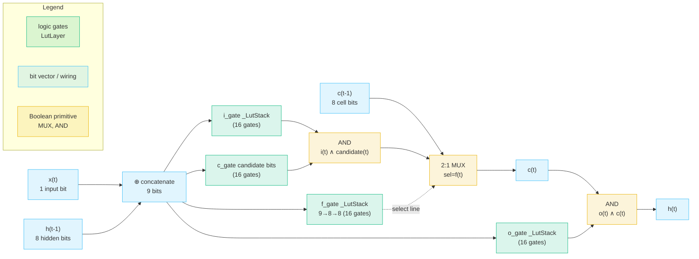
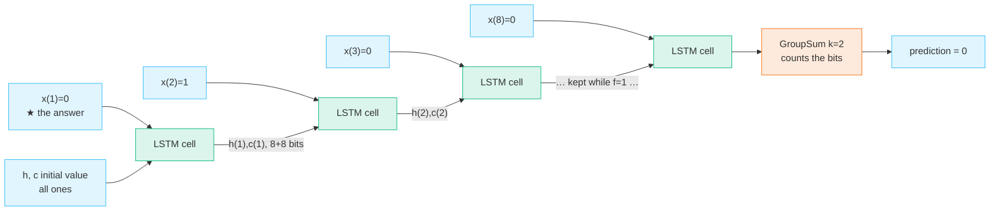
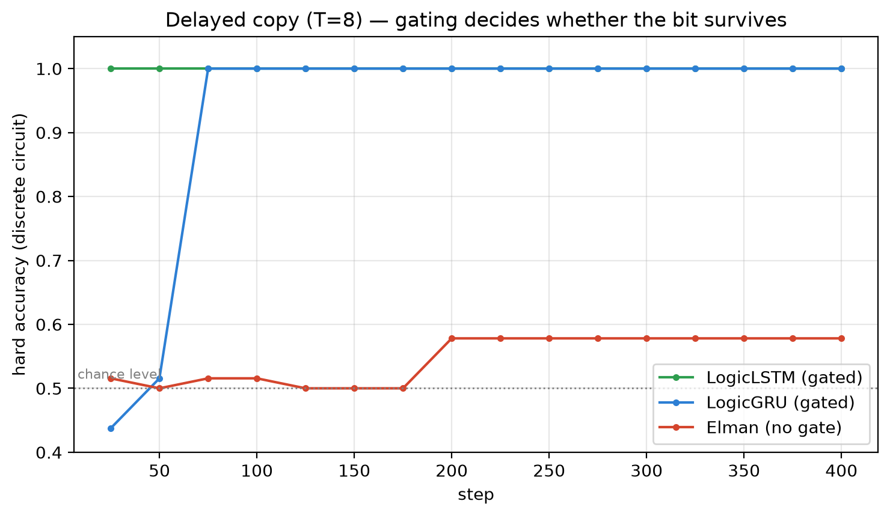
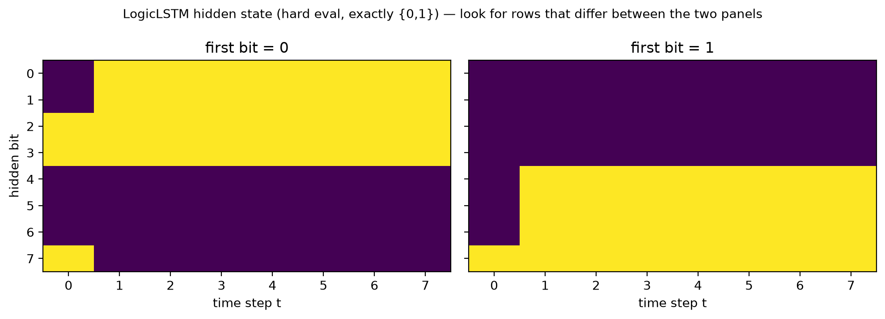
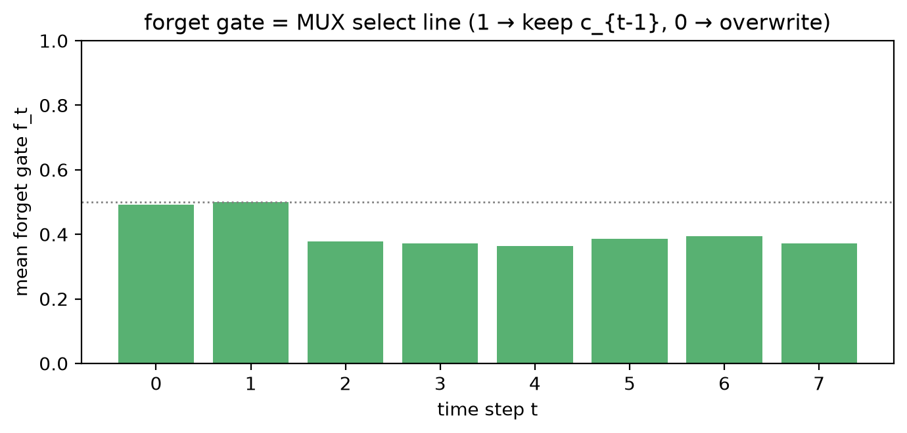
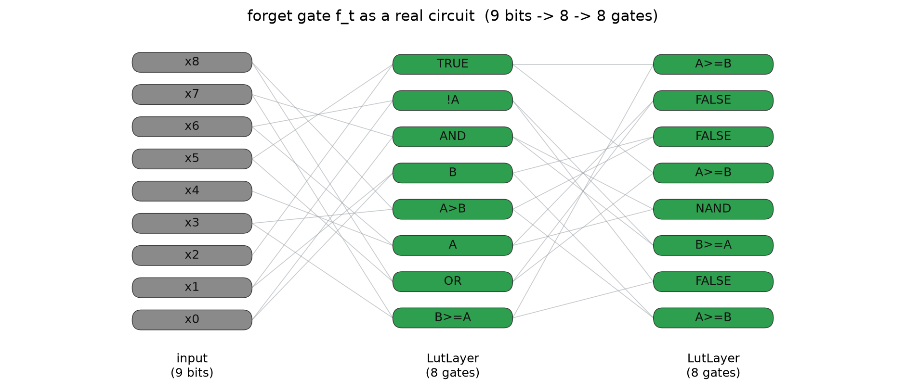

<!-- This file is auto-generated by scripts/build_tutorials.py.
     Do not edit it directly; edit examples/09_logic_lstm.py and regenerate. -->

**An LSTM forget gate is exactly a 2:1 multiplexer, and the output gate is exactly a bitwise AND.**
On $\{0,1\}$ the multiplications of gating turn into logic operations — we confirm that isomorphism on a
delayed copy task by comparing three models: LogicLSTM, LogicGRU, and a gateless Elman cell.

The two gated models reach hard acc 1.000, while the gateless Elman plateaus at 0.578.
Under hard eval the hidden state closes strictly onto $\{0,1\}$, and the opening of the forget gate
shows numerically, step by step, "when to keep the memory and when to throw it away".

:::tip[What you'll learn]
1. The isomorphism forget gate = 2:1 multiplexer, output gate = bitwise AND
2. How the difference between having gates (LSTM/GRU) and not having them (Elman) shows up on a delayed copy task
3. How to check that the hidden state closes strictly onto $\{0,1\}$ under hard eval

**Prerequisites**

- [A seq2seq Model Built from RNNs Alone (RDDLGN)](/en/tutorials/rddlgn-seq2seq/) — look at a recurrent circuit without gates first
- [Core Concepts](/en/getting-started/concepts/)
:::

:::note[About this page]
Estimated time: **about 5 minutes** / Environment: CPU only (no GPU required)
Source script: [`examples/09_logic_lstm.py`](https://github.com/tsukushi-gate/Griffith/blob/main/examples/09_logic_lstm.py)
Try it yourself: [`notebooks/09_logic_lstm.ipynb`](https://github.com/tsukushi-gate/Griffith/blob/main/notebooks/09_logic_lstm.ipynb)(the same content as this page as an un-executed notebook; open it with `uv run --group docs jupyter lab notebooks/`)
Every code output below is the **actual result of running the code**, embedded verbatim.
:::

<!-- Colab badge: once the repository is public, replace this span with an <a> whose
     href is the data-colab-url value to enable "Open in Colab". -->
<span class="colab-badge" data-colab-url="https://colab.research.google.com/github/tsukushi-gate/Griffith/blob/main/notebooks/09_logic_lstm.ipynb">▶ Open in Colab (enabled once the repository is public)</span>

LogicLSTM/LogicGRU: an example for feeling "gating = MUX/AND" first-hand.

In the previous example (08_rddlgn_seq2seq.py), the recurrent part of RDDLGN was

    k_t = K([ n_t ; k_{t-1} ])

which is the **Elman form**: at every step the whole state is rebuilt from scratch.
This form has a weakness: on a pure memory task such as "keep the bit seen at step 1 until
8 steps later", the path that carries the state is rewritten through a layer of LUTs every
time, so the information does not survive.

Ordinary neural networks solved this with LSTM/GRU gating. The claim of this example is:

    **Gating is, at bottom, a Boolean operation.**

    The cell update with a forget gate   c_t = f_t * c_{t-1} + (1 - f_t) * (i_t * c̃_t)
    is, once f_t collapses to {0,1}, exactly a 2:1 multiplexer (MUX), and
    the output gate                      h_t = o_t * c_t
    is exactly a bitwise AND.

In other words, the gate structure of an LSTM does not become an "approximation" when lowered
into a logic circuit — it becomes an exact "match". Under eval (hard), h and c of LogicLSTMCell
are strictly {0,1} —— we check that in this example too.

The task is a **delayed copy**: read a random bit sequence of length T=8 and, at the end, answer
"the bit at step 1". The seven bits in between are all noise, so a latch is required.
As calibrated in tests/test_logic_recurrent.py, LogicLSTMCell reaches hard accuracy 100% within
200 steps, while the Elman form under the same conditions never reaches 100%.
This contrast is the core of the lesson.

## Architecture, illustrated 1: inside the cell (LogicLSTMCell)

First we open up a single time step. The gates f/i/o and the candidate are all
**a stack of two LutLayers taking `cat([x_t, h_(t-1)])` as input** (`_LutStack`); in this
sample's configuration that is 9 input bits (= x 1 + h 8) → 8 gates → 8 gates.
The four bit vectors that come out are combined using **only two parts**: a MUX and an AND.



    f(t)=1 → the MUX picks the c(t-1) side = **keep the memory** (a latch)
    f(t)=0 → the MUX picks the i∧candidate side = **overwrite**
    o(t)=0 → h(t)=0, nothing leaves the cell (the gate is closed)

During training f/i/o are continuous values in 0–1, so the expressions above are a weighted
average; under eval (hard) they collapse to {0,1}, so the cell becomes **exactly, not
approximately**, a circuit of a 2:1 multiplexer and bitwise ANDs. That is the claim of this sample.

## Architecture, illustrated 2: unrolled in time (delayed copy, T=8)

We feed the bit sequence of the first real data point, `0 1 0 1 0 1 0 0`, and ask for
**the 0 from step 1** at the end. The bit to answer with arrives at t=1 and never appears again,
so something inside the cell has to grab it and carry it for seven steps.



**How it actually works** (the points that matter on a first read)

- **One gate = two LutLayer stages**. No matrix product, no sigmoid. With f/i/o/candidate that
  is 4×16 = 64 gates per cell (in the hidden=8 configuration).
- **Gating = choosing a wire**. A MUX is just the part that "lets one of two inputs through",
  and it fits in a single LUT on an FPGA. The LSTM's multiplication coincides with it exactly.
- **What the latch really is**: as long as f(t)=1, c(t) does not change. As a circuit it is
  literally a hold circuit with feedback. Learning means learning *when* to close f.
- **The difference from the Elman form**: the gateless recurrence h(t)=L2(L1([x,h])) rebuilds
  every bit at every step, so there is no dedicated path for keeping anything. It is the same
  figure with the MUX removed entirely.
- **The final readout**: GroupSum splits the hidden bits into two groups and counts the ones in
  each to form logits (it has no learnable parameters). Only the counting is real-valued.

Run: uv run python examples/09_logic_lstm.py
Expected result: LSTM=1.00 / GRU=1.00 / Elman does not reach 1.00 (around 0.6; roughly 20 seconds on CPU)

## Setup: imports and hyperparameters

`LogicLSTMCell` / `LogicGRUCell` are the gated recurrent cells, and `scan_cell` is the helper that
runs the loop over time. The gateless Elman type used for comparison is assembled by hand out of
`LutLayer`.

```python
import matplotlib.pyplot as plt
import torch
import torch.nn as nn
import torch.nn.functional as F

from griffith_logic import GroupSum, LutLayer
from griffith_logic.analysis.circuit_viz import plot_circuit
from griffith_logic.blocks import LogicGRUCell, LogicLSTMCell, scan_cell
```

### Hyperparameters

`T=8` is the sequence length, so the bit to be answered is carried 7 steps. `HIDDEN=8` is the bit
width of the hidden state — 8 lines is far more than enough to hold a single bit, which kills the
excuse "it fails because it lacks capacity" in advance. If a difference appears, only **the
difference in structure** can explain it.

```python
SEED = 0
T = 8          # Sequence length. The bit at step 1 must be carried T-1 steps forward
N_DATA = 64    # Random 64 sequences instead of all patterns (to see generalization of memory)
HIDDEN = 8     # Bit width of the hidden state. 8 bits is plenty for a 1-bit latch
STEPS = 400    # Number of training iterations
LR = 0.05
CHECK = 25     # How often (in steps) to measure hard accuracy
DATA_SEED = 123
```

## Task: delayed copy (answer at the end with the bit seen first)

Read a random bit sequence of length 8 and answer, at the end, **the bit from step 1**. The 7 bits
in between are all noise, so the circuit has to grab the first bit and carry it 7 steps.

**Why "the first"?** If the task were to answer "the last thing seen", it would be solvable by
merely reflecting the most recent input, and memory would make no difference. To test retention
itself, the answer has to be something that never appears again.

```python
def delayed_copy_data() -> tuple[torch.Tensor, torch.Tensor]:
    """Delayed copy: xs=(N,T,1) random bit sequences, y = xs[:,0] (the first bit).

    The key is asking for "what was seen first", not "what was seen last".
    If the task only required remembering the most recent input, the presence
    or absence of gates would make no difference.
    """
    gen = torch.Generator().manual_seed(DATA_SEED)
    xs = (torch.rand(N_DATA, T, 1, generator=gen) > 0.5).float()
    return xs, xs[:, 0, 0].long()
```

## Model: gated versus gateless

### Building the initial state out of bits

A recurrent circuit needs a "state at t=0". The default of 0.5 is a neutral value standing for
"logically undefined" and is convenient for training, but under hard evaluation it is **a value
that does not exist in a circuit**. A LUT fed an intermediate value returns 0.25 or 0.75, and that
propagates along the time axis, contaminating the whole hidden state with continuous values. We pin
the initial state to 1.0 (= bit 1) as well, so the circuit is closed from the very beginning.

```python
def binary_init_state(cell: nn.Module, batch: int):
    """Build the recurrent cell's initial state out of **bits** (so hard eval stays closed).

    The default of cell.init_state() is 0.5 —— a neutral value meaning "logically
    undefined", which is convenient for training. But using it under eval (hard)
    makes a LUT receiving 0.5 return intermediate values like 0.25 / 0.75 …, which
    propagate along the time axis and leave you with "a hidden state that is supposed
    to be a discrete circuit but holds continuous values".
    Here we also fix the initial state to 1.0 (= bit 1) so the circuit stays closed
    under pure Boolean operations from beginning to end.
    """
    state = cell.init_state(batch)
    if isinstance(state, tuple):
        return tuple(torch.ones_like(s) for s in state)
    return torch.ones_like(state)
```

### A gated cell + GroupSum classifier

A minimal setup that merely aggregates the hidden state at the final time step into two class
logits with `GroupSum`. `GroupSum` holds no trainable parameters and only "splits the bits into as
many groups as there are classes and counts the ones", so **the decision itself is part of the
circuit** that gets baked.

```python
class CellClassifier(nn.Module):
    """Minimal classifier: a recurrent cell (LSTM/GRU) + GroupSum.

    The hidden state h_T at the final time step is aggregated by GroupSum into 2-class logits.
    GroupSum is a layer that merely "splits the hidden bits into as many groups as there are
    classes and counts the ones in each group", and it has no learnable parameters. In other
    words **even the decision is part of the circuit**.
    """

    def __init__(self, cell: nn.Module, hidden: int):
        super().__init__()
        self.cell = cell
        # tau is the temperature of the logits. Taking the square root of the group width is
        # the standard practice in this library.
        self.readout = GroupSum(k=2, tau=max(1.0, (hidden // 2) ** 0.5))

    def forward(self, xs: torch.Tensor) -> torch.Tensor:
        # scan_cell runs the loop over the time axis (it returns outputs, final_state).
        state = binary_init_state(self.cell, xs.shape[0])
        outputs, _final = scan_cell(self.cell, xs, state)
        return self.readout(outputs[:, -1, :])
```

### The comparison: a gateless Elman type

$h_t = L_2(L_1([x_t ; h_{t-1}]))$ — a form that rebuilds the state from scratch at every time step
(the same as RDDLGN's K and P layers). Its weakness is that **there is no path dedicated to
retention**, which amounts to the cell diagram at the top of this page with the MUX removed
entirely. Its readout and training conditions match the gated side exactly, so if a difference
appears, only the way the recurrence is built can be the cause.

```python
class ElmanClassifier(nn.Module):
    """Gateless Elman form (recurrence with two LutLayers). The baseline for comparison.

    h_t = L2(L1([ x_t ; h_{t-1} ]))
    Same shape as the K/P layers of RDDLGN. Note that there is no dedicated path for keeping state.
    """

    def __init__(self, hidden: int, seed: int):
        super().__init__()
        torch.manual_seed(seed)
        self.l1 = LutLayer(1 + hidden, hidden, n_inputs=2)
        self.l2 = LutLayer(hidden, hidden, n_inputs=2)
        self.hidden = hidden
        self.readout = GroupSum(k=2, tau=max(1.0, (hidden // 2) ** 0.5))

    def forward(self, xs: torch.Tensor) -> torch.Tensor:
        batch, seq_len, _ = xs.shape
        # The initial state is bit 1. This matches the conditions of the LSTM/GRU side exactly
        # (0.5 is avoided for the same reason as binary_init_state above).
        h = torch.ones(batch, self.hidden)
        for t in range(seq_len):
            h = self.l2(self.l1(torch.cat([xs[:, t, :], h], dim=-1)))
        return self.readout(h)
```

## Training loop

Ordinary Adam + cross entropy. There is one rule of practice: **what we record is always the hard
(eval) accuracy**. Even if soft accuracy rises, it means nothing unless the argmax-settled circuit
gives the same answer — that is the most common form of self-deception in logic-gate NNs, so we
look at nothing but hard from the start.

```python
def train(model: nn.Module, xs, y) -> list[tuple[int, float]]:
    """Train and return the history of (step, hard accuracy)."""
    opt = torch.optim.Adam(model.parameters(), lr=LR)
    history = []
    for step in range(STEPS):
        model.train()
        opt.zero_grad()
        F.cross_entropy(model(xs), y).backward()
        opt.step()
        if (step + 1) % CHECK == 0:
            # What we record is always the hard (eval) side. Even if only soft acc goes up,
            # it means nothing unless the burned circuit gives the same answer.
            model.eval()
            with torch.no_grad():
                acc = (model(xs).argmax(-1) == y).float().mean().item()
            history.append((step + 1, acc))
    return history
```

## Running it: comparing three models under identical conditions

### Data

Print one actual bit sequence to see the shape of the task with your own eyes.

```python
xs, y = delayed_copy_data()
print(f'遅延コピー: xs={tuple(xs.shape)} (T={T}) / 目標=1ステップ目のビット')
print(f'例: 入力ビット列 {xs[0, :, 0].int().tolist()} → 正解 {int(y[0])}')
```

```text title="Output"
遅延コピー: xs=(64, 8, 1) (T=8) / 目標=1ステップ目のビット
例: 入力ビット列 [0, 1, 0, 1, 0, 1, 0, 0] → 正解 0
```

### Train the three models under identical conditions

Seed, data, step count, learning rate and readout are all matched so that **only the way the
recurrence is built differs**. We use "the best value reached during training" as the representative
number because hard accuracy wanders between steps due to discretization, and looking only at the
final value tends to understate the true ability.

```python
builders = {
    'LogicLSTM (gated)': lambda: CellClassifier(
        LogicLSTMCell(1, HIDDEN, seed=SEED), HIDDEN),
    'LogicGRU (gated)': lambda: CellClassifier(
        LogicGRUCell(1, HIDDEN, seed=SEED), HIDDEN),
    'Elman (no gate)': lambda: ElmanClassifier(HIDDEN, seed=SEED),
}

histories = {}
finals = {}
models = {}
for name, build in builders.items():
    torch.manual_seed(SEED)
    model = build()
    hist = train(model, xs, y)
    histories[name] = hist
    # Use "the best value reached at any point during training" as the representative number.
    # Hard acc bounces between steps because of discretization, so looking only at the final
    # value tends to underestimate the true ability.
    finals[name] = max(a for _s, a in hist)
    models[name] = model
    n_params = sum(p.numel() for p in model.parameters())
    print(f'{name:<20} best hard acc = {finals[name]:.4f}  ({n_params:,} params)')
```

```text title="Output"
LogicLSTM (gated)    best hard acc = 1.0000  (1,024 params)

LogicGRU (gated)     best hard acc = 1.0000  (768 params)

Elman (no gate)      best hard acc = 0.5781  (256 params)
```

In the output above the gated ones (LSTM / GRU) reach 1.0000 while the gateless one (Elman) never
gets to 1.0. If anything Elman has fewer parameters, so the difference comes from **structure**, not
capacity. The two asserts below fix that very contrast as a mechanical acceptance condition.

```python
# The gated ones score perfectly, the gateless one does not —— this is the claim of the example.
assert finals['LogicLSTM (gated)'] == 1.0, 'LogicLSTM が遅延コピーを解けていない'
assert finals['Elman (no gate)'] < 1.0, 'Elman型が満点(比較の前提が崩れた)'
```

## Visualization: what the gates are actually doing

### Figure 1: learning curves (they split depending on whether gates exist)

**What to look at**: the vertical axis is hard accuracy (measured on the discrete circuit as is),
and the dotted line is the coin-toss level of 0.5. All three lines share one plot, so **whether the
outcome forks on the presence of gates alone** can be read directly.

```python
fig, ax = plt.subplots(figsize=(7.5, 4.4))
colors = {'LogicLSTM (gated)': '#2e9e4f', 'LogicGRU (gated)': '#2d7fd4',
          'Elman (no gate)': '#d4452d'}
for name, hist in histories.items():
    steps, accs = zip(*hist, strict=True)
    ax.plot(steps, accs, 'o-', ms=3, color=colors[name], label=name)
ax.axhline(0.5, color='gray', ls=':', lw=1)
ax.text(STEPS * 0.02, 0.515, 'chance level', color='gray', fontsize=8)
ax.set_xlabel('step')
ax.set_ylabel('hard accuracy (discrete circuit)')
ax.set_ylim(0.4, 1.05)
ax.grid(alpha=0.3)
ax.legend(loc='lower right')
ax.set_title(f'Delayed copy (T={T}) — gating decides whether the bit survives')
fig.tight_layout()
plt.show()
```

    

    

**Reading it**: LSTM / GRU **jump to 1.0 in a step** around step 100. They jump rather than creep
because the circuit is complete the instant "which bit becomes the latch" is decided — this is not
the gradual improvement of a continuous approximation. Elman, meanwhile, climbs slowly from 0.5 and
hits a ceiling: with no path for retention, it is overwritten every time by the 7 noise bits in
between.

### Figure 2: is the hidden state really made of bits?

**What to look at** (drawn in the next cell): the hidden state is laid out as a time × bit grid,
with samples whose step-1 input was 0 on the left and whose input was 1 on the right. **A row whose
color differs between the two panels** is "the bit that kept the first bit all the way to the end" —
the latch the circuit found. Before that, an assert checks that the state is strictly $\{0,1\}$.

```python
lstm = models['LogicLSTM (gated)']
lstm.eval()
with torch.no_grad():
    state = binary_init_state(lstm.cell, 32)
    outputs, _ = scan_cell(lstm.cell, xs[:32], state)
uniq = torch.unique(outputs)
print(f'hidden state の出現値 = {uniq.tolist()}')
assert bool(((outputs == 0.0) | (outputs == 1.0)).all()), \
    'hard eval なのに隠れ状態が二値でない'
```

```text title="Output"
hidden state の出現値 = [0.0, 1.0]
```

The output above confirms that only the two values `[0.0, 1.0]` occur — once the gates $f, i, o$
fall to $\{0,1\}$, both the MUX and the AND become exact bit operations, so this is not an
approximation.

```python
fig, axes = plt.subplots(1, 2, figsize=(10, 3.6), sharey=True)
for ax, bit in zip(axes, (0, 1), strict=True):
    sel = outputs[y[:32] == bit]                 # (n, T, HIDDEN)
    ax.imshow(sel.mean(0).T, cmap='viridis', vmin=0, vmax=1, aspect='auto')
    ax.set_xlabel('time step t')
    ax.set_title(f'first bit = {bit}')
    ax.set_xticks(range(T))
axes[0].set_ylabel('hidden bit')
fig.suptitle('LogicLSTM hidden state (hard eval, exactly {0,1}) — '
             'look for rows that differ between the two panels', fontsize=10)
fig.tight_layout()
plt.show()
```

    

    

**Reading it**: comparing the two panels, most rows share the same pattern while a few have their
colors inverted. Those rows are the bits that took charge of the latch, and the fact that they
**hold a constant color from t=0 through t=7** is the direct evidence that the bit was carried 7
steps. The remaining rows are used for temporary processing of the input, so a division of labor
emerges naturally among the 8 bits.

### Figure 3: are the gates actually "closing"?

**What to look at**: the mean opening of the forget gate $f_t$ plotted as bars over time. When
$f_t=1$ the MUX selects the past side $c_{t-1}$ (= **keep**); when $f_t=0$ it is overwritten with
the candidate. The bar height is "the fraction of bits that fell to the keep side at that time step".

```python
lstm_cell = lstm.cell
with torch.no_grad():
    lstm_cell.eval()
    h, c = binary_init_state(lstm_cell, 32)   # The hard path does not close unless we start from {0,1}
    forget_rate = []
    for t in range(T):
        z = torch.cat([xs[:32, t, :], h], dim=-1)
        f_t = lstm_cell.f_gate(z)       # (32, HIDDEN) — {0,1}
        forget_rate.append(f_t.mean().item())
        h, c = lstm_cell(xs[:32, t, :], (h, c))

fig, ax = plt.subplots(figsize=(7, 3.4))
ax.bar(range(T), forget_rate, color='#2e9e4f', alpha=0.8)
ax.axhline(0.5, color='gray', ls=':', lw=1)
ax.set_xlabel('time step t')
ax.set_ylabel('mean forget gate f_t')
ax.set_ylim(0, 1)
ax.set_xticks(range(T))
ax.set_title('forget gate = MUX select line (1 → keep c_{t-1}, 0 → overwrite)')
fig.tight_layout()
plt.show()
```

    

    

**Reading it**: the bars stick neither to 1.0 nor to 0.0 but settle at an intermediate height.
That is because **only some of the bits close while the rest stay open** — we are averaging, so the
ratio of that division of labor becomes the height itself. That the height does not collapse as time
advances shows the latch never comes loose along the way.

### Figure 4: the forget gate "for real"

**How to read it, and what it says** (the last figure on this page). Every figure so far was about
behavior, so we finish by drawing the trained forget gate **as the circuit itself**. On the left are
the 9 input bits ($[x_t ; h_{t-1}]$), in the middle and on the right the two LutLayer stages of 8
gates each, and the text inside each box is the gate name settled by argmax (`AND` / `XOR` / `NAND` …).

The thing to read off is that **the boxes carry concrete gate names, not `LUT`**. This wiring and
these gate names come from the same discretization path that `export_ir` uses to emit Verilog, which
makes it the most direct evidence that "the forget gate of an LSTM" is, as it stands, a synthesizable
combinational circuit.

```python
fig, ax = plt.subplots(figsize=(9.5, 4.2))
plot_circuit(lstm.cell.f_gate, resolve=True, ax=ax,
             title='forget gate f_t as a real circuit  (9 bits -> 8 -> 8 gates)')
fig.tight_layout()
plt.show()

print('\n--- まとめ ---')
for name, acc in finals.items():
    print(f'{name:<20} hard acc = {acc:.4f}')
print(f'forget gate の平均開度(時刻順) = '
      f'{[round(v, 3) for v in forget_rate]}')
```

    

    

    
```text title="Output"
--- まとめ ---
LogicLSTM (gated)    hard acc = 1.0000
LogicGRU (gated)     hard acc = 1.0000
Elman (no gate)      hard acc = 0.5781
forget gate の平均開度(時刻順) = [0.492, 0.5, 0.379, 0.371, 0.363, 0.387, 0.395, 0.371]
```

## Read next

- [Causal convolution with logic gates](/en/tutorials/logic-wavenet/) — looking at history without recurrence
- [Reservoir computing (an RNN that is never trained)](/en/tutorials/logic-reservoir/) — the choice of not training the recurrent circuit
- [A seq2seq Model Built from RNNs Alone (RDDLGN)](/en/tutorials/rddlgn-seq2seq/)

<!-- i18n:source=tutorials/logic-lstm.md hash=37d1cc05d245 -->
