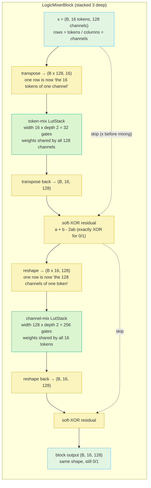
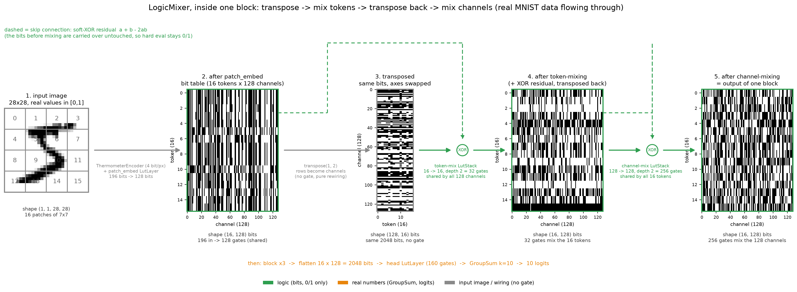
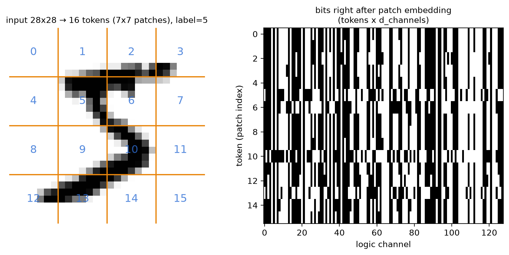
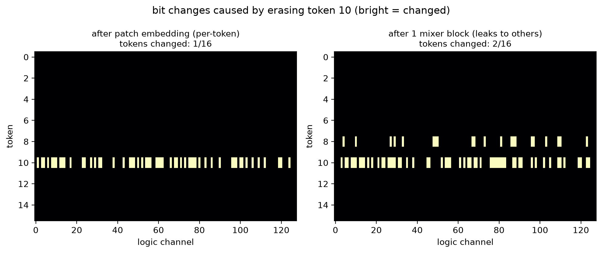
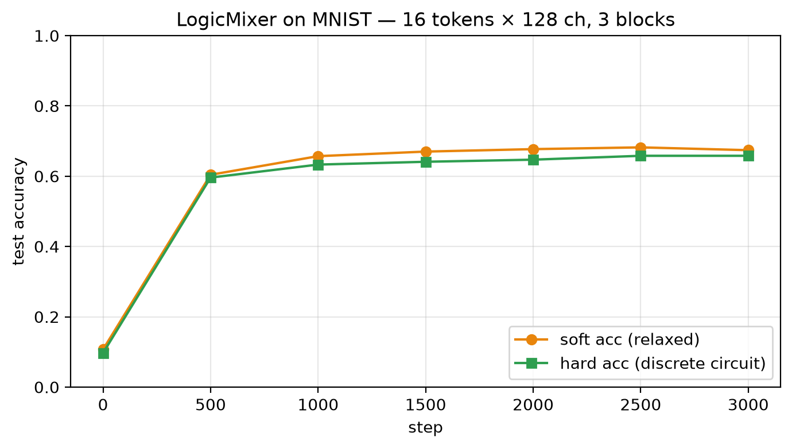
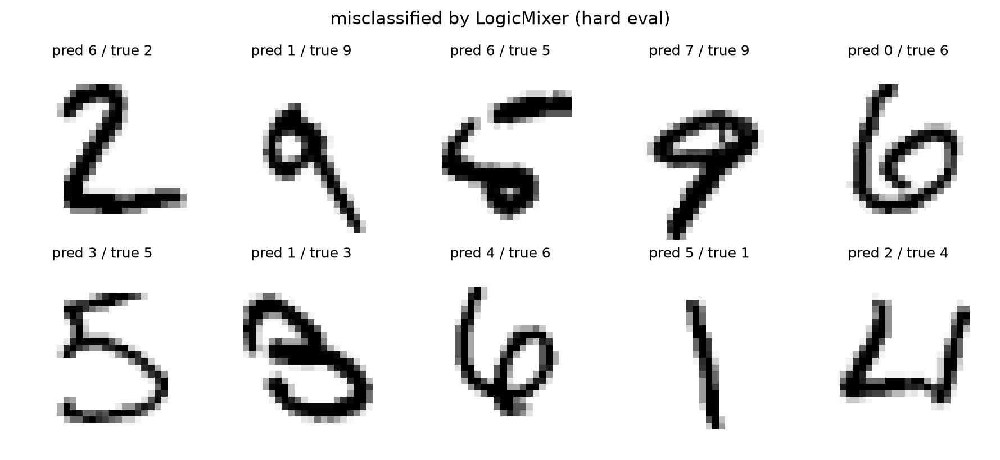

<!-- This file is generated automatically by scripts/build_tutorials.py.
     Do not edit it directly; edit examples/15_logic_mixer.py and regenerate. -->

The logic-gate version of MLP-Mixer, which mixes images without using attention. The image is
chopped into 16 tokens, and **token-mixing (transpose, then run through a LutStack)** and
**channel-mixing** are stacked alternately with soft-XOR residuals. Reaches hard acc 0.658 on MNIST.

The highlight is measuring *how* information gets mixed. Track the difference against an input where
a single patch has been erased: right after patch embedding the change stays confined to that
token's row, but after one block it leaks into neighbouring tokens (1→2 tokens per block). **Who is
doing the mixing** becomes visible in a picture.

:::tip[What you'll learn]
1. How to build an MLP-Mixer out of logic gates, mixing images without using attention
2. The division of labour between token-mixing (transpose, then run through a LutStack) and channel-mixing
3. How to read the difference from erasing a single patch to measure "how far information leaks"

**Prerequisites**

- [Residual connections in logic NNs](/en/tutorials/logic-resnet/) — the character of the soft-XOR residual
- [1. Train on MNIST](/en/tutorials/mnist/)
:::

:::note[About this page]
Estimated time: **about 8 minutes** / Environment: CPU only (no GPU needed)
Source script: [`examples/15_logic_mixer.py`](https://github.com/tsukushi-gate/Griffith/blob/main/examples/15_logic_mixer.py)
Try it yourself: [`notebooks/15_logic_mixer.ipynb`](https://github.com/tsukushi-gate/Griffith/blob/main/notebooks/15_logic_mixer.ipynb) (an unexecuted notebook with the same content as this page; open it with `uv run --group docs jupyter lab notebooks/`)
Every code output is the **actual result of running the code**, embedded verbatim.
:::

<!-- Colab badge: once the repository is public, replace this span with an <a> whose href is
     data-colab-url and "Open in Colab" becomes active. -->
<span class="colab-badge" data-colab-url="https://colab.research.google.com/github/tsukushi-gate/Griffith/blob/main/notebooks/15_logic_mixer.ipynb">▶ Open in Colab (enabled once the repository is public)</span>

An example of solving MNIST with LogicMixer (the logic-gate version of MLP-Mixer).

MLP-Mixer (Tolstikhin et al., 2021) is an architecture that "solves images with MLPs alone, without
attention"; it is built by simply alternating two kinds of mixing:

    token-mixing   … mixes across patches (tokens)  = "where to look"
    channel-mixing … mixes along the feature axis within one patch = "what to look at"

LogicMixer replaces these two MLPs with **stacks of LutLayers** to get a logic-gate version
(griffith_logic/models/mlp_mixer.py).

**Terminology (so the page reads even if neural networks are new to you)**

- **token** … one tile of the image once it is cut into 7x7 tiles. Chopping 28x28 into 7x7 gives
  4x4 = 16 tiles, so as far as this model is concerned an image is nothing but "16 tokens"
- **channel** … the string of bits that represents one token; 128 bits here.
  Think of it as "the answers to 128 yes/no questions that this tile holds"
- **LutLayer** … a layer of out_dim two-input logic gates. One gate = one output bit.
  During training each gate is a continuous mixture of the 16 logic functions (AND/OR/XOR…);
  once fixed it becomes a genuine circuit
- **LutStack** … depth LutLayers of the same width stacked up. It plays the role of an MLP's "hidden layers"
- **transpose** … swapping the rows and columns of a matrix. It changes not a single bit of the
  contents, yet it switches "which axis the gates act along" — that is the crux of Mixer

**The whole picture (with the numbers of this example's actual settings)**

```mermaid
flowchart LR
  subgraph IN["Input (the world of real numbers)"]
    direction LR
    IMG["MNIST 28x28<br/>pixels are reals in [0,1]"]
    PT["chop into 7x7 patches<br/>4x4 = 16 tokens<br/>1 patch = 49 pixels"]
  end

  subgraph BITS["The world of bits (everything here is 0/1 logic gates)"]
    direction LR
    TH["ThermometerEncoder<br/>1 pixel becomes a 4-bit thermometer code<br/>1 patch = 49x4 = 196 bits"]
    PE["patch_embed LutLayer<br/>196 bits → 128 bits<br/>128 gates, shared by all 16 tokens"]
    BLK["LogicMixerBlock x3<br/>each block = token-mix (32 gates)<br/>+ channel-mix (256 gates)"]
    HD["head LutLayer<br/>16x128 = 2,048 bits → 160 bits<br/>160 gates (10 classes x 16 lines)"]
  end

  subgraph OUT["Back to real numbers"]
    direction LR
    GS["GroupSum k=10<br/>split the 160 lines into 10 groups of 16<br/>and count the ones in each group"]
    LG["logits (10) → argmax<br/>predicted label 0-9"]
  end

  IMG --> PT
  PT -->|"(B, 16, 49) reals"| TH
  TH -->|"(B, 16, 196) bits"| PE
  PE -->|"(B, 16, 128) bits"| BLK
  BLK -->|"(B, 16, 128) bits"| HD
  HD -->|"(B, 160) bits"| GS
  GS --> LG

  style IMG fill:#38bdf826,stroke:#38bdf8
  style PT fill:#38bdf826,stroke:#38bdf8
  style TH fill:#10b98126,stroke:#10b981
  style PE fill:#10b98126,stroke:#10b981
  style BLK fill:#10b98126,stroke:#10b981
  style HD fill:#10b98126,stroke:#10b981
  style GS fill:#f9731626,stroke:#f97316
  style LG fill:#f9731626,stroke:#f97316
```



**Inside one block (what transposition actually does)**

The very same (16 tokens x 128 channels) bit table is run through a LutStack **twice, with rows and
columns swapped in between**. Turning the matrix around switches "who gets mixed with whom in one
application of a LutStack" between token-with-token and channel-with-channel — and that is the
entire idea of Mixer.



**How it is realised**

1. **Patch embedding is logic gates too**: a 7x7 patch is turned into bits by thermometer encoding
   (an encoding that writes the magnitude of a value as "the length of a bar"), and a single
   LutLayer shared across all patches collapses it into 128 bits. It corresponds to
   Conv2d(stride=patch_size) in a real-valued NN.
2. **token-mixing is realised by transposition**: transpose (B, tokens, channels) so that the
   channel axis folds into the batch side, then apply one LutStack along the token axis. This gives
   "mixing along the token direction with weights shared across all channels", so a mere 32 gates
   suffice to mix all 16 tiles.
3. **The residual is soft-XOR ``a + b - 2ab``, not addition.** For {0,1} inputs it matches
   bitwise XOR exactly, so intermediate representations stay in {0,1} at eval time too.
   soft-OR is not used because it saturates towards 1 as layers stack and destroys information
   (XOR keeps information intact since ``a XOR b XOR b = a``).
4. **Only the last step is real-valued**: the 160 bits are split into 10 groups and the ones are
   counted (GroupSum). This is where float first appears, and that value is the logits itself.

In this example we first follow the flow above with an architecture figure that has real data
flowing through it, then confirm that "a change in one patch propagates to all patches", and
finally train on MNIST.

Run: uv run python examples/15_logic_mixer.py
Expected result: hard accuracy around 0.65 (a reduced recipe that takes just under 2 minutes on CPU.
          Increasing d_channels / n_blocks / STEPS pushes it higher.)

## Setup: imports and the random seed

All we need is PyTorch, matplotlib and this library's `load_mnist` plus
`LogicMixer` / `LogicMixerConfig`. LogicMixer is the logic-gate version of **MLP-Mixer**
(the image architecture that simply alternates two kinds of mixing MLPs without any attention);
the implementation lives in `griffith_logic/models/mlp_mixer.py`.

```python
import matplotlib.pyplot as plt
import torch
import torch.nn.functional as F
from matplotlib.lines import Line2D
from matplotlib.patches import FancyArrowPatch, Patch
from torch.utils.data import DataLoader, Subset

from griffith_logic.datasets import load_mnist
from griffith_logic.models import LogicMixer, LogicMixerConfig
```

```python
torch.manual_seed(0)
```

## Hyperparameters: the numbers that fix the shape of the model

The shape of this model is decided almost entirely by the eight lines below. Let us define the
words first.

- **token** … one patch the image is chopped into. With `PATCH=7`, a 28x28 image becomes
  4x4 = **16 tokens**
- **channel** … the bits of the logic channels that represent one token. `D_CHANNELS=128`, so
  one token = 128 bits
- **the (tokens, d_channels) bit table** … the protagonist that gets mixed from here on.
  It is a 16 x 128 table of 0/1 with **rows = tokens, columns = channels**

`ENCODE_BITS=4` says how many bits one pixel is expanded into by the
**ThermometerEncoder (thermometer encoding = writing the magnitude of a real value as "the length
of a bar" in bits)**.

```python
# A reduced recipe that fits in 2-3 minutes on CPU. Raising n_blocks / depth / d_channels makes it stronger.
PATCH = 7          # chop 28x28 into 7x7 patches → 4x4 = 16 tokens
ENCODE_BITS = 4    # thermometer bits per pixel
D_CHANNELS = 128   # bit width representing one patch
N_BLOCKS = 3       # number of (token-mix → channel-mix) blocks
DEPTH = 2          # number of layers in each mixing LutStack
STEPS = 3000
BATCH = 64
N_TRAIN = 8000
N_TEST = 1000
```

## Dataset: MNIST read at its original 28x28

Unlike the other examples, the image is neither downscaled nor binarized. The image size has to be
divisible by the patch size 7, so we keep 28x28 as is (20x20 is not divisible by 7) and pass the
values through as reals in `[0,1]`. The conversion to bits is handled by the ThermometerEncoder
inside the model, so the data side does nothing.

```python
train_set, test_set = load_mnist(binarize_threshold=None)
```

```python
def materialize(dataset, n):
    """Collect the first n samples into a (N, 1, 28, 28) tensor plus labels."""
    subset = Subset(dataset, range(n))
    return next(iter(DataLoader(subset, batch_size=n)))
```

```python
train_x, train_y = materialize(train_set, N_TRAIN)
test_x, test_y = materialize(test_set, N_TEST)
print(f'train={tuple(train_x.shape)} test={tuple(test_x.shape)}')
```

```text title="Output"
train=(8000, 1, 28, 28) test=(1000, 1, 28, 28)
```

## Defining the model: building a Mixer out of LutLayers alone

Just handing the numbers above to `LogicMixerConfig` assembles everything from patch_embed →
LogicMixerBlock x3 → head → GroupSum. Let us pin down the names of the parts first.

- **LutStack** … depth LutLayers (layers of two-input logic gates) of the same width stacked up.
  It is the part that sits where MLP-Mixer's "MLP" goes
- **token-mixing / channel-mixing** … the former mixes bits across tokens
  (= "where to look"), the latter mixes the 128 channels within one token (= "what to look at")
- **residual connection** … the wiring that adds the value before mixing back after mixing.
  Here it is soft-XOR rather than addition
- **GroupSum** … the exit that counts the final bits per class to make logits.
  This is the only place in the model where real numbers appear

The structure of `model` that gets printed, together with the gate breakdown printed in the next
section, is the entire cost of this configuration.

```python
config = LogicMixerConfig(
    image_size=28,
    patch_size=PATCH,
    in_channels=1,
    encode_bits=ENCODE_BITS,
    d_channels=D_CHANNELS,
    n_blocks=N_BLOCKS,
    depth=DEPTH,
    n_inputs=2,
    num_classes=10,
)
model = LogicMixer(config)
print(f'\ntokens={config.d_tokens}(= {config.side}x{config.side} patches), '
      f'd_channels={config.d_channels}, '
      f'1パッチの生ビット数={config.patch_pixels * config.encode_bits}')
print(model)
```

    
```text title="Output"
tokens=16(= 4x4 patches), d_channels=128, 1パッチの生ビット数=196
LogicMixer(
  image_size=28, patch_size=7, d_tokens=16, d_channels=128, n_blocks=3, depth=2, n_inputs=2, embed=128(random)
  (thermometer): ThermometerEncoder(bits=4, mode=uniform, fitted=False)
  (patch_embed): Sequential(
    (0): LutLayer(in=196, out=128, n_inputs=2, entries=4, param=softmax/16gate)
  )
  (blocks): ModuleList(
    (0-2): 3 x LogicMixerBlock(
      (token_mix): _LutStack(
        (layers): ModuleList(
          (0-1): 2 x LutLayer(in=16, out=16, n_inputs=2, entries=4, param=softmax/16gate)
        )
      )
      (channel_mix): _LutStack(
        (layers): ModuleList(
          (0-1): 2 x LutLayer(in=128, out=128, n_inputs=2, entries=4, param=softmax/16gate)
        )
      )
    )
  )
  (head_lut): LutLayer(in=2048, out=160, n_inputs=2, entries=4, param=softmax/16gate)
  (group_sum): GroupSum(k=10, tau=4.0)
)
```

## The architecture: using the same tool twice via transposition

**Why transpose?** A LutStack is always a tool that acts on **each row** of a matrix.
Hand it the (tokens, d_channels) bit table as is and one row = the 128 channels of one token, so
you get **channel-mixing**; hand it the transpose and one row = the 16 tokens of one channel, so
you get **token-mixing**. Transposition is pure rewiring that rewrites not a single bit, and it is
there solely so that **the same part can be used twice, only turned around**.
"Turn the matrix around and use the same tool twice" — that is the whole idea of Mixer.

Below we push a single real image through and check the cross-sections as pictures.

### Taking the block cross-sections

Feed one image to the untrained model and pull out four bit tables: (1) right after patch
embedding (2) that matrix transposed (3) after token-mixing (4) after channel-mixing.

```python
# This just lays out by hand the same computation the block does; it is equivalent to model.blocks[0](x).
model.eval()
with torch.no_grad():
    arch_sample = train_x[0]
    arch_patches = model._patchify(arch_sample.unsqueeze(0))
    arch_coded = model.thermometer(arch_patches)
    arch_x0 = model.patch_embed(arch_coded.reshape(-1, arch_coded.shape[-1]))
    arch_x0 = arch_x0.reshape(1, config.d_tokens, config.d_channels)
    arch_block = model.blocks[0]
    arch_t = arch_x0.transpose(1, 2).reshape(config.d_channels, config.d_tokens)
    arch_mixed = arch_block.token_mix(arch_t)
    arch_mixed = arch_mixed.reshape(1, config.d_channels, config.d_tokens).transpose(1, 2)
    arch_x1 = arch_x0 + arch_mixed - 2.0 * arch_x0 * arch_mixed
    arch_ch = arch_block.channel_mix(arch_x1.reshape(config.d_tokens, config.d_channels))
    arch_ch = arch_ch.reshape(1, config.d_tokens, config.d_channels)
    arch_x2 = arch_x1 + arch_ch - 2.0 * arch_x1 * arch_ch

GATES_EMBED = sum(layer.out_dim for layer in model.patch_embed)  # 1段 or 2段のLutLayer
GATES_TOKEN = config.d_tokens * config.depth
GATES_CHANNEL = config.d_channels * config.depth
GATES_HEAD = model.head_lut.out_dim
print(f'\nゲート数: patch_embed={GATES_EMBED} / token-mix={GATES_TOKEN}(1ブロック) / '
      f'channel-mix={GATES_CHANNEL}(1ブロック) / head={GATES_HEAD} → '
      f'合計 {GATES_EMBED + N_BLOCKS * (GATES_TOKEN + GATES_CHANNEL) + GATES_HEAD} ゲート')
```

    
```text title="Output"
ゲート数: patch_embed=128 / token-mix=32(1ブロック) / channel-mix=256(1ブロック) / head=160 → 合計 1152 ゲート
```

### Figure 1: the cross-section of one block (with real data flowing through)

From the left: the input image → the bit table after patch embedding → **that matrix transposed** →
after token-mixing → after channel-mixing, five panels in all. What to look at is **the relation
between the second and third panels**: the very same 2,048 bits, merely viewed with the axes
swapped (not a single gate has been passed). Under each panel are the shape at that point and the
number of gates used up to there. The dashed lines are the detour of the soft-XOR residual, the
wiring that carries the bits before mixing over whole.
Colours follow the project convention: **green = logic (bits) / orange = real numbers / grey =
input and wiring**.

```python
# Text in the figure sticks to characters matplotlib's default font can render (Japanese would come out as tofu boxes).
C_GATE = '#2e9e4f'
C_REAL = '#e8850c'
C_WIRE = '#8a8a8a'
ARROW_Y = 0.475
SKIP_STUB_Y = 0.60
SKIP_LEVEL = 0.835
fig = plt.figure(figsize=(19.0, 6.8))
gs = fig.add_gridspec(
    1, 5, width_ratios=[1.15, 1.25, 0.5, 1.25, 1.25],
    left=0.042, right=0.988, bottom=0.27, top=0.68, wspace=1.25,
)
arch_axes = [fig.add_subplot(gs[0, i]) for i in range(5)]
arch_axes[0].imshow(arch_sample[0], cmap='gray_r', vmin=0, vmax=1)
for k in range(1, config.side):
    arch_axes[0].axhline(k * PATCH - 0.5, color=C_WIRE, lw=1.4)
    arch_axes[0].axvline(k * PATCH - 0.5, color=C_WIRE, lw=1.4)
for t in range(config.d_tokens):
    r, c = divmod(t, config.side)
    arch_axes[0].text(c * PATCH + PATCH / 2 - 0.5, r * PATCH + PATCH / 2 - 0.5, str(t),
                      color='#3d3d3d', ha='center', va='center', fontsize=10, alpha=0.75)
arch_axes[0].set_xticks([])
arch_axes[0].set_yticks([])
for spec in (
    (1, arch_x0[0], 'channel (128)', 'token (16)'),
    (2, arch_x0[0].T, 'token (16)', 'channel (128)'),
    (3, arch_x1[0], 'channel (128)', 'token (16)'),
    (4, arch_x2[0], 'channel (128)', 'token (16)'),
):
    idx, mat, xlab, ylab = spec
    arch_axes[idx].imshow(mat, cmap='gray_r', aspect='auto', vmin=0, vmax=1)
    arch_axes[idx].set_xlabel(xlab, fontsize=8)
    arch_axes[idx].set_ylabel(ylab, fontsize=8)
    arch_axes[idx].tick_params(labelsize=7)
for ax_, title, note, edge in zip(
    arch_axes,
    ('1. input image\n28x28, real values in [0,1]',
     '2. after patch_embed\nbit table (16 tokens x 128 channels)',
     '3. transposed\nsame bits, axes swapped',
     '4. after token-mixing\n(+ XOR residual, transposed back)',
     '5. after channel-mixing\n= output of one block'),
    (f'shape (1, 1, 28, 28)\n{config.d_tokens} patches of {PATCH}x{PATCH}',
     f'shape (16, 128) bits\n196 in -> {GATES_EMBED} gates (shared)',
     'shape (128, 16) bits\nsame 2048 bits, no gate',
     f'shape (16, 128) bits\n{GATES_TOKEN} gates mix the 16 tokens',
     f'shape (16, 128) bits\n{GATES_CHANNEL} gates mix the 128 channels'),
    (C_WIRE, C_GATE, C_WIRE, C_GATE, C_GATE),
    strict=True,
):
    ax_.set_title(title, fontsize=9.5)
    ax_.text(0.5, -0.17, note, transform=ax_.transAxes, ha='center', va='top',
             fontsize=7.8, color='#3d3d3d')
    for side_ in ax_.spines.values():
        side_.set_edgecolor(edge)
        side_.set_linewidth(1.8)
for i, j, col, label, has_xor in (
    (0, 1, C_WIRE, 'ThermometerEncoder (4 bit/px)\n+ patch_embed LutLayer\n'
                   '196 bits -> 128 bits', False),
    (1, 2, C_WIRE, 'transpose(1, 2)\nrows become channels\n'
                   '(no gate, pure rewiring)', False),
    (2, 3, C_GATE, 'token-mix LutStack\n16 -> 16, depth 2 = 32 gates\n'
                   'shared by all 128 channels', True),
    (3, 4, C_GATE, 'channel-mix LutStack\n128 -> 128, depth 2 = 256 gates\n'
                   'shared by all 16 tokens', True),
):
    pa, pb = arch_axes[i].get_position(), arch_axes[j].get_position()
    xa, xb = pa.x1 + 0.006, pb.x0 - 0.006
    xm = 0.5 * (xa + xb)
    segments = [(xa, xm - 0.012), (xm + 0.012, xb)] if has_xor else [(xa, xb)]
    for x0_, x1_ in segments:
        fig.add_artist(FancyArrowPatch(
            (x0_, ARROW_Y), (x1_, ARROW_Y), transform=fig.transFigure,
            arrowstyle='-|>', mutation_scale=15, color=col, lw=1.7))
    if has_xor:
        fig.text(xm, ARROW_Y, 'XOR', ha='center', va='center', fontsize=7,
                 color=col, bbox=dict(boxstyle='circle,pad=0.30', fc='white',
                                      ec=col, lw=1.5))
    fig.text(xm - 0.008, ARROW_Y - 0.045, label, ha='center', va='top',
             fontsize=7.2, color=col)
for src, i, j in ((1, 2, 3), (3, 3, 4)):
    ps = arch_axes[src].get_position()
    pa, pb = arch_axes[i].get_position(), arch_axes[j].get_position()
    xm = 0.5 * (pa.x1 + pb.x0)
    xup = 0.5 * (ps.x1 + arch_axes[src + 1].get_position().x0)
    for xs_, ys_, xe_, ye_ in (
        (ps.x1, SKIP_STUB_Y, xup, SKIP_STUB_Y),
        (xup, SKIP_STUB_Y, xup, SKIP_LEVEL),
        (xup, SKIP_LEVEL, xm, SKIP_LEVEL),
    ):
        fig.add_artist(Line2D([xs_, xe_], [ys_, ye_], transform=fig.transFigure,
                              color=C_GATE, lw=1.4, linestyle=(0, (4, 3))))
    fig.add_artist(FancyArrowPatch(
        (xm, SKIP_LEVEL), (xm, ARROW_Y + 0.032), transform=fig.transFigure,
        arrowstyle='-|>', mutation_scale=12, color=C_GATE, lw=1.4,
        linestyle=(0, (4, 3))))
fig.text(0.042, SKIP_LEVEL + 0.012,
         'dashed = skip connection: soft-XOR residual  a + b - 2ab\n'
         '(the bits before mixing are carried over untouched, so hard eval stays 0/1)',
         ha='left', va='bottom', fontsize=8.4, color=C_GATE)
fig.text(0.515, 0.085,
         f'then: block x{N_BLOCKS}  ->  flatten 16 x 128 = 2048 bits  ->  '
         f'head LutLayer ({GATES_HEAD} gates)  ->  GroupSum k=10  ->  10 logits',
         ha='center', va='bottom', fontsize=8.6, color=C_REAL)
fig.legend(handles=[Patch(facecolor=C_GATE, label='logic (bits, 0/1 only)'),
                    Patch(facecolor=C_REAL, label='real numbers (GroupSum, logits)'),
                    Patch(facecolor=C_WIRE, label='input image / wiring (no gate)')],
           loc='lower center', bbox_to_anchor=(0.515, 0.005), ncol=3, fontsize=8.4,
           frameon=False)
fig.suptitle('LogicMixer, inside one block: transpose -> mix tokens -> transpose back '
             '-> mix channels (real MNIST data flowing through)', fontsize=12.5, y=0.965)
plt.show()
```

    

    

Check that only the third panel has its axes swapped, and that the fourth and fifth are back to
**the same orientation and the same shape** (16 x 128) as the second. However many blocks you
stack, the size of the table never changes and its contents stay 0/1. The gate counts written
beside the arrows (token-mix 32, channel-mix 256) are the cost of one mixing step: **mixing all 16
tokens takes a mere 32 gates**.

### Figure 2: chopping the image into patches (tokens)

The same thing again, this time zoomed in on the input side only. On the left is how it is chopped
(the numbers are token indices); on the right is the **(tokens, d_channels) bit table right after
patch embedding = rows are tokens, columns are channels**.
In the Mixer's world an image is nothing more than "16 tokens", and from here on only this table
gets mixed.

```python
# Text in the figure sticks to characters matplotlib's default font can render (Japanese would come out as tofu boxes).
sample = train_x[0]
fig, axes = plt.subplots(1, 2, figsize=(9, 4.4))
axes[0].imshow(sample[0], cmap='gray_r', vmin=0, vmax=1)
for k in range(1, config.side):
    axes[0].axhline(k * PATCH - 0.5, color='#e8850c', lw=1.5)
    axes[0].axvline(k * PATCH - 0.5, color='#e8850c', lw=1.5)
for t in range(config.d_tokens):
    r, c = divmod(t, config.side)
    axes[0].text(c * PATCH + PATCH / 2 - 0.5, r * PATCH + PATCH / 2 - 0.5, str(t),
                 color='#2e6fd6', ha='center', va='center', fontsize=13, alpha=0.8)
axes[0].set_title(f'input 28x28 → {config.d_tokens} tokens '
                  f'({PATCH}x{PATCH} patches), label={int(train_y[0])}', fontsize=10)
axes[0].set_axis_off()

model.eval()
with torch.no_grad():
    patches = model._patchify(sample.unsqueeze(0))
    coded = model.thermometer(patches)
    embedded = model.patch_embed(coded.reshape(-1, coded.shape[-1]))
    embedded = embedded.reshape(1, config.d_tokens, config.d_channels)
axes[1].imshow(embedded[0], cmap='gray_r', aspect='auto', vmin=0, vmax=1)
axes[1].set_xlabel('logic channel')
axes[1].set_ylabel('token (patch index)')
axes[1].set_title('bits right after patch embedding\n(tokens x d_channels)',
                  fontsize=10)
fig.tight_layout()
plt.show()
```

    

    

The table on the right is from an untrained model, so its pattern carries no meaning. What to read
off it is that **the arrangement of raised bits differs from row to row** — that is, each token has
its own separate 128 bits, and at this point no token has mixed with any other at all.

### Figure 3: token-mixing carries information to every patch

Here we confirm by measurement **why a global view is possible without attention**. We build an
input with a single patch blacked out and put the **difference** against the original input
(bright = a changed bit) side by side in two panels. On the left is right after patch embedding:
patch embedding is independent per token, so the change should stay confined to the single row of
the erased token. On the right is after one block (token-mix → channel-mix): because token-mixing
is wired across the token axis, the change should **leak out** to other tokens.
LutLayer wiring is sparse (2 inputs per gate) so one block only reaches a few tokens, but
**it spreads across the whole image as blocks stack**. This is the mechanism by which a Mixer with
no attention sees globally, and this figure is the measurement of its first stage.

```python
# We erase "the patch with the most ink". MNIST is almost blank in the four corners,
# so erasing token 0 would change nothing and make the experiment pointless.
patch_ink = patches[0].sum(dim=1)
target_token = int(patch_ink.argmax())
tr_, tc_ = divmod(target_token, config.side)
perturbed = sample.clone()
perturbed[:, tr_ * PATCH:(tr_ + 1) * PATCH, tc_ * PATCH:(tc_ + 1) * PATCH] = 0.0
with torch.no_grad():
    p_patches = model._patchify(perturbed.unsqueeze(0))
    p_coded = model.thermometer(p_patches)
    p_embed = model.patch_embed(p_coded.reshape(-1, p_coded.shape[-1]))
    p_embed = p_embed.reshape(1, config.d_tokens, config.d_channels)
    after = model.blocks[0](embedded)
    p_after = model.blocks[0](p_embed)

diff_embed = (embedded - p_embed).abs()[0]
diff_after = (after - p_after).abs()[0]
rows_embed = int((diff_embed.sum(dim=1) > 0).sum())
rows_after = int((diff_after.sum(dim=1) > 0).sum())
print(f'\ntoken {target_token}(最もインクの多いパッチ)を潰したときに変化したtoken数: '
      f'埋め込み直後={rows_embed} / {config.d_tokens} → '
      f'1ブロック後={rows_after} / {config.d_tokens}')
assert rows_embed == 1, 'パッチ埋め込みはパッチ間で独立なはず'
assert rows_after > rows_embed, 'token-mixingが情報を他tokenへ運べていない'

fig, axes = plt.subplots(1, 2, figsize=(10, 4.2))
for ax, d, title in (
    (axes[0], diff_embed, f'after patch embedding (per-token)\n'
                          f'tokens changed: {rows_embed}/{config.d_tokens}'),
    (axes[1], diff_after, f'after 1 mixer block (leaks to others)\n'
                          f'tokens changed: {rows_after}/{config.d_tokens}'),
):
    ax.imshow(d, cmap='magma', aspect='auto', vmin=0, vmax=1)
    ax.set_xlabel('logic channel')
    ax.set_ylabel('token')
    ax.set_title(title, fontsize=10)
fig.suptitle(f'bit changes caused by erasing token {target_token} '
             f'(bright = changed)', fontsize=12)
fig.tight_layout()
plt.show()
```

    
```text title="Output"
token 10(最もインクの多いパッチ)を潰したときに変化したtoken数: 埋め込み直後=1 / 16 → 1ブロック後=2 / 16
```

    

    

On the left only one row lights up; on the right several rows do. The information from the single
erased patch reached other tokens in just one block, and the print and the asserts above put a
number on how many tokens changed.

## Training: an ordinary PyTorch loop

No special learning rule is used. This is **completely ordinary PyTorch** with Adam and cross
entropy. Every 500 steps accuracy is measured in two ways.

- **soft eval** (`train()`) … the state where each gate is still a continuous mixture of the 16
  logic functions. Gradients flow, but it is not a circuit yet
- **hard eval** (`eval()`) … each gate fixed to a single logic function by argmax: a pure Boolean
  circuit that can be burned into hardware as is

**hard is the number that counts**, and a state where only soft is high is a sign that "the circuit
has not been made up its mind".

```python
model.train()
opt = torch.optim.Adam(model.parameters(), lr=0.02)
history = []

for step in range(STEPS + 1):
    if step % 500 == 0:
        with torch.no_grad():
            model.train()
            soft_acc = (model(test_x).argmax(-1) == test_y).float().mean().item()
            model.eval()
            hard_acc = (model(test_x).argmax(-1) == test_y).float().mean().item()
        model.train()
        history.append((step, soft_acc, hard_acc))
        print(f'step {step:>5}  soft acc={soft_acc:.4f}  hard acc={hard_acc:.4f}')

    idx = torch.randint(0, N_TRAIN, (BATCH,))
    opt.zero_grad()
    loss = F.cross_entropy(model(train_x[idx]), train_y[idx])
    loss.backward()
    opt.step()

steps, soft_hist, hard_hist = zip(*history, strict=True)
final_soft, final_hard = soft_hist[-1], hard_hist[-1]
print(f'\n最終 soft acc={final_soft:.4f} / hard acc={final_hard:.4f}')
assert final_hard > 0.50, f'hard acc={final_hard:.4f} が低すぎる'
```

```text title="Output"
step     0  soft acc=0.1070  hard acc=0.0970

step   500  soft acc=0.6040  hard acc=0.5960

step  1000  soft acc=0.6570  hard acc=0.6330

step  1500  soft acc=0.6700  hard acc=0.6410

step  2000  soft acc=0.6770  hard acc=0.6470

step  2500  soft acc=0.6820  hard acc=0.6580

step  3000  soft acc=0.6740  hard acc=0.6580

最終 soft acc=0.6740 / hard acc=0.6580
```

## Evaluation: learning curves and misclassifications

### Figure 4: the soft and hard learning curves

Orange is soft, green is hard. The highlight is not the values themselves but **that the two lines
do not drift apart**.

**Why a soft-XOR residual?** The residual is taken as `a + b - 2ab` (exactly XOR for 0/1) because
XOR is its **own inverse** (`a XOR b XOR b = a`): flip one input and the output necessarily flips
too. In other words, it does not destroy information. An operation like soft-OR, which saturates
towards 1 as layers stack, makes gradients vanish deep in the network, whereas XOR does not, and
intermediate representations stay in {0,1}. That is why **hard has a hard time drifting away from
soft**. If the gap does open up wide, suspect that the gate mixtures are sitting in an intermediate
state.

```python
fig, ax = plt.subplots(figsize=(7, 4))
ax.plot(steps, soft_hist, 'o-', color='#e8850c', label='soft acc (relaxed)')
ax.plot(steps, hard_hist, 's-', color='#2e9e4f', label='hard acc (discrete circuit)')
ax.set_xlabel('step')
ax.set_ylabel('test accuracy')
ax.set_ylim(0, 1)
ax.grid(alpha=0.3)
ax.legend(loc='lower right')
ax.set_title(f'LogicMixer on MNIST — {config.d_tokens} tokens × '
             f'{config.d_channels} ch, {N_BLOCKS} blocks')
fig.tight_layout()
plt.show()
```

    

    

Indeed, green (hard) trails orange (soft) by a little and the two almost coincide at the end.
That means **the same accuracy is obtained while staying a discrete circuit**, which is exactly
LogicMixer's claim. The values plateau around 0.65 only because this is a reduced 2-minute CPU
recipe; raising `D_CHANNELS` / `N_BLOCKS` / `STEPS` pushes it straight up.

### Figure 5: misclassified examples

To close, here are ten images the fixed circuit (hard eval) got wrong. Mix-ups between similar
shapes should dominate: once the image is chopped into 7x7 tiles, some cases remain hard to tell
apart from local information alone. These are the global differences that a small mixing of 16
tokens x 3 blocks could not pick up — which is exactly where adding more blocks has room to help.

```python
model.eval()
with torch.no_grad():
    pred = model(test_x).argmax(-1)
wrong = (pred != test_y).nonzero(as_tuple=True)[0][:10]
print(f'誤分類 {int((pred != test_y).sum())} / {N_TEST} 枚(先頭10枚を表示)')

fig, axes = plt.subplots(2, 5, figsize=(9, 4.2))
for ax, i in zip(axes.ravel(), wrong.tolist(), strict=False):
    ax.imshow(test_x[i, 0], cmap='gray_r', vmin=0, vmax=1)
    ax.set_title(f'pred {int(pred[i])} / true {int(test_y[i])}', fontsize=9)
    ax.set_axis_off()
for ax in axes.ravel()[len(wrong):]:
    ax.set_axis_off()
fig.suptitle('misclassified by LogicMixer (hard eval)', fontsize=11)
fig.tight_layout()
plt.show()
```

```text title="Output"
誤分類 342 / 1000 枚(先頭10枚を表示)
```

    


## What to read next

- [A tour of four logic-gate attention variants](/en/tutorials/attention-tour/) — when the mixing is done with attention
- [Residual connections in logic NNs](/en/tutorials/logic-resnet/) — the character of the soft-XOR residual
- [DWN](/en/tutorials/dwn/) — digging into input binarization (thermometer encoding)

<!-- i18n:source=tutorials/logic-mixer.md hash=6e47f455927e -->
