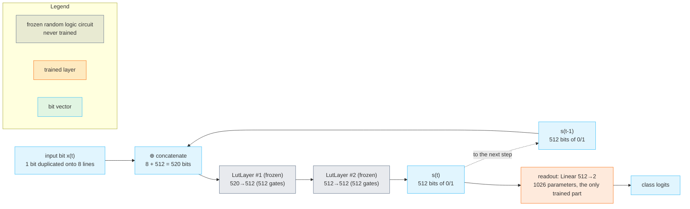
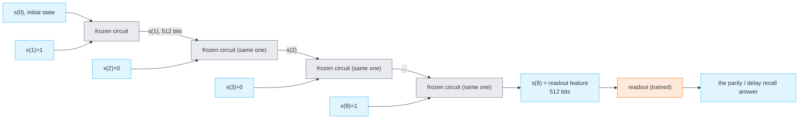
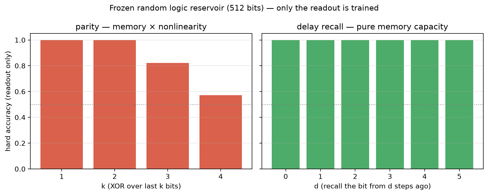
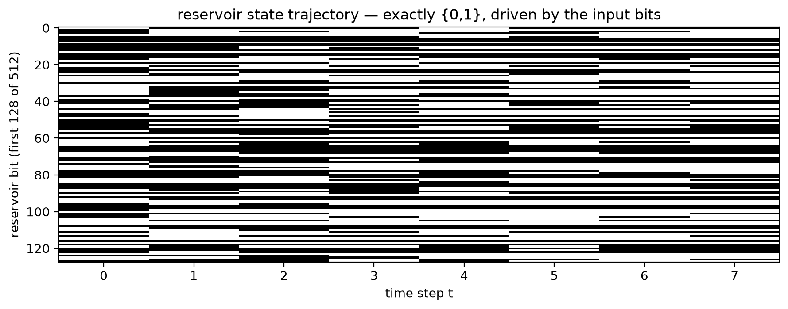
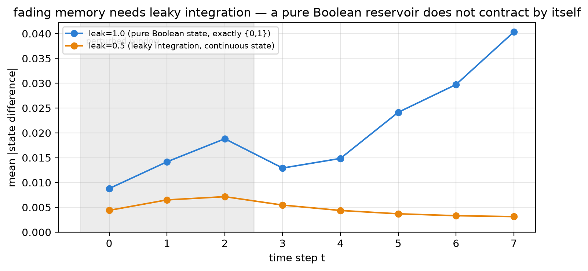
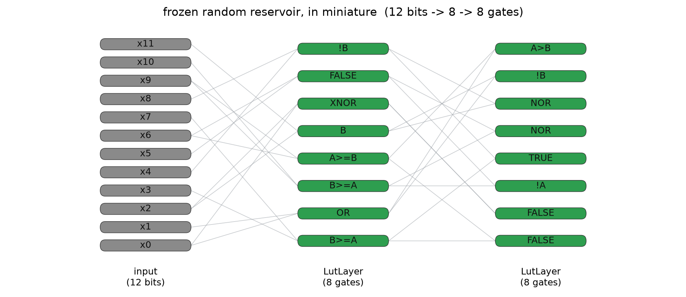

<!-- This file is auto-generated by scripts/build_tutorials.py.
     Do not edit it directly; edit examples/11_logic_reservoir.py and regenerate. -->

**Choosing not to train the circuit**. We push sequences through a frozen random 512-bit logic circuit and
train only the readout (5.9% of the whole) -- and yet parity and delayed recall get solved anyway.

The theme of this page is that "what a reservoir holds is **memory**, not **nonlinear computation over
that memory**". delay-d recall is perfect for all of d=0..5, yet parity degrades as k grows.
Furthermore, we use perturbation curves to show that a **hard-evaluated pure Boolean circuit (leak=1.0) is bounded but
does not contract** (a one-bit difference actually spreads), and we discuss the trade-off between fading memory and
hardware implementation.

:::tip[What you'll learn]
1. What can be solved by training only the readout (5.9% of the whole) on top of a frozen random logic circuit
2. That what a reservoir holds is **memory**, not nonlinear computation over that memory
3. The hardware pitfall that a hard-evaluated pure Boolean circuit is "bounded but does not contract"

**Prerequisites**

- [RNN: Logicizing LSTM / GRU](/en/tutorials/logic-lstm/) — compare with a trained recurrent circuit
:::

:::note[About this page]
Estimated time: **about 5 minutes** / Environment: CPU only (no GPU required)
Source script: [`examples/11_logic_reservoir.py`](https://github.com/tsukushi-gate/Griffith/blob/main/examples/11_logic_reservoir.py)
Try it yourself: [`notebooks/11_logic_reservoir.ipynb`](https://github.com/tsukushi-gate/Griffith/blob/main/notebooks/11_logic_reservoir.ipynb) (the same content as this page as an un-executed notebook; open it with `uv run --group docs jupyter lab notebooks/`)
Every code output below is the **actual result of running the code**, embedded verbatim.
:::

<!-- Colab badge: once the repository is public, replace this span with an <a> whose
     href is the data-colab-url value to enable "Open in Colab". -->
<span class="colab-badge" data-colab-url="https://colab.research.google.com/github/tsukushi-gate/Griffith/blob/main/notebooks/11_logic_reservoir.ipynb">▶ Open in Colab (enabled once the repository is public)</span>

LogicReservoir: the option of **not training** the circuit (reservoir computing).

The sequence models so far (08 RDDLGN / 09 LogicLSTM / 10 LogicWaveNet) all
learned the circuit itself by gradients. This example tries the exact opposite idea:

    **Use a huge random logic circuit frozen as it is, and train only the readout.**

This is reservoir computing. The circuit (the reservoir) is created once from random numbers and never
touched again. When you feed a sequence into it, the reservoir's internal state spreads the history of the
input into a "high-dimensional bit pattern" all by itself. All that is learned is the final linear layer that
extracts the answer from that state.

Why this meshes with this library's story:

    * The training cost is extremely cheap. Backprop flows through only the single readout layer
      (the reservoir is completely detached with requires_grad=False + no_grad)
    * The reservoir runs as a **hardened, purely Boolean circuit**. The state is strictly {0,1}, so
      divergence of continuous values cannot happen in principle (the structure guarantees a bounded state space)
    * A frozen random circuit can be burned into HDL as is. The only thing that needs training is the small layer at the edge

The task is **parity (exclusive OR)**. Answer the XOR of the last k bits of the sequence.
Parity is a combination of "memory x nonlinearity", the hardest possible shape of problem
for a linear readout, and a classic benchmark for measuring the limits of a reservoir's ability.
Alongside it we also run **delayed recall (delay-k recall)**, which measures the reservoir's memory capacity itself.

## Architecture, illustrated: only one layer at the edge is trained

The single most important picture is "**what is frozen and what is trained**".
The gray boxes (the reservoir) are created once at random and never updated again. The training
gradient reaches only the orange readout; not one of them flows back into the gray boxes.



Unrolled along time, it is nothing more than passing through the same frozen circuit eight times
(the figure shows the first real data point, the bit sequence `1 0 0 1 0 1 0 1`).



**How it actually works** (the points that matter on a first read)

- **The circuit is drawn at random exactly once**. Right after generating the wiring and truth
  tables determined by `LogicReservoirConfig.seed`, `requires_grad=False` is set and the state
  computation runs under `no_grad`. That is why backpropagation only ever flows through the one
  readout layer —— the reason training is extraordinarily cheap.
- **The state is rebuilt from scratch at every step**: `s(t) = frozen circuit([x(t) ⊕ s(t-1)])`.
  There is no dedicated keep path like an LSTM's, but with random wiring scattering it across a
  state as wide as 512 bits, traces of past inputs survive for a while.
- **The state is strictly 0/1**. With leak=1.0 it is a complete replacement, so the reservoir
  stays a pure Boolean circuit. Divergence and saturation are impossible (the state space is finite).
- **Only the readout is trained**: a linear map from 512 bits to 2 classes (1,026 parameters),
  while the 16,384 parameters of the circuit itself stay frozen (about 6% of the total is trained).
- **The limits show too**: a linear readout can read out "what is remembered", but is bad at
  "XOR-ing what is remembered". That is why parity falls apart as k grows.

Run: uv run python examples/11_logic_reservoir.py
Expected result: parity is 1.00 at k=1,2 and degrades at k=3,4 / delay recall is 1.00 for d=0..5
          (about 15 seconds on a CPU)

## Setup: imports and hyperparameters

All we need is `LogicReservoir` and `LogicReservoirConfig`, which fixes its configuration. We also
import `plot_circuit`, since the last figure draws a circuit diagram.

```python
import matplotlib.pyplot as plt
import torch
import torch.nn.functional as F

from griffith_logic.analysis.circuit_viz import plot_circuit
from griffith_logic.models import LogicReservoir, LogicReservoirConfig
```

### Hyperparameters

The eye-catching line is `RESERVOIR = 512` — **the input carries only one bit per step, yet the
state has 512 bits**. This "high-dimensional space that widens by itself" is the apparatus of
reservoir computing: the input history is projected into it, and only the readout is trained.

```python
SEED = 0
T = 8            # Sequence length
N_DATA = 512     # Number of samples
WIDTH = 8        # Input bit width (one bit stream is replicated into 8 lines)
RESERVOIR = 512  # Bit width of the reservoir state. This is the "high-dimensional space it spreads into"
STEPS = 600      # Number of training iterations for the readout
LR = 0.05
```

## Data: a random bit stream

We simply build 512 random bit sequences of length 8. Many different targets can be derived from
this stream later, so **the reservoir states only have to be computed once and can be reused for
every task** (that is where the speed comes from).

The single bit is replicated into 8 lines because, against a 512-bit state, one line is too weak a
drive and the state collapses into a fixed pattern that ignores the input.

```python
def bit_stream() -> tuple[torch.Tensor, torch.Tensor]:
    """Create a random bit sequence.

    Returns:
        xs: (N, T, WIDTH) input to the reservoir. One bit is replicated across WIDTH lines.
            With just one line, the drive from the input is far too weak for a 512-bit reservoir,
            and the state falls into a fixed pattern that ignores the input.
        bits: (N, T) the original single-bit sequence (used to build the supervision signal)
    """
    gen = torch.Generator().manual_seed(1)
    bit = (torch.rand(N_DATA, T, 1, generator=gen) > 0.5).float()
    return bit.repeat(1, 1, WIDTH), bit[:, :, 0]
```

## Model: a frozen reservoir + a trained readout

**Reservoir computing** is a design in which the inside of the recurrent circuit is **not trained at
all**. The input is fed into a randomly generated recurrent circuit, the states that appear there are
treated as features, and **only the one readout layer** is trained.

**Why does it work without training?** The job asked of the recurrent circuit is to project the past
inputs into a state in a mutually distinguishable form. As long as the projection is in a readable
direction, **it does not have to be a designed one** — even a random high-dimensional map lets a
linear readout pull out the components it needs afterwards. The idea is to move the whole training
burden from the recurrence to the readout.

`leak=1.0` means "replace the state completely at every time step", and in that case the state stays
strictly $\{0,1\}$ — that is, the whole reservoir is a pure Boolean circuit. Figure 3 shakes exactly
this point.

```python
def build() -> LogicReservoir:
    """Frozen random logic reservoir + linear readout."""
    torch.manual_seed(SEED)
    return LogicReservoir(LogicReservoirConfig(
        input_size=WIDTH,
        reservoir_size=RESERVOIR,
        num_classes=2,
        depth=2,          # Number of LutLayer stages per state update
        leak=1.0,         # 1.0 = full replacement. The state stays exactly {0,1}
        readout='group_sum',  # Learned linear map from state bits to class logits
        # The reservoir circuit is determined by this seed alone (independent of the global RNG).
        # With the same seed anyone running it gets the same circuit = reproducible.
        seed=0,
    ))
```

### Training only the readout

Backpropagation flows through the single readout layer and never takes a step into the reservoir.
That is why the states can be computed once and reused, with no recomputation when the task changes.

```python
def train_readout(model: LogicReservoir, feat: torch.Tensor,
                  y: torch.Tensor) -> float:
    """Train only the readout on the frozen features feat, and return the hard accuracy.

    Because the reservoir is not trained, the states **can be computed once and reused**.
    This is exactly why reservoir computing is fast
    (backprop at each step only flows through the single readout layer).
    """
    opt = torch.optim.Adam(model.trainable_parameters(), lr=LR)
    for _ in range(STEPS):
        model.train()
        opt.zero_grad()
        F.cross_entropy(model.readout(feat), y).backward()
        opt.step()
    model.eval()
    with torch.no_grad():
        return (model.readout(feat).argmax(-1) == y).float().mean().item()
```

Each task gets **a brand-new readout**. The reservoir is identical every time (deterministically
regenerated from a fixed seed), so the difference between tasks is purely "whether that feature can
be read".

```python
def solve(y: torch.Tensor, feat: torch.Tensor) -> float:
    """Prepare a brand-new readout each time and solve one task."""
    model = build()
    return train_readout(model, feat, y)
```

## Computing the reservoir states once and for all

First we print the breakdown of what is trained. The fraction of all parameters held by the readout
is exactly the size of "the part of this model that is being learned" (about 5.9% in practice).

```python
xs, bits = bit_stream()
model = build()
n_frozen = sum(p.numel() for p in model.reservoir.parameters())
n_train = sum(p.numel() for p in model.trainable_parameters())
print(f'凍結リザバー {n_frozen:,} パラメータ / 学習するreadout {n_train:,} パラメータ '
      f'(学習対象は全体の {100 * n_train / (n_frozen + n_train):.1f}%)')
```

```text title="Output"
凍結リザバー 16,384 パラメータ / 学習するreadout 1,026 パラメータ (学習対象は全体の 5.9%)
```

Next we compute the states at every time step in one go. Inside `states()` it is `no_grad` +
`detach`, so the computation graph is completely cut here and **nothing is recomputed no matter what
task we solve from now on**.

```python
# states() returns the states at every time step. Internally it uses no_grad + detach, so
# the computation graph is completely cut here.
states = model.states(xs)
print(f'リザバー状態 {tuple(states.shape)} / 出現値 = '
      f'{torch.unique(states).tolist()}')
```

```text title="Output"
リザバー状態 (512, 8, 512) / 出現値 = [0.0, 1.0]
```

We check that only the two values `[0.0, 1.0]` occur — a reservoir with `leak=1.0` is a pure Boolean
circuit, so an intermediate value appearing in the state would itself be a defect. The state at the
final time step is taken as the "feature for readout" and reused for every task below.

```python
# A reservoir with leak=1.0 is a pure Boolean circuit. The state must be exactly {0,1}.
assert bool(((states == 0.0) | (states == 1.0)).all()), 'リザバー状態が二値でない'
feat = states[:, -1, :]   # The state at the final time step is the "feature for readout"
```

## Experiments: parity and delayed recall

### Experiment 1: parity (XOR of the last k bits)

**Parity** is whether the number of ones in a bit string is even or odd — that is, a chain of XORs.
$k=1$ is easy, since it just means "answer the last bit as is", but as $k$ grows you have to
"remember $k$ bits and, on top of that, XOR them". It is a task that probes **both memory and
nonlinear computation**.

```python
parity_ks = [1, 2, 3, 4]
parity_acc = []
for k in parity_ks:
    y = bits[:, T - k:].sum(1).long() % 2
    acc = solve(y, feat)
    parity_acc.append(acc)
    print(f'parity(末尾{k}ビットXOR)  hard acc = {acc:.4f}')
```

```text title="Output"
parity(末尾1ビットXOR)  hard acc = 1.0000

parity(末尾2ビットXOR)  hard acc = 1.0000

parity(末尾3ビットXOR)  hard acc = 0.8223

parity(末尾4ビットXOR)  hard acc = 0.5723
```

### Experiment 2: delayed recall (memory capacity)

"Answer the bit that came in $d$ steps ago, as is". No XOR is needed, so this is a pure test of
**memory capacity**, a classic metric in reservoir research. Paired with experiment 1, it separates
"is the memory missing?" from "is the nonlinear computation missing?".

```python
delays = list(range(6))
delay_acc = []
for d in delays:
    y = bits[:, T - 1 - d].long()
    acc = solve(y, feat)
    delay_acc.append(acc)
    print(f'delay-{d} recall            hard acc = {acc:.4f}')
```

```text title="Output"
delay-0 recall            hard acc = 1.0000

delay-1 recall            hard acc = 1.0000

delay-2 recall            hard acc = 1.0000

delay-3 recall            hard acc = 1.0000

delay-4 recall            hard acc = 1.0000

delay-5 recall            hard acc = 1.0000
```

## Checking that it is frozen

"The reservoir is not trained" means nothing as a verbal promise, so we check it mechanically. We
assert that the reservoir's `state_dict` is **bitwise identical** before and after training, and
further that it matches a circuit rebuilt from the same seed — if the circuit is determined by the
random seed alone, everyone who runs it gets the same circuit, and it can be handed around as a
hardware blueprint as is.

```python
before = {k: v.clone() for k, v in model.reservoir.state_dict().items()}
_ = solve(bits[:, -1].long(), feat)
after = build().reservoir.state_dict()
for key, val in before.items():
    assert torch.equal(val, after[key]), f'リザバー {key} が変化した'
print('リザバーのパラメータは bitwise 不変(凍結されている)')

assert parity_acc[1] > 0.95, f'parity(k=2) が解けていない: {parity_acc[1]:.4f}'
assert all(a == 1.0 for a in delay_acc), f'delay recall が満点でない: {delay_acc}'
```

```text title="Output"
リザバーのパラメータは bitwise 不変(凍結されている)
```

## Visualization: what it can hold, and what it cannot

### Figure 1: parity breaks down as k grows / delay recall does not

**What to look at**: parity (growing $k$) on the left and delayed recall (growing $d$) on the right,
both with hard accuracy on the vertical axis and the coin-toss level as a dotted line. The star of
the show is **how differently the two panels break down**: if only one of them collapses, that tells
us which side the reservoir's limit lies on.

```python
fig, axes = plt.subplots(1, 2, figsize=(10, 4), sharey=True)
axes[0].bar([str(k) for k in parity_ks], parity_acc, color='#d4452d', alpha=0.85)
axes[0].set_xlabel('k (XOR over last k bits)')
axes[0].set_title('parity — memory × nonlinearity')
axes[1].bar([str(d) for d in delays], delay_acc, color='#2e9e4f', alpha=0.85)
axes[1].set_xlabel('d (recall the bit from d steps ago)')
axes[1].set_title('delay recall — pure memory capacity')
for ax in axes:
    ax.axhline(0.5, color='gray', ls=':', lw=1)
    ax.set_ylim(0, 1.05)
    ax.grid(alpha=0.3, axis='y')
axes[0].set_ylabel('hard accuracy (readout only)')
fig.suptitle(f'Frozen random logic reservoir ({RESERVOIR} bits) — '
             'only the readout is trained', fontsize=11)
fig.tight_layout()
plt.show()
```

    

    

**Reading it**: the right panel (delayed recall) stays at full marks from $d=0$ through $d=5$ without
breaking — the entire 8-step history survives inside the 512 bits. The left panel (parity), by
contrast, falls off sharply at $k=3,4$. In other words, **what is missing is not memory but nonlinear
computation over that memory**. What a reservoir provides stops at "retaining the past in a
distinguishable form"; anything beyond that (a composition such as XOR) is not a job a linear readout
can do — that is the conclusion of this page.

### Figure 2: the reservoir state itself

**What to look at**: the time evolution of the state for one sample drawn in black and white
(vertical = state bits, horizontal = time, black = 1). The input is only one bit per step yet the
state has 512 bits, so the picture directly shows "a random circuit mapping the input history into
high dimensions".

```python
fig, ax = plt.subplots(figsize=(9, 3.6))
ax.imshow(states[0, :, :128].T, cmap='binary', aspect='auto',
          interpolation='nearest')
ax.set_xlabel('time step t')
ax.set_ylabel(f'reservoir bit (first 128 of {RESERVOIR})')
ax.set_xticks(range(T))
ax.set_title('reservoir state trajectory — exactly {0,1}, driven by the input bits')
fig.tight_layout()
plt.show()
```

    

    

**Reading it**: rather than a uniform grey wash, the pattern switches from one time step to the
next — evidence that the state is being driven by the input bits. If instead every time step showed
the same vertical stripes, the state would have collapsed into a fixed pattern that ignores the input
(too weak an input drive) and the readout would have nothing to extract. The complete absence of
intermediate grey also confirms that this is a pure Boolean circuit.

### Figure 3: the trade-off between fading memory and leak

**What to look at** (drawn a few cells further down): **fading memory** (the echo state property) is
the property that "the influence of inputs from long ago, and of the initial condition, fades over
time". Without it the reservoir drags its initial state along forever and cannot produce stable
features for the same input.

Measuring it is simple: prepare a sequence in which only the first 3 steps are replaced, and watch
whether **the state difference** from the original sequence shrinks over time. We overlay blue
(`leak=1.0`, pure Boolean) and orange (`leak=0.5`, leaky integration) and compare which one decays.

```python
gen = torch.Generator().manual_seed(456)
perturbed = xs.clone()
perturbed[:, :3, :] = (
    torch.rand(N_DATA, 3, WIDTH, generator=gen) > 0.5
).float()
```

`leak` is the knob that sets how fast the state is overwritten: $s_t = \mathrm{leak}\cdot\text{new} +
(1-\mathrm{leak})\cdot s_{t-1}$, a low-pass filter. At 1.0 it is a complete replacement (= pure
Boolean); below 1 the past state is mixed in, but the state is no longer exactly $\{0,1\}$.

```python
def perturbation_curve(leak: float) -> torch.Tensor:
    """Measure the state difference between the original and the perturbed sequence at each time step."""
    torch.manual_seed(SEED)
    m = LogicReservoir(LogicReservoirConfig(
        input_size=WIDTH, reservoir_size=RESERVOIR, num_classes=2,
        depth=2, leak=leak, readout='group_sum', seed=0,
    ))
    return (m.states(xs) - m.states(perturbed)).abs().mean(dim=(0, 2))
```

We print the state-difference trajectory for the two leaks. Seeing the numbers first means the next
figure's verdict can already be read off the printed sequence.

```python
curves = {1.0: perturbation_curve(1.0), 0.5: perturbation_curve(0.5)}
for leak, curve in curves.items():
    print(f'leak={leak} の状態差 = {[round(v, 4) for v in curve.tolist()]}')
```

```text title="Output"
leak=1.0 の状態差 = [0.0088, 0.0142, 0.0188, 0.0129, 0.0149, 0.0241, 0.0297, 0.0403]
leak=0.5 の状態差 = [0.0044, 0.0065, 0.0071, 0.0055, 0.0044, 0.0037, 0.0033, 0.0031]
```

**Reading it** (figure 3, next): orange (`leak=0.5`) decays downward once past the perturbed window,
whereas blue (`leak=1.0`) does not fall — a random logic circuit also works in the direction of
**spreading** a one-bit difference across layers, so being bounded does not by itself make it contract.

This is where the pitfall for hardware lies. If you want fading memory the only lever is to lower the
leak, but the moment you do, the state leaves $\{0,1\}$ and you lose the very advantage of "staying
burnable as a pure Boolean circuit". **Fading memory and pure Boolean-ness are in a tug of war** —
the final lesson of this page.

```python
# Leaky integration damps the perturbation; pure Boolean (leak=1.0) does not.
assert curves[0.5][-1] < curves[0.5][2], 'leaky統合でも状態差が減衰していない'

fig, ax = plt.subplots(figsize=(7.5, 3.8))
for leak, color, label in (
    (1.0, '#2d7fd4', 'leak=1.0 (pure Boolean state, exactly {0,1})'),
    (0.5, '#e8850c', 'leak=0.5 (leaky integration, continuous state)'),
):
    ax.plot(range(T), curves[leak].numpy(), 'o-', color=color, label=label)
ax.axvspan(-0.5, 2.5, color='gray', alpha=0.15)
ax.text(-0.4, ax.get_ylim()[1] * 0.9, 'perturbed window', color='dimgray',
        fontsize=8)
ax.set_xlabel('time step t')
ax.set_ylabel('mean |state difference|')
ax.set_xticks(range(T))
ax.set_ylim(bottom=0)
ax.grid(alpha=0.3)
ax.legend(fontsize=8, loc='upper left')
ax.set_title('fading memory needs leaky integration — '
             'a pure Boolean reservoir does not contract by itself')
fig.tight_layout()
plt.show()
```

    

    

### Figure 4: the frozen random circuit "for real"

**How to read it, and what it says** (the last figure on this page). The 512-bit reservoir is far too
large to draw every gate, so we generate a much smaller reservoir the same way (8-bit state, depth=2)
and draw it as a circuit diagram. On the left are the inputs (the 12 bits of $[x_t ; s_{t-1}]$), in
the middle and on the right the two LutLayer stages of 8 gates each, and the text inside each box is
the settled gate name.

The thing to read off is that **concrete gate names appear even though nothing was trained**. The
truth tables drawn at random already mean something as a circuit, so this model is "a circuit you can
burn from the moment you create it", and what training changes lives entirely **outside** this
figure, in the readout.

```python
small = LogicReservoir(LogicReservoirConfig(
    input_size=4, reservoir_size=8, num_classes=2, depth=2,
    leak=1.0, readout='group_sum', seed=0,
))
fig, ax = plt.subplots(figsize=(9.5, 4.2))
plot_circuit(small.reservoir, resolve=True, ax=ax,
             title='frozen random reservoir, in miniature  (12 bits -> 8 -> 8 gates)')
fig.tight_layout()
plt.show()

print('\n--- まとめ ---')
print('parity  : ' + ' / '.join(
    f'k={k}:{a:.3f}' for k, a in zip(parity_ks, parity_acc, strict=True)))
print('delay   : ' + ' / '.join(
    f'd={d}:{a:.3f}' for d, a in zip(delays, delay_acc, strict=True)))
print(f'学習したのは {n_train:,} パラメータだけ'
      f'(回路本体 {n_frozen:,} は凍結)')
```

    

    

    
```text title="Output"
--- まとめ ---
parity  : k=1:1.000 / k=2:1.000 / k=3:0.822 / k=4:0.572
delay   : d=0:1.000 / d=1:1.000 / d=2:1.000 / d=3:1.000 / d=4:1.000 / d=5:1.000
学習したのは 1,026 パラメータだけ(回路本体 16,384 は凍結)
```

## Read next

- [6. Switching learning rules (DFA / AP)](/en/tutorials/learning-rules/) — another route that changes "where to learn"
- [RNN: Logicizing LSTM / GRU](/en/tutorials/logic-lstm/) — compare with a trained recurrent circuit
- [Burning onto an FPGA](/en/guides/fpga/) — the prerequisites for implementing a frozen circuit as is

<!-- i18n:source=tutorials/logic-reservoir.md hash=4f2bd573b655 -->
