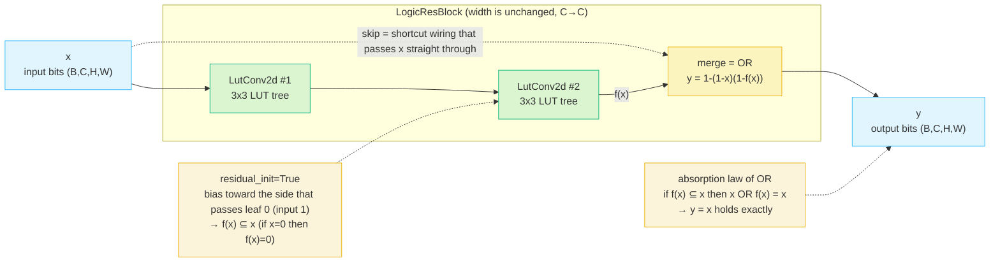
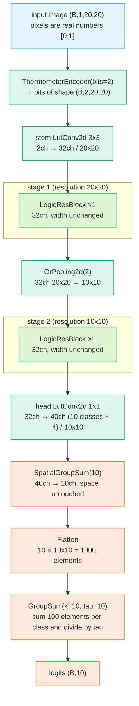
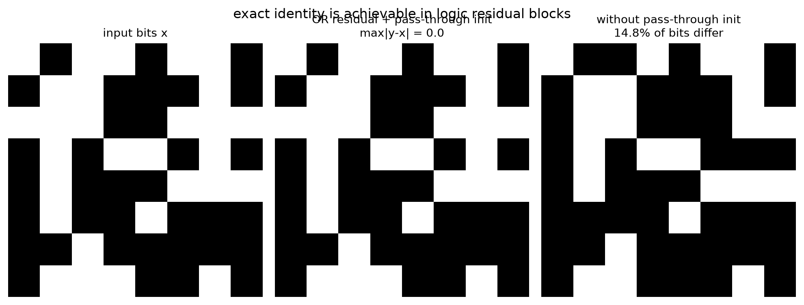
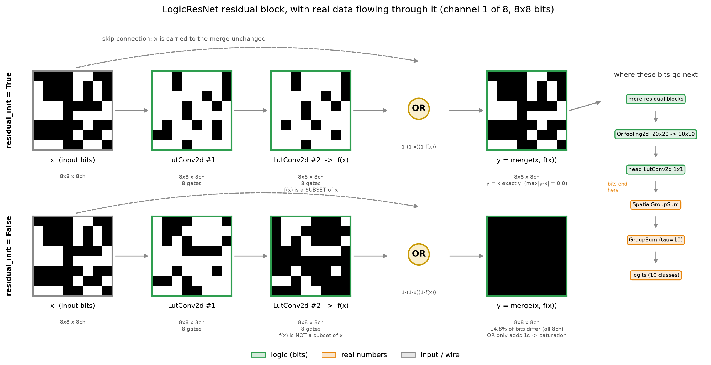
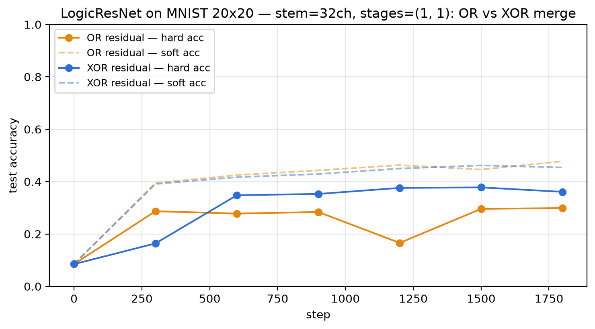
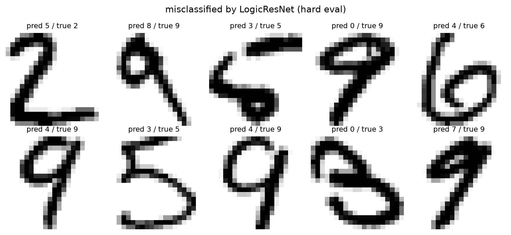

<!-- This file is auto-generated by scripts/build_tutorials.py.
     Do not edit it directly; edit examples/14_logic_resnet.py and regenerate. -->

**Residual connections in logic NNs can build the identity map *exactly*.** Combining an OR
residual with pass-through initialization gives $\max|y - x| = 0.0$ ── not an approximation but a
bit-exact match, so the input comes straight through. What a real-valued ResNet only approximates
at initialization holds here strictly.

There is a cost, though. OR can never lower a bit once it is set, so it **saturates**. With the same
seed, hard acc comes out as XOR residual 0.361 > OR residual 0.299, and the learning curves show
the trade-off between exactness of the identity and ease of learning.

:::tip[What you'll learn]
1. That an OR residual + pass-through initialization builds the identity map **exactly** ($\max|y-x| = 0$)
2. Its cost — OR can never lower a bit once it is set, so it saturates: the trade-off
3. How to read the learning curves of OR vs XOR residuals run with the same seed

**Prerequisites**

- [1. Train on MNIST](/en/tutorials/mnist/)
- [The math of LutLayer](/en/explanation/lut-layer/) — the background on why residuals work
:::

:::note[About this page]
Estimated time: **about 8 minutes** / Environment: CPU only (no GPU required)
Source script: [`examples/14_logic_resnet.py`](https://github.com/tsukushi-gate/Griffith/blob/main/examples/14_logic_resnet.py)
Try it yourself: [`notebooks/14_logic_resnet.ipynb`](https://github.com/tsukushi-gate/Griffith/blob/main/notebooks/14_logic_resnet.ipynb) (the same content as this page as an un-executed notebook; open it with `uv run --group docs jupyter lab notebooks/`)
Every code output below is the **actual result of running the code**, embedded verbatim.
:::

<!-- Colab badge: once the repository is public, replace this span with an <a> whose
     href is the data-colab-url value to enable "Open in Colab". -->
<span class="colab-badge" data-colab-url="https://colab.research.google.com/github/tsukushi-gate/Griffith/blob/main/notebooks/14_logic_resnet.ipynb">▶ Open in Colab (enabled once the repository is public)</span>

An example of solving MNIST with LogicResNet (a residual logic ConvNet).

Deep networks can be trained because the "skip connection" of a ResNet hands you
"do nothing (the identity map)" for free as the initial state.
In a real-valued NN you write this as ``x + f(x)``, and initializing the weights of ``f`` to 0 gives the identity.

**A logic gate NN has no weight that corresponds to "0".** A gate is a truth table, not a
coefficient, so you cannot initialize it to "have zero effect". So what do we do?

    LogicResNet merges the residual with **OR**:  merge(x, f(x)) = 1-(1-x)(1-f(x))
    and initializes LutConv2d as **pass-through** (residual_init=True).
    Pass-through means biasing toward gate A, which "outputs leaf 0 unchanged".

At this point f(x) is **contained in** x (wherever x is 0, f(x) is necessarily 0 as well).
OR obeys the absorption law

    merge(x, f(x)) = x OR f(x) = x    (when f(x) ⊆ x)  ← the identity map holds **exactly**

so the merge hands x straight back. The case where the bias takes full effect and f(x) = x
is just a special case of that, covered by the idempotence of OR, x OR x = x
(with the default parameterization='softmax', at eval each gate picks "leaf 0 AND NOT leaf 1",
so f(x) is a proper subset of x. Figure 2 shows this on real data).

Not "almost the identity" up to floating-point error, but a bit-exact match.
That is what makes logic NNs interesting here, and the first half of this sample (figures 1 and 2) checks it for real.

## Architecture diagram 1: inside a residual block (merging with OR)

A single residual block is nothing more than "two convolutions → merge with the original input via OR".
The **dashed line in the figure below is the skip connection** ── the shortcut wiring that carries the
input x to the merge point untouched, and it is what makes "do nothing" available as the initial state.



## Architecture diagram 2: the whole LogicResNet (where do the bits end?)

In the green stages both inputs and outputs are **bits (0 or 1)**; the orange stages are **real numbers**
(the integer you get by counting ones, and the logit you get by dividing it). The signal stays as bits
all the way to the head, and only at SpatialGroupSum does it step into the real-valued world of
"counting how many ones there are" — that is the shape of this model.
The numbers are those of the shrunk recipe used in this sample (stem 32ch / stage_blocks=(1,1) / encode_bits=2).



**How this is achieved** (the essentials, for readers new to neural networks)

- **A bit = a signal that is only ever 0 or 1**. Where an ordinary NN runs real numbers along its
  wires, this model treats them as 0/1 lines. That is why it can compute with AND / OR / XOR
  instead of multiplications and additions.
- **LutConv2d = a bundle of small truth tables (LUTs) slid across the image**. It picks a few bits
  out of a 3x3 window and looks up one table saying "for this input, this output". The contents of
  the table are what gets learned: instead of real-valued weights it holds "which table to use" as a
  continuous value, and at eval (inference) time argmax fixes it to a single one ── that is the "burned circuit".
- **Residual (skip) connection = shortcut wiring that passes the input straight through**. Even in a
  deep network "just pass it along" is always available, so learning does not break as you stack stages.
- **Pass-through initialization = putting the gates near "just pass it through" at the start of training**.
  A real-valued NN passes things through by setting weights to 0, but a truth table has no "weight of 0".
  Instead we bias toward the gate that "passes leaf 0 (the first input)", so that f(x) stays inside x.
- **The absorption law = OR-ing something "smaller than the original" leaves the original unchanged**.
  If f(x) ⊆ x then x OR f(x) = x. The case where f(x) matches x exactly is the special case covered by
  **idempotence** (feeding the same thing in twice changes nothing, x OR x = x).
- **ThermometerEncoder = an encoding that turns intensity into a scale**. It rewrites a real-valued
  pixel as a row of 0/1 saying "how many thresholds it exceeded", carrying everything downstream into the world of logic.
- **GroupSum = the decoding that counts ones at the end**. It counts how many of the output bits
  assigned to each class are on and divides by tau to get a logit. **This is the only place real numbers appear.**

**This exactness is not free, though.** OR is monotone (x OR f(x) ≧ x), so
the more layers you stack the more ones appear, it saturates, and gradients thin out. The other option, 'xor'
(a XOR b = a+b-2ab), does not saturate, but pass-through initialization
does not give you the identity (the condition for the identity becomes f(x)=0).

    'or'  … the identity can be the initial state / saturates and learning slows
    'xor' … the identity cannot be the initial state / no saturation and learning is faster

In the second half we run these two on MNIST under identical conditions and compare the learning curves (figure 3).
The main goal of this sample is to observe exactness of the identity, so for an accuracy-oriented recipe see
experiments/train_logic_resnet.py (20000 steps).

Run: uv run python examples/14_logic_resnet.py
Expected result: identity max|y-x| = 0.0, hard accuracy XOR around 0.35 > OR around 0.28
          (a shrunk recipe that takes 2-3 minutes on a CPU)

## Preparation: imports and the random seed

There are only three pieces to use ── `LogicResNet` (the model itself), `LogicResNetConfig`
(its configuration), and `LogicResBlock` (a single residual block; in the first half we pull
just one of these out and inspect it). The rest is the machinery for loading MNIST and plotting.

Let us fix the notation used on this page up front.

- **x** … the **input bits** to the residual block (a signal that is only ever 0 or 1)
- **h** … the output bits of the first `LutConv2d` inside the block
- **f(x)** … the **output bits** after passing through the residual branch (two `LutConv2d`)
- **y** … the **output bits** of the residual block. `y = merge(x, f(x))`

```python
import matplotlib.pyplot as plt
import torch
import torch.nn.functional as F
from matplotlib.patches import ConnectionPatch, Patch
from torch.utils.data import DataLoader, Subset

from griffith_logic.datasets import load_mnist20x20
from griffith_logic.models import LogicResNet, LogicResNetConfig
from griffith_logic.models.logic_resnet import LogicResBlock
```

```python
torch.manual_seed(0)
```

## First half: building an *exact* identity map with an OR residual

For a while there is no training at all. We only look at **what a block does at initialization**.

In a real-valued ResNet the residual is merged by addition, `y = x + f(x)`, and initializing the
weights of `f` to 0 hands you `y = x` (the **identity mapping** = the map that returns the input
unchanged) for free. But adding in the world of bits produces `1 + 1 = 2`, and the value escapes {0,1}.

So LogicResNet merges with **OR**: `y = x OR f(x) = 1-(1-x)(1-f(x))`.
OR is an "addition" that is **closed on {0,1}**, and wherever `f(x)=0` it falls back to `y=x`.
Combine that with **pass-through initialization** (= an initialization that biases the gates at the
start of training toward "pass leaf 0 (the first input) through unchanged"; since a truth table has
no "weight of 0", this was provided as the stand-in for zero-initialization in a real-valued NN)
and you get `f(x) ⊆ x`, so by the absorption law of OR **`y = x` holds exactly (max|y-x| = 0)**.

Not "almost the identity" but a **bit-exact match** ── this section checks that for real.

```python
# Use a minimal configuration so it is easy to verify.
#   kernel_size=1 … no spatial shift (do not mix neighbors)
#   tree_depth=1  … the LUT tree is the minimal "2 leaves -> 1 node" form
#   n_inputs=2    … each node takes 2 inputs (gate 'A' passes leaf 0 through)
IDENT_CHANNELS = 8
ident_config = LogicResNetConfig(
    in_channels=1, encode_bits=1, stem_channels=IDENT_CHANNELS,
    stage_blocks=(1,), residual_mode='or', n_inputs=2,
    num_classes=10, kernel_size=1, tree_depth=1, residual_init=True,
)
block = LogicResBlock(ident_config, IDENT_CHANNELS)
block.eval()  # eval = the "burned circuit" form, with truth tables fixed by argmax
```

```python
# Pass-through initialization only biases the choice toward "the gate that passes leaf 0",
# and whether "leaf 0 is the channel itself" depends on the wiring (indices_flat).
# Here we pin the wiring to the channel identity so the whole block becomes the identity.
for conv in block.residual.inner:
    with torch.no_grad():
        conv.indices_flat[:, 0] = torch.arange(IDENT_CHANNELS)

x_bits = (torch.rand(1, IDENT_CHANNELS, 8, 8) > 0.5).float()
with torch.no_grad():
    y_bits = block(x_bits)
max_err = (y_bits - x_bits).abs().max().item()
print(f'OR残差 + pass-through初期化 の恒等性: max|y-x| = {max_err}')
print(f'ビット単位で完全一致: {torch.equal(y_bits, x_bits)}')
assert torch.equal(y_bits, x_bits), 'OR残差ブロックが恒等写像になっていない'
```

```text title="Output"
OR残差 + pass-through初期化 の恒等性: max|y-x| = 0.0
ビット単位で完全一致: True
```

### Control experiment: turning pass-through initialization off

To separate whether the identity held thanks to **OR** or thanks to **pass-through initialization**,
we build a block with **the same wiring and the same configuration but the initialization switched
off** and compare. OR can only ever push toward adding ones, whatever `f(x)` is, so the moment
`f(x)` becomes unrelated to x the output drifts away from the input.

```python
# Control experiment: turning pass-through initialization off (residual_init=False) makes
# the initial gates random even with the same wiring, so the output drifts away from the input.
random_config = LogicResNetConfig(
    **{**ident_config.__dict__, 'residual_init': False}
)
random_block = LogicResBlock(random_config, IDENT_CHANNELS)
random_block.eval()
for conv in random_block.residual.inner:
    with torch.no_grad():
        conv.indices_flat[:, 0] = torch.arange(IDENT_CHANNELS)
with torch.no_grad():
    y_random = random_block(x_bits)
random_diff = (y_random != x_bits).float().mean().item()
print(f'pass-through初期化なしの同構成: 入力と異なるビットの割合 = {random_diff:.3f}')
```

```text title="Output"
pass-through初期化なしの同構成: 入力と異なるビットの割合 = 0.148
```

### Figure 1: see the identity with your own eyes

**What to look at**: the same input bits x, run through two residual blocks that differ only in
their initialization, shown side by side. Left is the input x, middle is the output y with
pass-through initialization, right is the output without it. All three are the 8x8 bits of
channel 0, with black for 1 and white for 0.
All you need to check is **whether the middle matches the left without a single pixel off**.

```python
# Left = input bits / middle = output of the OR residual block with pass-through init (exact match) /
# right = output without the init (broken). Channel 0's 8x8 is shown.
fig, axes = plt.subplots(1, 3, figsize=(10, 3.8))
for ax, img, title in (
    (axes[0], x_bits[0, 0], 'input bits x'),
    (axes[1], y_bits[0, 0], f'OR residual + pass-through init\nmax|y-x| = {max_err}'),
    (axes[2], y_random[0, 0],
     f'without pass-through init\n{random_diff:.1%} of bits differ'),
):
    ax.imshow(img, cmap='gray_r', vmin=0, vmax=1)
    ax.set_title(title, fontsize=10)
    ax.set_axis_off()
fig.suptitle('exact identity is achievable in logic residual blocks', fontsize=12)
fig.tight_layout()
plt.show()
```

    

    

**Reading it**: the middle is exactly the same picture as the left. It is not "almost equal" up to
floating-point error but `max|y-x| = 0`, i.e. **bit-exactly the identity**. The right has the same
wiring and the same structure, yet black (1) has clearly increased ── OR can only push toward
adding ones, so once `f(x)` is unrelated to x, **ones that were not in the input get piled on top**.
What builds the identity is not OR on its own but **the combination of OR and pass-through initialization**.

## Dissecting the inside of a residual block in a single figure

Figure 1 only looked at the entrance and the exit. Next we follow the **inside** of the block ──
the flow x → h → f(x) → (merged with the skip x via OR) → y ── on real data.
To do that we first pull out the output h of the first `LutConv2d` and f(x) after the second.

```python
# There are two LutConv2d inside the block. Keeping the output h of the first one and
# f(x) after the second lets us draw x → h → f(x) → (merged with the skip x via OR) → y in a single figure.
with torch.no_grad():
    h_pt = block.residual.inner[0](x_bits)
    f_pt = block.residual.inner[1](h_pt)
    h_rd = random_block.residual.inner[0](x_bits)
    f_rd = random_block.residual.inner[1](h_rd)

SUBSET_PT = bool((f_pt <= x_bits).all())
SUBSET_RD = bool((f_rd <= x_bits).all())
print(f'pass-through初期化あり: f(x) ⊆ x か = {SUBSET_PT} / なし = {SUBSET_RD}')

GATES_PER_CONV = block.residual.inner[0].num_gates
SHAPE_NOTE = f'{x_bits.shape[-2]}x{x_bits.shape[-1]} x {IDENT_CHANNELS}ch'
```

```text title="Output"
pass-through初期化あり: f(x) ⊆ x か = True / なし = False
```

### The parts used to draw figure 2

What follows are the plotting helpers for figure 2 (panels, annotations, wiring); they have nothing
to do with the model itself. Feel free to skip ahead to the explanation of figure 2. There is just
one choice being made ── **which of the 8 channels to show** ── and it is picked automatically so
that both the containment (`f(x) ⊆ x`) and its violation can be read off.

```python
# How the displayed channel is chosen: one where ones remain in f(x) in the top row (a fully white
# panel would hide the containment), and where many "ones not present in x" appear in the bottom row.
# That way the contrast between the two rows can be read off a single figure.
_pt_ones = f_pt.sum(dim=(0, 2, 3))
_violations = (f_rd > x_bits).float().sum(dim=(0, 2, 3))
VIEW_CH = int(torch.where(_pt_ones > 0, _violations, -torch.ones_like(_violations)).argmax())
COLOR_LOGIC = '#2e9e4f'   # green — the logic (bit) stages
COLOR_REAL = '#e8850c'    # orange — the stages that become real numbers
COLOR_WIRE = '#8a8a8a'    # gray — inputs and wiring
```

```python
def show_bits(ax, img, edge):
    """Draw a bitmap with a frame colored to express the nature of that stage."""
    ax.imshow(img, cmap='gray_r', vmin=0, vmax=1)
    ax.set_xticks([])
    ax.set_yticks([])
    for spine in ax.spines.values():
        spine.set_edgecolor(edge)
        spine.set_linewidth(2.2)
```

```python
def caption(ax, head, sub):
    """The note under a panel (top = name of the stage / bottom = resolution, channels, gate count)."""
    ax.text(0.5, -0.09, head, transform=ax.transAxes,
            ha='center', va='top', fontsize=8.5)
    ax.text(0.5, -0.30, sub, transform=ax.transAxes,
            ha='center', va='top', fontsize=7, color='#555555')
```

```python
def wire(fig, src, dst):
    """Wiring between panels (a solid line = the compute path)."""
    con = ConnectionPatch(
        xyA=(1.04, 0.5), coordsA=src.transAxes,
        xyB=(-0.04, 0.5), coordsB=dst.transAxes,
        arrowstyle='-|>', mutation_scale=11, linewidth=1.3,
        color=COLOR_WIRE,
    )
    fig.add_artist(con)
```

```python
def skip_wire(fig, src, dst):
    """The shortcut wiring carrying x to the merge point untouched (a dashed line looping over the top)."""
    con = ConnectionPatch(
        xyA=(0.55, 1.04), coordsA=src.transAxes,
        xyB=(0.5, 1.10), coordsB=dst.transAxes,
        arrowstyle='-|>', mutation_scale=11, linewidth=1.3,
        color=COLOR_WIRE, linestyle='--',
        connectionstyle='arc3,rad=-0.10',
    )
    fig.add_artist(con)
```

Along the right edge of figure 2 we add a vertical strip showing "where the output bits of this block
flow next". The stages that appear there mean the following.

- **OrPooling2d** … downsampling that OR-s together each 2x2 window and halves the resolution. It is
  the counterpart of max pooling in a real-valued CNN, and each one you insert widens the input range
  a single output bit sees (its **receptive field**)
- **head LutConv2d 1x1** … the final logic layer, producing the output bits used for classification
- **SpatialGroupSum** … the stage that counts how many ones are on in the group of channels assigned
  to each class. **This is the boundary between logic (bits) and real numbers**; from here on we are
  in the world of integers and logits
- **GroupSum(tau)** … the decoding that divides the counted number by the temperature **tau** to get a logit

```python
# The vertical strip on the right: where the output bits of this block flow next.
# They stay bits until the head (green), and become real numbers from SpatialGroupSum on (orange).
DOWNSTREAM = [
    ('more residual blocks', COLOR_LOGIC),
    ('OrPooling2d  20x20 -> 10x10', COLOR_LOGIC),
    ('head LutConv2d 1x1', COLOR_LOGIC),
    ('SpatialGroupSum', COLOR_REAL),
    ('GroupSum (tau=10)', COLOR_REAL),
    ('logits (10 classes)', COLOR_REAL),
]
```

```python
def draw_downstream(ax):
    """Draw "the stages that come next" as small boxes stacked vertically (color marks the logic/real boundary)."""
    ax.set_xlim(0, 1)
    ax.set_ylim(0, 1)
    ax.axis('off')
    ax.text(0.5, 0.99, 'where these bits go next', ha='center', va='top',
            fontsize=8.5, color='#333333')
    top, gap = 0.87, 0.155
    for i, (label, color) in enumerate(DOWNSTREAM):
        y = top - i * gap
        ax.text(0.5, y, label, ha='center', va='center', fontsize=7,
                bbox={'boxstyle': 'round,pad=0.34', 'facecolor': color + '26',
                      'edgecolor': color, 'linewidth': 1.2})
        if i < len(DOWNSTREAM) - 1:
            ax.annotate('', xy=(0.5, y - gap + 0.045), xytext=(0.5, y - 0.045),
                        arrowprops={'arrowstyle': '-|>', 'color': COLOR_WIRE,
                                    'linewidth': 1.0})
    ax.text(0.015, top - 2.5 * gap, 'bits end\nhere', ha='left', va='center',
            fontsize=6.5, color=COLOR_REAL)
```

### Figure 2: dissecting the residual block on real data

**What to look at**: the architecture diagram of the residual block with actual bits poured through
it. From left to right: x → h (the output of the first LutConv2d) → f(x) (the output of the residual
branch after the second) → OR (the merge point) → y, and **the dashed line looping over the top is
the skip connection** (= the shortcut wiring that carries the input x to the merge point untouched).
The top row is with pass-through initialization, the bottom row without.

The panel to watch is f(x): check **whether the black (1) of f(x) in the top row stays inside the
black of x** (`f(x) ⊆ x`). If it does, the absorption law of OR sends y back to x.
In the bottom row ones appear in positions x does not have, so OR only piles ones on.

```python
# Top row = with pass-through init (f(x) is contained in x, so merging with OR still leaves x),
# bottom row = without it (f(x) is unrelated to x, OR adds ones, and the output drifts from the input).
# The OR in the middle is the merge point, and the dashed line looping in from above is the skip connection.
ROWS = (
    ('residual_init = True', h_pt, f_pt, y_bits,
     'f(x) is a SUBSET of x' if SUBSET_PT else 'f(x) is not a subset of x',
     f'y = x exactly  (max|y-x| = {max_err})'),
    ('residual_init = False', h_rd, f_rd, y_random,
     'f(x) is a SUBSET of x' if SUBSET_RD else 'f(x) is NOT a subset of x',
     f'{random_diff:.1%} of bits differ (all 8ch)\nOR only adds 1s -> saturation'),
)
fig = plt.figure(figsize=(13.0, 6.6))
gs = fig.add_gridspec(2, 6, width_ratios=[1, 1, 1, 0.72, 1, 1.25],
                      left=0.05, right=0.98, top=0.80, bottom=0.18,
                      wspace=0.5, hspace=0.78)
ax_down = fig.add_subplot(gs[:, 5])
draw_downstream(ax_down)
for r, (row_label, h_mid, f_out, y_out, f_note, verdict) in enumerate(ROWS):
    ax_x = fig.add_subplot(gs[r, 0])
    ax_h = fig.add_subplot(gs[r, 1])
    ax_f = fig.add_subplot(gs[r, 2])
    ax_or = fig.add_subplot(gs[r, 3])
    ax_y = fig.add_subplot(gs[r, 4])
    show_bits(ax_x, x_bits[0, VIEW_CH], COLOR_WIRE)
    show_bits(ax_h, h_mid[0, VIEW_CH], COLOR_LOGIC)
    show_bits(ax_f, f_out[0, VIEW_CH], COLOR_LOGIC)
    show_bits(ax_y, y_out[0, VIEW_CH], COLOR_LOGIC)
    caption(ax_x, 'x  (input bits)', SHAPE_NOTE)
    caption(ax_h, 'LutConv2d #1', f'{SHAPE_NOTE}\n{GATES_PER_CONV} gates')
    caption(ax_f, 'LutConv2d #2  ->  f(x)',
            f'{SHAPE_NOTE}\n{GATES_PER_CONV} gates\n{f_note}')
    caption(ax_y, 'y = merge(x, f(x))', f'{SHAPE_NOTE}\n{verdict}')
    ax_or.set_xlim(0, 1)
    ax_or.set_ylim(0, 1)
    ax_or.axis('off')
    ax_or.text(0.5, 0.52, 'OR', ha='center', va='center', fontsize=11,
               fontweight='bold',
               bbox={'boxstyle': 'circle,pad=0.42', 'facecolor': '#eab30833',
                     'edgecolor': '#c99a06', 'linewidth': 1.8})
    ax_or.text(0.5, 0.02, '1-(1-x)(1-f(x))', ha='center', va='bottom', fontsize=6.5,
               color='#555555')
    ax_x.text(-0.30, 0.5, row_label, transform=ax_x.transAxes, rotation=90,
              ha='center', va='center', fontsize=9, fontweight='bold')
    wire(fig, ax_x, ax_h)
    wire(fig, ax_h, ax_f)
    wire(fig, ax_f, ax_or)
    wire(fig, ax_or, ax_y)
    skip_wire(fig, ax_x, ax_or)
    if r == 0:
        ax_x.text(1.9, 1.36, 'skip connection: x is carried to the merge unchanged',
                  transform=ax_x.transAxes, ha='center', va='bottom', fontsize=8,
                  color='#555555')
        con_down = ConnectionPatch(
            xyA=(1.04, 0.5), coordsA=ax_y.transAxes,
            xyB=(-0.05, 0.86), coordsB=ax_down.transAxes,
            arrowstyle='-|>', mutation_scale=11, linewidth=1.3, color=COLOR_WIRE,
        )
        fig.add_artist(con_down)
fig.legend(handles=[
    Patch(facecolor=COLOR_LOGIC + '33', edgecolor=COLOR_LOGIC, label='logic (bits)'),
    Patch(facecolor=COLOR_REAL + '33', edgecolor=COLOR_REAL, label='real numbers'),
    Patch(facecolor=COLOR_WIRE + '33', edgecolor=COLOR_WIRE, label='input / wire'),
], loc='lower center', ncol=3, frameon=False, fontsize=9)
fig.suptitle('LogicResNet residual block, with real data flowing through it '
             f'(channel {VIEW_CH} of {IDENT_CHANNELS}, 8x8 bits)',
             fontsize=12, y=0.975)
plt.show()
```

    

    

**Reading it**: in the top row the black of f(x) only ever appears inside the black of x, so the y
merged with OR is exactly the same picture as x ── the identity is preserved. In the bottom row f(x)
puts ones in positions unrelated to x, and y ends up with more black than x.

Here **the price of OR** becomes clear. OR is a monotone operation that can **never lower a bit**
once it is set (`x OR f(x) ≧ x`), so the more stages you stack the more ones appear and it
**saturates** ── the output fills up with ones, stops moving when the input changes, and at that
point gradients barely flow either.

The other option is the **XOR residual** (`a XOR b = a + b - 2ab`). Flipping either input of XOR
necessarily flips the output (it is its own inverse, and destroys no information), so it does not
saturate however deep you stack it and gradients do not vanish. In exchange it is not the identity
unless `f(x)=0`, so **the identity cannot be its initial state**.

- **OR** … the identity can be the initial state / saturates and learning slows
- **XOR** … the identity cannot be the initial state / no saturation and learning is faster

The second half below shows how this trade-off actually plays out, as learning curves run under
identical conditions.

## Second half: comparing OR and XOR residuals on MNIST

The second half is ordinary image classification. We train two LogicResNets that differ only in
`residual_mode` on MNIST shrunk to 20x20 and compare how their test accuracy grows.
It is a reduced recipe that fits in 2-3 minutes on a CPU, so the absolute accuracy is low, but
**the gap between the two modes** reproduces.

### Hyperparameters

```python
# A reduced recipe that fits in 2-3 minutes on CPU. Increasing stem_channels / stage_blocks / STEPS
# makes it stronger (the full recipe is experiments/train_logic_resnet.py).
STEM_CHANNELS = 32
STAGE_BLOCKS = (1, 1)   # one OrPooling2d sits between stages, so 20x20 -> 10x10
ENCODE_BITS = 2
```

Three of these settings are specific to logic gate NNs, so they deserve a note.

- **encode_bits** … the number of ticks on the `ThermometerEncoder`. It rewrites a real-valued pixel
  as a row of 0/1 saying "how many thresholds it exceeded", carrying everything downstream into the
  world of logic
- **tree_depth / n_inputs** … the depth of the **LUT tree** that produces one output bit (a bundle of
  small truth tables stacked in a tree, with input bits at the leaves and the output bit at the root)
  and the number of inputs each node takes
- **tau (temperature)** … the constant that `GroupSum` divides the counted number by. Here the count
  for one class goes up to `head_group_size(4) × 10x10` = 400, so leaving tau=1 makes the logits jump
  to the hundreds, saturating softmax and killing gradients. **Dividing by the group size** is the key

```python
# Temperature for GroupSum. After SpatialGroupSum -> Flatten, the group for one class
# is an integer from 0 to 400, summing head_group_size(4) x space(10x10).
# Leaving tau=1 (the default) makes logits jump to the hundreds, saturating softmax and killing gradients.
# The key is to divide by the group size (measurements also favor tau=10 over tau=1 or tau=40).
TAU = 10.0
STEPS = 1800
BATCH = 32
N_TRAIN = 8000
N_TEST = 1000

train_set, test_set = load_mnist20x20(binarize_threshold=None)
```

```python
def materialize(dataset, n):
    """Collect the first n items into an (N, 1, 20, 20) tensor and labels."""
    return next(iter(DataLoader(Subset(dataset, range(n)), batch_size=n)))
```

```python
train_x, train_y = materialize(train_set, N_TRAIN)
test_x, test_y = materialize(test_set, N_TEST)
print(f'\ntrain={tuple(train_x.shape)} test={tuple(test_x.shape)}')
```

    
```text title="Output"
train=(8000, 1, 20, 20) test=(1000, 1, 20, 20)
```

```python
def train_resnet(residual_mode):
    """Train a LogicResNet with the given residual mode and return (history, model)."""
    torch.manual_seed(0)  # compare the two modes from the same initial conditions
    config = LogicResNetConfig(
        in_channels=1,
        encode_bits=ENCODE_BITS,
        stem_channels=STEM_CHANNELS,
        stage_blocks=STAGE_BLOCKS,
        residual_mode=residual_mode,
        n_inputs=2,
        num_classes=10,
        kernel_size=3,
        tree_depth=1,
        tau=TAU,
        residual_init=True,   # pass-through initialization (the one from the first half)
    )
    model = LogicResNet(config)
    opt = torch.optim.Adam(model.parameters(), lr=0.05)
    history = []

    for step in range(STEPS + 1):
        if step % 300 == 0:
            with torch.no_grad():
                model.train()
                soft = (model(test_x).argmax(-1) == test_y).float().mean().item()
                model.eval()
                hard = (model(test_x).argmax(-1) == test_y).float().mean().item()
            model.train()
            history.append((step, soft, hard))
            print(f'  [{residual_mode}] step {step:>4}  soft={soft:.4f}  hard={hard:.4f}')

        idx = torch.randint(0, N_TRAIN, (BATCH,))
        opt.zero_grad()
        loss = F.cross_entropy(model(train_x[idx]), train_y[idx])
        loss.backward()
        opt.step()
    return history, model
```

```python
print('\n=== 残差モードの比較(同一seed・同一ハイパーパラメータ) ===')
results = {mode: train_resnet(mode) for mode in ('or', 'xor')}
model = results['xor'][1]   # use the XOR side to show misclassified examples

finals = {}
for mode, (history, _) in results.items():
    finals[mode] = history[-1][2]
    print(f'{mode:>3} 残差: 最終 soft={history[-1][1]:.4f} / hard={history[-1][2]:.4f}')
print(f'総ゲート数(LutConv2dのツリー内部ノード合計): {model.num_gates:,}')
```

    
```text title="Output"
=== 残差モードの比較(同一seed・同一ハイパーパラメータ) ===

  [or] step    0  soft=0.0850  hard=0.0850

  [or] step  300  soft=0.3950  hard=0.2870

  [or] step  600  soft=0.4250  hard=0.2780

  [or] step  900  soft=0.4430  hard=0.2840

  [or] step 1200  soft=0.4630  hard=0.1660

  [or] step 1500  soft=0.4460  hard=0.2960

  [or] step 1800  soft=0.4780  hard=0.2990

  [xor] step    0  soft=0.0850  hard=0.0850

  [xor] step  300  soft=0.3910  hard=0.1640

  [xor] step  600  soft=0.4170  hard=0.3480

  [xor] step  900  soft=0.4290  hard=0.3530

  [xor] step 1200  soft=0.4500  hard=0.3760

  [xor] step 1500  soft=0.4620  hard=0.3780

  [xor] step 1800  soft=0.4540  hard=0.3610
 or 残差: 最終 soft=0.4780 / hard=0.2990
xor 残差: 最終 soft=0.4540 / hard=0.3610
総ゲート数(LutConv2dのツリー内部ノード合計): 200
```

## Results: XOR, which gave up the identity, wins

The output above reports two accuracies, **soft** and **hard**. **soft** is `train()` mode, where
each gate is still the continuous mixture of its candidate logic functions (= the training-time form
that gradients flow through). **hard** is `eval()` mode, where argmax fixes each gate to a single
truth table ── the "burned circuit" form. **hard is the one that counts**; a high soft with a low
hard is a sign that the circuit has not been pinned down yet.

The result is a win for XOR. **OR is the one holding the strong initial state of an identity mapping,
and yet the non-saturating XOR comes out ahead on final accuracy** ── having gradients keep flowing
throughout training matters more than starting from a good initial state. That is the conclusion of
this sample.

```python
# OR is the one that can start from the identity, but it saturates and learns slowly. XOR wins in practice too.
assert finals['xor'] > 0.20, f"xor hard acc={finals['xor']:.4f} が低すぎる"
```

### Figure 3: learning curves of the OR and XOR residuals

**What to look at**: two learning curves run with the same seed and the same hyperparameters,
changing only the merge operation. Orange is OR, blue is XOR; solid lines are hard (the burned
circuit) and dashed lines are soft (the continuous mixture). The x axis is the training step and
the y axis is test accuracy.

The thing to watch is **how far the two solid lines spread apart**. The OR / XOR trade-off (an
identity initial state, or gradients that never saturate) shows up directly in the shape of the curves.

```python
# OR starts from a state that "breaks nothing", but ones only accumulate and it saturates.
# XOR does not start at the identity, yet a XOR b flips its output when an input flips
# (gradients do not vanish), so it gets further on the same budget.
fig, ax = plt.subplots(figsize=(7.5, 4.2))
colors = {'or': '#e8850c', 'xor': '#2e6fd6'}
for mode, (history, _) in results.items():
    steps, soft_hist, hard_hist = zip(*history, strict=True)
    ax.plot(steps, hard_hist, 'o-', color=colors[mode],
            label=f'{mode.upper()} residual — hard acc')
    ax.plot(steps, soft_hist, '--', color=colors[mode], alpha=0.5,
            label=f'{mode.upper()} residual — soft acc')
ax.set_xlabel('step')
ax.set_ylabel('test accuracy')
ax.set_ylim(0, 1)
ax.grid(alpha=0.3)
ax.legend(loc='upper left', fontsize=9)
ax.set_title(f'LogicResNet on MNIST 20x20 — stem={STEM_CHANNELS}ch, '
             f'stages={STAGE_BLOCKS}: OR vs XOR merge')
fig.tight_layout()
plt.show()
```

    

    

**Reading it**: the blue (XOR) solid line overtakes the orange (OR) early on and stays above it from
there. OR does get to start from the identity, but ones accumulate every time the signal passes a
layer until it saturates and the output stops reacting to changes in the input, so its growth stalls.
XOR cannot start from the identity, but it destroys no information and so gets further on the same
budget. It is also worth noting that soft (dashed) and hard (solid) do not diverge much ──
discretization does not break it.

## Looking at what it got wrong

Finally, we lay out the images the winning XOR model missed.

### Figure 4: misclassified handwritten digits

**What to look at**: the first 10 test images misclassified under hard eval (the burned-circuit
form). In each title `pred` is the prediction and `true` is the correct label.

**Reading it**: with a reduced recipe scoring around 30% there are plenty of errors, but what lines
up is mostly digits that look malformed to a human too, or ones whose stroke width or slant is
extreme. Because the images are shrunk to 20x20 and then binarized on the coarse scale of
`encode_bits=2`, information about thin strokes is already lost at the encoding stage.
For an accuracy-oriented recipe see `experiments/train_logic_resnet.py` (20000 steps).

```python
model.eval()
with torch.no_grad():
    pred = model(test_x).argmax(-1)
wrong = (pred != test_y).nonzero(as_tuple=True)[0][:10]
print(f'誤分類 {int((pred != test_y).sum())} / {N_TEST} 枚(先頭10枚を表示)')

fig, axes = plt.subplots(2, 5, figsize=(9, 4.2))
for ax, i in zip(axes.ravel(), wrong.tolist(), strict=False):
    ax.imshow(test_x[i, 0], cmap='gray_r', vmin=0, vmax=1)
    ax.set_title(f'pred {int(pred[i])} / true {int(test_y[i])}', fontsize=9)
    ax.set_axis_off()
for ax in axes.ravel()[len(wrong):]:
    ax.set_axis_off()
fig.suptitle('misclassified by LogicResNet (hard eval)', fontsize=11)
fig.tight_layout()
plt.show()
```

```text title="Output"
誤分類 639 / 1000 枚(先頭10枚を表示)
```

    


## Read next

- [LogicMixer (MLP-Mixer)](/en/tutorials/logic-mixer/) — a different way of mixing (token/channel mixing)
- [Logic gate U-Net](/en/tutorials/logic-unet/) — using skip connections for dense prediction
- [The math of LutLayer](/en/explanation/lut-layer/)

<!-- i18n:source=tutorials/logic-resnet.md hash=7f4d1261b107 -->
